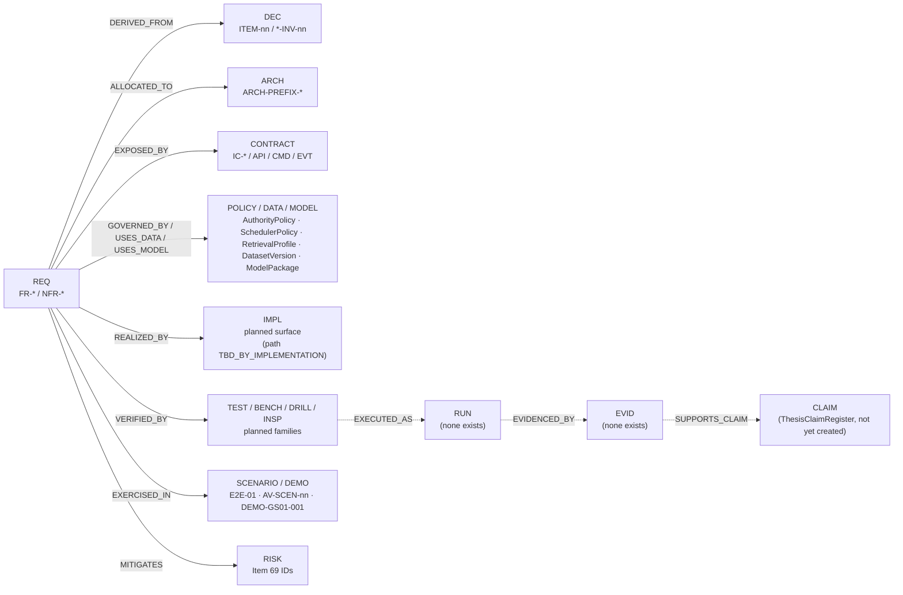
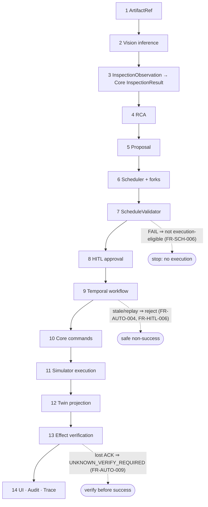
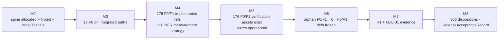

# 03 — Requirements Traceability Matrix
## Intelligent Manufacturing Operations Platform for Critical Aerospace Components — Requirement → Source Decision → Architecture → Planned Implementation → Verification → Future Evidence → Claim

| Field | Value |
|---|---|
| Document | `03_Requirements_Traceability_Matrix.md` |
| Status | **Draft — Derived from Approved 01/02 Baseline** (not approved; requires team review per §19) |
| Version | v0.1.0-draft |
| Generated | 17 Eylül 2026 (pre-implementation) |
| Normative baseline | `01_Master_Project_Specification.md` (Approved, baseline 13 Eylül 2026) — Items 81/82/83 primary |
| Architecture baseline | `02_System_Architecture_Specification.md` (Approved architecture baseline v1.0) |
| Production doctrine | `00_Downstream_Artifact_Production_Guide.md` §11 (File 03) |
| Semantic owner of requirement semantics / architecture trace coherence | Asrın (Item 83 #120) |
| Owner of trace registry tooling, CI validation, report generation | Yavuz (Item 83 #121) — not universal RTM secretary (#123) |
| Owners of per-requirement mapping correctness | Each requirement PrimaryOwner (Item 83 #122) |
| Evidence posture | No TestRun, BenchmarkRun, EvidenceID, observed metric or VERIFIED state exists or is claimed in this document |
| Machine-readable companion | `03_traceability/` (schema, planned edges, CSV/JSON exports) — generated from the same model as this file |

> **Reading rule.** This document is a *traceability index*, not a second requirement catalog. It references RequirementIDs and never restates SHALL text (Item 81 §163, Item 83 #2, RTM-INV-02). For wording, open the catalog anchor given in View A.


> **WP-GOV-001 implementation delta (2026-10-15).** Historical pre-implementation
> summaries below remain baseline snapshots. The eight WP-GOV-001 source records
> now reference real implementation and concrete test assets (§19.1), with local
> execution recorded under `evidence/WP-GOV-001/`. Their evidence is EVIDENCE_PENDING;
> remote CI, independent review and post-merge validation remain outstanding.
> No sealed EvidenceID, accepted measurement or VERIFIED state is asserted.

> **WP-CICD-001 implementation delta (2026-10-21).** NFR-DX-006 now references
> the tiered CI workflow, the flaky-test quarantine registry and concrete
> verification assets (§19.2); local execution is recorded under
> `evidence/WP-CICD-001/`. Its evidence is EVIDENCE_PENDING. FR-PLAT-004 stays
> VERIFY_PLANNED: CI is its first half; deployment to INTEGRATION is WP-CICD-002.
> Remote CI, branch protection (blocked by the private-repository plan) and
> post-merge validation remain outstanding. No VERIFIED state is asserted.

> **WP-PLAT-002 implementation delta (2026-10-23).** FR-PLAT-003 now references
> the `mfgctl` CLI in `tools/mfgctl/` and its command-contract tests (§19.3);
> NFR-DX-001 and NFR-DX-002 reference the doctor/check timing instrumentation.
> The shared-host development run is recorded under `evidence/WP-PLAT-002/`;
> evidence is EVIDENCE_PENDING. Profile, smoke and scenario commands are wired
> to the `mfgctl.capabilities/v1` registry contract whose real instance arrives
> with WP-PLAT-001 (DEP-003), so NFR-DX-003 and NFR-DX-004 stay VERIFY_PLANNED.
> The documented HardwareProfile is still open (Item 82): no accepted
> measurement, sealed EvidenceID or VERIFIED state is asserted.

> **WP-OBS-001 implementation delta (2026-10-23).** FR-PLAT-006 now references
> the OTel Collector → OpenObserve stack in `infra/observability/` and its REAL
> integration smoke (§19.4); NFR-OBS-001 and NFR-OBS-002 reference the
> `cap.health/v1` and `cap.log/v1` contracts, the `configure()`/`health_report()`
> helpers in `packages/observability/` and the CI coverage check over the nine
> mandatory deployables. The shared-host run is recorded under
> `evidence/WP-OBS-001/`; evidence is EVIDENCE_PENDING. Coverage is measured,
> not yet met: three of nine deployables exist and their adoption is pending, so
> `observed` stays null. No accepted measurement, sealed EvidenceID or VERIFIED
> state is asserted.

> **WP-PLAT-001 implementation delta (2026-10-24).** FR-PLAT-001 and FR-PLAT-002
> now reference the canonical Compose definition in `infra/compose/` with the
> eight 02 runtime profiles and its `infra` layer (PostgreSQL, NATS JetStream,
> Valkey, SeaweedFS, Keycloak), validated by TEST-PLAT-COMPOSE assets (§19.5);
> `infra/mfgctl/capabilities.json` instantiates the mfgctl registry contract.
> NFR-DEP-002 references the startup-to-healthy instrumentation; the shared-host
> run is recorded under `evidence/WP-PLAT-001/` as a DEV observation of the
> `infra` profile only. Application deployables join the profiles as they become
> runnable services, so FR-PLAT-001's full composition and the Integration
> profile remain open; evidence is EVIDENCE_PENDING and `observed` stays null.

> **WP-TEST-001 implementation delta (2026-10-24).** NFR-DX-006 now also
> references the machine-checked test strategy `ci/test-strategy.json`
> (`cap.test-strategy/v1`): six tiers with their CI job and allowed boundary
> modes (§4.5), the TestID convention and every test suite of the repository.
> `ci/scripts/check_test_strategy.py` runs in t1-unit and fails on an untracked
> test file, a run outside its tier's CI job or a disallowed boundary mode
> (§19.6). The shared-host run is recorded under `evidence/WP-TEST-001/`.
> The release-gate zero count of NFR-DX-006 is measured at the final gates
> (WP-TEST-008); evidence stays EVIDENCE_PENDING and `observed` stays null.

> **WP-OBJ-001 implementation delta (2026-10-25).** NFR-DATA-001 now references
> the artifact store in `packages/artifacts/` (§19.9): the `cap.artifact-ref/v1`
> ArtifactReference contract (IC-SHARED-001), SHA-256 content identity verified
> when an artifact version is finalized and on every read, write-once versions
> held in a PostgreSQL registry, a bidirectional consistency sweep, least-privilege
> S3 identities and short-lived read capabilities. The shared-host run is recorded
> under `evidence/WP-OBJ-001/`. The 100% measurement over final critical artifacts
> is an EVALUATION gate and FR-VIS-001 is accepted on the integrated Vision path
> (E2E-01, AV-SCEN-01), so evidence stays EVIDENCE_PENDING and `observed` stays null.

> **WP-GOV-002 implementation delta (2026-10-25).** The trace graph of §4 now
> also exists as data: `traceability/trace_edges.yaml` (`cap.trace-registry/v1`,
> schema `traceability/trace_schema.json`) holds the 306 requirement nodes and
> their edges, seeded from the §17 records, which stay the source: a PR that
> changes §17 runs `mfgctl trace seed`, and CI fails on drift. The trace linter
> (`tools/trace`, `cap_trace`) runs the §18.1 checks TL-01…TL-13 in t1-unit,
> including FR-GOV-004/005 completeness, NFR-GOV-009 (no VERIFIED without
> durable evidence) and the PR Requirement-Impact declaration; views are
> generated under `traceability/generated/` (§19.10). The shared-host run is
> recorded under `evidence/WP-GOV-002/`. INSP-GOV-ACCEPT belongs to the
> EVALUATION gate (WP-GOV-003); evidence stays EVIDENCE_PENDING.

---

## Table of Contents

- 1. Purpose and Independent Engineering Value
- 2. Canonical Sources, Precedence and Non-Goals
- 3. Baseline Machine Check (306 = 186 + 120)
- 4. Trace Model: Nodes, Relations, States, Evidence Semantics
- 5. Identity Namespaces Used (Existing vs Derived)
- 6. View A — Requirement Master Index
- 7. View B — Architecture Allocation
- 8. View C — Planned Implementation Coverage
- 9. View D — Verification Design Coverage (+ Verification Asset Registry)
- 10. View E — Evidence Coverage
- 11. View F — F0 Integrated Coverage and GS-01 Trace
- 12. View G — NFR Measurement View
- 13. View H — Research Claim Trace
- 14. View I — Orphans, Gaps and Source Conflicts
- 15. Milestone Coverage Gate Projection
- 16. Supporting Views: Scenario Coverage, Staleness Triggers, Risk Hooks, Ownership Load
- 17. Requirement Trace Records (Edge-Level Projection)
- 18. Machine-Readable Companion and Trace Tooling Design
- 19. RTM Maintenance Protocol
- 20. Rejected Alternatives
- 21. Item 83 Success-Criteria Conformance
- 22. Source-Fidelity and Internal-Consistency Audit

---

## 1. Purpose and Independent Engineering Value

Item 83 defines traceability as a graph whose matrices are generated views. This file is the first human-readable projection of that graph for all 306 normative requirements *before implementation starts*. Its engineering value, independent of 01 and 02, is:

| Question this RTM answers | Where |
|---|---|
| Which approved decisions/invariants does each requirement derive from (DERIVED_FROM)? | View A, §17 |
| Which 02 architecture components realize it, and where is the allocation only coarse? | View B, View I |
| Which implementation surface is planned (without inventing repo paths)? | View C |
| Which planned verification asset families will prove it, at which boundary realism and evidence maturity? | View D, View E |
| Does every F0 capability appear on a real integrated path, and what does GS-01 prove vs not prove? | View F |
| For every NFR: class, metric, threshold, WorkloadProfile, HardwareProfile, mechanism — with observed value explicitly absent? | View G |
| Which benchmarks and requirement families feed each RQ / major claim? | View H |
| What is unresolved, conflicting or at risk of blocking M4/M5/M6? | View I, §15 |
| Which requirements become STALE when a model/corpus/policy/workflow/hardware changes? | §16.2 |
| What must the trace registry tooling validate from day one? | §18 |

What it is **not**: not a requirement catalog, not an architecture restatement, not a WBS, not a dependency graph (05), not evidence. Trace completeness here is planning completeness; it cannot mark anything VERIFIED (RTM-INV-46, FR-GOV-010).

## 2. Canonical Sources, Precedence and Non-Goals

| Rank | Source | Authority used in this RTM |
|---|---|---|
| 1 | 01 Items 81 / 82 | Requirement identity, class, PrimaryOwner, verification codes (FR), acceptance-evidence codes (FR), NFR class/threshold semantics |
| 1 | 01 Item 83 | Node types, controlled relation vocabulary, coverage states, orphan classes, milestone gates, evidence maturity, boundary modes, focused-view list |
| 1 | 01 Items 03–80, 84, 85 | Originating decisions and invariants (DERIVED_FROM targets); AV-SCEN set (84); FBC-01 lanes (79); milestones (65); dependency statements (66); risks (69) |
| 2 | 02 Requirements Traceability Interface | ARCH-<PREFIX>-* registry (80 IDs) — the only ALLOCATED_TO targets used |
| 2 | 02 Service Catalog / Contract Registry | Deployable names, IC-* contract namespaces, canonical producer rules |
| 2 | 02 Reconciliation Register (R-001…R-009), Open Decisions (OD-*) | Latest-refinement readings; open implementation details referenced, never resolved here |
| 3 | 00 Production Guide §3, §7, §8, §11 | Artifact structure, honesty statuses, namespace conventions for derived IDs |
| 4 | This document | Derived Planning Detail only: verification family IDs, GAP-RTM-*, trace records, gate projection |

**Conflict rule applied.** Where 00 and 01 differ (e.g., trace-state vocabulary), 01 controls and the difference is recorded as a finding (GAP-RTM-011), not silently merged. Where 01 early/late Items differ, the 02 Reconciliation Register reading is used (latest approved refinement, 00 §2.2).

**Non-goals.** No new requirement, capability, technology, authority, owner, milestone meaning, benchmark sample size or claim is introduced. Final technology baseline is taken as settled (Python-first + TypeScript frontend, PostgreSQL, Qdrant, NATS JetStream, Temporal, SeaweedFS, Keycloak, Valkey optional, OTel + Collector + OpenObserve, MLflow support, OR-Tools CP-SAT, custom deterministic Python DES, Docker/Compose, GitHub Actions + GHCR). No cloud/Kubernetes requirement exists (NFR-DEP-006). Claims remain bounded to a simulated/research-scale critical-component manufacturing operational environment.

## 3. Baseline Machine Check (306 = 186 + 120)

Performed programmatically against the 01 catalog tables/headings (Item 81 L169637–L170798, Item 82 L170799–L173479) and cross-checked against the 02 projection.

| Check | Expected | Observed | Result |
|---|---|---|---|
| FR count | 186 | 186 | MATCH |
| NFR count | 120 | 120 | MATCH |
| Total normative requirements | 306 | 306 | MATCH |
| Unique IDs | 306 | 306 | MATCH |
| Duplicate IDs | 0 | 0 | PASS |
| Numbering gaps inside domains | 0 | 0 | PASS |
| FR class split F0/F1/R1 | — | 17 / 159 / 10 | RECORDED |
| NFR class split H0/A1/S2/C3 | — | 52 / 41 / 23 / 4 | RECORDED |
| Invalid PrimaryOwner (not Asrın/Selman/Batu/Yavuz) | 0 | 0 | PASS |
| Requirements with >1 PrimaryOwner | 0 | 0 (2 NFRs carry compound wording that resolves to one PrimaryOwner → GAP-RTM-017) | PASS w/ note |
| FR/NFR IDs referenced in 01 or 02 that do not exist | 0 | 0 | PASS |
| 02 NFR class vs 01 class mismatches | 0 | 0 | PASS |
| 02 NFR projection completeness | 120 rows | 120 unique rows after CTRL-DOC-005 / CHG-016 (previous actual113; historical finding stated110); seven missing governance projections and nine owner cells repaired | INFO → GAP-RTM-018 |
| FR domain counts vs Item 81 count table | 16 domains | 16 domains, all counts equal | PASS |
| NFR domain counts vs Item 82 count table | 13 domains | 13 domains, all counts equal | PASS |

### 3.1 FR distribution

| Prefix | Domain | Total | F0 | F1 | R1 | Asrın | Selman | Batu | Yavuz |
|---|---|---|---|---|---|---|---|---|---|
| FR-GOV | Requirement Governance | 10 | 0 | 10 | 0 | 7 | 0 | 0 | 3 |
| FR-CORE | Manufacturing Core | 16 | 2 | 14 | 0 | 16 | 0 | 0 | 0 |
| FR-SIM | Operational Simulator | 14 | 2 | 12 | 0 | 0 | 0 | 14 | 0 |
| FR-TWIN | Operational Digital Twin | 10 | 1 | 9 | 0 | 10 | 0 | 0 | 0 |
| FR-EVT | Event & Integration Contracts | 10 | 1 | 9 | 0 | 8 | 0 | 0 | 2 |
| FR-VIS | Vision / Inspection Intelligence | 16 | 2 | 14 | 0 | 0 | 16 | 0 | 0 |
| FR-ML | Predictive ML | 8 | 0 | 8 | 0 | 8 | 0 | 0 | 0 |
| FR-RAG | Documentary RAG | 10 | 0 | 10 | 0 | 10 | 0 | 0 | 0 |
| FR-AI | Operational AI / RCA | 13 | 2 | 11 | 0 | 13 | 0 | 0 | 0 |
| FR-SCH | Scheduling / Optimization | 15 | 2 | 13 | 0 | 0 | 0 | 15 | 0 |
| FR-AUTO | Durable Automation | 14 | 2 | 12 | 0 | 0 | 0 | 14 | 0 |
| FR-HITL | HITL / Authority | 10 | 1 | 9 | 0 | 8 | 0 | 0 | 2 |
| FR-UI | Command Center / Frontend | 10 | 1 | 9 | 0 | 6 | 1 | 2 | 1 |
| FR-PLAT | Platform / Runtime | 10 | 1 | 9 | 0 | 0 | 0 | 0 | 10 |
| FR-SEC | Security Runtime | 10 | 0 | 10 | 0 | 2 | 0 | 0 | 8 |
| FR-EVAL | Research / Evaluation / Evidence (R1) | 10 | 0 | 0 | 10 | 4 | 0 | 0 | 6 |
| **Σ** |  | 186 | 17 | 159 | 10 | 92 | 17 | 45 | 32 |

### 3.2 NFR distribution

| Prefix | Domain | Total | H0 | A1 | S2 | C3 | Asrın | Selman | Batu | Yavuz |
|---|---|---|---|---|---|---|---|---|---|---|
| NFR-GOV | NFR Governance | 10 | 10 | 0 | 0 | 0 | 6 | 0 | 0 | 4 |
| NFR-PERF | Performance / Latency | 14 | 0 | 4 | 9 | 1 | 8 | 2 | 3 | 1 |
| NFR-CAP | Capacity / Throughput | 10 | 0 | 6 | 3 | 1 | 1 | 0 | 6 | 3 |
| NFR-REL | Reliability / Resilience | 10 | 3 | 7 | 0 | 0 | 2 | 0 | 2 | 6 |
| NFR-REC | Recoverability / Durability | 10 | 4 | 3 | 3 | 0 | 2 | 0 | 0 | 8 |
| NFR-SEC | Security / Privacy | 12 | 10 | 2 | 0 | 0 | 2 | 0 | 0 | 10 |
| NFR-OBS | Observability / Auditability | 9 | 3 | 5 | 1 | 0 | 0 | 0 | 0 | 9 |
| NFR-REP | Reproducibility / Determinism | 9 | 5 | 3 | 0 | 1 | 2 | 0 | 1 | 6 |
| NFR-RES | Resource Efficiency | 8 | 2 | 5 | 0 | 1 | 0 | 0 | 0 | 8 |
| NFR-DEP | Deployability / Portability | 6 | 3 | 2 | 1 | 0 | 0 | 0 | 0 | 6 |
| NFR-DX | Maintainability / DX | 8 | 1 | 1 | 6 | 0 | 0 | 0 | 0 | 8 |
| NFR-DATA | Data / Evidence Quality | 8 | 8 | 0 | 0 | 0 | 3 | 0 | 0 | 5 |
| NFR-UX | Usability / Human Decision Quality | 6 | 3 | 3 | 0 | 0 | 6 | 0 | 0 | 0 |
| **Σ** |  | 120 | 52 | 41 | 23 | 4 | 32 | 2 | 12 | 74 |

**Acceptance denominators derived from the check** (Item 83 Final Acceptance Rules #130–#136): active F0 = 17 must be VERIFIED; active F1 = 159 must be VERIFIED; R1 = 10 must be VERIFIED; H0 = 52 must PASS; A1 = 41 must PASS (unless formally rebaselined); S2 = 23 must be measured with PASS/MISS; C3 = 4 must be measured. No active mandatory requirement may remain UNKNOWN at M8 (#137).

### 3.3 WP-GOV-001 generated catalog inventory

Source: `requirements/coverage_counts.json`; regenerate this block with
`projectctl catalog-export --artifact rtm-counts`. CI checks the catalog, schema,
JSON counts and this block against Items 81/82. These are inventory counts;
null canonical fields and pending NFR metadata remain source gaps.

<!-- WP-GOV-001:GENERATED-COUNTS:START -->
| Inventory (not verification coverage) | Count |
|---|---|
| Total / unique IDs | 306 / 306 |
| FR / NFR | 186 / 120 |
| FR F0 / F1 / R1 | 17 / 159 / 10 |
| NFR H0 / A1 / S2 / C3 | 52 / 41 / 23 / 4 |
| Missing canonical Revision / Status | 306 / 306 |
| Recorded retired/superseded IDs | 0 |
<!-- WP-GOV-001:GENERATED-COUNTS:END -->

## 4. Trace Model: Nodes, Relations, States, Evidence Semantics

### 4.1 Graph metamodel used by this RTM



Solid edges are populated in this Draft (planned). Dotted edges are structurally defined but intentionally empty: populating them before real execution would violate RTM-INV-68 ("Future EvidenceIDs are not fabricated").

### 4.2 Controlled relation vocabulary (Item 83 #23–#38) and population status

| Relation | From → To | Populated in this Draft | Constraint |
|---|---|---|---|
| DERIVED_FROM | REQ → DEC | Yes, all 306 | Item + invariant granularity; owner semantic confirmation pending (GAP-RTM-006) |
| ALLOCATED_TO | REQ → ARCH | Yes, all 306 | Only 02 registry IDs; coarse allocations flagged |
| DECIDED_BY | REQ → ADR | Partial (5 requirements carry edges) | ADR IDs minted in `docs/adr/` (ADR-0001…ADR-0013 by 02 backfill list position, CHG-029); edges reference `ADR-NNNN` — never counts as verification (RTM-INV-17) |
| EXPOSED_BY | REQ → CONTRACT | Where cross-service | IC-* namespaces from 02; exact schema versions TBD |
| REALIZED_BY | REQ → IMPL | Planned surface only | Repository path = TBD_BY_IMPLEMENTATION (00 §7.3) |
| USES_DATA / USES_MODEL / GOVERNED_BY | REQ → DATA/MODEL/POLICY | Artifact *types* | No DatasetVersion/ModelPackage IDs invented |
| EXERCISED_IN | REQ → SCENARIO | Yes (integrated scenarios) | Scenario metadata declares coverage, never expected answers (RTM-INV-31) |
| VERIFIED_BY | REQ → TEST/BENCH/DRILL/INSP | Yes, all 306 | Planned families; numeric TestIDs TBD (Item 83 open detail) |
| EXECUTED_AS | VER → RUN | No | Populated only by real runs |
| EVIDENCED_BY | REQ/RUN → EVID | No | Populated only by immutable EvidenceBundles |
| SUPPORTS_CLAIM | EVID → CLAIM | No | ClaimIDs belong to ThesisClaimRegister |
| MITIGATES | REQ → RISK | Derived hooks (§16.3) | Mitigation ≠ verification (Item 83 #96) |
| CARRIES_DEBT | REQ/IMPL → DEBT | No | No TechnicalDebtRecord exists; H0/A1 cannot carry debt (RTM-INV-39) |

### 4.3 State semantics — canonical coverage state vs planning overlay

Item 83 (#53–#61) defines the canonical per-requirement **CoverageState**; 00 §11 proposes pre-implementation planning states. They are not identical (e.g., Item 83 `VERIFY_PLANNED` means "verification asset exists"; no asset exists yet). To avoid a false-green reading, this RTM keeps three separate fields:

| Field | Vocabulary | Source | Current value for all 306 |
|---|---|---|---|
| CoverageState (canonical, derived) | UNALLOCATED · ALLOCATED · IMPLEMENTED · VERIFY_PLANNED · EVIDENCE_PENDING · VERIFIED · FAILED · STALE · SUPERSEDED | Item 83 | `ALLOCATED` (architecture surface exists in 02; no implementation or asset exists) |
| PlanningState (overlay) | UNALLOCATED · ALLOCATED · IMPLEMENTATION_PLANNED · VERIFY_PLANNED · EVIDENCE_PENDING · BLOCKED · SUPERSEDED | 00 §11 | `VERIFY_PLANNED` = allocation + planned surface + verification *design* declared here; suffix `(ALLOC-COARSE)` where allocation is coarse |
| EvidenceState | NOT_YET_EXECUTED · EVIDENCE_PENDING · CURRENT · STALE · SUPERSEDED · NOT_APPLICABLE | 00 §7.3 + Item 83 EvidenceApplicability | `NOT_YET_EXECUTED` |

```mermaid
stateDiagram-v2
  [*] --> UNALLOCATED
  UNALLOCATED --> ALLOCATED: ALLOCATED_TO edge exists
  ALLOCATED --> IMPLEMENTED: REALIZED_BY resolves to real repo artifact (M4)
  IMPLEMENTED --> VERIFY_PLANNED: verification asset exists in repo (M5)
  VERIFY_PLANNED --> EVIDENCE_PENDING: asset runs, acceptable final evidence absent
  EVIDENCE_PENDING --> VERIFIED: sufficient CURRENT evidence (class-aware)
  EVIDENCE_PENDING --> FAILED: required verification failed
  VERIFIED --> STALE: material behavior/model/data/policy/hardware change
  STALE --> EVIDENCE_PENDING: re-verification planned
  ALLOCATED --> SUPERSEDED: approved change control
  note right of ALLOCATED: All 306 requirements are here today
```



### 4.4 Verification sufficiency rules applied per class (Item 83 "Verification Sufficiency by Requirement Class", #63–#69)

| Class | Minimum for final disposition | Enforced in this Draft by |
|---|---|---|
| F0 | implementation + local/component verification + ≥1 REAL integrated acceptance path + final evidence (EV-L3+) | Audit: every F0 has ≥1 SCENARIO/DEMO family (§22 check C-07) |
| F1 | implementation + appropriate verification + final evidence; E2E only where the catalog verify code includes E | Audit: code E→integrated asset, B→BENCH, R→DRILL/restart test, N→negative asset, D→DEMO, I→inspection/lint (C-08…C-13) |
| R1 | reproducible research mechanism + final research evidence (EV-L5) | All FR-EVAL mapped to BENCH-FBC-001 + inspection/restore assets |
| H0 | hard/negative evidence; happy path insufficient; PASS required | Audit: every H0 has ≥1 TEST/DRILL/SCENARIO (not inspection-only) (C-14) |
| A1 | measured threshold PASS in correct HardwareProfile/WorkloadProfile/Environment | View G binds HP/WP per NFR |
| S2 | measured PASS or MISS; MISS is valid evidence, never trace failure | View G disposition column allows MISS |
| C3 | measured characterization; absence of threshold ≠ absence of evidence | View G mechanism mandatory |

### 4.5 Evidence maturity, environment class and boundary mode

| Level | Meaning | Typical use in this RTM |
|---|---|---|
| EV-L1 | Development (local) | Onboarding walk-through only (NFR-DX-005) |
| EV-L2 | CI (protected pipeline) | Deterministic local rules: schema, state machine, idempotency, lint |
| EV-L3 | Integration (shared host) | F0 integrated paths, drills, browser E2E |
| EV-L4 | Formal Evaluation | Performance/capacity/resilience measurements, GS-01 demo run |
| EV-L5 | Sealed Final (EvidenceSeal) | RQ lanes, final Vision/ML/Scheduler/Automation lanes, final analysis |

Boundary modes (Item 83 #113–#114): `REAL` · `FIXTURE_ALLOWED` · `STUB_ALLOWED` · `MOCK_ONLY`. The value in View D is the **mode required for final acceptance evidence**; lower layers may use fixtures (TEST-INV-05, E2E-INV-27). No requirement in this RTM is final-verifiable with `MOCK_ONLY`.

Evidence environment classes (Item 83 #70): DEV · CI · INTEGRATION · EVALUATION · DEMO · PUBLIC_REPRO. DEMO evidence never substitutes EVALUATION evidence (RTM-INV-22, EXP-INV-28).
## 5. Identity Namespaces Used (Existing vs Derived)

| Namespace | Status | Origin | Use here |
|---|---|---|---|
| FR-<DOMAIN>-NNN, NFR-<DOMAIN>-NNN | EXISTING (normative) | 01 Items 81/82 | Requirement nodes; never recycled |
| ITEM-nn | EXISTING (decision reference) | 01 Item numbering; Item 83 #5 example `ITEM-23` | DERIVED_FROM targets; Item 43 treated as one logical item (02 R-001) |
| <FAMILY>-INV-nn (e.g., AUTH-INV-08, SCH-INV-11) | EXISTING | 01 domain invariant catalogs | DERIVED_FROM targets; every cited ID machine-verified to exist in 01 (strict boundary match) |
| ARCH-<PREFIX>-<COMPONENT> | EXISTING | 02 Architecture Component ID Registry (80 IDs) | ALLOCATED_TO targets; no ID added by this RTM |
| IC-VIS/AI/SCH/AUTO/SHARED-nnn | EXISTING (namespace) | 02 Conceptual Contract Catalog | EXPOSED_BY targets; exact schema versions TBD |
| E2E-01, AV-SCEN-01…12, RV-01…15, V-MICRO-01…06, GS-01, FBC-01, ENG-A…I | EXISTING | 01 Items 67, 84, 57, 07, 79 | Scenario / lane identities |
| BENCH-RQ1-001, BENCH-RQ2-001, RES-BROKER-001, RESTORE-HOST-001, DEMO-GS01-001, TEST-AUTO-RESTART-001 | EXISTING (Item 83 exemplar identities) | 01 Item 83 TestID Standard | Adopted verbatim as planned formal identities |
| TEST-<DOMAIN>-<SUITE>, BENCH-<LANE>-*, RES-*, RESTORE-*, INSP-*, REPRO-* | DERIVED PLANNING DETAIL | This RTM (00 §3.1 allows planned TestID placeholder families) | Planned verification families; one family may map to many test functions (Item 83 #40); numeric allocation TBD_BY_IMPLEMENTATION |
| <AREA>-Rnn (ARCH-R01, AUTO-R04, …) | EXISTING | 01 Item 69 Risk Register | MITIGATES hook targets (priority not restated) |
| OD-*, R-001…R-009 | EXISTING | 02 Open Decisions / Reconciliation Register | Referenced, never resolved |
| GAP-RTM-nnn | DERIVED (document-local) | This RTM | Findings register (View I) |
| ADR-NNNN | EXISTING | `docs/adr/README.md` (CHG-029) | Minted ADR identity (ADR-0001…ADR-0013 backfill set); replaces the former `ADR:backfill-NN` placeholder reference |

**Namespace hazards:** `WP-*` (Item 82 workload profiles) versus WBS work-package IDs was recorded as GAP-RTM-013 and is resolved by convention in 04 (full-pattern parsing `WP-[A-Z0-9]+-[0-9]{3}`; profiles carry no numeric suffix); `CP-SMALL/NORMAL/STRESS` (Item 51) vs `CP-1/2/3` critical paths (GAP-RTM-014); `RES-*` drills vs `NFR-RES-*` vs `RES-INV-*`, and 01 Item 34 two-digit `ARCH-INV-nn` vs 02 global three-digit `ARCH-INV-nnn` (GAP-RTM-016). This RTM cites only 01 two-digit `ARCH-INV-04` and avoids 02's global sequence in DERIVED_FROM.

## 6. View A — Requirement Master Index

Columns: **Catalog anchor** = location of canonical wording (open it; wording is not copied). **Source decisions** = DERIVED_FROM set. **Flags** = open findings touching the row. Coverage/Planning/Evidence states per §4.3 (uniform today: `ALLOCATED` / `VERIFY_PLANNED` / `NOT_YET_EXECUTED`; exceptions shown).

### 6.FA FR-GOV — Requirement Governance (10)

| ID | Class | PrimaryOwner | Catalog anchor | Source decisions (DERIVED_FROM) | Planning state | Flags |
|---|---|---|---|---|---|---|
| FR-GOV-001 | F1 | Asrın | 01 Item81 FR-GOV-001 L169832 | ITEM-81, FRC-INV-01, RTM-INV-03 | EVIDENCE_PENDING | — |
| FR-GOV-002 | F1 | Asrın | 01 Item81 FR-GOV-002 L169833 | ITEM-81, FRC-INV-02, NFR-INV-01 | EVIDENCE_PENDING | — |
| FR-GOV-003 | F1 | Asrın | 01 Item81 FR-GOV-003 L169834 | ITEM-81, ITEM-62, FRC-INV-05, RESP-INV-01 | EVIDENCE_PENDING | — |
| FR-GOV-004 | F1 | Asrın | 01 Item81 FR-GOV-004 L169835 | ITEM-81, ITEM-83, FRC-INV-06, RTM-INV-05 | VERIFY_PLANNED (ALLOC-COARSE) | ALLOC-COARSE |
| FR-GOV-005 | F1 | Yavuz | 01 Item81 FR-GOV-005 L169836 | ITEM-81, ITEM-83, FRC-INV-07, RTM-INV-08 | VERIFY_PLANNED | — |
| FR-GOV-006 | F1 | Yavuz | 01 Item81 FR-GOV-006 L169837 | ITEM-81, ITEM-83, FRC-INV-08, RTM-INV-68 | VERIFY_PLANNED | — |
| FR-GOV-007 | F1 | Asrın | 01 Item81 FR-GOV-007 L169838 | ITEM-81, ITEM-73, FRC-INV-25, FRC-INV-26 | VERIFY_PLANNED | — |
| FR-GOV-008 | F1 | Asrın | 01 Item81 FR-GOV-008 L169839 | ITEM-81, ITEM-68, FRC-INV-13, SCOPE-INV-01 | EVIDENCE_PENDING | — |
| FR-GOV-009 | F1 | Yavuz | 01 Item81 FR-GOV-009 L169840 | ITEM-83, RTM-INV-01, RTM-INV-45 | VERIFY_PLANNED | — |
| FR-GOV-010 | F1 | Asrın | 01 Item81 FR-GOV-010 L169841 | ITEM-81, ITEM-83, FRC-INV-09, RTM-INV-46 | VERIFY_PLANNED | — |

### 6.FB FR-CORE — Manufacturing Core (16)

| ID | Class | PrimaryOwner | Catalog anchor | Source decisions (DERIVED_FROM) | Planning state | Flags |
|---|---|---|---|---|---|---|
| FR-CORE-001 | F0 | Asrın | 01 Item81 FR-CORE-001 L169849 | ITEM-08, ITEM-09, ITEM-15, WL-INV-01, ITEM-68 | VERIFY_PLANNED | — |
| FR-CORE-002 | F0 | Asrın | 01 Item81 FR-CORE-002 L169850 | ITEM-08, ITEM-09, ITEM-68, DATA-INV-05 | VERIFY_PLANNED | — |
| FR-CORE-003 | F1 | Asrın | 01 Item81 FR-CORE-003 L169851 | ITEM-09, ITEM-15, BE-INV-01, WL-INV-06, WL-INV-07 | VERIFY_PLANNED | — |
| FR-CORE-004 | F1 | Asrın | 01 Item81 FR-CORE-004 L169852 | ITEM-15, ITEM-22, BE-INV-07, INT-INV-07 | VERIFY_PLANNED | — |
| FR-CORE-005 | F1 | Asrın | 01 Item81 FR-CORE-005 L169853 | ITEM-15, ITEM-36, BE-INV-04, EVTINF-INV-05 | VERIFY_PLANNED | — |
| FR-CORE-006 | F1 | Asrın | 01 Item81 FR-CORE-006 L169854 | ITEM-15, ITEM-18, INT-INV-08, AUTO-INV-03 | VERIFY_PLANNED | — |
| FR-CORE-007 | F1 | Asrın | 01 Item81 FR-CORE-007 L169855 | ITEM-09, ITEM-15, ITEM-23, WL-INV-06 | VERIFY_PLANNED | CONTRACT-RECON |
| FR-CORE-008 | F1 | Asrın | 01 Item81 FR-CORE-008 L169856 | ITEM-09, ITEM-24, HITL-INV-03 | VERIFY_PLANNED | — |
| FR-CORE-009 | F1 | Asrın | 01 Item81 FR-CORE-009 L169857 | ITEM-09, WL-INV-04, WL-INV-05, KG-INV-04 | VERIFY_PLANNED | — |
| FR-CORE-010 | F1 | Asrın | 01 Item81 FR-CORE-010 L169858 | ITEM-09, WL-INV-02, WL-INV-03 | VERIFY_PLANNED | — |
| FR-CORE-011 | F1 | Asrın | 01 Item81 FR-CORE-011 L169859 | ITEM-09, WL-INV-02, WL-INV-03 | VERIFY_PLANNED | — |
| FR-CORE-012 | F1 | Asrın | 01 Item81 FR-CORE-012 L169860 | ITEM-25, KG-INV-05, KG-INV-16, WL-INV-04 | VERIFY_PLANNED | — |
| FR-CORE-013 | F1 | Asrın | 01 Item81 FR-CORE-013 L169861 | ITEM-13, ITEM-34, ITEM-35, DA-INV-03, DB-INV-02, INT-INV-01 | VERIFY_PLANNED | — |
| FR-CORE-014 | F1 | Asrın | 01 Item81 FR-CORE-014 L169862 | ITEM-12, ITEM-15, EV-INV-10, BE-INV-03 | VERIFY_PLANNED | — |
| FR-CORE-015 | F1 | Asrın | 01 Item81 FR-CORE-015 L169863 | ITEM-15, ITEM-36, EVTINF-INV-06, TECH-INV-10 | VERIFY_PLANNED | — |
| FR-CORE-016 | F1 | Asrın | 01 Item81 FR-CORE-016 L169864 | ITEM-22, ITEM-34, INT-INV-15, EV-INV-06 | VERIFY_PLANNED | — |

### 6.FC FR-SIM — Operational Simulator (14)

| ID | Class | PrimaryOwner | Catalog anchor | Source decisions (DERIVED_FROM) | Planning state | Flags |
|---|---|---|---|---|---|---|
| FR-SIM-001 | F0 | Batu | 01 Item81 FR-SIM-001 L169872 | ITEM-10, ITEM-68, ITEM-61, SCOPE-INV-01 | EVIDENCE_PENDING | — |
| FR-SIM-002 | F0 | Batu | 01 Item81 FR-SIM-002 L169873 | ITEM-10, ITEM-09, ITEM-68 | VERIFY_PLANNED | — |
| FR-SIM-003 | F1 | Batu | 01 Item81 FR-SIM-003 L169874 | ITEM-10, ITEM-57 | VERIFY_PLANNED | — |
| FR-SIM-004 | F1 | Batu | 01 Item81 FR-SIM-004 L169875 | ITEM-10, WL-INV-08 | VERIFY_PLANNED | — |
| FR-SIM-005 | F1 | Batu | 01 Item81 FR-SIM-005 L169876 | ITEM-10, ITEM-57 | VERIFY_PLANNED | — |
| FR-SIM-006 | F1 | Batu | 01 Item81 FR-SIM-006 L169877 | ITEM-10, WL-INV-05 | VERIFY_PLANNED | — |
| FR-SIM-007 | F1 | Batu | 01 Item81 FR-SIM-007 L169878 | ITEM-10, ITEM-60, EXP-INV-10 | EVIDENCE_PENDING | — |
| FR-SIM-008 | F1 | Batu | 01 Item81 FR-SIM-008 L169879 | ITEM-10, ITEM-60, TEST-INV-06 | VERIFY_PLANNED | — |
| FR-SIM-009 | F1 | Batu | 01 Item81 FR-SIM-009 L169880 | ITEM-10, ITEM-37, DT-INV-10 | VERIFY_PLANNED | — |
| FR-SIM-010 | F1 | Batu | 01 Item81 FR-SIM-010 L169881 | ITEM-10, ITEM-19, SCH-INV-10 | VERIFY_PLANNED | — |
| FR-SIM-011 | F1 | Batu | 01 Item81 FR-SIM-011 L169882 | ITEM-10, EV-INV-05, AUTO-INV-08, SEC-INV-20 | VERIFY_PLANNED | — |
| FR-SIM-012 | F1 | Batu | 01 Item81 FR-SIM-012 L169883 | ITEM-10, ITEM-36, EVTINF-INV-03, SEC-INV-18, DA-INV-04 | VERIFY_PLANNED | — |
| FR-SIM-013 | F1 | Batu | 01 Item81 FR-SIM-013 L169884 | ITEM-10, ITEM-19, ITEM-22, SCH-INV-02 | VERIFY_PLANNED | — |
| FR-SIM-014 | F1 | Batu | 01 Item81 FR-SIM-014 L169885 | ITEM-10, ITEM-22, INT-INV-14, SRE-INV-11 | VERIFY_PLANNED | — |

### 6.FD FR-TWIN — Operational Digital Twin (10)

| ID | Class | PrimaryOwner | Catalog anchor | Source decisions (DERIVED_FROM) | Planning state | Flags |
|---|---|---|---|---|---|---|
| FR-TWIN-001 | F0 | Asrın | 01 Item81 FR-TWIN-001 L169893 | ITEM-11, ITEM-68, DT-INV-09 | VERIFY_PLANNED | — |
| FR-TWIN-002 | F1 | Asrın | 01 Item81 FR-TWIN-002 L169894 | ITEM-11, DT-INV-01, DA-INV-02, ARCH-INV-04 | VERIFY_PLANNED | — |
| FR-TWIN-003 | F1 | Asrın | 01 Item81 FR-TWIN-003 L169895 | ITEM-11, DT-INV-03, INT-INV-04, UI-INV-04 | VERIFY_PLANNED | — |
| FR-TWIN-004 | F1 | Asrın | 01 Item81 FR-TWIN-004 L169896 | ITEM-11, DT-INV-07 | VERIFY_PLANNED | — |
| FR-TWIN-005 | F1 | Asrın | 01 Item81 FR-TWIN-005 L169897 | ITEM-11, EVTINF-INV-09, OBS-INV-11, UI-INV-13 | VERIFY_PLANNED | — |
| FR-TWIN-006 | F1 | Asrın | 01 Item81 FR-TWIN-006 L169898 | ITEM-11, ITEM-53, DB-INV-13, DR-INV-08 | VERIFY_PLANNED | — |
| FR-TWIN-007 | F1 | Asrın | 01 Item81 FR-TWIN-007 L169899 | ITEM-11, DT-INV-04, EV-INV-05 | VERIFY_PLANNED | — |
| FR-TWIN-008 | F1 | Asrın | 01 Item81 FR-TWIN-008 L169900 | ITEM-11, ITEM-34, DB-INV-05, ARCH-INV-04 | VERIFY_PLANNED | — |
| FR-TWIN-009 | F1 | Asrın | 01 Item81 FR-TWIN-009 L169901 | ITEM-11, INT-INV-07 | VERIFY_PLANNED | — |
| FR-TWIN-010 | F1 | Asrın | 01 Item81 FR-TWIN-010 L169902 | ITEM-07, ITEM-18, ITEM-84, RES-INV-15 | VERIFY_PLANNED | — |

### 6.FE FR-EVT — Event & Integration Contracts (10)

| ID | Class | PrimaryOwner | Catalog anchor | Source decisions (DERIVED_FROM) | Planning state | Flags |
|---|---|---|---|---|---|---|
| FR-EVT-001 | F0 | Asrın | 01 Item81 FR-EVT-001 L169910 | ITEM-22, ITEM-68, INT-INV-02, INT-INV-15 | EVIDENCE_PENDING | — |
| FR-EVT-002 | F1 | Asrın | 01 Item81 FR-EVT-002 L169911 | ITEM-12, EVTINF-INV-04 | VERIFY_PLANNED | — |
| FR-EVT-003 | F1 | Asrın | 01 Item81 FR-EVT-003 L169912 | ITEM-12, ITEM-47, BE-INV-09, OBS-INV-05 | VERIFY_PLANNED | — |
| FR-EVT-004 | F1 | Asrın | 01 Item81 FR-EVT-004 L169913 | ITEM-12, ITEM-84, SEC-INV-20, DX-INV-59 | VERIFY_PLANNED | — |
| FR-EVT-005 | F1 | Asrın | 01 Item81 FR-EVT-005 L169914 | ITEM-36, EV-INV-03, EVTINF-INV-05, TEST-INV-09 | EVIDENCE_PENDING | — |
| FR-EVT-006 | F1 | Asrın | 01 Item81 FR-EVT-006 L169915 | ITEM-22, ITEM-36, EV-INV-06 | EVIDENCE_PENDING | — |
| FR-EVT-007 | F1 | Asrın | 01 Item81 FR-EVT-007 L169916 | ITEM-13, ITEM-22, DA-INV-03, INT-INV-01, GIT-INV-02 | VERIFY_PLANNED | — |
| FR-EVT-008 | F1 | Asrın | 01 Item81 FR-EVT-008 L169917 | ITEM-22, INT-INV-03, EV-INV-08 | EVIDENCE_PENDING | — |
| FR-EVT-009 | F1 | Yavuz | 01 Item81 FR-EVT-009 L169918 | ITEM-36, EV-INV-07, EVTINF-INV-11, AUTO-INV-07 | VERIFY_PLANNED | — |
| FR-EVT-010 | F1 | Yavuz | 01 Item81 FR-EVT-010 L169919 | ITEM-36, ITEM-52, EVTINF-INV-10, SRE-INV-06, RES-INV-05 | VERIFY_PLANNED | — |

### 6.FF FR-VIS — Vision / Inspection Intelligence (16)

| ID | Class | PrimaryOwner | Catalog anchor | Source decisions (DERIVED_FROM) | Planning state | Flags |
|---|---|---|---|---|---|---|
| FR-VIS-001 | F0 | Selman | 01 Item81 FR-VIS-001 L169927 | ITEM-16, ITEM-37, ITEM-68, E2E-INV-05 | VERIFY_PLANNED | — |
| FR-VIS-002 | F1 | Selman | 01 Item81 FR-VIS-002 L169928 | ITEM-16, ITEM-30, CV-INV-01, CVEVAL-INV-01 | VERIFY_PLANNED | — |
| FR-VIS-003 | F1 | Selman | 01 Item81 FR-VIS-003 L169929 | ITEM-16, ITEM-30, CV-INV-01 | VERIFY_PLANNED | — |
| FR-VIS-004 | F1 | Selman | 01 Item81 FR-VIS-004 L169930 | ITEM-16, ITEM-30, CVEVAL-INV-05 | VERIFY_PLANNED | — |
| FR-VIS-005 | F1 | Selman | 01 Item81 FR-VIS-005 L169931 | ITEM-16, ITEM-30, CVEVAL-INV-06 | VERIFY_PLANNED | — |
| FR-VIS-006 | F1 | Selman | 01 Item81 FR-VIS-006 L169932 | ITEM-16, CV-INV-06, CVEVAL-INV-07, SYN-INV-28 | VERIFY_PLANNED | — |
| FR-VIS-007 | F1 | Selman | 01 Item81 FR-VIS-007 L169933 | ITEM-16, ITEM-17, CV-INV-05, VMLOPS-INV-02 | VERIFY_PLANNED | — |
| FR-VIS-008 | F1 | Selman | 01 Item81 FR-VIS-008 L169934 | ITEM-16, ITEM-30, ML-INV-06 | VERIFY_PLANNED | — |
| FR-VIS-009 | F1 | Selman | 01 Item81 FR-VIS-009 L169935 | ITEM-16, ITEM-22, ITEM-62 | VERIFY_PLANNED | CONTRACT-RECON |
| FR-VIS-010 | F1 | Selman | 01 Item81 FR-VIS-010 L169936 | ITEM-16, CV-INV-07 | VERIFY_PLANNED | — |
| FR-VIS-011 | F1 | Selman | 01 Item81 FR-VIS-011 L169937 | ITEM-17, ITEM-55, ITEM-56, VMLOPS-INV-03, SYN-INV-01 | VERIFY_PLANNED (ALLOC-COARSE) | ALLOC-COARSE |
| FR-VIS-012 | F1 | Selman | 01 Item81 FR-VIS-012 L169938 | ITEM-17, ITEM-45, VMLOPS-INV-01, MLOPS-INV-04, VMLOPS-INV-04 | VERIFY_PLANNED (ALLOC-COARSE) | ALLOC-COARSE |
| FR-VIS-013 | F1 | Selman | 01 Item81 FR-VIS-013 L169939 | ITEM-16, CV-INV-02, CVEVAL-INV-13, DATA-INV-20 | VERIFY_PLANNED | — |
| FR-VIS-014 | F1 | Selman | 01 Item81 FR-VIS-014 L169940 | ITEM-16, ITEM-74, DX-INV-35, LOCAL-INV-10 | VERIFY_PLANNED | — |
| FR-VIS-015 | F1 | Selman | 01 Item81 FR-VIS-015 L169941 | ITEM-17, ITEM-45, MLOPS-INV-07, ART-INV-09 | VERIFY_PLANNED | — |
| FR-VIS-016 | F0 | Selman | 01 Item81 FR-VIS-016 L169942 | ITEM-07, ITEM-67, ITEM-68, E2E-INV-05, E2E-INV-06 | VERIFY_PLANNED | — |

### 6.FG FR-ML — Predictive ML (8)

| ID | Class | PrimaryOwner | Catalog anchor | Source decisions (DERIVED_FROM) | Planning state | Flags |
|---|---|---|---|---|---|---|
| FR-ML-001 | F1 | Asrın | 01 Item81 FR-ML-001 L169950 | ITEM-27, ML-INV-02, ML-INV-12 | VERIFY_PLANNED (ALLOC-COARSE) | ALLOC-COARSE |
| FR-ML-002 | F1 | Asrın | 01 Item81 FR-ML-002 L169951 | ITEM-27, ML-INV-08 | VERIFY_PLANNED (ALLOC-COARSE) | ALLOC-COARSE |
| FR-ML-003 | F1 | Asrın | 01 Item81 FR-ML-003 L169952 | ITEM-27, ML-INV-09, ML-INV-10 | VERIFY_PLANNED (ALLOC-COARSE) | ALLOC-COARSE |
| FR-ML-004 | F1 | Asrın | 01 Item81 FR-ML-004 L169953 | ITEM-27, ITEM-22, INT-INV-04 | VERIFY_PLANNED | — |
| FR-ML-005 | F1 | Asrın | 01 Item81 FR-ML-005 L169954 | ITEM-27, ITEM-45, MLOPS-INV-08, INT-INV-07 | VERIFY_PLANNED | — |
| FR-ML-006 | F1 | Asrın | 01 Item81 FR-ML-006 L169955 | ITEM-27, ML-INV-06, MLOPS-INV-11 | VERIFY_PLANNED | — |
| FR-ML-007 | F1 | Asrın | 01 Item81 FR-ML-007 L169956 | ITEM-27, ITEM-45, ITEM-46, DA-INV-10, DATA-INV-24 | VERIFY_PLANNED (ALLOC-COARSE) | ALLOC-COARSE |
| FR-ML-008 | F1 | Asrın | 01 Item81 FR-ML-008 L169957 | ITEM-27, ITEM-60, MLOPS-INV-09, EXP-INV-04, ML-INV-04 | VERIFY_PLANNED (ALLOC-COARSE) | ALLOC-COARSE |

### 6.FH FR-RAG — Documentary RAG (10)

| ID | Class | PrimaryOwner | Catalog anchor | Source decisions (DERIVED_FROM) | Planning state | Flags |
|---|---|---|---|---|---|---|
| FR-RAG-001 | F1 | Asrın | 01 Item81 FR-RAG-001 L169965 | ITEM-26, RAG-INV-02, RAG-INV-12 | VERIFY_PLANNED | — |
| FR-RAG-002 | F1 | Asrın | 01 Item81 FR-RAG-002 L169966 | ITEM-26, RAG-INV-01, TECH-INV-06, DATA-INV-21 | VERIFY_PLANNED | — |
| FR-RAG-003 | F1 | Asrın | 01 Item81 FR-RAG-003 L169967 | ITEM-26, ITEM-61, RAG-INV-05 | VERIFY_PLANNED | — |
| FR-RAG-004 | F1 | Asrın | 01 Item81 FR-RAG-004 L169968 | ITEM-26, ITEM-61 | VERIFY_PLANNED | — |
| FR-RAG-005 | F1 | Asrın | 01 Item81 FR-RAG-005 L169969 | ITEM-26, ITEM-61, TECH-INV-06 | VERIFY_PLANNED | — |
| FR-RAG-006 | F1 | Asrın | 01 Item81 FR-RAG-006 L169970 | ITEM-26, RAG-INV-07, AIEVAL-INV-05 | VERIFY_PLANNED | — |
| FR-RAG-007 | F1 | Asrın | 01 Item81 FR-RAG-007 L169971 | ITEM-26, ITEM-55, RAG-INV-11 | VERIFY_PLANNED | — |
| FR-RAG-008 | F1 | Asrın | 01 Item81 FR-RAG-008 L169972 | ITEM-26, RAG-INV-09, RAG-INV-10, AUTH-INV-10 | VERIFY_PLANNED | — |
| FR-RAG-009 | F1 | Asrın | 01 Item81 FR-RAG-009 L169973 | ITEM-26, ITEM-29, ITEM-60, MLOPS-INV-19 | VERIFY_PLANNED | — |
| FR-RAG-010 | F1 | Asrın | 01 Item81 FR-RAG-010 L169974 | ITEM-26, ITEM-28, AGENT-INV-13, AI-INV-03 | VERIFY_PLANNED | — |

### 6.FI FR-AI — Operational AI / RCA (13)

| ID | Class | PrimaryOwner | Catalog anchor | Source decisions (DERIVED_FROM) | Planning state | Flags |
|---|---|---|---|---|---|---|
| FR-AI-001 | F0 | Asrın | 01 Item81 FR-AI-001 L169982 | ITEM-14, ITEM-28, ITEM-68, AI-INV-03, AGENT-INV-01 | VERIFY_PLANNED | — |
| FR-AI-002 | F1 | Asrın | 01 Item81 FR-AI-002 L169983 | ITEM-28, AGENT-INV-06, INT-INV-05 | VERIFY_PLANNED | — |
| FR-AI-003 | F1 | Asrın | 01 Item81 FR-AI-003 L169984 | ITEM-23, AUTH-INV-01, AGENT-INV-03 | VERIFY_PLANNED | — |
| FR-AI-004 | F0 | Asrın | 01 Item81 FR-AI-004 L169985 | ITEM-23, ITEM-68, AUTH-INV-01, AUTH-INV-08, AGENT-INV-03, E2E-INV-07 | VERIFY_PLANNED | — |
| FR-AI-005 | F1 | Asrın | 01 Item81 FR-AI-005 L169986 | ITEM-28, AGENT-INV-09, AI-INV-04, KG-INV-06 | VERIFY_PLANNED | — |
| FR-AI-006 | F1 | Asrın | 01 Item81 FR-AI-006 L169987 | ITEM-28, AI-INV-03, AIEVAL-INV-09 | VERIFY_PLANNED | — |
| FR-AI-007 | F1 | Asrın | 01 Item81 FR-AI-007 L169988 | ITEM-28, AGENT-INV-08, AGENT-INV-07, AIEVAL-INV-08 | VERIFY_PLANNED | — |
| FR-AI-008 | F1 | Asrın | 01 Item81 FR-AI-008 L169989 | ITEM-28, ITEM-29, RAG-INV-08 | VERIFY_PLANNED | — |
| FR-AI-009 | F1 | Asrın | 01 Item81 FR-AI-009 L169990 | ITEM-23, AUTH-INV-02, AUTO-INV-01, INT-INV-11 | VERIFY_PLANNED | — |
| FR-AI-010 | F1 | Asrın | 01 Item81 FR-AI-010 L169991 | ITEM-23, ITEM-24, DT-INV-07, INT-INV-07 | VERIFY_PLANNED | — |
| FR-AI-011 | F1 | Asrın | 01 Item81 FR-AI-011 L169992 | ITEM-28, ITEM-45, MLOPS-INV-18, MLOPS-INV-19 | VERIFY_PLANNED | — |
| FR-AI-012 | F1 | Asrın | 01 Item81 FR-AI-012 L169993 | ITEM-28, AGENT-INV-11, AGENT-INV-12, COST-INV-06 | VERIFY_PLANNED | — |
| FR-AI-013 | F1 | Asrın | 01 Item81 FR-AI-013 L169994 | ITEM-28, RES-INV-09, AGENT-INV-14 | VERIFY_PLANNED | — |

### 6.FJ FR-SCH — Scheduling / Optimization (15)

| ID | Class | PrimaryOwner | Catalog anchor | Source decisions (DERIVED_FROM) | Planning state | Flags |
|---|---|---|---|---|---|---|
| FR-SCH-001 | F0 | Batu | 01 Item81 FR-SCH-001 L170002 | ITEM-19, ITEM-68, SCH-INV-01 | VERIFY_PLANNED | — |
| FR-SCH-002 | F1 | Batu | 01 Item81 FR-SCH-002 L170003 | ITEM-19, SCH-INV-12 | VERIFY_PLANNED | — |
| FR-SCH-003 | F1 | Batu | 01 Item81 FR-SCH-003 L170004 | ITEM-19, ITEM-18 | VERIFY_PLANNED | — |
| FR-SCH-004 | F1 | Batu | 01 Item81 FR-SCH-004 L170005 | ITEM-19, SCH-INV-03, SCH-INV-05, SCH-INV-07 | VERIFY_PLANNED | — |
| FR-SCH-005 | F0 | Batu | 01 Item81 FR-SCH-005 L170006 | ITEM-19, ITEM-23, ITEM-68, SCH-INV-09, E2E-INV-10, BENCH-INV-21 | VERIFY_PLANNED | — |
| FR-SCH-006 | F1 | Batu | 01 Item81 FR-SCH-006 L170007 | ITEM-19, ITEM-84, SCH-INV-09 | VERIFY_PLANNED | — |
| FR-SCH-007 | F1 | Batu | 01 Item81 FR-SCH-007 L170008 | ITEM-19, DT-INV-07, INT-INV-07 | EVIDENCE_PENDING | — |
| FR-SCH-008 | F1 | Batu | 01 Item81 FR-SCH-008 L170009 | ITEM-19, ITEM-22, INT-INV-05 | EVIDENCE_PENDING | — |
| FR-SCH-009 | F1 | Batu | 01 Item81 FR-SCH-009 L170010 | ITEM-19, ITEM-61, SCH-INV-08 | VERIFY_PLANNED | — |
| FR-SCH-010 | F1 | Batu | 01 Item81 FR-SCH-010 L170011 | ITEM-59, ITEM-31, BASE-INV-13 | VERIFY_PLANNED (ALLOC-COARSE) | ALLOC-COARSE |
| FR-SCH-011 | F1 | Batu | 01 Item81 FR-SCH-011 L170012 | ITEM-31, SCH-INV-12 | VERIFY_PLANNED (ALLOC-COARSE) | ALLOC-COARSE |
| FR-SCH-012 | F1 | Batu | 01 Item81 FR-SCH-012 L170013 | ITEM-19, ITEM-51, PERF-INV-10, RES-INV-11 | VERIFY_PLANNED | — |
| FR-SCH-013 | F1 | Batu | 01 Item81 FR-SCH-013 L170014 | ITEM-19, ITEM-10, SCH-INV-10, AUTO-INV-08 | VERIFY_PLANNED | — |
| FR-SCH-014 | F1 | Batu | 01 Item81 FR-SCH-014 L170015 | ITEM-23, AUTH-INV-04, INT-INV-11 | VERIFY_PLANNED | — |
| FR-SCH-015 | F1 | Batu | 01 Item81 FR-SCH-015 L170016 | ITEM-19, ITEM-33, NFR-INV-53 | EVIDENCE_PENDING | — |

### 6.FK FR-AUTO — Durable Automation (14)

| ID | Class | PrimaryOwner | Catalog anchor | Source decisions (DERIVED_FROM) | Planning state | Flags |
|---|---|---|---|---|---|---|
| FR-AUTO-001 | F0 | Batu | 01 Item81 FR-AUTO-001 L170024 | ITEM-18, ITEM-68, AUTO-INV-11 | VERIFY_PLANNED | — |
| FR-AUTO-002 | F1 | Batu | 01 Item81 FR-AUTO-002 L170025 | ITEM-61, ITEM-18, TECH-INV-11, E2E-INV-13 | VERIFY_PLANNED | — |
| FR-AUTO-003 | F1 | Batu | 01 Item81 FR-AUTO-003 L170026 | ITEM-18, ITEM-24, RES-INV-13 | VERIFY_PLANNED | — |
| FR-AUTO-004 | F1 | Batu | 01 Item81 FR-AUTO-004 L170027 | ITEM-18, AUTO-INV-05, HITL-INV-11 | VERIFY_PLANNED | — |
| FR-AUTO-005 | F1 | Batu | 01 Item81 FR-AUTO-005 L170028 | ITEM-18, AUTO-INV-04, RES-INV-12 | VERIFY_PLANNED | — |
| FR-AUTO-006 | F1 | Batu | 01 Item81 FR-AUTO-006 L170029 | ITEM-18, ITEM-52, AUTO-INV-11, DR-INV-20 | VERIFY_PLANNED | — |
| FR-AUTO-007 | F1 | Batu | 01 Item81 FR-AUTO-007 L170030 | ITEM-18, AUTO-INV-03, UI-INV-10 | VERIFY_PLANNED | — |
| FR-AUTO-008 | F1 | Batu | 01 Item81 FR-AUTO-008 L170031 | ITEM-18, ITEM-84, RES-INV-15, KPI-INV-09, BENCH-INV-33 | VERIFY_PLANNED | — |
| FR-AUTO-009 | F1 | Batu | 01 Item81 FR-AUTO-009 L170032 | ITEM-18, ITEM-84, INT-INV-08 | VERIFY_PLANNED | — |
| FR-AUTO-010 | F1 | Batu | 01 Item81 FR-AUTO-010 L170033 | ITEM-18, ITEM-84, SEC-INV-20, E2E-INV-12 | VERIFY_PLANNED | — |
| FR-AUTO-011 | F1 | Batu | 01 Item81 FR-AUTO-011 L170034 | ITEM-18, AUTO-INV-10, SRE-INV-07 | VERIFY_PLANNED | — |
| FR-AUTO-012 | F1 | Batu | 01 Item81 FR-AUTO-012 L170035 | ITEM-18, ITEM-23, AUTO-INV-09, AUTH-INV-12 | VERIFY_PLANNED | — |
| FR-AUTO-013 | F1 | Batu | 01 Item81 FR-AUTO-013 L170036 | ITEM-18, ITEM-24, SEC-INV-08, HITL-INV-12 | VERIFY_PLANNED | — |
| FR-AUTO-014 | F0 | Batu | 01 Item81 FR-AUTO-014 L170037 | ITEM-07, ITEM-67, ITEM-68, E2E-INV-13, E2E-INV-14 | VERIFY_PLANNED | — |

### 6.FL FR-HITL — HITL / Authority (10)

| ID | Class | PrimaryOwner | Catalog anchor | Source decisions (DERIVED_FROM) | Planning state | Flags |
|---|---|---|---|---|---|---|
| FR-HITL-001 | F0 | Asrın | 01 Item81 FR-HITL-001 L170045 | ITEM-23, ITEM-24, ITEM-68, AUTH-INV-06, HITL-INV-01 | VERIFY_PLANNED | RUNTIME-BOUNDARY-NOTE |
| FR-HITL-002 | F1 | Asrın | 01 Item81 FR-HITL-002 L170046 | ITEM-24, HITL-INV-01, HITL-INV-05 | VERIFY_PLANNED | RUNTIME-BOUNDARY-NOTE |
| FR-HITL-003 | F1 | Asrın | 01 Item81 FR-HITL-003 L170047 | ITEM-24, HITL-INV-08, SEC-INV-07 | VERIFY_PLANNED | RUNTIME-BOUNDARY-NOTE |
| FR-HITL-004 | F1 | Asrın | 01 Item81 FR-HITL-004 L170048 | ITEM-24, HITL-INV-09 | VERIFY_PLANNED | RUNTIME-BOUNDARY-NOTE |
| FR-HITL-005 | F1 | Asrın | 01 Item81 FR-HITL-005 L170049 | ITEM-24, HITL-INV-15, HITL-INV-10 | VERIFY_PLANNED | RUNTIME-BOUNDARY-NOTE |
| FR-HITL-006 | F1 | Asrın | 01 Item81 FR-HITL-006 L170050 | ITEM-24, ITEM-84, HITL-INV-08, SEC-INV-26, E2E-INV-22 | VERIFY_PLANNED | RUNTIME-BOUNDARY-NOTE |
| FR-HITL-007 | F1 | Yavuz | 01 Item81 FR-HITL-007 L170051 | ITEM-24, ITEM-48, SEC-INV-01, E2E-INV-11 | VERIFY_PLANNED | RUNTIME-BOUNDARY-NOTE |
| FR-HITL-008 | F1 | Asrın | 01 Item81 FR-HITL-008 L170052 | ITEM-24, ITEM-47, SEC-INV-25 | VERIFY_PLANNED | RUNTIME-BOUNDARY-NOTE |
| FR-HITL-009 | F1 | Asrın | 01 Item81 FR-HITL-009 L170053 | ITEM-24, HITL-INV-05, HITL-INV-06 | VERIFY_PLANNED | RUNTIME-BOUNDARY-NOTE |
| FR-HITL-010 | F1 | Yavuz | 01 Item81 FR-HITL-010 L170054 | ITEM-24, ITEM-48, SEC-INV-23, SEC-INV-24, HITL-INV-13 | VERIFY_PLANNED | RUNTIME-BOUNDARY-NOTE |

### 6.FM FR-UI — Command Center / Frontend (10)

| ID | Class | PrimaryOwner | Catalog anchor | Source decisions (DERIVED_FROM) | Planning state | Flags |
|---|---|---|---|---|---|---|
| FR-UI-001 | F0 | Asrın | 01 Item81 FR-UI-001 L170062 | ITEM-33, ITEM-68, UI-INV-15 | VERIFY_PLANNED | — |
| FR-UI-002 | F1 | Asrın | 01 Item81 FR-UI-002 L170063 | ITEM-33, UI-INV-02, UI-INV-12 | VERIFY_PLANNED | — |
| FR-UI-003 | F1 | Selman | 01 Item81 FR-UI-003 L170064 | ITEM-33, ITEM-16, VMLOPS-INV-06 | VERIFY_PLANNED | — |
| FR-UI-004 | F1 | Asrın | 01 Item81 FR-UI-004 L170065 | ITEM-33, UI-INV-06 | VERIFY_PLANNED | — |
| FR-UI-005 | F1 | Batu | 01 Item81 FR-UI-005 L170066 | ITEM-33, UI-INV-08 | VERIFY_PLANNED | — |
| FR-UI-006 | F1 | Asrın | 01 Item81 FR-UI-006 L170067 | ITEM-33, ITEM-24, UI-INV-07, NFR-INV-53 | VERIFY_PLANNED | — |
| FR-UI-007 | F1 | Batu | 01 Item81 FR-UI-007 L170068 | ITEM-33, UI-INV-11 | VERIFY_PLANNED | — |
| FR-UI-008 | F1 | Asrın | 01 Item81 FR-UI-008 L170069 | ITEM-33, UI-INV-04, UI-INV-02 | VERIFY_PLANNED | — |
| FR-UI-009 | F1 | Yavuz | 01 Item81 FR-UI-009 L170070 | ITEM-33, ITEM-47, DX-INV-29 | VERIFY_PLANNED | — |
| FR-UI-010 | F1 | Asrın | 01 Item81 FR-UI-010 L170071 | ITEM-33, ITEM-47, UI-INV-14 | VERIFY_PLANNED | — |

### 6.FN FR-PLAT — Platform / Runtime (10)

| ID | Class | PrimaryOwner | Catalog anchor | Source decisions (DERIVED_FROM) | Planning state | Flags |
|---|---|---|---|---|---|---|
| FR-PLAT-001 | F0 | Yavuz | 01 Item81 FR-PLAT-001 L170079 | ITEM-39, ITEM-61, ITEM-68, NFR-INV-44, INTEG-INV-20 | EVIDENCE_PENDING | — |
| FR-PLAT-002 | F1 | Yavuz | 01 Item81 FR-PLAT-002 L170080 | ITEM-38, DX-INV-07, DX-INV-08 | EVIDENCE_PENDING | — |
| FR-PLAT-003 | F1 | Yavuz | 01 Item81 FR-PLAT-003 L170081 | ITEM-74, DX-INV-02, DX-INV-03 | EVIDENCE_PENDING | — |
| FR-PLAT-004 | F1 | Yavuz | 01 Item81 FR-PLAT-004 L170082 | ITEM-42, CD-INV-01, PLAT-INV-01, INTEG-INV-03 | VERIFY_PLANNED | — |
| FR-PLAT-005 | F1 | Yavuz | 01 Item81 FR-PLAT-005 L170083 | ITEM-42, CD-INV-03, PLAT-INV-10 | VERIFY_PLANNED | — |
| FR-PLAT-006 | F1 | Yavuz | 01 Item81 FR-PLAT-006 L170084 | ITEM-47, ITEM-61, TECH-INV-14 | EVIDENCE_PENDING | — |
| FR-PLAT-007 | F1 | Yavuz | 01 Item81 FR-PLAT-007 L170085 | ITEM-47, OBS-INV-05, OBS-INV-06, E2E-INV-23 | VERIFY_PLANNED | — |
| FR-PLAT-008 | F1 | Yavuz | 01 Item81 FR-PLAT-008 L170086 | ITEM-53, DR-INV-02, DR-INV-11 | VERIFY_PLANNED | — |
| FR-PLAT-009 | F1 | Yavuz | 01 Item81 FR-PLAT-009 L170087 | ITEM-53, DR-INV-08, DB-INV-13 | VERIFY_PLANNED | — |
| FR-PLAT-010 | F1 | Yavuz | 01 Item81 FR-PLAT-010 L170088 | ITEM-43, ITEM-79, ENV-INV-16, PERF-INV-01 | VERIFY_PLANNED | — |

### 6.FO FR-SEC — Security Runtime (10)

| ID | Class | PrimaryOwner | Catalog anchor | Source decisions (DERIVED_FROM) | Planning state | Flags |
|---|---|---|---|---|---|---|
| FR-SEC-001 | F1 | Yavuz | 01 Item81 FR-SEC-001 L170096 | ITEM-48, ITEM-61, DX-INV-14, SEC-INV-01 | VERIFY_PLANNED | — |
| FR-SEC-002 | F1 | Yavuz | 01 Item81 FR-SEC-002 L170097 | ITEM-48, SEC-INV-10, SEC-INV-09 | VERIFY_PLANNED | — |
| FR-SEC-003 | F1 | Asrın | 01 Item81 FR-SEC-003 L170098 | ITEM-48, UI-INV-01, SEC-INV-03, TECH-INV-18 | EVIDENCE_PENDING | — |
| FR-SEC-004 | F1 | Yavuz | 01 Item81 FR-SEC-004 L170099 | ITEM-48, SEC-INV-17, AGENT-INV-04 | VERIFY_PLANNED | — |
| FR-SEC-005 | F1 | Yavuz | 01 Item81 FR-SEC-005 L170100 | ITEM-48, SEC-INV-17, KG-INV-08, AGENT-INV-05 | VERIFY_PLANNED | — |
| FR-SEC-006 | F1 | Yavuz | 01 Item81 FR-SEC-006 L170101 | ITEM-48, ITEM-49, SEC-INV-12, PLAT-INV-04, GIT-INV-14 | VERIFY_PLANNED | — |
| FR-SEC-007 | F1 | Yavuz | 01 Item81 FR-SEC-007 L170102 | ITEM-48, ITEM-47, SRE-INV-03, OBS-INV-02 | VERIFY_PLANNED | — |
| FR-SEC-008 | F1 | Yavuz | 01 Item81 FR-SEC-008 L170103 | ITEM-48, ITEM-74, DX-INV-15, SEC-INV-21, TEST-INV-21 | VERIFY_PLANNED | — |
| FR-SEC-009 | F1 | Asrın | 01 Item81 FR-SEC-009 L170104 | ITEM-26, ITEM-48, SEC-INV-16, RAG-INV-09 | VERIFY_PLANNED | — |
| FR-SEC-010 | F1 | Yavuz | 01 Item81 FR-SEC-010 L170105 | ITEM-48, ITEM-84, SEC-INV-18, TEST-INV-12 | VERIFY_PLANNED | — |

### 6.FP FR-EVAL — Research / Evaluation / Evidence (R1) (10)

| ID | Class | PrimaryOwner | Catalog anchor | Source decisions (DERIVED_FROM) | Planning state | Flags |
|---|---|---|---|---|---|---|
| FR-EVAL-001 | R1 | Yavuz | 01 Item81 FR-EVAL-001 L170119 | ITEM-60, ITEM-79, EXP-INV-30, PERF-INV-01 | VERIFY_PLANNED (ALLOC-COARSE) | ALLOC-COARSE |
| FR-EVAL-002 | R1 | Asrın | 01 Item81 FR-EVAL-002 L170120 | ITEM-60, EXP-INV-04, EXP-INV-07 | VERIFY_PLANNED (ALLOC-COARSE) | ALLOC-COARSE |
| FR-EVAL-003 | R1 | Yavuz | 01 Item81 FR-EVAL-003 L170121 | ITEM-79, BENCH-INV-12 | VERIFY_PLANNED (ALLOC-COARSE) | ALLOC-COARSE |
| FR-EVAL-004 | R1 | Yavuz | 01 Item81 FR-EVAL-004 L170122 | ITEM-79, EXP-INV-18, BENCH-INV-54, ENV-INV-17 | VERIFY_PLANNED (ALLOC-COARSE) | ALLOC-COARSE |
| FR-EVAL-005 | R1 | Yavuz | 01 Item81 FR-EVAL-005 L170123 | ITEM-79, EXP-INV-17, BENCH-INV-15 | VERIFY_PLANNED (ALLOC-COARSE) | ALLOC-COARSE |
| FR-EVAL-006 | R1 | Asrın | 01 Item81 FR-EVAL-006 L170124 | ITEM-60, ITEM-79, BENCH-INV-43, DATA-INV-12 | VERIFY_PLANNED (ALLOC-COARSE) | ALLOC-COARSE |
| FR-EVAL-007 | R1 | Yavuz | 01 Item81 FR-EVAL-007 L170125 | ITEM-79, BENCH-INV-51, BENCH-INV-53 | VERIFY_PLANNED (ALLOC-COARSE) | ALLOC-COARSE |
| FR-EVAL-008 | R1 | Yavuz | 01 Item81 FR-EVAL-008 L170126 | ITEM-53, ITEM-79, DR-INV-05, BENCH-INV-77 | VERIFY_PLANNED | — |
| FR-EVAL-009 | R1 | Asrın | 01 Item81 FR-EVAL-009 L170127 | ITEM-58, ITEM-79, EXP-INV-29, BENCH-INV-46 | VERIFY_PLANNED (ALLOC-COARSE) | ALLOC-COARSE |
| FR-EVAL-010 | R1 | Asrın | 01 Item81 FR-EVAL-010 L170128 | ITEM-76, ITEM-77, ITEM-79, BENCH-INV-68 | VERIFY_PLANNED (ALLOC-COARSE) | ALLOC-COARSE |

### 6.NA NFR-GOV — NFR Governance (10)

| ID | Class | PrimaryOwner | Catalog anchor | Source decisions (DERIVED_FROM) | Planning state | Flags |
|---|---|---|---|---|---|---|
| NFR-GOV-001 | H0 | Asrın | 01 Item82 NFR-GOV-001 L171021 | ITEM-82, NFR-INV-01 | EVIDENCE_PENDING | — |
| NFR-GOV-002 | H0 | Asrın | 01 Item82 NFR-GOV-002 L171030 | ITEM-82, NFR-INV-01, FRC-INV-02 | EVIDENCE_PENDING | — |
| NFR-GOV-003 | H0 | Asrın | 01 Item82 NFR-GOV-003 L171039 | ITEM-82, ITEM-62, RESP-INV-01 | EVIDENCE_PENDING | — |
| NFR-GOV-004 | H0 | Yavuz | 01 Item82 NFR-GOV-004 L171048 | ITEM-82, NFR-INV-02, PERF-INV-01 | VERIFY_PLANNED | — |
| NFR-GOV-005 | H0 | Yavuz | 01 Item82 NFR-GOV-005 L171057 | ITEM-82, NFR-INV-03, BENCH-INV-06 | VERIFY_PLANNED | — |
| NFR-GOV-006 | H0 | Yavuz | 01 Item82 NFR-GOV-006 L171066 | ITEM-82, NFR-INV-04, BENCH-INV-37 | VERIFY_PLANNED | — |
| NFR-GOV-007 | H0 | Asrın | 01 Item82 NFR-GOV-007 L171075 | ITEM-82, NFR-INV-05 | EVIDENCE_PENDING | — |
| NFR-GOV-008 | H0 | Asrın | 01 Item82 NFR-GOV-008 L171086 | ITEM-82, NFR-INV-55, NFR-INV-56 | VERIFY_PLANNED | — |
| NFR-GOV-009 | H0 | Yavuz | 01 Item82 NFR-GOV-009 L171095 | ITEM-82, ITEM-83, RTM-INV-46 | VERIFY_PLANNED | — |
| NFR-GOV-010 | H0 | Asrın | 01 Item82 NFR-GOV-010 L171104 | ITEM-82, NFR-INV-06, KPI-INV-02 | VERIFY_PLANNED | — |

### 6.NB NFR-PERF — Performance / Latency (14)

| ID | Class | PrimaryOwner | Catalog anchor | Source decisions (DERIVED_FROM) | Planning state | Flags |
|---|---|---|---|---|---|---|
| NFR-PERF-001 | S2 | Asrın | 01 Item82 NFR-PERF-001 L171115 | ITEM-51, ITEM-11, ITEM-15 | VERIFY_PLANNED | — |
| NFR-PERF-002 | S2 | Asrın | 01 Item82 NFR-PERF-002 L171130 | ITEM-51, ITEM-15, NFR-INV-11 | VERIFY_PLANNED | — |
| NFR-PERF-003 | A1 | Asrın | 01 Item82 NFR-PERF-003 L171143 | ITEM-36, ITEM-51, EVTINF-INV-06 | VERIFY_PLANNED | — |
| NFR-PERF-004 | A1 | Asrın | 01 Item82 NFR-PERF-004 L171159 | ITEM-11, ITEM-51, NFR-INV-14 | VERIFY_PLANNED | — |
| NFR-PERF-005 | S2 | Asrın | 01 Item82 NFR-PERF-005 L171175 | ITEM-33, ITEM-51 | VERIFY_PLANNED | — |
| NFR-PERF-006 | S2 | Asrın | 01 Item82 NFR-PERF-006 L171188 | ITEM-26, ITEM-51 | VERIFY_PLANNED | — |
| NFR-PERF-007 | S2 | Asrın | 01 Item82 NFR-PERF-007 L171201 | ITEM-28, ITEM-51, PERF-INV-09, NFR-INV-17 | VERIFY_PLANNED | — |
| NFR-PERF-008 | A1 | Batu | 01 Item82 NFR-PERF-008 L171218 | ITEM-19, ITEM-51, NFR-INV-15, PERF-INV-10 | VERIFY_PLANNED | — |
| NFR-PERF-009 | A1 | Selman | 01 Item82 NFR-PERF-009 L171235 | ITEM-16, ITEM-51, NFR-INV-16 | VERIFY_PLANNED | — |
| NFR-PERF-010 | C3 | Selman | 01 Item82 NFR-PERF-010 L171250 | ITEM-16, ITEM-51, PERF-INV-13 | VERIFY_PLANNED | — |
| NFR-PERF-011 | S2 | Batu | 01 Item82 NFR-PERF-011 L171265 | ITEM-18, ITEM-51, NFR-INV-12 | VERIFY_PLANNED | — |
| NFR-PERF-012 | S2 | Yavuz | 01 Item82 NFR-PERF-012 L171284 | ITEM-24, ITEM-51 | VERIFY_PLANNED | — |
| NFR-PERF-013 | S2 | Batu | 01 Item82 NFR-PERF-013 L171297 | ITEM-07, ITEM-51, BENCH-INV-64 | VERIFY_PLANNED | — |
| NFR-PERF-014 | S2 | Asrın | 01 Item82 NFR-PERF-014 L171318 | ITEM-33, ITEM-51 | VERIFY_PLANNED | — |

### 6.NC NFR-CAP — Capacity / Throughput (10)

| ID | Class | PrimaryOwner | Catalog anchor | Source decisions (DERIVED_FROM) | Planning state | Flags |
|---|---|---|---|---|---|---|
| NFR-CAP-001 | A1 | Batu | 01 Item82 NFR-CAP-001 L171333 | ITEM-51, ITEM-82, NFR-INV-18 | VERIFY_PLANNED | — |
| NFR-CAP-002 | A1 | Batu | 01 Item82 NFR-CAP-002 L171346 | ITEM-51, NFR-INV-19, PERF-INV-19 | VERIFY_PLANNED | — |
| NFR-CAP-003 | A1 | Batu | 01 Item82 NFR-CAP-003 L171366 | ITEM-10, ITEM-51 | VERIFY_PLANNED | — |
| NFR-CAP-004 | A1 | Yavuz | 01 Item82 NFR-CAP-004 L171379 | ITEM-36, ITEM-51, EVTINF-INV-15 | VERIFY_PLANNED | — |
| NFR-CAP-005 | S2 | Asrın | 01 Item82 NFR-CAP-005 L171397 | ITEM-15, ITEM-51 | VERIFY_PLANNED | — |
| NFR-CAP-006 | A1 | Batu | 01 Item82 NFR-CAP-006 L171410 | ITEM-19, ITEM-51, NFR-INV-20 | VERIFY_PLANNED | — |
| NFR-CAP-007 | C3 | Batu | 01 Item82 NFR-CAP-007 L171423 | ITEM-19, ITEM-51, NFR-INV-59 | VERIFY_PLANNED | — |
| NFR-CAP-008 | A1 | Batu | 01 Item82 NFR-CAP-008 L171441 | ITEM-18, ITEM-51 | VERIFY_PLANNED | — |
| NFR-CAP-009 | S2 | Yavuz | 01 Item82 NFR-CAP-009 L171454 | ITEM-33, ITEM-51 | VERIFY_PLANNED | — |
| NFR-CAP-010 | S2 | Yavuz | 01 Item82 NFR-CAP-010 L171467 | ITEM-43, ITEM-51, ENV-INV-12 | VERIFY_PLANNED | — |

### 6.ND NFR-REL — Reliability / Resilience (10)

| ID | Class | PrimaryOwner | Catalog anchor | Source decisions (DERIVED_FROM) | Planning state | Flags |
|---|---|---|---|---|---|---|
| NFR-REL-001 | H0 | Batu | 01 Item82 NFR-REL-001 L171484 | ITEM-52, NFR-INV-21, BENCH-INV-25 | VERIFY_PLANNED | — |
| NFR-REL-002 | H0 | Asrın | 01 Item82 NFR-REL-002 L171495 | ITEM-24, NFR-INV-22, BENCH-INV-24 | VERIFY_PLANNED | — |
| NFR-REL-003 | A1 | Yavuz | 01 Item82 NFR-REL-003 L171506 | ITEM-52, RES-INV-01 | VERIFY_PLANNED | — |
| NFR-REL-004 | A1 | Batu | 01 Item82 NFR-REL-004 L171519 | ITEM-18, ITEM-52, RES-INV-13 | VERIFY_PLANNED | — |
| NFR-REL-005 | A1 | Yavuz | 01 Item82 NFR-REL-005 L171532 | ITEM-52, ITEM-53, NFR-INV-23 | VERIFY_PLANNED | — |
| NFR-REL-006 | A1 | Yavuz | 01 Item82 NFR-REL-006 L171549 | ITEM-36, ITEM-52, EVTINF-INV-16, RES-INV-03 | VERIFY_PLANNED | — |
| NFR-REL-007 | A1 | Yavuz | 01 Item82 NFR-REL-007 L171566 | ITEM-52, RES-INV-29 | VERIFY_PLANNED | — |
| NFR-REL-008 | A1 | Yavuz | 01 Item82 NFR-REL-008 L171583 | ITEM-51, PERF-INV-04 | VERIFY_PLANNED | — |
| NFR-REL-009 | A1 | Yavuz | 01 Item82 NFR-REL-009 L171596 | ITEM-21, ITEM-52, SRE-INV-01, LOCAL-INV-17 | VERIFY_PLANNED | — |
| NFR-REL-010 | H0 | Asrın | 01 Item82 NFR-REL-010 L171613 | ITEM-11, ITEM-84, DR-INV-19 | VERIFY_PLANNED | — |

### 6.NE NFR-REC — Recoverability / Durability (10)

| ID | Class | PrimaryOwner | Catalog anchor | Source decisions (DERIVED_FROM) | Planning state | Flags |
|---|---|---|---|---|---|---|
| NFR-REC-001 | A1 | Yavuz | 01 Item82 NFR-REC-001 L171626 | ITEM-53, DR-INV-03 | VERIFY_PLANNED | 02-STALE-OD |
| NFR-REC-002 | H0 | Yavuz | 01 Item82 NFR-REC-002 L171637 | ITEM-53, ITEM-79, NFR-INV-25, DR-INV-05 | VERIFY_PLANNED | — |
| NFR-REC-003 | A1 | Yavuz | 01 Item82 NFR-REC-003 L171650 | ITEM-53, DR-INV-17, BENCH-INV-39 | VERIFY_PLANNED | — |
| NFR-REC-004 | A1 | Yavuz | 01 Item82 NFR-REC-004 L171665 | ITEM-53, NFR-INV-24, INTEG-INV-20 | VERIFY_PLANNED | — |
| NFR-REC-005 | S2 | Yavuz | 01 Item82 NFR-REC-005 L171683 | ITEM-42, ITEM-53, CD-INV-16 | VERIFY_PLANNED | — |
| NFR-REC-006 | H0 | Yavuz | 01 Item82 NFR-REC-006 L171696 | ITEM-53, DR-INV-10, DR-INV-30 | VERIFY_PLANNED | — |
| NFR-REC-007 | H0 | Yavuz | 01 Item82 NFR-REC-007 L171707 | ITEM-53, DR-INV-30 | VERIFY_PLANNED | — |
| NFR-REC-008 | S2 | Asrın | 01 Item82 NFR-REC-008 L171718 | ITEM-11, ITEM-53, DR-INV-08 | VERIFY_PLANNED | — |
| NFR-REC-009 | S2 | Asrın | 01 Item82 NFR-REC-009 L171729 | ITEM-26, ITEM-53, TECH-INV-07 | VERIFY_PLANNED | — |
| NFR-REC-010 | H0 | Yavuz | 01 Item82 NFR-REC-010 L171742 | ITEM-53, DR-INV-16 | VERIFY_PLANNED | — |

### 6.NF NFR-SEC — Security / Privacy (12)

| ID | Class | PrimaryOwner | Catalog anchor | Source decisions (DERIVED_FROM) | Planning state | Flags |
|---|---|---|---|---|---|---|
| NFR-SEC-001 | H0 | Yavuz | 01 Item82 NFR-SEC-001 L171759 | ITEM-48, ITEM-49, NFR-INV-27, SC-INV-05 | VERIFY_PLANNED | — |
| NFR-SEC-002 | H0 | Yavuz | 01 Item82 NFR-SEC-002 L171770 | ITEM-49, NFR-INV-28, SC-INV-13 | VERIFY_PLANNED | — |
| NFR-SEC-003 | A1 | Yavuz | 01 Item82 NFR-SEC-003 L171785 | ITEM-48, INTEG-INV-07 | VERIFY_PLANNED | — |
| NFR-SEC-004 | H0 | Asrın | 01 Item82 NFR-SEC-004 L171800 | ITEM-48, ITEM-23, BENCH-INV-35, SEC-INV-04 | VERIFY_PLANNED | — |
| NFR-SEC-005 | H0 | Yavuz | 01 Item82 NFR-SEC-005 L171811 | ITEM-24, ITEM-48, HITL-INV-12 | VERIFY_PLANNED | — |
| NFR-SEC-006 | H0 | Yavuz | 01 Item82 NFR-SEC-006 L171822 | ITEM-48, NFR-INV-29, DX-INV-15 | VERIFY_PLANNED | — |
| NFR-SEC-007 | H0 | Yavuz | 01 Item82 NFR-SEC-007 L171833 | ITEM-48, ITEM-39 | VERIFY_PLANNED | — |
| NFR-SEC-008 | A1 | Yavuz | 01 Item82 NFR-SEC-008 L171846 | ITEM-48, ITEM-39 | VERIFY_PLANNED | — |
| NFR-SEC-009 | H0 | Asrın | 01 Item82 NFR-SEC-009 L171859 | ITEM-48, ITEM-55, NFR-INV-30, SEC-INV-27 | VERIFY_PLANNED | — |
| NFR-SEC-010 | H0 | Yavuz | 01 Item82 NFR-SEC-010 L171872 | ITEM-48, ITEM-24, NFR-INV-31 | VERIFY_PLANNED | — |
| NFR-SEC-011 | H0 | Yavuz | 01 Item82 NFR-SEC-011 L171891 | ITEM-41, ITEM-49, SEC-INV-13, CI-INV-14 | VERIFY_PLANNED | — |
| NFR-SEC-012 | H0 | Yavuz | 01 Item82 NFR-SEC-012 L171904 | ITEM-48, SEC-INV-24 | VERIFY_PLANNED | — |

### 6.NG NFR-OBS — Observability / Auditability (9)

| ID | Class | PrimaryOwner | Catalog anchor | Source decisions (DERIVED_FROM) | Planning state | Flags |
|---|---|---|---|---|---|---|
| NFR-OBS-001 | A1 | Yavuz | 01 Item82 NFR-OBS-001 L171917 | ITEM-47, OBS-INV-09 | EVIDENCE_PENDING | — |
| NFR-OBS-002 | A1 | Yavuz | 01 Item82 NFR-OBS-002 L171928 | ITEM-47, OBS-INV-04 | EVIDENCE_PENDING | — |
| NFR-OBS-003 | A1 | Yavuz | 01 Item82 NFR-OBS-003 L171943 | ITEM-47, E2E-INV-23, NFR-INV-33 | VERIFY_PLANNED | — |
| NFR-OBS-004 | A1 | Yavuz | 01 Item82 NFR-OBS-004 L171952 | ITEM-21, ITEM-47, TEST-INV-22 | VERIFY_PLANNED | — |
| NFR-OBS-005 | H0 | Yavuz | 01 Item82 NFR-OBS-005 L171963 | ITEM-47, OBS-INV-04, DX-INV-29 | VERIFY_PLANNED | — |
| NFR-OBS-006 | H0 | Yavuz | 01 Item82 NFR-OBS-006 L171977 | ITEM-47, OBS-INV-07, DX-INV-43 | VERIFY_PLANNED | — |
| NFR-OBS-007 | H0 | Yavuz | 01 Item82 NFR-OBS-007 L171988 | ITEM-47, SRE-INV-03, NFR-INV-32, RES-INV-20 | VERIFY_PLANNED | — |
| NFR-OBS-008 | S2 | Yavuz | 01 Item82 NFR-OBS-008 L171999 | ITEM-47, ITEM-51, NFR-INV-34, OBS-INV-19 | VERIFY_PLANNED | — |
| NFR-OBS-009 | A1 | Yavuz | 01 Item82 NFR-OBS-009 L172018 | ITEM-47, COST-INV-18 | VERIFY_PLANNED | — |

### 6.NH NFR-REP — Reproducibility / Determinism (9)

| ID | Class | PrimaryOwner | Catalog anchor | Source decisions (DERIVED_FROM) | Planning state | Flags |
|---|---|---|---|---|---|---|
| NFR-REP-001 | H0 | Batu | 01 Item82 NFR-REP-001 L172035 | ITEM-10, ITEM-60, NFR-INV-35 | VERIFY_PLANNED | — |
| NFR-REP-002 | H0 | Asrın | 01 Item82 NFR-REP-002 L172051 | ITEM-60, ITEM-79, BENCH-INV-43 | VERIFY_PLANNED | — |
| NFR-REP-003 | A1 | Yavuz | 01 Item82 NFR-REP-003 L172064 | ITEM-42, ITEM-79, NFR-INV-37 | VERIFY_PLANNED | — |
| NFR-REP-004 | A1 | Yavuz | 01 Item82 NFR-REP-004 L172073 | ITEM-79, NFR-INV-38, BENCH-INV-40 | VERIFY_PLANNED | — |
| NFR-REP-005 | H0 | Yavuz | 01 Item82 NFR-REP-005 L172084 | ITEM-74, DX-INV-21, DX-INV-20 | VERIFY_PLANNED | — |
| NFR-REP-006 | H0 | Yavuz | 01 Item82 NFR-REP-006 L172095 | ITEM-49, SC-INV-03, DX-INV-12 | VERIFY_PLANNED | — |
| NFR-REP-007 | H0 | Yavuz | 01 Item82 NFR-REP-007 L172112 | ITEM-42, SC-INV-09, PLAT-INV-02 | VERIFY_PLANNED | — |
| NFR-REP-008 | A1 | Yavuz | 01 Item82 NFR-REP-008 L172121 | ITEM-78, ITEM-79 | VERIFY_PLANNED | — |
| NFR-REP-009 | C3 | Asrın | 01 Item82 NFR-REP-009 L172134 | ITEM-60, NFR-INV-36, BENCH-INV-60 | VERIFY_PLANNED | — |

### 6.NI NFR-RES — Resource Efficiency (8)

| ID | Class | PrimaryOwner | Catalog anchor | Source decisions (DERIVED_FROM) | Planning state | Flags |
|---|---|---|---|---|---|---|
| NFR-RES-001 | A1 | Yavuz | 01 Item82 NFR-RES-001 L172153 | ITEM-39, ITEM-51, NFR-INV-39, PERF-INV-17 | VERIFY_PLANNED | — |
| NFR-RES-002 | A1 | Yavuz | 01 Item82 NFR-RES-002 L172170 | ITEM-39, ITEM-51, PERF-INV-19 | VERIFY_PLANNED | — |
| NFR-RES-003 | H0 | Yavuz | 01 Item82 NFR-RES-003 L172183 | ITEM-51, PERF-INV-19 | VERIFY_PLANNED | — |
| NFR-RES-004 | A1 | Yavuz | 01 Item82 NFR-RES-004 L172194 | ITEM-75, ITEM-79, NFR-INV-40 | VERIFY_PLANNED | — |
| NFR-RES-005 | H0 | Yavuz | 01 Item82 NFR-RES-005 L172207 | ITEM-75, ITEM-79, NFR-INV-41, PERF-INV-16 | VERIFY_PLANNED | — |
| NFR-RES-006 | A1 | Yavuz | 01 Item82 NFR-RES-006 L172221 | ITEM-54, NFR-INV-42, COST-INV-18 | VERIFY_PLANNED | — |
| NFR-RES-007 | A1 | Yavuz | 01 Item82 NFR-RES-007 L172234 | ITEM-74, NFR-INV-43, DX-INV-35, LOCAL-INV-10 | VERIFY_PLANNED | — |
| NFR-RES-008 | C3 | Yavuz | 01 Item82 NFR-RES-008 L172245 | ITEM-51, NFR-INV-59 | VERIFY_PLANNED | — |

### 6.NJ NFR-DEP — Deployability / Portability (6)

| ID | Class | PrimaryOwner | Catalog anchor | Source decisions (DERIVED_FROM) | Planning state | Flags |
|---|---|---|---|---|---|---|
| NFR-DEP-001 | A1 | Yavuz | 01 Item82 NFR-DEP-001 L172262 | ITEM-39, ITEM-61, NFR-INV-44 | VERIFY_PLANNED | — |
| NFR-DEP-002 | S2 | Yavuz | 01 Item82 NFR-DEP-002 L172275 | ITEM-39, ITEM-42 | EVIDENCE_PENDING | — |
| NFR-DEP-003 | H0 | Yavuz | 01 Item82 NFR-DEP-003 L172286 | ITEM-42, INTEG-INV-02, CD-INV-17 | VERIFY_PLANNED | — |
| NFR-DEP-004 | A1 | Yavuz | 01 Item82 NFR-DEP-004 L172299 | ITEM-35, ITEM-42, CD-INV-08, LOCAL-INV-12 | VERIFY_PLANNED | — |
| NFR-DEP-005 | H0 | Yavuz | 01 Item82 NFR-DEP-005 L172308 | ITEM-84, NFR-INV-44, DX-INV-51 | VERIFY_PLANNED | — |
| NFR-DEP-006 | H0 | Yavuz | 01 Item82 NFR-DEP-006 L172321 | ITEM-44, CLOUD-INV-01, TECH-INV-19 | VERIFY_PLANNED | — |

### 6.NK NFR-DX — Maintainability / DX (8)

| ID | Class | PrimaryOwner | Catalog anchor | Source decisions (DERIVED_FROM) | Planning state | Flags |
|---|---|---|---|---|---|---|
| NFR-DX-001 | S2 | Yavuz | 01 Item82 NFR-DX-001 L172336 | ITEM-74, DX-INV-06 | EVIDENCE_PENDING | — |
| NFR-DX-002 | S2 | Yavuz | 01 Item82 NFR-DX-002 L172347 | ITEM-74, DX-INV-52 | EVIDENCE_PENDING | — |
| NFR-DX-003 | S2 | Yavuz | 01 Item82 NFR-DX-003 L172360 | ITEM-74, DX-INV-27 | VERIFY_PLANNED | OWNER-WORDING |
| NFR-DX-004 | S2 | Yavuz | 01 Item82 NFR-DX-004 L172373 | ITEM-74, DX-INV-07 | VERIFY_PLANNED | — |
| NFR-DX-005 | S2 | Yavuz | 01 Item82 NFR-DX-005 L172384 | ITEM-74, DX-INV-28, DX-INV-51 | VERIFY_PLANNED | — |
| NFR-DX-006 | H0 | Yavuz | 01 Item82 NFR-DX-006 L172401 | ITEM-50, NFR-INV-46, TEST-INV-24 | EVIDENCE_PENDING | — |
| NFR-DX-007 | A1 | Yavuz | 01 Item82 NFR-DX-007 L172414 | ITEM-72, ITEM-74, NFR-INV-47 | VERIFY_PLANNED | — |
| NFR-DX-008 | S2 | Yavuz | 01 Item82 NFR-DX-008 L172429 | ITEM-74, DX-INV-43 | VERIFY_PLANNED | — |

### 6.NL NFR-DATA — Data / Evidence Quality (8)

| ID | Class | PrimaryOwner | Catalog anchor | Source decisions (DERIVED_FROM) | Planning state | Flags |
|---|---|---|---|---|---|---|
| NFR-DATA-001 | H0 | Yavuz | 01 Item82 NFR-DATA-001 L172444 | ITEM-37, ITEM-49, SEC-INV-28, ART-INV-03 | EVIDENCE_PENDING | — |
| NFR-DATA-002 | H0 | Asrın | 01 Item82 NFR-DATA-002 L172455 | ITEM-45, ITEM-60, NFR-INV-49, VMLOPS-INV-04 | VERIFY_PLANNED | OWNER-WORDING |
| NFR-DATA-003 | H0 | Yavuz | 01 Item82 NFR-DATA-003 L172468 | ITEM-79, BENCH-INV-50 | VERIFY_PLANNED | — |
| NFR-DATA-004 | H0 | Yavuz | 01 Item82 NFR-DATA-004 L172479 | ITEM-79, BENCH-INV-65, ART-INV-10 | VERIFY_PLANNED | — |
| NFR-DATA-005 | H0 | Asrın | 01 Item82 NFR-DATA-005 L172490 | ITEM-22, TEST-INV-28 | EVIDENCE_PENDING | — |
| NFR-DATA-006 | H0 | Asrın | 01 Item82 NFR-DATA-006 L172499 | ITEM-55, ITEM-46, NFR-INV-48, SC-INV-17 | VERIFY_PLANNED | — |
| NFR-DATA-007 | H0 | Yavuz | 01 Item82 NFR-DATA-007 L172514 | ITEM-79, NFR-INV-50, BENCH-INV-70 | VERIFY_PLANNED | — |
| NFR-DATA-008 | H0 | Yavuz | 01 Item82 NFR-DATA-008 L172527 | ITEM-46, ITEM-84, DB-INV-15, DATA-INV-06 | VERIFY_PLANNED | — |

### 6.NM NFR-UX — Usability / Human Decision Quality (6)

| ID | Class | PrimaryOwner | Catalog anchor | Source decisions (DERIVED_FROM) | Planning state | Flags |
|---|---|---|---|---|---|---|
| NFR-UX-001 | A1 | Asrın | 01 Item82 NFR-UX-001 L172543 | ITEM-33, NFR-INV-51 | VERIFY_PLANNED | — |
| NFR-UX-002 | H0 | Asrın | 01 Item82 NFR-UX-002 L172560 | ITEM-33, NFR-INV-52, UI-INV-13, OBS-INV-11 | VERIFY_PLANNED | — |
| NFR-UX-003 | H0 | Asrın | 01 Item82 NFR-UX-003 L172571 | ITEM-24, ITEM-33, NFR-INV-53, UI-INV-07 | VERIFY_PLANNED | — |
| NFR-UX-004 | A1 | Asrın | 01 Item82 NFR-UX-004 L172587 | ITEM-33, UI-INV-10 | VERIFY_PLANNED | — |
| NFR-UX-005 | A1 | Asrın | 01 Item82 NFR-UX-005 L172598 | ITEM-33, ITEM-50 | VERIFY_PLANNED | — |
| NFR-UX-006 | H0 | Asrın | 01 Item82 NFR-UX-006 L172612 | ITEM-75, NFR-INV-54, SEC-INV-21 | VERIFY_PLANNED | — |

## 7. View B — Architecture Allocation

Each requirement retains exactly one PrimaryOwner even when allocated to several components (RTM-INV-28). **Allocation quality**: `EXACT` = a named 02 registry component realizes the obligation; `COARSE` = only a broader component/deployable exists in the 02 registry (the registry itself is declared "representative, not exhaustive"); coarse rows are tracked in View I and must be resolved via 02 registry append (append-only, CHANGE_CONTROL_REQUIRED) before the M4 implementation-coverage gate.

### 7.FA FR-GOV — Requirement Governance

| ID | ALLOCATED_TO (02 ARCH IDs) | Deployable / runtime surface | Allocation quality |
|---|---|---|---|
| FR-GOV-001 | ARCH-PLAT-CICD | repository governance | EXACT |
| FR-GOV-002 | ARCH-PLAT-CICD | repository governance | EXACT |
| FR-GOV-003 | ARCH-PLAT-CICD | repository governance | EXACT |
| FR-GOV-004 | ARCH-PLAT-CICD | trace registry | COARSE (GAP-RTM-006) |
| FR-GOV-005 | ARCH-PLAT-CICD | trace registry | EXACT |
| FR-GOV-006 | ARCH-PLAT-CICD, ARCH-DATA-OBJ | trace registry + evidence store | EXACT |
| FR-GOV-007 | ARCH-PLAT-CICD | change control | EXACT |
| FR-GOV-008 | ARCH-PLAT-CICD | repository governance | EXACT |
| FR-GOV-009 | ARCH-PLAT-CICD, ARCH-PLAT-CLI | trace registry tooling | EXACT |
| FR-GOV-010 | ARCH-PLAT-CICD | trace registry tooling | EXACT |

### 7.FB FR-CORE — Manufacturing Core

| ID | ALLOCATED_TO (02 ARCH IDs) | Deployable / runtime surface | Allocation quality |
|---|---|---|---|
| FR-CORE-001 | ARCH-CORE-DOMAIN, ARCH-CORE-DB | manufacturing-core | EXACT |
| FR-CORE-002 | ARCH-CORE-DOMAIN | manufacturing-core | EXACT |
| FR-CORE-003 | ARCH-CORE-DOMAIN, ARCH-CORE-CMD | manufacturing-core | EXACT |
| FR-CORE-004 | ARCH-CORE-CMD | manufacturing-core | EXACT |
| FR-CORE-005 | ARCH-CORE-CMD, ARCH-AUTO-IDEMPOTENCY | manufacturing-core | EXACT |
| FR-CORE-006 | ARCH-CORE-CMD, ARCH-CORE-DB | manufacturing-core | EXACT |
| FR-CORE-007 | ARCH-CORE-CMD, ARCH-CORE-DOMAIN | manufacturing-core | EXACT |
| FR-CORE-008 | ARCH-CORE-CMD, ARCH-CORE-DOMAIN | manufacturing-core | EXACT |
| FR-CORE-009 | ARCH-CORE-DOMAIN, ARCH-CORE-GENEALOGY | manufacturing-core | EXACT |
| FR-CORE-010 | ARCH-CORE-GENEALOGY | manufacturing-core | EXACT |
| FR-CORE-011 | ARCH-CORE-GENEALOGY | manufacturing-core | EXACT |
| FR-CORE-012 | ARCH-CORE-GENEALOGY, ARCH-CORE-DB | manufacturing-core | EXACT |
| FR-CORE-013 | ARCH-CORE-DB, ARCH-CORE-CMD | manufacturing-core + PostgreSQL runtime | EXACT |
| FR-CORE-014 | ARCH-CORE-OUTBOX, ARCH-EVT-OUTBOX | manufacturing-core | EXACT |
| FR-CORE-015 | ARCH-CORE-OUTBOX, ARCH-CORE-DB, ARCH-EVT-OUTBOX | manufacturing-core | EXACT |
| FR-CORE-016 | ARCH-CORE-CMD, ARCH-CTR-API, ARCH-CTR-CMDSCHEMA, ARCH-CTR-VERSIONING | manufacturing-core | EXACT |

### 7.FC FR-SIM — Operational Simulator

| ID | ALLOCATED_TO (02 ARCH IDs) | Deployable / runtime surface | Allocation quality |
|---|---|---|---|
| FR-SIM-001 | ARCH-SIM-ENGINE, ARCH-SIM-CLOCK | manufacturing-simulator | EXACT |
| FR-SIM-002 | ARCH-SIM-ENGINE | manufacturing-simulator | EXACT |
| FR-SIM-003 | ARCH-SIM-ENGINE | manufacturing-simulator | EXACT |
| FR-SIM-004 | ARCH-SIM-ENGINE | manufacturing-simulator | EXACT |
| FR-SIM-005 | ARCH-SIM-ENGINE | manufacturing-simulator | EXACT |
| FR-SIM-006 | ARCH-SIM-ENGINE | manufacturing-simulator | EXACT |
| FR-SIM-007 | ARCH-SIM-ENGINE, ARCH-SIM-SCENARIO | manufacturing-simulator | EXACT |
| FR-SIM-008 | ARCH-SIM-ENGINE, ARCH-SIM-SCENARIO | manufacturing-simulator | EXACT |
| FR-SIM-009 | ARCH-SIM-SNAPSHOT | manufacturing-simulator | EXACT |
| FR-SIM-010 | ARCH-SIM-SNAPSHOT, ARCH-WORLD-FORK | manufacturing-simulator | EXACT |
| FR-SIM-011 | ARCH-WORLD-ISOLATION, ARCH-SIM-SNAPSHOT | manufacturing-simulator | EXACT |
| FR-SIM-012 | ARCH-SIM-ORACLE, ARCH-WORLD-EVALZONE | manufacturing-simulator + runtime identity | EXACT |
| FR-SIM-013 | ARCH-SIM-ENGINE, ARCH-CTR-CMDSCHEMA | manufacturing-simulator | EXACT |
| FR-SIM-014 | ARCH-SIM-ENGINE, ARCH-WORLD-EVALZONE | manufacturing-simulator | EXACT |

### 7.FD FR-TWIN — Operational Digital Twin

| ID | ALLOCATED_TO (02 ARCH IDs) | Deployable / runtime surface | Allocation quality |
|---|---|---|---|
| FR-TWIN-001 | ARCH-TWIN-PROJECTOR, ARCH-TWIN-STATE, ARCH-TWIN-API | digital-twin-service | EXACT |
| FR-TWIN-002 | ARCH-TWIN-PROJECTOR | digital-twin-service | EXACT |
| FR-TWIN-003 | ARCH-TWIN-STATE, ARCH-WORLD-SCOPE | digital-twin-service | EXACT |
| FR-TWIN-004 | ARCH-TWIN-FRESHNESS, ARCH-TWIN-API | digital-twin-service | EXACT |
| FR-TWIN-005 | ARCH-TWIN-FRESHNESS | digital-twin-service | EXACT |
| FR-TWIN-006 | ARCH-TWIN-REBUILD | digital-twin-service | EXACT |
| FR-TWIN-007 | ARCH-TWIN-STATE, ARCH-WORLD-ISOLATION | digital-twin-service | EXACT |
| FR-TWIN-008 | ARCH-TWIN-API, ARCH-SEC-AUTHZ | digital-twin-service | EXACT |
| FR-TWIN-009 | ARCH-TWIN-PROJECTOR, ARCH-TWIN-FRESHNESS | digital-twin-service | EXACT |
| FR-TWIN-010 | ARCH-TWIN-API, ARCH-AUTO-VERIFY | digital-twin-service + automation-service | EXACT |

### 7.FE FR-EVT — Event & Integration Contracts

| ID | ALLOCATED_TO (02 ARCH IDs) | Deployable / runtime surface | Allocation quality |
|---|---|---|---|
| FR-EVT-001 | ARCH-CTR-CMDSCHEMA, ARCH-CTR-EVTSCHEMA, ARCH-CTR-API, ARCH-CTR-VERSIONING | contracts package + all bounded services | EXACT |
| FR-EVT-002 | ARCH-EVT-SCHEMA | contracts package | EXACT |
| FR-EVT-003 | ARCH-EVT-SCHEMA, ARCH-OBS-TRACE | contracts package + observability SDK wrapper | EXACT |
| FR-EVT-004 | ARCH-WORLD-SCOPE, ARCH-EVT-SCHEMA | contracts package | EXACT |
| FR-EVT-005 | ARCH-EVT-CONSUMER | all event consumers | EXACT |
| FR-EVT-006 | ARCH-EVT-SCHEMA, ARCH-CTR-EVTSCHEMA | contracts package | EXACT |
| FR-EVT-007 | ARCH-CTR-API, ARCH-CORE-DB | all bounded services | EXACT |
| FR-EVT-008 | ARCH-CTR-VERSIONING, ARCH-EVT-SCHEMA | Integration Contract Registry | EXACT |
| FR-EVT-009 | ARCH-EVT-REPLAY, ARCH-EVT-CONSUMER | NATS JetStream runtime + consumers | EXACT |
| FR-EVT-010 | ARCH-EVT-REPLAY, ARCH-OBS-HEALTH | NATS JetStream runtime + consumers | EXACT |

### 7.FF FR-VIS — Vision / Inspection Intelligence

| ID | ALLOCATED_TO (02 ARCH IDs) | Deployable / runtime surface | Allocation quality |
|---|---|---|---|
| FR-VIS-001 | ARCH-VIS-ARTIFACT, ARCH-VIS-INFER, ARCH-DATA-OBJ | vision-service | EXACT |
| FR-VIS-002 | ARCH-VIS-INFER, ARCH-VIS-EVAL | vision-service | EXACT |
| FR-VIS-003 | ARCH-VIS-INFER, ARCH-VIS-EVAL | vision-service | EXACT |
| FR-VIS-004 | ARCH-VIS-INFER, ARCH-VIS-EVAL | vision-service | EXACT |
| FR-VIS-005 | ARCH-VIS-OOD, ARCH-VIS-EVAL | vision-service | EXACT |
| FR-VIS-006 | ARCH-VIS-OOD | vision-service | EXACT |
| FR-VIS-007 | ARCH-VIS-MODEL, ARCH-VIS-INFER | vision-service | EXACT |
| FR-VIS-008 | ARCH-VIS-INFER, ARCH-VIS-OOD | vision-service | EXACT |
| FR-VIS-009 | ARCH-VIS-INFER, ARCH-CTR-EVTSCHEMA | vision-service | EXACT |
| FR-VIS-010 | ARCH-VIS-INFER, ARCH-VIS-EVAL | vision-service | EXACT |
| FR-VIS-011 | ARCH-DATA-LINEAGE, ARCH-VIS-MODEL, ARCH-VIS-DATA | Vision dataset pipeline (GAP-RTM-003 allocation) | EXPLICIT — append-only02 allocation |
| FR-VIS-012 | ARCH-DATA-LINEAGE, ARCH-DATA-OBJ, ARCH-VIS-DATA | Vision dataset pipeline (GAP-RTM-003 allocation) | EXPLICIT — append-only02 allocation |
| FR-VIS-013 | ARCH-VIS-INFER, ARCH-WORLD-EVALZONE | vision-service | EXACT |
| FR-VIS-014 | ARCH-VIS-INFER, ARCH-PLAT-CLI | vision-service | EXACT |
| FR-VIS-015 | ARCH-VIS-MODEL, ARCH-DATA-OBJ | vision-service + MLflow support tooling | EXACT |
| FR-VIS-016 | ARCH-VIS-INFER, ARCH-AI-ORCH | vision-service → ai-intelligence-service | EXACT |

### 7.FG FR-ML — Predictive ML

| ID | ALLOCATED_TO (02 ARCH IDs) | Deployable / runtime surface | Allocation quality |
|---|---|---|---|
| FR-ML-001 | ARCH-AI-ORCH, ARCH-DATA-LINEAGE, ARCH-AI-ML, ARCH-AI-MLOPS | ai-intelligence-service (predictive intelligence) — GAP-RTM-001 | EXPLICIT — append-only02 allocation |
| FR-ML-002 | ARCH-AI-ORCH, ARCH-DATA-LINEAGE, ARCH-AI-ML, ARCH-AI-MLOPS | ai-intelligence-service (predictive intelligence) — GAP-RTM-001 | EXPLICIT — append-only02 allocation |
| FR-ML-003 | ARCH-AI-ORCH, ARCH-DATA-LINEAGE, ARCH-AI-ML, ARCH-AI-MLOPS | ai-intelligence-service (predictive intelligence) — GAP-RTM-001 | EXPLICIT — append-only02 allocation |
| FR-ML-004 | ARCH-CTR-EVTSCHEMA, ARCH-AI-ORCH, ARCH-AI-ML, ARCH-AI-MLOPS | ai-intelligence-service | EXPLICIT — append-only02 allocation |
| FR-ML-005 | ARCH-CTR-EVTSCHEMA, ARCH-DATA-LINEAGE, ARCH-AI-ML, ARCH-AI-MLOPS | ai-intelligence-service | EXPLICIT — append-only02 allocation |
| FR-ML-006 | ARCH-AI-ORCH, ARCH-AI-ML, ARCH-AI-MLOPS | ai-intelligence-service | EXPLICIT — append-only02 allocation |
| FR-ML-007 | ARCH-DATA-LINEAGE, ARCH-AI-ML, ARCH-AI-MLOPS | MLOps/data pipeline — GAP-RTM-001 | EXPLICIT — append-only02 allocation |
| FR-ML-008 | ARCH-DATA-LINEAGE, ARCH-AI-ML, ARCH-AI-MLOPS | MLOps/data pipeline — GAP-RTM-001 | EXPLICIT — append-only02 allocation |

### 7.FH FR-RAG — Documentary RAG

| ID | ALLOCATED_TO (02 ARCH IDs) | Deployable / runtime surface | Allocation quality |
|---|---|---|---|
| FR-RAG-001 | ARCH-AI-RAG, ARCH-DATA-VECTOR, ARCH-DATA-PG | ai-intelligence-service (RAG) | EXACT |
| FR-RAG-002 | ARCH-AI-RAG, ARCH-DATA-VECTOR | ai-intelligence-service (RAG) | EXACT |
| FR-RAG-003 | ARCH-AI-RAG, ARCH-DATA-VECTOR | ai-intelligence-service (RAG) + Qdrant | EXACT |
| FR-RAG-004 | ARCH-AI-RAG, ARCH-DATA-VECTOR | ai-intelligence-service (RAG) + Qdrant | EXACT |
| FR-RAG-005 | ARCH-AI-RAG, ARCH-DATA-VECTOR | ai-intelligence-service (RAG) + Qdrant | EXACT |
| FR-RAG-006 | ARCH-AI-RAG | ai-intelligence-service (RAG) | EXACT |
| FR-RAG-007 | ARCH-AI-RAG, ARCH-SEC-AUTHZ | ai-intelligence-service (RAG) | EXACT |
| FR-RAG-008 | ARCH-AI-RAG, ARCH-AI-TOOLS, ARCH-SEC-AUTHZ | ai-intelligence-service | EXACT |
| FR-RAG-009 | ARCH-AI-RAG, ARCH-DATA-LINEAGE | ai-intelligence-service + experiment runner | EXACT |
| FR-RAG-010 | ARCH-AI-RAG, ARCH-AI-ORCH | ai-intelligence-service | EXACT |

### 7.FI FR-AI — Operational AI / RCA

| ID | ALLOCATED_TO (02 ARCH IDs) | Deployable / runtime surface | Allocation quality |
|---|---|---|---|
| FR-AI-001 | ARCH-AI-ORCH, ARCH-AI-TOOLS | ai-intelligence-service | EXACT |
| FR-AI-002 | ARCH-AI-TOOLS | ai-intelligence-service | EXACT |
| FR-AI-003 | ARCH-AI-TOOLS, ARCH-SEC-AUTHZ | ai-intelligence-service | EXACT |
| FR-AI-004 | ARCH-AI-ORCH, ARCH-CORE-CMD, ARCH-SEC-AUTHZ | ai-intelligence-service ↔ manufacturing-core boundary | EXACT |
| FR-AI-005 | ARCH-AI-ORCH | ai-intelligence-service | EXACT |
| FR-AI-006 | ARCH-AI-ORCH | ai-intelligence-service | EXACT |
| FR-AI-007 | ARCH-AI-ORCH | ai-intelligence-service | EXACT |
| FR-AI-008 | ARCH-AI-ORCH | ai-intelligence-service | EXACT |
| FR-AI-009 | ARCH-AI-PROPOSAL | ai-intelligence-service → automation-service | EXACT |
| FR-AI-010 | ARCH-AI-PROPOSAL, ARCH-TWIN-FRESHNESS | ai-intelligence-service | EXACT |
| FR-AI-011 | ARCH-AI-PROVIDER, ARCH-AI-ORCH | ai-intelligence-service | EXACT |
| FR-AI-012 | ARCH-AI-ORCH | ai-intelligence-service | EXACT |
| FR-AI-013 | ARCH-AI-ORCH, ARCH-CTR-EVTSCHEMA | ai-intelligence-service | EXACT |

### 7.FJ FR-SCH — Scheduling / Optimization

| ID | ALLOCATED_TO (02 ARCH IDs) | Deployable / runtime surface | Allocation quality |
|---|---|---|---|
| FR-SCH-001 | ARCH-SCH-ENGINE, ARCH-SCH-HEURISTIC | scheduler-service | EXACT |
| FR-SCH-002 | ARCH-SCH-ENGINE | scheduler-service | EXACT |
| FR-SCH-003 | ARCH-SCH-ENGINE | scheduler-service | EXACT |
| FR-SCH-004 | ARCH-SCH-ENGINE | scheduler-service | EXACT |
| FR-SCH-005 | ARCH-SCH-VALIDATOR | scheduler-service (independent ScheduleValidator) | EXACT |
| FR-SCH-006 | ARCH-SCH-VALIDATOR, ARCH-AUTO-WORKFLOW | scheduler-service + automation-service | EXACT |
| FR-SCH-007 | ARCH-SCH-PLAN, ARCH-TWIN-FRESHNESS | scheduler-service | EXACT |
| FR-SCH-008 | ARCH-SCH-PLAN, ARCH-CTR-EVTSCHEMA | scheduler-service | EXACT |
| FR-SCH-009 | ARCH-SCH-ENGINE | scheduler-service | EXACT |
| FR-SCH-010 | ARCH-SCH-HEURISTIC, ARCH-VIS-EVAL, ARCH-SCH-EVAL | scheduling evaluation harness — GAP-RTM-002 | EXPLICIT — append-only02 allocation |
| FR-SCH-011 | ARCH-SCH-ENGINE, ARCH-SCH-EVAL | scheduling evaluation harness — GAP-RTM-002 | EXPLICIT — append-only02 allocation |
| FR-SCH-012 | ARCH-SCH-HEURISTIC, ARCH-SCH-ENGINE | scheduler-service | EXACT |
| FR-SCH-013 | ARCH-SCH-ENGINE, ARCH-WORLD-FORK, ARCH-SIM-SNAPSHOT | scheduler-service + manufacturing-simulator | EXACT |
| FR-SCH-014 | ARCH-SCH-VALIDATOR, ARCH-AI-PROPOSAL | scheduler-service ↔ ai-intelligence-service | EXACT |
| FR-SCH-015 | ARCH-SCH-PLAN, ARCH-EDGE-BFF | scheduler-service → operations-bff | EXACT |

### 7.FK FR-AUTO — Durable Automation

| ID | ALLOCATED_TO (02 ARCH IDs) | Deployable / runtime surface | Allocation quality |
|---|---|---|---|
| FR-AUTO-001 | ARCH-AUTO-WORKFLOW, ARCH-AUTO-ACTIONCAT | automation-service | EXACT |
| FR-AUTO-002 | ARCH-AUTO-WORKFLOW | automation-service + Temporal runtime | EXACT |
| FR-AUTO-003 | ARCH-AUTO-WORKFLOW, ARCH-HITL-APPROVAL | automation-service | EXACT |
| FR-AUTO-004 | ARCH-AUTO-WORKFLOW, ARCH-HITL-EXPIRY | automation-service | EXACT |
| FR-AUTO-005 | ARCH-AUTO-IDEMPOTENCY | automation-service | EXACT |
| FR-AUTO-006 | ARCH-AUTO-WORKFLOW, ARCH-AUTO-IDEMPOTENCY | automation-service | EXACT |
| FR-AUTO-007 | ARCH-AUTO-VERIFY | automation-service | EXACT |
| FR-AUTO-008 | ARCH-AUTO-VERIFY, ARCH-TWIN-API, ARCH-CORE-CMD | automation-service | EXACT |
| FR-AUTO-009 | ARCH-AUTO-VERIFY | automation-service | EXACT |
| FR-AUTO-010 | ARCH-AUTO-WORKFLOW, ARCH-WORLD-SCOPE | automation-service | EXACT |
| FR-AUTO-011 | ARCH-AUTO-WORKFLOW, ARCH-OBS-AUDIT | automation-service + Temporal history | EXACT |
| FR-AUTO-012 | ARCH-AUTO-ACTIONCAT | automation-service | EXACT |
| FR-AUTO-013 | ARCH-AUTO-ACTIONCAT, ARCH-HITL-POLICY | automation-service | EXACT |
| FR-AUTO-014 | ARCH-AUTO-WORKFLOW, ARCH-CORE-CMD, ARCH-SIM-ENGINE | automation-service → manufacturing-core → manufacturing-simulator | EXACT |

### 7.FL FR-HITL — HITL / Authority

| ID | ALLOCATED_TO (02 ARCH IDs) | Deployable / runtime surface | Allocation quality |
|---|---|---|---|
| FR-HITL-001 | ARCH-HITL-POLICY, ARCH-SEC-AUTHZ | authority policy engine (Asrın semantics; runtime in automation-service — GAP-RTM-012) | EXACT |
| FR-HITL-002 | ARCH-HITL-POLICY | authority policy engine | EXACT |
| FR-HITL-003 | ARCH-HITL-APPROVAL | approval binding service | EXACT |
| FR-HITL-004 | ARCH-HITL-APPROVAL | approval binding service | EXACT |
| FR-HITL-005 | ARCH-HITL-APPROVAL, ARCH-HITL-EXPIRY, ARCH-WORLD-SCOPE | approval binding service | EXACT |
| FR-HITL-006 | ARCH-HITL-EXPIRY | approval binding service | EXACT |
| FR-HITL-007 | ARCH-SEC-IDP, ARCH-EDGE-AUTH, ARCH-HITL-APPROVAL | Keycloak + operations-bff session integration | EXACT |
| FR-HITL-008 | ARCH-HITL-APPROVAL, ARCH-OBS-AUDIT | approval binding service + audit log | EXACT |
| FR-HITL-009 | ARCH-HITL-DUAL | approval binding service | EXACT |
| FR-HITL-010 | ARCH-SEC-BREAKGLASS, ARCH-OBS-AUDIT | security/identity + automation-service | EXACT |

### 7.FM FR-UI — Command Center / Frontend

| ID | ALLOCATED_TO (02 ARCH IDs) | Deployable / runtime surface | Allocation quality |
|---|---|---|---|
| FR-UI-001 | ARCH-EDGE-WEB, ARCH-EDGE-BFF | command-center-web + operations-bff | EXACT |
| FR-UI-002 | ARCH-EDGE-WEB, ARCH-EDGE-BFF, ARCH-EDGE-NOTIFY | command-center-web | EXACT |
| FR-UI-003 | ARCH-EDGE-WEB, ARCH-VIS-ARTIFACT | command-center-web (Inspection Viewer) | EXACT |
| FR-UI-004 | ARCH-EDGE-WEB | command-center-web (Incident/Investigation Workspace) | EXACT |
| FR-UI-005 | ARCH-EDGE-WEB, ARCH-SCH-PLAN | command-center-web (Planning views) | EXACT |
| FR-UI-006 | ARCH-HITL-UI, ARCH-EDGE-WEB | command-center-web (Approval Center) | EXACT |
| FR-UI-007 | ARCH-EDGE-WEB | command-center-web (Workflow views) | EXACT |
| FR-UI-008 | ARCH-EDGE-WEB | command-center-web | EXACT |
| FR-UI-009 | ARCH-EDGE-WEB, ARCH-PLAT-RELEASE, ARCH-OBS-HEALTH | command-center-web (System Health) | EXACT |
| FR-UI-010 | ARCH-EDGE-WEB, ARCH-OBS-AUDIT, ARCH-OBS-TRACE | command-center-web + operations-bff | EXACT |

### 7.FN FR-PLAT — Platform / Runtime

| ID | ALLOCATED_TO (02 ARCH IDs) | Deployable / runtime surface | Allocation quality |
|---|---|---|---|
| FR-PLAT-001 | ARCH-PLAT-COMPOSE, ARCH-PLAT-RELEASE | shared Linux host runtime | EXACT |
| FR-PLAT-002 | ARCH-PLAT-COMPOSE | repository platform definitions | EXACT |
| FR-PLAT-003 | ARCH-PLAT-CLI | mfgctl | EXACT |
| FR-PLAT-004 | ARCH-PLAT-CICD, ARCH-PLAT-RELEASE | GitHub Actions + GHCR + deploy workflow | EXACT |
| FR-PLAT-005 | ARCH-PLAT-RELEASE | deploy workflow | EXACT |
| FR-PLAT-006 | ARCH-OBS-TELEMETRY, ARCH-OBS-STORE | OTel SDK + Collector + OpenObserve | EXACT |
| FR-PLAT-007 | ARCH-OBS-TRACE, ARCH-OBS-TELEMETRY | OTel propagation across HTTP/NATS/Temporal | EXACT |
| FR-PLAT-008 | ARCH-PLAT-BACKUP, ARCH-DATA-PG, ARCH-DATA-OBJ | backup/restore automation | EXACT |
| FR-PLAT-009 | ARCH-PLAT-BACKUP, ARCH-TWIN-REBUILD, ARCH-DATA-VECTOR | backup/restore automation + derived-state owners | EXACT |
| FR-PLAT-010 | ARCH-PLAT-RELEASE | experiment runner + demo tooling | EXACT |

### 7.FO FR-SEC — Security Runtime

| ID | ALLOCATED_TO (02 ARCH IDs) | Deployable / runtime surface | Allocation quality |
|---|---|---|---|
| FR-SEC-001 | ARCH-SEC-IDP, ARCH-EDGE-AUTH | Keycloak + operations-bff | EXACT |
| FR-SEC-002 | ARCH-SEC-IDP, ARCH-SEC-AUTHZ, ARCH-SEC-SECRET | service identity infrastructure | EXACT |
| FR-SEC-003 | ARCH-SEC-AUTHZ, ARCH-CORE-CMD | manufacturing-core + automation-service policy enforcement points | EXACT |
| FR-SEC-004 | ARCH-AI-TOOLS, ARCH-SEC-AUTHZ | ai-intelligence-service runtime | EXACT |
| FR-SEC-005 | ARCH-AI-TOOLS, ARCH-SEC-AUTHZ | ai-intelligence-service runtime | EXACT |
| FR-SEC-006 | ARCH-SEC-SECRET | runtime secrets/config mechanism | EXACT |
| FR-SEC-007 | ARCH-OBS-AUDIT, ARCH-SEC-AUTHZ | audit log (separate from OpenObserve) | EXACT |
| FR-SEC-008 | ARCH-SEC-IDP, ARCH-PLAT-RELEASE | formal environment configuration | EXACT |
| FR-SEC-009 | ARCH-AI-RAG, ARCH-SEC-AUTHZ | ai-intelligence-service + authorization service | EXACT |
| FR-SEC-010 | ARCH-WORLD-EVALZONE, ARCH-SIM-ORACLE, ARCH-SEC-AUTHZ | runtime identity + network configuration | EXACT |

### 7.FP FR-EVAL — Research / Evaluation / Evidence (R1)

| ID | ALLOCATED_TO (02 ARCH IDs) | Deployable / runtime surface | Allocation quality |
|---|---|---|---|
| FR-EVAL-001 | ARCH-PLAT-RELEASE, ARCH-DATA-LINEAGE, ARCH-PLAT-CLI, ARCH-PLAT-EXPERIMENT, ARCH-DATA-EVIDENCE | experiment runner — GAP-RTM-002 | EXPLICIT — append-only02 allocation |
| FR-EVAL-002 | ARCH-DATA-LINEAGE, ARCH-PLAT-EXPERIMENT, ARCH-DATA-EVIDENCE | experiment definitions — GAP-RTM-002 | EXPLICIT — append-only02 allocation |
| FR-EVAL-003 | ARCH-DATA-LINEAGE, ARCH-DATA-PG, ARCH-PLAT-EXPERIMENT, ARCH-DATA-EVIDENCE | benchmark run registry — GAP-RTM-002 | EXPLICIT — append-only02 allocation |
| FR-EVAL-004 | ARCH-DATA-LINEAGE, ARCH-PLAT-EXPERIMENT, ARCH-DATA-EVIDENCE | benchmark run registry — GAP-RTM-002 | EXPLICIT — append-only02 allocation |
| FR-EVAL-005 | ARCH-DATA-LINEAGE, ARCH-PLAT-EXPERIMENT, ARCH-DATA-EVIDENCE | benchmark run registry — GAP-RTM-002 | EXPLICIT — append-only02 allocation |
| FR-EVAL-006 | ARCH-DATA-LINEAGE, ARCH-DATA-OBJ, ARCH-PLAT-EXPERIMENT, ARCH-DATA-EVIDENCE | AnalysisPackage — GAP-RTM-002 | EXPLICIT — append-only02 allocation |
| FR-EVAL-007 | ARCH-DATA-OBJ, ARCH-DATA-LINEAGE, ARCH-PLAT-EXPERIMENT, ARCH-DATA-EVIDENCE | evidence sealing tooling — GAP-RTM-002 | EXPLICIT — append-only02 allocation |
| FR-EVAL-008 | ARCH-PLAT-BACKUP, ARCH-DATA-OBJ, ARCH-PLAT-EXPERIMENT, ARCH-DATA-EVIDENCE | backup/restore automation | EXPLICIT — append-only02 allocation |
| FR-EVAL-009 | ARCH-DATA-LINEAGE, ARCH-PLAT-EXPERIMENT, ARCH-DATA-EVIDENCE | AnalysisPackage — GAP-RTM-002 | EXPLICIT — append-only02 allocation |
| FR-EVAL-010 | ARCH-DATA-LINEAGE, ARCH-PLAT-EXPERIMENT, ARCH-DATA-EVIDENCE | AnalysisPackage exports — GAP-RTM-002 | EXPLICIT — append-only02 allocation |

### 7.NA NFR-GOV — NFR Governance

| ID | Class | ALLOCATED_TO (responsible architecture/operational surface) | Allocation quality |
|---|---|---|---|
| NFR-GOV-001 | H0 | ARCH-PLAT-CICD | EXACT |
| NFR-GOV-002 | H0 | ARCH-PLAT-CICD | EXACT |
| NFR-GOV-003 | H0 | ARCH-PLAT-CICD | EXACT |
| NFR-GOV-004 | H0 | ARCH-PLAT-RELEASE, ARCH-DATA-LINEAGE | EXACT |
| NFR-GOV-005 | H0 | ARCH-PLAT-RELEASE | EXACT |
| NFR-GOV-006 | H0 | ARCH-PLAT-RELEASE | EXACT |
| NFR-GOV-007 | H0 | ARCH-PLAT-CICD | EXACT |
| NFR-GOV-008 | H0 | ARCH-PLAT-CICD | EXACT |
| NFR-GOV-009 | H0 | ARCH-PLAT-CICD, ARCH-DATA-OBJ | EXACT |
| NFR-GOV-010 | H0 | ARCH-PLAT-CICD | EXACT |

### 7.NB NFR-PERF — Performance / Latency

| ID | Class | ALLOCATED_TO (responsible architecture/operational surface) | Allocation quality |
|---|---|---|---|
| NFR-PERF-001 | S2 | ARCH-CORE-DOMAIN, ARCH-TWIN-API, ARCH-EDGE-BFF | EXACT |
| NFR-PERF-002 | S2 | ARCH-CORE-CMD | EXACT |
| NFR-PERF-003 | A1 | ARCH-CORE-OUTBOX, ARCH-EVT-OUTBOX, ARCH-EVT-BROKER | EXACT |
| NFR-PERF-004 | A1 | ARCH-TWIN-PROJECTOR, ARCH-TWIN-FRESHNESS, ARCH-EVT-CONSUMER | EXACT |
| NFR-PERF-005 | S2 | ARCH-EDGE-WEB, ARCH-EDGE-NOTIFY | EXACT |
| NFR-PERF-006 | S2 | ARCH-AI-RAG, ARCH-DATA-VECTOR | EXACT |
| NFR-PERF-007 | S2 | ARCH-AI-ORCH, ARCH-AI-PROVIDER | EXACT |
| NFR-PERF-008 | A1 | ARCH-SCH-ENGINE, ARCH-SCH-VALIDATOR, ARCH-SCH-HEURISTIC | EXACT |
| NFR-PERF-009 | A1 | ARCH-VIS-INFER | EXACT |
| NFR-PERF-010 | C3 | ARCH-VIS-INFER | EXACT |
| NFR-PERF-011 | S2 | ARCH-AUTO-WORKFLOW, ARCH-AUTO-VERIFY | EXACT |
| NFR-PERF-012 | S2 | ARCH-HITL-APPROVAL, ARCH-EDGE-BFF | EXACT |
| NFR-PERF-013 | S2 | ARCH-VIS-INFER, ARCH-AI-ORCH, ARCH-SCH-ENGINE, ARCH-AUTO-WORKFLOW, ARCH-TWIN-API | EXACT |
| NFR-PERF-014 | S2 | ARCH-EDGE-WEB | EXACT |

### 7.NC NFR-CAP — Capacity / Throughput

| ID | Class | ALLOCATED_TO (responsible architecture/operational surface) | Allocation quality |
|---|---|---|---|
| NFR-CAP-001 | A1 | ARCH-CORE-DOMAIN, ARCH-SIM-ENGINE, ARCH-TWIN-PROJECTOR | EXACT |
| NFR-CAP-002 | A1 | ARCH-CORE-DOMAIN, ARCH-SIM-ENGINE, ARCH-TWIN-PROJECTOR, ARCH-WORLD-ISOLATION | EXACT |
| NFR-CAP-003 | A1 | ARCH-SIM-ENGINE | EXACT |
| NFR-CAP-004 | A1 | ARCH-EVT-BROKER, ARCH-EVT-CONSUMER, ARCH-EVT-OUTBOX | EXACT |
| NFR-CAP-005 | S2 | ARCH-CORE-CMD | EXACT |
| NFR-CAP-006 | A1 | ARCH-SCH-ENGINE | EXACT |
| NFR-CAP-007 | C3 | ARCH-SCH-ENGINE, ARCH-SCH-HEURISTIC | EXACT |
| NFR-CAP-008 | A1 | ARCH-AUTO-WORKFLOW | EXACT |
| NFR-CAP-009 | S2 | ARCH-EDGE-BFF, ARCH-SEC-IDP | EXACT |
| NFR-CAP-010 | S2 | ARCH-WORLD-REGISTRY, ARCH-WORLD-ISOLATION | EXACT |

### 7.ND NFR-REL — Reliability / Resilience

| ID | Class | ALLOCATED_TO (responsible architecture/operational surface) | Allocation quality |
|---|---|---|---|
| NFR-REL-001 | H0 | ARCH-AUTO-IDEMPOTENCY, ARCH-EVT-CONSUMER, ARCH-CORE-CMD | EXACT |
| NFR-REL-002 | H0 | ARCH-HITL-EXPIRY, ARCH-HITL-APPROVAL, ARCH-AUTO-WORKFLOW | EXACT |
| NFR-REL-003 | A1 | ARCH-PLAT-COMPOSE, ARCH-OBS-HEALTH | EXACT |
| NFR-REL-004 | A1 | ARCH-AUTO-WORKFLOW | EXACT |
| NFR-REL-005 | A1 | ARCH-PLAT-COMPOSE, ARCH-OBS-HEALTH | EXACT |
| NFR-REL-006 | A1 | ARCH-EVT-BROKER, ARCH-EVT-OUTBOX, ARCH-PLAT-COMPOSE | EXACT |
| NFR-REL-007 | A1 | ARCH-PLAT-COMPOSE, ARCH-OBS-HEALTH | EXACT |
| NFR-REL-008 | A1 | ARCH-EVT-CONSUMER, ARCH-OBS-TELEMETRY | EXACT |
| NFR-REL-009 | A1 | ARCH-OBS-HEALTH | EXACT |
| NFR-REL-010 | H0 | ARCH-TWIN-PROJECTOR, ARCH-AUTO-VERIFY, ARCH-CORE-DOMAIN | EXACT |

### 7.NE NFR-REC — Recoverability / Durability

| ID | Class | ALLOCATED_TO (responsible architecture/operational surface) | Allocation quality |
|---|---|---|---|
| NFR-REC-001 | A1 | ARCH-PLAT-BACKUP, ARCH-DATA-PG | EXACT |
| NFR-REC-002 | H0 | ARCH-PLAT-BACKUP, ARCH-DATA-OBJ | EXACT |
| NFR-REC-003 | A1 | ARCH-PLAT-BACKUP, ARCH-DATA-PG | EXACT |
| NFR-REC-004 | A1 | ARCH-PLAT-BACKUP, ARCH-PLAT-RELEASE, ARCH-PLAT-COMPOSE | EXACT |
| NFR-REC-005 | S2 | ARCH-PLAT-RELEASE, ARCH-PLAT-CICD | EXACT |
| NFR-REC-006 | H0 | ARCH-PLAT-BACKUP | EXACT |
| NFR-REC-007 | H0 | ARCH-PLAT-BACKUP, ARCH-PLAT-RELEASE | EXACT |
| NFR-REC-008 | S2 | ARCH-TWIN-REBUILD | EXACT |
| NFR-REC-009 | S2 | ARCH-AI-RAG, ARCH-DATA-VECTOR | EXACT |
| NFR-REC-010 | H0 | ARCH-PLAT-BACKUP | EXACT |

### 7.NF NFR-SEC — Security / Privacy

| ID | Class | ALLOCATED_TO (responsible architecture/operational surface) | Allocation quality |
|---|---|---|---|
| NFR-SEC-001 | H0 | ARCH-SEC-SECRET, ARCH-SEC-SUPPLYCHAIN | EXACT |
| NFR-SEC-002 | H0 | ARCH-SEC-SUPPLYCHAIN | EXACT |
| NFR-SEC-003 | A1 | ARCH-EDGE-BFF, ARCH-SEC-AUTHZ | EXACT |
| NFR-SEC-004 | H0 | ARCH-SEC-AUTHZ, ARCH-HITL-POLICY, ARCH-CORE-CMD | EXACT |
| NFR-SEC-005 | H0 | ARCH-SEC-IDP, ARCH-HITL-APPROVAL | EXACT |
| NFR-SEC-006 | H0 | ARCH-SEC-IDP, ARCH-PLAT-RELEASE | EXACT |
| NFR-SEC-007 | H0 | ARCH-PLAT-COMPOSE, ARCH-SEC-SUPPLYCHAIN | EXACT |
| NFR-SEC-008 | A1 | ARCH-PLAT-COMPOSE | EXACT |
| NFR-SEC-009 | H0 | ARCH-AI-PROVIDER, ARCH-WORLD-EVALZONE | EXACT |
| NFR-SEC-010 | H0 | ARCH-OBS-AUDIT, ARCH-HITL-APPROVAL, ARCH-AUTO-VERIFY | EXACT |
| NFR-SEC-011 | H0 | ARCH-PLAT-CICD, ARCH-SEC-SUPPLYCHAIN | EXACT |
| NFR-SEC-012 | H0 | ARCH-SEC-BREAKGLASS, ARCH-OBS-AUDIT | EXACT |

### 7.NG NFR-OBS — Observability / Auditability

| ID | Class | ALLOCATED_TO (responsible architecture/operational surface) | Allocation quality |
|---|---|---|---|
| NFR-OBS-001 | A1 | ARCH-OBS-HEALTH | EXACT |
| NFR-OBS-002 | A1 | ARCH-OBS-TELEMETRY | EXACT |
| NFR-OBS-003 | A1 | ARCH-OBS-TRACE, ARCH-OBS-TELEMETRY | EXACT |
| NFR-OBS-004 | A1 | ARCH-OBS-HEALTH, ARCH-OBS-STORE | EXACT |
| NFR-OBS-005 | H0 | ARCH-OBS-TELEMETRY, ARCH-OBS-TRACE | EXACT |
| NFR-OBS-006 | H0 | ARCH-OBS-TELEMETRY, ARCH-SEC-SECRET | EXACT |
| NFR-OBS-007 | H0 | ARCH-OBS-AUDIT, ARCH-OBS-STORE | EXACT |
| NFR-OBS-008 | S2 | ARCH-OBS-TELEMETRY | EXACT |
| NFR-OBS-009 | A1 | ARCH-OBS-STORE | EXACT |

### 7.NH NFR-REP — Reproducibility / Determinism

| ID | Class | ALLOCATED_TO (responsible architecture/operational surface) | Allocation quality |
|---|---|---|---|
| NFR-REP-001 | H0 | ARCH-SIM-ENGINE, ARCH-SIM-SCENARIO | EXACT |
| NFR-REP-002 | H0 | ARCH-DATA-LINEAGE | EXACT |
| NFR-REP-003 | A1 | ARCH-PLAT-RELEASE, ARCH-PLAT-COMPOSE | EXACT |
| NFR-REP-004 | A1 | ARCH-PLAT-RELEASE, ARCH-PLAT-CLI | EXACT |
| NFR-REP-005 | H0 | ARCH-CTR-VERSIONING, ARCH-PLAT-CICD | EXACT |
| NFR-REP-006 | H0 | ARCH-SEC-SUPPLYCHAIN, ARCH-PLAT-CICD | EXACT |
| NFR-REP-007 | H0 | ARCH-PLAT-RELEASE | EXACT |
| NFR-REP-008 | A1 | ARCH-PLAT-RELEASE | EXACT |
| NFR-REP-009 | C3 | ARCH-AI-PROVIDER, ARCH-DATA-LINEAGE | EXACT |

### 7.NI NFR-RES — Resource Efficiency

| ID | Class | ALLOCATED_TO (responsible architecture/operational surface) | Allocation quality |
|---|---|---|---|
| NFR-RES-001 | A1 | ARCH-PLAT-COMPOSE | EXACT |
| NFR-RES-002 | A1 | ARCH-PLAT-COMPOSE | EXACT |
| NFR-RES-003 | H0 | ARCH-PLAT-COMPOSE | EXACT |
| NFR-RES-004 | A1 | ARCH-PLAT-CLI, ARCH-PLAT-RELEASE | EXACT |
| NFR-RES-005 | H0 | ARCH-PLAT-RELEASE, ARCH-PLAT-CICD | EXACT |
| NFR-RES-006 | A1 | ARCH-OBS-STORE, ARCH-DATA-CACHE, ARCH-DATA-OBJ | EXACT |
| NFR-RES-007 | A1 | ARCH-PLAT-CLI, ARCH-VIS-INFER | EXACT |
| NFR-RES-008 | C3 | ARCH-PLAT-COMPOSE | EXACT |

### 7.NJ NFR-DEP — Deployability / Portability

| ID | Class | ALLOCATED_TO (responsible architecture/operational surface) | Allocation quality |
|---|---|---|---|
| NFR-DEP-001 | A1 | ARCH-PLAT-COMPOSE | EXACT |
| NFR-DEP-002 | S2 | ARCH-PLAT-COMPOSE, ARCH-OBS-HEALTH | EXACT |
| NFR-DEP-003 | H0 | ARCH-PLAT-CICD, ARCH-PLAT-RELEASE | EXACT |
| NFR-DEP-004 | A1 | ARCH-DATA-PG, ARCH-PLAT-CICD | EXACT |
| NFR-DEP-005 | H0 | ARCH-PLAT-RELEASE, ARCH-PLAT-COMPOSE | EXACT |
| NFR-DEP-006 | H0 | ARCH-PLAT-COMPOSE | EXACT |

### 7.NK NFR-DX — Maintainability / DX

| ID | Class | ALLOCATED_TO (responsible architecture/operational surface) | Allocation quality |
|---|---|---|---|
| NFR-DX-001 | S2 | ARCH-PLAT-CLI | EXACT |
| NFR-DX-002 | S2 | ARCH-PLAT-CLI, ARCH-PLAT-CICD | EXACT |
| NFR-DX-003 | S2 | ARCH-PLAT-CLI | EXACT |
| NFR-DX-004 | S2 | ARCH-PLAT-COMPOSE, ARCH-PLAT-CLI | EXACT |
| NFR-DX-005 | S2 | ARCH-PLAT-CLI | EXACT |
| NFR-DX-006 | H0 | ARCH-PLAT-CICD | EXACT |
| NFR-DX-007 | A1 | ARCH-PLAT-CLI, ARCH-PLAT-RELEASE | EXACT |
| NFR-DX-008 | S2 | ARCH-PLAT-CLI, ARCH-SEC-SECRET | EXACT |

### 7.NL NFR-DATA — Data / Evidence Quality

| ID | Class | ALLOCATED_TO (responsible architecture/operational surface) | Allocation quality |
|---|---|---|---|
| NFR-DATA-001 | H0 | ARCH-DATA-OBJ, ARCH-DATA-LINEAGE | EXACT |
| NFR-DATA-002 | H0 | ARCH-DATA-LINEAGE | EXACT |
| NFR-DATA-003 | H0 | ARCH-DATA-LINEAGE | EXACT |
| NFR-DATA-004 | H0 | ARCH-DATA-LINEAGE, ARCH-DATA-OBJ | EXACT |
| NFR-DATA-005 | H0 | ARCH-CTR-EVTSCHEMA, ARCH-CTR-CMDSCHEMA | EXACT |
| NFR-DATA-006 | H0 | ARCH-DATA-LINEAGE | EXACT |
| NFR-DATA-007 | H0 | ARCH-DATA-LINEAGE | EXACT |
| NFR-DATA-008 | H0 | ARCH-DATA-LINEAGE, ARCH-EVT-SCHEMA | EXACT |

### 7.NM NFR-UX — Usability / Human Decision Quality

| ID | Class | ALLOCATED_TO (responsible architecture/operational surface) | Allocation quality |
|---|---|---|---|
| NFR-UX-001 | A1 | ARCH-EDGE-WEB | EXACT |
| NFR-UX-002 | H0 | ARCH-EDGE-WEB, ARCH-TWIN-FRESHNESS | EXACT |
| NFR-UX-003 | H0 | ARCH-HITL-UI, ARCH-EDGE-WEB | EXACT |
| NFR-UX-004 | A1 | ARCH-EDGE-WEB, ARCH-EDGE-BFF | EXACT |
| NFR-UX-005 | A1 | ARCH-EDGE-WEB | EXACT |
| NFR-UX-006 | H0 | ARCH-EDGE-PRESENT | EXACT |

### 7.Z Allocation density by 02 ARCH prefix

| ARCH prefix | Requirement allocations | Asrın | Selman | Batu | Yavuz |
|---|---|---|---|---|---|
| ARCH-AI | 44 | 39 | 1 | 2 | 2 |
| ARCH-AUTO | 28 | 4 | 0 | 23 | 1 |
| ARCH-CORE | 39 | 34 | 0 | 5 | 0 |
| ARCH-CTR | 18 | 14 | 1 | 2 | 1 |
| ARCH-DATA | 56 | 24 | 5 | 0 | 27 |
| ARCH-EDGE | 30 | 20 | 1 | 3 | 6 |
| ARCH-EVT | 22 | 11 | 0 | 1 | 10 |
| ARCH-HITL | 21 | 14 | 0 | 3 | 4 |
| ARCH-OBS | 35 | 4 | 0 | 1 | 30 |
| ARCH-PLAT | 93 | 13 | 1 | 0 | 79 |
| ARCH-SCH | 25 | 0 | 0 | 25 | 0 |
| ARCH-SEC | 34 | 9 | 0 | 0 | 25 |
| ARCH-SIM | 25 | 0 | 0 | 24 | 1 |
| ARCH-TWIN | 27 | 21 | 0 | 5 | 1 |
| ARCH-VIS | 29 | 0 | 26 | 2 | 1 |
| ARCH-WORLD | 16 | 5 | 1 | 7 | 3 |

02 registry IDs with no requirement allocation (3): `ARCH-AUTO-COMPENSATE`, `ARCH-CTR-WORKFLOW`, `ARCH-SCH-POLICY`. These are legitimate components whose obligations are carried by broader allocations or by non-requirement architecture invariants; they are not orphan implementation findings (ORPHAN-IMPL applies to implemented capabilities only, Item 83 #52).

## 8. View C — Planned Implementation Coverage

`REALIZED_BY` targets are **planned semantic surfaces** (service, bounded-context module, workflow, policy, migration, platform definition — Item 83 #47). Repository paths are intentionally `TBD_BY_IMPLEMENTATION`; Item 83 records exact path notation as an implementation-time detail. Platform/security requirements may legitimately realize through configuration, CI workflows, manifests and runbooks rather than source code (Item 83 Platform/Security Traceability). **M4 gate: 100% of active F0/F1 must replace `TBD_BY_IMPLEMENTATION` with real references.**

### 8.FA FR-GOV — Requirement Governance

| ID | Planned implementation surface (REALIZED_BY) | Contract / policy / data / model identities (EXPOSED_BY · GOVERNED_BY · USES_*) | Repo reference | Target |
|---|---|---|---|---|
| FR-GOV-001 | machine-readable requirement catalog + ID lint | DATA:RequirementCatalog | requirements/catalog.json; tools/projectctl/src/projectctl/requirement_catalog.py | M4 (F0/F1) |
| FR-GOV-002 | retired/superseded ID registry check in trace linter | DATA:RequirementCatalog | requirements/catalog.json; tools/projectctl/src/projectctl/requirement_catalog.py | M4 (F0/F1) |
| FR-GOV-003 | catalog schema: single PrimaryOwner field; CODEOWNERS alignment | DATA:RequirementCatalog | requirements/catalog.json; tools/projectctl/src/projectctl/requirement_catalog.py | M4 (F0/F1) |
| FR-GOV-004 | DERIVED_FROM edge completeness rule in trace linter | DATA:trace_edges | TBD_BY_IMPLEMENTATION | M4 (F0/F1) |
| FR-GOV-005 | VERIFIED_BY edge completeness rule (M5 gate) | DATA:trace_edges | TBD_BY_IMPLEMENTATION | M4 (F0/F1) |
| FR-GOV-006 | EVIDENCED_BY edge rule bound to immutable EvidenceIDs | DATA:EvidenceBundle | TBD_BY_IMPLEMENTATION | M4 (F0/F1) |
| FR-GOV-007 | requirement-change PR template + freeze-impact review record | POLICY:ChangeControl | TBD_BY_IMPLEMENTATION | M4 (F0/F1) |
| FR-GOV-008 | ScopeClass enum F0/F1/R1 in catalog schema | DATA:RequirementCatalog | requirements/catalog.json; tools/projectctl/src/projectctl/requirement_catalog.py | M4 (F0/F1) |
| FR-GOV-009 | trace_edges registry + `mfgctl trace` generated views | DATA:trace_edges · DATA:trace_schema | TBD_BY_IMPLEMENTATION | M4 (F0/F1) |
| FR-GOV-010 | VERIFIED-state derivation only from applicable CURRENT evidence | DATA:EvidenceApplicability | TBD_BY_IMPLEMENTATION | M4 (F0/F1) |

### 8.FB FR-CORE — Manufacturing Core

| ID | Planned implementation surface (REALIZED_BY) | Contract / policy / data / model identities (EXPOSED_BY · GOVERNED_BY · USES_*) | Repo reference | Target |
|---|---|---|---|---|
| FR-CORE-001 | production/material/route/equipment domain model + `core` schema migrations | CONTRACT:Core Query API (versioned) | TBD_BY_IMPLEMENTATION | M4 (F0/F1) |
| FR-CORE-002 | reentrant route/visit model (visit index, operation-class revisit) | CONTRACT:Core Query API (versioned) | TBD_BY_IMPLEMENTATION | M4 (F0/F1) |
| FR-CORE-003 | minimal lifecycle/state producer component (WP-CORE-009) plus manufacturing state machine / transition guard module (WP-CORE-002) | CONTRACT:Core Command Acceptance API | TBD_BY_IMPLEMENTATION | M4 (F0/F1) |
| FR-CORE-004 | command precondition/revision validator (STALE/CONFLICT outcomes) | CONTRACT:Core Command Acceptance API | `services/manufacturing-core/src/manufacturing_core/commands.py` | M4 (F0/F1) |
| FR-CORE-005 | command idempotency-key store (Item 83 example: core app + idempotency package) | CONTRACT:IC-AUTO-003 Typed Operational Command | `services/manufacturing-core/src/manufacturing_core/command_persistence.py` | M4 (F0/F1) |
| FR-CORE-006 | durable CommandOutcome record (completed/rejected/unresolved) | CONTRACT:Core Command Acceptance API | `services/manufacturing-core/src/manufacturing_core/command_persistence.py` | M4 (F0/F1) |
| FR-CORE-007 | PlaceLotOnHold command handler (CMD-PlaceLotOnHold-v1) | CONTRACT:PlaceLotOnHold / CMD-PlaceLotOnHold-v1 | TBD_BY_IMPLEMENTATION | M4 (F0/F1) |
| FR-CORE-008 | ReleaseMaterialHold eligibility handler | CONTRACT:ReleaseMaterialHold command | TBD_BY_IMPLEMENTATION | M4 (F0/F1) |
| FR-CORE-009 | ReworkDirective + append-only route-visit history | CONTRACT:ExecuteApprovedReworkDirective command | TBD_BY_IMPLEMENTATION | M4 (F0/F1) |
| FR-CORE-010 | lot split relation model | CONTRACT:Core Query API (genealogy) | TBD_BY_IMPLEMENTATION | M4 (F0/F1) |
| FR-CORE-011 | lot merge relation model (policy-permitted) | CONTRACT:Core Query API (genealogy) | TBD_BY_IMPLEMENTATION | M4 (F0/F1) |
| FR-CORE-012 | relational temporal genealogy (no mandatory graph DB, backfill ADR 12) | CONTRACT:Core Query API (genealogy) · ADR-0012 | TBD_BY_IMPLEMENTATION | M4 (F0/F1) |
| FR-CORE-013 | schema-level grants; per-service DB roles; `core` schema privacy | POLICY:DB role/grant configuration | TBD_BY_IMPLEMENTATION | M4 (F0/F1) |
| FR-CORE-014 | domain-event emission per accepted transition | CONTRACT:Core domain event schemas (Production/Equipment/Quality/Schedule namespaces) | TBD_BY_IMPLEMENTATION | M4 (F0/F1) |
| FR-CORE-015 | transactional outbox table + relay | CONTRACT:Outbox record schema | TBD_BY_IMPLEMENTATION | M4 (F0/F1) |
| FR-CORE-016 | versioned OpenAPI query/command surface | CONTRACT:Core Query API · CONTRACT:Core Command Acceptance API | `packages/contracts/registry/core.operational-command.v1.json` | M4 (F0/F1) |

### 8.FC FR-SIM — Operational Simulator

| ID | Planned implementation surface (REALIZED_BY) | Contract / policy / data / model identities (EXPOSED_BY · GOVERNED_BY · USES_*) | Repo reference | Target |
|---|---|---|---|---|
| FR-SIM-001 | custom deterministic Python DES kernel (backfill ADR 7) | ADR-0007 | TBD_BY_IMPLEMENTATION | M4 (F0/F1) |
| FR-SIM-002 | reentrant lot routing executor | CONTRACT:physical execution events | TBD_BY_IMPLEMENTATION | M4 (F0/F1) |
| FR-SIM-003 | equipment queue model | SCENARIO:ScenarioVersion | TBD_BY_IMPLEMENTATION | M4 (F0/F1) |
| FR-SIM-004 | equipment availability/failure/repair model | SCENARIO:failure scenarios | TBD_BY_IMPLEMENTATION | M4 (F0/F1) |
| FR-SIM-005 | maintenance effect model | SCENARIO:maintenance scenarios | TBD_BY_IMPLEMENTATION | M4 (F0/F1) |
| FR-SIM-006 | rework transition execution | SCENARIO:inspection/rework scenarios | TBD_BY_IMPLEMENTATION | M4 (F0/F1) |
| FR-SIM-007 | named RNG stream registry (arrival/processing/failure/repair/quality/inspection) | DATA:SeedSet | TBD_BY_IMPLEMENTATION | M4 (F0/F1) |
| FR-SIM-008 | deterministic replay + event-sequence hash | DATA:SeedSet · SCENARIO:ScenarioVersion | TBD_BY_IMPLEMENTATION | M4 (F0/F1) |
| FR-SIM-009 | snapshot writer (SNAPSHOT_CHECKPOINT artifacts on SeaweedFS) | DATA:Simulator Snapshot artifact | TBD_BY_IMPLEMENTATION | M4 (F0/F1) |
| FR-SIM-010 | fork/restore into new WorldID | CONTRACT:Simulation control API (Snapshot/Fork) | TBD_BY_IMPLEMENTATION | M4 (F0/F1) |
| FR-SIM-011 | world-scope guard on physical command/event paths | POLICY:World-Scope Model | TBD_BY_IMPLEMENTATION | M4 (F0/F1) |
| FR-SIM-012 | Oracle stream namespace + EVALUATOR_ONLY credential separation | POLICY:Oracle isolation / service identities | TBD_BY_IMPLEMENTATION | M4 (F0/F1) |
| FR-SIM-013 | external dispatch/planning decision interface (Core-validated physical commands) | CONTRACT:IC-SCH-005 DispatchDecision | TBD_BY_IMPLEMENTATION | M4 (F0/F1) |
| FR-SIM-014 | operational event/telemetry publication without Oracle fields | CONTRACT:physical execution events · CONTRACT:telemetry stream | TBD_BY_IMPLEMENTATION | M4 (F0/F1) |

### 8.FD FR-TWIN — Operational Digital Twin

| ID | Planned implementation surface (REALIZED_BY) | Contract / policy / data / model identities (EXPOSED_BY · GOVERNED_BY · USES_*) | Repo reference | Target |
|---|---|---|---|---|
| FR-TWIN-001 | twin-projector-worker + twin-query-api + `twin` schema | CONTRACT:Twin Query API | TBD_BY_IMPLEMENTATION | M4 (F0/F1) |
| FR-TWIN-002 | event-consumer projection handlers (no mutation endpoint) | CONTRACT:consumed domain event schemas | TBD_BY_IMPLEMENTATION | M4 (F0/F1) |
| FR-TWIN-003 | epistemic-class tagging in projection model | CONTRACT:Twin Query API (epistemic field) | TBD_BY_IMPLEMENTATION | M4 (F0/F1) |
| FR-TWIN-004 | revision/freshness metadata on query responses | CONTRACT:Twin Query API (revision/freshness) | TBD_BY_IMPLEMENTATION | M4 (F0/F1) |
| FR-TWIN-005 | sequence-gap detector + stale marking | CONTRACT:Twin Query API (staleness) | TBD_BY_IMPLEMENTATION | M4 (F0/F1) |
| FR-TWIN-006 | rebuild job from retained canonical events/Core sources | POLICY:RecoveryDependencyGraph | TBD_BY_IMPLEMENTATION | M4 (F0/F1) |
| FR-TWIN-007 | what-if stream family separated from primary projection | POLICY:World-Scope Model | TBD_BY_IMPLEMENTATION | M4 (F0/F1) |
| FR-TWIN-008 | read-only query API + SchedulingSnapshot export; consumer read scopes | CONTRACT:Twin Query API · CONTRACT:IC-SCH-001 SchedulingSnapshot | TBD_BY_IMPLEMENTATION | M4 (F0/F1) |
| FR-TWIN-009 | projection revision ↔ source EventID/revision ledger | CONTRACT:Twin Query API (source revision) | TBD_BY_IMPLEMENTATION | M4 (F0/F1) |
| FR-TWIN-010 | post-condition verification query used by workflows | CONTRACT:Twin Query API (verification view) | TBD_BY_IMPLEMENTATION | M4 (F0/F1) |

### 8.FE FR-EVT — Event & Integration Contracts

| ID | Planned implementation surface (REALIZED_BY) | Contract / policy / data / model identities (EXPOSED_BY · GOVERNED_BY · USES_*) | Repo reference | Target |
|---|---|---|---|---|
| FR-EVT-001 | Integration Contract Registry (Git-backed) | CONTRACT:IC-VIS-* · IC-AI-* · IC-SCH-* · IC-AUTO-* · IC-SHARED-* | packages/contracts/; evidence/WP-EVT-001/CLOSEOUT.md (registry primitives; cross-service adoption pending) | M4 (F0/F1) |
| FR-EVT-002 | event envelope EventID generation | CONTRACT:event envelope | TBD_BY_IMPLEMENTATION | M4 (F0/F1) |
| FR-EVT-003 | CorrelationID/CausationID propagation middleware | CONTRACT:event envelope · CONTRACT:IC-SHARED-003 ActorContext | TBD_BY_IMPLEMENTATION | M4 (F0/F1) |
| FR-EVT-004 | WorldID scope-tagging middleware | CONTRACT:event envelope (WorldID) | TBD_BY_IMPLEMENTATION | M4 (F0/F1) |
| FR-EVT-005 | idempotent consumer framework (processed-message ledger) | CONTRACT:consumer idempotency policy | TBD_BY_IMPLEMENTATION | M4 (F0/F1) |
| FR-EVT-006 | boundary schema validators (producer + consumer) | CONTRACT:event schemas | packages/contracts/src/cap_contracts/boundary.py; ci/tests/test_contract_registry.py; evidence/WP-EVT-001/CLOSEOUT.md (event consumer adoption pending) | M4 (F0/F1) |
| FR-EVT-007 | architecture boundary rules + DB role separation | POLICY:ArchitectureRule set | TBD_BY_IMPLEMENTATION | M4 (F0/F1) |
| FR-EVT-008 | canonical-producer field + producer ACL on broker subjects | CONTRACT:Integration Contract Registry | packages/contracts/src/cap_contracts/authority.py; packages/contracts/src/cap_contracts/permissions.py; evidence/WP-EVT-001/CLOSEOUT.md (runtime enforcement pending) | M4 (F0/F1) |
| FR-EVT-009 | replay procedure with World/revision/idempotency guards | POLICY:replay runbook | TBD_BY_IMPLEMENTATION | M4 (F0/F1) |
| FR-EVT-010 | poison-message quarantine/DLQ path + alert (policy choice OD-FAIL-01) | POLICY:poison-message disposition (OD-FAIL-01) | TBD_BY_IMPLEMENTATION | M4 (F0/F1) |

### 8.FF FR-VIS — Vision / Inspection Intelligence

| ID | Planned implementation surface (REALIZED_BY) | Contract / policy / data / model identities (EXPOSED_BY · GOVERNED_BY · USES_*) | Repo reference | Target |
|---|---|---|---|---|
| FR-VIS-001 | async InspectionRequested → inference worker over ArtifactRef | CONTRACT:IC-VIS-001 InspectionRequest · CONTRACT:IC-SHARED-001 ArtifactReference · MODEL:Vision ModelPackage | TBD_BY_IMPLEMENTATION | M4 (F0/F1) |
| FR-VIS-002 | classification head for accepted task set | MODEL:Vision ModelPackage · DATA:Vision DatasetVersion/SplitManifest | TBD_BY_IMPLEMENTATION | M4 (F0/F1) |
| FR-VIS-003 | localization output (boxes/regions) | MODEL:Vision ModelPackage · DATA:Vision DatasetVersion/SplitManifest | TBD_BY_IMPLEMENTATION | M4 (F0/F1) |
| FR-VIS-004 | segmentation output (masks as object artifacts) | MODEL:Vision ModelPackage · DATA:Vision DatasetVersion/SplitManifest | TBD_BY_IMPLEMENTATION | M4 (F0/F1) |
| FR-VIS-005 | anomaly model path (independent of classifier) | MODEL:Vision anomaly ModelPackage | TBD_BY_IMPLEMENTATION | M4 (F0/F1) |
| FR-VIS-006 | UNKNOWN/OOD outcome + ThresholdPolicyVersion | POLICY:ThresholdPolicyVersion | TBD_BY_IMPLEMENTATION | M4 (F0/F1) |
| FR-VIS-007 | provenance fields (ModelVersion, PreprocessingVersion) on InspectionResult | CONTRACT:IC-VIS-002 InspectionResult | TBD_BY_IMPLEMENTATION | M4 (F0/F1) |
| FR-VIS-008 | confidence/uncertainty fields + calibration artifact | CONTRACT:IC-VIS-002 InspectionResult | TBD_BY_IMPLEMENTATION | M4 (F0/F1) |
| FR-VIS-009 | InspectionObservation publisher; Core normalizes separate InspectionResult | CONTRACT:EVT-InspectionObservation-v1; IC-VIS-002 is separate normalized InspectionResult · IC-VIS-003..005 | TBD_BY_IMPLEMENTATION | M4 (F0/F1) |
| FR-VIS-010 | serialized component spatial-pattern / cluster analysis module | CONTRACT:IC-VIS-004 DefectPattern · IC-VIS-005 DefectCluster | TBD_BY_IMPLEMENTATION | M4 (F0/F1) |
| FR-VIS-011 | dataset card + provenance class field (SYNTHETIC/PUBLIC) | DATA:Vision DatasetVersion | TBD_BY_IMPLEMENTATION | M4 (F0/F1) |
| FR-VIS-012 | sealed DatasetVersion + SplitManifest (train/calibration/final) | DATA:Vision DatasetVersion · DATA:SplitManifest | TBD_BY_IMPLEMENTATION | M4 (F0/F1) |
| FR-VIS-013 | input-field allowlist; Oracle-taint rejection | POLICY:Oracle taint rules | TBD_BY_IMPLEMENTATION | M4 (F0/F1) |
| FR-VIS-014 | CPU smoke inference profile (mfgctl smoke vision) | MODEL:smoke ModelPackage (distinct from promoted final, DX-INV-60) | TBD_BY_IMPLEMENTATION | M4 (F0/F1) |
| FR-VIS-015 | ModelPackage manifest (bytes digest, dataset/experiment lineage) | MODEL:Vision ModelPackage | TBD_BY_IMPLEMENTATION | M4 (F0/F1) |
| FR-VIS-016 | GS-01 closed-loop wiring: Vision observation as RCA evidence input (no hardcoded defect flag) | CONTRACT:IC-VIS-002 InspectionResult · CONTRACT:IC-AI-001 Evidence | TBD_BY_IMPLEMENTATION | M4 (F0/F1) |

### 8.FG FR-ML — Predictive ML

| ID | Planned implementation surface (REALIZED_BY) | Contract / policy / data / model identities (EXPOSED_BY · GOVERNED_BY · USES_*) | Repo reference | Target |
|---|---|---|---|---|
| FR-ML-001 | M1 equipment-risk model training/inference | MODEL:M1 ModelPackage · DATA:DatasetVersion/SplitManifest | TBD_BY_IMPLEMENTATION | M4 (F0/F1) |
| FR-ML-002 | M2 cycle-time/tardiness model | MODEL:M2 ModelPackage · DATA:DatasetVersion/SplitManifest | TBD_BY_IMPLEMENTATION | M4 (F0/F1) |
| FR-ML-003 | M3 pre-inspection quality model | MODEL:M3 ModelPackage · DATA:DatasetVersion/SplitManifest | TBD_BY_IMPLEMENTATION | M4 (F0/F1) |
| FR-ML-004 | common Prediction contract + PredictionCreated event | CONTRACT:IC-AI-002 Prediction | TBD_BY_IMPLEMENTATION | M4 (F0/F1) |
| FR-ML-005 | ModelPackage/version + input revision fields | CONTRACT:IC-AI-002 Prediction · MODEL:M1/M2/M3 ModelPackage | TBD_BY_IMPLEMENTATION | M4 (F0/F1) |
| FR-ML-006 | calibration step + calibrated probability output | MODEL:calibration artifact bound to ModelPackage | TBD_BY_IMPLEMENTATION | M4 (F0/F1) |
| FR-ML-007 | DatasetVersion/SplitManifest binding in training/eval runs | DATA:DatasetVersion · DATA:SplitManifest | TBD_BY_IMPLEMENTATION | M4 (F0/F1) |
| FR-ML-008 | FINAL-partition access guard in training/tuning jobs | DATA:SplitManifest (FINAL sealed) | TBD_BY_IMPLEMENTATION | M4 (F0/F1) |

### 8.FH FR-RAG — Documentary RAG

| ID | Planned implementation surface (REALIZED_BY) | Contract / policy / data / model identities (EXPOSED_BY · GOVERNED_BY · USES_*) | Repo reference | Target |
|---|---|---|---|---|
| FR-RAG-001 | versioned corpus ingestion + DocumentVersion metadata in PostgreSQL | DATA:CorpusVersion | TBD_BY_IMPLEMENTATION | M4 (F0/F1) |
| FR-RAG-002 | documentary evidence type separate from operational evidence type | CONTRACT:IC-AI-001 Evidence (source class) | TBD_BY_IMPLEMENTATION | M4 (F0/F1) |
| FR-RAG-003 | sparse retrieval profile | POLICY:RetrievalProfile | TBD_BY_IMPLEMENTATION | M4 (F0/F1) |
| FR-RAG-004 | dense retrieval profile (embedding model: OD-RAG-02) | POLICY:RetrievalProfile | TBD_BY_IMPLEMENTATION | M4 (F0/F1) |
| FR-RAG-005 | hybrid retrieval via Qdrant native fusion | POLICY:RetrievalProfile | TBD_BY_IMPLEMENTATION | M4 (F0/F1) |
| FR-RAG-006 | chunk provenance (DocumentVersion, chunk span) in retrieval results | CONTRACT:IC-AI-001 Evidence (documentary ref) | TBD_BY_IMPLEMENTATION | M4 (F0/F1) |
| FR-RAG-007 | eligibility/rights payload filter at query time | POLICY:corpus rights/eligibility policy | TBD_BY_IMPLEMENTATION | M4 (F0/F1) |
| FR-RAG-008 | retrieved-content-as-data isolation in prompt assembly | POLICY:AuthorityPolicy (non-overridable) | TBD_BY_IMPLEMENTATION | M4 (F0/F1) |
| FR-RAG-009 | CorpusVersion/RetrievalProfile binding in ExperimentDefinition | DATA:CorpusVersion · POLICY:RetrievalProfile | TBD_BY_IMPLEMENTATION | M4 (F0/F1) |
| FR-RAG-010 | citation-bearing EvidenceRef in RootCauseAssessment | CONTRACT:IC-AI-003 RootCauseAssessment | TBD_BY_IMPLEMENTATION | M4 (F0/F1) |

### 8.FI FR-AI — Operational AI / RCA

| ID | Planned implementation surface (REALIZED_BY) | Contract / policy / data / model identities (EXPOSED_BY · GOVERNED_BY · USES_*) | Repo reference | Target |
|---|---|---|---|---|
| FR-AI-001 | custom deterministic orchestrator state machine (backfill ADR 13, OD-AI-01) | CONTRACT:IC-AI-001 Evidence · IC-AI-003 RootCauseAssessment | TBD_BY_IMPLEMENTATION | M4 (F0/F1) |
| FR-AI-002 | typed versioned tool registry (catalog names OD-AI-04) | CONTRACT:AI Tool interfaces (versioned) | TBD_BY_IMPLEMENTATION | M4 (F0/F1) |
| FR-AI-003 | tool allowlist with READ/SIMULATE/PROPOSE authority tags | POLICY:AuthorityPolicy · POLICY:tool allowlist | TBD_BY_IMPLEMENTATION | M4 (F0/F1) |
| FR-AI-004 | no mutation credentials for AI identity; Core command authz denies AI principal | POLICY:service identity/credential matrix | TBD_BY_IMPLEMENTATION | M4 (F0/F1) |
| FR-AI-005 | assessment schema separating Hypothesis vs ObservedEvidence | CONTRACT:IC-AI-003 RootCauseAssessment | TBD_BY_IMPLEMENTATION | M4 (F0/F1) |
| FR-AI-006 | EvidenceRef list validation (no fabricated IDs, AGENT-INV-13) | CONTRACT:IC-AI-003 RootCauseAssessment | TBD_BY_IMPLEMENTATION | M4 (F0/F1) |
| FR-AI-007 | conflicting/missing-evidence representation; tool failure ≠ negative evidence | CONTRACT:IC-AI-003 RootCauseAssessment | TBD_BY_IMPLEMENTATION | M4 (F0/F1) |
| FR-AI-008 | INSUFFICIENT_EVIDENCE / abstention status | CONTRACT:IC-AI-003 RootCauseAssessment | TBD_BY_IMPLEMENTATION | M4 (F0/F1) |
| FR-AI-009 | ActionProposal/Recommendation object (no command semantics) | CONTRACT:IC-AI-004 Recommendation | TBD_BY_IMPLEMENTATION | M4 (F0/F1) |
| FR-AI-010 | proposal base-revision/world/evidence-set binding | CONTRACT:IC-AI-004 Recommendation (binding fields) | TBD_BY_IMPLEMENTATION | M4 (F0/F1) |
| FR-AI-011 | AIBehaviorBundle (provider/model/prompt/tool versions) on AgentRun | MODEL:AIBehaviorBundle · POLICY:provider binding | TBD_BY_IMPLEMENTATION | M4 (F0/F1) |
| FR-AI-012 | AgentBudgetProfile enforcement (numeric limits OD-AI-02) | POLICY:AgentBudgetProfile | TBD_BY_IMPLEMENTATION | M4 (F0/F1) |
| FR-AI-013 | structured-output schema validation gate before publication | CONTRACT:IC-AI-003/004 schemas | TBD_BY_IMPLEMENTATION | M4 (F0/F1) |

### 8.FJ FR-SCH — Scheduling / Optimization

| ID | Planned implementation surface (REALIZED_BY) | Contract / policy / data / model identities (EXPOSED_BY · GOVERNED_BY · USES_*) | Repo reference | Target |
|---|---|---|---|---|
| FR-SCH-001 | dispatch/scheduling over SchedulingSnapshot | CONTRACT:IC-SCH-001 SchedulingSnapshot · IC-SCH-002 SchedulingRequest | TBD_BY_IMPLEMENTATION | M4 (F0/F1) |
| FR-SCH-002 | rolling-horizon planning loop (Long/Planning workload class) | POLICY:SchedulerPolicy | TBD_BY_IMPLEMENTATION | M4 (F0/F1) |
| FR-SCH-003 | event-triggered replanning for accepted disruption classes | POLICY:SchedulerPolicy (disruption classes) | TBD_BY_IMPLEMENTATION | M4 (F0/F1) |
| FR-SCH-004 | CP-SAT hard-constraint model | POLICY:SchedulerPolicy (hard constraints) | TBD_BY_IMPLEMENTATION | M4 (F0/F1) |
| FR-SCH-005 | deterministic validator module independent of generator | CONTRACT:IC-SCH-004 RecoveryPlan (validation result) | TBD_BY_IMPLEMENTATION | M4 (F0/F1) |
| FR-SCH-006 | execution-eligibility flag gated by validator result; Automation rejects ineligible | CONTRACT:IC-SCH-004 RecoveryPlan (eligibility) | TBD_BY_IMPLEMENTATION | M4 (F0/F1) |
| FR-SCH-007 | plan ↔ SchedulingSnapshot revision binding | CONTRACT:IC-SCH-004 RecoveryPlan (source revision) | TBD_BY_IMPLEMENTATION | M4 (F0/F1) |
| FR-SCH-008 | RecoveryPlan schema (Item 83 example: CONTRACT-RecoveryPlan-v1) | CONTRACT:IC-SCH-004 RecoveryPlan | TBD_BY_IMPLEMENTATION | M4 (F0/F1) |
| FR-SCH-009 | OR-Tools CP-SAT candidate strategy (backfill ADR 8) | ADR-0008 · POLICY:SchedulerPolicy | TBD_BY_IMPLEMENTATION | M4 (F0/F1) |
| FR-SCH-010 | FIFO/EDD/CR/SPT/SRPT baseline implementations (BaselineDefinition) | DATA:BaselineDefinition | TBD_BY_IMPLEMENTATION | M4 (F0/F1) |
| FR-SCH-011 | churn/stability metric calculators separate from objective | DATA:MetricDefinitions | TBD_BY_IMPLEMENTATION | M4 (F0/F1) |
| FR-SCH-012 | bounded fallback policy + explicit failure state | POLICY:SchedulerPolicy (fallback) | TBD_BY_IMPLEMENTATION | M4 (F0/F1) |
| FR-SCH-013 | counterfactual candidate evaluation per fork WorldID | POLICY:World-Scope Model | TBD_BY_IMPLEMENTATION | M4 (F0/F1) |
| FR-SCH-014 | AI-originated plan requests routed through validator (no bypass path) | POLICY:AuthorityPolicy | TBD_BY_IMPLEMENTATION | M4 (F0/F1) |
| FR-SCH-015 | rationale/objective/comparison fields for review | CONTRACT:IC-SCH-003 ScheduleCandidate · IC-SCH-004 RecoveryPlan | TBD_BY_IMPLEMENTATION | M4 (F0/F1) |

### 8.FK FR-AUTO — Durable Automation

| ID | Planned implementation surface (REALIZED_BY) | Contract / policy / data / model identities (EXPOSED_BY · GOVERNED_BY · USES_*) | Repo reference | Target |
|---|---|---|---|---|
| FR-AUTO-001 | durable recovery WorkflowDefinitions (WorkflowBundle) | POLICY:WorkflowBundle · CONTRACT:IC-AUTO-001 WorkflowState | TBD_BY_IMPLEMENTATION | M4 (F0/F1) |
| FR-AUTO-002 | Temporal workers/workflows (backfill ADR 4) | ADR-0004 | TBD_BY_IMPLEMENTATION | M4 (F0/F1) |
| FR-AUTO-003 | durable approval-wait signal handling | CONTRACT:IC-AUTO-002 ApprovalRequest | TBD_BY_IMPLEMENTATION | M4 (F0/F1) |
| FR-AUTO-004 | final revalidation activity (target state, freshness, validator result, policy) | POLICY:AuthorityPolicy | TBD_BY_IMPLEMENTATION | M4 (F0/F1) |
| FR-AUTO-005 | activity idempotency keys propagated to Core commands | CONTRACT:IC-AUTO-003 Typed Operational Command (idempotency key) | TBD_BY_IMPLEMENTATION | M4 (F0/F1) |
| FR-AUTO-006 | restart-safe effect ledger / verified-effect check before re-issue | POLICY:WorkflowBundle | TBD_BY_IMPLEMENTATION | M4 (F0/F1) |
| FR-AUTO-007 | outcome state model (ACCEPTED ≠ VERIFIED_SUCCESS) | CONTRACT:IC-AUTO-004 AutomationOutcome | TBD_BY_IMPLEMENTATION | M4 (F0/F1) |
| FR-AUTO-008 | effect-verification activity against Core events/Twin state | CONTRACT:IC-AUTO-004 AutomationOutcome | TBD_BY_IMPLEMENTATION | M4 (F0/F1) |
| FR-AUTO-009 | UNKNOWN_VERIFY_REQUIRED path + reconciliation | CONTRACT:IC-AUTO-004 AutomationOutcome | TBD_BY_IMPLEMENTATION | M4 (F0/F1) |
| FR-AUTO-010 | command identity (WorldID, revision, ActionID) on every typed command | CONTRACT:IC-AUTO-003 Typed Operational Command | TBD_BY_IMPLEMENTATION | M4 (F0/F1) |
| FR-AUTO-011 | workflow history query surface + audit linkage | CONTRACT:IC-AUTO-001 WorkflowState | TBD_BY_IMPLEMENTATION | M4 (F0/F1) |
| FR-AUTO-012 | ActionCatalog registry (risk level, preconditions, idempotency, valid world types) | POLICY:ActionCatalog | TBD_BY_IMPLEMENTATION | M4 (F0/F1) |
| FR-AUTO-013 | external-approval gate (no self-authorization) | POLICY:AuthorityPolicy | TBD_BY_IMPLEMENTATION | M4 (F0/F1) |
| FR-AUTO-014 | GS-01 recovery workflow (isolation, ActivateSchedule, maintenance WO) | POLICY:WorkflowBundle · CONTRACT:IC-AUTO-003 | TBD_BY_IMPLEMENTATION | M4 (F0/F1) |

### 8.FL FR-HITL — HITL / Authority

| ID | Planned implementation surface (REALIZED_BY) | Contract / policy / data / model identities (EXPOSED_BY · GOVERNED_BY · USES_*) | Repo reference | Target |
|---|---|---|---|---|
| FR-HITL-001 | deterministic policy evaluation independent of AI text | POLICY:AuthorityPolicy | TBD_BY_IMPLEMENTATION | M4 (F0/F1) |
| FR-HITL-002 | L0–L4 policy classes in AuthorityPolicy/ActionCatalog metadata | POLICY:AuthorityPolicy | TBD_BY_IMPLEMENTATION | M4 (F0/F1) |
| FR-HITL-003 | approval ↔ Proposal revision binding | CONTRACT:IC-AUTO-002 ApprovalRequest | TBD_BY_IMPLEMENTATION | M4 (F0/F1) |
| FR-HITL-004 | approval ↔ Plan revision binding; material plan change invalidation | CONTRACT:IC-AUTO-002 ApprovalRequest | TBD_BY_IMPLEMENTATION | M4 (F0/F1) |
| FR-HITL-005 | WorldID + freshness/revision scope on approval | CONTRACT:IC-AUTO-002 ApprovalRequest | TBD_BY_IMPLEMENTATION | M4 (F0/F1) |
| FR-HITL-006 | expiry/replay/nonce checks at execution time | POLICY:AuthorityPolicy (expiry) | TBD_BY_IMPLEMENTATION | M4 (F0/F1) |
| FR-HITL-007 | authenticated principal propagated into approval record | POLICY:Keycloak realm/client configuration | TBD_BY_IMPLEMENTATION | M4 (F0/F1) |
| FR-HITL-008 | ApprovalRecord schema (decision, subject, binding, actor, timestamp) | CONTRACT:ApprovalRecord | TBD_BY_IMPLEMENTATION | M4 (F0/F1) |
| FR-HITL-009 | dual-approval enforcement (distinct identities) | POLICY:AuthorityPolicy (dual approval actions) | TBD_BY_IMPLEMENTATION | M4 (F0/F1) |
| FR-HITL-010 | break-glass path flag + high-risk audit record | POLICY:break-glass policy | TBD_BY_IMPLEMENTATION | M4 (F0/F1) |

### 8.FM FR-UI — Command Center / Frontend

| ID | Planned implementation surface (REALIZED_BY) | Contract / policy / data / model identities (EXPOSED_BY · GOVERNED_BY · USES_*) | Repo reference | Target |
|---|---|---|---|---|
| FR-UI-001 | React/Vite SPA shell via BFF only | CONTRACT:BFF UI-facing API | TBD_BY_IMPLEMENTATION | M4 (F0/F1) |
| FR-UI-002 | manufacturing facility/Twin state views scoped to active WorldID | CONTRACT:BFF UI-facing API · CONTRACT:realtime channel (OD-EDGE-01) | TBD_BY_IMPLEMENTATION | M4 (F0/F1) |
| FR-UI-003 | inspection viewer with overlays via scoped artifact access | CONTRACT:Artifact Access API (scoped capability) | TBD_BY_IMPLEMENTATION | M4 (F0/F1) |
| FR-UI-004 | RCA hypothesis/evidence/abstention panels | CONTRACT:IC-AI-003 via BFF view model | TBD_BY_IMPLEMENTATION | M4 (F0/F1) |
| FR-UI-005 | plan comparison + validation status view | CONTRACT:IC-SCH-003/004 via BFF view model | TBD_BY_IMPLEMENTATION | M4 (F0/F1) |
| FR-UI-006 | pending/completed approvals with bound context | CONTRACT:IC-AUTO-002 via BFF | TBD_BY_IMPLEMENTATION | M4 (F0/F1) |
| FR-UI-007 | workflow execution/verification progress (domain-level) | CONTRACT:IC-AUTO-001/004 via BFF | TBD_BY_IMPLEMENTATION | M4 (F0/F1) |
| FR-UI-008 | epistemic-class visual encoding system | CONTRACT:Twin epistemic field via BFF | TBD_BY_IMPLEMENTATION | M4 (F0/F1) |
| FR-UI-009 | environment/release/world diagnostic panel | CONTRACT:ReleaseManifest/EnvironmentManifest via BFF | TBD_BY_IMPLEMENTATION | M4 (F0/F1) |
| FR-UI-010 | incident/decision timeline composed from correlated records | CONTRACT:BFF timeline view model | TBD_BY_IMPLEMENTATION | M4 (F0/F1) |

### 8.FN FR-PLAT — Platform / Runtime

| ID | Planned implementation surface (REALIZED_BY) | Contract / policy / data / model identities (EXPOSED_BY · GOVERNED_BY · USES_*) | Repo reference | Target |
|---|---|---|---|---|
| FR-PLAT-001 | Compose-based INTEGRATION composition of 9 deployables + infrastructure (backfill ADR 11) | POLICY:EnvironmentManifest · ADR-0011 | TBD_BY_IMPLEMENTATION | M4 (F0/F1) |
| FR-PLAT-002 | capability-group Compose profiles | POLICY:Compose profiles | TBD_BY_IMPLEMENTATION | M4 (F0/F1) |
| FR-PLAT-003 | bootstrap/doctor/profile/scenario/smoke commands | CONTRACT:mfgctl command surface | TBD_BY_IMPLEMENTATION | M4 (F0/F1) |
| FR-PLAT-004 | main-derived immutable artifact promotion to INTEGRATION | POLICY:deployment workflow | TBD_BY_IMPLEMENTATION | M4 (F0/F1) |
| FR-PLAT-005 | ReleaseManifest/DeploymentRecord emission (format OD-CICD-01) | DATA:ReleaseManifest · DATA:DeploymentRecord | TBD_BY_IMPLEMENTATION | M4 (F0/F1) |
| FR-PLAT-006 | centralized telemetry pipeline (backfill ADR 10) | POLICY:Collector pipeline config | TBD_BY_IMPLEMENTATION | M4 (F0/F1) |
| FR-PLAT-007 | trace-context propagation adapters | CONTRACT:event envelope (trace context) | TBD_BY_IMPLEMENTATION | M4 (F0/F1) |
| FR-PLAT-008 | BackupSet jobs (PostgreSQL logical/physical, critical objects) + off-host copy | POLICY:BackupPolicy (RC-A/RC-B) | TBD_BY_IMPLEMENTATION | M4 (F0/F1) |
| FR-PLAT-009 | RecoveryDependencyGraph-driven rebuild runbooks | POLICY:RecoveryDependencyGraph | TBD_BY_IMPLEMENTATION | M4 (F0/F1) |
| FR-PLAT-010 | EvaluationRunManifest/DemoManifest binding of Environment/Release/HardwareProfile | DATA:EnvironmentManifest · DATA:ReleaseManifest · DATA:HardwareProfile | TBD_BY_IMPLEMENTATION | M4 (F0/F1) |

### 8.FO FR-SEC — Security Runtime

| ID | Planned implementation surface (REALIZED_BY) | Contract / policy / data / model identities (EXPOSED_BY · GOVERNED_BY · USES_*) | Repo reference | Target |
|---|---|---|---|---|
| FR-SEC-001 | OIDC login/session for formal environments (backfill ADR 9) | POLICY:Keycloak realm configuration | TBD_BY_IMPLEMENTATION | M4 (F0/F1) |
| FR-SEC-002 | per-service client credentials / DB roles / broker accounts | POLICY:service identity/credential matrix | TBD_BY_IMPLEMENTATION | M4 (F0/F1) |
| FR-SEC-003 | backend authorization checks on protected commands | POLICY:AuthorityPolicy | TBD_BY_IMPLEMENTATION | M4 (F0/F1) |
| FR-SEC-004 | tool inventory without shell execution capability | POLICY:tool allowlist | TBD_BY_IMPLEMENTATION | M4 (F0/F1) |
| FR-SEC-005 | tool inventory without arbitrary SQL; typed queries only | POLICY:tool allowlist | TBD_BY_IMPLEMENTATION | M4 (F0/F1) |
| FR-SEC-006 | non-Git secret injection for formal runtime | POLICY:secret sourcing configuration | TBD_BY_IMPLEMENTATION | M4 (F0/F1) |
| FR-SEC-007 | protected-action audit record with authn/authz identity | CONTRACT:AuditRecord | TBD_BY_IMPLEMENTATION | M4 (F0/F1) |
| FR-SEC-008 | test-auth mode flag rejected by formal runtime profile | POLICY:EnvironmentManifest (auth mode) | TBD_BY_IMPLEMENTATION | M4 (F0/F1) |
| FR-SEC-009 | authorization policy source isolated from corpus content | POLICY:AuthorityPolicy | TBD_BY_IMPLEMENTATION | M4 (F0/F1) |
| FR-SEC-010 | EVALUATOR_ONLY credential/network separation (mechanism OD-AI-03) | POLICY:service identity/credential matrix | TBD_BY_IMPLEMENTATION | M4 (F0/F1) |

### 8.FP FR-EVAL — Research / Evaluation / Evidence (R1)

| ID | Planned implementation surface (REALIZED_BY) | Contract / policy / data / model identities (EXPOSED_BY · GOVERNED_BY · USES_*) | Repo reference | Target |
|---|---|---|---|---|
| FR-EVAL-001 | ExperimentRun manifest binding + runner CLI | DATA:ExperimentDefinition · DATA:SeedSet · DATA:HardwareProfile | TBD_BY_IMPLEMENTATION | M5/M7 (R1) |
| FR-EVAL-002 | partition + seed namespace fields in ExperimentDefinition | DATA:ExperimentDefinition · DATA:SplitManifest | TBD_BY_IMPLEMENTATION | M5/M7 (R1) |
| FR-EVAL-003 | BenchmarkRunRecord persistence | DATA:BenchmarkRunRecord | TBD_BY_IMPLEMENTATION | M5/M7 (R1) |
| FR-EVAL-004 | append-only run status incl. failed/invalid attempts | DATA:BenchmarkRunRecord · DATA:RunDispositionRegister | TBD_BY_IMPLEMENTATION | M5/M7 (R1) |
| FR-EVAL-005 | RetryOf + disposition provenance | DATA:RunDispositionRegister | TBD_BY_IMPLEMENTATION | M5/M7 (R1) |
| FR-EVAL-006 | versioned AnalysisPackage (metric calculators, tests, tables, figures) | DATA:AnalysisPackage | TBD_BY_IMPLEMENTATION | M5/M7 (R1) |
| FR-EVAL-007 | EvidenceSeal + FinalBenchmarkEvidenceBundle assembly | DATA:FinalBenchmarkEvidenceBundle | TBD_BY_IMPLEMENTATION | M5/M7 (R1) |
| FR-EVAL-008 | off-host evidence copy + restore test job | POLICY:BackupPolicy (RC-B) | TBD_BY_IMPLEMENTATION | M5/M7 (R1) |
| FR-EVAL-009 | RQ outcome derivation step (SUPPORTED/PARTIAL/NOT/INCONCLUSIVE) from sealed evidence | DATA:AnalysisPackage · DATA:ResearchHypothesis | TBD_BY_IMPLEMENTATION | M5/M7 (R1) |
| FR-EVAL-010 | PortfolioMetricExport / thesis tables generated from sealed analysis | DATA:PortfolioMetricExport | TBD_BY_IMPLEMENTATION | M5/M7 (R1) |

### 8.NA NFR-GOV — NFR Governance

| ID | Measured surface (what must exist to be measurable) | Measurement implementation state | Target |
|---|---|---|---|
| NFR-GOV-001 | ARCH-PLAT-CICD | requirements/catalog.json; tools/projectctl/src/projectctl/requirement_catalog.py (IMPLEMENTED ⇒ capability required for measurement exists) | M4 strategy / M5 suite |
| NFR-GOV-002 | ARCH-PLAT-CICD | requirements/catalog.json; tools/projectctl/src/projectctl/requirement_catalog.py (IMPLEMENTED ⇒ capability required for measurement exists) | M4 strategy / M5 suite |
| NFR-GOV-003 | ARCH-PLAT-CICD | requirements/catalog.json; tools/projectctl/src/projectctl/requirement_catalog.py (IMPLEMENTED ⇒ capability required for measurement exists) | M4 strategy / M5 suite |
| NFR-GOV-004 | ARCH-PLAT-RELEASE, ARCH-DATA-LINEAGE | TBD_BY_IMPLEMENTATION (IMPLEMENTED ⇒ capability required for measurement exists) | M4 strategy / M5 suite |
| NFR-GOV-005 | ARCH-PLAT-RELEASE | TBD_BY_IMPLEMENTATION (IMPLEMENTED ⇒ capability required for measurement exists) | M4 strategy / M5 suite |
| NFR-GOV-006 | ARCH-PLAT-RELEASE | TBD_BY_IMPLEMENTATION (IMPLEMENTED ⇒ capability required for measurement exists) | M4 strategy / M5 suite |
| NFR-GOV-007 | ARCH-PLAT-CICD | requirements/catalog.json; tools/projectctl/src/projectctl/requirement_catalog.py (IMPLEMENTED ⇒ capability required for measurement exists) | M4 strategy / M5 suite |
| NFR-GOV-008 | ARCH-PLAT-CICD | TBD_BY_IMPLEMENTATION (IMPLEMENTED ⇒ capability required for measurement exists) | M4 strategy / M5 suite |
| NFR-GOV-009 | ARCH-PLAT-CICD, ARCH-DATA-OBJ | TBD_BY_IMPLEMENTATION (IMPLEMENTED ⇒ capability required for measurement exists) | M4 strategy / M5 suite |
| NFR-GOV-010 | ARCH-PLAT-CICD | TBD_BY_IMPLEMENTATION (IMPLEMENTED ⇒ capability required for measurement exists) | M4 strategy / M5 suite |

### 8.NB NFR-PERF — Performance / Latency

| ID | Measured surface (what must exist to be measurable) | Measurement implementation state | Target |
|---|---|---|---|
| NFR-PERF-001 | ARCH-CORE-DOMAIN, ARCH-TWIN-API, ARCH-EDGE-BFF | TBD_BY_IMPLEMENTATION (IMPLEMENTED ⇒ capability required for measurement exists) | M4 strategy / M5 suite |
| NFR-PERF-002 | ARCH-CORE-CMD | TBD_BY_IMPLEMENTATION (IMPLEMENTED ⇒ capability required for measurement exists) | M4 strategy / M5 suite |
| NFR-PERF-003 | ARCH-CORE-OUTBOX, ARCH-EVT-OUTBOX, ARCH-EVT-BROKER | TBD_BY_IMPLEMENTATION (IMPLEMENTED ⇒ capability required for measurement exists) | M4 strategy / M5 suite |
| NFR-PERF-004 | ARCH-TWIN-PROJECTOR, ARCH-TWIN-FRESHNESS, ARCH-EVT-CONSUMER | TBD_BY_IMPLEMENTATION (IMPLEMENTED ⇒ capability required for measurement exists) | M4 strategy / M5 suite |
| NFR-PERF-005 | ARCH-EDGE-WEB, ARCH-EDGE-NOTIFY | TBD_BY_IMPLEMENTATION (IMPLEMENTED ⇒ capability required for measurement exists) | M4 strategy / M5 suite |
| NFR-PERF-006 | ARCH-AI-RAG, ARCH-DATA-VECTOR | TBD_BY_IMPLEMENTATION (IMPLEMENTED ⇒ capability required for measurement exists) | M4 strategy / M5 suite |
| NFR-PERF-007 | ARCH-AI-ORCH, ARCH-AI-PROVIDER | TBD_BY_IMPLEMENTATION (IMPLEMENTED ⇒ capability required for measurement exists) | M4 strategy / M5 suite |
| NFR-PERF-008 | ARCH-SCH-ENGINE, ARCH-SCH-VALIDATOR, ARCH-SCH-HEURISTIC | TBD_BY_IMPLEMENTATION (IMPLEMENTED ⇒ capability required for measurement exists) | M4 strategy / M5 suite |
| NFR-PERF-009 | ARCH-VIS-INFER | TBD_BY_IMPLEMENTATION (IMPLEMENTED ⇒ capability required for measurement exists) | M4 strategy / M5 suite |
| NFR-PERF-010 | ARCH-VIS-INFER | TBD_BY_IMPLEMENTATION (IMPLEMENTED ⇒ capability required for measurement exists) | M4 strategy / M5 suite |
| NFR-PERF-011 | ARCH-AUTO-WORKFLOW, ARCH-AUTO-VERIFY | TBD_BY_IMPLEMENTATION (IMPLEMENTED ⇒ capability required for measurement exists) | M4 strategy / M5 suite |
| NFR-PERF-012 | ARCH-HITL-APPROVAL, ARCH-EDGE-BFF | TBD_BY_IMPLEMENTATION (IMPLEMENTED ⇒ capability required for measurement exists) | M4 strategy / M5 suite |
| NFR-PERF-013 | ARCH-VIS-INFER, ARCH-AI-ORCH, ARCH-SCH-ENGINE, ARCH-AUTO-WORKFLOW, ARCH-TWIN-API | TBD_BY_IMPLEMENTATION (IMPLEMENTED ⇒ capability required for measurement exists) | M4 strategy / M5 suite |
| NFR-PERF-014 | ARCH-EDGE-WEB | TBD_BY_IMPLEMENTATION (IMPLEMENTED ⇒ capability required for measurement exists) | M4 strategy / M5 suite |

### 8.NC NFR-CAP — Capacity / Throughput

| ID | Measured surface (what must exist to be measurable) | Measurement implementation state | Target |
|---|---|---|---|
| NFR-CAP-001 | ARCH-CORE-DOMAIN, ARCH-SIM-ENGINE, ARCH-TWIN-PROJECTOR | TBD_BY_IMPLEMENTATION (IMPLEMENTED ⇒ capability required for measurement exists) | M4 strategy / M5 suite |
| NFR-CAP-002 | ARCH-CORE-DOMAIN, ARCH-SIM-ENGINE, ARCH-TWIN-PROJECTOR, ARCH-WORLD-ISOLATION | TBD_BY_IMPLEMENTATION (IMPLEMENTED ⇒ capability required for measurement exists) | M4 strategy / M5 suite |
| NFR-CAP-003 | ARCH-SIM-ENGINE | TBD_BY_IMPLEMENTATION (IMPLEMENTED ⇒ capability required for measurement exists) | M4 strategy / M5 suite |
| NFR-CAP-004 | ARCH-EVT-BROKER, ARCH-EVT-CONSUMER, ARCH-EVT-OUTBOX | TBD_BY_IMPLEMENTATION (IMPLEMENTED ⇒ capability required for measurement exists) | M4 strategy / M5 suite |
| NFR-CAP-005 | ARCH-CORE-CMD | TBD_BY_IMPLEMENTATION (IMPLEMENTED ⇒ capability required for measurement exists) | M4 strategy / M5 suite |
| NFR-CAP-006 | ARCH-SCH-ENGINE | TBD_BY_IMPLEMENTATION (IMPLEMENTED ⇒ capability required for measurement exists) | M4 strategy / M5 suite |
| NFR-CAP-007 | ARCH-SCH-ENGINE, ARCH-SCH-HEURISTIC | TBD_BY_IMPLEMENTATION (IMPLEMENTED ⇒ capability required for measurement exists) | M4 strategy / M5 suite |
| NFR-CAP-008 | ARCH-AUTO-WORKFLOW | TBD_BY_IMPLEMENTATION (IMPLEMENTED ⇒ capability required for measurement exists) | M4 strategy / M5 suite |
| NFR-CAP-009 | ARCH-EDGE-BFF, ARCH-SEC-IDP | TBD_BY_IMPLEMENTATION (IMPLEMENTED ⇒ capability required for measurement exists) | M4 strategy / M5 suite |
| NFR-CAP-010 | ARCH-WORLD-REGISTRY, ARCH-WORLD-ISOLATION | TBD_BY_IMPLEMENTATION (IMPLEMENTED ⇒ capability required for measurement exists) | M4 strategy / M5 suite |

### 8.ND NFR-REL — Reliability / Resilience

| ID | Measured surface (what must exist to be measurable) | Measurement implementation state | Target |
|---|---|---|---|
| NFR-REL-001 | ARCH-AUTO-IDEMPOTENCY, ARCH-EVT-CONSUMER, ARCH-CORE-CMD | TBD_BY_IMPLEMENTATION (IMPLEMENTED ⇒ capability required for measurement exists) | M4 strategy / M5 suite |
| NFR-REL-002 | ARCH-HITL-EXPIRY, ARCH-HITL-APPROVAL, ARCH-AUTO-WORKFLOW | TBD_BY_IMPLEMENTATION (IMPLEMENTED ⇒ capability required for measurement exists) | M4 strategy / M5 suite |
| NFR-REL-003 | ARCH-PLAT-COMPOSE, ARCH-OBS-HEALTH | TBD_BY_IMPLEMENTATION (IMPLEMENTED ⇒ capability required for measurement exists) | M4 strategy / M5 suite |
| NFR-REL-004 | ARCH-AUTO-WORKFLOW | TBD_BY_IMPLEMENTATION (IMPLEMENTED ⇒ capability required for measurement exists) | M4 strategy / M5 suite |
| NFR-REL-005 | ARCH-PLAT-COMPOSE, ARCH-OBS-HEALTH | TBD_BY_IMPLEMENTATION (IMPLEMENTED ⇒ capability required for measurement exists) | M4 strategy / M5 suite |
| NFR-REL-006 | ARCH-EVT-BROKER, ARCH-EVT-OUTBOX, ARCH-PLAT-COMPOSE | TBD_BY_IMPLEMENTATION (IMPLEMENTED ⇒ capability required for measurement exists) | M4 strategy / M5 suite |
| NFR-REL-007 | ARCH-PLAT-COMPOSE, ARCH-OBS-HEALTH | TBD_BY_IMPLEMENTATION (IMPLEMENTED ⇒ capability required for measurement exists) | M4 strategy / M5 suite |
| NFR-REL-008 | ARCH-EVT-CONSUMER, ARCH-OBS-TELEMETRY | TBD_BY_IMPLEMENTATION (IMPLEMENTED ⇒ capability required for measurement exists) | M4 strategy / M5 suite |
| NFR-REL-009 | ARCH-OBS-HEALTH | TBD_BY_IMPLEMENTATION (IMPLEMENTED ⇒ capability required for measurement exists) | M4 strategy / M5 suite |
| NFR-REL-010 | ARCH-TWIN-PROJECTOR, ARCH-AUTO-VERIFY, ARCH-CORE-DOMAIN | TBD_BY_IMPLEMENTATION (IMPLEMENTED ⇒ capability required for measurement exists) | M4 strategy / M5 suite |

### 8.NE NFR-REC — Recoverability / Durability

| ID | Measured surface (what must exist to be measurable) | Measurement implementation state | Target |
|---|---|---|---|
| NFR-REC-001 | ARCH-PLAT-BACKUP, ARCH-DATA-PG | TBD_BY_IMPLEMENTATION (IMPLEMENTED ⇒ capability required for measurement exists) | M4 strategy / M5 suite |
| NFR-REC-002 | ARCH-PLAT-BACKUP, ARCH-DATA-OBJ | TBD_BY_IMPLEMENTATION (IMPLEMENTED ⇒ capability required for measurement exists) | M4 strategy / M5 suite |
| NFR-REC-003 | ARCH-PLAT-BACKUP, ARCH-DATA-PG | TBD_BY_IMPLEMENTATION (IMPLEMENTED ⇒ capability required for measurement exists) | M4 strategy / M5 suite |
| NFR-REC-004 | ARCH-PLAT-BACKUP, ARCH-PLAT-RELEASE, ARCH-PLAT-COMPOSE | TBD_BY_IMPLEMENTATION (IMPLEMENTED ⇒ capability required for measurement exists) | M4 strategy / M5 suite |
| NFR-REC-005 | ARCH-PLAT-RELEASE, ARCH-PLAT-CICD | TBD_BY_IMPLEMENTATION (IMPLEMENTED ⇒ capability required for measurement exists) | M4 strategy / M5 suite |
| NFR-REC-006 | ARCH-PLAT-BACKUP | TBD_BY_IMPLEMENTATION (IMPLEMENTED ⇒ capability required for measurement exists) | M4 strategy / M5 suite |
| NFR-REC-007 | ARCH-PLAT-BACKUP, ARCH-PLAT-RELEASE | TBD_BY_IMPLEMENTATION (IMPLEMENTED ⇒ capability required for measurement exists) | M4 strategy / M5 suite |
| NFR-REC-008 | ARCH-TWIN-REBUILD | TBD_BY_IMPLEMENTATION (IMPLEMENTED ⇒ capability required for measurement exists) | M4 strategy / M5 suite |
| NFR-REC-009 | ARCH-AI-RAG, ARCH-DATA-VECTOR | TBD_BY_IMPLEMENTATION (IMPLEMENTED ⇒ capability required for measurement exists) | M4 strategy / M5 suite |
| NFR-REC-010 | ARCH-PLAT-BACKUP | TBD_BY_IMPLEMENTATION (IMPLEMENTED ⇒ capability required for measurement exists) | M4 strategy / M5 suite |

### 8.NF NFR-SEC — Security / Privacy

| ID | Measured surface (what must exist to be measurable) | Measurement implementation state | Target |
|---|---|---|---|
| NFR-SEC-001 | ARCH-SEC-SECRET, ARCH-SEC-SUPPLYCHAIN | TBD_BY_IMPLEMENTATION (IMPLEMENTED ⇒ capability required for measurement exists) | M4 strategy / M5 suite |
| NFR-SEC-002 | ARCH-SEC-SUPPLYCHAIN | TBD_BY_IMPLEMENTATION (IMPLEMENTED ⇒ capability required for measurement exists) | M4 strategy / M5 suite |
| NFR-SEC-003 | ARCH-EDGE-BFF, ARCH-SEC-AUTHZ | TBD_BY_IMPLEMENTATION (IMPLEMENTED ⇒ capability required for measurement exists) | M4 strategy / M5 suite |
| NFR-SEC-004 | ARCH-SEC-AUTHZ, ARCH-HITL-POLICY, ARCH-CORE-CMD | TBD_BY_IMPLEMENTATION (IMPLEMENTED ⇒ capability required for measurement exists) | M4 strategy / M5 suite |
| NFR-SEC-005 | ARCH-SEC-IDP, ARCH-HITL-APPROVAL | TBD_BY_IMPLEMENTATION (IMPLEMENTED ⇒ capability required for measurement exists) | M4 strategy / M5 suite |
| NFR-SEC-006 | ARCH-SEC-IDP, ARCH-PLAT-RELEASE | TBD_BY_IMPLEMENTATION (IMPLEMENTED ⇒ capability required for measurement exists) | M4 strategy / M5 suite |
| NFR-SEC-007 | ARCH-PLAT-COMPOSE, ARCH-SEC-SUPPLYCHAIN | TBD_BY_IMPLEMENTATION (IMPLEMENTED ⇒ capability required for measurement exists) | M4 strategy / M5 suite |
| NFR-SEC-008 | ARCH-PLAT-COMPOSE | TBD_BY_IMPLEMENTATION (IMPLEMENTED ⇒ capability required for measurement exists) | M4 strategy / M5 suite |
| NFR-SEC-009 | ARCH-AI-PROVIDER, ARCH-WORLD-EVALZONE | TBD_BY_IMPLEMENTATION (IMPLEMENTED ⇒ capability required for measurement exists) | M4 strategy / M5 suite |
| NFR-SEC-010 | ARCH-OBS-AUDIT, ARCH-HITL-APPROVAL, ARCH-AUTO-VERIFY | TBD_BY_IMPLEMENTATION (IMPLEMENTED ⇒ capability required for measurement exists) | M4 strategy / M5 suite |
| NFR-SEC-011 | ARCH-PLAT-CICD, ARCH-SEC-SUPPLYCHAIN | TBD_BY_IMPLEMENTATION (IMPLEMENTED ⇒ capability required for measurement exists) | M4 strategy / M5 suite |
| NFR-SEC-012 | ARCH-SEC-BREAKGLASS, ARCH-OBS-AUDIT | TBD_BY_IMPLEMENTATION (IMPLEMENTED ⇒ capability required for measurement exists) | M4 strategy / M5 suite |

### 8.NG NFR-OBS — Observability / Auditability

| ID | Measured surface (what must exist to be measurable) | Measurement implementation state | Target |
|---|---|---|---|
| NFR-OBS-001 | ARCH-OBS-HEALTH | TBD_BY_IMPLEMENTATION (IMPLEMENTED ⇒ capability required for measurement exists) | M4 strategy / M5 suite |
| NFR-OBS-002 | ARCH-OBS-TELEMETRY | TBD_BY_IMPLEMENTATION (IMPLEMENTED ⇒ capability required for measurement exists) | M4 strategy / M5 suite |
| NFR-OBS-003 | ARCH-OBS-TRACE, ARCH-OBS-TELEMETRY | TBD_BY_IMPLEMENTATION (IMPLEMENTED ⇒ capability required for measurement exists) | M4 strategy / M5 suite |
| NFR-OBS-004 | ARCH-OBS-HEALTH, ARCH-OBS-STORE | TBD_BY_IMPLEMENTATION (IMPLEMENTED ⇒ capability required for measurement exists) | M4 strategy / M5 suite |
| NFR-OBS-005 | ARCH-OBS-TELEMETRY, ARCH-OBS-TRACE | TBD_BY_IMPLEMENTATION (IMPLEMENTED ⇒ capability required for measurement exists) | M4 strategy / M5 suite |
| NFR-OBS-006 | ARCH-OBS-TELEMETRY, ARCH-SEC-SECRET | TBD_BY_IMPLEMENTATION (IMPLEMENTED ⇒ capability required for measurement exists) | M4 strategy / M5 suite |
| NFR-OBS-007 | ARCH-OBS-AUDIT, ARCH-OBS-STORE | TBD_BY_IMPLEMENTATION (IMPLEMENTED ⇒ capability required for measurement exists) | M4 strategy / M5 suite |
| NFR-OBS-008 | ARCH-OBS-TELEMETRY | TBD_BY_IMPLEMENTATION (IMPLEMENTED ⇒ capability required for measurement exists) | M4 strategy / M5 suite |
| NFR-OBS-009 | ARCH-OBS-STORE | TBD_BY_IMPLEMENTATION (IMPLEMENTED ⇒ capability required for measurement exists) | M4 strategy / M5 suite |

### 8.NH NFR-REP — Reproducibility / Determinism

| ID | Measured surface (what must exist to be measurable) | Measurement implementation state | Target |
|---|---|---|---|
| NFR-REP-001 | ARCH-SIM-ENGINE, ARCH-SIM-SCENARIO | TBD_BY_IMPLEMENTATION (IMPLEMENTED ⇒ capability required for measurement exists) | M4 strategy / M5 suite |
| NFR-REP-002 | ARCH-DATA-LINEAGE | TBD_BY_IMPLEMENTATION (IMPLEMENTED ⇒ capability required for measurement exists) | M4 strategy / M5 suite |
| NFR-REP-003 | ARCH-PLAT-RELEASE, ARCH-PLAT-COMPOSE | TBD_BY_IMPLEMENTATION (IMPLEMENTED ⇒ capability required for measurement exists) | M4 strategy / M5 suite |
| NFR-REP-004 | ARCH-PLAT-RELEASE, ARCH-PLAT-CLI | TBD_BY_IMPLEMENTATION (IMPLEMENTED ⇒ capability required for measurement exists) | M4 strategy / M5 suite |
| NFR-REP-005 | ARCH-CTR-VERSIONING, ARCH-PLAT-CICD | TBD_BY_IMPLEMENTATION (IMPLEMENTED ⇒ capability required for measurement exists) | M4 strategy / M5 suite |
| NFR-REP-006 | ARCH-SEC-SUPPLYCHAIN, ARCH-PLAT-CICD | TBD_BY_IMPLEMENTATION (IMPLEMENTED ⇒ capability required for measurement exists) | M4 strategy / M5 suite |
| NFR-REP-007 | ARCH-PLAT-RELEASE | TBD_BY_IMPLEMENTATION (IMPLEMENTED ⇒ capability required for measurement exists) | M4 strategy / M5 suite |
| NFR-REP-008 | ARCH-PLAT-RELEASE | TBD_BY_IMPLEMENTATION (IMPLEMENTED ⇒ capability required for measurement exists) | M4 strategy / M5 suite |
| NFR-REP-009 | ARCH-AI-PROVIDER, ARCH-DATA-LINEAGE | TBD_BY_IMPLEMENTATION (IMPLEMENTED ⇒ capability required for measurement exists) | M4 strategy / M5 suite |

### 8.NI NFR-RES — Resource Efficiency

| ID | Measured surface (what must exist to be measurable) | Measurement implementation state | Target |
|---|---|---|---|
| NFR-RES-001 | ARCH-PLAT-COMPOSE | TBD_BY_IMPLEMENTATION (IMPLEMENTED ⇒ capability required for measurement exists) | M4 strategy / M5 suite |
| NFR-RES-002 | ARCH-PLAT-COMPOSE | TBD_BY_IMPLEMENTATION (IMPLEMENTED ⇒ capability required for measurement exists) | M4 strategy / M5 suite |
| NFR-RES-003 | ARCH-PLAT-COMPOSE | TBD_BY_IMPLEMENTATION (IMPLEMENTED ⇒ capability required for measurement exists) | M4 strategy / M5 suite |
| NFR-RES-004 | ARCH-PLAT-CLI, ARCH-PLAT-RELEASE | TBD_BY_IMPLEMENTATION (IMPLEMENTED ⇒ capability required for measurement exists) | M4 strategy / M5 suite |
| NFR-RES-005 | ARCH-PLAT-RELEASE, ARCH-PLAT-CICD | TBD_BY_IMPLEMENTATION (IMPLEMENTED ⇒ capability required for measurement exists) | M4 strategy / M5 suite |
| NFR-RES-006 | ARCH-OBS-STORE, ARCH-DATA-CACHE, ARCH-DATA-OBJ | TBD_BY_IMPLEMENTATION (IMPLEMENTED ⇒ capability required for measurement exists) | M4 strategy / M5 suite |
| NFR-RES-007 | ARCH-PLAT-CLI, ARCH-VIS-INFER | TBD_BY_IMPLEMENTATION (IMPLEMENTED ⇒ capability required for measurement exists) | M4 strategy / M5 suite |
| NFR-RES-008 | ARCH-PLAT-COMPOSE | TBD_BY_IMPLEMENTATION (IMPLEMENTED ⇒ capability required for measurement exists) | M4 strategy / M5 suite |

### 8.NJ NFR-DEP — Deployability / Portability

| ID | Measured surface (what must exist to be measurable) | Measurement implementation state | Target |
|---|---|---|---|
| NFR-DEP-001 | ARCH-PLAT-COMPOSE | TBD_BY_IMPLEMENTATION (IMPLEMENTED ⇒ capability required for measurement exists) | M4 strategy / M5 suite |
| NFR-DEP-002 | ARCH-PLAT-COMPOSE, ARCH-OBS-HEALTH | TBD_BY_IMPLEMENTATION (IMPLEMENTED ⇒ capability required for measurement exists) | M4 strategy / M5 suite |
| NFR-DEP-003 | ARCH-PLAT-CICD, ARCH-PLAT-RELEASE | TBD_BY_IMPLEMENTATION (IMPLEMENTED ⇒ capability required for measurement exists) | M4 strategy / M5 suite |
| NFR-DEP-004 | ARCH-DATA-PG, ARCH-PLAT-CICD | TBD_BY_IMPLEMENTATION (IMPLEMENTED ⇒ capability required for measurement exists) | M4 strategy / M5 suite |
| NFR-DEP-005 | ARCH-PLAT-RELEASE, ARCH-PLAT-COMPOSE | TBD_BY_IMPLEMENTATION (IMPLEMENTED ⇒ capability required for measurement exists) | M4 strategy / M5 suite |
| NFR-DEP-006 | ARCH-PLAT-COMPOSE | TBD_BY_IMPLEMENTATION (IMPLEMENTED ⇒ capability required for measurement exists) | M4 strategy / M5 suite |

### 8.NK NFR-DX — Maintainability / DX

| ID | Measured surface (what must exist to be measurable) | Measurement implementation state | Target |
|---|---|---|---|
| NFR-DX-001 | ARCH-PLAT-CLI | TBD_BY_IMPLEMENTATION (IMPLEMENTED ⇒ capability required for measurement exists) | M4 strategy / M5 suite |
| NFR-DX-002 | ARCH-PLAT-CLI, ARCH-PLAT-CICD | TBD_BY_IMPLEMENTATION (IMPLEMENTED ⇒ capability required for measurement exists) | M4 strategy / M5 suite |
| NFR-DX-003 | ARCH-PLAT-CLI | TBD_BY_IMPLEMENTATION (IMPLEMENTED ⇒ capability required for measurement exists) | M4 strategy / M5 suite |
| NFR-DX-004 | ARCH-PLAT-COMPOSE, ARCH-PLAT-CLI | TBD_BY_IMPLEMENTATION (IMPLEMENTED ⇒ capability required for measurement exists) | M4 strategy / M5 suite |
| NFR-DX-005 | ARCH-PLAT-CLI | TBD_BY_IMPLEMENTATION (IMPLEMENTED ⇒ capability required for measurement exists) | M4 strategy / M5 suite |
| NFR-DX-006 | ARCH-PLAT-CICD | TBD_BY_IMPLEMENTATION (IMPLEMENTED ⇒ capability required for measurement exists) | M4 strategy / M5 suite |
| NFR-DX-007 | ARCH-PLAT-CLI, ARCH-PLAT-RELEASE | TBD_BY_IMPLEMENTATION (IMPLEMENTED ⇒ capability required for measurement exists) | M4 strategy / M5 suite |
| NFR-DX-008 | ARCH-PLAT-CLI, ARCH-SEC-SECRET | TBD_BY_IMPLEMENTATION (IMPLEMENTED ⇒ capability required for measurement exists) | M4 strategy / M5 suite |

### 8.NL NFR-DATA — Data / Evidence Quality

| ID | Measured surface (what must exist to be measurable) | Measurement implementation state | Target |
|---|---|---|---|
| NFR-DATA-001 | ARCH-DATA-OBJ, ARCH-DATA-LINEAGE | TBD_BY_IMPLEMENTATION (IMPLEMENTED ⇒ capability required for measurement exists) | M4 strategy / M5 suite |
| NFR-DATA-002 | ARCH-DATA-LINEAGE | TBD_BY_IMPLEMENTATION (IMPLEMENTED ⇒ capability required for measurement exists) | M4 strategy / M5 suite |
| NFR-DATA-003 | ARCH-DATA-LINEAGE | TBD_BY_IMPLEMENTATION (IMPLEMENTED ⇒ capability required for measurement exists) | M4 strategy / M5 suite |
| NFR-DATA-004 | ARCH-DATA-LINEAGE, ARCH-DATA-OBJ | TBD_BY_IMPLEMENTATION (IMPLEMENTED ⇒ capability required for measurement exists) | M4 strategy / M5 suite |
| NFR-DATA-005 | ARCH-CTR-EVTSCHEMA, ARCH-CTR-CMDSCHEMA | packages/contracts/src/cap_contracts/; evidence/WP-EVT-001/CLOSEOUT.md (final-evidence validation pending) | M4 strategy / M5 suite |
| NFR-DATA-006 | ARCH-DATA-LINEAGE | TBD_BY_IMPLEMENTATION (IMPLEMENTED ⇒ capability required for measurement exists) | M4 strategy / M5 suite |
| NFR-DATA-007 | ARCH-DATA-LINEAGE | TBD_BY_IMPLEMENTATION (IMPLEMENTED ⇒ capability required for measurement exists) | M4 strategy / M5 suite |
| NFR-DATA-008 | ARCH-DATA-LINEAGE, ARCH-EVT-SCHEMA | TBD_BY_IMPLEMENTATION (IMPLEMENTED ⇒ capability required for measurement exists) | M4 strategy / M5 suite |

### 8.NM NFR-UX — Usability / Human Decision Quality

| ID | Measured surface (what must exist to be measurable) | Measurement implementation state | Target |
|---|---|---|---|
| NFR-UX-001 | ARCH-EDGE-WEB | TBD_BY_IMPLEMENTATION (IMPLEMENTED ⇒ capability required for measurement exists) | M4 strategy / M5 suite |
| NFR-UX-002 | ARCH-EDGE-WEB, ARCH-TWIN-FRESHNESS | TBD_BY_IMPLEMENTATION (IMPLEMENTED ⇒ capability required for measurement exists) | M4 strategy / M5 suite |
| NFR-UX-003 | ARCH-HITL-UI, ARCH-EDGE-WEB | TBD_BY_IMPLEMENTATION (IMPLEMENTED ⇒ capability required for measurement exists) | M4 strategy / M5 suite |
| NFR-UX-004 | ARCH-EDGE-WEB, ARCH-EDGE-BFF | TBD_BY_IMPLEMENTATION (IMPLEMENTED ⇒ capability required for measurement exists) | M4 strategy / M5 suite |
| NFR-UX-005 | ARCH-EDGE-WEB | TBD_BY_IMPLEMENTATION (IMPLEMENTED ⇒ capability required for measurement exists) | M4 strategy / M5 suite |
| NFR-UX-006 | ARCH-EDGE-PRESENT | TBD_BY_IMPLEMENTATION (IMPLEMENTED ⇒ capability required for measurement exists) | M4 strategy / M5 suite |
## 9. View D — Verification Design Coverage

For FRs the **declared verification codes** come from the Item 81 catalog (T/E/N/B/R/D/I). For NFRs, Item 82 does not carry per-NFR verification fields; the mechanism is derived from Item 82 "NFR and Final Benchmark" (PERF→performance benchmark, REL→resilience, REC→restore drills, SEC→negative suite, REP→reproduction, DATA→evidence audit) and Item 79 ENG lanes, and is flagged for owner confirmation (GAP-RTM-004). **M5 gate: every listed family must exist as an executable/inspectable asset for 100% of active F0/F1.**

### 9.FA FR-GOV — Requirement Governance

| ID | Class | Verify codes | VERIFIED_BY (planned families) | EXERCISED_IN (integrated scenarios) | Final boundary mode | M6 freeze-sensitive |
|---|---|---|---|---|---|---|
| FR-GOV-001 | F1 | I | TEST-GOV-CATALOG | — | FIXTURE_ALLOWED | — |
| FR-GOV-002 | F1 | I | TEST-GOV-CATALOG, TEST-GOV-TRACELINT | — | FIXTURE_ALLOWED | — |
| FR-GOV-003 | F1 | I | TEST-GOV-CATALOG | — | FIXTURE_ALLOWED | — |
| FR-GOV-004 | F1 | I | TEST-GOV-TRACELINT | — | FIXTURE_ALLOWED | — |
| FR-GOV-005 | F1 | I | TEST-GOV-TRACELINT | — | FIXTURE_ALLOWED | — |
| FR-GOV-006 | F1 | T/I | TEST-GOV-TRACELINT, INSP-GOV-ACCEPT | — | REAL | — |
| FR-GOV-007 | F1 | I | INSP-GOV-CHANGECTRL | — | FIXTURE_ALLOWED | — |
| FR-GOV-008 | F1 | I | TEST-GOV-CATALOG | — | FIXTURE_ALLOWED | — |
| FR-GOV-009 | F1 | I | TEST-GOV-TRACELINT, INSP-GOV-ACCEPT | — | REAL | — |
| FR-GOV-010 | F1 | I | TEST-GOV-TRACELINT, INSP-GOV-ACCEPT | — | REAL | — |

### 9.FB FR-CORE — Manufacturing Core

| ID | Class | Verify codes | VERIFIED_BY (planned families) | EXERCISED_IN (integrated scenarios) | Final boundary mode | M6 freeze-sensitive |
|---|---|---|---|---|---|---|
| FR-CORE-001 | F0 | T/E | TEST-CORE-DOMAIN, BENCH-E2E-001 | E2E-01, AV-SCEN-01 | REAL | Y |
| FR-CORE-002 | F0 | T/E | TEST-CORE-DOMAIN, TEST-CORE-GENEALOGY, BENCH-E2E-001 | E2E-01, AV-SCEN-02 | REAL | Y |
| FR-CORE-003 | F1 | T/N/E | TEST-CORE-LIFECYCLE, TEST-CORE-STATEMACHINE | AV-SCEN-01 | REAL | — |
| FR-CORE-004 | F1 | T/N | TEST-CORE-REVISION, TEST-HITL-REPLAY-NEG | — | FIXTURE_ALLOWED | — |
| FR-CORE-005 | F1 | T/E | TEST-CORE-IDEMP, RES-DUP-001 | AV-SCEN-05 | REAL | — |
| FR-CORE-006 | F1 | T/E | TEST-CORE-IDEMP, TEST-AUTO-OUTCOME | AV-SCEN-01 | REAL | — |
| FR-CORE-007 | F1 | T/E | TEST-CORE-STATEMACHINE | E2E-01, AV-SCEN-01 | REAL | — |
| FR-CORE-008 | F1 | T | TEST-CORE-STATEMACHINE, TEST-AUTH-NEG | — | FIXTURE_ALLOWED | — |
| FR-CORE-009 | F1 | T/E | TEST-CORE-STATEMACHINE, TEST-CORE-GENEALOGY, BENCH-E2E-001 | — | REAL | Y |
| FR-CORE-010 | F1 | T | TEST-CORE-GENEALOGY | — | FIXTURE_ALLOWED | — |
| FR-CORE-011 | F1 | T | TEST-CORE-GENEALOGY | — | FIXTURE_ALLOWED | — |
| FR-CORE-012 | F1 | T/E | TEST-CORE-GENEALOGY, BENCH-RQ1-001 | AV-SCEN-01 | REAL | Y |
| FR-CORE-013 | F1 | T/N/I | TEST-ARCH-BOUNDARY, TEST-SEC-SVCID, TEST-AUTH-NEG | — | REAL | — |
| FR-CORE-014 | F1 | T/E | TEST-CORE-OUTBOX, TEST-EVT-SCHEMA | AV-SCEN-01 | REAL | — |
| FR-CORE-015 | F1 | T/R | TEST-CORE-OUTBOX, RES-BROKER-001 | AV-SCEN-07 | REAL | — |
| FR-CORE-016 | F1 | T/I | TEST-CORE-CONTRACT, TEST-EVT-SCHEMA | — | FIXTURE_ALLOWED | — |

### 9.FC FR-SIM — Operational Simulator

| ID | Class | Verify codes | VERIFIED_BY (planned families) | EXERCISED_IN (integrated scenarios) | Final boundary mode | M6 freeze-sensitive |
|---|---|---|---|---|---|---|
| FR-SIM-001 | F0 | T/E | TEST-SIM-KERNEL, BENCH-SIMVAL-001 | E2E-01, AV-SCEN-01 | REAL | Y |
| FR-SIM-002 | F0 | T/E | TEST-SIM-KERNEL, BENCH-SIMVAL-001 | E2E-01, AV-SCEN-02 | REAL | Y |
| FR-SIM-003 | F1 | T/E | TEST-SIM-KERNEL, BENCH-SIMVAL-001 | AV-SCEN-02 | REAL | Y |
| FR-SIM-004 | F1 | T/E | TEST-SIM-KERNEL, BENCH-RQ2-001 | AV-SCEN-02 | REAL | Y |
| FR-SIM-005 | F1 | T/E | TEST-SIM-KERNEL, BENCH-SIMVAL-001, BENCH-E2E-001 | AV-SCEN-02 | REAL | Y |
| FR-SIM-006 | F1 | T/E | TEST-SIM-KERNEL, BENCH-SIMVAL-001, BENCH-E2E-001 | — | REAL | Y |
| FR-SIM-007 | F1 | T/B | TEST-SIM-DETERMINISM, BENCH-SIMVAL-001 | — | FIXTURE_ALLOWED | Y |
| FR-SIM-008 | F1 | T/B | TEST-SIM-DETERMINISM, BENCH-SIMVAL-001, REPRO-NONOWNER-001 | — | REAL | Y |
| FR-SIM-009 | F1 | T/E | TEST-SIM-SNAPSHOT | AV-SCEN-09 | REAL | — |
| FR-SIM-010 | F1 | T/B | TEST-SIM-SNAPSHOT, BENCH-RQ2-001 | AV-SCEN-09 | REAL | Y |
| FR-SIM-011 | F1 | T/N | TEST-SIM-ISOLATION | AV-SCEN-09, AV-SCEN-10 | FIXTURE_ALLOWED | — |
| FR-SIM-012 | F1 | N/B | TEST-SIM-ISOLATION, TEST-SEC-ORACLE-NEG, BENCH-RQ3-001 | AV-SCEN-11 | REAL | Y |
| FR-SIM-013 | F1 | T/E | TEST-SIM-DECISIONIF, BENCH-RQ2-001 | AV-SCEN-02 | REAL | Y |
| FR-SIM-014 | F1 | T/N/E | TEST-SIM-DECISIONIF, TEST-SIM-ISOLATION | AV-SCEN-01, AV-SCEN-11 | REAL | — |

### 9.FD FR-TWIN — Operational Digital Twin

| ID | Class | Verify codes | VERIFIED_BY (planned families) | EXERCISED_IN (integrated scenarios) | Final boundary mode | M6 freeze-sensitive |
|---|---|---|---|---|---|---|
| FR-TWIN-001 | F0 | T/E | TEST-TWIN-PROJECTION, BENCH-E2E-001 | E2E-01, AV-SCEN-01 | REAL | Y |
| FR-TWIN-002 | F1 | T/N | TEST-TWIN-PROJECTION, TEST-TWIN-READONLY | — | FIXTURE_ALLOWED | — |
| FR-TWIN-003 | F1 | T/E | TEST-TWIN-EPISTEMIC | AV-SCEN-01, AV-SCEN-09 | REAL | — |
| FR-TWIN-004 | F1 | T/E | TEST-TWIN-FRESHNESS, BENCH-PERF-CORE | AV-SCEN-01 | REAL | — |
| FR-TWIN-005 | F1 | T/N | TEST-TWIN-FRESHNESS | AV-SCEN-07 | FIXTURE_ALLOWED | — |
| FR-TWIN-006 | F1 | T/R | TEST-TWIN-PROJECTION, RES-TWINREBUILD-001 | AV-SCEN-08 | REAL | — |
| FR-TWIN-007 | F1 | T/N | TEST-TWIN-EPISTEMIC | AV-SCEN-09 | FIXTURE_ALLOWED | — |
| FR-TWIN-008 | F1 | T/N/E | TEST-TWIN-READONLY, TEST-AUTH-NEG | AV-SCEN-01 | REAL | — |
| FR-TWIN-009 | F1 | T/I | TEST-TWIN-PROJECTION | — | FIXTURE_ALLOWED | — |
| FR-TWIN-010 | F1 | E | BENCH-E2E-001 | AV-SCEN-01, E2E-01, DEMO-GS01-001 | REAL | Y |

### 9.FE FR-EVT — Event & Integration Contracts

| ID | Class | Verify codes | VERIFIED_BY (planned families) | EXERCISED_IN (integrated scenarios) | Final boundary mode | M6 freeze-sensitive |
|---|---|---|---|---|---|---|
| FR-EVT-001 | F0 | T/I | TEST-EVT-SCHEMA, TEST-ARCH-BOUNDARY, BENCH-E2E-001 | AV-SCEN-01 | REAL | Y |
| FR-EVT-002 | F1 | T | TEST-EVT-ENVELOPE | — | FIXTURE_ALLOWED | — |
| FR-EVT-003 | F1 | T/E | TEST-EVT-ENVELOPE, TEST-OBS-TRACEPROP | AV-SCEN-01 | REAL | — |
| FR-EVT-004 | F1 | T/N/E | TEST-EVT-ENVELOPE | AV-SCEN-10, AV-SCEN-09 | REAL | — |
| FR-EVT-005 | F1 | T/R | TEST-EVT-CONSUMER-IDEMP, RES-DUP-001 | AV-SCEN-05 | REAL | — |
| FR-EVT-006 | F1 | T | TEST-EVT-SCHEMA | — | FIXTURE_ALLOWED | — |
| FR-EVT-007 | F1 | N/I | TEST-ARCH-BOUNDARY, TEST-SEC-SVCID | — | REAL | — |
| FR-EVT-008 | F1 | I/T | TEST-ARCH-BOUNDARY, TEST-EVT-SCHEMA | — | FIXTURE_ALLOWED | — |
| FR-EVT-009 | F1 | T/R | TEST-EVT-REPLAY-DLQ, RES-BROKER-001 | — | REAL | — |
| FR-EVT-010 | F1 | T/R | TEST-EVT-REPLAY-DLQ, RES-DEPFAIL-001 | — | REAL | — |

### 9.FF FR-VIS — Vision / Inspection Intelligence

| ID | Class | Verify codes | VERIFIED_BY (planned families) | EXERCISED_IN (integrated scenarios) | Final boundary mode | M6 freeze-sensitive |
|---|---|---|---|---|---|---|
| FR-VIS-001 | F0 | T/E | TEST-VIS-PIPELINE, BENCH-E2E-001 | E2E-01, AV-SCEN-01 | REAL | Y |
| FR-VIS-002 | F1 | T/B | TEST-VIS-PIPELINE, BENCH-VIS-001 | — | REAL | Y |
| FR-VIS-003 | F1 | T/B | TEST-VIS-PIPELINE, BENCH-VIS-001 | — | REAL | Y |
| FR-VIS-004 | F1 | T/B | TEST-VIS-PIPELINE, BENCH-VIS-001 | — | REAL | Y |
| FR-VIS-005 | F1 | T/B | TEST-VIS-OOD, BENCH-VIS-001 | — | REAL | Y |
| FR-VIS-006 | F1 | T/N/B | TEST-VIS-OOD, BENCH-VIS-001, BENCH-RQ4-001 | — | REAL | Y |
| FR-VIS-007 | F1 | T/I | TEST-VIS-PROVENANCE, INSP-VIS-DATASET | — | FIXTURE_ALLOWED | — |
| FR-VIS-008 | F1 | T/B | TEST-VIS-PROVENANCE, BENCH-VIS-001 | — | REAL | Y |
| FR-VIS-009 | F1 | T/E | TEST-VIS-PIPELINE, TEST-EVT-SCHEMA | AV-SCEN-01, E2E-01 | REAL | — |
| FR-VIS-010 | F1 | T/B | TEST-VIS-PIPELINE, BENCH-VIS-001, BENCH-RQ4-001 | — | REAL | Y |
| FR-VIS-011 | F1 | I/B | INSP-VIS-DATASET, BENCH-VIS-001 | — | REAL | Y |
| FR-VIS-012 | F1 | I/B | INSP-VIS-DATASET, TEST-DATA-SPLITLEAK, BENCH-VIS-001 | — | REAL | Y |
| FR-VIS-013 | F1 | N/B | TEST-VIS-ORACLE-NEG, BENCH-VIS-001 | AV-SCEN-11 | REAL | Y |
| FR-VIS-014 | F1 | T | TEST-VIS-CPUSMOKE, TEST-RES-CPUONLY | — | FIXTURE_ALLOWED | — |
| FR-VIS-015 | F1 | I/T | TEST-VIS-PROVENANCE, TEST-DATA-CHECKSUM | — | REAL | — |
| FR-VIS-016 | F0 | E/D | BENCH-E2E-001 | E2E-01, AV-SCEN-01, DEMO-GS01-001 | REAL | Y |

### 9.FG FR-ML — Predictive ML

| ID | Class | Verify codes | VERIFIED_BY (planned families) | EXERCISED_IN (integrated scenarios) | Final boundary mode | M6 freeze-sensitive |
|---|---|---|---|---|---|---|
| FR-ML-001 | F1 | T/B | TEST-ML-CONTRACT, BENCH-ML-M1-001 | — | REAL | Y |
| FR-ML-002 | F1 | T/B | TEST-ML-CONTRACT, TEST-ML-LEAKAGE, BENCH-ML-M2-001 | — | REAL | Y |
| FR-ML-003 | F1 | T/B | TEST-ML-CONTRACT, TEST-ML-LEAKAGE, BENCH-ML-M3-001 | — | REAL | Y |
| FR-ML-004 | F1 | T | TEST-ML-CONTRACT, TEST-EVT-SCHEMA | — | FIXTURE_ALLOWED | — |
| FR-ML-005 | F1 | T/I | TEST-ML-CONTRACT, INSP-AI-BEHAVIOR | — | FIXTURE_ALLOWED | — |
| FR-ML-006 | F1 | B | BENCH-ML-M1-001, BENCH-ML-M2-001, BENCH-ML-M3-001 | — | REAL | Y |
| FR-ML-007 | F1 | I/B | INSP-DATA-PROVENANCE, BENCH-ML-M1-001, BENCH-ML-M2-001, BENCH-ML-M3-001 | — | REAL | Y |
| FR-ML-008 | F1 | N/I/B | TEST-ML-LEAKAGE, TEST-DATA-SPLITLEAK, INSP-EVAL-PARTITION, BENCH-ML-M1-001, BENCH-ML-M2-001, BENCH-ML-M3-001 | — | REAL | Y |

### 9.FH FR-RAG — Documentary RAG

| ID | Class | Verify codes | VERIFIED_BY (planned families) | EXERCISED_IN (integrated scenarios) | Final boundary mode | M6 freeze-sensitive |
|---|---|---|---|---|---|---|
| FR-RAG-001 | F1 | T/E | TEST-RAG-RETRIEVAL | AV-SCEN-01 | REAL | — |
| FR-RAG-002 | F1 | N/I | TEST-AI-OUTPUT, TEST-ARCH-BOUNDARY | — | FIXTURE_ALLOWED | — |
| FR-RAG-003 | F1 | T/B | TEST-RAG-RETRIEVAL, BENCH-RAG-001 | — | REAL | Y |
| FR-RAG-004 | F1 | T/B | TEST-RAG-RETRIEVAL, BENCH-RAG-001 | — | REAL | Y |
| FR-RAG-005 | F1 | T/B | TEST-RAG-RETRIEVAL, BENCH-RAG-001, BENCH-RQ1-001 | — | REAL | Y |
| FR-RAG-006 | F1 | T/B | TEST-RAG-PROVENANCE, BENCH-RAG-001 | — | REAL | Y |
| FR-RAG-007 | F1 | T/N | TEST-RAG-RIGHTS | — | FIXTURE_ALLOWED | — |
| FR-RAG-008 | F1 | N | TEST-RAG-INJECTION, BENCH-RQ3-001 | — | FIXTURE_ALLOWED | Y |
| FR-RAG-009 | F1 | I/B | INSP-AI-BEHAVIOR, BENCH-RQ1-001, BENCH-RAG-001 | — | REAL | Y |
| FR-RAG-010 | F1 | T/E/B | TEST-RAG-PROVENANCE, TEST-AI-OUTPUT, BENCH-RQ1-001 | AV-SCEN-01 | REAL | Y |

### 9.FI FR-AI — Operational AI / RCA

| ID | Class | Verify codes | VERIFIED_BY (planned families) | EXERCISED_IN (integrated scenarios) | Final boundary mode | M6 freeze-sensitive |
|---|---|---|---|---|---|---|
| FR-AI-001 | F0 | E/B | TEST-AI-OUTPUT, BENCH-RQ1-001, BENCH-E2E-001 | E2E-01, AV-SCEN-01 | REAL | Y |
| FR-AI-002 | F1 | T/E | TEST-AI-TOOLS | AV-SCEN-01 | REAL | — |
| FR-AI-003 | F1 | T/N | TEST-AI-TOOLS, TEST-AUTH-NEG | — | FIXTURE_ALLOWED | — |
| FR-AI-004 | F0 | N/E | TEST-AUTH-NEG, BENCH-RQ3-001, TEST-SEC-SVCID | AV-SCEN-01 | REAL | Y |
| FR-AI-005 | F1 | T/B | TEST-AI-OUTPUT, BENCH-RQ1-001 | — | REAL | Y |
| FR-AI-006 | F1 | T/B | TEST-AI-OUTPUT, BENCH-RQ1-001 | — | REAL | Y |
| FR-AI-007 | F1 | T/B | TEST-AI-OUTPUT, BENCH-RQ1-001 | — | REAL | Y |
| FR-AI-008 | F1 | T/B | TEST-AI-OUTPUT, BENCH-RQ1-001 | AV-SCEN-03 | REAL | Y |
| FR-AI-009 | F1 | T/N/E | TEST-AUTH-NEG, BENCH-RQ3-001 | AV-SCEN-01 | REAL | Y |
| FR-AI-010 | F1 | T/N | TEST-AI-BINDING | AV-SCEN-04 | FIXTURE_ALLOWED | — |
| FR-AI-011 | F1 | I/B | INSP-AI-BEHAVIOR, BENCH-RQ1-001, INSP-REP-LLM | — | REAL | Y |
| FR-AI-012 | F1 | T/N | TEST-AI-BUDGET | — | FIXTURE_ALLOWED | — |
| FR-AI-013 | F1 | T/E | TEST-AI-OUTPUT | AV-SCEN-01 | REAL | — |

### 9.FJ FR-SCH — Scheduling / Optimization

| ID | Class | Verify codes | VERIFIED_BY (planned families) | EXERCISED_IN (integrated scenarios) | Final boundary mode | M6 freeze-sensitive |
|---|---|---|---|---|---|---|
| FR-SCH-001 | F0 | T/E | TEST-SCH-CONSTRAINTS, BENCH-SCH-001, BENCH-E2E-001 | E2E-01, AV-SCEN-02 | REAL | Y |
| FR-SCH-002 | F1 | T/B | TEST-SCH-REPLAN, BENCH-SCH-001 | — | REAL | Y |
| FR-SCH-003 | F1 | T/E/B | TEST-SCH-REPLAN, BENCH-RQ2-001 | AV-SCEN-02 | REAL | Y |
| FR-SCH-004 | F1 | T/B | TEST-SCH-CONSTRAINTS, BENCH-SCH-001 | — | REAL | Y |
| FR-SCH-005 | F0 | T/N/E/B | TEST-SCH-VALIDATOR, BENCH-SCH-001, BENCH-E2E-001 | E2E-01, AV-SCEN-01, AV-SCEN-02 | REAL | Y |
| FR-SCH-006 | F1 | N/E | TEST-SCH-VALIDATOR | AV-SCEN-01 | REAL | — |
| FR-SCH-007 | F1 | T/N | TEST-SCH-PLAN, TEST-AUTO-FRESHNESS | — | FIXTURE_ALLOWED | — |
| FR-SCH-008 | F1 | T/E | TEST-SCH-PLAN | AV-SCEN-01 | REAL | — |
| FR-SCH-009 | F1 | T/B | TEST-SCH-CONSTRAINTS, BENCH-SCH-001, BENCH-PERF-SCH | — | REAL | Y |
| FR-SCH-010 | F1 | T/B | BENCH-SCH-001, BENCH-RQ2-001 | — | REAL | Y |
| FR-SCH-011 | F1 | B | BENCH-SCH-001, BENCH-RQ2-001 | — | REAL | Y |
| FR-SCH-012 | F1 | T/B | TEST-SCH-FALLBACK, BENCH-PERF-SCH | — | REAL | — |
| FR-SCH-013 | F1 | T/N/B | TEST-SCH-COUNTERFACTUAL, BENCH-RQ2-001 | AV-SCEN-09 | REAL | Y |
| FR-SCH-014 | F1 | N/E | TEST-SCH-VALIDATOR, TEST-AUTH-NEG, BENCH-RQ3-001 | AV-SCEN-01 | REAL | Y |
| FR-SCH-015 | F1 | T/E | TEST-SCH-PLAN, TEST-UI-PLAN | AV-SCEN-01 | REAL | — |

### 9.FK FR-AUTO — Durable Automation

| ID | Class | Verify codes | VERIFIED_BY (planned families) | EXERCISED_IN (integrated scenarios) | Final boundary mode | M6 freeze-sensitive |
|---|---|---|---|---|---|---|
| FR-AUTO-001 | F0 | T/E | TEST-AUTO-WORKFLOW, BENCH-AUTO-001, BENCH-E2E-001 | E2E-01, AV-SCEN-01 | REAL | Y |
| FR-AUTO-002 | F1 | T/E | TEST-AUTO-WORKFLOW | E2E-01, AV-SCEN-01 | REAL | — |
| FR-AUTO-003 | F1 | T/E/R | TEST-AUTO-WORKFLOW, TEST-AUTO-RESTART-001 | AV-SCEN-06 | REAL | — |
| FR-AUTO-004 | F1 | T/N/E | TEST-AUTO-FRESHNESS | AV-SCEN-04, AV-SCEN-01 | REAL | — |
| FR-AUTO-005 | F1 | T/R | TEST-AUTO-RESTART-001, RES-DUP-001 | — | REAL | — |
| FR-AUTO-006 | F1 | T/R | TEST-AUTO-RESTART-001, RES-WORKER-001 | AV-SCEN-06 | REAL | — |
| FR-AUTO-007 | F1 | T/E | TEST-AUTO-OUTCOME | AV-SCEN-01 | REAL | — |
| FR-AUTO-008 | F1 | E/R | RES-WORKER-001, BENCH-E2E-001 | AV-SCEN-01 | REAL | Y |
| FR-AUTO-009 | F1 | T/R | TEST-AUTO-OUTCOME, RES-DUP-001 | — | REAL | — |
| FR-AUTO-010 | F1 | T/N | TEST-AUTO-FRESHNESS | AV-SCEN-10 | FIXTURE_ALLOWED | — |
| FR-AUTO-011 | F1 | T/I | TEST-AUTO-ACTIONCAT, TEST-SEC-AUDIT | — | REAL | — |
| FR-AUTO-012 | F1 | T/N | TEST-AUTO-ACTIONCAT, TEST-AUTH-NEG | — | FIXTURE_ALLOWED | — |
| FR-AUTO-013 | F1 | N/E | TEST-AUTO-ACTIONCAT, TEST-AUTH-NEG | AV-SCEN-04 | REAL | — |
| FR-AUTO-014 | F0 | E/D | BENCH-E2E-001 | E2E-01, AV-SCEN-01, DEMO-GS01-001 | REAL | Y |

### 9.FL FR-HITL — HITL / Authority

| ID | Class | Verify codes | VERIFIED_BY (planned families) | EXERCISED_IN (integrated scenarios) | Final boundary mode | M6 freeze-sensitive |
|---|---|---|---|---|---|---|
| FR-HITL-001 | F0 | N/E | TEST-HITL-POLICY, TEST-AUTH-NEG, BENCH-RQ3-001 | AV-SCEN-01, AV-SCEN-04 | REAL | Y |
| FR-HITL-002 | F1 | T/N | TEST-HITL-POLICY, BENCH-RQ3-001 | — | FIXTURE_ALLOWED | Y |
| FR-HITL-003 | F1 | T/N/E | TEST-HITL-BINDING | AV-SCEN-01, AV-SCEN-04 | REAL | — |
| FR-HITL-004 | F1 | T/N/E | TEST-HITL-BINDING | AV-SCEN-01, AV-SCEN-04 | REAL | — |
| FR-HITL-005 | F1 | T/N | TEST-HITL-BINDING | AV-SCEN-10 | FIXTURE_ALLOWED | — |
| FR-HITL-006 | F1 | N/B | TEST-HITL-REPLAY-NEG, BENCH-RQ3-001 | AV-SCEN-04 | REAL | Y |
| FR-HITL-007 | F1 | T/N/E | TEST-SEC-AUTHN | AV-SCEN-01, E2E-01 | REAL | — |
| FR-HITL-008 | F1 | T/I | TEST-HITL-RECORD, TEST-SEC-AUDIT | — | REAL | — |
| FR-HITL-009 | F1 | T/N | TEST-HITL-DUAL, BENCH-RQ3-001 | — | FIXTURE_ALLOWED | Y |
| FR-HITL-010 | F1 | T/N/I | TEST-SEC-BREAKGLASS, TEST-SEC-AUDIT | — | REAL | — |

### 9.FM FR-UI — Command Center / Frontend

| ID | Class | Verify codes | VERIFIED_BY (planned families) | EXERCISED_IN (integrated scenarios) | Final boundary mode | M6 freeze-sensitive |
|---|---|---|---|---|---|---|
| FR-UI-001 | F0 | E/D | TEST-UI-BROWSER | E2E-01, AV-SCEN-01, DEMO-GS01-001 | REAL | — |
| FR-UI-002 | F1 | E/D | TEST-UI-BROWSER | AV-SCEN-01, DEMO-GS01-001 | REAL | — |
| FR-UI-003 | F1 | E/D | TEST-UI-VISION | AV-SCEN-01, DEMO-GS01-001 | REAL | — |
| FR-UI-004 | F1 | E/D | TEST-UI-BROWSER | AV-SCEN-01, DEMO-GS01-001 | REAL | — |
| FR-UI-005 | F1 | E/D | TEST-UI-PLAN | AV-SCEN-01, DEMO-GS01-001 | REAL | — |
| FR-UI-006 | F1 | E/D | TEST-UI-BROWSER | AV-SCEN-01, AV-SCEN-04, DEMO-GS01-001 | REAL | — |
| FR-UI-007 | F1 | E/D | TEST-UI-PLAN | AV-SCEN-01, DEMO-GS01-001 | REAL | — |
| FR-UI-008 | F1 | E/D | TEST-UI-SEMANTICS | AV-SCEN-09, DEMO-GS01-001 | REAL | — |
| FR-UI-009 | F1 | E/D | TEST-UI-DIAG | DEMO-GS01-001 | REAL | — |
| FR-UI-010 | F1 | E/D | TEST-UI-BROWSER | AV-SCEN-01, DEMO-GS01-001 | REAL | — |

### 9.FN FR-PLAT — Platform / Runtime

| ID | Class | Verify codes | VERIFIED_BY (planned families) | EXERCISED_IN (integrated scenarios) | Final boundary mode | M6 freeze-sensitive |
|---|---|---|---|---|---|---|
| FR-PLAT-001 | F0 | E/I | TEST-PLAT-COMPOSE, TEST-DEP-PLATFORM, BENCH-E2E-001 | E2E-01, AV-SCEN-12 | REAL | Y |
| FR-PLAT-002 | F1 | T/I | TEST-PLAT-COMPOSE, BENCH-DX-001 | — | FIXTURE_ALLOWED | — |
| FR-PLAT-003 | F1 | T | TEST-PLAT-FABCTL, BENCH-DX-001 | — | FIXTURE_ALLOWED | — |
| FR-PLAT-004 | F1 | T/E/I | TEST-PLAT-CD, INSP-DEP-HOST | — | REAL | — |
| FR-PLAT-005 | F1 | T/I | TEST-PLAT-CD, INSP-DEP-HOST | — | REAL | — |
| FR-PLAT-006 | F1 | T/E | TEST-OBS-TELEMETRY | AV-SCEN-01 | REAL | — |
| FR-PLAT-007 | F1 | T/E | TEST-OBS-TRACEPROP, BENCH-E2E-001 | AV-SCEN-01 | REAL | Y |
| FR-PLAT-008 | F1 | T/R | RESTORE-PG-001, RESTORE-HOST-001, INSP-REC-BACKUP | — | REAL | — |
| FR-PLAT-009 | F1 | T/R | RES-TWINREBUILD-001, RES-IDXREBUILD-001 | AV-SCEN-08 | REAL | — |
| FR-PLAT-010 | F1 | I/B/D | TEST-EVAL-RUNNER, INSP-GOV-ACCEPT, BENCH-FBC-001 | DEMO-GS01-001 | REAL | Y |

### 9.FO FR-SEC — Security Runtime

| ID | Class | Verify codes | VERIFIED_BY (planned families) | EXERCISED_IN (integrated scenarios) | Final boundary mode | M6 freeze-sensitive |
|---|---|---|---|---|---|---|
| FR-SEC-001 | F1 | T/N/E | TEST-SEC-AUTHN | E2E-01, AV-SCEN-01 | REAL | — |
| FR-SEC-002 | F1 | T/N | TEST-SEC-SVCID, TEST-AUTH-NEG | — | REAL | — |
| FR-SEC-003 | F1 | N/E | TEST-SEC-AUTHZ-NEG, BENCH-RQ3-001 | AV-SCEN-04 | REAL | Y |
| FR-SEC-004 | F1 | N/I | TEST-SEC-AISURFACE, TEST-AUTH-NEG | — | FIXTURE_ALLOWED | — |
| FR-SEC-005 | F1 | N/I | TEST-SEC-AISURFACE, TEST-AUTH-NEG | — | FIXTURE_ALLOWED | — |
| FR-SEC-006 | F1 | I/N | TEST-SEC-SECRETS, INSP-DEP-HOST | — | REAL | — |
| FR-SEC-007 | F1 | T/I | TEST-SEC-AUDIT, TEST-OBS-AUDITSEP | — | REAL | — |
| FR-SEC-008 | F1 | N/E | TEST-SEC-TESTAUTH-NEG | E2E-01, DEMO-GS01-001 | REAL | — |
| FR-SEC-009 | F1 | N | TEST-RAG-INJECTION, TEST-AUTH-NEG | — | FIXTURE_ALLOWED | — |
| FR-SEC-010 | F1 | N/B | TEST-SEC-ORACLE-NEG, BENCH-RQ3-001 | AV-SCEN-11 | REAL | Y |

### 9.FP FR-EVAL — Research / Evaluation / Evidence (R1)

| ID | Class | Verify codes | VERIFIED_BY (planned families) | EXERCISED_IN (integrated scenarios) | Final boundary mode | M6 freeze-sensitive |
|---|---|---|---|---|---|---|
| FR-EVAL-001 | R1 | T/B | TEST-EVAL-RUNNER, REPRO-NONOWNER-001, BENCH-FBC-001 | — | REAL | Y |
| FR-EVAL-002 | R1 | I/B | INSP-EVAL-PARTITION, TEST-DATA-SPLITLEAK, BENCH-FBC-001 | — | REAL | Y |
| FR-EVAL-003 | R1 | T/B | TEST-EVAL-RUNRECORD, BENCH-FBC-001 | — | REAL | Y |
| FR-EVAL-004 | R1 | I/B | TEST-EVAL-RUNRECORD, TEST-DATA-ACCOUNTING, BENCH-FBC-001 | — | REAL | Y |
| FR-EVAL-005 | R1 | I/B | TEST-EVAL-RUNRECORD, BENCH-FBC-001 | — | REAL | Y |
| FR-EVAL-006 | R1 | I/B | TEST-EVAL-ANALYSIS, INSP-EVAL-CLAIMS, BENCH-FBC-001 | — | REAL | Y |
| FR-EVAL-007 | R1 | I/B | INSP-EVAL-SEAL, TEST-DATA-REFINTEGRITY, BENCH-FBC-001 | — | REAL | Y |
| FR-EVAL-008 | R1 | R/I | RESTORE-EVID-001, INSP-REC-BACKUP | — | REAL | — |
| FR-EVAL-009 | R1 | I/B | INSP-EVAL-CLAIMS, TEST-EVAL-ANALYSIS, BENCH-FBC-001 | — | REAL | Y |
| FR-EVAL-010 | R1 | I/B | INSP-EVAL-CLAIMS, BENCH-FBC-001 | — | REAL | Y |

### 9.NA NFR-GOV — NFR Governance

| ID | Class | Verify codes | VERIFIED_BY (planned families) | EXERCISED_IN (integrated scenarios) | Final boundary mode | M6 freeze-sensitive |
|---|---|---|---|---|---|---|
| NFR-GOV-001 | H0 | T (derived) | TEST-GOV-CATALOG | — | REAL | — |
| NFR-GOV-002 | H0 | T (derived) | TEST-GOV-CATALOG, TEST-GOV-TRACELINT | — | REAL | — |
| NFR-GOV-003 | H0 | T (derived) | TEST-GOV-CATALOG | — | REAL | — |
| NFR-GOV-004 | H0 | I/T (derived) | INSP-GOV-NFR, TEST-DATA-REFINTEGRITY | — | REAL | — |
| NFR-GOV-005 | H0 | I/T (derived) | INSP-GOV-NFR, TEST-DATA-REFINTEGRITY | — | REAL | — |
| NFR-GOV-006 | H0 | I/T (derived) | INSP-GOV-NFR, TEST-DATA-REFINTEGRITY | — | REAL | — |
| NFR-GOV-007 | H0 | I/T (derived) | TEST-GOV-CATALOG, INSP-GOV-NFR | — | REAL | — |
| NFR-GOV-008 | H0 | I/T (derived) | INSP-GOV-CHANGECTRL, TEST-GOV-TRACELINT | — | REAL | — |
| NFR-GOV-009 | H0 | I/T (derived) | TEST-GOV-TRACELINT, INSP-GOV-ACCEPT | — | REAL | — |
| NFR-GOV-010 | H0 | I/T (derived) | INSP-GOV-ACCEPT, TEST-GOV-TRACELINT | — | REAL | — |

### 9.NB NFR-PERF — Performance / Latency

| ID | Class | Verify codes | VERIFIED_BY (planned families) | EXERCISED_IN (integrated scenarios) | Final boundary mode | M6 freeze-sensitive |
|---|---|---|---|---|---|---|
| NFR-PERF-001 | S2 | B (derived) | BENCH-PERF-CORE | — | REAL | — |
| NFR-PERF-002 | S2 | B (derived) | BENCH-PERF-CORE | — | REAL | — |
| NFR-PERF-003 | A1 | B (derived) | BENCH-PERF-CORE | — | REAL | — |
| NFR-PERF-004 | A1 | B (derived) | BENCH-PERF-CORE | — | REAL | — |
| NFR-PERF-005 | S2 | B (derived) | BENCH-PERF-UI | — | REAL | — |
| NFR-PERF-006 | S2 | B (derived) | BENCH-PERF-AI | — | REAL | — |
| NFR-PERF-007 | S2 | B/I (derived) | BENCH-PERF-AI, INSP-REP-LLM | — | REAL | — |
| NFR-PERF-008 | A1 | B/T (derived) | BENCH-PERF-SCH, TEST-SCH-FALLBACK | — | REAL | — |
| NFR-PERF-009 | A1 | B/T (derived) | BENCH-PERF-VIS, TEST-VIS-CPUSMOKE | — | REAL | — |
| NFR-PERF-010 | C3 | B (derived) | BENCH-PERF-VIS | — | REAL | — |
| NFR-PERF-011 | S2 | B (derived) | BENCH-PERF-WF | — | REAL | — |
| NFR-PERF-012 | S2 | B (derived) | BENCH-PERF-WF | — | REAL | — |
| NFR-PERF-013 | S2 | B (derived) | BENCH-PERF-WF, BENCH-E2E-001 | — | REAL | Y |
| NFR-PERF-014 | S2 | B (derived) | BENCH-PERF-UI | — | REAL | — |

### 9.NC NFR-CAP — Capacity / Throughput

| ID | Class | Verify codes | VERIFIED_BY (planned families) | EXERCISED_IN (integrated scenarios) | Final boundary mode | M6 freeze-sensitive |
|---|---|---|---|---|---|---|
| NFR-CAP-001 | A1 | B/R (derived) | BENCH-CAP-WORLD, RES-SOAK-001 | — | REAL | — |
| NFR-CAP-002 | A1 | B (derived) | BENCH-CAP-WORLD, BENCH-RES-FOOTPRINT | — | REAL | — |
| NFR-CAP-003 | A1 | B/T (derived) | BENCH-CAP-WORLD, TEST-SIM-DETERMINISM | — | REAL | — |
| NFR-CAP-004 | A1 | B (derived) | BENCH-CAP-EVT | — | REAL | — |
| NFR-CAP-005 | S2 | B (derived) | BENCH-PERF-CORE | — | REAL | — |
| NFR-CAP-006 | A1 | B (derived) | BENCH-PERF-SCH | — | REAL | — |
| NFR-CAP-007 | C3 | B (derived) | BENCH-PERF-SCH | — | REAL | — |
| NFR-CAP-008 | A1 | B/R (derived) | BENCH-PERF-WF, RES-DUP-001 | — | REAL | — |
| NFR-CAP-009 | S2 | B (derived) | BENCH-CAP-ENV | — | REAL | — |
| NFR-CAP-010 | S2 | B/E (derived) | BENCH-CAP-ENV | AV-SCEN-10 | REAL | — |

### 9.ND NFR-REL — Reliability / Resilience

| ID | Class | Verify codes | VERIFIED_BY (planned families) | EXERCISED_IN (integrated scenarios) | Final boundary mode | M6 freeze-sensitive |
|---|---|---|---|---|---|---|
| NFR-REL-001 | H0 | E/R/T (derived) | RES-DUP-001, TEST-AUTO-RESTART-001 | AV-SCEN-05, AV-SCEN-06 | REAL | — |
| NFR-REL-002 | H0 | B/E/T (derived) | TEST-HITL-REPLAY-NEG, BENCH-RQ3-001 | AV-SCEN-04, AV-SCEN-10 | REAL | Y |
| NFR-REL-003 | A1 | R (derived) | RES-PROCESS-001 | — | REAL | — |
| NFR-REL-004 | A1 | E/R (derived) | RES-WORKER-001 | AV-SCEN-06 | REAL | — |
| NFR-REL-005 | A1 | E/R (derived) | RES-REBOOT-001 | AV-SCEN-12 | REAL | — |
| NFR-REL-006 | A1 | E/R (derived) | RES-BROKER-001 | AV-SCEN-07 | REAL | — |
| NFR-REL-007 | A1 | R (derived) | RES-SOAK-001 | — | REAL | — |
| NFR-REL-008 | A1 | B/R (derived) | RES-SOAK-001, BENCH-CAP-EVT | — | REAL | — |
| NFR-REL-009 | A1 | R (derived) | RES-DEPFAIL-001 | — | REAL | — |
| NFR-REL-010 | H0 | B/E/R (derived) | BENCH-E2E-001, RES-TWINREBUILD-001 | AV-SCEN-01 | REAL | Y |

### 9.NE NFR-REC — Recoverability / Durability

| ID | Class | Verify codes | VERIFIED_BY (planned families) | EXERCISED_IN (integrated scenarios) | Final boundary mode | M6 freeze-sensitive |
|---|---|---|---|---|---|---|
| NFR-REC-001 | A1 | I/R (derived) | INSP-REC-BACKUP, RESTORE-PG-001 | — | REAL | — |
| NFR-REC-002 | H0 | I/R (derived) | INSP-REC-BACKUP, RESTORE-EVID-001 | — | REAL | — |
| NFR-REC-003 | A1 | R (derived) | RESTORE-PG-001 | — | REAL | — |
| NFR-REC-004 | A1 | R (derived) | RESTORE-HOST-001 | — | REAL | — |
| NFR-REC-005 | S2 | R (derived) | RESTORE-ROLLBACK-001 | — | REAL | — |
| NFR-REC-006 | H0 | I/T (derived) | INSP-REC-BACKUP, TEST-DATA-CHECKSUM | — | REAL | — |
| NFR-REC-007 | H0 | R (derived) | RESTORE-HOST-001 | — | REAL | — |
| NFR-REC-008 | S2 | E/R (derived) | RES-TWINREBUILD-001 | AV-SCEN-08 | REAL | — |
| NFR-REC-009 | S2 | R (derived) | RES-IDXREBUILD-001 | — | REAL | — |
| NFR-REC-010 | H0 | I/R (derived) | INSP-REC-BACKUP, RESTORE-PG-001, RESTORE-HOST-001 | — | REAL | — |

### 9.NF NFR-SEC — Security / Privacy

| ID | Class | Verify codes | VERIFIED_BY (planned families) | EXERCISED_IN (integrated scenarios) | Final boundary mode | M6 freeze-sensitive |
|---|---|---|---|---|---|---|
| NFR-SEC-001 | H0 | T (derived) | TEST-SEC-SECRETS | — | REAL | — |
| NFR-SEC-002 | H0 | T (derived) | TEST-SEC-SUPPLYCHAIN | — | REAL | — |
| NFR-SEC-003 | A1 | T (derived) | TEST-SEC-TLS | — | REAL | — |
| NFR-SEC-004 | H0 | B/E/T (derived) | TEST-AUTH-NEG, TEST-SEC-AUTHZ-NEG, BENCH-RQ3-001 | AV-SCEN-04 | REAL | Y |
| NFR-SEC-005 | H0 | T (derived) | TEST-SEC-AUTHN, TEST-HITL-RECORD | — | REAL | — |
| NFR-SEC-006 | H0 | T (derived) | TEST-SEC-TESTAUTH-NEG | — | REAL | — |
| NFR-SEC-007 | H0 | T (derived) | TEST-SEC-CONTAINER | — | REAL | — |
| NFR-SEC-008 | A1 | T (derived) | TEST-SEC-CONTAINER | — | REAL | — |
| NFR-SEC-009 | H0 | E/T (derived) | TEST-SEC-EGRESS | AV-SCEN-11 | REAL | — |
| NFR-SEC-010 | H0 | E/T (derived) | TEST-SEC-AUDIT | AV-SCEN-01 | REAL | — |
| NFR-SEC-011 | H0 | T (derived) | TEST-SEC-CIISOLATION | — | REAL | — |
| NFR-SEC-012 | H0 | T (derived) | TEST-SEC-BREAKGLASS | — | REAL | — |

### 9.NG NFR-OBS — Observability / Auditability

| ID | Class | Verify codes | VERIFIED_BY (planned families) | EXERCISED_IN (integrated scenarios) | Final boundary mode | M6 freeze-sensitive |
|---|---|---|---|---|---|---|
| NFR-OBS-001 | A1 | T (derived) | TEST-OBS-HEALTH | — | REAL | — |
| NFR-OBS-002 | A1 | T (derived) | TEST-OBS-LOGS | — | REAL | — |
| NFR-OBS-003 | A1 | B/D/T (derived) | TEST-OBS-TRACEPROP, BENCH-E2E-001 | DEMO-GS01-001 | REAL | Y |
| NFR-OBS-004 | A1 | R/T (derived) | TEST-OBS-HEALTH, RES-DEPFAIL-001, RES-PROCESS-001 | — | REAL | — |
| NFR-OBS-005 | H0 | T (derived) | TEST-OBS-TRACEPROP, TEST-DATA-REFINTEGRITY | — | REAL | — |
| NFR-OBS-006 | H0 | T (derived) | TEST-OBS-REDACTION | — | REAL | — |
| NFR-OBS-007 | H0 | T (derived) | TEST-OBS-AUDITSEP | — | REAL | — |
| NFR-OBS-008 | S2 | B (derived) | BENCH-OBS-OVERHEAD | — | REAL | — |
| NFR-OBS-009 | A1 | I (derived) | INSP-OBS-RETENTION | — | REAL | — |

### 9.NH NFR-REP — Reproducibility / Determinism

| ID | Class | Verify codes | VERIFIED_BY (planned families) | EXERCISED_IN (integrated scenarios) | Final boundary mode | M6 freeze-sensitive |
|---|---|---|---|---|---|---|
| NFR-REP-001 | H0 | B/R/T (derived) | TEST-SIM-DETERMINISM, BENCH-SIMVAL-001, REPRO-NONOWNER-001 | — | REAL | Y |
| NFR-REP-002 | H0 | T (derived) | TEST-EVAL-ANALYSIS, TEST-REP-ANALYSIS | — | REAL | — |
| NFR-REP-003 | A1 | R (derived) | REPRO-CLEANHOST-001 | — | REAL | — |
| NFR-REP-004 | A1 | R (derived) | REPRO-NONOWNER-001 | — | REAL | — |
| NFR-REP-005 | H0 | T (derived) | TEST-REP-CODEGEN | — | REAL | — |
| NFR-REP-006 | H0 | T (derived) | TEST-REP-LOCKS | — | REAL | — |
| NFR-REP-007 | H0 | T (derived) | TEST-REP-LOCKS, TEST-PLAT-CD | — | REAL | — |
| NFR-REP-008 | A1 | R (derived) | REPRO-OSR3-001 | — | REAL | — |
| NFR-REP-009 | C3 | B/I (derived) | INSP-REP-LLM, BENCH-RQ1-001 | — | REAL | Y |

### 9.NI NFR-RES — Resource Efficiency

| ID | Class | Verify codes | VERIFIED_BY (planned families) | EXERCISED_IN (integrated scenarios) | Final boundary mode | M6 freeze-sensitive |
|---|---|---|---|---|---|---|
| NFR-RES-001 | A1 | B/R (derived) | BENCH-RES-FOOTPRINT, RES-SOAK-001 | — | REAL | — |
| NFR-RES-002 | A1 | B (derived) | BENCH-RES-FOOTPRINT | — | REAL | — |
| NFR-RES-003 | H0 | R (derived) | RES-SOAK-001 | — | REAL | — |
| NFR-RES-004 | A1 | T (derived) | TEST-RES-PREFLIGHT | — | REAL | — |
| NFR-RES-005 | H0 | I/T (derived) | TEST-RES-PREFLIGHT, INSP-DEP-HOST | — | REAL | — |
| NFR-RES-006 | A1 | I (derived) | INSP-RES-RETENTION | — | REAL | — |
| NFR-RES-007 | A1 | T (derived) | TEST-RES-CPUONLY, TEST-VIS-CPUSMOKE | — | REAL | — |
| NFR-RES-008 | C3 | B (derived) | BENCH-RES-FOOTPRINT | — | REAL | — |

### 9.NJ NFR-DEP — Deployability / Portability

| ID | Class | Verify codes | VERIFIED_BY (planned families) | EXERCISED_IN (integrated scenarios) | Final boundary mode | M6 freeze-sensitive |
|---|---|---|---|---|---|---|
| NFR-DEP-001 | A1 | T (derived) | TEST-DEP-PLATFORM | — | REAL | — |
| NFR-DEP-002 | S2 | B (derived) | BENCH-DEP-STARTUP | — | REAL | — |
| NFR-DEP-003 | H0 | I/T (derived) | INSP-DEP-HOST, TEST-PLAT-CD | — | REAL | — |
| NFR-DEP-004 | A1 | T (derived) | TEST-DEP-MIGRATION | — | REAL | — |
| NFR-DEP-005 | H0 | I/R (derived) | INSP-DEP-HOST, REPRO-CLEANHOST-001 | — | REAL | — |
| NFR-DEP-006 | H0 | I/T (derived) | INSP-DEP-HOST, TEST-DEP-PLATFORM | — | REAL | — |

### 9.NK NFR-DX — Maintainability / DX

| ID | Class | Verify codes | VERIFIED_BY (planned families) | EXERCISED_IN (integrated scenarios) | Final boundary mode | M6 freeze-sensitive |
|---|---|---|---|---|---|---|
| NFR-DX-001 | S2 | B (derived) | BENCH-DX-001 | — | REAL | — |
| NFR-DX-002 | S2 | B (derived) | BENCH-DX-001 | — | REAL | — |
| NFR-DX-003 | S2 | B (derived) | BENCH-DX-001 | — | REAL | — |
| NFR-DX-004 | S2 | B (derived) | BENCH-DX-001 | — | REAL | — |
| NFR-DX-005 | S2 | I (derived) | INSP-DX-ONBOARD | — | REAL | — |
| NFR-DX-006 | H0 | T (derived) | TEST-DX-FLAKE | — | REAL | — |
| NFR-DX-007 | A1 | T (derived) | TEST-DX-DOCS | — | REAL | — |
| NFR-DX-008 | S2 | B/T (derived) | BENCH-DX-001, TEST-OBS-REDACTION | — | REAL | — |

### 9.NL NFR-DATA — Data / Evidence Quality

| ID | Class | Verify codes | VERIFIED_BY (planned families) | EXERCISED_IN (integrated scenarios) | Final boundary mode | M6 freeze-sensitive |
|---|---|---|---|---|---|---|
| NFR-DATA-001 | H0 | T (derived) | TEST-DATA-CHECKSUM | — | REAL | — |
| NFR-DATA-002 | H0 | I/T (derived) | TEST-DATA-SPLITLEAK, INSP-EVAL-PARTITION | — | REAL | — |
| NFR-DATA-003 | H0 | T (derived) | TEST-DATA-REFINTEGRITY | — | REAL | — |
| NFR-DATA-004 | H0 | I/T (derived) | TEST-DATA-REFINTEGRITY, INSP-EVAL-SEAL | — | REAL | — |
| NFR-DATA-005 | H0 | T (derived) | TEST-DATA-CONTRACTVALID, TEST-EVT-SCHEMA | — | REAL | — |
| NFR-DATA-006 | H0 | I/T (derived) | INSP-DATA-PROVENANCE, INSP-VIS-DATASET, TEST-DATA-REFINTEGRITY | — | REAL | — |
| NFR-DATA-007 | H0 | T (derived) | TEST-DATA-ACCOUNTING | — | REAL | — |
| NFR-DATA-008 | H0 | T (derived) | TEST-DATA-TIME | — | REAL | — |

### 9.NM NFR-UX — Usability / Human Decision Quality

| ID | Class | Verify codes | VERIFIED_BY (planned families) | EXERCISED_IN (integrated scenarios) | Final boundary mode | M6 freeze-sensitive |
|---|---|---|---|---|---|---|
| NFR-UX-001 | A1 | T (derived) | TEST-UI-SEMANTICS | — | REAL | — |
| NFR-UX-002 | H0 | E/T (derived) | TEST-UI-SEMANTICS | AV-SCEN-07 | REAL | — |
| NFR-UX-003 | H0 | E/T (derived) | TEST-UI-SEMANTICS | AV-SCEN-01 | REAL | — |
| NFR-UX-004 | A1 | T (derived) | TEST-UI-SEMANTICS | — | REAL | — |
| NFR-UX-005 | A1 | T (derived) | TEST-UI-BROWSER | — | REAL | — |
| NFR-UX-006 | H0 | D/T (derived) | TEST-UI-SEMANTICS | DEMO-GS01-001 | REAL | — |

### 9.X Verification Asset Registry (planned) with backward traceability

Backward trace (Item 83 #44): every acceptance-relevant family maps to ≥1 requirement — **acceptance-critical ORPHAN-TEST (planning) = 0**. `Named in source = Y` marks identities that literally appear in 01; all others are Derived Planning Detail. Owner = capability owner responsible for semantic correctness of the asset (Item 83 #122); Yavuz owns execution tooling.

#### TEST (101)

| Asset family | Owner | Scope | FBC-01 lane / tier | Min env | EV target | Source Items | Named in source | #Req | Requirements (backward trace) |
|---|---|---|---|---|---|---|---|---|---|
| TEST-GOV-CATALOG | Yavuz | Machine-readable requirement catalog lint: ID pattern/uniqueness/non-reuse, single PrimaryOwner, class, source-ref presence | ENG-A | CI | EV-L2 | ITEM-81, ITEM-82, ITEM-83 | — | 8 | FR-GOV-001, FR-GOV-002, FR-GOV-003, FR-GOV-008, NFR-GOV-001, NFR-GOV-002, NFR-GOV-003, NFR-GOV-007 |
| TEST-GOV-TRACELINT | Yavuz | Trace-registry linter (Item 83 CI Trace Validation checks 1–10) incl. VERIFIED-without-evidence rejection | ENG-A | CI | EV-L2 | ITEM-83 | — | 10 | FR-GOV-002, FR-GOV-004, FR-GOV-005, FR-GOV-006, FR-GOV-009, FR-GOV-010, NFR-GOV-002, NFR-GOV-008, NFR-GOV-009, NFR-GOV-010 |
| TEST-ARCH-BOUNDARY | Asrın | Architecture-rules-as-code: import boundaries, schema ownership, forbidden cross-service credentials, contract producer uniqueness | ENG-B | CI | EV-L2 | ITEM-84, ITEM-40, ITEM-41 | — | 5 | FR-CORE-013, FR-EVT-001, FR-EVT-007, FR-EVT-008, FR-RAG-002 |
| TEST-CORE-DOMAIN | Asrın | Canonical entity model: order/lot/serialized component/route/step/equipment incl. reentrant route representation | ENG-A | CI | EV-L2 | ITEM-08, ITEM-09, ITEM-15 | — | 2 | FR-CORE-001, FR-CORE-002 |
| TEST-CORE-STATEMACHINE | Asrın | Legal/illegal manufacturing transitions incl. hold/release/rework/split/merge (negative-path mandatory, TEST-INV-08) | ENG-B | CI | EV-L2 | ITEM-09, ITEM-15, ITEM-50 | — | 4 | FR-CORE-003, FR-CORE-007, FR-CORE-008, FR-CORE-009 |
| TEST-CORE-REVISION | Asrın | Revision/freshness precondition rejection (STALE/CONFLICT outcomes) | ENG-B | CI | EV-L2 | ITEM-15, ITEM-22 | — | 1 | FR-CORE-004 |
| TEST-CORE-IDEMP | Asrın | Command idempotency + durable command-outcome persistence (completed/rejected/unresolved) | ENG-B | CI | EV-L2 | ITEM-15, ITEM-36 | — | 2 | FR-CORE-005, FR-CORE-006 |
| TEST-CORE-GENEALOGY | Asrın | Temporal genealogy / rework history non-overwrite / split-merge lineage queries | ENG-B | CI | EV-L2 | ITEM-25, ITEM-09 | — | 5 | FR-CORE-002, FR-CORE-009, FR-CORE-010, FR-CORE-011, FR-CORE-012 |
| TEST-CORE-OUTBOX | Asrın | Atomic mutation+outbox boundary incl. crash between commit and publish (real PostgreSQL, TEST-INV-03) | ENG-B | CI | EV-L2 | ITEM-15, ITEM-36 | — | 2 | FR-CORE-014, FR-CORE-015 |
| TEST-CORE-CONTRACT | Asrın | Versioned Core query/command contract compatibility (consumer-driven) | ENG-B | CI | EV-L2 | ITEM-22, ITEM-34 | — | 1 | FR-CORE-016 |
| TEST-SIM-KERNEL | Batu | DES kernel mechanics: reentrant routing, queues, availability/failure/repair, maintenance, rework | ENG-A | CI | EV-L2 | ITEM-10 | — | 6 | FR-SIM-001, FR-SIM-002, FR-SIM-003, FR-SIM-004, FR-SIM-005, FR-SIM-006 |
| TEST-SIM-DETERMINISM | Batu | Named seeded RNG streams + same-seed replay state/event-hash equivalence | ENG-G | CI | EV-L2 | ITEM-10, ITEM-60 | — | 4 | FR-SIM-007, FR-SIM-008, NFR-CAP-003, NFR-REP-001 |
| TEST-SIM-SNAPSHOT | Batu | Snapshot, restore and fork into new WorldID | ENG-B | CI | EV-L2 | ITEM-10, ITEM-37 | — | 2 | FR-SIM-009, FR-SIM-010 |
| TEST-SIM-ISOLATION | Batu | Counterfactual non-mutation of primary world + Oracle stream/namespace inaccessibility (negative) | ENG-C | CI | EV-L2 | ITEM-10, ITEM-36 | — | 3 | FR-SIM-011, FR-SIM-012, FR-SIM-014 |
| TEST-SIM-DECISIONIF | Batu | External dispatch/planning decision contract acceptance + operational state/event exposure without Oracle fields | ENG-B | CI | EV-L2 | ITEM-10, ITEM-22 | — | 2 | FR-SIM-013, FR-SIM-014 |
| TEST-TWIN-PROJECTION | Asrın | Event-derived projection: duplicate/out-of-order/gap handling, source revision traceability | ENG-B | CI | EV-L2 | ITEM-11, ITEM-36 | — | 4 | FR-TWIN-001, FR-TWIN-002, FR-TWIN-006, FR-TWIN-009 |
| TEST-TWIN-EPISTEMIC | Asrın | ACTUAL/OBSERVED/INFERRED/PREDICTED/PLANNED/COUNTERFACTUAL separation + counterfactual isolation | ENG-B | CI | EV-L2 | ITEM-11 | — | 2 | FR-TWIN-003, FR-TWIN-007 |
| TEST-TWIN-FRESHNESS | Asrın | Projection revision/freshness exposure and stale marking | ENG-B | CI | EV-L2 | ITEM-11 | — | 2 | FR-TWIN-004, FR-TWIN-005 |
| TEST-TWIN-READONLY | Asrın | Twin mutation-API ban + consumer read-only access (AI/Scheduler/BFF) | ENG-C | CI | EV-L2 | ITEM-11, ITEM-34 | — | 2 | FR-TWIN-002, FR-TWIN-008 |
| TEST-EVT-ENVELOPE | Asrın | Message envelope: unique EventID, CorrelationID/CausationID, WorldID presence rules | ENG-B | CI | EV-L2 | ITEM-12, ITEM-22 | — | 3 | FR-EVT-002, FR-EVT-003, FR-EVT-004 |
| TEST-EVT-SCHEMA | Asrın | Producer/consumer schema validation + compatibility / breaking-change detection | ENG-B | CI | EV-L2 | ITEM-22, ITEM-36 | — | 8 | FR-CORE-014, FR-CORE-016, FR-EVT-001, FR-EVT-006, FR-EVT-008, FR-VIS-009, FR-ML-004, NFR-DATA-005 |
| TEST-EVT-CONSUMER-IDEMP | Asrın | At-least-once consumer idempotency with real NATS JetStream (no fake bus, CI-INV-07) | ENG-B | CI | EV-L2 | ITEM-36, ITEM-50 | — | 1 | FR-EVT-005 |
| TEST-EVT-REPLAY-DLQ | Yavuz | Replay side-effect protection + poison/DLQ discoverability | ENG-D | CI | EV-L2 | ITEM-36, ITEM-52 | — | 2 | FR-EVT-009, FR-EVT-010 |
| TEST-VIS-PIPELINE | Selman | Versioned ArtifactRef → preprocessing → inference → InspectionObservation publication | ENG-A | CI | EV-L2 | ITEM-16, ITEM-37 | — | 6 | FR-VIS-001, FR-VIS-002, FR-VIS-003, FR-VIS-004, FR-VIS-009, FR-VIS-010 |
| TEST-VIS-OOD | Selman | UNKNOWN/OOD outcome emission + anomaly path independent of closed-set classifier | ENG-A | CI | EV-L2 | ITEM-16, ITEM-30 | — | 2 | FR-VIS-005, FR-VIS-006 |
| TEST-VIS-PROVENANCE | Selman | Model/preprocessing identity + confidence fields on every output; ModelPackage immutability | ENG-B | CI | EV-L2 | ITEM-16, ITEM-17, ITEM-45 | — | 3 | FR-VIS-007, FR-VIS-008, FR-VIS-015 |
| TEST-VIS-CPUSMOKE | Selman | CPU-only smoke inference path on documented small sample | ENG-A | CI | EV-L2 | ITEM-16, ITEM-74 | — | 3 | FR-VIS-014, NFR-PERF-009, NFR-RES-007 |
| TEST-VIS-ORACLE-NEG | Selman | Oracle/evaluator label exclusion from Vision runtime inputs (negative) | ENG-C | CI | EV-L2 | ITEM-16, ITEM-56 | — | 1 | FR-VIS-013 |
| TEST-ML-CONTRACT | Asrın | Common versioned Prediction contract incl. ModelPackage + input revision binding | ENG-B | CI | EV-L2 | ITEM-27, ITEM-22 | — | 5 | FR-ML-001, FR-ML-002, FR-ML-003, FR-ML-004, FR-ML-005 |
| TEST-ML-LEAKAGE | Asrın | Feature-leakage / future-information / FINAL-partition guard (ML-INV-01..05) | ENG-C | CI | EV-L2 | ITEM-27, ITEM-60 | — | 3 | FR-ML-002, FR-ML-003, FR-ML-008 |
| TEST-RAG-RETRIEVAL | Asrın | Sparse / dense / hybrid retrieval functional behavior on versioned corpus (real Qdrant) | ENG-A | CI | EV-L2 | ITEM-26, ITEM-61 | — | 4 | FR-RAG-001, FR-RAG-003, FR-RAG-004, FR-RAG-005 |
| TEST-RAG-PROVENANCE | Asrın | Document/chunk provenance + citation-bearing evidence references | ENG-B | CI | EV-L2 | ITEM-26 | — | 2 | FR-RAG-006, FR-RAG-010 |
| TEST-RAG-RIGHTS | Asrın | Rights/eligibility metadata filtering (negative: ineligible source never returned) | ENG-C | CI | EV-L2 | ITEM-26, ITEM-55 | — | 1 | FR-RAG-007 |
| TEST-RAG-INJECTION | Asrın | Prompt-injection / retrieved-content cannot change authorization or policy (negative) | ENG-C | CI | EV-L2 | ITEM-26, ITEM-48 | — | 2 | FR-RAG-008, FR-SEC-009 |
| TEST-AI-TOOLS | Asrın | Versioned typed tool interfaces; tool allowlist exposes only READ/SIMULATE/PROPOSE | ENG-C | CI | EV-L2 | ITEM-28, ITEM-23 | — | 2 | FR-AI-002, FR-AI-003 |
| TEST-AI-OUTPUT | Asrın | RCA structured output: hypothesis vs evidence separation, evidence refs, conflict/missing, abstention, schema validation | ENG-B | CI | EV-L2 | ITEM-28, ITEM-29 | — | 8 | FR-RAG-002, FR-RAG-010, FR-AI-001, FR-AI-005, FR-AI-006, FR-AI-007, FR-AI-008, FR-AI-013 |
| TEST-AI-BINDING | Asrın | Proposal ↔ evidence/revision/world context binding | ENG-C | CI | EV-L2 | ITEM-23, ITEM-28 | — | 1 | FR-AI-010 |
| TEST-AI-BUDGET | Asrın | AgentBudgetProfile enforcement and bounded termination (no unbounded loop) | ENG-D | CI | EV-L2 | ITEM-28, ITEM-54 | — | 1 | FR-AI-012 |
| TEST-AUTH-NEG | Asrın | Cross-cutting authority negative suite: AI mutation/self-approval/credential/bypass attempts (AUTH-INV family) | ENG-C | CI | EV-L2 | ITEM-23, ITEM-48, ITEM-50 | — | 15 | FR-CORE-008, FR-CORE-013, FR-TWIN-008, FR-AI-003, FR-AI-004, FR-AI-009, FR-SCH-014, FR-AUTO-012, FR-AUTO-013, FR-HITL-001, FR-SEC-002, FR-SEC-004, FR-SEC-005, FR-SEC-009, NFR-SEC-004 |
| TEST-SCH-CONSTRAINTS | Batu | Property-based hard-constraint feasibility (not golden snapshots only, TEST-INV-17) | ENG-B | CI | EV-L2 | ITEM-19, ITEM-50 | — | 3 | FR-SCH-001, FR-SCH-004, FR-SCH-009 |
| TEST-SCH-VALIDATOR | Batu | Independent ScheduleValidator: infeasible plan rejection, eligibility blocking, AI-origin plans included | ENG-C | CI | EV-L2 | ITEM-19, ITEM-23 | — | 3 | FR-SCH-005, FR-SCH-006, FR-SCH-014 |
| TEST-SCH-PLAN | Batu | RecoveryPlan contract: snapshot revision binding, assignments, rationale/objective fields | ENG-B | CI | EV-L2 | ITEM-19, ITEM-22 | — | 3 | FR-SCH-007, FR-SCH-008, FR-SCH-015 |
| TEST-SCH-REPLAN | Batu | Rolling-horizon + event-triggered rescheduling for accepted disruption classes | ENG-A | CI | EV-L2 | ITEM-19 | — | 2 | FR-SCH-002, FR-SCH-003 |
| TEST-SCH-FALLBACK | Batu | Bounded fallback / explicit failure state when CP-SAT cannot return valid plan | ENG-D | CI | EV-L2 | ITEM-19, ITEM-51 | — | 2 | FR-SCH-012, NFR-PERF-008 |
| TEST-SCH-COUNTERFACTUAL | Batu | Counterfactual plan evaluation in isolated fork WorldID | ENG-C | CI | EV-L2 | ITEM-19, ITEM-10 | — | 1 | FR-SCH-013 |
| TEST-AUTO-WORKFLOW | Batu | Temporal workflow semantics: durable approval wait, timers, activity boundaries | ENG-A | CI | EV-L2 | ITEM-18, ITEM-61 | — | 3 | FR-AUTO-001, FR-AUTO-002, FR-AUTO-003 |
| TEST-AUTO-FRESHNESS | Batu | Pre-execution revalidation of proposal/plan/state freshness, WorldID and action identity | ENG-C | CI | EV-L2 | ITEM-18, ITEM-24 | — | 3 | FR-SCH-007, FR-AUTO-004, FR-AUTO-010 |
| TEST-AUTO-RESTART-001 | Batu | Worker crash / restart-before-command / duplicate delivery / restart-after-effect / restart-before-verification | ENG-D | CI | EV-L2 | ITEM-18, ITEM-52, ITEM-83 | Y | 4 | FR-AUTO-003, FR-AUTO-005, FR-AUTO-006, NFR-REL-001 |
| TEST-AUTO-OUTCOME | Batu | ACK ≠ effect; lost/ambiguous response → UNKNOWN_VERIFY_REQUIRED; Core/Twin effect verification | ENG-B | CI | EV-L2 | ITEM-18, ITEM-22 | — | 3 | FR-CORE-006, FR-AUTO-007, FR-AUTO-009 |
| TEST-AUTO-ACTIONCAT | Batu | ActionCatalog-only execution; no self-authorization; inspectable history | ENG-C | CI | EV-L2 | ITEM-18, ITEM-23 | — | 3 | FR-AUTO-011, FR-AUTO-012, FR-AUTO-013 |
| TEST-HITL-POLICY | Asrın | L0–L4 policy class mapping and enforcement independent of AI text | ENG-C | CI | EV-L2 | ITEM-24, ITEM-23 | — | 2 | FR-HITL-001, FR-HITL-002 |
| TEST-HITL-BINDING | Asrın | Exact Proposal/Plan revision + WorldID + freshness binding; material plan change invalidates approval | ENG-C | CI | EV-L2 | ITEM-24 | — | 3 | FR-HITL-003, FR-HITL-004, FR-HITL-005 |
| TEST-HITL-REPLAY-NEG | Asrın | Stale/expired/replayed/cross-world approval rejection (negative) | ENG-C | CI | EV-L2 | ITEM-24, ITEM-48 | — | 3 | FR-CORE-004, FR-HITL-006, NFR-REL-002 |
| TEST-HITL-DUAL | Asrın | Dual approval requires two distinct authorized identities | ENG-C | CI | EV-L2 | ITEM-24 | — | 1 | FR-HITL-009 |
| TEST-HITL-RECORD | Asrın | Approval record fields: decision, subject, revision binding, actor, timestamp | ENG-C | CI | EV-L2 | ITEM-24, ITEM-47 | — | 2 | FR-HITL-008, NFR-SEC-005 |
| TEST-SEC-BREAKGLASS | Yavuz | Break-glass path distinction, audit emission, no hard-invariant bypass | ENG-C | INTEGRATION | EV-L3 | ITEM-24, ITEM-48 | — | 2 | FR-HITL-010, NFR-SEC-012 |
| TEST-UI-BROWSER | Asrın | Browser E2E against real BFF/API (DX-INV-40): primary flows, Chromium-family + Firefox | ENG-A | INTEGRATION | EV-L3 | ITEM-33, ITEM-50 | — | 6 | FR-UI-001, FR-UI-002, FR-UI-004, FR-UI-006, FR-UI-010, NFR-UX-005 |
| TEST-UI-VISION | Selman | Inspection viewer: artifacts, localization/segmentation overlays | ENG-A | INTEGRATION | EV-L3 | ITEM-33 | — | 1 | FR-UI-003 |
| TEST-UI-PLAN | Batu | Plan/validation-status and workflow progress views | ENG-A | INTEGRATION | EV-L3 | ITEM-33 | — | 3 | FR-SCH-015, FR-UI-005, FR-UI-007 |
| TEST-UI-SEMANTICS | Asrın | Epistemic distinction, staleness, failure state, non-color-only status, Presenter Mode integrity | ENG-C | INTEGRATION | EV-L3 | ITEM-33, ITEM-75 | — | 6 | FR-UI-008, NFR-UX-001, NFR-UX-002, NFR-UX-003, NFR-UX-004, NFR-UX-006 |
| TEST-UI-DIAG | Yavuz | Environment/release/world diagnostic surface | ENG-A | INTEGRATION | EV-L3 | ITEM-33, ITEM-47 | — | 1 | FR-UI-009 |
| TEST-PLAT-COMPOSE | Yavuz | Compose profile render/validation + mandatory runtime composition on accepted Linux host | ENG-G | CI | EV-L2 | ITEM-38, ITEM-39, ITEM-61 | — | 2 | FR-PLAT-001, FR-PLAT-002 |
| TEST-PLAT-FABCTL | Yavuz | mfgctl bootstrap/doctor/profile/scenario/smoke command contract tests | ENG-G | CI | EV-L2 | ITEM-74 | — | 1 | FR-PLAT-003 |
| TEST-PLAT-CD | Yavuz | Main-derived immutable artifact deploy to INTEGRATION without host source patch; DeploymentRecord emission | ENG-G | INTEGRATION | EV-L3 | ITEM-42, ITEM-39 | — | 4 | FR-PLAT-004, FR-PLAT-005, NFR-REP-007, NFR-DEP-003 |
| TEST-OBS-TELEMETRY | Yavuz | Centralized OTel → Collector → OpenObserve ingestion for logs/metrics/traces | ENG-D | INTEGRATION | EV-L3 | ITEM-47, ITEM-61 | — | 1 | FR-PLAT-006 |
| TEST-OBS-TRACEPROP | Yavuz | CorrelationID/trace-context propagation across closed-loop async boundaries | ENG-D | INTEGRATION | EV-L3 | ITEM-47 | — | 4 | FR-EVT-003, FR-PLAT-007, NFR-OBS-003, NFR-OBS-005 |
| TEST-OBS-HEALTH | Yavuz | Health/readiness surface inventory for 100% mandatory deployables + failure-detection latency | ENG-D | INTEGRATION | EV-L3 | ITEM-47, ITEM-21 | — | 2 | NFR-OBS-001, NFR-OBS-004 |
| TEST-OBS-LOGS | Yavuz | Structured log field coverage (service, environment, correlation) | ENG-D | CI | EV-L2 | ITEM-47 | — | 1 | NFR-OBS-002 |
| TEST-OBS-REDACTION | Yavuz | Plaintext-secret scan over logs, diagnostic bundles and evidence | ENG-C | EVALUATION | EV-L4 | ITEM-47, ITEM-48 | — | 2 | NFR-OBS-006, NFR-DX-008 |
| TEST-OBS-AUDITSEP | Yavuz | Audit vs telemetry separation: telemetry rotation does not erase protected audit | ENG-C | INTEGRATION | EV-L3 | ITEM-47, ITEM-48 | — | 2 | FR-SEC-007, NFR-OBS-007 |
| TEST-SEC-AUTHN | Yavuz | Keycloak interactive authentication for formal flows; approval ↔ authenticated identity | ENG-C | INTEGRATION | EV-L3 | ITEM-48, ITEM-61 | — | 3 | FR-HITL-007, FR-SEC-001, NFR-SEC-005 |
| TEST-SEC-SVCID | Yavuz | Declared service identities; anonymous mutation rejected; no universal super-credential | ENG-C | INTEGRATION | EV-L3 | ITEM-48 | — | 4 | FR-CORE-013, FR-EVT-007, FR-AI-004, FR-SEC-002 |
| TEST-SEC-AUTHZ-NEG | Asrın | Backend authorization negative suite (UI visibility ≠ authorization; unknown permission ≠ allow) | ENG-C | INTEGRATION | EV-L3 | ITEM-48, ITEM-24 | — | 2 | FR-SEC-003, NFR-SEC-004 |
| TEST-SEC-AISURFACE | Yavuz | AI-reachable capability inventory: no shell / no arbitrary SQL surface | ENG-C | CI | EV-L2 | ITEM-48, ITEM-28 | — | 2 | FR-SEC-004, FR-SEC-005 |
| TEST-SEC-SECRETS | Yavuz | Secret scanning of Git history, images, manifests; non-Git secret sourcing | ENG-C | CI | EV-L2 | ITEM-48, ITEM-49 | — | 2 | FR-SEC-006, NFR-SEC-001 |
| TEST-SEC-AUDIT | Yavuz | Protected-action audit coverage: proposal/plan binding, actor, approval, command, effect verification | ENG-C | INTEGRATION | EV-L3 | ITEM-48, ITEM-24 | — | 5 | FR-AUTO-011, FR-HITL-008, FR-HITL-010, FR-SEC-007, NFR-SEC-010 |
| TEST-SEC-TESTAUTH-NEG | Yavuz | Formal runtime rejects bounded test-auth bypass; run evidence shows 0 uses | ENG-C | EVALUATION | EV-L4 | ITEM-48, ITEM-74 | — | 2 | FR-SEC-008, NFR-SEC-006 |
| TEST-SEC-ORACLE-NEG | Yavuz | Oracle/evaluator-only data inaccessible to normal service identities (runtime denial) | ENG-C | EVALUATION | EV-L4 | ITEM-48, ITEM-84 | — | 2 | FR-SIM-012, FR-SEC-010 |
| TEST-SEC-SUPPLYCHAIN | Yavuz | Vulnerability scan + disposition, lock/pin/digest verification, SBOM presence | ENG-C | CI | EV-L2 | ITEM-49 | — | 1 | NFR-SEC-002 |
| TEST-SEC-CONTAINER | Yavuz | Container runtime posture: no privileged mode, non-root with approved exceptions | ENG-C | INTEGRATION | EV-L3 | ITEM-48, ITEM-39 | — | 2 | NFR-SEC-007, NFR-SEC-008 |
| TEST-SEC-TLS | Yavuz | TLS on browser ingress for INTEGRATION/EVALUATION/DEMO | ENG-C | INTEGRATION | EV-L3 | ITEM-48 | — | 1 | NFR-SEC-003 |
| TEST-SEC-CIISOLATION | Yavuz | Untrusted fork/PR jobs receive no privileged credentials and no sensitive runner | ENG-C | CI | EV-L2 | ITEM-41, ITEM-49 | — | 1 | NFR-SEC-011 |
| TEST-SEC-EGRESS | Asrın | External LLM request payload audit: no secrets / Oracle truth / rights-prohibited data | ENG-C | EVALUATION | EV-L4 | ITEM-48, ITEM-55 | — | 1 | NFR-SEC-009 |
| TEST-EVAL-RUNNER | Yavuz | Experiment runner binds release/environment/hardware/data/scenario/seed identities | ENG-G | CI | EV-L2 | ITEM-60, ITEM-79 | — | 2 | FR-PLAT-010, FR-EVAL-001 |
| TEST-EVAL-RUNRECORD | Yavuz | BenchmarkRunID/status record; failed/invalid attempts retained; RetryOf/disposition provenance | ENG-G | EVALUATION | EV-L4 | ITEM-79 | — | 3 | FR-EVAL-003, FR-EVAL-004, FR-EVAL-005 |
| TEST-EVAL-ANALYSIS | Asrın | AnalysisPackage regeneration determinism from frozen raw evidence | RQ* | EVALUATION | EV-L5 | ITEM-60, ITEM-79 | — | 3 | FR-EVAL-006, FR-EVAL-009, NFR-REP-002 |
| TEST-REP-ANALYSIS | Asrın | Deterministic serialization/rounding rules for canonical numerical result tables (unit level, complements TEST-EVAL-ANALYSIS) | ENG-G | CI | EV-L2 | ITEM-60 | — | 1 | NFR-REP-002 |
| TEST-REP-CODEGEN | Yavuz | Generated client/contract drift detection (CI-detectable, DX-INV-21) | ENG-G | CI | EV-L2 | ITEM-74, ITEM-41 | — | 1 | NFR-REP-005 |
| TEST-REP-LOCKS | Yavuz | Lockfile/pin/digest resolution; unbounded latest prohibited; immutable deployment identity | ENG-G | CI | EV-L2 | ITEM-49, ITEM-42 | — | 2 | NFR-REP-006, NFR-REP-007 |
| TEST-RES-PREFLIGHT | Yavuz | Benchmark/Demo preflight: disk headroom, undeclared heavy workload exclusion | ENG-E | EVALUATION | EV-L4 | ITEM-79, ITEM-75 | — | 2 | NFR-RES-004, NFR-RES-005 |
| TEST-RES-CPUONLY | Yavuz | Quickstart + CPU smoke path on GPU-less host | ENG-G | CI | EV-L2 | ITEM-74, ITEM-44 | — | 2 | FR-VIS-014, NFR-RES-007 |
| TEST-DEP-PLATFORM | Yavuz | x86-64 Linux + Docker/Compose deployment without VM/Kubernetes/paid cloud | ENG-G | INTEGRATION | EV-L3 | ITEM-39, ITEM-44, ITEM-61 | — | 3 | FR-PLAT-001, NFR-DEP-001, NFR-DEP-006 |
| TEST-DEP-MIGRATION | Yavuz | Versioned automated migration execution with inspectable status (CD path) | ENG-B | INTEGRATION | EV-L3 | ITEM-42, ITEM-35 | — | 1 | NFR-DEP-004 |
| TEST-DX-FLAKE | Yavuz | Flaky-test registry/quarantine gate for release/benchmark gates (no retry-until-green) | ENG-G | CI | EV-L2 | ITEM-50, ITEM-41 | — | 1 | NFR-DX-006 |
| TEST-DX-DOCS | Yavuz | Executable documentation validation of quickstart/reproduction/runbook commands against release | ENG-G | EVALUATION | EV-L4 | ITEM-72, ITEM-74 | — | 1 | NFR-DX-007 |
| TEST-DATA-CHECKSUM | Yavuz | Checksum/content identity verification for final critical immutable artifacts | ENG-B | EVALUATION | EV-L5 | ITEM-37, ITEM-49 | — | 3 | FR-VIS-015, NFR-REC-006, NFR-DATA-001 |
| TEST-DATA-SPLITLEAK | Asrın | Frozen partition entity/group overlap detection against SplitManifest policy | RQ* | EVALUATION | EV-L5 | ITEM-45, ITEM-60 | — | 4 | FR-VIS-012, FR-ML-008, FR-EVAL-002, NFR-DATA-002 |
| TEST-DATA-REFINTEGRITY | Yavuz | Sealed evidence: BenchmarkRunRecord mandatory-field completeness + zero unresolved references | RQ* | EVALUATION | EV-L5 | ITEM-79 | — | 8 | FR-EVAL-007, NFR-GOV-004, NFR-GOV-005, NFR-GOV-006, NFR-OBS-005, NFR-DATA-003, NFR-DATA-004, NFR-DATA-006 |
| TEST-DATA-CONTRACTVALID | Asrın | Schema/version validation of formal messages/artifacts used in final evidence | ENG-B | EVALUATION | EV-L5 | ITEM-22, ITEM-79 | — | 1 | NFR-DATA-005 |
| TEST-DATA-ACCOUNTING | Yavuz | FBC planned-experimental-unit reconciliation to RunDispositionRegister | RQ* | EVALUATION | EV-L5 | ITEM-79 | — | 2 | FR-EVAL-004, NFR-DATA-007 |
| TEST-DATA-TIME | Yavuz | UTC wall-clock vs simulation-time field semantics in persisted formal evidence | ENG-B | CI | EV-L2 | ITEM-46, ITEM-84 | — | 1 | NFR-DATA-008 |

#### INSP (15)

| Asset family | Owner | Scope | FBC-01 lane / tier | Min env | EV target | Source Items | Named in source | #Req | Requirements (backward trace) |
|---|---|---|---|---|---|---|---|---|---|
| INSP-GOV-CHANGECTRL | Asrın | Change-control / freeze-impact review record audit for requirement semantic changes (post-M6 focus) | ENG-A | CI | EV-L2 | ITEM-81, ITEM-82, ITEM-73 | — | 2 | FR-GOV-007, NFR-GOV-008 |
| INSP-GOV-ACCEPT | Yavuz | Generated AcceptanceCoverageReport + ReleaseAcceptanceRecord reproducibility review | ENG-A | EVALUATION | EV-L5 | ITEM-83, ITEM-79 | — | 6 | FR-GOV-006, FR-GOV-009, FR-GOV-010, FR-PLAT-010, NFR-GOV-009, NFR-GOV-010 |
| INSP-VIS-DATASET | Selman | DatasetVersion/SplitManifest immutability, synthetic vs public provenance, rights status | ENG-B | EVALUATION | EV-L4 | ITEM-17, ITEM-55, ITEM-56 | — | 4 | FR-VIS-007, FR-VIS-011, FR-VIS-012, NFR-DATA-006 |
| INSP-AI-BEHAVIOR | Asrın | Provider/model + BehaviorBundle/prompt/tool version identity on formal runs | ENG-G | EVALUATION | EV-L4 | ITEM-28, ITEM-45 | — | 3 | FR-ML-005, FR-RAG-009, FR-AI-011 |
| INSP-OBS-RETENTION | Yavuz | Telemetry retention/quota configuration + 7-day window inspection | ENG-D | INTEGRATION | EV-L3 | ITEM-47, ITEM-54 | — | 1 | NFR-OBS-009 |
| INSP-EVAL-PARTITION | Asrın | DEV/CAL/FINAL partition + seed-namespace separation in ExperimentDefinitions | RQ* | EVALUATION | EV-L4 | ITEM-60 | — | 3 | FR-ML-008, FR-EVAL-002, NFR-DATA-002 |
| INSP-EVAL-SEAL | Yavuz | EvidenceSeal + FinalBenchmarkEvidenceBundle completeness and immutability | RQ* | EVALUATION | EV-L5 | ITEM-79 | — | 2 | FR-EVAL-007, NFR-DATA-004 |
| INSP-EVAL-CLAIMS | Asrın | RQ1–RQ4 outcome derivation + public/thesis metric exports trace to sealed analysis | RQ* | EVALUATION | EV-L5 | ITEM-76, ITEM-77, ITEM-79 | — | 3 | FR-EVAL-006, FR-EVAL-009, FR-EVAL-010 |
| INSP-REC-BACKUP | Yavuz | BackupSet checksum/integrity, off-host copy timing, RPO schedule and drill provenance fields | ENG-F | EVALUATION | EV-L4 | ITEM-53 | — | 6 | FR-PLAT-008, FR-EVAL-008, NFR-REC-001, NFR-REC-002, NFR-REC-006, NFR-REC-010 |
| INSP-REP-LLM | Asrın | External LLM characterization protocol: provider/model, timestamps, raw outputs, repeated trials, uncertainty | RQ1 | EVALUATION | EV-L5 | ITEM-60, ITEM-79 | — | 3 | FR-AI-011, NFR-PERF-007, NFR-REP-009 |
| INSP-RES-RETENTION | Yavuz | Explicit retention/quota limits for logs/metrics/traces/caches/derived artifacts | ENG-D | INTEGRATION | EV-L3 | ITEM-54, ITEM-47 | — | 1 | NFR-RES-006 |
| INSP-DEP-HOST | Yavuz | DeploymentRecord audit: zero host source patches, no hidden runtime dependency, no mandatory cloud/K8s/VM | ENG-G | EVALUATION | EV-L4 | ITEM-42, ITEM-44, ITEM-84 | — | 7 | FR-PLAT-004, FR-PLAT-005, FR-SEC-006, NFR-RES-005, NFR-DEP-003, NFR-DEP-005, NFR-DEP-006 |
| INSP-DX-ONBOARD | Yavuz | Non-author onboarding walk-through record (clone→bootstrap→doctor→smoke) | ENG-G | DEV | EV-L1 | ITEM-74 | — | 1 | NFR-DX-005 |
| INSP-DATA-PROVENANCE | Asrın | Dataset/corpus source, version, rights/provenance status for formal claims | RQ* | EVALUATION | EV-L5 | ITEM-55, ITEM-46 | — | 2 | FR-ML-007, NFR-DATA-006 |
| INSP-GOV-NFR | Asrın | NFR catalog/measurement-definition completeness: class, metric, context, HardwareProfile/WorkloadProfile binding | ENG-E | CI | EV-L2 | ITEM-82 | — | 4 | NFR-GOV-004, NFR-GOV-005, NFR-GOV-006, NFR-GOV-007 |

#### SCENARIO (13)

| Asset family | Owner | Scope | FBC-01 lane / tier | Min env | EV target | Source Items | Named in source | #Req | Requirements (backward trace) |
|---|---|---|---|---|---|---|---|---|---|
| E2E-01 | Asrın | First formal E2E checkpoint: inspection-triggered controlled recovery (pre-M3; small deterministic world) | E2E | INTEGRATION | EV-L3 | ITEM-67 | Y | 21 | FR-CORE-001, FR-CORE-002, FR-CORE-007, FR-SIM-001, FR-SIM-002, FR-TWIN-001, FR-TWIN-010, FR-VIS-001, FR-VIS-009, FR-VIS-016, FR-AI-001, FR-SCH-001, FR-SCH-005, FR-AUTO-001, FR-AUTO-002, FR-AUTO-014, FR-HITL-007, FR-UI-001, FR-PLAT-001, FR-SEC-001, FR-SEC-008 |
| AV-SCEN-01 | Asrın | Architecture validation scenario: Inspection-triggered controlled recovery | AVG | INTEGRATION | EV-L3 | ITEM-84 | Y | 54 | FR-CORE-001, FR-CORE-003, FR-CORE-006, FR-CORE-007, FR-CORE-012, FR-CORE-014, FR-SIM-001, FR-SIM-014, FR-TWIN-001, FR-TWIN-003, FR-TWIN-004, FR-TWIN-008, FR-TWIN-010, FR-EVT-001, FR-EVT-003, FR-VIS-001, FR-VIS-009, FR-VIS-016, FR-RAG-001, FR-RAG-010, FR-AI-001, FR-AI-002, FR-AI-004, FR-AI-009, FR-AI-013, FR-SCH-005, FR-SCH-006, FR-SCH-008, FR-SCH-014, FR-SCH-015, FR-AUTO-001, FR-AUTO-002, FR-AUTO-004, FR-AUTO-007, FR-AUTO-008, FR-AUTO-014, FR-HITL-001, FR-HITL-003, FR-HITL-004, FR-HITL-007, FR-UI-001, FR-UI-002, FR-UI-003, FR-UI-004, FR-UI-005, FR-UI-006, FR-UI-007, FR-UI-010, FR-PLAT-006, FR-PLAT-007, FR-SEC-001, NFR-REL-010, NFR-SEC-010, NFR-UX-003 |
| AV-SCEN-02 | Batu | Architecture validation scenario: Equipment disruption → dynamic rescheduling | AVG | INTEGRATION | EV-L3 | ITEM-84 | Y | 9 | FR-CORE-002, FR-SIM-002, FR-SIM-003, FR-SIM-004, FR-SIM-005, FR-SIM-013, FR-SCH-001, FR-SCH-003, FR-SCH-005 |
| AV-SCEN-03 | Asrın | Architecture validation scenario: Normal production with no false recovery | AVG | INTEGRATION | EV-L3 | ITEM-84 | Y | 1 | FR-AI-008 |
| AV-SCEN-04 | Asrın | Architecture validation scenario: Stale/replayed/mismatched approval rejection | AVG | INTEGRATION | EV-L3 | ITEM-84 | Y | 11 | FR-AI-010, FR-AUTO-004, FR-AUTO-013, FR-HITL-001, FR-HITL-003, FR-HITL-004, FR-HITL-006, FR-UI-006, FR-SEC-003, NFR-REL-002, NFR-SEC-004 |
| AV-SCEN-05 | Asrın | Architecture validation scenario: Duplicate/out-of-order event delivery | AVG | INTEGRATION | EV-L3 | ITEM-84 | Y | 3 | FR-CORE-005, FR-EVT-005, NFR-REL-001 |
| AV-SCEN-06 | Batu | Architecture validation scenario: Workflow worker crash and restart | AVG | INTEGRATION | EV-L3 | ITEM-84 | Y | 4 | FR-AUTO-003, FR-AUTO-006, NFR-REL-001, NFR-REL-004 |
| AV-SCEN-07 | Yavuz | Architecture validation scenario: Broker interruption and backlog recovery | AVG | INTEGRATION | EV-L3 | ITEM-84 | Y | 4 | FR-CORE-015, FR-TWIN-005, NFR-REL-006, NFR-UX-002 |
| AV-SCEN-08 | Asrın | Architecture validation scenario: Twin projection loss/rebuild | AVG | INTEGRATION | EV-L3 | ITEM-84 | Y | 3 | FR-TWIN-006, FR-PLAT-009, NFR-REC-008 |
| AV-SCEN-09 | Batu | Architecture validation scenario: Counterfactual fork isolation | AVG | INTEGRATION | EV-L3 | ITEM-84 | Y | 8 | FR-SIM-009, FR-SIM-010, FR-SIM-011, FR-TWIN-003, FR-TWIN-007, FR-EVT-004, FR-SCH-013, FR-UI-008 |
| AV-SCEN-10 | Asrın | Architecture validation scenario: Cross-WorldID mutation rejection | AVG | INTEGRATION | EV-L3 | ITEM-84 | Y | 6 | FR-SIM-011, FR-EVT-004, FR-AUTO-010, FR-HITL-005, NFR-CAP-010, NFR-REL-002 |
| AV-SCEN-11 | Yavuz | Architecture validation scenario: Oracle-access negative validation | AVG | INTEGRATION | EV-L3 | ITEM-84 | Y | 5 | FR-SIM-012, FR-SIM-014, FR-VIS-013, FR-SEC-010, NFR-SEC-009 |
| AV-SCEN-12 | Yavuz | Architecture validation scenario: Shared-host reboot and controlled recovery | AVG | INTEGRATION | EV-L3 | ITEM-84 | Y | 2 | FR-PLAT-001, NFR-REL-005 |

#### DEMO (1)

| Asset family | Owner | Scope | FBC-01 lane / tier | Min env | EV target | Source Items | Named in source | #Req | Requirements (backward trace) |
|---|---|---|---|---|---|---|---|---|---|
| DEMO-GS01-001 | Asrın | GS-01 formal clean-world demo run (EXP-DEMO; never statistical evidence) | ENG-H | DEMO | EV-L4 | ITEM-07, ITEM-75, ITEM-83 | Y | 17 | FR-TWIN-010, FR-VIS-016, FR-AUTO-014, FR-UI-001, FR-UI-002, FR-UI-003, FR-UI-004, FR-UI-005, FR-UI-006, FR-UI-007, FR-UI-008, FR-UI-009, FR-UI-010, FR-PLAT-010, FR-SEC-008, NFR-OBS-003, NFR-UX-006 |

#### BENCH (27)

| Asset family | Owner | Scope | FBC-01 lane / tier | Min env | EV target | Source Items | Named in source | #Req | Requirements (backward trace) |
|---|---|---|---|---|---|---|---|---|---|
| BENCH-SIMVAL-001 | Batu | SimulationValidationRun / RealismBenchmarkSuite: V-MICRO-01..06, RV-01..15, IndependentKPIRecalculator, RL-3 target | RQ2 | EVALUATION | EV-L4 | ITEM-57 | — | 8 | FR-SIM-001, FR-SIM-002, FR-SIM-003, FR-SIM-005, FR-SIM-006, FR-SIM-007, FR-SIM-008, NFR-REP-001 |
| BENCH-VIS-001 | Selman | Final Vision evaluation lane: classification, localization, segmentation, anomaly, OOD, spatial pattern (no single accuracy) | VISION | EVALUATION | EV-L5 | ITEM-30, ITEM-79 | — | 10 | FR-VIS-002, FR-VIS-003, FR-VIS-004, FR-VIS-005, FR-VIS-006, FR-VIS-008, FR-VIS-010, FR-VIS-011, FR-VIS-012, FR-VIS-013 |
| BENCH-RQ4-001 | Selman | RQ-4 perception-to-operations context evaluation (120 episodes) | RQ4 | EVALUATION | EV-L5 | ITEM-58, ITEM-60, ITEM-79 | — | 2 | FR-VIS-006, FR-VIS-010 |
| BENCH-ML-M1-001 | Asrın | M1 equipment-risk evaluation (discrimination + calibration separately) | ML | EVALUATION | EV-L5 | ITEM-27, ITEM-79 | — | 4 | FR-ML-001, FR-ML-006, FR-ML-007, FR-ML-008 |
| BENCH-ML-M2-001 | Asrın | M2 cycle-time/tardiness evaluation | ML | EVALUATION | EV-L5 | ITEM-27, ITEM-79 | — | 4 | FR-ML-002, FR-ML-006, FR-ML-007, FR-ML-008 |
| BENCH-ML-M3-001 | Asrın | M3 pre-inspection quality evaluation | ML | EVALUATION | EV-L5 | ITEM-27, ITEM-79 | — | 4 | FR-ML-003, FR-ML-006, FR-ML-007, FR-ML-008 |
| BENCH-RAG-001 | Asrın | Retrieval ablation lane RAG-B0..B3 + RAG-PROPOSED bound to CorpusVersion/RetrievalProfile | RQ1 | EVALUATION | EV-L5 | ITEM-59, ITEM-79 | — | 5 | FR-RAG-003, FR-RAG-004, FR-RAG-005, FR-RAG-006, FR-RAG-009 |
| BENCH-RQ1-001 | Asrın | RQ-1 evidence-grounded RCA final evaluation (120 FINAL_TEST cases, baselines RCA-B1..PROPOSED) | RQ1 | EVALUATION | EV-L5 | ITEM-58, ITEM-60, ITEM-79 | Y | 11 | FR-CORE-012, FR-RAG-005, FR-RAG-009, FR-RAG-010, FR-AI-001, FR-AI-005, FR-AI-006, FR-AI-007, FR-AI-008, FR-AI-011, NFR-REP-009 |
| BENCH-RQ3-001 | Asrın | RQ-3 governed AI-to-action (150 cases, L0–L4 × 30, ≥40% adversarial) | RQ3 | EVALUATION | EV-L5 | ITEM-58, ITEM-60, ITEM-79 | — | 13 | FR-SIM-012, FR-RAG-008, FR-AI-004, FR-AI-009, FR-SCH-014, FR-HITL-001, FR-HITL-002, FR-HITL-006, FR-HITL-009, FR-SEC-003, FR-SEC-010, NFR-REL-002, NFR-SEC-004 |
| BENCH-SCH-001 | Batu | Scheduler component benchmark (8 families × 30 paired seeds) incl. baselines and churn/stability metrics | SCHEDULER | EVALUATION | EV-L5 | ITEM-31, ITEM-59, ITEM-79 | — | 7 | FR-SCH-001, FR-SCH-002, FR-SCH-004, FR-SCH-005, FR-SCH-009, FR-SCH-010, FR-SCH-011 |
| BENCH-RQ2-001 | Batu | RQ-2 dynamic closed-loop recovery (4 families × 20 paired seeds, realized execution outcome) | RQ2 | EVALUATION | EV-L5 | ITEM-58, ITEM-60, ITEM-79 | Y | 7 | FR-SIM-004, FR-SIM-010, FR-SIM-013, FR-SCH-003, FR-SCH-010, FR-SCH-011, FR-SCH-013 |
| BENCH-AUTO-001 | Batu | Automation/workflow evaluation lane (durability/effect result) | AUTOMATION | EVALUATION | EV-L5 | ITEM-31, ITEM-79 | — | 1 | FR-AUTO-001 |
| BENCH-FBC-001 | Yavuz | FBC-01 campaign-level execution: BenchmarkCampaignManifest, preflight, run registry, sealing across all lanes (R1 mechanisms exercised formally) | FBC | EVALUATION | EV-L5 | ITEM-79, ITEM-60 | — | 10 | FR-PLAT-010, FR-EVAL-001, FR-EVAL-002, FR-EVAL-003, FR-EVAL-004, FR-EVAL-005, FR-EVAL-006, FR-EVAL-007, FR-EVAL-009, FR-EVAL-010 |
| BENCH-E2E-001 | Yavuz | FBC-01 final statistical E2E matrix: 4 frozen scenario definitions × 20 seeds (80 base instances) | E2E | EVALUATION | EV-L5 | ITEM-79, ITEM-60 | — | 21 | FR-CORE-001, FR-CORE-002, FR-CORE-009, FR-SIM-005, FR-SIM-006, FR-TWIN-001, FR-TWIN-010, FR-EVT-001, FR-VIS-001, FR-VIS-016, FR-AI-001, FR-SCH-001, FR-SCH-005, FR-AUTO-001, FR-AUTO-008, FR-AUTO-014, FR-PLAT-001, FR-PLAT-007, NFR-PERF-013, NFR-REL-010, NFR-OBS-003 |
| BENCH-OBS-OVERHEAD | Yavuz | Instrumentation overhead vs instrumentation-disabled diagnostic baseline (p95 latency, mean CPU) | PERF | EVALUATION | EV-L4 | ITEM-47, ITEM-51 | — | 1 | NFR-OBS-008 |
| BENCH-PERF-CORE | Asrın | Core/Twin read latency, command decision latency, outbox delay, Twin freshness, Core command throughput | PERF | EVALUATION | EV-L4 | ITEM-51, ITEM-82 | — | 6 | FR-TWIN-004, NFR-PERF-001, NFR-PERF-002, NFR-PERF-003, NFR-PERF-004, NFR-CAP-005 |
| BENCH-PERF-UI | Asrın | Command Center state visibility and initial actionable load on accepted LAN/client profile | PERF | EVALUATION | EV-L4 | ITEM-51, ITEM-33 | — | 2 | NFR-PERF-005, NFR-PERF-014 |
| BENCH-PERF-AI | Asrın | RAG top-k retrieval latency and RCA path latency decomposition (provider context retained) | PERF | EVALUATION | EV-L4 | ITEM-51, ITEM-26 | — | 2 | NFR-PERF-006, NFR-PERF-007 |
| BENCH-PERF-SCH | Batu | SP-NORMAL decision budget and SP-STRESS frontier (feasibility, solve time, quality, fallback rate) | PERF | EVALUATION | EV-L4 | ITEM-51, ITEM-19 | — | 5 | FR-SCH-009, FR-SCH-012, NFR-PERF-008, NFR-CAP-006, NFR-CAP-007 |
| BENCH-PERF-VIS | Selman | Vision CPU smoke latency and cold/warm CPU/GPU inference characterization | PERF | EVALUATION | EV-L4 | ITEM-51, ITEM-16 | — | 2 | NFR-PERF-009, NFR-PERF-010 |
| BENCH-PERF-WF | Batu | Workflow control-plane overhead, approval persistence, GS-01 system-controlled duration, workflow concurrency | PERF | EVALUATION | EV-L4 | ITEM-51, ITEM-18 | — | 4 | NFR-PERF-011, NFR-PERF-012, NFR-PERF-013, NFR-CAP-008 |
| BENCH-CAP-WORLD | Batu | WP-NORMAL / WP-STRESS operational world and ≥250,000-event simulator stress | PERF | EVALUATION | EV-L4 | ITEM-51, ITEM-82 | — | 3 | NFR-CAP-001, NFR-CAP-002, NFR-CAP-003 |
| BENCH-CAP-EVT | Yavuz | Application event pipeline sustained 100 msg/s × 10 min | PERF | EVALUATION | EV-L4 | ITEM-51, ITEM-36 | — | 2 | NFR-CAP-004, NFR-REL-008 |
| BENCH-CAP-ENV | Yavuz | Interactive session concurrency and isolated-WorldID capacity | PERF | EVALUATION | EV-L4 | ITEM-51, ITEM-43 | — | 2 | NFR-CAP-009, NFR-CAP-010 |
| BENCH-RES-FOOTPRINT | Yavuz | cgroup memory steady/peak and CPU mean/p95/saturation under WP-NORMAL and stress | PERF | EVALUATION | EV-L4 | ITEM-51, ITEM-39 | — | 4 | NFR-CAP-002, NFR-RES-001, NFR-RES-002, NFR-RES-008 |
| BENCH-DEP-STARTUP | Yavuz | Full Integration profile startup-to-healthy with pre-pulled images | ENG-G | INTEGRATION | EV-L3 | ITEM-39, ITEM-42 | — | 1 | NFR-DEP-002 |
| BENCH-DX-001 | Yavuz | DX timing suite: doctor, static validation, capability smoke, local profile startup, diagnostic bundle | ENG-G | DEV | EV-L2 | ITEM-74 | — | 7 | FR-PLAT-002, FR-PLAT-003, NFR-DX-001, NFR-DX-002, NFR-DX-003, NFR-DX-004, NFR-DX-008 |

#### DRILL (16)

| Asset family | Owner | Scope | FBC-01 lane / tier | Min env | EV target | Source Items | Named in source | #Req | Requirements (backward trace) |
|---|---|---|---|---|---|---|---|---|---|
| RES-TWINREBUILD-001 | Asrın | Twin projection loss → deterministic rebuild from retained canonical sources (AV-SCEN-08 execution) | ENG-D | INTEGRATION | EV-L3 | ITEM-11, ITEM-53, ITEM-84 | — | 4 | FR-TWIN-006, FR-PLAT-009, NFR-REL-010, NFR-REC-008 |
| RESTORE-EVID-001 | Yavuz | Off-host copy + restore test of FinalBenchmarkEvidenceBundle | ENG-F | EVALUATION | EV-L5 | ITEM-53, ITEM-79 | — | 2 | FR-EVAL-008, NFR-REC-002 |
| RES-PROCESS-001 | Yavuz | Stateless team-owned service crash → healthy within bound | ENG-D | INTEGRATION | EV-L3 | ITEM-52 | — | 2 | NFR-REL-003, NFR-OBS-004 |
| RES-WORKER-001 | Batu | Workflow-worker crash/restart resumption without duplicate verified effect (AV-SCEN-06 execution) | ENG-D | INTEGRATION | EV-L3 | ITEM-52, ITEM-18 | — | 3 | FR-AUTO-006, FR-AUTO-008, NFR-REL-004 |
| RES-BROKER-001 | Yavuz | 5-minute broker interruption under WP-NORMAL → backlog drain, no committed-effect loss (AV-SCEN-07 execution) | ENG-D | INTEGRATION | EV-L3 | ITEM-52, ITEM-83 | Y | 3 | FR-CORE-015, FR-EVT-009, NFR-REL-006 |
| RES-REBOOT-001 | Yavuz | Host reboot with intact volumes → healthy/known-degraded (AV-SCEN-12 execution) | ENG-D | INTEGRATION | EV-L3 | ITEM-52, ITEM-53 | — | 1 | NFR-REL-005 |
| RES-SOAK-001 | Yavuz | 8-hour WP-NORMAL soak: crash loops, corruption, duplication, OOM, queue growth, memory | ENG-D | EVALUATION | EV-L4 | ITEM-52, ITEM-51 | — | 5 | NFR-CAP-001, NFR-REL-007, NFR-REL-008, NFR-RES-001, NFR-RES-003 |
| RES-DUP-001 | Batu | Duplicate/retry/restart protected-effect suite aggregation (AV-SCEN-05/06 + TEST-AUTO-RESTART-001) | ENG-D | EVALUATION | EV-L4 | ITEM-52, ITEM-79 | — | 6 | FR-CORE-005, FR-EVT-005, FR-AUTO-005, FR-AUTO-009, NFR-CAP-008, NFR-REL-001 |
| RES-DEPFAIL-001 | Yavuz | Mandatory dependency loss → DEGRADED/UNAVAILABLE/MANUAL_REQUIRED visibility within bound | ENG-D | INTEGRATION | EV-L3 | ITEM-52, ITEM-21 | — | 3 | FR-EVT-010, NFR-REL-009, NFR-OBS-004 |
| RES-IDXREBUILD-001 | Asrın | Qdrant/RAG index rebuild from canonical corpus artifacts | ENG-F | INTEGRATION | EV-L3 | ITEM-53, ITEM-26 | — | 2 | FR-PLAT-009, NFR-REC-009 |
| RESTORE-PG-001 | Yavuz | PostgreSQL restore from accepted backup + application-level smoke validation | ENG-F | INTEGRATION | EV-L3 | ITEM-53 | — | 4 | FR-PLAT-008, NFR-REC-001, NFR-REC-003, NFR-REC-010 |
| RESTORE-HOST-001 | Yavuz | Full-host-loss reconstruction from Git + manifests + registry + off-host backups | ENG-F | EVALUATION | EV-L4 | ITEM-53, ITEM-83 | Y | 4 | FR-PLAT-008, NFR-REC-004, NFR-REC-007, NFR-REC-010 |
| RESTORE-ROLLBACK-001 | Yavuz | Known-good compatible release rollback where migration state permits | ENG-F | INTEGRATION | EV-L3 | ITEM-42, ITEM-53 | — | 1 | NFR-REC-005 |
| REPRO-CLEANHOST-001 | Yavuz | Clean compatible host deploys exact ReleaseManifest without private developer state | ENG-G | EVALUATION | EV-L4 | ITEM-79, ITEM-42 | — | 2 | NFR-REP-003, NFR-DEP-005 |
| REPRO-NONOWNER-001 | Yavuz | Non-owner teammate reproduction of selected final environment/scenario (ENG-G) | ENG-G | EVALUATION | EV-L4 | ITEM-79, ITEM-60 | — | 4 | FR-SIM-008, FR-EVAL-001, NFR-REP-001, NFR-REP-004 |
| REPRO-OSR3-001 | Yavuz | v1 public (or sanitized embargoed) package OSR-3 clean-clone hero reproduction | ENG-I | PUBLIC_REPRO | EV-L4 | ITEM-78 | — | 1 | NFR-REP-008 |

## 10. View E — Evidence Coverage

No evidence exists. The table fixes, per requirement, **what kind of evidence will be acceptable** so that later evidence cannot be down-scoped silently. Evidence codes for FRs are the Item 81 catalog codes (TE, EE, BE, RE, DE, AE, LE, PE); NFR codes are derived from the mechanism families. `EvidenceID` stays empty until an immutable EvidenceBundle exists (RTM-INV-68); `Applicability` becomes CURRENT/STALE/SUPERSEDED/NOT_APPLICABLE only then.

### 10.FA FR-GOV — Requirement Governance

| ID | Class | Acceptable evidence codes | Required env class(es) | Min evidence maturity at final disposition | EvidenceID | Applicability | EvidenceState |
|---|---|---|---|---|---|---|---|
| FR-GOV-001 | F1 | PE | CI | EV-L2 | — | — | EVIDENCE_PENDING |
| FR-GOV-002 | F1 | PE | CI | EV-L2 | — | — | EVIDENCE_PENDING |
| FR-GOV-003 | F1 | PE | CI | EV-L2 | — | — | EVIDENCE_PENDING |
| FR-GOV-004 | F1 | PE | CI | EV-L2 | — | — | NOT_YET_EXECUTED |
| FR-GOV-005 | F1 | TE/PE | CI | EV-L2 | — | — | NOT_YET_EXECUTED |
| FR-GOV-006 | F1 | TE/PE | CI + EVALUATION | EV-L5 | — | — | NOT_YET_EXECUTED |
| FR-GOV-007 | F1 | PE | CI | EV-L2 | — | — | NOT_YET_EXECUTED |
| FR-GOV-008 | F1 | PE | CI | EV-L2 | — | — | EVIDENCE_PENDING |
| FR-GOV-009 | F1 | PE | CI + EVALUATION | EV-L5 | — | — | NOT_YET_EXECUTED |
| FR-GOV-010 | F1 | TE/BE/EE | CI + EVALUATION | EV-L5 | — | — | NOT_YET_EXECUTED |

### 10.FB FR-CORE — Manufacturing Core

| ID | Class | Acceptable evidence codes | Required env class(es) | Min evidence maturity at final disposition | EvidenceID | Applicability | EvidenceState |
|---|---|---|---|---|---|---|---|
| FR-CORE-001 | F0 | TE/EE | CI + INTEGRATION + EVALUATION | EV-L5 | — | — | NOT_YET_EXECUTED |
| FR-CORE-002 | F0 | TE/EE | CI + INTEGRATION + EVALUATION | EV-L5 | — | — | NOT_YET_EXECUTED |
| FR-CORE-003 | F1 | TE/EE | CI + INTEGRATION | EV-L3 | — | — | NOT_YET_EXECUTED |
| FR-CORE-004 | F1 | TE | CI | EV-L2 | — | — | NOT_YET_EXECUTED |
| FR-CORE-005 | F1 | TE/EE | CI + INTEGRATION + EVALUATION | EV-L4 | — | — | NOT_YET_EXECUTED |
| FR-CORE-006 | F1 | TE/EE | CI + INTEGRATION | EV-L3 | — | — | NOT_YET_EXECUTED |
| FR-CORE-007 | F1 | TE/EE | CI + INTEGRATION | EV-L3 | — | — | NOT_YET_EXECUTED |
| FR-CORE-008 | F1 | TE | CI | EV-L2 | — | — | NOT_YET_EXECUTED |
| FR-CORE-009 | F1 | TE/EE | CI + EVALUATION | EV-L5 | — | — | NOT_YET_EXECUTED |
| FR-CORE-010 | F1 | TE | CI | EV-L2 | — | — | NOT_YET_EXECUTED |
| FR-CORE-011 | F1 | TE | CI | EV-L2 | — | — | NOT_YET_EXECUTED |
| FR-CORE-012 | F1 | TE/EE | CI + INTEGRATION + EVALUATION | EV-L5 | — | — | NOT_YET_EXECUTED |
| FR-CORE-013 | F1 | TE/PE | CI + INTEGRATION | EV-L3 | — | — | NOT_YET_EXECUTED |
| FR-CORE-014 | F1 | TE/EE | CI + INTEGRATION | EV-L3 | — | — | NOT_YET_EXECUTED |
| FR-CORE-015 | F1 | TE/RE | CI + INTEGRATION | EV-L3 | — | — | NOT_YET_EXECUTED |
| FR-CORE-016 | F1 | TE/PE | CI | EV-L2 | — | — | NOT_YET_EXECUTED |

### 10.FC FR-SIM — Operational Simulator

| ID | Class | Acceptable evidence codes | Required env class(es) | Min evidence maturity at final disposition | EvidenceID | Applicability | EvidenceState |
|---|---|---|---|---|---|---|---|
| FR-SIM-001 | F0 | TE/EE | CI + INTEGRATION + EVALUATION | EV-L4 | — | — | NOT_YET_EXECUTED |
| FR-SIM-002 | F0 | TE/EE | CI + INTEGRATION + EVALUATION | EV-L4 | — | — | NOT_YET_EXECUTED |
| FR-SIM-003 | F1 | TE/EE | CI + INTEGRATION + EVALUATION | EV-L4 | — | — | NOT_YET_EXECUTED |
| FR-SIM-004 | F1 | TE/EE | CI + INTEGRATION + EVALUATION | EV-L5 | — | — | NOT_YET_EXECUTED |
| FR-SIM-005 | F1 | TE/EE | CI + INTEGRATION + EVALUATION | EV-L5 | — | — | NOT_YET_EXECUTED |
| FR-SIM-006 | F1 | TE/EE | CI + EVALUATION | EV-L5 | — | — | NOT_YET_EXECUTED |
| FR-SIM-007 | F1 | TE/BE | CI + EVALUATION | EV-L4 | — | — | NOT_YET_EXECUTED |
| FR-SIM-008 | F1 | TE/BE | CI + EVALUATION | EV-L4 | — | — | NOT_YET_EXECUTED |
| FR-SIM-009 | F1 | TE/EE | CI + INTEGRATION | EV-L3 | — | — | NOT_YET_EXECUTED |
| FR-SIM-010 | F1 | TE/BE | CI + INTEGRATION + EVALUATION | EV-L5 | — | — | NOT_YET_EXECUTED |
| FR-SIM-011 | F1 | TE | CI + INTEGRATION | EV-L3 | — | — | NOT_YET_EXECUTED |
| FR-SIM-012 | F1 | TE/BE | CI + INTEGRATION + EVALUATION | EV-L5 | — | — | NOT_YET_EXECUTED |
| FR-SIM-013 | F1 | TE/EE | CI + INTEGRATION + EVALUATION | EV-L5 | — | — | NOT_YET_EXECUTED |
| FR-SIM-014 | F1 | TE/EE | CI + INTEGRATION | EV-L3 | — | — | NOT_YET_EXECUTED |

### 10.FD FR-TWIN — Operational Digital Twin

| ID | Class | Acceptable evidence codes | Required env class(es) | Min evidence maturity at final disposition | EvidenceID | Applicability | EvidenceState |
|---|---|---|---|---|---|---|---|
| FR-TWIN-001 | F0 | TE/EE | CI + INTEGRATION + EVALUATION | EV-L5 | — | — | NOT_YET_EXECUTED |
| FR-TWIN-002 | F1 | TE | CI | EV-L2 | — | — | NOT_YET_EXECUTED |
| FR-TWIN-003 | F1 | TE/EE | CI + INTEGRATION | EV-L3 | — | — | NOT_YET_EXECUTED |
| FR-TWIN-004 | F1 | TE/EE | CI + INTEGRATION + EVALUATION | EV-L4 | — | — | NOT_YET_EXECUTED |
| FR-TWIN-005 | F1 | TE | CI + INTEGRATION | EV-L3 | — | — | NOT_YET_EXECUTED |
| FR-TWIN-006 | F1 | TE/RE | CI + INTEGRATION | EV-L3 | — | — | NOT_YET_EXECUTED |
| FR-TWIN-007 | F1 | TE | CI + INTEGRATION | EV-L3 | — | — | NOT_YET_EXECUTED |
| FR-TWIN-008 | F1 | TE/EE | CI + INTEGRATION | EV-L3 | — | — | NOT_YET_EXECUTED |
| FR-TWIN-009 | F1 | TE/PE | CI | EV-L2 | — | — | NOT_YET_EXECUTED |
| FR-TWIN-010 | F1 | EE | INTEGRATION + EVALUATION + DEMO | EV-L5 | — | — | NOT_YET_EXECUTED |

### 10.FE FR-EVT — Event & Integration Contracts

| ID | Class | Acceptable evidence codes | Required env class(es) | Min evidence maturity at final disposition | EvidenceID | Applicability | EvidenceState |
|---|---|---|---|---|---|---|---|
| FR-EVT-001 | F0 | TE/PE | CI + INTEGRATION + EVALUATION | EV-L5 | — | — | EVIDENCE_PENDING |
| FR-EVT-002 | F1 | TE | CI | EV-L2 | — | — | NOT_YET_EXECUTED |
| FR-EVT-003 | F1 | TE/EE | CI + INTEGRATION | EV-L3 | — | — | NOT_YET_EXECUTED |
| FR-EVT-004 | F1 | TE/EE | CI + INTEGRATION | EV-L3 | — | — | NOT_YET_EXECUTED |
| FR-EVT-005 | F1 | TE/RE | CI + INTEGRATION + EVALUATION | EV-L4 | — | — | NOT_YET_EXECUTED |
| FR-EVT-006 | F1 | TE | CI | EV-L2 | — | — | EVIDENCE_PENDING |
| FR-EVT-007 | F1 | TE/PE | CI + INTEGRATION | EV-L3 | — | — | NOT_YET_EXECUTED |
| FR-EVT-008 | F1 | PE/TE | CI | EV-L2 | — | — | EVIDENCE_PENDING |
| FR-EVT-009 | F1 | TE/RE | CI + INTEGRATION | EV-L3 | — | — | NOT_YET_EXECUTED |
| FR-EVT-010 | F1 | TE/RE | CI + INTEGRATION | EV-L3 | — | — | NOT_YET_EXECUTED |

### 10.FF FR-VIS — Vision / Inspection Intelligence

| ID | Class | Acceptable evidence codes | Required env class(es) | Min evidence maturity at final disposition | EvidenceID | Applicability | EvidenceState |
|---|---|---|---|---|---|---|---|
| FR-VIS-001 | F0 | TE/EE | CI + INTEGRATION + EVALUATION | EV-L5 | — | — | NOT_YET_EXECUTED |
| FR-VIS-002 | F1 | TE/BE | CI + EVALUATION | EV-L5 | — | — | NOT_YET_EXECUTED |
| FR-VIS-003 | F1 | TE/BE | CI + EVALUATION | EV-L5 | — | — | NOT_YET_EXECUTED |
| FR-VIS-004 | F1 | TE/BE | CI + EVALUATION | EV-L5 | — | — | NOT_YET_EXECUTED |
| FR-VIS-005 | F1 | TE/BE | CI + EVALUATION | EV-L5 | — | — | NOT_YET_EXECUTED |
| FR-VIS-006 | F1 | TE/BE | CI + EVALUATION | EV-L5 | — | — | NOT_YET_EXECUTED |
| FR-VIS-007 | F1 | TE/PE | CI + EVALUATION | EV-L4 | — | — | NOT_YET_EXECUTED |
| FR-VIS-008 | F1 | TE/BE | CI + EVALUATION | EV-L5 | — | — | NOT_YET_EXECUTED |
| FR-VIS-009 | F1 | TE/EE | CI + INTEGRATION | EV-L3 | — | — | NOT_YET_EXECUTED |
| FR-VIS-010 | F1 | TE/BE | CI + EVALUATION | EV-L5 | — | — | NOT_YET_EXECUTED |
| FR-VIS-011 | F1 | PE/BE | EVALUATION | EV-L5 | — | — | NOT_YET_EXECUTED |
| FR-VIS-012 | F1 | PE/BE | EVALUATION | EV-L5 | — | — | NOT_YET_EXECUTED |
| FR-VIS-013 | F1 | TE/BE | CI + INTEGRATION + EVALUATION | EV-L5 | — | — | NOT_YET_EXECUTED |
| FR-VIS-014 | F1 | TE | CI | EV-L2 | — | — | NOT_YET_EXECUTED |
| FR-VIS-015 | F1 | PE/TE | CI + EVALUATION | EV-L5 | — | — | NOT_YET_EXECUTED |
| FR-VIS-016 | F0 | EE/DE | INTEGRATION + EVALUATION + DEMO | EV-L5 | — | — | NOT_YET_EXECUTED |

### 10.FG FR-ML — Predictive ML

| ID | Class | Acceptable evidence codes | Required env class(es) | Min evidence maturity at final disposition | EvidenceID | Applicability | EvidenceState |
|---|---|---|---|---|---|---|---|
| FR-ML-001 | F1 | TE/BE | CI + EVALUATION | EV-L5 | — | — | NOT_YET_EXECUTED |
| FR-ML-002 | F1 | TE/BE | CI + EVALUATION | EV-L5 | — | — | NOT_YET_EXECUTED |
| FR-ML-003 | F1 | TE/BE | CI + EVALUATION | EV-L5 | — | — | NOT_YET_EXECUTED |
| FR-ML-004 | F1 | TE | CI | EV-L2 | — | — | NOT_YET_EXECUTED |
| FR-ML-005 | F1 | TE/PE | CI + EVALUATION | EV-L4 | — | — | NOT_YET_EXECUTED |
| FR-ML-006 | F1 | BE | EVALUATION | EV-L5 | — | — | NOT_YET_EXECUTED |
| FR-ML-007 | F1 | PE/BE | EVALUATION | EV-L5 | — | — | NOT_YET_EXECUTED |
| FR-ML-008 | F1 | PE/BE | CI + EVALUATION | EV-L5 | — | — | NOT_YET_EXECUTED |

### 10.FH FR-RAG — Documentary RAG

| ID | Class | Acceptable evidence codes | Required env class(es) | Min evidence maturity at final disposition | EvidenceID | Applicability | EvidenceState |
|---|---|---|---|---|---|---|---|
| FR-RAG-001 | F1 | TE/EE | CI + INTEGRATION | EV-L3 | — | — | NOT_YET_EXECUTED |
| FR-RAG-002 | F1 | TE/PE | CI | EV-L2 | — | — | NOT_YET_EXECUTED |
| FR-RAG-003 | F1 | TE/BE | CI + EVALUATION | EV-L5 | — | — | NOT_YET_EXECUTED |
| FR-RAG-004 | F1 | TE/BE | CI + EVALUATION | EV-L5 | — | — | NOT_YET_EXECUTED |
| FR-RAG-005 | F1 | TE/BE | CI + EVALUATION | EV-L5 | — | — | NOT_YET_EXECUTED |
| FR-RAG-006 | F1 | TE/BE | CI + EVALUATION | EV-L5 | — | — | NOT_YET_EXECUTED |
| FR-RAG-007 | F1 | TE | CI | EV-L2 | — | — | NOT_YET_EXECUTED |
| FR-RAG-008 | F1 | TE | CI + EVALUATION | EV-L5 | — | — | NOT_YET_EXECUTED |
| FR-RAG-009 | F1 | PE/BE | EVALUATION | EV-L5 | — | — | NOT_YET_EXECUTED |
| FR-RAG-010 | F1 | TE/EE/BE | CI + INTEGRATION + EVALUATION | EV-L5 | — | — | NOT_YET_EXECUTED |

### 10.FI FR-AI — Operational AI / RCA

| ID | Class | Acceptable evidence codes | Required env class(es) | Min evidence maturity at final disposition | EvidenceID | Applicability | EvidenceState |
|---|---|---|---|---|---|---|---|
| FR-AI-001 | F0 | EE/BE | CI + INTEGRATION + EVALUATION | EV-L5 | — | — | NOT_YET_EXECUTED |
| FR-AI-002 | F1 | TE/EE | CI + INTEGRATION | EV-L3 | — | — | NOT_YET_EXECUTED |
| FR-AI-003 | F1 | TE | CI | EV-L2 | — | — | NOT_YET_EXECUTED |
| FR-AI-004 | F0 | TE/EE | CI + INTEGRATION + EVALUATION | EV-L5 | — | — | NOT_YET_EXECUTED |
| FR-AI-005 | F1 | TE/BE | CI + EVALUATION | EV-L5 | — | — | NOT_YET_EXECUTED |
| FR-AI-006 | F1 | TE/BE | CI + EVALUATION | EV-L5 | — | — | NOT_YET_EXECUTED |
| FR-AI-007 | F1 | TE/BE | CI + EVALUATION | EV-L5 | — | — | NOT_YET_EXECUTED |
| FR-AI-008 | F1 | TE/BE | CI + INTEGRATION + EVALUATION | EV-L5 | — | — | NOT_YET_EXECUTED |
| FR-AI-009 | F1 | TE/EE | CI + INTEGRATION + EVALUATION | EV-L5 | — | — | NOT_YET_EXECUTED |
| FR-AI-010 | F1 | TE | CI + INTEGRATION | EV-L3 | — | — | NOT_YET_EXECUTED |
| FR-AI-011 | F1 | PE/BE | EVALUATION | EV-L5 | — | — | NOT_YET_EXECUTED |
| FR-AI-012 | F1 | TE | CI | EV-L2 | — | — | NOT_YET_EXECUTED |
| FR-AI-013 | F1 | TE/EE | CI + INTEGRATION | EV-L3 | — | — | NOT_YET_EXECUTED |

### 10.FJ FR-SCH — Scheduling / Optimization

| ID | Class | Acceptable evidence codes | Required env class(es) | Min evidence maturity at final disposition | EvidenceID | Applicability | EvidenceState |
|---|---|---|---|---|---|---|---|
| FR-SCH-001 | F0 | TE/EE | CI + INTEGRATION + EVALUATION | EV-L5 | — | — | NOT_YET_EXECUTED |
| FR-SCH-002 | F1 | TE/BE | CI + EVALUATION | EV-L5 | — | — | NOT_YET_EXECUTED |
| FR-SCH-003 | F1 | TE/EE/BE | CI + INTEGRATION + EVALUATION | EV-L5 | — | — | NOT_YET_EXECUTED |
| FR-SCH-004 | F1 | TE/BE | CI + EVALUATION | EV-L5 | — | — | NOT_YET_EXECUTED |
| FR-SCH-005 | F0 | TE/EE/BE | CI + INTEGRATION + EVALUATION | EV-L5 | — | — | NOT_YET_EXECUTED |
| FR-SCH-006 | F1 | TE/EE | CI + INTEGRATION | EV-L3 | — | — | NOT_YET_EXECUTED |
| FR-SCH-007 | F1 | TE | CI | EV-L2 | — | — | NOT_YET_EXECUTED |
| FR-SCH-008 | F1 | TE/EE | CI + INTEGRATION | EV-L3 | — | — | NOT_YET_EXECUTED |
| FR-SCH-009 | F1 | TE/BE | CI + EVALUATION | EV-L5 | — | — | NOT_YET_EXECUTED |
| FR-SCH-010 | F1 | TE/BE | EVALUATION | EV-L5 | — | — | NOT_YET_EXECUTED |
| FR-SCH-011 | F1 | BE | EVALUATION | EV-L5 | — | — | NOT_YET_EXECUTED |
| FR-SCH-012 | F1 | TE/BE | CI + EVALUATION | EV-L4 | — | — | NOT_YET_EXECUTED |
| FR-SCH-013 | F1 | TE/BE | CI + INTEGRATION + EVALUATION | EV-L5 | — | — | NOT_YET_EXECUTED |
| FR-SCH-014 | F1 | TE/EE | CI + INTEGRATION + EVALUATION | EV-L5 | — | — | NOT_YET_EXECUTED |
| FR-SCH-015 | F1 | TE/EE | CI + INTEGRATION | EV-L3 | — | — | NOT_YET_EXECUTED |

### 10.FK FR-AUTO — Durable Automation

| ID | Class | Acceptable evidence codes | Required env class(es) | Min evidence maturity at final disposition | EvidenceID | Applicability | EvidenceState |
|---|---|---|---|---|---|---|---|
| FR-AUTO-001 | F0 | TE/EE | CI + INTEGRATION + EVALUATION | EV-L5 | — | — | NOT_YET_EXECUTED |
| FR-AUTO-002 | F1 | TE/EE | CI + INTEGRATION | EV-L3 | — | — | NOT_YET_EXECUTED |
| FR-AUTO-003 | F1 | TE/EE/RE | CI + INTEGRATION | EV-L3 | — | — | NOT_YET_EXECUTED |
| FR-AUTO-004 | F1 | TE/EE | CI + INTEGRATION | EV-L3 | — | — | NOT_YET_EXECUTED |
| FR-AUTO-005 | F1 | TE/RE | CI + EVALUATION | EV-L4 | — | — | NOT_YET_EXECUTED |
| FR-AUTO-006 | F1 | TE/RE | CI + INTEGRATION | EV-L3 | — | — | NOT_YET_EXECUTED |
| FR-AUTO-007 | F1 | TE/EE | CI + INTEGRATION | EV-L3 | — | — | NOT_YET_EXECUTED |
| FR-AUTO-008 | F1 | EE/RE | INTEGRATION + EVALUATION | EV-L5 | — | — | NOT_YET_EXECUTED |
| FR-AUTO-009 | F1 | TE/RE | CI + EVALUATION | EV-L4 | — | — | NOT_YET_EXECUTED |
| FR-AUTO-010 | F1 | TE | CI + INTEGRATION | EV-L3 | — | — | NOT_YET_EXECUTED |
| FR-AUTO-011 | F1 | TE/AE | CI + INTEGRATION | EV-L3 | — | — | NOT_YET_EXECUTED |
| FR-AUTO-012 | F1 | TE | CI | EV-L2 | — | — | NOT_YET_EXECUTED |
| FR-AUTO-013 | F1 | TE/EE | CI + INTEGRATION | EV-L3 | — | — | NOT_YET_EXECUTED |
| FR-AUTO-014 | F0 | EE/DE | INTEGRATION + EVALUATION + DEMO | EV-L5 | — | — | NOT_YET_EXECUTED |

### 10.FL FR-HITL — HITL / Authority

| ID | Class | Acceptable evidence codes | Required env class(es) | Min evidence maturity at final disposition | EvidenceID | Applicability | EvidenceState |
|---|---|---|---|---|---|---|---|
| FR-HITL-001 | F0 | TE/EE | CI + INTEGRATION + EVALUATION | EV-L5 | — | — | NOT_YET_EXECUTED |
| FR-HITL-002 | F1 | TE | CI + EVALUATION | EV-L5 | — | — | NOT_YET_EXECUTED |
| FR-HITL-003 | F1 | TE/EE | CI + INTEGRATION | EV-L3 | — | — | NOT_YET_EXECUTED |
| FR-HITL-004 | F1 | TE/EE | CI + INTEGRATION | EV-L3 | — | — | NOT_YET_EXECUTED |
| FR-HITL-005 | F1 | TE | CI + INTEGRATION | EV-L3 | — | — | NOT_YET_EXECUTED |
| FR-HITL-006 | F1 | TE/BE | CI + INTEGRATION + EVALUATION | EV-L5 | — | — | NOT_YET_EXECUTED |
| FR-HITL-007 | F1 | TE/AE | INTEGRATION | EV-L3 | — | — | NOT_YET_EXECUTED |
| FR-HITL-008 | F1 | TE/AE | CI + INTEGRATION | EV-L3 | — | — | NOT_YET_EXECUTED |
| FR-HITL-009 | F1 | TE | CI + EVALUATION | EV-L5 | — | — | NOT_YET_EXECUTED |
| FR-HITL-010 | F1 | TE/AE | INTEGRATION | EV-L3 | — | — | NOT_YET_EXECUTED |

### 10.FM FR-UI — Command Center / Frontend

| ID | Class | Acceptable evidence codes | Required env class(es) | Min evidence maturity at final disposition | EvidenceID | Applicability | EvidenceState |
|---|---|---|---|---|---|---|---|
| FR-UI-001 | F0 | EE/DE | INTEGRATION + DEMO | EV-L4 | — | — | NOT_YET_EXECUTED |
| FR-UI-002 | F1 | EE/DE | INTEGRATION + DEMO | EV-L4 | — | — | NOT_YET_EXECUTED |
| FR-UI-003 | F1 | EE/DE | INTEGRATION + DEMO | EV-L4 | — | — | NOT_YET_EXECUTED |
| FR-UI-004 | F1 | EE/DE | INTEGRATION + DEMO | EV-L4 | — | — | NOT_YET_EXECUTED |
| FR-UI-005 | F1 | EE/DE | INTEGRATION + DEMO | EV-L4 | — | — | NOT_YET_EXECUTED |
| FR-UI-006 | F1 | EE/DE | INTEGRATION + DEMO | EV-L4 | — | — | NOT_YET_EXECUTED |
| FR-UI-007 | F1 | EE/DE | INTEGRATION + DEMO | EV-L4 | — | — | NOT_YET_EXECUTED |
| FR-UI-008 | F1 | EE/DE | INTEGRATION + DEMO | EV-L4 | — | — | NOT_YET_EXECUTED |
| FR-UI-009 | F1 | EE/DE | INTEGRATION + DEMO | EV-L4 | — | — | NOT_YET_EXECUTED |
| FR-UI-010 | F1 | EE/DE | INTEGRATION + DEMO | EV-L4 | — | — | NOT_YET_EXECUTED |

### 10.FN FR-PLAT — Platform / Runtime

| ID | Class | Acceptable evidence codes | Required env class(es) | Min evidence maturity at final disposition | EvidenceID | Applicability | EvidenceState |
|---|---|---|---|---|---|---|---|
| FR-PLAT-001 | F0 | EE/LE | CI + INTEGRATION + EVALUATION | EV-L5 | — | — | NOT_YET_EXECUTED |
| FR-PLAT-002 | F1 | TE/LE | DEV + CI | EV-L2 | — | — | NOT_YET_EXECUTED |
| FR-PLAT-003 | F1 | TE | DEV + CI | EV-L2 | — | — | NOT_YET_EXECUTED |
| FR-PLAT-004 | F1 | TE/LE | INTEGRATION + EVALUATION | EV-L4 | — | — | NOT_YET_EXECUTED |
| FR-PLAT-005 | F1 | TE/LE | INTEGRATION + EVALUATION | EV-L4 | — | — | NOT_YET_EXECUTED |
| FR-PLAT-006 | F1 | TE/EE | INTEGRATION | EV-L3 | — | — | NOT_YET_EXECUTED |
| FR-PLAT-007 | F1 | TE/EE | INTEGRATION + EVALUATION | EV-L5 | — | — | NOT_YET_EXECUTED |
| FR-PLAT-008 | F1 | TE/RE | INTEGRATION + EVALUATION | EV-L4 | — | — | NOT_YET_EXECUTED |
| FR-PLAT-009 | F1 | TE/RE | INTEGRATION | EV-L3 | — | — | NOT_YET_EXECUTED |
| FR-PLAT-010 | F1 | LE/BE/DE | CI + EVALUATION + DEMO | EV-L5 | — | — | NOT_YET_EXECUTED |

### 10.FO FR-SEC — Security Runtime

| ID | Class | Acceptable evidence codes | Required env class(es) | Min evidence maturity at final disposition | EvidenceID | Applicability | EvidenceState |
|---|---|---|---|---|---|---|---|
| FR-SEC-001 | F1 | TE/EE | INTEGRATION | EV-L3 | — | — | NOT_YET_EXECUTED |
| FR-SEC-002 | F1 | TE | CI + INTEGRATION | EV-L3 | — | — | NOT_YET_EXECUTED |
| FR-SEC-003 | F1 | TE/EE | INTEGRATION + EVALUATION | EV-L5 | — | — | NOT_YET_EXECUTED |
| FR-SEC-004 | F1 | TE/PE | CI | EV-L2 | — | — | NOT_YET_EXECUTED |
| FR-SEC-005 | F1 | TE/PE | CI | EV-L2 | — | — | NOT_YET_EXECUTED |
| FR-SEC-006 | F1 | PE/TE | CI + EVALUATION | EV-L4 | — | — | NOT_YET_EXECUTED |
| FR-SEC-007 | F1 | TE/AE | INTEGRATION | EV-L3 | — | — | NOT_YET_EXECUTED |
| FR-SEC-008 | F1 | TE/EE | INTEGRATION + EVALUATION + DEMO | EV-L4 | — | — | NOT_YET_EXECUTED |
| FR-SEC-009 | F1 | TE | CI | EV-L2 | — | — | NOT_YET_EXECUTED |
| FR-SEC-010 | F1 | TE/BE | INTEGRATION + EVALUATION | EV-L5 | — | — | NOT_YET_EXECUTED |

### 10.FP FR-EVAL — Research / Evaluation / Evidence (R1)

| ID | Class | Acceptable evidence codes | Required env class(es) | Min evidence maturity at final disposition | EvidenceID | Applicability | EvidenceState |
|---|---|---|---|---|---|---|---|
| FR-EVAL-001 | R1 | TE/BE | CI + EVALUATION | EV-L5 | — | — | NOT_YET_EXECUTED |
| FR-EVAL-002 | R1 | PE/BE | EVALUATION | EV-L5 | — | — | NOT_YET_EXECUTED |
| FR-EVAL-003 | R1 | TE/BE | EVALUATION | EV-L5 | — | — | NOT_YET_EXECUTED |
| FR-EVAL-004 | R1 | BE | EVALUATION | EV-L5 | — | — | NOT_YET_EXECUTED |
| FR-EVAL-005 | R1 | BE | EVALUATION | EV-L5 | — | — | NOT_YET_EXECUTED |
| FR-EVAL-006 | R1 | PE/BE | EVALUATION | EV-L5 | — | — | NOT_YET_EXECUTED |
| FR-EVAL-007 | R1 | BE | EVALUATION | EV-L5 | — | — | NOT_YET_EXECUTED |
| FR-EVAL-008 | R1 | RE/BE | EVALUATION | EV-L5 | — | — | NOT_YET_EXECUTED |
| FR-EVAL-009 | R1 | BE | EVALUATION | EV-L5 | — | — | NOT_YET_EXECUTED |
| FR-EVAL-010 | R1 | BE/PE | EVALUATION | EV-L5 | — | — | NOT_YET_EXECUTED |

### 10.NA NFR-GOV — NFR Governance

| ID | Class | Acceptable evidence codes | Required env class(es) | Min evidence maturity at final disposition | EvidenceID | Applicability | EvidenceState |
|---|---|---|---|---|---|---|---|
| NFR-GOV-001 | H0 | TE | CI | EV-L2 | — | — | EVIDENCE_PENDING |
| NFR-GOV-002 | H0 | TE | CI | EV-L2 | — | — | EVIDENCE_PENDING |
| NFR-GOV-003 | H0 | TE | CI | EV-L2 | — | — | EVIDENCE_PENDING |
| NFR-GOV-004 | H0 | PE/TE/LE | CI + EVALUATION | EV-L5 | — | — | NOT_YET_EXECUTED |
| NFR-GOV-005 | H0 | PE/TE/LE | CI + EVALUATION | EV-L5 | — | — | NOT_YET_EXECUTED |
| NFR-GOV-006 | H0 | PE/TE/LE | CI + EVALUATION | EV-L5 | — | — | NOT_YET_EXECUTED |
| NFR-GOV-007 | H0 | TE/PE | CI | EV-L2 | — | — | EVIDENCE_PENDING |
| NFR-GOV-008 | H0 | PE/TE | CI | EV-L2 | — | — | NOT_YET_EXECUTED |
| NFR-GOV-009 | H0 | TE/PE | CI + EVALUATION | EV-L5 | — | — | NOT_YET_EXECUTED |
| NFR-GOV-010 | H0 | PE/TE | CI + EVALUATION | EV-L5 | — | — | NOT_YET_EXECUTED |

### 10.NB NFR-PERF — Performance / Latency

| ID | Class | Acceptable evidence codes | Required env class(es) | Min evidence maturity at final disposition | EvidenceID | Applicability | EvidenceState |
|---|---|---|---|---|---|---|---|
| NFR-PERF-001 | S2 | BE | EVALUATION | EV-L4 | — | — | NOT_YET_EXECUTED |
| NFR-PERF-002 | S2 | BE | EVALUATION | EV-L4 | — | — | NOT_YET_EXECUTED |
| NFR-PERF-003 | A1 | BE | EVALUATION | EV-L4 | — | — | NOT_YET_EXECUTED |
| NFR-PERF-004 | A1 | BE | EVALUATION | EV-L4 | — | — | NOT_YET_EXECUTED |
| NFR-PERF-005 | S2 | BE | EVALUATION | EV-L4 | — | — | NOT_YET_EXECUTED |
| NFR-PERF-006 | S2 | BE | EVALUATION | EV-L4 | — | — | NOT_YET_EXECUTED |
| NFR-PERF-007 | S2 | BE/PE | EVALUATION | EV-L5 | — | — | NOT_YET_EXECUTED |
| NFR-PERF-008 | A1 | BE/TE | CI + EVALUATION | EV-L4 | — | — | NOT_YET_EXECUTED |
| NFR-PERF-009 | A1 | BE/TE | CI + EVALUATION | EV-L4 | — | — | NOT_YET_EXECUTED |
| NFR-PERF-010 | C3 | BE | EVALUATION | EV-L4 | — | — | NOT_YET_EXECUTED |
| NFR-PERF-011 | S2 | BE | EVALUATION | EV-L4 | — | — | NOT_YET_EXECUTED |
| NFR-PERF-012 | S2 | BE | EVALUATION | EV-L4 | — | — | NOT_YET_EXECUTED |
| NFR-PERF-013 | S2 | BE | EVALUATION | EV-L5 | — | — | NOT_YET_EXECUTED |
| NFR-PERF-014 | S2 | BE | EVALUATION | EV-L4 | — | — | NOT_YET_EXECUTED |

### 10.NC NFR-CAP — Capacity / Throughput

| ID | Class | Acceptable evidence codes | Required env class(es) | Min evidence maturity at final disposition | EvidenceID | Applicability | EvidenceState |
|---|---|---|---|---|---|---|---|
| NFR-CAP-001 | A1 | BE/RE | EVALUATION | EV-L4 | — | — | NOT_YET_EXECUTED |
| NFR-CAP-002 | A1 | BE | EVALUATION | EV-L4 | — | — | NOT_YET_EXECUTED |
| NFR-CAP-003 | A1 | BE/TE | CI + EVALUATION | EV-L4 | — | — | NOT_YET_EXECUTED |
| NFR-CAP-004 | A1 | BE | EVALUATION | EV-L4 | — | — | NOT_YET_EXECUTED |
| NFR-CAP-005 | S2 | BE | EVALUATION | EV-L4 | — | — | NOT_YET_EXECUTED |
| NFR-CAP-006 | A1 | BE | EVALUATION | EV-L4 | — | — | NOT_YET_EXECUTED |
| NFR-CAP-007 | C3 | BE | EVALUATION | EV-L4 | — | — | NOT_YET_EXECUTED |
| NFR-CAP-008 | A1 | BE/RE | EVALUATION | EV-L4 | — | — | NOT_YET_EXECUTED |
| NFR-CAP-009 | S2 | BE | EVALUATION | EV-L4 | — | — | NOT_YET_EXECUTED |
| NFR-CAP-010 | S2 | BE/EE | INTEGRATION + EVALUATION | EV-L4 | — | — | NOT_YET_EXECUTED |

### 10.ND NFR-REL — Reliability / Resilience

| ID | Class | Acceptable evidence codes | Required env class(es) | Min evidence maturity at final disposition | EvidenceID | Applicability | EvidenceState |
|---|---|---|---|---|---|---|---|
| NFR-REL-001 | H0 | RE/EE/TE | CI + INTEGRATION + EVALUATION | EV-L4 | — | — | NOT_YET_EXECUTED |
| NFR-REL-002 | H0 | TE/EE/BE | CI + INTEGRATION + EVALUATION | EV-L5 | — | — | NOT_YET_EXECUTED |
| NFR-REL-003 | A1 | RE | INTEGRATION | EV-L3 | — | — | NOT_YET_EXECUTED |
| NFR-REL-004 | A1 | RE/EE | INTEGRATION | EV-L3 | — | — | NOT_YET_EXECUTED |
| NFR-REL-005 | A1 | RE/EE | INTEGRATION | EV-L3 | — | — | NOT_YET_EXECUTED |
| NFR-REL-006 | A1 | RE/EE | INTEGRATION | EV-L3 | — | — | NOT_YET_EXECUTED |
| NFR-REL-007 | A1 | RE | EVALUATION | EV-L4 | — | — | NOT_YET_EXECUTED |
| NFR-REL-008 | A1 | RE/BE | EVALUATION | EV-L4 | — | — | NOT_YET_EXECUTED |
| NFR-REL-009 | A1 | RE | INTEGRATION | EV-L3 | — | — | NOT_YET_EXECUTED |
| NFR-REL-010 | H0 | EE/BE/RE | INTEGRATION + EVALUATION | EV-L5 | — | — | NOT_YET_EXECUTED |

### 10.NE NFR-REC — Recoverability / Durability

| ID | Class | Acceptable evidence codes | Required env class(es) | Min evidence maturity at final disposition | EvidenceID | Applicability | EvidenceState |
|---|---|---|---|---|---|---|---|
| NFR-REC-001 | A1 | PE/RE | INTEGRATION + EVALUATION | EV-L4 | — | — | NOT_YET_EXECUTED |
| NFR-REC-002 | H0 | PE/RE | EVALUATION | EV-L5 | — | — | NOT_YET_EXECUTED |
| NFR-REC-003 | A1 | RE | INTEGRATION | EV-L3 | — | — | NOT_YET_EXECUTED |
| NFR-REC-004 | A1 | RE/LE | EVALUATION | EV-L4 | — | — | NOT_YET_EXECUTED |
| NFR-REC-005 | S2 | RE/LE | INTEGRATION | EV-L3 | — | — | NOT_YET_EXECUTED |
| NFR-REC-006 | H0 | PE/TE | EVALUATION | EV-L5 | — | — | NOT_YET_EXECUTED |
| NFR-REC-007 | H0 | RE/LE | EVALUATION | EV-L4 | — | — | NOT_YET_EXECUTED |
| NFR-REC-008 | S2 | RE/EE | INTEGRATION | EV-L3 | — | — | NOT_YET_EXECUTED |
| NFR-REC-009 | S2 | RE | INTEGRATION | EV-L3 | — | — | NOT_YET_EXECUTED |
| NFR-REC-010 | H0 | PE/RE | INTEGRATION + EVALUATION | EV-L4 | — | — | NOT_YET_EXECUTED |

### 10.NF NFR-SEC — Security / Privacy

| ID | Class | Acceptable evidence codes | Required env class(es) | Min evidence maturity at final disposition | EvidenceID | Applicability | EvidenceState |
|---|---|---|---|---|---|---|---|
| NFR-SEC-001 | H0 | TE | CI | EV-L2 | — | — | NOT_YET_EXECUTED |
| NFR-SEC-002 | H0 | TE | CI | EV-L2 | — | — | NOT_YET_EXECUTED |
| NFR-SEC-003 | A1 | TE | INTEGRATION | EV-L3 | — | — | NOT_YET_EXECUTED |
| NFR-SEC-004 | H0 | TE/BE/EE | CI + INTEGRATION + EVALUATION | EV-L5 | — | — | NOT_YET_EXECUTED |
| NFR-SEC-005 | H0 | TE | CI + INTEGRATION | EV-L3 | — | — | NOT_YET_EXECUTED |
| NFR-SEC-006 | H0 | TE/LE | EVALUATION | EV-L4 | — | — | NOT_YET_EXECUTED |
| NFR-SEC-007 | H0 | TE | INTEGRATION | EV-L3 | — | — | NOT_YET_EXECUTED |
| NFR-SEC-008 | A1 | TE | INTEGRATION | EV-L3 | — | — | NOT_YET_EXECUTED |
| NFR-SEC-009 | H0 | TE/EE | INTEGRATION + EVALUATION | EV-L4 | — | — | NOT_YET_EXECUTED |
| NFR-SEC-010 | H0 | TE/EE/AE | INTEGRATION | EV-L3 | — | — | NOT_YET_EXECUTED |
| NFR-SEC-011 | H0 | TE | CI | EV-L2 | — | — | NOT_YET_EXECUTED |
| NFR-SEC-012 | H0 | TE/AE | INTEGRATION | EV-L3 | — | — | NOT_YET_EXECUTED |

### 10.NG NFR-OBS — Observability / Auditability

| ID | Class | Acceptable evidence codes | Required env class(es) | Min evidence maturity at final disposition | EvidenceID | Applicability | EvidenceState |
|---|---|---|---|---|---|---|---|
| NFR-OBS-001 | A1 | TE | INTEGRATION | EV-L3 | — | — | NOT_YET_EXECUTED |
| NFR-OBS-002 | A1 | TE | CI | EV-L2 | — | — | NOT_YET_EXECUTED |
| NFR-OBS-003 | A1 | TE/BE/DE | INTEGRATION + EVALUATION + DEMO | EV-L5 | — | — | NOT_YET_EXECUTED |
| NFR-OBS-004 | A1 | TE/RE | INTEGRATION | EV-L3 | — | — | NOT_YET_EXECUTED |
| NFR-OBS-005 | H0 | TE | INTEGRATION + EVALUATION | EV-L5 | — | — | NOT_YET_EXECUTED |
| NFR-OBS-006 | H0 | TE | EVALUATION | EV-L4 | — | — | NOT_YET_EXECUTED |
| NFR-OBS-007 | H0 | TE/AE | INTEGRATION | EV-L3 | — | — | NOT_YET_EXECUTED |
| NFR-OBS-008 | S2 | BE | EVALUATION | EV-L4 | — | — | NOT_YET_EXECUTED |
| NFR-OBS-009 | A1 | PE | INTEGRATION | EV-L3 | — | — | NOT_YET_EXECUTED |

### 10.NH NFR-REP — Reproducibility / Determinism

| ID | Class | Acceptable evidence codes | Required env class(es) | Min evidence maturity at final disposition | EvidenceID | Applicability | EvidenceState |
|---|---|---|---|---|---|---|---|
| NFR-REP-001 | H0 | TE/BE/RE | CI + EVALUATION | EV-L4 | — | — | NOT_YET_EXECUTED |
| NFR-REP-002 | H0 | TE | CI + EVALUATION | EV-L5 | — | — | NOT_YET_EXECUTED |
| NFR-REP-003 | A1 | RE/LE | EVALUATION | EV-L4 | — | — | NOT_YET_EXECUTED |
| NFR-REP-004 | A1 | RE/LE | EVALUATION | EV-L4 | — | — | NOT_YET_EXECUTED |
| NFR-REP-005 | H0 | TE | CI | EV-L2 | — | — | NOT_YET_EXECUTED |
| NFR-REP-006 | H0 | TE | CI | EV-L2 | — | — | NOT_YET_EXECUTED |
| NFR-REP-007 | H0 | TE/LE | CI + INTEGRATION | EV-L3 | — | — | NOT_YET_EXECUTED |
| NFR-REP-008 | A1 | RE/LE | PUBLIC_REPRO | EV-L4 | — | — | NOT_YET_EXECUTED |
| NFR-REP-009 | C3 | PE/BE | EVALUATION | EV-L5 | — | — | NOT_YET_EXECUTED |

### 10.NI NFR-RES — Resource Efficiency

| ID | Class | Acceptable evidence codes | Required env class(es) | Min evidence maturity at final disposition | EvidenceID | Applicability | EvidenceState |
|---|---|---|---|---|---|---|---|
| NFR-RES-001 | A1 | BE/RE | EVALUATION | EV-L4 | — | — | NOT_YET_EXECUTED |
| NFR-RES-002 | A1 | BE | EVALUATION | EV-L4 | — | — | NOT_YET_EXECUTED |
| NFR-RES-003 | H0 | RE | EVALUATION | EV-L4 | — | — | NOT_YET_EXECUTED |
| NFR-RES-004 | A1 | TE/LE | EVALUATION | EV-L4 | — | — | NOT_YET_EXECUTED |
| NFR-RES-005 | H0 | TE/PE/LE | EVALUATION | EV-L4 | — | — | NOT_YET_EXECUTED |
| NFR-RES-006 | A1 | PE | INTEGRATION | EV-L3 | — | — | NOT_YET_EXECUTED |
| NFR-RES-007 | A1 | TE | CI | EV-L2 | — | — | NOT_YET_EXECUTED |
| NFR-RES-008 | C3 | BE | EVALUATION | EV-L4 | — | — | NOT_YET_EXECUTED |

### 10.NJ NFR-DEP — Deployability / Portability

| ID | Class | Acceptable evidence codes | Required env class(es) | Min evidence maturity at final disposition | EvidenceID | Applicability | EvidenceState |
|---|---|---|---|---|---|---|---|
| NFR-DEP-001 | A1 | TE | INTEGRATION | EV-L3 | — | — | NOT_YET_EXECUTED |
| NFR-DEP-002 | S2 | BE | INTEGRATION | EV-L3 | — | — | NOT_YET_EXECUTED |
| NFR-DEP-003 | H0 | PE/TE/LE | INTEGRATION + EVALUATION | EV-L4 | — | — | NOT_YET_EXECUTED |
| NFR-DEP-004 | A1 | TE | INTEGRATION | EV-L3 | — | — | NOT_YET_EXECUTED |
| NFR-DEP-005 | H0 | PE/RE/LE | EVALUATION | EV-L4 | — | — | NOT_YET_EXECUTED |
| NFR-DEP-006 | H0 | PE/TE | INTEGRATION + EVALUATION | EV-L4 | — | — | NOT_YET_EXECUTED |

### 10.NK NFR-DX — Maintainability / DX

| ID | Class | Acceptable evidence codes | Required env class(es) | Min evidence maturity at final disposition | EvidenceID | Applicability | EvidenceState |
|---|---|---|---|---|---|---|---|
| NFR-DX-001 | S2 | BE | DEV | EV-L2 | — | — | NOT_YET_EXECUTED |
| NFR-DX-002 | S2 | BE | DEV | EV-L2 | — | — | NOT_YET_EXECUTED |
| NFR-DX-003 | S2 | BE | DEV | EV-L2 | — | — | NOT_YET_EXECUTED |
| NFR-DX-004 | S2 | BE | DEV | EV-L2 | — | — | NOT_YET_EXECUTED |
| NFR-DX-005 | S2 | PE | DEV | EV-L1 | — | — | NOT_YET_EXECUTED |
| NFR-DX-006 | H0 | TE | CI | EV-L2 | — | — | NOT_YET_EXECUTED |
| NFR-DX-007 | A1 | TE/LE | EVALUATION | EV-L4 | — | — | NOT_YET_EXECUTED |
| NFR-DX-008 | S2 | BE/TE | DEV + EVALUATION | EV-L4 | — | — | NOT_YET_EXECUTED |

### 10.NL NFR-DATA — Data / Evidence Quality

| ID | Class | Acceptable evidence codes | Required env class(es) | Min evidence maturity at final disposition | EvidenceID | Applicability | EvidenceState |
|---|---|---|---|---|---|---|---|
| NFR-DATA-001 | H0 | TE | EVALUATION | EV-L5 | — | — | NOT_YET_EXECUTED |
| NFR-DATA-002 | H0 | TE/PE | EVALUATION | EV-L5 | — | — | NOT_YET_EXECUTED |
| NFR-DATA-003 | H0 | TE | EVALUATION | EV-L5 | — | — | NOT_YET_EXECUTED |
| NFR-DATA-004 | H0 | TE/PE | EVALUATION | EV-L5 | — | — | NOT_YET_EXECUTED |
| NFR-DATA-005 | H0 | TE | CI + EVALUATION | EV-L5 | — | — | EVIDENCE_PENDING |
| NFR-DATA-006 | H0 | PE/TE | EVALUATION | EV-L5 | — | — | NOT_YET_EXECUTED |
| NFR-DATA-007 | H0 | TE | EVALUATION | EV-L5 | — | — | NOT_YET_EXECUTED |
| NFR-DATA-008 | H0 | TE | CI | EV-L2 | — | — | NOT_YET_EXECUTED |

### 10.NM NFR-UX — Usability / Human Decision Quality

| ID | Class | Acceptable evidence codes | Required env class(es) | Min evidence maturity at final disposition | EvidenceID | Applicability | EvidenceState |
|---|---|---|---|---|---|---|---|
| NFR-UX-001 | A1 | TE | INTEGRATION | EV-L3 | — | — | NOT_YET_EXECUTED |
| NFR-UX-002 | H0 | TE/EE | INTEGRATION | EV-L3 | — | — | NOT_YET_EXECUTED |
| NFR-UX-003 | H0 | TE/EE | INTEGRATION | EV-L3 | — | — | NOT_YET_EXECUTED |
| NFR-UX-004 | A1 | TE | INTEGRATION | EV-L3 | — | — | NOT_YET_EXECUTED |
| NFR-UX-005 | A1 | TE | INTEGRATION | EV-L3 | — | — | NOT_YET_EXECUTED |
| NFR-UX-006 | H0 | TE/DE | INTEGRATION + DEMO | EV-L4 | — | — | NOT_YET_EXECUTED |

**Evidence coverage metrics (Item 83 #102–#107), generated:**

| Metric | Denominator | Value today | Gate |
|---|---|---|---|
| Allocation coverage | 306 | 306 (100%) — of which 19 COARSE | M6: F0/F1 orphan = 0 |
| Implementation coverage (real refs) | 176 F0/F1 | 0 (0%) — pre-implementation | M4: 100% |
| Verification design coverage (declared families) | 306 | 306 (100%) planned; 0 assets exist | M5: 100% F0/F1 executable/inspectable |
| Evidence coverage | 306 | 0 | M7 (R1/FBC), M8 (all) |
| Final verification coverage (VERIFIED) | 176 F0/F1 + 10 R1 + 93 H0/A1 | 0 | M8: 100% |
| Orphan counts (REQ / TEST / EVID / CLAIM) | — | 0 / 0 / 0 (no evidence) / n.a. (no ClaimIDs yet) | M8: all 0 |

Coverage metrics measure completeness, not productivity; 99% coverage cannot compensate for one blocking requirement (RTM-INV-47/48).
## 11. View F — F0 Integrated Coverage and GS-01 Trace

Item 83 #86 / RTM-INV-32: every F0 must appear in at least one **real integrated acceptance path**; unit/component-only verification cannot fully satisfy F0. Item 84 AVG-11 consumes this view. The closed-loop stages are those of AVG-02 (Sense → Understand → Predict → Decide → Optimize → Execute → Observe → Repeat); CP-1 segments are from Item 66/84.

| F0 ID | Owner | Closed-loop stage | CP-1 segment | Mandatory real boundary | Integrated paths (EXERCISED_IN) | Boundary mode | Evidence maturity | Planned evidence |
|---|---|---|---|---|---|---|---|---|
| FR-CORE-001 | Asrın | Understand | Core Domain Contracts | Core↔Simulator (Dual Validation), Core→Outbox→NATS | E2E-01, AV-SCEN-01, BENCH-E2E-001 | REAL (mocks/stubs cannot solely verify, #114) | EV-L3 (INTEGRATION) min; EV-L5 for FBC-01 E2E matrix | E2EEvidenceBundle — NOT_YET_EXECUTED |
| FR-CORE-002 | Asrın | Understand | Core Domain Contracts / Simulator-Core Integration | reentrant route semantics shared by Core and Simulator | E2E-01, AV-SCEN-02, BENCH-E2E-001 | REAL (mocks/stubs cannot solely verify, #114) | EV-L3 (INTEGRATION) min; EV-L5 for FBC-01 E2E matrix | E2EEvidenceBundle — NOT_YET_EXECUTED |
| FR-SIM-001 | Batu | Sense (operational signals) · world | Simulator/Core Integration | Simulator→NATS events, Core-validated physical commands | E2E-01, AV-SCEN-01 | REAL (mocks/stubs cannot solely verify, #114) | EV-L3 (INTEGRATION) min; EV-L5 for FBC-01 E2E matrix | E2EEvidenceBundle — NOT_YET_EXECUTED |
| FR-SIM-002 | Batu | Sense · Execute (physical) | Simulator/Core Integration | reentrant routing executed under Core legality | E2E-01, AV-SCEN-02 | REAL (mocks/stubs cannot solely verify, #114) | EV-L3 (INTEGRATION) min; EV-L5 for FBC-01 E2E matrix | E2EEvidenceBundle — NOT_YET_EXECUTED |
| FR-TWIN-001 | Asrın | Understand · Observe | Twin → Twin Verification | NATS consumer → Twin projection → Twin Query API | E2E-01, AV-SCEN-01, BENCH-E2E-001 | REAL (mocks/stubs cannot solely verify, #114) | EV-L3 (INTEGRATION) min; EV-L5 for FBC-01 E2E matrix | E2EEvidenceBundle — NOT_YET_EXECUTED |
| FR-EVT-001 | Asrın | all boundaries | Operational Event Spine | every cross-service command/event/query via IC-* contracts | AV-SCEN-01, BENCH-E2E-001 | REAL (mocks/stubs cannot solely verify, #114) | EV-L3 (INTEGRATION) min; EV-L5 for FBC-01 E2E matrix | E2EEvidenceBundle — NOT_YET_EXECUTED |
| FR-VIS-001 | Selman | Sense | Vision Evidence | SeaweedFS ArtifactRef → vision-service → InspectionObservation event → Core normalized InspectionResult | E2E-01, AV-SCEN-01, BENCH-E2E-001 | REAL (mocks/stubs cannot solely verify, #114) | EV-L3 (INTEGRATION) min; EV-L5 for FBC-01 E2E matrix | E2EEvidenceBundle — NOT_YET_EXECUTED |
| FR-VIS-016 | Selman | Sense → Understand | Vision Evidence → AI/RCA Proposal | Vision observation consumed as RCA evidence (no hardcoded flag) | E2E-01, AV-SCEN-01, DEMO-GS01-001, BENCH-E2E-001 | REAL (mocks/stubs cannot solely verify, #114) | EV-L3 (INTEGRATION) min; EV-L5 for FBC-01 E2E matrix | E2EEvidenceBundle — NOT_YET_EXECUTED |
| FR-AI-001 | Asrın | Understand · Predict | AI/RCA Proposal | AI tools → Core/Twin Query APIs → structured RCA | E2E-01, AV-SCEN-01, BENCH-E2E-001 | REAL (mocks/stubs cannot solely verify, #114) | EV-L3 (INTEGRATION) min; EV-L5 for FBC-01 E2E matrix | E2EEvidenceBundle — NOT_YET_EXECUTED |
| FR-AI-004 | Asrın | Decide (proposal-only) | AI/RCA Proposal ↔ Authority | AI principal holds no Core mutation credential (negative path exercised on real runtime) | AV-SCEN-01 | REAL (mocks/stubs cannot solely verify, #114) | EV-L3 (INTEGRATION) min; EV-L5 for FBC-01 E2E matrix | E2EEvidenceBundle — NOT_YET_EXECUTED |
| FR-SCH-001 | Batu | Optimize | Recovery Scheduling | Twin SchedulingSnapshot → scheduler-service → RecoveryPlan | E2E-01, AV-SCEN-02, BENCH-E2E-001 | REAL (mocks/stubs cannot solely verify, #114) | EV-L3 (INTEGRATION) min; EV-L5 for FBC-01 E2E matrix | E2EEvidenceBundle — NOT_YET_EXECUTED |
| FR-SCH-005 | Batu | Optimize (feasibility gate) | Recovery Scheduling → Authority/HITL | independent ScheduleValidator before execution eligibility | E2E-01, AV-SCEN-01, AV-SCEN-02, BENCH-E2E-001 | REAL (mocks/stubs cannot solely verify, #114) | EV-L3 (INTEGRATION) min; EV-L5 for FBC-01 E2E matrix | E2EEvidenceBundle — NOT_YET_EXECUTED |
| FR-AUTO-001 | Batu | Execute | Durable Automation | Temporal workflow → Core typed commands | E2E-01, AV-SCEN-01, BENCH-E2E-001 | REAL (mocks/stubs cannot solely verify, #114) | EV-L3 (INTEGRATION) min; EV-L5 for FBC-01 E2E matrix | E2EEvidenceBundle — NOT_YET_EXECUTED |
| FR-AUTO-014 | Batu | Execute → Observe | Durable Automation → Core Effect | GS-01 hold/recovery effects via real Temporal path | E2E-01, AV-SCEN-01, DEMO-GS01-001, BENCH-E2E-001 | REAL (mocks/stubs cannot solely verify, #114) | EV-L3 (INTEGRATION) min; EV-L5 for FBC-01 E2E matrix | E2EEvidenceBundle — NOT_YET_EXECUTED |
| FR-HITL-001 | Asrın | Decide · Execute gate | Authority/HITL | deterministic policy + authenticated approval independent of AI text | AV-SCEN-01, AV-SCEN-04 | REAL (mocks/stubs cannot solely verify, #114) | EV-L3 (INTEGRATION) min; EV-L5 for FBC-01 E2E matrix | E2EEvidenceBundle — NOT_YET_EXECUTED |
| FR-UI-001 | Asrın | Observe · Decide (human) | Authority/HITL (Approval Center) · observation | browser → operations-bff only (no broker/DB access) | E2E-01, AV-SCEN-01, DEMO-GS01-001 | REAL (mocks/stubs cannot solely verify, #114) | EV-L3 (INTEGRATION) min; EV-L5 for FBC-01 E2E matrix | E2EEvidenceBundle — NOT_YET_EXECUTED |
| FR-PLAT-001 | Yavuz | all (runtime substrate) | Platform Foundation | containerized multi-service runtime on shared Linux host | E2E-01, AV-SCEN-12, BENCH-E2E-001 | REAL (mocks/stubs cannot solely verify, #114) | EV-L3 (INTEGRATION) min; EV-L5 for FBC-01 E2E matrix | E2EEvidenceBundle — NOT_YET_EXECUTED |

### 11.1 F0 → CP-1 coverage map

```mermaid
flowchart LR
  P["Platform Foundation<br/>FR-PLAT-001"] --> C["Core Domain Contracts<br/>FR-CORE-001 · FR-CORE-002"]
  C --> E["Operational Event Spine<br/>FR-EVT-001"]
  E --> S["Simulator/Core Integration<br/>FR-SIM-001 · FR-SIM-002"]
  S --> T["Twin<br/>FR-TWIN-001"]
  T --> V["Vision Evidence<br/>FR-VIS-001 · FR-VIS-016"]
  V --> A["AI/RCA Proposal<br/>FR-AI-001 · FR-AI-004"]
  A --> R["Recovery Scheduling<br/>FR-SCH-001 · FR-SCH-005"]
  R --> H["Authority/HITL<br/>FR-HITL-001 · FR-UI-001"]
  H --> X["Durable Automation<br/>FR-AUTO-001 · FR-AUTO-014"]
  X --> CE["Core Effect"]
  CE --> TV["Twin Verification<br/>FR-TWIN-001 (verification role)"]
```



### 11.2 Integrated path matrix for F0

| F0 ID | E2E-01 | AV-SCEN-01 | AV-SCEN-02 | AV-SCEN-03 | AV-SCEN-04 | AV-SCEN-09 | AV-SCEN-10 | AV-SCEN-11 | AV-SCEN-12 | DEMO-GS01-001 | BENCH-E2E-001 |
|---|---|---|---|---|---|---|---|---|---|---|---|
| FR-CORE-001 | ● | ● |  |  |  |  |  |  |  |  | ● |
| FR-CORE-002 | ● |  | ● |  |  |  |  |  |  |  | ● |
| FR-SIM-001 | ● | ● |  |  |  |  |  |  |  |  |  |
| FR-SIM-002 | ● |  | ● |  |  |  |  |  |  |  |  |
| FR-TWIN-001 | ● | ● |  |  |  |  |  |  |  |  | ● |
| FR-EVT-001 |  | ● |  |  |  |  |  |  |  |  | ● |
| FR-VIS-001 | ● | ● |  |  |  |  |  |  |  |  | ● |
| FR-VIS-016 | ● | ● |  |  |  |  |  |  |  | ● | ● |
| FR-AI-001 | ● | ● |  |  |  |  |  |  |  |  | ● |
| FR-AI-004 |  | ● |  |  |  |  |  |  |  |  |  |
| FR-SCH-001 | ● |  | ● |  |  |  |  |  |  |  | ● |
| FR-SCH-005 | ● | ● | ● |  |  |  |  |  |  |  | ● |
| FR-AUTO-001 | ● | ● |  |  |  |  |  |  |  |  | ● |
| FR-AUTO-014 | ● | ● |  |  |  |  |  |  |  | ● | ● |
| FR-HITL-001 |  | ● |  |  | ● |  |  |  |  |  |  |
| FR-UI-001 | ● | ● |  |  |  |  |  |  |  | ● |  |
| FR-PLAT-001 | ● |  |  |  |  |  |  |  | ● |  | ● |

Milestone semantics: `E2E-01` is the pre-M3 architectural precursor (Item 67; E2E-INV-01, E2E-INV-30 — passing it waives nothing). M3 requires every closed-loop F0 to have an integrated scenario path; M8 requires sealed/formal integrated evidence. `DEMO-GS01-001` is EXP-DEMO class and never statistical evidence (EXP-INV-28); `BENCH-E2E-001` is the FBC-01 4×20 matrix.

### 11.3 GS-01 Trace View

Canonical chain (Item 83 GS-01 Trace View; 02 Sequence A): Artifact → Vision → InspectionObservation → RCA → Proposal → Scheduler → ScheduleValidator → Approval → Temporal → Core → Simulator → Twin → UI/Audit. The table binds each hop to the requirement IDs whose behavior is *exercised* there. Exercise ≠ sufficient verification (see 11.4).

| Hop | Step | Components | Requirements exercised |
|---|---|---|---|
| 1 | Inspection artifact (ArtifactRef, SeaweedFS) | manufacturing-simulator → vision-service | FR-SIM-014, FR-VIS-001, FR-EVT-004, NFR-DATA-001 |
| 2 | Vision inference (classification / localization / segmentation / anomaly / OOD) | vision-service | FR-VIS-002, FR-VIS-003, FR-VIS-004, FR-VIS-005, FR-VIS-006, FR-VIS-007, FR-VIS-008, FR-VIS-010, FR-VIS-013 |
| 3 | InspectionObservation / InspectionResult event (EVT-InspectionObservation-v1, distinct from IC-VIS-002) | vision-service → NATS → manufacturing-core, digital-twin-service | FR-VIS-009, FR-EVT-001, FR-EVT-002, FR-EVT-003, FR-EVT-005, FR-EVT-006, FR-CORE-014, FR-CORE-015, NFR-PERF-003, NFR-PERF-004 |
| 4 | Evidence-grounded RCA | ai-intelligence-service ↔ Core/Twin Query APIs, RAG | FR-VIS-016, FR-AI-001, FR-AI-002, FR-AI-003, FR-AI-005, FR-AI-006, FR-AI-007, FR-AI-008, FR-AI-011, FR-AI-012, FR-AI-013, FR-RAG-001, FR-RAG-005, FR-RAG-006, FR-RAG-010, FR-CORE-012, FR-TWIN-004, FR-TWIN-008, NFR-PERF-006, NFR-PERF-007, NFR-SEC-009 |
| 5 | ActionProposal / Recommendation (proposal-only) | ai-intelligence-service → automation-service | FR-AI-004, FR-AI-009, FR-AI-010 |
| 6 | Recovery planning + counterfactual forks | scheduler-service ↔ Twin snapshot, manufacturing-simulator forks | FR-SCH-001, FR-SCH-003, FR-SCH-004, FR-SCH-007, FR-SCH-008, FR-SCH-009, FR-SCH-013, FR-SCH-015, FR-SIM-010, FR-SIM-011, FR-TWIN-007, NFR-PERF-008 |
| 7 | Independent ScheduleValidator | scheduler-service (validator module) | FR-SCH-005, FR-SCH-006, FR-SCH-014 |
| 8 | HITL approval (L3, bound to plan revision + WorldID) | Approval Center → operations-bff → automation-service; Keycloak | FR-HITL-001, FR-HITL-002, FR-HITL-003, FR-HITL-004, FR-HITL-005, FR-HITL-007, FR-HITL-008, FR-UI-006, FR-SEC-001, NFR-UX-003, NFR-SEC-005, NFR-PERF-012 |
| 9 | Durable workflow (final revalidation, typed actions) | automation-service on Temporal | FR-AUTO-001, FR-AUTO-002, FR-AUTO-003, FR-AUTO-004, FR-AUTO-005, FR-AUTO-010, FR-AUTO-012, FR-AUTO-013, FR-AUTO-014, NFR-PERF-011 |
| 10 | Core commands (isolation, ActivateSchedule, maintenance WO) | automation-service → manufacturing-core | FR-CORE-003, FR-CORE-004, FR-CORE-005, FR-CORE-006, FR-CORE-007, FR-CORE-016, FR-SEC-002, FR-SEC-003 |
| 11 | Simulated physical execution | manufacturing-core → manufacturing-simulator | FR-SIM-004, FR-SIM-013 |
| 12 | Twin projection of verified effect | NATS → digital-twin-service | FR-TWIN-002, FR-TWIN-003, FR-TWIN-009, NFR-REL-010 |
| 13 | Effect verification (ACK ≠ effect) | automation-service ↔ Core events / Twin | FR-AUTO-007, FR-AUTO-008, FR-AUTO-009, FR-TWIN-010 |
| 14 | Command Center, audit, trace, timeline | command-center-web, audit log, OTel/OpenObserve | FR-UI-002, FR-UI-003, FR-UI-004, FR-UI-005, FR-UI-007, FR-UI-008, FR-UI-010, FR-PLAT-006, FR-PLAT-007, FR-SEC-007, NFR-OBS-003, NFR-OBS-005, NFR-SEC-010, NFR-UX-006, NFR-PERF-013 |



GS-01 exercises **117 of 306** requirements (100 FR, 17 NFR).

### 11.4 What GS-01 does **not** verify (Item 83 #85, RTM-INV-33)

| Prefix | Requirements outside the GS-01 spine (require their own evidence) |
|---|---|
| FR-AUTO | 006, 011 |
| FR-CORE | 001, 002, 008, 009, 010, 011, 013 |
| FR-EVAL | 001, 002, 003, 004, 005, 006, 007, 008, 009, 010 |
| FR-EVT | 007, 008, 009, 010 |
| FR-GOV | 001, 002, 003, 004, 005, 006, 007, 008, 009, 010 |
| FR-HITL | 006, 009, 010 |
| FR-ML | 001, 002, 003, 004, 005, 006, 007, 008 |
| FR-PLAT | 001, 002, 003, 004, 005, 008, 009, 010 |
| FR-RAG | 002, 003, 004, 007, 008, 009 |
| FR-SCH | 002, 010, 011, 012 |
| FR-SEC | 004, 005, 006, 008, 009, 010 |
| FR-SIM | 001, 002, 003, 005, 006, 007, 008, 009, 012 |
| FR-TWIN | 001, 005, 006 |
| FR-UI | 001, 009 |
| FR-VIS | 011, 012, 014, 015 |
| NFR-CAP | 001, 002, 003, 004, 005, 006, 007, 008, 009, 010 |
| NFR-DATA | 002, 003, 004, 005, 006, 007, 008 |
| NFR-DEP | 001, 002, 003, 004, 005, 006 |
| NFR-DX | 001, 002, 003, 004, 005, 006, 007, 008 |
| NFR-GOV | 001, 002, 003, 004, 005, 006, 007, 008, 009, 010 |
| NFR-OBS | 001, 002, 004, 006, 007, 008, 009 |
| NFR-PERF | 001, 002, 005, 009, 010, 014 |
| NFR-REC | 001, 002, 003, 004, 005, 006, 007, 008, 009, 010 |
| NFR-REL | 001, 002, 003, 004, 005, 006, 007, 008, 009 |
| NFR-REP | 001, 002, 003, 004, 005, 006, 007, 008, 009 |
| NFR-RES | 001, 002, 003, 004, 005, 006, 007, 008 |
| NFR-SEC | 001, 002, 003, 004, 006, 007, 008, 011, 012 |
| NFR-UX | 001, 002, 004, 005 |

Even for requirements inside the spine, GS-01 is a single clean-world demo: security negatives (AV-SCEN-04/10/11, TEST-AUTH-NEG), idempotency/restart (AV-SCEN-05/06), capacity, OOD, restore and benchmark lanes need their own evidence. Hard abort conditions (02 Demo topology) — wrong release, test-auth enabled, Oracle violation, authority bypass, validator failure, stale plan execution, unverified effect, unreconciled Core/Twin — are preferable to misleading success.

## 12. View G — NFR Measurement View

Threshold text is a short index form of Item 82; Item 82 remains the canonical wording. **Observed value, disposition and EvidenceID are empty by design** (00 §23). Quantitative results are valid only when bound to ReleaseManifest + EnvironmentManifest + HardwareProfile + ResourceProfile + WorkloadProfile + BenchmarkDefinition (NFR-GOV-004). Latency acceptance uses distributions with ≥100 observations (p50/p95/p99), monotonic wall-clock time; simulation time and human think/approval time are excluded (Item 82 Measurement Rules). A result on a larger unrelated host does not satisfy a 16 GiB-bound NFR (Environment Substitution rule).

| Class | Count | Final semantics (M8) | Allowed dispositions |
|---|---|---|---|
| H0 | 52 | 100% PASS; any failure blocks acceptance; cannot be averaged | PASS · FAIL |
| A1 | 41 | 100% PASS unless formally rebaselined | PASS · FAIL · REBASELINED (via change control) |
| S2 | 23 | measured + PASS/MISS recorded; MISS → analysis, risk/debt, claim wording | PASS · MISS |
| C3 | 4 | measured + characterized + retained | CHARACTERIZED |

### 12.A NFR-GOV — NFR Governance

| ID | Class | Owner | Metric | Threshold / target | WorkloadProfile | HardwareProfile | Planned measurement mechanism | Observed | Disposition | Evidence state |
|---|---|---|---|---|---|---|---|---|---|---|
| NFR-GOV-001 | H0 | Asrın | catalog lint violations | 0 missing/duplicate NFRIDs | — | N/A (not hardware-bound) | TEST-GOV-CATALOG | NOT_YET_MEASURED | — | EVIDENCE_PENDING |
| NFR-GOV-002 | H0 | Asrın | retired-ID reuse detections | 0 | — | N/A (not hardware-bound) | TEST-GOV-CATALOG, TEST-GOV-TRACELINT | NOT_YET_MEASURED | — | EVIDENCE_PENDING |
| NFR-GOV-003 | H0 | Asrın | NFRs without exactly one PrimaryOwner | 0 | — | N/A (not hardware-bound) | TEST-GOV-CATALOG | NOT_YET_MEASURED | — | EVIDENCE_PENDING |
| NFR-GOV-004 | H0 | Yavuz | quantitative NFRs lacking metric+measurement context | 0 | — | N/A (not hardware-bound) | INSP-GOV-NFR, TEST-DATA-REFINTEGRITY | NOT_YET_MEASURED | — | NOT_YET_EXECUTED |
| NFR-GOV-005 | H0 | Yavuz | hardware-dependent final results without HardwareProfile | 0 | — | N/A (not hardware-bound) | INSP-GOV-NFR, TEST-DATA-REFINTEGRITY | NOT_YET_MEASURED | — | NOT_YET_EXECUTED |
| NFR-GOV-006 | H0 | Yavuz | load-dependent final results without WorkloadProfile | 0 | — | N/A (not hardware-bound) | INSP-GOV-NFR, TEST-DATA-REFINTEGRITY | NOT_YET_MEASURED | — | NOT_YET_EXECUTED |
| NFR-GOV-007 | H0 | Asrın | NFRs without H0/A1/S2/C3 class | 0 | — | N/A (not hardware-bound) | TEST-GOV-CATALOG, INSP-GOV-NFR | NOT_YET_MEASURED | — | EVIDENCE_PENDING |
| NFR-GOV-008 | H0 | Asrın | post-M6 material NFR changes without freeze-impact review | 0 | — | N/A (not hardware-bound) | INSP-GOV-CHANGECTRL, TEST-GOV-TRACELINT | NOT_YET_MEASURED | — | NOT_YET_EXECUTED |
| NFR-GOV-009 | H0 | Yavuz | VERIFIED NFRs without durable measurement evidence | 0 | — | N/A (not hardware-bound) | TEST-GOV-TRACELINT, INSP-GOV-ACCEPT | NOT_YET_MEASURED | — | NOT_YET_EXECUTED |
| NFR-GOV-010 | H0 | Asrın | composite/averaged quality score used for NFR disposition | 0 uses | — | N/A (not hardware-bound) | INSP-GOV-ACCEPT, TEST-GOV-TRACELINT | NOT_YET_MEASURED | — | NOT_YET_EXECUTED |

### 12.B NFR-PERF — Performance / Latency

| ID | Class | Owner | Metric | Threshold / target | WorkloadProfile | HardwareProfile | Planned measurement mechanism | Observed | Disposition | Evidence state |
|---|---|---|---|---|---|---|---|---|---|---|
| NFR-PERF-001 | S2 | Asrın | backend/BFF receipt→response latency, common Core/Twin reads | p95 ≤ 500 ms | WP-NORMAL | HP: accepted 16 GiB shared Linux host (EVALUATION HardwareProfile) | BENCH-PERF-CORE | NOT_YET_MEASURED | — | NOT_YET_EXECUTED |
| NFR-PERF-002 | S2 | Asrın | command accepted/rejected decision latency (not effect) | p95 ≤ 750 ms | WP-NORMAL | HP: accepted 16 GiB shared Linux host (EVALUATION HardwareProfile) | BENCH-PERF-CORE | NOT_YET_MEASURED | — | NOT_YET_EXECUTED |
| NFR-PERF-003 | A1 | Asrın | committed outbox record → durable broker publication delay | p95 ≤ 2 s; p99 ≤ 5 s | WP-NORMAL (healthy deps) | HP: accepted 16 GiB shared Linux host (EVALUATION HardwareProfile) | BENCH-PERF-CORE | NOT_YET_MEASURED | — | NOT_YET_EXECUTED |
| NFR-PERF-004 | A1 | Asrın | canonical event → readable Twin projection lag | p95 ≤ 2 s; p99 ≤ 5 s | WP-NORMAL (healthy backbone) | HP: accepted 16 GiB shared Linux host (EVALUATION HardwareProfile) | BENCH-PERF-CORE | NOT_YET_MEASURED | — | NOT_YET_EXECUTED |
| NFR-PERF-005 | S2 | Asrın | backend/Twin current → primary view reflects update | p95 ≤ 3 s | WP-NORMAL | HP: accepted 16 GiB shared Linux host (EVALUATION HardwareProfile) + accepted local/integration network | BENCH-PERF-UI | NOT_YET_MEASURED | — | NOT_YET_EXECUTED |
| NFR-PERF-006 | S2 | Asrın | top-k retrieval latency, frozen corpus/RetrievalProfile (excl. LLM) | p95 ≤ 2 s | frozen final corpus | HP: accepted 16 GiB shared Linux host (EVALUATION HardwareProfile) | BENCH-PERF-AI | NOT_YET_MEASURED | — | NOT_YET_EXECUTED |
| NFR-PERF-007 | S2 | Asrın | orchestrator start → structured RCA result | p95 ≤ 60 s (outage scenarios separate) | final RCA cases | HP: accepted 16 GiB shared Linux host (EVALUATION HardwareProfile) + opaque external provider context | BENCH-PERF-AI, INSP-REP-LLM | NOT_YET_MEASURED | — | NOT_YET_EXECUTED |
| NFR-PERF-008 | A1 | Batu | wall-clock to validator-feasible candidate / accepted fallback / explicit failure | ≤ 30 s for every instance | SP-NORMAL | HP: accepted 16 GiB shared Linux host (EVALUATION HardwareProfile) | BENCH-PERF-SCH, TEST-SCH-FALLBACK | NOT_YET_MEASURED | — | NOT_YET_EXECUTED |
| NFR-PERF-009 | A1 | Selman | CPU smoke path time per image on accepted small sample | ≤ 15 s/image | accepted small inspection sample | HP: documented CPU baseline | BENCH-PERF-VIS, TEST-VIS-CPUSMOKE | NOT_YET_MEASURED | — | NOT_YET_EXECUTED |
| NFR-PERF-010 | C3 | Selman | cold-start and warm inference latency per CPU/GPU profile | C3 — characterize; no threshold | final inspection workload | HP: final Vision CPU/GPU profile(s) (schema OD-EVID-01) | BENCH-PERF-VIS | NOT_YET_MEASURED | — | NOT_YET_EXECUTED |
| NFR-PERF-011 | S2 | Batu | authorization-ready step → verified Core/Twin effect overhead (human wait excluded) | p95 ≤ 10 s | protected actions without deliberate waits | HP: accepted 16 GiB shared Linux host (EVALUATION HardwareProfile) | BENCH-PERF-WF | NOT_YET_MEASURED | — | NOT_YET_EXECUTED |
| NFR-PERF-012 | S2 | Yavuz | authenticated approve/reject submission → durable approval record | p95 ≤ 2 s | Integration/Evaluation profile | HP: accepted 16 GiB shared Linux host (EVALUATION HardwareProfile) | BENCH-PERF-WF | NOT_YET_MEASURED | — | NOT_YET_EXECUTED |
| NFR-PERF-013 | S2 | Batu | inspection evidence available → verified final recovery state (system-controlled) | p95 ≤ 120 s (excl. human, sim waits, provider outage) | GS-01 / FBC-01 visual-excursion family | HP: accepted 16 GiB shared Linux host (EVALUATION HardwareProfile) | BENCH-PERF-WF, BENCH-E2E-001 | NOT_YET_MEASURED | — | NOT_YET_EXECUTED |
| NFR-PERF-014 | S2 | Asrın | primary route actionable after warm app startup | p95 ≤ 3 s | accepted LAN/client profile | HP: accepted client profile (recorded) | BENCH-PERF-UI | NOT_YET_MEASURED | — | NOT_YET_EXECUTED |

### 12.C NFR-CAP — Capacity / Throughput

| ID | Class | Owner | Metric | Threshold / target | WorkloadProfile | HardwareProfile | Planned measurement mechanism | Observed | Disposition | Evidence state |
|---|---|---|---|---|---|---|---|---|---|---|
| NFR-CAP-001 | A1 | Batu | sustained operation without semantic degradation | ≥100 tools / 1,000 active lots | WP-NORMAL | HP: accepted 16 GiB shared Linux host (EVALUATION HardwareProfile) | BENCH-CAP-WORLD, RES-SOAK-001 | NOT_YET_MEASURED | — | NOT_YET_EXECUTED |
| NFR-CAP-002 | A1 | Batu | corruption / cross-world leakage / invalid transition / OOM counts | all = 0 at 200 tools / 2,000 lots | WP-STRESS | HP: accepted 16 GiB shared Linux host (EVALUATION HardwareProfile) | BENCH-CAP-WORLD, BENCH-RES-FOOTPRINT | NOT_YET_MEASURED | — | NOT_YET_EXECUTED |
| NFR-CAP-003 | A1 | Batu | discrete events processed without correctness failure | ≥ 250,000 events | simulator stress benchmark | HP: accepted 16 GiB shared Linux host (EVALUATION HardwareProfile) | BENCH-CAP-WORLD, TEST-SIM-DETERMINISM | NOT_YET_MEASURED | — | NOT_YET_EXECUTED |
| NFR-CAP-004 | A1 | Yavuz | durable application messages/s sustained; loss and duplicate protected effects | 100 msg/s × 10 min; loss = 0; duplicates = 0 | application event pipeline load | HP: accepted 16 GiB shared Linux host (EVALUATION HardwareProfile) | BENCH-CAP-EVT | NOT_YET_MEASURED | — | NOT_YET_EXECUTED |
| NFR-CAP-005 | S2 | Asrın | domain command throughput without correctness failure | 20 cmd/s × 5 min | controlled synthetic load | HP: accepted 16 GiB shared Linux host (EVALUATION HardwareProfile) | BENCH-PERF-CORE | NOT_YET_MEASURED | — | NOT_YET_EXECUTED |
| NFR-CAP-006 | A1 | Batu | NFR-PERF-008 satisfaction at normal scheduling scale | ≤100 eligible lots / ≤50 tools within 30 s | SP-NORMAL | HP: accepted 16 GiB shared Linux host (EVALUATION HardwareProfile) | BENCH-PERF-SCH | NOT_YET_MEASURED | — | NOT_YET_EXECUTED |
| NFR-CAP-007 | C3 | Batu | feasibility rate, solve time, solution quality, fallback rate | C3 — characterize | SP-STRESS (≤250 lots / ≤100 tools) | HP: accepted 16 GiB shared Linux host (EVALUATION HardwareProfile) | BENCH-PERF-SCH | NOT_YET_MEASURED | — | NOT_YET_EXECUTED |
| NFR-CAP-008 | A1 | Batu | simultaneously active/waiting workflows; lost state; duplicate effects | 50 workflows; lost = 0; duplicates = 0 | workflow concurrency profile | HP: accepted 16 GiB shared Linux host (EVALUATION HardwareProfile) | BENCH-PERF-WF, RES-DUP-001 | NOT_YET_MEASURED | — | NOT_YET_EXECUTED |
| NFR-CAP-009 | S2 | Yavuz | concurrent authenticated interactive sessions without correctness degradation | ≥ 8 sessions | Integration profile | HP: accepted 16 GiB shared Linux host (EVALUATION HardwareProfile) | BENCH-CAP-ENV | NOT_YET_MEASURED | — | NOT_YET_EXECUTED |
| NFR-CAP-010 | S2 | Yavuz | simultaneously existing isolated WorldIDs; cross-world leakage | ≥ 5 WorldIDs; leakage = 0 | Integration/Evaluation runtime | HP: accepted 16 GiB shared Linux host (EVALUATION HardwareProfile) | BENCH-CAP-ENV, AV-SCEN-10 | NOT_YET_MEASURED | — | NOT_YET_EXECUTED |

### 12.D NFR-REL — Reliability / Resilience

| ID | Class | Owner | Metric | Threshold / target | WorkloadProfile | HardwareProfile | Planned measurement mechanism | Observed | Disposition | Evidence state |
|---|---|---|---|---|---|---|---|---|---|---|
| NFR-REL-001 | H0 | Batu | duplicate protected manufacturing effects across duplicate/retry/restart suites | = 0 | duplicate-delivery, retry, restart suites | N/A (count-based; context recorded) | RES-DUP-001, AV-SCEN-05, AV-SCEN-06, TEST-AUTO-RESTART-001 | NOT_YET_MEASURED | — | NOT_YET_EXECUTED |
| NFR-REL-002 | H0 | Asrın | accepted stale/replayed/mismatched protected executions | = 0 | final authority suite (BENCH-RQ3-001 adversarial share) | N/A (not hardware-bound) | TEST-HITL-REPLAY-NEG, AV-SCEN-04, AV-SCEN-10, BENCH-RQ3-001 | NOT_YET_MEASURED | — | NOT_YET_EXECUTED |
| NFR-REL-003 | A1 | Yavuz | intentional crash → healthy | ≤ 2 min | normal restart policy | HP: accepted 16 GiB shared Linux host (EVALUATION HardwareProfile) | RES-PROCESS-001 | NOT_YET_MEASURED | — | NOT_YET_EXECUTED |
| NFR-REL-004 | A1 | Batu | worker crash/restart → durable processing resumed; duplicate verified effects | ≤ 5 min; duplicates = 0 | workflow restart scenario | HP: accepted 16 GiB shared Linux host (EVALUATION HardwareProfile) | RES-WORKER-001, AV-SCEN-06 | NOT_YET_MEASURED | — | NOT_YET_EXECUTED |
| NFR-REL-005 | A1 | Yavuz | reboot with intact volumes → healthy or accepted known-degraded | ≤ 10 min | mandatory Integration runtime | HP: accepted 16 GiB shared Linux host (EVALUATION HardwareProfile) | RES-REBOOT-001, AV-SCEN-12 | NOT_YET_MEASURED | — | NOT_YET_EXECUTED |
| NFR-REL-006 | A1 | Yavuz | 5-min broker interruption → backlog drain; committed Core effect loss | drain ≤ 15 min; loss = 0 | WP-NORMAL | HP: accepted 16 GiB shared Linux host (EVALUATION HardwareProfile) | RES-BROKER-001, AV-SCEN-07 | NOT_YET_MEASURED | — | NOT_YET_EXECUTED |
| NFR-REL-007 | A1 | Yavuz | unhandled crash loops / data corruption / effect duplication over soak | 8 h; all = 0 | WP-NORMAL | HP: accepted 16 GiB shared Linux host (EVALUATION HardwareProfile) | RES-SOAK-001 | NOT_YET_MEASURED | — | NOT_YET_EXECUTED |
| NFR-REL-008 | A1 | Yavuz | duration of unbounded monotonic queue/backlog growth | ≤ 15 min (else capacity exceeded) | sustained WP-NORMAL | HP: accepted 16 GiB shared Linux host (EVALUATION HardwareProfile) | RES-SOAK-001, BENCH-CAP-EVT | NOT_YET_MEASURED | — | NOT_YET_EXECUTED |
| NFR-REL-009 | A1 | Yavuz | dependency loss → DEGRADED/UNAVAILABLE/MANUAL_REQUIRED visibility time | ≤ 60 s where observable | mandatory observable dependencies | HP: accepted 16 GiB shared Linux host (EVALUATION HardwareProfile) | RES-DEPFAIL-001 | NOT_YET_MEASURED | — | NOT_YET_EXECUTED |
| NFR-REL-010 | H0 | Asrın | unresolved semantic mismatch between verified Core effect and Twin state at run end | = 0 per valid closed-loop run | closed-loop runs (E2E matrix, AV-SCEN-01/02) | N/A (not hardware-bound) | AV-SCEN-01, BENCH-E2E-001, RES-TWINREBUILD-001 | NOT_YET_MEASURED | — | NOT_YET_EXECUTED |

### 12.E NFR-REC — Recoverability / Durability

| ID | Class | Owner | Metric | Threshold / target | WorkloadProfile | HardwareProfile | Planned measurement mechanism | Observed | Disposition | Evidence state |
|---|---|---|---|---|---|---|---|---|---|---|
| NFR-REC-001 | A1 | Yavuz | recovery point age for canonical Integration mutable data | RPO ≤ 24 h | Integration backup schedule | N/A (not hardware-bound) | INSP-REC-BACKUP, RESTORE-PG-001 | NOT_YET_MEASURED | — | NOT_YET_EXECUTED |
| NFR-REC-002 | H0 | Yavuz | EvidenceSeal → verified off-host copy of critical RC-B evidence | ≤ 30 min | final evidence sealing | N/A (not hardware-bound) | INSP-REC-BACKUP, RESTORE-EVID-001 | NOT_YET_MEASURED | — | NOT_YET_EXECUTED |
| NFR-REC-003 | A1 | Yavuz | PostgreSQL restore + application smoke validation duration | ≤ 2 h | accepted backup | HP: compatible restore hardware (recorded) | RESTORE-PG-001 | NOT_YET_MEASURED | — | NOT_YET_EXECUTED |
| NFR-REC-004 | A1 | Yavuz | simulated host loss → mandatory Integration reconstructed | ≤ 4 h | Git + manifests + registry + off-host backups | HP: compatible replacement hardware (recorded) | RESTORE-HOST-001 | NOT_YET_MEASURED | — | NOT_YET_EXECUTED |
| NFR-REC-005 | S2 | Yavuz | rollback decision → known-good compatible release verified | ≤ 20 min where technically safe | rollback-safe migration state | HP: accepted 16 GiB shared Linux host (EVALUATION HardwareProfile) | RESTORE-ROLLBACK-001 | NOT_YET_MEASURED | — | NOT_YET_EXECUTED |
| NFR-REC-006 | H0 | Yavuz | acceptance/DR-critical backup artifacts failing checksum/integrity verification | = 0 (100% verified) | final/DR BackupSets | N/A (not hardware-bound) | INSP-REC-BACKUP, TEST-DATA-CHECKSUM | NOT_YET_MEASURED | — | NOT_YET_EXECUTED |
| NFR-REC-007 | H0 | Yavuz | full-host-loss reconstruction/restore drill result before M8 | ≥ 1 PASS | full host loss | HP: compatible replacement hardware (recorded) | RESTORE-HOST-001 | NOT_YET_MEASURED | — | NOT_YET_EXECUTED |
| NFR-REC-008 | S2 | Asrın | mandatory Twin projection rebuild duration | ≤ 60 min | final benchmark-scale retained canonical data | HP: accepted 16 GiB shared Linux host (EVALUATION HardwareProfile) | RES-TWINREBUILD-001, AV-SCEN-08 | NOT_YET_MEASURED | — | NOT_YET_EXECUTED |
| NFR-REC-009 | S2 | Asrın | Qdrant/RAG index rebuild from canonical artifacts, no manual reconstruction | ≤ 60 min | final corpus | HP: accepted 16 GiB shared Linux host (EVALUATION HardwareProfile) | RES-IDXREBUILD-001 | NOT_YET_MEASURED | — | NOT_YET_EXECUTED |
| NFR-REC-010 | H0 | Yavuz | formal restore drills missing backup source/target release/EnvironmentID/timestamps/result | = 0 | every formal drill | N/A (not hardware-bound) | INSP-REC-BACKUP, RESTORE-PG-001, RESTORE-HOST-001 | NOT_YET_MEASURED | — | NOT_YET_EXECUTED |

### 12.F NFR-SEC — Security / Privacy

| ID | Class | Owner | Metric | Threshold / target | WorkloadProfile | HardwareProfile | Planned measurement mechanism | Observed | Disposition | Evidence state |
|---|---|---|---|---|---|---|---|---|---|---|
| NFR-SEC-001 | H0 | Yavuz | known live secrets/credentials in release + publishable Git history | = 0 | final accepted release | N/A (not hardware-bound) | TEST-SEC-SECRETS | NOT_YET_MEASURED | — | NOT_YET_EXECUTED |
| NFR-SEC-002 | H0 | Yavuz | known unmitigated Critical vulnerabilities in mandatory deployed components | = 0 (High → documented disposition) | final accepted release | N/A (not hardware-bound) | TEST-SEC-SUPPLYCHAIN | NOT_YET_MEASURED | — | NOT_YET_EXECUTED |
| NFR-SEC-003 | A1 | Yavuz | browser ingress without TLS in INTEGRATION/EVALUATION/DEMO | = 0 endpoints | formal environments | N/A (not hardware-bound) | TEST-SEC-TLS | NOT_YET_MEASURED | — | NOT_YET_EXECUTED |
| NFR-SEC-004 | H0 | Asrın | rejection rate of unauthorized protected-action attempts | 100% | final negative authority suite | N/A (not hardware-bound) | TEST-AUTH-NEG, TEST-SEC-AUTHZ-NEG, BENCH-RQ3-001, AV-SCEN-04 | NOT_YET_MEASURED | — | NOT_YET_EXECUTED |
| NFR-SEC-005 | H0 | Yavuz | accepted protected approvals not mapping to exactly one authenticated authorized human | = 0 | formal approvals | N/A (not hardware-bound) | TEST-SEC-AUTHN, TEST-HITL-RECORD | NOT_YET_MEASURED | — | NOT_YET_EXECUTED |
| NFR-SEC-006 | H0 | Yavuz | uses of bounded test-auth bypass in accepted formal runs | = 0 | formal Integration/Evaluation/Demo runs | N/A (not hardware-bound) | TEST-SEC-TESTAUTH-NEG | NOT_YET_MEASURED | — | NOT_YET_EXECUTED |
| NFR-SEC-007 | H0 | Yavuz | team-owned mandatory containers running privileged | = 0 (infra exceptions reviewed) | mandatory runtime | N/A (not hardware-bound) | TEST-SEC-CONTAINER | NOT_YET_MEASURED | — | NOT_YET_EXECUTED |
| NFR-SEC-008 | A1 | Yavuz | team-owned application containers running as root without approved exception | = 0 | mandatory runtime | N/A (not hardware-bound) | TEST-SEC-CONTAINER | NOT_YET_MEASURED | — | NOT_YET_EXECUTED |
| NFR-SEC-009 | H0 | Asrın | external LLM requests containing secrets / Oracle truth / rights-prohibited data | = 0 | formal AI runs | N/A (not hardware-bound) | TEST-SEC-EGRESS, AV-SCEN-11 | NOT_YET_MEASURED | — | NOT_YET_EXECUTED |
| NFR-SEC-010 | H0 | Yavuz | audit coverage of proposal/plan binding, actor, approval, command, effect verification | 100% | formal protected actions | N/A (not hardware-bound) | TEST-SEC-AUDIT, AV-SCEN-01 | NOT_YET_MEASURED | — | NOT_YET_EXECUTED |
| NFR-SEC-011 | H0 | Yavuz | privileged credentials / sensitive runners available to untrusted fork/PR jobs | = 0 | CI configuration | N/A (not hardware-bound) | TEST-SEC-CIISOLATION | NOT_YET_MEASURED | — | NOT_YET_EXECUTED |
| NFR-SEC-012 | H0 | Yavuz | break-glass invocations generating explicit high-risk audit records | 100% (if enabled) | break-glass drills | N/A (not hardware-bound) | TEST-SEC-BREAKGLASS | NOT_YET_MEASURED | — | NOT_YET_EXECUTED |

### 12.G NFR-OBS — Observability / Auditability

| ID | Class | Owner | Metric | Threshold / target | WorkloadProfile | HardwareProfile | Planned measurement mechanism | Observed | Disposition | Evidence state |
|---|---|---|---|---|---|---|---|---|---|---|
| NFR-OBS-001 | A1 | Yavuz | mandatory deployables exposing inspectable health/readiness | 100% | mandatory runtime | N/A (not hardware-bound) | TEST-OBS-HEALTH | NOT_YET_MEASURED | — | NOT_YET_EXECUTED |
| NFR-OBS-002 | A1 | Yavuz | team-owned mandatory services emitting structured logs with service/environment/correlation | 100% where applicable | mandatory runtime | N/A (not hardware-bound) | TEST-OBS-LOGS | NOT_YET_MEASURED | — | NOT_YET_EXECUTED |
| NFR-OBS-003 | A1 | Yavuz | formal GS-01/E2E acceptance runs with complete traceable path across mandatory boundaries | 100% of acceptance runs | GS-01 + FBC-01 E2E matrix | N/A (not hardware-bound) | TEST-OBS-TRACEPROP, BENCH-E2E-001, DEMO-GS01-001 | NOT_YET_MEASURED | — | NOT_YET_EXECUTED |
| NFR-OBS-004 | A1 | Yavuz | hard failure → observable health/alert telemetry | ≤ 60 s | mandatory service hard-failure injection | HP: accepted 16 GiB shared Linux host (EVALUATION HardwareProfile) | TEST-OBS-HEALTH, RES-DEPFAIL-001, RES-PROCESS-001 | NOT_YET_MEASURED | — | NOT_YET_EXECUTED |
| NFR-OBS-005 | H0 | Yavuz | formal evidence telemetry lacking EnvironmentID/WorldID/release/CorrelationID-TraceID | = 0 | formal evidence telemetry | N/A (not hardware-bound) | TEST-OBS-TRACEPROP, TEST-DATA-REFINTEGRITY | NOT_YET_MEASURED | — | NOT_YET_EXECUTED |
| NFR-OBS-006 | H0 | Yavuz | known plaintext secrets in final logs/evidence | = 0 | final log/evidence redaction check | N/A (not hardware-bound) | TEST-OBS-REDACTION | NOT_YET_MEASURED | — | NOT_YET_EXECUTED |
| NFR-OBS-007 | H0 | Yavuz | protected-action audit records lost after telemetry loss/rotation | = 0; distinct stores/lifecycles | telemetry rotation test | N/A (not hardware-bound) | TEST-OBS-AUDITSEP | NOT_YET_MEASURED | — | NOT_YET_EXECUTED |
| NFR-OBS-008 | S2 | Yavuz | overhead vs instrumentation-disabled diagnostic baseline | ≈ ≤10% p95 latency; ≤15% mean CPU (larger disclosed) | representative controlled workload | HP: accepted 16 GiB shared Linux host (EVALUATION HardwareProfile) | BENCH-OBS-OVERHEAD | NOT_YET_MEASURED | — | NOT_YET_EXECUTED |
| NFR-OBS-009 | A1 | Yavuz | retained useful Integration logs/metrics/traces under quota | ≥ 7 days | Integration storage quota | HP: accepted 16 GiB shared Linux host (EVALUATION HardwareProfile) | INSP-OBS-RETENTION | NOT_YET_MEASURED | — | NOT_YET_EXECUTED |

### 12.H NFR-REP — Reproducibility / Determinism

| ID | Class | Owner | Metric | Threshold / target | WorkloadProfile | HardwareProfile | Planned measurement mechanism | Observed | Disposition | Evidence state |
|---|---|---|---|---|---|---|---|---|---|---|
| NFR-REP-001 | H0 | Batu | final state + deterministic event sequence/hash equality for same release/scenario/state/seed | identical | deterministic scenarios | N/A (not hardware-bound) | TEST-SIM-DETERMINISM, BENCH-SIMVAL-001, REPRO-NONOWNER-001 | NOT_YET_MEASURED | — | NOT_YET_EXECUTED |
| NFR-REP-002 | H0 | Asrın | canonical numerical results/tables regenerated from frozen raw inputs + AnalysisPackage | identical under rounding rules | frozen FBC-01 raw evidence | N/A (not hardware-bound) | TEST-EVAL-ANALYSIS, TEST-REP-ANALYSIS | NOT_YET_MEASURED | — | NOT_YET_EXECUTED |
| NFR-REP-003 | A1 | Yavuz | clean compatible host deploys exact ReleaseManifest without private state | PASS | exact accepted ReleaseManifest | HP: clean compatible host (recorded) | REPRO-CLEANHOST-001 | NOT_YET_MEASURED | — | NOT_YET_EXECUTED |
| NFR-REP-004 | A1 | Yavuz | non-owner teammate reproductions of selected final environment/scenario | ≥ 1 PASS before M8 | selected final scenario | N/A (not hardware-bound) | REPRO-NONOWNER-001 | NOT_YET_MEASURED | — | NOT_YET_EXECUTED |
| NFR-REP-005 | H0 | Yavuz | known stale generated runtime-required clients/contracts in formal release | = 0 | formal release | N/A (not hardware-bound) | TEST-REP-CODEGEN | NOT_YET_MEASURED | — | NOT_YET_EXECUTED |
| NFR-REP-006 | H0 | Yavuz | unlocked/unpinned mandatory dependencies; unbounded latest in formal identity | = 0 | formal runtime identity | N/A (not hardware-bound) | TEST-REP-LOCKS | NOT_YET_MEASURED | — | NOT_YET_EXECUTED |
| NFR-REP-007 | H0 | Yavuz | formal deployments referencing mutable artifact/image identities | = 0 | formal deployments | N/A (not hardware-bound) | TEST-REP-LOCKS, TEST-PLAT-CD | NOT_YET_MEASURED | — | NOT_YET_EXECUTED |
| NFR-REP-008 | A1 | Yavuz | OSR-3 clean-clone hero reproduction of v1 public (or sanitized) package | PASS | public/sanitized package | HP: clean public-repro host (recorded) | REPRO-OSR3-001 | NOT_YET_MEASURED | — | NOT_YET_EXECUTED |
| NFR-REP-009 | C3 | Asrın | provider/model identity, timestamps, raw outputs, repeated trials, aggregate uncertainty | C3 — characterize (byte identity not required) | RCA robustness study (30 cases × 5 generations) | opaque external provider (context recorded) | INSP-REP-LLM, BENCH-RQ1-001 | NOT_YET_MEASURED | — | NOT_YET_EXECUTED |

### 12.I NFR-RES — Resource Efficiency

| ID | Class | Owner | Metric | Threshold / target | WorkloadProfile | HardwareProfile | Planned measurement mechanism | Observed | Disposition | Evidence state |
|---|---|---|---|---|---|---|---|---|---|---|
| NFR-RES-001 | A1 | Yavuz | p95 cgroup-accounted combined mandatory container memory over 30-min steady window | ≤ 12 GiB | WP-NORMAL | HP: accepted 16 GiB shared Linux host (EVALUATION HardwareProfile) | BENCH-RES-FOOTPRINT, RES-SOAK-001 | NOT_YET_MEASURED | — | NOT_YET_EXECUTED |
| NFR-RES-002 | A1 | Yavuz | combined mandatory container memory during accepted short peaks; OOM kills | ≤ 14 GiB; OOM = 0 | accepted operational peaks | HP: accepted 16 GiB shared Linux host (EVALUATION HardwareProfile) | BENCH-RES-FOOTPRINT | NOT_YET_MEASURED | — | NOT_YET_EXECUTED |
| NFR-RES-003 | H0 | Yavuz | OOM kills during final 8-hour normal soak | = 0 | WP-NORMAL 8 h soak | HP: accepted 16 GiB shared Linux host (EVALUATION HardwareProfile) | RES-SOAK-001 | NOT_YET_MEASURED | — | NOT_YET_EXECUTED |
| NFR-RES-004 | A1 | Yavuz | free persistent-filesystem capacity at Benchmark/Demo preflight | ≥ 20% (or explicit allocated headroom) | preflight | HP: accepted 16 GiB shared Linux host (EVALUATION HardwareProfile) | TEST-RES-PREFLIGHT | NOT_YET_MEASURED | — | NOT_YET_EXECUTED |
| NFR-RES-005 | H0 | Yavuz | undeclared concurrent training/bulk indexing/heavy CI during formal benchmark/performance/demo | = 0 | formal benchmark/demo windows | HP: accepted 16 GiB shared Linux host (EVALUATION HardwareProfile) | TEST-RES-PREFLIGHT, INSP-DEP-HOST | NOT_YET_MEASURED | — | NOT_YET_EXECUTED |
| NFR-RES-006 | A1 | Yavuz | storage classes without explicit retention/quota limit | = 0 | Integration runtime | N/A (not hardware-bound) | INSP-RES-RETENTION | NOT_YET_MEASURED | — | NOT_YET_EXECUTED |
| NFR-RES-007 | A1 | Yavuz | GPU requirement in mandatory quickstart / CPU smoke path | none required | GPU-less host | HP: GPU-less CPU host (recorded) | TEST-RES-CPUONLY, TEST-VIS-CPUSMOKE | NOT_YET_MEASURED | — | NOT_YET_EXECUTED |
| NFR-RES-008 | C3 | Yavuz | mean CPU, p95 CPU, saturation behavior | C3 — characterize | WP-NORMAL + selected stress | HP: accepted 16 GiB shared Linux host (EVALUATION HardwareProfile) | BENCH-RES-FOOTPRINT | NOT_YET_MEASURED | — | NOT_YET_EXECUTED |

### 12.J NFR-DEP — Deployability / Portability

| ID | Class | Owner | Metric | Threshold / target | WorkloadProfile | HardwareProfile | Planned measurement mechanism | Observed | Disposition | Evidence state |
|---|---|---|---|---|---|---|---|---|---|---|
| NFR-DEP-001 | A1 | Yavuz | mandatory runtime deploys on documented x86-64 Linux + Docker/Compose without VM/K8s | PASS | mandatory Integration profile | HP: x86-64 Linux host (distro OD-PLAT-01) | TEST-DEP-PLATFORM | NOT_YET_MEASURED | — | NOT_YET_EXECUTED |
| NFR-DEP-002 | S2 | Yavuz | startup → healthy or explicit known-degraded with images local | ≤ 10 min | full mandatory Integration profile | HP: accepted 16 GiB shared Linux host (EVALUATION HardwareProfile) | BENCH-DEP-STARTUP | NOT_YET_MEASURED | — | NOT_YET_EXECUTED |
| NFR-DEP-003 | H0 | Yavuz | manual source-code patches on target host for formal deployment | = 0 | formal deployments | N/A (not hardware-bound) | INSP-DEP-HOST, TEST-PLAT-CD | NOT_YET_MEASURED | — | NOT_YET_EXECUTED |
| NFR-DEP-004 | A1 | Yavuz | release-required migrations executed outside versioned automated tooling | = 0; status inspectable | release deployments | N/A (not hardware-bound) | TEST-DEP-MIGRATION | NOT_YET_MEASURED | — | NOT_YET_EXECUTED |
| NFR-DEP-005 | H0 | Yavuz | private filesystem state / undocumented endpoints / hidden services in formal/public reproduction | = 0 | formal + public reproduction paths | N/A (not hardware-bound) | INSP-DEP-HOST, REPRO-CLEANHOST-001 | NOT_YET_MEASURED | — | NOT_YET_EXECUTED |
| NFR-DEP-006 | H0 | Yavuz | mandatory Kubernetes / paid cloud / mandatory VM dependencies in v1 baseline | = 0 | v1 mandatory baseline | N/A (not hardware-bound) | INSP-DEP-HOST, TEST-DEP-PLATFORM | NOT_YET_MEASURED | — | NOT_YET_EXECUTED |

### 12.K NFR-DX — Maintainability / DX

| ID | Class | Owner | Metric | Threshold / target | WorkloadProfile | HardwareProfile | Planned measurement mechanism | Observed | Disposition | Evidence state |
|---|---|---|---|---|---|---|---|---|---|---|
| NFR-DX-001 | S2 | Yavuz | `mfgctl doctor` duration on healthy bootstrapped machine | ≤ 30 s | — | HP: documented normal developer hardware (TBD, Item 82 open) | BENCH-DX-001 | NOT_YET_MEASURED | — | NOT_YET_EXECUTED |
| NFR-DX-002 | S2 | Yavuz | high-value local lint/type/static validation duration | ≤ 90 s | — | HP: documented normal developer hardware | BENCH-DX-001 | NOT_YET_MEASURED | — | NOT_YET_EXECUTED |
| NFR-DX-003 | S2 | Yavuz | capability smoke duration (excl. first downloads) | ≤ 2 min | per capability smoke | HP: documented normal developer hardware | BENCH-DX-001 | NOT_YET_MEASURED | — | NOT_YET_EXECUTED |
| NFR-DX-004 | S2 | Yavuz | normal capability profile ready time with images present | ≤ 5 min | capability profile | HP: documented normal developer hardware | BENCH-DX-001 | NOT_YET_MEASURED | — | NOT_YET_EXECUTED |
| NFR-DX-005 | S2 | Yavuz | non-author clone→bootstrap→doctor→subsystem smoke | ≈ one focused hour (excl. bulk downloads) | onboarding walk-through | HP: documented normal developer hardware | INSP-DX-ONBOARD | NOT_YET_MEASURED | — | NOT_YET_EXECUTED |
| NFR-DX-006 | H0 | Yavuz | known unresolved unquarantined flaky tests in final release/benchmark gates | = 0 | final required gates | N/A (not hardware-bound) | TEST-DX-FLAKE | NOT_YET_MEASURED | — | NOT_YET_EXECUTED |
| NFR-DX-007 | A1 | Yavuz | quickstart/reproduction/runbook commands validated against applicable release | 100% before M8 | applicable release | N/A (not hardware-bound) | TEST-DX-DOCS | NOT_YET_MEASURED | — | NOT_YET_EXECUTED |
| NFR-DX-008 | S2 | Yavuz | diagnostic-bundle generation duration; unredacted secrets | ≤ 2 min; secrets = 0 | normal host conditions | HP: accepted 16 GiB shared Linux host (EVALUATION HardwareProfile) | BENCH-DX-001, TEST-OBS-REDACTION | NOT_YET_MEASURED | — | NOT_YET_EXECUTED |

### 12.L NFR-DATA — Data / Evidence Quality

| ID | Class | Owner | Metric | Threshold / target | WorkloadProfile | HardwareProfile | Planned measurement mechanism | Observed | Disposition | Evidence state |
|---|---|---|---|---|---|---|---|---|---|---|
| NFR-DATA-001 | H0 | Yavuz | final critical immutable artifacts with verified checksum/content identity | 100% | final critical artifacts | N/A (not hardware-bound) | TEST-DATA-CHECKSUM | NOT_YET_MEASURED | — | NOT_YET_EXECUTED |
| NFR-DATA-002 | H0 | Asrın | prohibited entity/group overlap across frozen train/calibration/final partitions | = 0 | all frozen SplitManifests | N/A (not hardware-bound) | TEST-DATA-SPLITLEAK, INSP-EVAL-PARTITION | NOT_YET_MEASURED | — | NOT_YET_EXECUTED |
| NFR-DATA-003 | H0 | Yavuz | accepted final BenchmarkRunRecords with 100% mandatory provenance fields | 100% | FBC-01 run set | N/A (not hardware-bound) | TEST-DATA-REFINTEGRITY | NOT_YET_MEASURED | — | NOT_YET_EXECUTED |
| NFR-DATA-004 | H0 | Yavuz | unresolved mandatory artifact/run/evidence references in sealed evidence | = 0 | FinalBenchmarkEvidenceBundle | N/A (not hardware-bound) | TEST-DATA-REFINTEGRITY, INSP-EVAL-SEAL | NOT_YET_MEASURED | — | NOT_YET_EXECUTED |
| NFR-DATA-005 | H0 | Asrın | formal messages/artifacts in final evidence failing declared schema/version validation | = 0 | final evidence | N/A (not hardware-bound) | TEST-DATA-CONTRACTVALID, TEST-EVT-SCHEMA | NOT_YET_MEASURED | — | NOT_YET_EXECUTED |
| NFR-DATA-006 | H0 | Asrın | formal-claim datasets/corpora identifying source, version, rights/provenance | 100% | final datasets/corpora | N/A (not hardware-bound) | INSP-DATA-PROVENANCE, INSP-VIS-DATASET, TEST-DATA-REFINTEGRITY | NOT_YET_MEASURED | — | NOT_YET_EXECUTED |
| NFR-DATA-007 | H0 | Yavuz | planned FBC experimental units reconciled to one documented disposition | 100% | FBC-01 | N/A (not hardware-bound) | TEST-DATA-ACCOUNTING | NOT_YET_MEASURED | — | NOT_YET_EXECUTED |
| NFR-DATA-008 | H0 | Yavuz | persisted formal evidence fields with ambiguous UTC-vs-simulation time | = 0 | formal persisted evidence | N/A (not hardware-bound) | TEST-DATA-TIME | NOT_YET_MEASURED | — | NOT_YET_EXECUTED |

### 12.M NFR-UX — Usability / Human Decision Quality

| ID | Class | Owner | Metric | Threshold / target | WorkloadProfile | HardwareProfile | Planned measurement mechanism | Observed | Disposition | Evidence state |
|---|---|---|---|---|---|---|---|---|---|---|
| NFR-UX-001 | A1 | Asrın | safety/authority-critical states encoded by color only | = 0 | primary Command Center flows | N/A (not hardware-bound) | TEST-UI-SEMANTICS | NOT_YET_MEASURED | — | NOT_YET_EXECUTED |
| NFR-UX-002 | H0 | Asrın | known-stale user-facing state presented as current | = 0 | staleness injection (AV-SCEN-07/08) | N/A (not hardware-bound) | TEST-UI-SEMANTICS, AV-SCEN-07 | NOT_YET_MEASURED | — | NOT_YET_EXECUTED |
| NFR-UX-003 | H0 | Asrın | protected approvals without inspectable proposal/plan/revision/risk context | = 0 | Approval Center flows | N/A (not hardware-bound) | TEST-UI-SEMANTICS, AV-SCEN-01 | NOT_YET_MEASURED | — | NOT_YET_EXECUTED |
| NFR-UX-004 | A1 | Asrın | known failures shown as indefinite success-looking spinner | = 0 | failure-injected UI flows | N/A (not hardware-bound) | TEST-UI-SEMANTICS | NOT_YET_MEASURED | — | NOT_YET_EXECUTED |
| NFR-UX-005 | A1 | Asrın | primary flow browser E2E on current stable Chromium-family + Firefox (versions recorded) | PASS on both at M8 | primary Command Center flows | HP: recorded browser versions | TEST-UI-BROWSER | NOT_YET_MEASURED | — | NOT_YET_EXECUTED |
| NFR-UX-006 | H0 | Asrın | approvals/validation/failures/effect verification concealed or bypassed by Presenter Mode | = 0 | DEMO profile + GS-01 rehearsal | N/A (not hardware-bound) | TEST-UI-SEMANTICS, DEMO-GS01-001 | NOT_YET_MEASURED | — | NOT_YET_EXECUTED |

### 12.N Hard-Gate Matrix → NFR/FR binding (Item 82)

| Area | Hard failure (cannot be averaged away) | Bound requirements | Primary mechanism |
|---|---|---|---|
| Authority | unauthorized protected action accepted | NFR-SEC-004, NFR-REL-002, FR-HITL-006, FR-AI-004 | TEST-AUTH-NEG, AV-SCEN-04, BENCH-RQ3-001 |
| Idempotency | duplicate protected effect | NFR-REL-001, FR-AUTO-005, FR-AUTO-006, FR-EVT-005 | RES-DUP-001, AV-SCEN-05/06 |
| Oracle | hidden truth available to runtime decision path | FR-SIM-012, FR-SEC-010, FR-VIS-013, NFR-SEC-009 | AV-SCEN-11, TEST-SEC-ORACLE-NEG |
| Data | final split leakage | NFR-DATA-002, FR-ML-008, FR-VIS-012 | TEST-DATA-SPLITLEAK |
| Security | known live secret in release | NFR-SEC-001, NFR-OBS-006 | TEST-SEC-SECRETS, TEST-OBS-REDACTION |
| Evidence | planned final runs disappear without disposition | NFR-DATA-007, FR-EVAL-004 | TEST-DATA-ACCOUNTING |
| Recovery | final mandatory restore drill fails | NFR-REC-007, NFR-REC-006 | RESTORE-HOST-001 |
| Reproducibility | final baseline cannot be reconstructed | NFR-REP-003, NFR-REP-001, NFR-REC-004 | REPRO-CLEANHOST-001, RESTORE-HOST-001 |
| Core/Twin | verified effect remains semantically contradictory | NFR-REL-010, FR-TWIN-010, FR-AUTO-008 | AV-SCEN-01, BENCH-E2E-001 |
| Scheduler | infeasible plan reaches execution eligibility | FR-SCH-005, FR-SCH-006, FR-SCH-014 | TEST-SCH-VALIDATOR, BENCH-SCH-001 |

### 12.P Measurement-context readiness (blocking inputs for M6 NFR freeze)

| Context input | Needed by | Source status | RTM state |
|---|---|---|---|
| 16 GiB shared-host EVALUATION HardwareProfile record | NFR-PERF-001…008/011…013, NFR-CAP-*, NFR-RES-001…005/008, NFR-OBS-008/009 | Host defined in Items 39/51/82; HardwareProfile sub-field schema open (OD-EVID-01) | DEFINED (schema TBD) |
| Documented CPU baseline (Vision smoke) | NFR-PERF-009 (A1) | Not pinned; Item 82 open question "exact normal developer HardwareProfile" | OPEN → GAP-RTM-021 (A1 cannot be measured without it) |
| Final Vision GPU/CPU HardwareProfile | NFR-PERF-010 (C3) | Item 82 open question | OPEN → GAP-RTM-021 |
| Normal developer hardware profile | NFR-DX-001…005 (S2) | Item 82 open question | OPEN → GAP-RTM-021 |
| WP-SMALL/NORMAL/STRESS, SP-NORMAL/STRESS compositions | PERF/CAP/REL/RES | Sizes fixed (Item 82); exact stress composition open | DEFINED (composition TBD) |
| Latency BenchmarkDefinition sampling/warm-up | all latency NFRs | Item 82 open question; ≥100 observations fixed | PARTIAL |
| Browser versions | NFR-UX-005 | Recorded in final evidence (Item 82) | DEFERRED BY DESIGN |
| Regression baselines (>20% adverse → review) | post-M5 critical metrics | Item 82 Regression Review | DEFERRED BY DESIGN |
## 13. View H — Research Claim Trace

Canonical direction: Claim ← Evidence ← Benchmark/Run ← Requirements/System Capability (Item 83 Claim Traceability). ClaimIDs are owned by the ThesisClaimRegister, which does not exist yet; claims are therefore keyed by the approved RQ/MC identities (Item 58). Status for all rows: **NOT_YET_EVALUATED**. Positive RQ outcomes are not required for M7 PASS (BENCH-INV-79); NOT_SUPPORTED and INCONCLUSIVE are valid outcomes (EXP-INV-29). Product acceptance and research outcome are separate axes (BENCH-INV-47).

| Claim (keyed by approved identity) | Research owner | Planned benchmark / asset | Frozen design (Items 60/79) | Requirement families feeding the claim | Freeze prerequisites | Future evidence root |
|---|---|---|---|---|---|---|
| RQ-1 — Heterogeneous evidence & RCA grounding/abstention | Asrın | BENCH-RQ1-001, BENCH-RAG-001, INSP-REP-LLM | 240 governed cases (60 DEV / 60 CAL / 120 FINAL_TEST), RCA-D1…D6 × 20, robustness 30 × 5; baselines RCA-B1, RCA-B2/B3, RCA-B4, RCA-B5, RCA-PROPOSED; reference RCA-REF-ORACLE (never competitor) | FR-AI-001…013, FR-RAG-001…010, FR-CORE-012, FR-VIS-016, FR-ML-001…008, FR-EVAL-002/006/009, NFR-DATA-002/006, NFR-REP-009, NFR-SEC-009 | RCA final corpus frozen before RQ-1 final evaluation (HARD); CorpusVersion + RetrievalProfile + AIBehaviorBundle frozen at M6 | FinalBenchmarkEvidenceBundle — RQ1 lane (EV-L5) |
| RQ-2 — Execution-aware dynamic rescheduling | Batu | BENCH-RQ2-001, BENCH-SCH-001, BENCH-SIMVAL-001 | component 8 families × 30 paired seeds (240 blocks/strategy); full recovery 4 families × 20 paired seeds (80 worlds/config, ext. ≤40); CRN; realized execution outcome mandatory | FR-SCH-001…015, FR-SIM-001…014, FR-AUTO-001…014, NFR-PERF-008, NFR-CAP-006/007, NFR-REP-001 | Simulation validation (RL-3) before final RQ-2 claim (HARD); SchedulerPolicy + WorkflowBundle frozen at M6 | FinalBenchmarkEvidenceBundle — RQ2 + Scheduler lanes (EV-L5) |
| RQ-3 — Bounded AI authority, risk-tiered HITL, execution verification | Asrın | BENCH-RQ3-001 | 150 frozen cases, L0–L4 × 30, ≥40% adversarial (stale, revision mismatch, duplicate, replay, malformed, forbidden, lost ACK, expired approval); same proposal set across policies | FR-HITL-001…010, FR-AI-003/004/009/010, FR-AUTO-004/012/013, FR-SCH-014, FR-SEC-003/009/010, NFR-REL-001/002, NFR-SEC-004/005/010 | Authority scenario set frozen before RQ-3 final (HARD); AuthorityPolicy + ActionCatalog frozen at M6; safety gate: zero executed high-risk invariant violations | FinalBenchmarkEvidenceBundle — RQ3 + authority/security lane (EV-L5) |
| RQ-4 — Perception coupled with spatial/operational context | Selman | BENCH-RQ4-001, BENCH-VIS-001 | 120 episodes; 5 deep-training seeds; 10,000 bootstrap resamples; downstream perception-to-operations evaluation mandatory | FR-VIS-001…016, FR-UI-003, FR-AI-006, NFR-DATA-002/006, NFR-PERF-010 | Vision split freeze before final RQ-4 (HARD); ModelPackage + ThresholdPolicyVersion frozen at M6 | FinalBenchmarkEvidenceBundle — RQ4 + Vision lanes (EV-L5) |
| MC-1 — End-to-end closed-loop evaluation | Asrın | BENCH-E2E-001 | 4 frozen scenario definitions × 20 seeds = 80 base instances; families: Normal Production, Equipment Failure, Visual Excursion, Workflow/Runtime Failure, Authority Negative Case | all 17 F0; NFR-PERF-013, NFR-OBS-003, NFR-REL-010 | Stable release before E2E formal experiment (HARD) | FinalBenchmarkEvidenceBundle — final E2E lane (EV-L5) |
| MC-2 — Governed Oracle-separated synthetic manufacturing benchmark | Asrın Dündar (accountable; underlying WP owners unchanged) | BENCH-SIMVAL-001, BENCH-FBC-001 | versioned Oracle-separated scenarios (normal flow, bottlenecks, failures, degradation, excursion, rework, holds, ambiguous RCA, insufficient evidence, dynamic recovery) | FR-SIM-007/008/012/014, FR-SEC-010, FR-VIS-011/013, NFR-DATA-001/006, NFR-REP-001 | ScenarioVersion/SeedSet freeze | FinalBenchmarkEvidenceBundle + BenchmarkReproductionPackage |
| Simulator realism claim (RL-3, literature/public-evidence calibrated) | Batu | BENCH-SIMVAL-001 | V-MICRO-01…06, RV-01…15, IndependentKPIRecalculator, multi-KPI calibration, replications 30 (≤60) | FR-SIM-001…014, NFR-REP-001, NFR-CAP-003 | RealismProfile LITERATURE_CALIBRATED frozen | RealismReport within FBC-01 evidence |
| Product acceptance (PRODUCT_PASS / PRODUCT_FAIL) | Asrın (semantics) · Yavuz (generation) | INSP-GOV-ACCEPT, ENG-A…ENG-G lanes | binary; not averaged; all F0/F1/R1 VERIFIED, H0/A1 PASS, S2 measured, C3 measured | all 306 | M8 final disposition | ReleaseAcceptanceRecord + AcceptanceCoverageReport (generated) |
| Reproducibility claim (R-EXP-3 for key experiments; OSR-3 public) | Yavuz | REPRO-NONOWNER-001, REPRO-CLEANHOST-001, REPRO-OSR3-001, RESTORE-EVID-001 | ≥1 cross-owner rerun per domain key experiment; non-owner reproduction before M8 | NFR-REP-001…008, NFR-DEP-005, NFR-DX-007, FR-EVAL-001/008 | BenchmarkReproductionPackage frozen with campaign | ENG-G / ENG-I evidence |
| Engineering characterization (performance/capacity envelope) | Yavuz (infra) · capability owners (semantics) | BENCH-PERF-*, BENCH-CAP-*, BENCH-RES-FOOTPRINT, BENCH-OBS-OVERHEAD | distribution-based; HardwareProfile/WorkloadProfile bound; tested envelope only | NFR-PERF-*, NFR-CAP-*, NFR-RES-*, NFR-OBS-008 | hardware freeze (Item 79 §15) | ENG-E evidence (EV-L4/L5) |

### 13.1 Claim boundaries enforced on every future ClaimID

| Forbidden / bounded claim | Why | Trace control |
|---|---|---|
| fully autonomous manufacturing / self-approving AI | RQ-3 scope; AUTH-INV-09 | CLAIM must link RQ3 lane evidence incl. HITL burden |
| real-manufacturing-facility first-pass yield improvement; accurate real-manufacturing-facility digital replica; industry-validated accuracy | RL-4 and E-R4 out of scope; KPI-INV-07 | CLAIM evidence tier ≤ E-R3; no RL-4 wording |
| global scheduler optimality | SCH-INV-08; only if proven on small instances | BENCH-SCH-001 must carry optimality proof status |
| 99.9%/99.99% availability; HA; hard real-time | Item 82 Availability/Real-Time Doctrine; INTEG-INV-04 | only "near-real-time decision-support within measured envelopes" |
| enterprise-scale capacity | PERF-INV-02; Item 79 §88 | report tested envelope only (WP/SP profiles) |
| beating unreproduced SOTA | BASE-INV-27 | literature context ≠ local BaselineRun |
| GS-01 success as statistical evidence | EXP-INV-28; AIEVAL-INV-16; CVEVAL-INV-16 | DEMO evidence cannot support SUPPORTS_CLAIM for empirical claims |

## 14. View I — Orphans, Gaps and Source Conflicts

### 14.1 Orphan counts (planning baseline)

| Orphan class (Item 83) | Definition | Count today | Note |
|---|---|---|---|
| ORPHAN-REQ | mandatory requirement missing required downstream trace | 0 planning orphans (all 306 have DERIVED_FROM, ALLOCATED_TO, planned REALIZED_BY, VERIFIED_BY) | Canonical orphan evaluation against *real* REALIZED_BY/EVIDENCED_BY becomes meaningful at M4/M8; today all F0/F1 would be ORPHAN under the final rule by construction (pre-implementation) |
| ORPHAN-TEST | acceptance-critical verification without requirement trace | 0 of 173 planned families | Backward trace in §9.X |
| ORPHAN-EVID | final evidence without accepted purpose | 0 | No evidence exists |
| ORPHAN-CLAIM | major claim lacking EvidenceRef | n/a | ThesisClaimRegister not yet created |
| ORPHAN-IMPL | material implementation without requirement/architecture rationale | n/a | No implementation exists |
| Unresolved owner (requirements) | requirement without exactly one PrimaryOwner | 0 | — |
| Unresolved owner (research contribution) | approved research contribution without primary owner | 0 | MC-2 accountable owner: Asrın Dündar |

### 14.2 Finding register

Severity: **B-M4 / B-M5 / B-M6** = blocks the named gate if unresolved; **MAJOR** = must resolve before implementation of affected surface; **MINOR/INFO** = non-blocking. Class vocabulary follows 00 §2.1/§3.2.

| ID | Class | Finding | Affected requirements | Required resolution (no decision taken here) | Resolution owner | Severity |
|---|---|---|---|---|---|---|
| GAP-RTM-001 | RESOLVED_BY_FINAL_HUMAN_DECISION | RESOLVED — ARCH-AI-ML / ARCH-AI-MLOPS are append-only allocations in02; no new service | FR-ML-001, FR-ML-002, FR-ML-003, FR-ML-007, FR-ML-008 | 01/02 final reconciliation binding; peer review pending | Asrın (semantics) · Yavuz (MLflow runtime) | INFO — implementation/evidence gates remain |
| GAP-RTM-002 | RESOLVED_BY_FINAL_HUMAN_DECISION | RESOLVED — ARCH-PLAT-EXPERIMENT / ARCH-DATA-EVIDENCE / ARCH-SCH-EVAL in02 | FR-SCH-010, FR-SCH-011, FR-EVAL-001, FR-EVAL-002, FR-EVAL-003, FR-EVAL-004, FR-EVAL-005, FR-EVAL-006, FR-EVAL-007, FR-EVAL-009, FR-EVAL-010 | 01/02 final reconciliation binding; peer review pending | Yavuz (runner/evidence) · Asrın (AnalysisPackage) · Batu (harness) | INFO — implementation/evidence gates remain |
| GAP-RTM-003 | RESOLVED_BY_FINAL_HUMAN_DECISION | RESOLVED — ARCH-VIS-DATA in02; DatasetVersion/SplitManifest responsibility retained | FR-VIS-011, FR-VIS-012 | 01/02 final reconciliation binding; peer review pending | Selman | INFO — implementation/evidence gates remain |
| GAP-RTM-004 | SOURCE_GAP | Item 82 NFR Record Model requires VerificationMethod, AcceptanceEvidence, WorkloadProfile, HardwareProfile, DerivedFrom per NFR, but NFR entries carry only Class/Owner/Statement. View D/E/G values for all 120 NFRs are derived. | all 120 NFR | Owner confirmation of View G row per NFR before M4 measurement-strategy gate | each NFR PrimaryOwner | B-M4 |
| GAP-RTM-005 | SOURCE_GAP | Item 81 Requirement Record Model requires Revision, DerivedFrom, TargetGate, Status per FR; catalog rows carry ID/Class/Owner/Statement/Verify/Evidence only. Gate projection in §15 is class-level + Item 66 hooks. | all 186 FR | Populate machine-readable catalog fields (FR-GOV-001/004) during M0–M2 | Asrın · Yavuz (tooling) | B-M2 (spine) / B-M4 |
| GAP-RTM-006 | TRACE_CONFIRMATION_REQUIRED | DERIVED_FROM edges in this Draft are an RTM projection at Item + invariant granularity; Item 83 #122 assigns semantic correctness to capability owners. | all 306 | Owner review per domain; record as trace_edges `LastValidatedIn` | all four owners | B-M6 (FRC-INV-06) |
| GAP-RTM-007 | TRACKING | Verification families are Derived Planning Detail; numeric TestID allocation is an Item 83 open detail. | 173 families | Allocate TEST-<DOMAIN>-NNN when assets are created; keep family→ID map in registry | Yavuz (tooling) · owners | INFO (B-M5 if unresolved) |
| GAP-RTM-008 | COARSE_REGISTRY | 02 registry is "representative, not exhaustive"; Command Center views share ARCH-EDGE-WEB (persona-split ownership, Item 33). | FR-UI-002…010 | Optional append of per-view ARCH IDs if review needs finer allocation | Asrın · Selman · Batu · Yavuz | MINOR |
| GAP-RTM-009 | RESOLVED_BY_FINAL_HUMAN_DECISION | RESOLVED — distinct EVT-InspectionObservation-v1 and IC-VIS-002 InspectionResult; Vision observation / Core quality authority | FR-VIS-009, FR-VIS-016, FR-UI-003, NFR-DATA-005 | 01/02 final reconciliation binding; peer review pending | Selman | INFO — implementation/evidence gates remain |
| GAP-RTM-010 | RESOLVED_BY_FINAL_HUMAN_DECISION | RESOLVED — PlaceLotOnHold / existing CMD-PlaceLotOnHold-v1; ApplyMaterialHold deprecated | FR-CORE-007, FR-AUTO-010, FR-AUTO-014 | 01/02 final reconciliation binding; peer review pending | Asrın | INFO — implementation/evidence gates remain |
| GAP-RTM-011 | RESOLVED | 00 explicitly distinguishes PlanningState from01 CoverageState; planning never creates verification evidence. | all 306 (state fields) | 01 controls; this RTM separates CoverageState vs PlanningState (§4.3). Align 00 or record convention in 08 DoR/DoD | Asrın · Yavuz | INFO — future implementation evidence remains required |
| GAP-RTM-012 | OWNERSHIP_BOUNDARY_NOTE | FR-HITL PrimaryOwner is Asrın (authority semantics, Item 62) while ApprovalRequest/ExecutionAuthorization runtime authority sits in automation-service (Batu, 02 Canonical Authority Matrix); FR-HITL-007/010 are Yavuz. Not a conflict; ARCH-HITL-* has no deployable binding in 02. | FR-HITL-001…010, NFR-PERF-012 | State in 04/06: policy semantics (Asrın) vs runtime enforcement (Batu) vs identity (Yavuz); CR-3 review Batu+Yavuz | Asrın | MINOR |
| GAP-RTM-013 | NAMESPACE_COLLISION — RESOLVED BY CONVENTION | 00 §8 suggests WBS IDs `WP-CORE-001`; Item 82 uses `WP-SMALL/NORMAL/STRESS` for workload profiles. Recorded here before 04 existed. | downstream 04 | Resolved in 04 §2 / WBS-GAP-01 by pattern-based disambiguation: work packages keep `WP-<AREA>-NNN` and always match the full pattern `WP-[A-Z0-9]+-[0-9]{3}`, workload profiles carry no numeric suffix. Remaining obligation: every tool parses the full pattern, never a bare `WP-` prefix match. | Yavuz (tooling) | RESOLVED — MINOR (tooling rule stands) |
| GAP-RTM-014 | RESOLVED | CHG-006 updated02 workload/capacity nomenclature to01 Item82 WP/SP profiles. | NFR-PERF/CAP/RES | Use Item 82 `WP-*`/`SP-*` (latest refinement); 02 OD-RES-01 should be updated | Yavuz | INFO — future implementation evidence remains required |
| GAP-RTM-015 | RESOLVED | CHG-006 updated02 RPO/resource references to the existing01 Item82 limits. | NFR-REC-001, NFR-RES-001, NFR-RES-002 | Close OD-REC-01/OD-RES-01 in 02 by editorial update (C0/C1) | Yavuz | INFO — future implementation evidence remains required |
| GAP-RTM-016 | NAMESPACE_OVERLOAD | `RES-*` drills vs `NFR-RES-*` vs `RES-INV-*`; 01 Item 34 two-digit `ARCH-INV-nn` vs 02 global `ARCH-INV-nnn` (02 audit issue 4). | tooling | Trace linter must match full IDs with prefix boundaries; never parse by suffix | Yavuz | MINOR |
| GAP-RTM-017 | OWNER_WORDING | NFR-DX-003 ("relevant capability owner; PrimaryOwner Yavuz") and NFR-DATA-002 ("relevant model owner; PrimaryOwner Asrın") use compound wording. | NFR-DX-003, NFR-DATA-002 | RTM records PrimaryOwner only; supporting owners listed as reviewers in 06 | Yavuz · Asrın | INFO |
| GAP-RTM-018 | RESOLVED | CHG-016 restored all120 distinct02 NFR rows/classes and their canonical owners. | 13 NFRs | Editorial update of 02 (C0); 01 remains authoritative meanwhile | Yavuz | INFO — future implementation evidence remains required |
| GAP-RTM-019 | RESOLVED | CHG-016 cites01 Item62 for simulator ownership; no owner was reassigned. | FR-SIM-* | Editorial citation fix in 02 (C0); no ownership change | Batu | INFO — future implementation evidence remains required |
| GAP-RTM-020 | RESOLVED_BY_FINAL_HUMAN_DECISION | RESOLVED — Asrın Dündar accountable for MC-2; underlying WP owners unchanged | MC-2 claim trace (View H) | 01/02 final reconciliation binding; peer review pending | team (change control) | INFO — implementation/evidence gates remain |
| GAP-RTM-021 | RESOLVED_BY_FINAL_HUMAN_DECISION | RESOLVED — primary shared-host profile pinned in01; actual run measurement/identity remains required | NFR-PERF-009, NFR-PERF-010, NFR-DX-001…005 | 01/02 final reconciliation binding; peer review pending | Selman · Yavuz | INFO — implementation/evidence gates remain |
| GAP-RTM-022 | KNOWN_SOURCE_DEFECT (closed) | Item 43 heading duplicated verbatim in 01 (ENV-INV-01…20 appear twice). | — | Treated as one logical Item (02 R-001); trace linter must de-duplicate invariant IDs | — | CLOSED/INFO |
| GAP-RTM-023 | RESOLVED | CHG-029 minted ADR-0001…ADR-0013 in `docs/adr/` and repointed the five existing DECIDED_BY edges from `ADR:backfill-NN` to the minted IDs. FR-AI-001, FR-SEC-001, FR-PLAT-006 and FR-RAG-005 were listed here but carry no DECIDED_BY edge; none was created. | FR-CORE-012, FR-SIM-001, FR-SCH-009, FR-AUTO-002, FR-PLAT-001 | Editorial update of 03 (C0); ADR validation evidence stays tracked by each ADR's ValidationState | Asrın (index) · decision owners | INFO — DECIDED_BY never satisfies VERIFIED_BY |

No finding requires changing an approved requirement, owner, technology or authority boundary. Findings marked CHANGE_CONTROL_REQUIRED must follow the existing 09 Change Control process.

## 15. Milestone Coverage Gate Projection

| Milestone | Item 81/82/83 trace gate | Denominator (computed) | Requirements in scope | State today |
|---|---|---|---|---|
| M0 Engineering Foundation Ready | Repo/CI exists (Item 66 #29); trace registry skeleton + catalog lint (FR-GOV-001/009) — derived expectation | — | FR-GOV-*, TEST-GOV-CATALOG, TEST-GOV-TRACELINT | NOT_STARTED |
| M2 Operational Manufacturing Alpha | foundational spine requirements have architecture allocation, implementation links, initial TestIDs (Item 83); requirement identities stable (Item 81) | 45 spine FRs (derived set: CORE, EVT, SIM spine, TWIN spine, PLAT-001…004) | FR-CORE-001, FR-CORE-002, FR-CORE-003, FR-CORE-004, FR-CORE-005, FR-CORE-006, FR-CORE-007, FR-CORE-008, FR-CORE-009, FR-CORE-010, FR-CORE-011, FR-CORE-012, FR-CORE-013, FR-CORE-014, FR-CORE-015, FR-CORE-016, FR-SIM-001, FR-SIM-002, FR-SIM-003, FR-SIM-004, FR-SIM-007, FR-SIM-008, FR-SIM-009, FR-SIM-013, FR-SIM-014, FR-TWIN-001, FR-TWIN-002, FR-TWIN-003, FR-TWIN-004, FR-TWIN-005, FR-TWIN-009, FR-EVT-001, FR-EVT-002, FR-EVT-003, FR-EVT-004, FR-EVT-005, FR-EVT-006, FR-EVT-007, FR-EVT-008, FR-EVT-009, FR-EVT-010, FR-PLAT-001, FR-PLAT-002, FR-PLAT-003, FR-PLAT-004 | ALLOCATED |
| M3 Closed-Loop Alpha | every closed-loop F0 has integrated scenario path (Item 83); closed-loop F0 path executable (Item 81); hard safety/integrity instrumentation exists (Item 82) | 17 F0 + H0 instrumentation | View F; E2E-01 precursor | PLANNED |
| M4 Mandatory Core Feature Complete | 100% active F0/F1 implementation coverage; all mandatory NFRs have measurement strategy | 176 F0/F1; 120 NFR | Views C, G; blocking findings B-M4 | 0% implemented; blockers: GAP-RTM-001/002/003/004/005 |
| M5 Reliability & Evaluation Ready | 100% active F0/F1 verification-design coverage (assets exist); performance/resilience/security/recovery suites operational | 176 F0/F1; 173 planned families | View D registry | 0 assets exist |
| M6 Research Freeze | active F0/F1 ORPHAN-REQ = 0; all H0/A1 measurement definitions complete; NFR thresholds frozen; research-affecting trace semantics frozen; R2 promotions closed | 176 F0/F1; 93 H0/A1; 89 freeze-sensitive requirements | View D "M6 freeze-sensitive" | blockers: GAP-RTM-006/020/021 |
| M7 Final Benchmark Complete | R1 and FBC evidence traces complete; FBC produces final quantitative/reliability evidence | 10 R1; FBC-01 lanes | View H, FR-EVAL-* | NOT_YET_EXECUTED |
| M8 Final Release Candidate | 100% active F0/F1 final disposition; 100% H0/A1 disposition; orphan REQ/EVID/major CLAIM = 0; no active mandatory UNKNOWN; ReleaseAcceptanceRecord generated | 306 | all | NOT_YET_EXECUTED |



### 15.1 Requirement-specific gate hooks (from Items 66/82; everything else follows class gates)

| Requirement | Class gate chain | Specific hook (source) |
|---|---|---|
| FR-AUTO-002 | M4 impl → M5 verify → M6 orphan=0 → M8 VERIFIED | Temporal HARD for durable integration by M3 (Item 66 #36/#77) |
| FR-AUTO-003 | M4 impl → M5 verify → M6 orphan=0 → M8 VERIFIED | Temporal HARD by M3 (Item 66 #36) |
| FR-AUTO-008 | M4 impl → M5 verify → M6 orphan=0 → M8 VERIFIED | effect verification depends on Core/Twin observed state (Item 66 #80) |
| FR-CORE-003 | M2 spine → M4 impl → M5 verify → M6 orphan=0 → M8 VERIFIED | legal transitions stable before real execution — HARD (Item 66 #41) |
| FR-CORE-016 | M2 spine → M4 impl → M5 verify → M6 orphan=0 → M8 VERIFIED | command contracts precede Automation integration (Item 66 #42) |
| FR-EVAL-008 | M5 verify → M6 freeze → M7 VERIFIED → M8 disposition | M7 evidence protection (Item 79) |
| FR-EVT-001 | M3 integrated path → M4 impl → M5 verify → M6 orphan=0 → M8 VERIFIED | event contracts precede Twin integration (Item 66 #44) |
| FR-HITL-007 | M4 impl → M5 verify → M6 orphan=0 → M8 VERIFIED | Keycloak HARD before serious HITL / M4 (Item 66 #34) |
| FR-ML-005 | M4 impl → M5 verify → M6 orphan=0 → M8 VERIFIED | MLflow-backed governance by M4/M5 (Item 66 #38) |
| FR-ML-007 | M4 impl → M5 verify → M6 orphan=0 → M8 VERIFIED | MLflow-backed governance by M4/M5 (Item 66 #38) |
| FR-PLAT-006 | M4 impl → M5 verify → M6 orphan=0 → M8 VERIFIED | basic health instrumentation M1 (Item 66 #35) |
| FR-PLAT-007 | M4 impl → M5 verify → M6 orphan=0 → M8 VERIFIED | distributed traceability by M3; reliability telemetry HARD by M5 (Item 66 #35) |
| FR-RAG-003 | M4 impl → M5 verify → M6 orphan=0 → M8 VERIFIED | Qdrant required by M4 (Item 66 #37) |
| FR-RAG-004 | M4 impl → M5 verify → M6 orphan=0 → M8 VERIFIED | Qdrant required by M4 (Item 66 #37) |
| FR-RAG-005 | M4 impl → M5 verify → M6 orphan=0 → M8 VERIFIED | Qdrant by M4; RAG HARD for full RCA by M4/M5 (Item 66 #37,#67) |
| FR-RAG-009 | M4 impl → M5 verify → M6 orphan=0 → M8 VERIFIED | RCA final corpus before RQ-1 final evaluation (Item 66 research chain) |
| FR-RAG-010 | M4 impl → M5 verify → M6 orphan=0 → M8 VERIFIED | RAG HARD for final full RCA configuration by M4/M5 (Item 66 #67) |
| FR-SCH-013 | M4 impl → M5 verify → M6 orphan=0 → M8 VERIFIED | Counterfactual scheduling requires Simulator — HARD (Item 66 #75) |
| FR-SEC-001 | M4 impl → M5 verify → M6 orphan=0 → M8 VERIFIED | Keycloak HARD before M4 security acceptance (Item 66 #34) |
| FR-SIM-008 | M2 spine → M4 impl → M5 verify → M6 orphan=0 → M8 VERIFIED | Simulation validation before final RQ-2 claim (Item 66 research chain) |
| FR-SIM-010 | M4 impl → M5 verify → M6 orphan=0 → M8 VERIFIED | Snapshot/Fork HARD before counterfactual planning (Item 66 #52) |
| FR-TWIN-001 | M3 integrated path → M4 impl → M5 verify → M6 orphan=0 → M8 VERIFIED | Twin INTEGRATION_READY before serious operational RCA (Item 66 #46) |
| FR-VIS-012 | M4 impl → M5 verify → M6 orphan=0 → M8 VERIFIED | Vision split freeze before final RQ-4 (Item 66 research chain) |
| FR-VIS-015 | M4 impl → M5 verify → M6 orphan=0 → M8 VERIFIED | MLflow-backed promotion governance by M4/M5 (Item 66 #38) |
| NFR-DX-007 | M4 measurement strategy → M5 suite operational → M6 frozen → M7 FBC measured → M8 PASS | before M8 (Item 82) |
| NFR-GOV-008 | M3 hard instrumentation → M4 measurement strategy → M5 suite operational → M6 frozen → M7 FBC measured → M8 PASS | post-M6 changes only (Item 82) |
| NFR-REC-002 | M3 hard instrumentation → M4 measurement strategy → M5 suite operational → M6 frozen → M7 FBC measured → M8 PASS | at EvidenceSeal, M7 (Item 79/82) |
| NFR-REC-007 | M3 hard instrumentation → M4 measurement strategy → M5 suite operational → M6 frozen → M7 FBC measured → M8 PASS | ≥1 PASS before M8 (Item 82) |
| NFR-REP-004 | M4 measurement strategy → M5 suite operational → M6 frozen → M7 FBC measured → M8 PASS | before M8 (Item 82) |
| NFR-UX-005 | M4 measurement strategy → M5 suite operational → M6 frozen → M7 FBC measured → M8 PASS | at M8 (Item 82) |

### 15.2 Class gate chains

| Class | Gate chain |
|---|---|
| F0 | M3 integrated path → M4 impl → M5 verify → M6 orphan=0 → M8 VERIFIED |
| F1 (spine) | M2 spine → M4 impl → M5 verify → M6 orphan=0 → M8 VERIFIED |
| F1 (non-spine) | M4 impl → M5 verify → M6 orphan=0 → M8 VERIFIED |
| R1 | M5 verify → M6 freeze → M7 VERIFIED → M8 disposition |
| H0 | M3 hard instrumentation → M4 measurement strategy → M5 suite operational → M6 frozen → M7 FBC measured → M8 PASS |
| A1 | M4 measurement strategy → M5 suite operational → M6 frozen → M7 FBC measured → M8 PASS |
| S2 | M4 measurement strategy → M5 suite operational → M6 frozen → M7 FBC measured → M8 PASS/MISS |
| C3 | M4 measurement strategy → M5 suite operational → M6 frozen → M7 FBC measured → M8 characterized |
## 16. Supporting Views

### 16.1 Scenario → requirement coverage (EXERCISED_IN, backward)

Scenario metadata declares capability coverage; evaluator owns expected truth (RTM-INV-31). Hero hardcoding (e.g., scenario-ID branches) is an architecture failure (Item 84).

| Scenario / run | Scope | #Req | #F0 | Requirements exercised |
|---|---|---|---|---|
| E2E-01 | First formal E2E checkpoint: inspection-triggered controlled recovery (pre-M3; small deterministic world) | 21 | 14 | FR-CORE-001, FR-CORE-002, FR-CORE-007, FR-SIM-001, FR-SIM-002, FR-TWIN-001, FR-TWIN-010, FR-VIS-001, FR-VIS-009, FR-VIS-016, FR-AI-001, FR-SCH-001, FR-SCH-005, FR-AUTO-001, FR-AUTO-002, FR-AUTO-014, FR-HITL-007, FR-UI-001, FR-PLAT-001, FR-SEC-001, FR-SEC-008 |
| AV-SCEN-01 | Inspection-triggered controlled recovery | 54 | 13 | FR-CORE-001, FR-CORE-003, FR-CORE-006, FR-CORE-007, FR-CORE-012, FR-CORE-014, FR-SIM-001, FR-SIM-014, FR-TWIN-001, FR-TWIN-003, FR-TWIN-004, FR-TWIN-008, FR-TWIN-010, FR-EVT-001, FR-EVT-003, FR-VIS-001, FR-VIS-009, FR-VIS-016, FR-RAG-001, FR-RAG-010, FR-AI-001, FR-AI-002, FR-AI-004, FR-AI-009, FR-AI-013, FR-SCH-005, FR-SCH-006, FR-SCH-008, FR-SCH-014, FR-SCH-015, FR-AUTO-001, FR-AUTO-002, FR-AUTO-004, FR-AUTO-007, FR-AUTO-008, FR-AUTO-014, FR-HITL-001, FR-HITL-003, FR-HITL-004, FR-HITL-007, FR-UI-001, FR-UI-002, FR-UI-003, FR-UI-004, FR-UI-005, FR-UI-006, FR-UI-007, FR-UI-010, FR-PLAT-006, FR-PLAT-007, FR-SEC-001, NFR-REL-010, NFR-SEC-010, NFR-UX-003 |
| AV-SCEN-02 | Equipment disruption → dynamic rescheduling | 9 | 4 | FR-CORE-002, FR-SIM-002, FR-SIM-003, FR-SIM-004, FR-SIM-005, FR-SIM-013, FR-SCH-001, FR-SCH-003, FR-SCH-005 |
| AV-SCEN-03 | Normal production with no false recovery | 1 | 0 | FR-AI-008 |
| AV-SCEN-04 | Stale/replayed/mismatched approval rejection | 11 | 1 | FR-AI-010, FR-AUTO-004, FR-AUTO-013, FR-HITL-001, FR-HITL-003, FR-HITL-004, FR-HITL-006, FR-UI-006, FR-SEC-003, NFR-REL-002, NFR-SEC-004 |
| AV-SCEN-05 | Duplicate/out-of-order event delivery | 3 | 0 | FR-CORE-005, FR-EVT-005, NFR-REL-001 |
| AV-SCEN-06 | Workflow worker crash and restart | 4 | 0 | FR-AUTO-003, FR-AUTO-006, NFR-REL-001, NFR-REL-004 |
| AV-SCEN-07 | Broker interruption and backlog recovery | 4 | 0 | FR-CORE-015, FR-TWIN-005, NFR-REL-006, NFR-UX-002 |
| AV-SCEN-08 | Twin projection loss/rebuild | 3 | 0 | FR-TWIN-006, FR-PLAT-009, NFR-REC-008 |
| AV-SCEN-09 | Counterfactual fork isolation | 8 | 0 | FR-SIM-009, FR-SIM-010, FR-SIM-011, FR-TWIN-003, FR-TWIN-007, FR-EVT-004, FR-SCH-013, FR-UI-008 |
| AV-SCEN-10 | Cross-WorldID mutation rejection | 6 | 0 | FR-SIM-011, FR-EVT-004, FR-AUTO-010, FR-HITL-005, NFR-CAP-010, NFR-REL-002 |
| AV-SCEN-11 | Oracle-access negative validation | 5 | 0 | FR-SIM-012, FR-SIM-014, FR-VIS-013, FR-SEC-010, NFR-SEC-009 |
| AV-SCEN-12 | Shared-host reboot and controlled recovery | 2 | 1 | FR-PLAT-001, NFR-REL-005 |
| DEMO-GS01-001 | GS-01 formal clean-world demo run (EXP-DEMO; never statistical evidence) | 17 | 3 | FR-TWIN-010, FR-VIS-016, FR-AUTO-014, FR-UI-001, FR-UI-002, FR-UI-003, FR-UI-004, FR-UI-005, FR-UI-006, FR-UI-007, FR-UI-008, FR-UI-009, FR-UI-010, FR-PLAT-010, FR-SEC-008, NFR-OBS-003, NFR-UX-006 |
| BENCH-E2E-001 | FBC-01 final statistical E2E matrix: 4 frozen scenario definitions × 20 seeds (80 base instances) | 21 | 12 | FR-CORE-001, FR-CORE-002, FR-CORE-009, FR-SIM-005, FR-SIM-006, FR-TWIN-001, FR-TWIN-010, FR-EVT-001, FR-VIS-001, FR-VIS-016, FR-AI-001, FR-SCH-001, FR-SCH-005, FR-AUTO-001, FR-AUTO-008, FR-AUTO-014, FR-PLAT-001, FR-PLAT-007, NFR-PERF-013, NFR-REL-010, NFR-OBS-003 |

AVG gate family binding (Item 84 → scenarios): AVG-03 ← AV-SCEN-01/04; AVG-05 ← AV-SCEN-09/10/11; AVG-06 ← AV-SCEN-05; AVG-07 ← AV-SCEN-01/06; AVG-08 ← AV-SCEN-08/12; AVG-11 ← View F; AVG-12 ← §16.4 ownership agreement.

### 16.2 Evidence staleness trigger matrix (Item 83 #72–#79, #116)

When an artifact of the given type changes materially, evidence for these requirements must be re-evaluated (CURRENT → STALE unless a compatibility review proves otherwise). Derived from the GOVERNED_BY / USES_* / hardware bindings in this RTM. Documentation-only changes do not stale behavior evidence (RTM-INV-25).

| Changed artifact type | #Req | Requirements whose evidence may become STALE |
|---|---|---|
| ModelPackage (Vision / M1–M3 / smoke) or ThresholdPolicyVersion | 16 | FR-VIS-001, FR-VIS-002, FR-VIS-003, FR-VIS-004, FR-VIS-005, FR-VIS-006, FR-VIS-014, FR-VIS-015, FR-ML-001, FR-ML-002, FR-ML-003, FR-ML-005, FR-ML-006, FR-AI-011, NFR-PERF-009, NFR-PERF-010 |
| CorpusVersion / RetrievalProfile | 7 | FR-RAG-001, FR-RAG-003, FR-RAG-004, FR-RAG-005, FR-RAG-009, NFR-PERF-006, NFR-REC-009 |
| AIBehaviorBundle / provider-model binding / tool allowlist | 7 | FR-AI-003, FR-AI-011, FR-SEC-004, FR-SEC-005, NFR-PERF-007, NFR-SEC-009, NFR-REP-009 |
| SchedulerPolicy | 8 | FR-SCH-002, FR-SCH-003, FR-SCH-004, FR-SCH-009, FR-SCH-012, NFR-PERF-008, NFR-CAP-006, NFR-CAP-007 |
| WorkflowBundle / ActionCatalog | 7 | FR-AUTO-001, FR-AUTO-006, FR-AUTO-012, FR-AUTO-014, NFR-PERF-011, NFR-CAP-008, NFR-REL-004 |
| AuthorityPolicy / approval policy | 13 | FR-RAG-008, FR-AI-003, FR-SCH-014, FR-AUTO-004, FR-AUTO-013, FR-HITL-001, FR-HITL-002, FR-HITL-006, FR-HITL-009, FR-SEC-003, FR-SEC-009, NFR-REL-002, NFR-SEC-004 |
| DatasetVersion / SplitManifest / SeedSet / ScenarioVersion | 20 | FR-SIM-003, FR-SIM-004, FR-SIM-005, FR-SIM-006, FR-SIM-007, FR-SIM-008, FR-VIS-002, FR-VIS-003, FR-VIS-004, FR-VIS-011, FR-VIS-012, FR-ML-001, FR-ML-002, FR-ML-003, FR-ML-007, FR-ML-008, FR-EVAL-001, FR-EVAL-002, NFR-REP-001, NFR-DATA-002 |
| Event/command/API contract version (breaking) | 87 | FR-CORE-001, FR-CORE-002, FR-CORE-003, FR-CORE-004, FR-CORE-005, FR-CORE-006, FR-CORE-007, FR-CORE-008, FR-CORE-009, FR-CORE-010, FR-CORE-011, FR-CORE-012, FR-CORE-014, FR-CORE-015, FR-CORE-016, FR-SIM-002, FR-SIM-010, FR-SIM-013, FR-SIM-014, FR-TWIN-001, FR-TWIN-002, FR-TWIN-003, FR-TWIN-004, FR-TWIN-005, FR-TWIN-008, FR-TWIN-009, FR-TWIN-010, FR-EVT-001, FR-EVT-002, FR-EVT-003, FR-EVT-004, FR-EVT-005, FR-EVT-006, FR-EVT-008, FR-VIS-001, FR-VIS-007, FR-VIS-008, FR-VIS-009, FR-VIS-010, FR-VIS-016, FR-ML-004, FR-ML-005, FR-RAG-002, FR-RAG-006, FR-RAG-010, FR-AI-001, FR-AI-002, FR-AI-005, FR-AI-006, FR-AI-007, FR-AI-008, FR-AI-009, FR-AI-010, FR-AI-013, FR-SCH-001, FR-SCH-005, FR-SCH-006, FR-SCH-007, FR-SCH-008, FR-SCH-015, FR-AUTO-001, FR-AUTO-003, FR-AUTO-005, FR-AUTO-007, FR-AUTO-008, FR-AUTO-009, FR-AUTO-010, FR-AUTO-011, FR-AUTO-014, FR-HITL-003, FR-HITL-004, FR-HITL-005, FR-HITL-008, FR-UI-001, FR-UI-002, FR-UI-003, FR-UI-004, FR-UI-005, FR-UI-006, FR-UI-007, FR-UI-008, FR-UI-009, FR-UI-010, FR-PLAT-003, FR-PLAT-007, FR-SEC-007, NFR-DATA-005 |
| HardwareProfile / host resources | 58 | NFR-PERF-001, NFR-PERF-002, NFR-PERF-003, NFR-PERF-004, NFR-PERF-005, NFR-PERF-006, NFR-PERF-007, NFR-PERF-008, NFR-PERF-009, NFR-PERF-010, NFR-PERF-011, NFR-PERF-012, NFR-PERF-013, NFR-PERF-014, NFR-CAP-001, NFR-CAP-002, NFR-CAP-003, NFR-CAP-004, NFR-CAP-005, NFR-CAP-006, NFR-CAP-007, NFR-CAP-008, NFR-CAP-009, NFR-CAP-010, NFR-REL-003, NFR-REL-004, NFR-REL-005, NFR-REL-006, NFR-REL-007, NFR-REL-008, NFR-REL-009, NFR-REC-003, NFR-REC-004, NFR-REC-005, NFR-REC-007, NFR-REC-008, NFR-REC-009, NFR-OBS-004, NFR-OBS-008, NFR-OBS-009, NFR-REP-003, NFR-REP-008, NFR-RES-001, NFR-RES-002, NFR-RES-003, NFR-RES-004, NFR-RES-005, NFR-RES-007, NFR-RES-008, NFR-DEP-001, NFR-DEP-002, NFR-DX-001, NFR-DX-002, NFR-DX-003, NFR-DX-004, NFR-DX-005, NFR-DX-008, NFR-UX-005 |
| ReleaseManifest / EnvironmentManifest / Compose composition | 38 | FR-UI-009, FR-PLAT-001, FR-PLAT-002, FR-PLAT-004, FR-PLAT-005, FR-PLAT-010, FR-SEC-008, FR-EVAL-001, NFR-GOV-004, NFR-GOV-005, NFR-GOV-006, NFR-REL-003, NFR-REL-005, NFR-REL-006, NFR-REL-007, NFR-REC-004, NFR-REC-005, NFR-REC-007, NFR-SEC-006, NFR-SEC-007, NFR-SEC-008, NFR-REP-003, NFR-REP-004, NFR-REP-007, NFR-REP-008, NFR-RES-001, NFR-RES-002, NFR-RES-003, NFR-RES-004, NFR-RES-005, NFR-RES-008, NFR-DEP-001, NFR-DEP-002, NFR-DEP-003, NFR-DEP-005, NFR-DEP-006, NFR-DX-004, NFR-DX-007 |

### 16.3 Risk hooks (MITIGATES, derived)

Risk IDs from Item 69; priority is not restated here (see Item 69 register). A mitigation link never substitutes acceptance evidence (Item 83 #96); P0/P1 risks affecting requirements must be queryable (Red-Team trace query "mandatory requirements with active high risks").

| Risk ID | Requirements carrying mitigation obligation |
|---|---|
| AI-R01 | FR-AI-005, FR-AI-006, FR-AI-008 |
| AI-R02 | FR-AI-006, FR-RAG-006, FR-RAG-010 |
| AI-R03 | FR-RAG-005 |
| AI-R04 | FR-RAG-002 |
| AI-R05 | FR-RAG-008, FR-SEC-009 |
| AI-R06 | FR-AI-003, FR-SEC-004, FR-SEC-005 |
| AI-R07 | FR-AI-004, FR-HITL-001 |
| AI-R08 | FR-AI-011, NFR-REP-009 |
| AI-R09 | FR-AI-012 |
| AI-R10 | NFR-SEC-009 |
| AI-R11 | FR-ML-001, FR-ML-002, FR-ML-003 |
| AI-R12 | FR-ML-008 |
| ARCH-R01 | FR-AUTO-014, FR-EVT-001, FR-VIS-016 |
| ARCH-R03 | FR-EVT-006 |
| ARCH-R04 | FR-EVT-001 |
| ARCH-R05 | FR-CORE-013, FR-EVT-007, FR-EVT-008 |
| ARCH-R06 | FR-TWIN-001, FR-TWIN-002 |
| ARCH-R07 | FR-EVT-007 |
| ARCH-R08 | FR-EVT-009 |
| ARCH-R09 | FR-EVT-004, FR-SIM-011, FR-TWIN-007, NFR-CAP-010 |
| ARCH-R10 | FR-EVT-006 |
| AUTO-R01 | FR-AUTO-005, FR-AUTO-006, FR-CORE-005, NFR-REL-001 |
| AUTO-R02 | FR-AUTO-009 |
| AUTO-R03 | FR-AUTO-003, FR-AUTO-006 |
| AUTO-R04 | FR-HITL-006, NFR-REL-002 |
| AUTO-R05 | FR-AUTO-004, NFR-REL-002 |
| AUTO-R06 | FR-AUTO-007, FR-AUTO-008 |
| AUTO-R09 | FR-HITL-007, NFR-SEC-005 |
| AUTO-R10 | FR-UI-006, NFR-UX-003 |
| DATA-R02 | NFR-DATA-006 |
| DATA-R03 | FR-VIS-011, NFR-DATA-006 |
| DATA-R04 | FR-ML-008, NFR-DATA-002 |
| DATA-R05 | NFR-DATA-002 |
| DATA-R09 | FR-VIS-012 |
| DEMO-R01 | NFR-PERF-013 |
| DEMO-R03 | NFR-DEP-005 |
| DEMO-R04 | NFR-UX-006 |
| DEMO-R05 | NFR-UX-003 |
| DEMO-R07 | FR-UI-009 |
| DOC-R05 | FR-EVAL-010 |
| DR-R01 | NFR-REC-006 |
| DR-R02 | FR-EVAL-008, NFR-REC-002 |
| DR-R03 | NFR-REC-003, NFR-REC-007 |
| DR-R04 | NFR-REC-004 |
| DR-R06 | FR-PLAT-009, NFR-REC-008 |
| PERF-R02 | NFR-REL-008 |
| PERF-R03 | FR-TWIN-005, NFR-PERF-004 |
| PERF-R04 | NFR-PERF-008 |
| PERF-R05 | NFR-PERF-007 |
| PERF-R07 | NFR-OBS-008 |
| PLAN-R03 | FR-VIS-016 |
| PLAN-R04 | FR-AUTO-014 |
| PLAT-R01 | NFR-RES-001, NFR-RES-002 |
| PLAT-R02 | NFR-OBS-009 |
| PLAT-R03 | NFR-REC-009 |
| PLAT-R05 | NFR-RES-004 |
| PLAT-R06 | NFR-REC-004, NFR-REC-007 |
| PLAT-R07 | NFR-SEC-011 |
| PLAT-R08 | FR-PLAT-004, NFR-DEP-003 |
| PLAT-R09 | NFR-REP-007 |
| PLAT-R10 | NFR-DEP-005 |
| PLAT-R11 | NFR-OBS-007 |
| PLAT-R12 | NFR-RES-005 |
| RES-R01 | FR-EVAL-002, FR-ML-008, NFR-DATA-002 |
| RES-R05 | FR-EVAL-004, FR-EVAL-005 |
| RES-R08 | FR-EVAL-001 |
| RES-R12 | FR-EVAL-010 |
| RES-R13 | FR-EVAL-006, NFR-REP-002 |
| RES-R14 | FR-EVAL-004, NFR-DATA-007 |
| RES-R15 | FR-EVAL-001 |
| SCH-R01 | FR-SCH-004, FR-SCH-005, FR-SCH-006 |
| SCH-R03 | FR-SCH-012, NFR-PERF-008 |
| SCH-R04 | FR-SCH-011 |
| SCH-R05 | FR-SCH-003 |
| SCH-R06 | FR-SCH-010 |
| SCH-R07 | FR-SCH-005, FR-SCH-012 |
| SEC-R01 | FR-SEC-006, NFR-SEC-001 |
| SEC-R02 | FR-SEC-003 |
| SEC-R03 | FR-SEC-002 |
| SEC-R04 | FR-SEC-010, FR-SIM-012 |
| SEC-R05 | FR-HITL-010, NFR-SEC-012 |
| SEC-R06 | NFR-SEC-002 |
| SIM-R01 | FR-SIM-001 |
| SIM-R02 | FR-SIM-001 |
| SIM-R04 | FR-SEC-010, FR-SIM-012, FR-VIS-013 |
| SIM-R06 | FR-SIM-008, NFR-REP-001 |
| SIM-R08 | FR-SCH-013, FR-SIM-010 |
| TEAM-R01 | NFR-REP-004 |
| VIS-R01 | FR-VIS-003, FR-VIS-004, FR-VIS-016 |
| VIS-R04 | FR-VIS-006 |
| VIS-R05 | FR-VIS-003, FR-VIS-004 |
| VIS-R06 | FR-VIS-014, NFR-PERF-009 |
| VIS-R07 | FR-VIS-015 |

Item 69 risks without a requirement-level hook (56): ARCH-R02, PLAN-R01, PLAN-R02, PLAN-R05, PLAN-R06, PLAN-R07, PLAN-R08, PLAN-R09, PLAN-R10, TEAM-R02, TEAM-R03, TEAM-R04, TEAM-R05, TEAM-R06, TEAM-R07, TEAM-R08, SIM-R03, SIM-R05, SIM-R07, SIM-R09, DATA-R01, DATA-R06, DATA-R07, DATA-R08, DATA-R10, VIS-R02, VIS-R03, AI-R13, AI-R14, SCH-R02, SCH-R08, AUTO-R07, AUTO-R08, PLAT-R04, SEC-R07, SEC-R08, SEC-R09, SEC-R10, DR-R05, RES-R02, RES-R03, RES-R04, RES-R06, RES-R07, RES-R09, RES-R10, RES-R11, PERF-R01, PERF-R06, DEMO-R02, DEMO-R06, DOC-R01, DOC-R02, DOC-R03, DOC-R04, DOC-R06. These are planning/team/documentation/research-process risks whose controls live in 05/07/08/09 rather than in a single requirement; they are not RTM gaps.

### 16.4 Ownership load and removal-test agreement (AVG-12 input)

| Owner | #Req | F0 | F1 | R1 | H0 | A1 | S2 | C3 | #Verification families owned | Requirement domains owned |
|---|---|---|---|---|---|---|---|---|---|---|
| Asrın | 124 | 8 | 80 | 4 | 17 | 5 | 9 | 1 | 65 | AI, CAP(NFR), CORE, DATA(NFR), EVAL, EVT, GOV, GOV(NFR), HITL, ML, PERF(NFR), RAG, REC(NFR), REL(NFR), REP(NFR), SEC, SEC(NFR), TWIN, UI, UX(NFR) |
| Selman | 19 | 2 | 15 | 0 | 0 | 1 | 0 | 1 | 10 | PERF(NFR), UI, VIS |
| Batu | 57 | 6 | 39 | 0 | 2 | 7 | 2 | 1 | 29 | AUTO, CAP(NFR), PERF(NFR), REL(NFR), REP(NFR), SCH, SIM, UI |
| Yavuz | 106 | 1 | 25 | 6 | 33 | 28 | 12 | 1 | 69 | CAP(NFR), DATA(NFR), DEP(NFR), DX(NFR), EVAL, EVT, GOV, GOV(NFR), HITL, OBS(NFR), PERF(NFR), PLAT, REC(NFR), REL(NFR), REP(NFR), RES(NFR), SEC, SEC(NFR), UI |

| Owner | Removal-test family (00 §5 / Item 84) | F0 requirements owned (RTM evidence of agreement) | Agreement |
|---|---|---|---|
| Asrın | Understand / Govern / Core Intelligence | FR-CORE-001, FR-CORE-002, FR-TWIN-001, FR-EVT-001, FR-AI-001, FR-AI-004, FR-HITL-001, FR-UI-001 | CONSISTENT |
| Selman | Sense | FR-VIS-001, FR-VIS-016 | CONSISTENT |
| Batu | Operational world + Decide / Optimize / Execute | FR-SIM-001, FR-SIM-002, FR-SCH-001, FR-SCH-005, FR-AUTO-001, FR-AUTO-014 | CONSISTENT |
| Yavuz | Operate / Recover / Reproduce | FR-PLAT-001 (+74 NFR incl. REC/REP/DEP H0/A1) | CONSISTENT |

Each role owns ≥1 F0 in a distinct capability family; no F0 is shared. RoleCriticalityReport must still be generated from real evidence (AVG-12); this table is planning agreement only.

## 17. Requirement Trace Records (Edge-Level Projection)

One record per requirement, in the controlled relation vocabulary. These records are the human-readable mirror of `03_traceability/trace_edges.yaml` (same generator). `EXECUTED_AS`, `EVIDENCED_BY`, `SUPPORTS_CLAIM` are intentionally empty.

### 17.FA FR-GOV

```yaml
FR-GOV-001:
  meta: {class: F1, owner: Asrın, anchor: "01 Item81 FR-GOV-001 L169832"}
  DERIVED_FROM: [ITEM-81, FRC-INV-01, RTM-INV-03]
  ALLOCATED_TO: [ARCH-PLAT-CICD]
  REALIZED_BY: {surface: "machine-readable requirement catalog + ID lint", deployable: "repository governance", ref: "requirements/catalog.json; tools/projectctl/src/projectctl/requirement_catalog.py"}
  USES_DATA: ["RequirementCatalog"]
  VERIFIED_BY: [TEST-GOV-001]
  EXECUTED_AS: [RUN-GOV-001-LOCAL-002]  # local run; acceptance pending
  EVIDENCED_BY: []  # no EvidenceID may be invented
  acceptance: {boundary_mode_final: FIXTURE_ALLOWED, evidence_target: EV-L2, env: "CI", m6_freeze_sensitive: false}
  state: {coverage: EVIDENCE_PENDING, planning: EVIDENCE_PENDING, evidence: EVIDENCE_PENDING}
FR-GOV-002:
  meta: {class: F1, owner: Asrın, anchor: "01 Item81 FR-GOV-002 L169833"}
  DERIVED_FROM: [ITEM-81, FRC-INV-02, NFR-INV-01]
  ALLOCATED_TO: [ARCH-PLAT-CICD]
  REALIZED_BY: {surface: "retired/superseded ID registry check in trace linter", deployable: "repository governance", ref: "requirements/catalog.json; tools/projectctl/src/projectctl/requirement_catalog.py"}
  USES_DATA: ["RequirementCatalog"]
  VERIFIED_BY: [TEST-GOV-001, TEST-GOV-002]
  EXECUTED_AS: [RUN-GOV-001-LOCAL-002]  # local run; acceptance pending
  EVIDENCED_BY: []  # no EvidenceID may be invented
  acceptance: {boundary_mode_final: FIXTURE_ALLOWED, evidence_target: EV-L2, env: "CI", m6_freeze_sensitive: false}
  state: {coverage: EVIDENCE_PENDING, planning: EVIDENCE_PENDING, evidence: EVIDENCE_PENDING}
FR-GOV-003:
  meta: {class: F1, owner: Asrın, anchor: "01 Item81 FR-GOV-003 L169834"}
  DERIVED_FROM: [ITEM-81, ITEM-62, FRC-INV-05, RESP-INV-01]
  ALLOCATED_TO: [ARCH-PLAT-CICD]
  REALIZED_BY: {surface: "catalog schema: single PrimaryOwner field; CODEOWNERS alignment", deployable: "repository governance", ref: "requirements/catalog.json; tools/projectctl/src/projectctl/requirement_catalog.py"}
  USES_DATA: ["RequirementCatalog"]
  VERIFIED_BY: [TEST-GOV-001]
  EXECUTED_AS: [RUN-GOV-001-LOCAL-002]  # local run; acceptance pending
  EVIDENCED_BY: []  # no EvidenceID may be invented
  acceptance: {boundary_mode_final: FIXTURE_ALLOWED, evidence_target: EV-L2, env: "CI", m6_freeze_sensitive: false}
  state: {coverage: EVIDENCE_PENDING, planning: EVIDENCE_PENDING, evidence: EVIDENCE_PENDING}
FR-GOV-004:
  meta: {class: F1, owner: Asrın, anchor: "01 Item81 FR-GOV-004 L169835"}
  DERIVED_FROM: [ITEM-81, ITEM-83, FRC-INV-06, RTM-INV-05]
  ALLOCATED_TO: [ARCH-PLAT-CICD]
  REALIZED_BY: {surface: "DERIVED_FROM edge completeness rule in trace linter (TL-08)", deployable: "trace registry", ref: "traceability/trace_edges.yaml; tools/trace/src/cap_trace/rules.py"}
  USES_DATA: ["trace_edges"]
  VERIFIED_BY: [TEST-GOV-TRACELINT, TEST-GOV-002-003]
  EXECUTED_AS: [RUN-GOV-002-DEV-001]  # shared-host run; acceptance pending
  EVIDENCED_BY: []  # no EvidenceID may be invented
  acceptance: {boundary_mode_final: FIXTURE_ALLOWED, evidence_target: EV-L2, env: "CI", m6_freeze_sensitive: false}
  state: {coverage: EVIDENCE_PENDING, planning: EVIDENCE_PENDING, evidence: EVIDENCE_PENDING, flags: [ALLOC-COARSE]}
  note: "This RTM supplies the initial DERIVED_FROM set; owner semantic confirmation pending (see GAP-RTM-006)."
FR-GOV-005:
  meta: {class: F1, owner: Yavuz, anchor: "01 Item81 FR-GOV-005 L169836"}
  DERIVED_FROM: [ITEM-81, ITEM-83, FRC-INV-07, RTM-INV-08]
  ALLOCATED_TO: [ARCH-PLAT-CICD]
  REALIZED_BY: {surface: "VERIFIED_BY edge completeness rule in trace linter (TL-08, M5 gate)", deployable: "trace registry", ref: "traceability/trace_edges.yaml; tools/trace/src/cap_trace/rules.py"}
  USES_DATA: ["trace_edges"]
  VERIFIED_BY: [TEST-GOV-TRACELINT, TEST-GOV-002-003]
  EXECUTED_AS: [RUN-GOV-002-DEV-001]  # shared-host run; acceptance pending
  EVIDENCED_BY: []  # no EvidenceID may be invented
  acceptance: {boundary_mode_final: FIXTURE_ALLOWED, evidence_target: EV-L2, env: "CI", m6_freeze_sensitive: false}
  state: {coverage: EVIDENCE_PENDING, planning: EVIDENCE_PENDING, evidence: EVIDENCE_PENDING}
FR-GOV-006:
  meta: {class: F1, owner: Yavuz, anchor: "01 Item81 FR-GOV-006 L169837"}
  DERIVED_FROM: [ITEM-81, ITEM-83, FRC-INV-08, RTM-INV-68]
  ALLOCATED_TO: [ARCH-PLAT-CICD, ARCH-DATA-OBJ]
  REALIZED_BY: {surface: "EVIDENCED_BY edge rule bound to immutable EvidenceIDs", deployable: "trace registry + evidence store", ref: TBD_BY_IMPLEMENTATION}
  USES_DATA: ["EvidenceBundle"]
  VERIFIED_BY: [TEST-GOV-TRACELINT, INSP-GOV-ACCEPT]
  EXECUTED_AS: []  # NOT_YET_EXECUTED
  EVIDENCED_BY: []  # no EvidenceID may be invented
  acceptance: {boundary_mode_final: REAL, evidence_target: EV-L5, env: "CI + EVALUATION", m6_freeze_sensitive: false}
  state: {coverage: ALLOCATED, planning: VERIFY_PLANNED, evidence: NOT_YET_EXECUTED}
FR-GOV-007:
  meta: {class: F1, owner: Asrın, anchor: "01 Item81 FR-GOV-007 L169838"}
  DERIVED_FROM: [ITEM-81, ITEM-73, FRC-INV-25, FRC-INV-26]
  ALLOCATED_TO: [ARCH-PLAT-CICD]
  REALIZED_BY: {surface: "requirement-change PR template + freeze-impact review record", deployable: "change control", ref: TBD_BY_IMPLEMENTATION}
  GOVERNED_BY: ["ChangeControl"]
  VERIFIED_BY: [INSP-GOV-CHANGECTRL]
  EXECUTED_AS: []  # NOT_YET_EXECUTED
  EVIDENCED_BY: []  # no EvidenceID may be invented
  acceptance: {boundary_mode_final: FIXTURE_ALLOWED, evidence_target: EV-L2, env: "CI", m6_freeze_sensitive: false}
  state: {coverage: ALLOCATED, planning: VERIFY_PLANNED, evidence: NOT_YET_EXECUTED}
FR-GOV-008:
  meta: {class: F1, owner: Asrın, anchor: "01 Item81 FR-GOV-008 L169839"}
  DERIVED_FROM: [ITEM-81, ITEM-68, FRC-INV-13, SCOPE-INV-01]
  ALLOCATED_TO: [ARCH-PLAT-CICD]
  REALIZED_BY: {surface: "ScopeClass enum F0/F1/R1 in catalog schema", deployable: "repository governance", ref: "requirements/catalog.json; tools/projectctl/src/projectctl/requirement_catalog.py"}
  USES_DATA: ["RequirementCatalog"]
  VERIFIED_BY: [TEST-GOV-001]
  EXECUTED_AS: [RUN-GOV-001-LOCAL-002]  # local run; acceptance pending
  EVIDENCED_BY: []  # no EvidenceID may be invented
  acceptance: {boundary_mode_final: FIXTURE_ALLOWED, evidence_target: EV-L2, env: "CI", m6_freeze_sensitive: false}
  state: {coverage: EVIDENCE_PENDING, planning: EVIDENCE_PENDING, evidence: EVIDENCE_PENDING}
FR-GOV-009:
  meta: {class: F1, owner: Yavuz, anchor: "01 Item81 FR-GOV-009 L169840"}
  DERIVED_FROM: [ITEM-83, RTM-INV-01, RTM-INV-45]
  ALLOCATED_TO: [ARCH-PLAT-CICD, ARCH-PLAT-CLI]
  REALIZED_BY: {surface: "trace_edges registry + `mfgctl trace` generated views + trace linter TL-01…TL-13", deployable: "trace registry tooling", ref: "traceability/trace_edges.yaml; traceability/trace_schema.json; traceability/generated/; tools/trace/src/cap_trace/; tools/mfgctl/src/mfgctl/trace.py; .github/workflows/ci.yml"}
  USES_DATA: ["trace_edges", "trace_schema"]
  VERIFIED_BY: [TEST-GOV-TRACELINT, INSP-GOV-ACCEPT, TEST-GOV-002-001, TEST-GOV-002-002, TEST-GOV-002-004, TEST-GOV-002-005]
  EXECUTED_AS: [RUN-GOV-002-DEV-001]  # shared-host run; INSP-GOV-ACCEPT at EVALUATION pending (WP-GOV-003)
  EVIDENCED_BY: []  # no EvidenceID may be invented
  acceptance: {boundary_mode_final: REAL, evidence_target: EV-L5, env: "CI + EVALUATION", m6_freeze_sensitive: false}
  state: {coverage: EVIDENCE_PENDING, planning: EVIDENCE_PENDING, evidence: EVIDENCE_PENDING}
FR-GOV-010:
  meta: {class: F1, owner: Asrın, anchor: "01 Item81 FR-GOV-010 L169841"}
  DERIVED_FROM: [ITEM-81, ITEM-83, FRC-INV-09, RTM-INV-46]
  ALLOCATED_TO: [ARCH-PLAT-CICD]
  REALIZED_BY: {surface: "VERIFIED-state derivation only from applicable CURRENT evidence", deployable: "trace registry tooling", ref: TBD_BY_IMPLEMENTATION}
  USES_DATA: ["EvidenceApplicability"]
  VERIFIED_BY: [TEST-GOV-TRACELINT, INSP-GOV-ACCEPT]
  EXECUTED_AS: []  # NOT_YET_EXECUTED
  EVIDENCED_BY: []  # no EvidenceID may be invented
  acceptance: {boundary_mode_final: REAL, evidence_target: EV-L5, env: "CI + EVALUATION", m6_freeze_sensitive: false}
  state: {coverage: ALLOCATED, planning: VERIFY_PLANNED, evidence: NOT_YET_EXECUTED}
```

### 17.FB FR-CORE

```yaml
FR-CORE-001:
  meta: {class: F0, owner: Asrın, anchor: "01 Item81 FR-CORE-001 L169849"}
  DERIVED_FROM: [ITEM-08, ITEM-09, ITEM-15, WL-INV-01, ITEM-68]
  ALLOCATED_TO: [ARCH-CORE-DOMAIN, ARCH-CORE-DB]
  REALIZED_BY: {surface: "production/material/route/equipment domain model + `core` schema migrations", deployable: "manufacturing-core", ref: TBD_BY_IMPLEMENTATION}
  EXPOSED_BY: ["Core Query API (versioned)"]
  VERIFIED_BY: [TEST-CORE-DOMAIN, BENCH-E2E-001]
  EXERCISED_IN: [E2E-01, AV-SCEN-01]
  EXECUTED_AS: []  # NOT_YET_EXECUTED
  EVIDENCED_BY: []  # no EvidenceID may be invented
  acceptance: {boundary_mode_final: REAL, evidence_target: EV-L5, env: "CI + INTEGRATION + EVALUATION", m6_freeze_sensitive: true}
  state: {coverage: ALLOCATED, planning: VERIFY_PLANNED, evidence: NOT_YET_EXECUTED}
FR-CORE-002:
  meta: {class: F0, owner: Asrın, anchor: "01 Item81 FR-CORE-002 L169850"}
  DERIVED_FROM: [ITEM-08, ITEM-09, ITEM-68, DATA-INV-05]
  ALLOCATED_TO: [ARCH-CORE-DOMAIN]
  REALIZED_BY: {surface: "reentrant route/visit model (visit index, operation-class revisit)", deployable: "manufacturing-core", ref: TBD_BY_IMPLEMENTATION}
  EXPOSED_BY: ["Core Query API (versioned)"]
  VERIFIED_BY: [TEST-CORE-DOMAIN, TEST-CORE-GENEALOGY, BENCH-E2E-001]
  EXERCISED_IN: [E2E-01, AV-SCEN-02]
  EXECUTED_AS: []  # NOT_YET_EXECUTED
  EVIDENCED_BY: []  # no EvidenceID may be invented
  acceptance: {boundary_mode_final: REAL, evidence_target: EV-L5, env: "CI + INTEGRATION + EVALUATION", m6_freeze_sensitive: true}
  state: {coverage: ALLOCATED, planning: VERIFY_PLANNED, evidence: NOT_YET_EXECUTED}
FR-CORE-003:
  meta: {class: F1, owner: Asrın, anchor: "01 Item81 FR-CORE-003 L169851"}
  DERIVED_FROM: [ITEM-09, ITEM-15, BE-INV-01, WL-INV-06, WL-INV-07]
  ALLOCATED_TO: [ARCH-CORE-DOMAIN, ARCH-CORE-CMD]
  REALIZED_BY: {surface: "manufacturing state machine / transition guard module", deployable: "manufacturing-core", ref: "services/manufacturing-core/src/manufacturing_core/transitions.py"}
  EXPOSED_BY: ["Core Command Acceptance API"]
  VERIFIED_BY: [TEST-CORE-STATEMACHINE]
  EXERCISED_IN: [AV-SCEN-01]
  EXECUTED_AS: []  # NOT_YET_EXECUTED
  EVIDENCED_BY: []  # no EvidenceID may be invented
  acceptance: {boundary_mode_final: REAL, evidence_target: EV-L3, env: "CI + INTEGRATION", m6_freeze_sensitive: false}
  state: {coverage: ALLOCATED, planning: VERIFY_PLANNED, evidence: NOT_YET_EXECUTED}
FR-CORE-004:
  meta: {class: F1, owner: Asrın, anchor: "01 Item81 FR-CORE-004 L169852"}
  DERIVED_FROM: [ITEM-15, ITEM-22, BE-INV-07, INT-INV-07]
  ALLOCATED_TO: [ARCH-CORE-CMD]
  REALIZED_BY: {surface: "command precondition/revision validator (STALE/CONFLICT outcomes)", deployable: "manufacturing-core", ref: "services/manufacturing-core/src/manufacturing_core/commands.py"}
  EXPOSED_BY: ["Core Command Acceptance API"]
  VERIFIED_BY: [TEST-CORE-REVISION, TEST-HITL-REPLAY-NEG]
  EXECUTED_AS: []  # NOT_YET_EXECUTED
  EVIDENCED_BY: []  # no EvidenceID may be invented
  acceptance: {boundary_mode_final: FIXTURE_ALLOWED, evidence_target: EV-L2, env: "CI", m6_freeze_sensitive: false}
  state: {coverage: ALLOCATED, planning: VERIFY_PLANNED, evidence: NOT_YET_EXECUTED}
FR-CORE-005:
  meta: {class: F1, owner: Asrın, anchor: "01 Item81 FR-CORE-005 L169853"}
  DERIVED_FROM: [ITEM-15, ITEM-36, BE-INV-04, EVTINF-INV-05]
  ALLOCATED_TO: [ARCH-CORE-CMD, ARCH-AUTO-IDEMPOTENCY]
  REALIZED_BY: {surface: "command idempotency-key store (Item 83 example: core app + idempotency package)", deployable: "manufacturing-core", ref: "services/manufacturing-core/src/manufacturing_core/command_persistence.py"}
  EXPOSED_BY: ["IC-AUTO-003 Typed Operational Command"]
  VERIFIED_BY: [TEST-CORE-IDEMP, RES-DUP-001]
  EXERCISED_IN: [AV-SCEN-05]
  MITIGATES: [AUTO-R01]
  EXECUTED_AS: []  # NOT_YET_EXECUTED
  EVIDENCED_BY: []  # no EvidenceID may be invented
  acceptance: {boundary_mode_final: REAL, evidence_target: EV-L4, env: "CI + INTEGRATION + EVALUATION", m6_freeze_sensitive: false}
  state: {coverage: ALLOCATED, planning: VERIFY_PLANNED, evidence: NOT_YET_EXECUTED}
FR-CORE-006:
  meta: {class: F1, owner: Asrın, anchor: "01 Item81 FR-CORE-006 L169854"}
  DERIVED_FROM: [ITEM-15, ITEM-18, INT-INV-08, AUTO-INV-03]
  ALLOCATED_TO: [ARCH-CORE-CMD, ARCH-CORE-DB]
  REALIZED_BY: {surface: "durable CommandOutcome record (completed/rejected/unresolved)", deployable: "manufacturing-core", ref: "services/manufacturing-core/src/manufacturing_core/command_persistence.py"}
  EXPOSED_BY: ["Core Command Acceptance API"]
  VERIFIED_BY: [TEST-CORE-IDEMP, TEST-AUTO-OUTCOME]
  EXERCISED_IN: [AV-SCEN-01]
  EXECUTED_AS: []  # NOT_YET_EXECUTED
  EVIDENCED_BY: []  # no EvidenceID may be invented
  acceptance: {boundary_mode_final: REAL, evidence_target: EV-L3, env: "CI + INTEGRATION", m6_freeze_sensitive: false}
  state: {coverage: ALLOCATED, planning: VERIFY_PLANNED, evidence: NOT_YET_EXECUTED}
FR-CORE-007:
  meta: {class: F1, owner: Asrın, anchor: "01 Item81 FR-CORE-007 L169855"}
  DERIVED_FROM: [ITEM-09, ITEM-15, ITEM-23, WL-INV-06]
  ALLOCATED_TO: [ARCH-CORE-CMD, ARCH-CORE-DOMAIN]
  REALIZED_BY: {surface: "PlaceLotOnHold command handler (CMD-PlaceLotOnHold-v1)", deployable: "manufacturing-core", ref: "services/manufacturing-core/src/manufacturing_core/transitions.py:CoreTransitionService.place_lot_on_hold"}
  EXPOSED_BY: ["PlaceLotOnHold / CMD-PlaceLotOnHold-v1"]
  VERIFIED_BY: [TEST-CORE-STATEMACHINE]
  EXERCISED_IN: [E2E-01, AV-SCEN-01]
  EXECUTED_AS: []  # NOT_YET_EXECUTED
  EVIDENCED_BY: []  # no EvidenceID may be invented
  acceptance: {boundary_mode_final: REAL, evidence_target: EV-L3, env: "CI + INTEGRATION", m6_freeze_sensitive: false}
  state: {coverage: ALLOCATED, planning: VERIFY_PLANNED, evidence: NOT_YET_EXECUTED, flags: []}
FR-CORE-008:
  meta: {class: F1, owner: Asrın, anchor: "01 Item81 FR-CORE-008 L169856"}
  DERIVED_FROM: [ITEM-09, ITEM-24, HITL-INV-03]
  ALLOCATED_TO: [ARCH-CORE-CMD, ARCH-CORE-DOMAIN]
  REALIZED_BY: {surface: "ReleaseMaterialHold eligibility handler", deployable: "manufacturing-core", ref: "services/manufacturing-core/src/manufacturing_core/transitions.py:CoreTransitionService.release_material_hold"}
  EXPOSED_BY: ["ReleaseMaterialHold command"]
  VERIFIED_BY: [TEST-CORE-STATEMACHINE, TEST-AUTH-NEG]
  EXECUTED_AS: []  # NOT_YET_EXECUTED
  EVIDENCED_BY: []  # no EvidenceID may be invented
  acceptance: {boundary_mode_final: FIXTURE_ALLOWED, evidence_target: EV-L2, env: "CI", m6_freeze_sensitive: false}
  state: {coverage: ALLOCATED, planning: VERIFY_PLANNED, evidence: NOT_YET_EXECUTED}
FR-CORE-009:
  meta: {class: F1, owner: Asrın, anchor: "01 Item81 FR-CORE-009 L169857"}
  DERIVED_FROM: [ITEM-09, WL-INV-04, WL-INV-05, KG-INV-04]
  ALLOCATED_TO: [ARCH-CORE-DOMAIN, ARCH-CORE-GENEALOGY]
  REALIZED_BY: {surface: "ReworkDirective + append-only route-visit history", deployable: "manufacturing-core", ref: "services/manufacturing-core/src/manufacturing_core/rework_repository.py"} # history storage only; ExecuteApprovedReworkDirective blocked: missing authoritative approval lookup, lifecycle transition interface, frozen protected-command contract (evidence/WP-CORE-004/CURRENT-MAIN-LOCAL-VALIDATION.md)
  EXPOSED_BY: ["ExecuteApprovedReworkDirective command"]
  VERIFIED_BY: [TEST-CORE-STATEMACHINE, TEST-CORE-GENEALOGY, BENCH-E2E-001]
  EXECUTED_AS: []  # NOT_YET_EXECUTED
  EVIDENCED_BY: []  # no EvidenceID may be invented
  acceptance: {boundary_mode_final: REAL, evidence_target: EV-L5, env: "CI + EVALUATION", m6_freeze_sensitive: true}
  state: {coverage: ALLOCATED, planning: VERIFY_PLANNED, evidence: NOT_YET_EXECUTED}
FR-CORE-010:
  meta: {class: F1, owner: Asrın, anchor: "01 Item81 FR-CORE-010 L169858"}
  DERIVED_FROM: [ITEM-09, WL-INV-02, WL-INV-03]
  ALLOCATED_TO: [ARCH-CORE-GENEALOGY]
  REALIZED_BY: {surface: "lot split relation model", deployable: "manufacturing-core", ref: "services/manufacturing-core/src/manufacturing_core/genealogy_queries.py"} # persisted split ancestry/exposure reads; real producer integration pending (evidence/WP-CORE-004/CURRENT-MAIN-LOCAL-VALIDATION.md)
  EXPOSED_BY: ["Core Query API (genealogy)"]
  VERIFIED_BY: [TEST-CORE-GENEALOGY]
  EXECUTED_AS: []  # NOT_YET_EXECUTED
  EVIDENCED_BY: []  # no EvidenceID may be invented
  acceptance: {boundary_mode_final: FIXTURE_ALLOWED, evidence_target: EV-L2, env: "CI", m6_freeze_sensitive: false}
  state: {coverage: ALLOCATED, planning: VERIFY_PLANNED, evidence: NOT_YET_EXECUTED}
FR-CORE-011:
  meta: {class: F1, owner: Asrın, anchor: "01 Item81 FR-CORE-011 L169859"}
  DERIVED_FROM: [ITEM-09, WL-INV-02, WL-INV-03]
  ALLOCATED_TO: [ARCH-CORE-GENEALOGY]
  REALIZED_BY: {surface: "lot merge relation model (policy-permitted)", deployable: "manufacturing-core", ref: "services/manufacturing-core/src/manufacturing_core/genealogy_queries.py"} # persisted merge ancestry/exposure reads; merge eligibility/execution not inferred (evidence/WP-CORE-004/CURRENT-MAIN-LOCAL-VALIDATION.md)
  EXPOSED_BY: ["Core Query API (genealogy)"]
  VERIFIED_BY: [TEST-CORE-GENEALOGY]
  EXECUTED_AS: []  # NOT_YET_EXECUTED
  EVIDENCED_BY: []  # no EvidenceID may be invented
  acceptance: {boundary_mode_final: FIXTURE_ALLOWED, evidence_target: EV-L2, env: "CI", m6_freeze_sensitive: false}
  state: {coverage: ALLOCATED, planning: VERIFY_PLANNED, evidence: NOT_YET_EXECUTED}
FR-CORE-012:
  meta: {class: F1, owner: Asrın, anchor: "01 Item81 FR-CORE-012 L169860"}
  DERIVED_FROM: [ITEM-25, KG-INV-05, KG-INV-16, WL-INV-04]
  ALLOCATED_TO: [ARCH-CORE-GENEALOGY, ARCH-CORE-DB]
  REALIZED_BY: {surface: "relational temporal genealogy (no mandatory graph DB, backfill ADR 12)", deployable: "manufacturing-core", ref: "services/manufacturing-core/src/manufacturing_core/genealogy_queries.py"} # stored execution/lineage facts only; full real lineage integration pending (evidence/WP-CORE-004/CURRENT-MAIN-LOCAL-VALIDATION.md)
  EXPOSED_BY: ["Core Query API (genealogy)"]
  DECIDED_BY: ["ADR-0012"]
  VERIFIED_BY: [TEST-CORE-GENEALOGY, BENCH-RQ1-001]
  EXERCISED_IN: [AV-SCEN-01]
  EXECUTED_AS: []  # NOT_YET_EXECUTED
  EVIDENCED_BY: []  # no EvidenceID may be invented
  acceptance: {boundary_mode_final: REAL, evidence_target: EV-L5, env: "CI + INTEGRATION + EVALUATION", m6_freeze_sensitive: true}
  state: {coverage: ALLOCATED, planning: VERIFY_PLANNED, evidence: NOT_YET_EXECUTED}
FR-CORE-013:
  meta: {class: F1, owner: Asrın, anchor: "01 Item81 FR-CORE-013 L169861"}
  DERIVED_FROM: [ITEM-13, ITEM-34, ITEM-35, DA-INV-03, DB-INV-02, INT-INV-01]
  ALLOCATED_TO: [ARCH-CORE-DB, ARCH-CORE-CMD]
  REALIZED_BY: {surface: "versioned migration ledger; explicit per-service role bindings; same-schema grants with cross-schema denial", deployable: "manufacturing-core + PostgreSQL runtime", ref: "services/manufacturing-core/src/manufacturing_core/migrate.py; services/manufacturing-core/src/manufacturing_core/role_matrix.py; services/manufacturing-core/src/manufacturing_core/role_matrix.json"}
  GOVERNED_BY: ["DB role/grant configuration"]
  VERIFIED_BY: [TEST-ARCH-BOUNDARY, TEST-SEC-SVCID, TEST-AUTH-NEG]
  MITIGATES: [ARCH-R05]
  EXECUTED_AS: []  # NOT_YET_EXECUTED
  EVIDENCED_BY: []  # no EvidenceID may be invented
  acceptance: {boundary_mode_final: REAL, evidence_target: EV-L3, env: "CI + INTEGRATION", m6_freeze_sensitive: false}
  state: {coverage: ALLOCATED, planning: VERIFY_PLANNED, evidence: NOT_YET_EXECUTED}
FR-CORE-014:
  meta: {class: F1, owner: Asrın, anchor: "01 Item81 FR-CORE-014 L169862"}
  DERIVED_FROM: [ITEM-12, ITEM-15, EV-INV-10, BE-INV-03]
  ALLOCATED_TO: [ARCH-CORE-OUTBOX, ARCH-EVT-OUTBOX]
  REALIZED_BY: {surface: "domain-event emission per accepted transition", deployable: "manufacturing-core", ref: TBD_BY_IMPLEMENTATION}
  EXPOSED_BY: ["Core domain event schemas (Production/Equipment/Quality/Schedule namespaces)"]
  VERIFIED_BY: [TEST-CORE-OUTBOX, TEST-EVT-SCHEMA]
  EXERCISED_IN: [AV-SCEN-01]
  EXECUTED_AS: []  # NOT_YET_EXECUTED
  EVIDENCED_BY: []  # no EvidenceID may be invented
  acceptance: {boundary_mode_final: REAL, evidence_target: EV-L3, env: "CI + INTEGRATION", m6_freeze_sensitive: false}
  state: {coverage: ALLOCATED, planning: VERIFY_PLANNED, evidence: NOT_YET_EXECUTED}
FR-CORE-015:
  meta: {class: F1, owner: Asrın, anchor: "01 Item81 FR-CORE-015 L169863"}
  DERIVED_FROM: [ITEM-15, ITEM-36, EVTINF-INV-06, TECH-INV-10]
  ALLOCATED_TO: [ARCH-CORE-OUTBOX, ARCH-CORE-DB, ARCH-EVT-OUTBOX]
  REALIZED_BY: {surface: "transactional outbox table + relay", deployable: "manufacturing-core", ref: TBD_BY_IMPLEMENTATION}
  EXPOSED_BY: ["Outbox record schema"]
  VERIFIED_BY: [TEST-CORE-OUTBOX, RES-BROKER-001]
  EXERCISED_IN: [AV-SCEN-07]
  EXECUTED_AS: []  # NOT_YET_EXECUTED
  EVIDENCED_BY: []  # no EvidenceID may be invented
  acceptance: {boundary_mode_final: REAL, evidence_target: EV-L3, env: "CI + INTEGRATION", m6_freeze_sensitive: false}
  state: {coverage: ALLOCATED, planning: VERIFY_PLANNED, evidence: NOT_YET_EXECUTED}
FR-CORE-016:
  meta: {class: F1, owner: Asrın, anchor: "01 Item81 FR-CORE-016 L169864"}
  DERIVED_FROM: [ITEM-22, ITEM-34, INT-INV-15, EV-INV-06]
  ALLOCATED_TO: [ARCH-CORE-CMD, ARCH-CTR-API, ARCH-CTR-VERSIONING]
  REALIZED_BY: {surface: "versioned typed command contract surface", deployable: "manufacturing-core", ref: "packages/contracts/registry/core.operational-command.v1.json"}
  EXPOSED_BY: ["Core Query API", "Core Command Acceptance API"]
  VERIFIED_BY: [TEST-CORE-CONTRACT, TEST-EVT-SCHEMA]
  EXECUTED_AS: []  # NOT_YET_EXECUTED
  EVIDENCED_BY: []  # no EvidenceID may be invented
  acceptance: {boundary_mode_final: FIXTURE_ALLOWED, evidence_target: EV-L2, env: "CI", m6_freeze_sensitive: false}
  state: {coverage: ALLOCATED, planning: VERIFY_PLANNED, evidence: NOT_YET_EXECUTED}
```

#### CHG-073 owner-local evidence binding (not final requirement evidence)

The merged WP-CORE-005 owner-local transaction/outbox implementation and its
real PostgreSQL 18 validation are bound to `DEP-022` by
`evidence/readiness/DN-CORE-OUTBOX-DEP-022.json` and
`evidence/WP-CORE-005/CURRENT-MAIN-VALIDATION-2026-10-27.md`. This is an
edge-readiness projection only: the FR-CORE-014/015 structured records above
remain `VERIFY_PLANNED` / `NOT_YET_EXECUTED` for their full EV-L3 scope until
the later relay, broker, scenario and immutable EvidenceBundle obligations are
executed. No final RTM EvidenceID is invented.

### 17.FC FR-SIM

```yaml
FR-SIM-001:
  meta: {class: F0, owner: Batu, anchor: "01 Item81 FR-SIM-001 L169872"}
  DERIVED_FROM: [ITEM-10, ITEM-68, ITEM-61, SCOPE-INV-01]
  ALLOCATED_TO: [ARCH-SIM-ENGINE, ARCH-SIM-CLOCK]
  REALIZED_BY: {surface: "custom deterministic Python DES kernel (backfill ADR 7)", deployable: "manufacturing-simulator", ref: "services/manufacturing-simulator/src/manufacturing_simulator/; services/manufacturing-simulator/tests/"}
  DECIDED_BY: ["ADR-0007"]
  VERIFIED_BY: [TEST-SIM-KERNEL, BENCH-SIMVAL-001]
  EXERCISED_IN: [E2E-01, AV-SCEN-01]
  MITIGATES: [SIM-R01, SIM-R02]
  EXECUTED_AS: [evidence/WP-SIM-001/runs/run-5-post-review]  # kernel-level local run (toy scenario); REAL/integrated acceptance pending
  EVIDENCED_BY: []  # no EvidenceID may be invented
  acceptance: {boundary_mode_final: REAL, evidence_target: EV-L4, env: "CI + INTEGRATION + EVALUATION", m6_freeze_sensitive: true}
  state: {coverage: EVIDENCE_PENDING, planning: EVIDENCE_PENDING, evidence: EVIDENCE_PENDING}
  note: "The local run is the final run named in evidence/WP-SIM-001/run-manifest.json. WP-SIM-001 delivers the deterministic DES kernel only; operation semantics belong to later simulator WPs. evidence/WP-SIM-001/README.md records limits: toy fixture scenario, no REAL integrated path, E2E-01, AV-SCEN-01 and BENCH-SIMVAL-001 not executed, no VERIFIED claim."
FR-SIM-002:
  meta: {class: F0, owner: Batu, anchor: "01 Item81 FR-SIM-002 L169873"}
  DERIVED_FROM: [ITEM-10, ITEM-09, ITEM-68]
  ALLOCATED_TO: [ARCH-SIM-ENGINE]
  REALIZED_BY: {surface: "reentrant lot routing executor", deployable: "manufacturing-simulator", ref: TBD_BY_IMPLEMENTATION}
  EXPOSED_BY: ["physical execution events"]
  VERIFIED_BY: [TEST-SIM-KERNEL, BENCH-SIMVAL-001]
  EXERCISED_IN: [E2E-01, AV-SCEN-02]
  EXECUTED_AS: []  # NOT_YET_EXECUTED
  EVIDENCED_BY: []  # no EvidenceID may be invented
  acceptance: {boundary_mode_final: REAL, evidence_target: EV-L4, env: "CI + INTEGRATION + EVALUATION", m6_freeze_sensitive: true}
  state: {coverage: ALLOCATED, planning: VERIFY_PLANNED, evidence: NOT_YET_EXECUTED}
FR-SIM-003:
  meta: {class: F1, owner: Batu, anchor: "01 Item81 FR-SIM-003 L169874"}
  DERIVED_FROM: [ITEM-10, ITEM-57]
  ALLOCATED_TO: [ARCH-SIM-ENGINE]
  REALIZED_BY: {surface: "equipment queue model", deployable: "manufacturing-simulator", ref: TBD_BY_IMPLEMENTATION}
  USES_DATA: ["SCENARIO:ScenarioVersion"]
  VERIFIED_BY: [TEST-SIM-KERNEL, BENCH-SIMVAL-001]
  EXERCISED_IN: [AV-SCEN-02]
  EXECUTED_AS: []  # NOT_YET_EXECUTED
  EVIDENCED_BY: []  # no EvidenceID may be invented
  acceptance: {boundary_mode_final: REAL, evidence_target: EV-L4, env: "CI + INTEGRATION + EVALUATION", m6_freeze_sensitive: true}
  state: {coverage: ALLOCATED, planning: VERIFY_PLANNED, evidence: NOT_YET_EXECUTED}
FR-SIM-004:
  meta: {class: F1, owner: Batu, anchor: "01 Item81 FR-SIM-004 L169875"}
  DERIVED_FROM: [ITEM-10, WL-INV-08]
  ALLOCATED_TO: [ARCH-SIM-ENGINE]
  REALIZED_BY: {surface: "equipment availability/failure/repair model", deployable: "manufacturing-simulator", ref: TBD_BY_IMPLEMENTATION}
  USES_DATA: ["SCENARIO:failure scenarios"]
  VERIFIED_BY: [TEST-SIM-KERNEL, BENCH-RQ2-001]
  EXERCISED_IN: [AV-SCEN-02]
  EXECUTED_AS: []  # NOT_YET_EXECUTED
  EVIDENCED_BY: []  # no EvidenceID may be invented
  acceptance: {boundary_mode_final: REAL, evidence_target: EV-L5, env: "CI + INTEGRATION + EVALUATION", m6_freeze_sensitive: true}
  state: {coverage: ALLOCATED, planning: VERIFY_PLANNED, evidence: NOT_YET_EXECUTED}
FR-SIM-005:
  meta: {class: F1, owner: Batu, anchor: "01 Item81 FR-SIM-005 L169876"}
  DERIVED_FROM: [ITEM-10, ITEM-57]
  ALLOCATED_TO: [ARCH-SIM-ENGINE]
  REALIZED_BY: {surface: "maintenance effect model", deployable: "manufacturing-simulator", ref: TBD_BY_IMPLEMENTATION}
  USES_DATA: ["SCENARIO:maintenance scenarios"]
  VERIFIED_BY: [TEST-SIM-KERNEL, BENCH-SIMVAL-001, BENCH-E2E-001]
  EXERCISED_IN: [AV-SCEN-02]
  EXECUTED_AS: []  # NOT_YET_EXECUTED
  EVIDENCED_BY: []  # no EvidenceID may be invented
  acceptance: {boundary_mode_final: REAL, evidence_target: EV-L5, env: "CI + INTEGRATION + EVALUATION", m6_freeze_sensitive: true}
  state: {coverage: ALLOCATED, planning: VERIFY_PLANNED, evidence: NOT_YET_EXECUTED}
FR-SIM-006:
  meta: {class: F1, owner: Batu, anchor: "01 Item81 FR-SIM-006 L169877"}
  DERIVED_FROM: [ITEM-10, WL-INV-05]
  ALLOCATED_TO: [ARCH-SIM-ENGINE]
  REALIZED_BY: {surface: "rework transition execution", deployable: "manufacturing-simulator", ref: TBD_BY_IMPLEMENTATION}
  USES_DATA: ["SCENARIO:inspection/rework scenarios"]
  VERIFIED_BY: [TEST-SIM-KERNEL, BENCH-SIMVAL-001, BENCH-E2E-001]
  EXECUTED_AS: []  # NOT_YET_EXECUTED
  EVIDENCED_BY: []  # no EvidenceID may be invented
  acceptance: {boundary_mode_final: REAL, evidence_target: EV-L5, env: "CI + EVALUATION", m6_freeze_sensitive: true}
  state: {coverage: ALLOCATED, planning: VERIFY_PLANNED, evidence: NOT_YET_EXECUTED}
FR-SIM-007:
  meta: {class: F1, owner: Batu, anchor: "01 Item81 FR-SIM-007 L169878"}
  DERIVED_FROM: [ITEM-10, ITEM-60, EXP-INV-10]
  ALLOCATED_TO: [ARCH-SIM-ENGINE, ARCH-SIM-SCENARIO]
  REALIZED_BY: {surface: "named RNG stream registry (arrival/processing/failure/repair/quality/inspection)", deployable: "manufacturing-simulator", ref: "services/manufacturing-simulator/src/manufacturing_simulator/; services/manufacturing-simulator/tests/"}
  USES_DATA: ["SeedSet"]
  VERIFIED_BY: [TEST-SIM-DETERMINISM, BENCH-SIMVAL-001]
  EXECUTED_AS: [evidence/WP-SIM-001/runs/run-5-post-review]  # kernel-level local run (toy scenario); REAL/integrated acceptance pending
  EVIDENCED_BY: []  # no EvidenceID may be invented
  acceptance: {boundary_mode_final: FIXTURE_ALLOWED, evidence_target: EV-L4, env: "CI + EVALUATION", m6_freeze_sensitive: true}
  state: {coverage: EVIDENCE_PENDING, planning: EVIDENCE_PENDING, evidence: EVIDENCE_PENDING}
  note: "The local run is the final run named in evidence/WP-SIM-001/run-manifest.json. WP-SIM-001 provides the named RNG registry and local determinism tests (TEST-SIM-DETERMINISM). evidence/WP-SIM-001/README.md records limits: toy fixture scenario, BENCH-SIMVAL-001 not executed, no VERIFIED claim."
FR-SIM-008:
  meta: {class: F1, owner: Batu, anchor: "01 Item81 FR-SIM-008 L169879"}
  DERIVED_FROM: [ITEM-10, ITEM-60, TEST-INV-06]
  ALLOCATED_TO: [ARCH-SIM-ENGINE, ARCH-SIM-SCENARIO]
  REALIZED_BY: {surface: "deterministic replay + event-sequence hash", deployable: "manufacturing-simulator", ref: TBD_BY_IMPLEMENTATION}
  USES_DATA: ["SeedSet", "SCENARIO:ScenarioVersion"]
  VERIFIED_BY: [TEST-SIM-DETERMINISM, BENCH-SIMVAL-001, REPRO-NONOWNER-001]
  MITIGATES: [SIM-R06]
  EXECUTED_AS: []  # NOT_YET_EXECUTED
  EVIDENCED_BY: []  # no EvidenceID may be invented
  acceptance: {boundary_mode_final: REAL, evidence_target: EV-L4, env: "CI + EVALUATION", m6_freeze_sensitive: true}
  state: {coverage: ALLOCATED, planning: VERIFY_PLANNED, evidence: NOT_YET_EXECUTED}
FR-SIM-009:
  meta: {class: F1, owner: Batu, anchor: "01 Item81 FR-SIM-009 L169880"}
  DERIVED_FROM: [ITEM-10, ITEM-37, DT-INV-10]
  ALLOCATED_TO: [ARCH-SIM-SNAPSHOT]
  REALIZED_BY: {surface: "snapshot writer (SNAPSHOT_CHECKPOINT artifacts on SeaweedFS)", deployable: "manufacturing-simulator", ref: TBD_BY_IMPLEMENTATION}
  USES_DATA: ["Simulator Snapshot artifact"]
  VERIFIED_BY: [TEST-SIM-SNAPSHOT]
  EXERCISED_IN: [AV-SCEN-09]
  EXECUTED_AS: []  # NOT_YET_EXECUTED
  EVIDENCED_BY: []  # no EvidenceID may be invented
  acceptance: {boundary_mode_final: REAL, evidence_target: EV-L3, env: "CI + INTEGRATION", m6_freeze_sensitive: false}
  state: {coverage: ALLOCATED, planning: VERIFY_PLANNED, evidence: NOT_YET_EXECUTED}
FR-SIM-010:
  meta: {class: F1, owner: Batu, anchor: "01 Item81 FR-SIM-010 L169881"}
  DERIVED_FROM: [ITEM-10, ITEM-19, SCH-INV-10]
  ALLOCATED_TO: [ARCH-SIM-SNAPSHOT, ARCH-WORLD-FORK]
  REALIZED_BY: {surface: "fork/restore into new WorldID", deployable: "manufacturing-simulator", ref: TBD_BY_IMPLEMENTATION}
  EXPOSED_BY: ["Simulation control API (Snapshot/Fork)"]
  VERIFIED_BY: [TEST-SIM-SNAPSHOT, BENCH-RQ2-001]
  EXERCISED_IN: [AV-SCEN-09]
  MITIGATES: [SIM-R08]
  EXECUTED_AS: []  # NOT_YET_EXECUTED
  EVIDENCED_BY: []  # no EvidenceID may be invented
  acceptance: {boundary_mode_final: REAL, evidence_target: EV-L5, env: "CI + INTEGRATION + EVALUATION", m6_freeze_sensitive: true}
  state: {coverage: ALLOCATED, planning: VERIFY_PLANNED, evidence: NOT_YET_EXECUTED}
FR-SIM-011:
  meta: {class: F1, owner: Batu, anchor: "01 Item81 FR-SIM-011 L169882"}
  DERIVED_FROM: [ITEM-10, EV-INV-05, AUTO-INV-08, SEC-INV-20]
  ALLOCATED_TO: [ARCH-WORLD-ISOLATION, ARCH-SIM-SNAPSHOT]
  REALIZED_BY: {surface: "world-scope guard on physical command/event paths", deployable: "manufacturing-simulator", ref: TBD_BY_IMPLEMENTATION}
  GOVERNED_BY: ["World-Scope Model"]
  VERIFIED_BY: [TEST-SIM-ISOLATION]
  EXERCISED_IN: [AV-SCEN-09, AV-SCEN-10]
  MITIGATES: [ARCH-R09]
  EXECUTED_AS: []  # NOT_YET_EXECUTED
  EVIDENCED_BY: []  # no EvidenceID may be invented
  acceptance: {boundary_mode_final: FIXTURE_ALLOWED, evidence_target: EV-L3, env: "CI + INTEGRATION", m6_freeze_sensitive: false}
  state: {coverage: ALLOCATED, planning: VERIFY_PLANNED, evidence: NOT_YET_EXECUTED}
FR-SIM-012:
  meta: {class: F1, owner: Batu, anchor: "01 Item81 FR-SIM-012 L169883"}
  DERIVED_FROM: [ITEM-10, ITEM-36, EVTINF-INV-03, SEC-INV-18, DA-INV-04]
  ALLOCATED_TO: [ARCH-SIM-ORACLE, ARCH-WORLD-EVALZONE]
  REALIZED_BY: {surface: "Oracle stream namespace + EVALUATOR_ONLY credential separation", deployable: "manufacturing-simulator + runtime identity", ref: TBD_BY_IMPLEMENTATION}
  GOVERNED_BY: ["Oracle isolation / service identities"]
  VERIFIED_BY: [TEST-SIM-ISOLATION, TEST-SEC-ORACLE-NEG, BENCH-RQ3-001]
  EXERCISED_IN: [AV-SCEN-11]
  MITIGATES: [SIM-R04, SEC-R04]
  EXECUTED_AS: []  # NOT_YET_EXECUTED
  EVIDENCED_BY: []  # no EvidenceID may be invented
  acceptance: {boundary_mode_final: REAL, evidence_target: EV-L5, env: "CI + INTEGRATION + EVALUATION", m6_freeze_sensitive: true}
  state: {coverage: ALLOCATED, planning: VERIFY_PLANNED, evidence: NOT_YET_EXECUTED}
FR-SIM-013:
  meta: {class: F1, owner: Batu, anchor: "01 Item81 FR-SIM-013 L169884"}
  DERIVED_FROM: [ITEM-10, ITEM-19, ITEM-22, SCH-INV-02]
  ALLOCATED_TO: [ARCH-SIM-ENGINE, ARCH-CTR-CMDSCHEMA]
  REALIZED_BY: {surface: "external dispatch/planning decision interface (Core-validated physical commands)", deployable: "manufacturing-simulator", ref: TBD_BY_IMPLEMENTATION}
  EXPOSED_BY: ["IC-SCH-005 DispatchDecision"]
  VERIFIED_BY: [TEST-SIM-DECISIONIF, BENCH-RQ2-001]
  EXERCISED_IN: [AV-SCEN-02]
  EXECUTED_AS: []  # NOT_YET_EXECUTED
  EVIDENCED_BY: []  # no EvidenceID may be invented
  acceptance: {boundary_mode_final: REAL, evidence_target: EV-L5, env: "CI + INTEGRATION + EVALUATION", m6_freeze_sensitive: true}
  state: {coverage: ALLOCATED, planning: VERIFY_PLANNED, evidence: NOT_YET_EXECUTED}
FR-SIM-014:
  meta: {class: F1, owner: Batu, anchor: "01 Item81 FR-SIM-014 L169885"}
  DERIVED_FROM: [ITEM-10, ITEM-22, INT-INV-14, SRE-INV-11]
  ALLOCATED_TO: [ARCH-SIM-ENGINE, ARCH-WORLD-EVALZONE]
  REALIZED_BY: {surface: "operational event/telemetry publication without Oracle fields", deployable: "manufacturing-simulator", ref: TBD_BY_IMPLEMENTATION}
  EXPOSED_BY: ["physical execution events", "telemetry stream"]
  VERIFIED_BY: [TEST-SIM-DECISIONIF, TEST-SIM-ISOLATION]
  EXERCISED_IN: [AV-SCEN-01, AV-SCEN-11]
  EXECUTED_AS: []  # NOT_YET_EXECUTED
  EVIDENCED_BY: []  # no EvidenceID may be invented
  acceptance: {boundary_mode_final: REAL, evidence_target: EV-L3, env: "CI + INTEGRATION", m6_freeze_sensitive: false}
  state: {coverage: ALLOCATED, planning: VERIFY_PLANNED, evidence: NOT_YET_EXECUTED}
```

### 17.FD FR-TWIN

```yaml
FR-TWIN-001:
  meta: {class: F0, owner: Asrın, anchor: "01 Item81 FR-TWIN-001 L169893"}
  DERIVED_FROM: [ITEM-11, ITEM-68, DT-INV-09]
  ALLOCATED_TO: [ARCH-TWIN-PROJECTOR, ARCH-TWIN-STATE, ARCH-TWIN-API]
  REALIZED_BY: {surface: "twin-projector-worker + twin-query-api + `twin` schema", deployable: "digital-twin-service", ref: "services/operational-twin/; evidence/WP-TWIN-001/SLICE1_LOCAL_PROJECTION.md"}
  EXPOSED_BY: ["Twin Query API"]
  VERIFIED_BY: [TEST-TWIN-PROJECTION, BENCH-E2E-001]
  EXERCISED_IN: [E2E-01, AV-SCEN-01]
  MITIGATES: [ARCH-R06]
  EXECUTED_AS: []  # NOT_YET_EXECUTED
  EVIDENCED_BY: []  # no EvidenceID may be invented
  acceptance: {boundary_mode_final: REAL, evidence_target: EV-L5, env: "CI + INTEGRATION + EVALUATION", m6_freeze_sensitive: true}
  state: {coverage: IMPLEMENTED, planning: VERIFY_PLANNED, evidence: EVIDENCE_PENDING}
  note: "Local projection slice implemented; DEP-032/DEP-033 real integration and F0 acceptance remain pending."
FR-TWIN-002:
  meta: {class: F1, owner: Asrın, anchor: "01 Item81 FR-TWIN-002 L169894"}
  DERIVED_FROM: [ITEM-11, DT-INV-01, DA-INV-02, ARCH-INV-04]
  ALLOCATED_TO: [ARCH-TWIN-PROJECTOR]
  REALIZED_BY: {surface: "event-consumer projection handlers (no mutation endpoint)", deployable: "digital-twin-service", ref: "services/operational-twin/src/operational_twin/projector.py"}
  EXPOSED_BY: ["consumed domain event schemas"]
  VERIFIED_BY: [TEST-TWIN-PROJECTION, TEST-TWIN-READONLY]
  MITIGATES: [ARCH-R06]
  EXECUTED_AS: []  # NOT_YET_EXECUTED
  EVIDENCED_BY: []  # no EvidenceID may be invented
  acceptance: {boundary_mode_final: FIXTURE_ALLOWED, evidence_target: EV-L2, env: "CI", m6_freeze_sensitive: false}
  state: {coverage: IMPLEMENTED, planning: VERIFY_PLANNED, evidence: EVIDENCE_PENDING}
  note: "Read-only boundary and event-derived handlers are locally verified; runtime integration remains pending."
FR-TWIN-003:
  meta: {class: F1, owner: Asrın, anchor: "01 Item81 FR-TWIN-003 L169895"}
  DERIVED_FROM: [ITEM-11, DT-INV-03, INT-INV-04, UI-INV-04]
  ALLOCATED_TO: [ARCH-TWIN-STATE, ARCH-WORLD-SCOPE]
  REALIZED_BY: {surface: "epistemic-class tagging in projection model", deployable: "digital-twin-service", ref: TBD_BY_IMPLEMENTATION}
  EXPOSED_BY: ["Twin Query API (epistemic field)"]
  VERIFIED_BY: [TEST-TWIN-EPISTEMIC]
  EXERCISED_IN: [AV-SCEN-01, AV-SCEN-09]
  EXECUTED_AS: []  # NOT_YET_EXECUTED
  EVIDENCED_BY: []  # no EvidenceID may be invented
  acceptance: {boundary_mode_final: REAL, evidence_target: EV-L3, env: "CI + INTEGRATION", m6_freeze_sensitive: false}
  state: {coverage: ALLOCATED, planning: VERIFY_PLANNED, evidence: NOT_YET_EXECUTED}
FR-TWIN-004:
  meta: {class: F1, owner: Asrın, anchor: "01 Item81 FR-TWIN-004 L169896"}
  DERIVED_FROM: [ITEM-11, DT-INV-07]
  ALLOCATED_TO: [ARCH-TWIN-FRESHNESS, ARCH-TWIN-API]
  REALIZED_BY: {surface: "revision/freshness metadata on query responses", deployable: "digital-twin-service", ref: TBD_BY_IMPLEMENTATION}
  EXPOSED_BY: ["Twin Query API (revision/freshness)"]
  VERIFIED_BY: [TEST-TWIN-FRESHNESS, BENCH-PERF-CORE]
  EXERCISED_IN: [AV-SCEN-01]
  EXECUTED_AS: []  # NOT_YET_EXECUTED
  EVIDENCED_BY: []  # no EvidenceID may be invented
  acceptance: {boundary_mode_final: REAL, evidence_target: EV-L4, env: "CI + INTEGRATION + EVALUATION", m6_freeze_sensitive: false}
  state: {coverage: ALLOCATED, planning: VERIFY_PLANNED, evidence: NOT_YET_EXECUTED}
FR-TWIN-005:
  meta: {class: F1, owner: Asrın, anchor: "01 Item81 FR-TWIN-005 L169897"}
  DERIVED_FROM: [ITEM-11, EVTINF-INV-09, OBS-INV-11, UI-INV-13]
  ALLOCATED_TO: [ARCH-TWIN-FRESHNESS]
  REALIZED_BY: {surface: "sequence-gap detector + stale marking", deployable: "digital-twin-service", ref: TBD_BY_IMPLEMENTATION}
  EXPOSED_BY: ["Twin Query API (staleness)"]
  VERIFIED_BY: [TEST-TWIN-FRESHNESS]
  EXERCISED_IN: [AV-SCEN-07]
  MITIGATES: [PERF-R03]
  EXECUTED_AS: []  # NOT_YET_EXECUTED
  EVIDENCED_BY: []  # no EvidenceID may be invented
  acceptance: {boundary_mode_final: FIXTURE_ALLOWED, evidence_target: EV-L3, env: "CI + INTEGRATION", m6_freeze_sensitive: false}
  state: {coverage: ALLOCATED, planning: VERIFY_PLANNED, evidence: NOT_YET_EXECUTED}
FR-TWIN-006:
  meta: {class: F1, owner: Asrın, anchor: "01 Item81 FR-TWIN-006 L169898"}
  DERIVED_FROM: [ITEM-11, ITEM-53, DB-INV-13, DR-INV-08]
  ALLOCATED_TO: [ARCH-TWIN-REBUILD]
  REALIZED_BY: {surface: "rebuild job from retained canonical events/Core sources", deployable: "digital-twin-service", ref: TBD_BY_IMPLEMENTATION}
  GOVERNED_BY: ["RecoveryDependencyGraph"]
  VERIFIED_BY: [TEST-TWIN-PROJECTION, RES-TWINREBUILD-001]
  EXERCISED_IN: [AV-SCEN-08]
  EXECUTED_AS: []  # NOT_YET_EXECUTED
  EVIDENCED_BY: []  # no EvidenceID may be invented
  acceptance: {boundary_mode_final: REAL, evidence_target: EV-L3, env: "CI + INTEGRATION", m6_freeze_sensitive: false}
  state: {coverage: ALLOCATED, planning: VERIFY_PLANNED, evidence: NOT_YET_EXECUTED}
FR-TWIN-007:
  meta: {class: F1, owner: Asrın, anchor: "01 Item81 FR-TWIN-007 L169899"}
  DERIVED_FROM: [ITEM-11, DT-INV-04, EV-INV-05]
  ALLOCATED_TO: [ARCH-TWIN-STATE, ARCH-WORLD-ISOLATION]
  REALIZED_BY: {surface: "what-if stream family separated from primary projection", deployable: "digital-twin-service", ref: TBD_BY_IMPLEMENTATION}
  GOVERNED_BY: ["World-Scope Model"]
  VERIFIED_BY: [TEST-TWIN-EPISTEMIC]
  EXERCISED_IN: [AV-SCEN-09]
  MITIGATES: [ARCH-R09]
  EXECUTED_AS: []  # NOT_YET_EXECUTED
  EVIDENCED_BY: []  # no EvidenceID may be invented
  acceptance: {boundary_mode_final: FIXTURE_ALLOWED, evidence_target: EV-L3, env: "CI + INTEGRATION", m6_freeze_sensitive: false}
  state: {coverage: ALLOCATED, planning: VERIFY_PLANNED, evidence: NOT_YET_EXECUTED}
FR-TWIN-008:
  meta: {class: F1, owner: Asrın, anchor: "01 Item81 FR-TWIN-008 L169900"}
  DERIVED_FROM: [ITEM-11, ITEM-34, DB-INV-05, ARCH-INV-04]
  ALLOCATED_TO: [ARCH-TWIN-API, ARCH-SEC-AUTHZ]
  REALIZED_BY: {surface: "read-only query API + SchedulingSnapshot export; consumer read scopes", deployable: "digital-twin-service", ref: TBD_BY_IMPLEMENTATION}
  EXPOSED_BY: ["Twin Query API", "IC-SCH-001 SchedulingSnapshot"]
  VERIFIED_BY: [TEST-TWIN-READONLY, TEST-AUTH-NEG]
  EXERCISED_IN: [AV-SCEN-01]
  EXECUTED_AS: []  # NOT_YET_EXECUTED
  EVIDENCED_BY: []  # no EvidenceID may be invented
  acceptance: {boundary_mode_final: REAL, evidence_target: EV-L3, env: "CI + INTEGRATION", m6_freeze_sensitive: false}
  state: {coverage: ALLOCATED, planning: VERIFY_PLANNED, evidence: NOT_YET_EXECUTED}
FR-TWIN-009:
  meta: {class: F1, owner: Asrın, anchor: "01 Item81 FR-TWIN-009 L169901"}
  DERIVED_FROM: [ITEM-11, INT-INV-07]
  ALLOCATED_TO: [ARCH-TWIN-PROJECTOR, ARCH-TWIN-FRESHNESS]
  REALIZED_BY: {surface: "projection revision ↔ source EventID/revision ledger", deployable: "digital-twin-service", ref: "services/operational-twin/src/operational_twin/projector.py; services/operational-twin/migrations/0001_twin.sql"}
  EXPOSED_BY: ["Twin Query API (source revision)"]
  VERIFIED_BY: [TEST-TWIN-PROJECTION]
  EXECUTED_AS: []  # NOT_YET_EXECUTED
  EVIDENCED_BY: []  # no EvidenceID may be invented
  acceptance: {boundary_mode_final: FIXTURE_ALLOWED, evidence_target: EV-L2, env: "CI", m6_freeze_sensitive: false}
  state: {coverage: IMPLEMENTED, planning: VERIFY_PLANNED, evidence: EVIDENCE_PENDING}
  note: "Source EventID/revision ledger model and local tests exist; real PostgreSQL migration evidence is DEP-033 pending."
FR-TWIN-010:
  meta: {class: F1, owner: Asrın, anchor: "01 Item81 FR-TWIN-010 L169902"}
  DERIVED_FROM: [ITEM-07, ITEM-18, ITEM-84, RES-INV-15]
  ALLOCATED_TO: [ARCH-TWIN-API, ARCH-AUTO-VERIFY]
  REALIZED_BY: {surface: "post-condition verification query used by workflows", deployable: "digital-twin-service + automation-service", ref: TBD_BY_IMPLEMENTATION}
  EXPOSED_BY: ["Twin Query API (verification view)"]
  VERIFIED_BY: [BENCH-E2E-001]
  EXERCISED_IN: [AV-SCEN-01, E2E-01, DEMO-GS01-001]
  EXECUTED_AS: []  # NOT_YET_EXECUTED
  EVIDENCED_BY: []  # no EvidenceID may be invented
  acceptance: {boundary_mode_final: REAL, evidence_target: EV-L5, env: "INTEGRATION + EVALUATION + DEMO", m6_freeze_sensitive: true}
  state: {coverage: ALLOCATED, planning: VERIFY_PLANNED, evidence: NOT_YET_EXECUTED}
```

### 17.FE FR-EVT

```yaml
FR-EVT-001:
  meta: {class: F0, owner: Asrın, anchor: "01 Item81 FR-EVT-001 L169910"}
  DERIVED_FROM: [ITEM-22, ITEM-68, INT-INV-02, INT-INV-15]
  ALLOCATED_TO: [ARCH-CTR-CMDSCHEMA, ARCH-CTR-EVTSCHEMA, ARCH-CTR-API, ARCH-CTR-VERSIONING]
  REALIZED_BY: {surface: "Integration Contract Registry (Git-backed)", deployable: "contracts package + all bounded services", ref: "packages/contracts/; evidence/WP-EVT-001/CLOSEOUT.md (registry primitives; cross-service adoption pending)"}
  EXPOSED_BY: ["IC-VIS-*", "IC-AI-*", "IC-SCH-*", "IC-AUTO-*", "IC-SHARED-*"]
  VERIFIED_BY: [TEST-EVT-SCHEMA, TEST-ARCH-BOUNDARY, BENCH-E2E-001]
  EXERCISED_IN: [AV-SCEN-01]
  MITIGATES: [ARCH-R04, ARCH-R01]
  EXECUTED_AS: [RUN-EVT-001-LOCAL-001]  # scoped unit/contract runs; final acceptance pending
  EVIDENCED_BY: []  # no EvidenceID may be invented
  acceptance: {boundary_mode_final: REAL, evidence_target: EV-L5, env: "CI + INTEGRATION + EVALUATION", m6_freeze_sensitive: true}
  state: {coverage: EVIDENCE_PENDING, planning: EVIDENCE_PENDING, evidence: EVIDENCE_PENDING}
  note: "Scoped WP-EVT-001 primitives and unit evidence only; see evidence/WP-EVT-001/CLOSEOUT.md. No complete cross-service, broker, final-evidence or freeze acceptance is claimed."
FR-EVT-002:
  meta: {class: F1, owner: Asrın, anchor: "01 Item81 FR-EVT-002 L169911"}
  DERIVED_FROM: [ITEM-12, EVTINF-INV-04]
  ALLOCATED_TO: [ARCH-EVT-SCHEMA]
  REALIZED_BY: {surface: "event envelope EventID generation", deployable: "contracts package", ref: "packages/contracts/src/cap_contracts/envelope.py:new_event_id/EventEnvelope (fb552ba17acf62a009046794b5a87f7f9b2f8139); packages/contracts/schemas/event-envelope.v1.schema.json and packages/contracts/fixtures/event-envelope.utc.json, packages/contracts/fixtures/event-envelope.simulation.json (82d108ce844dc501c7ee876def836b6dcd624abf); ci/tests/test_event_envelope.py:TEST-EVT-002-001; evidence/WP-EVT-002/TRACE-RECONCILIATION.md"}
  EXPOSED_BY: ["event envelope"]
  VERIFIED_BY: [TEST-EVT-ENVELOPE]
  EXECUTED_AS: [RUN-EVT-002-SLICE1-LOCAL-001, RUN-EVT-002-SCHEMA-LOCAL-001, RUN-EVT-002-WORLD-SCOPE-LOCAL-001]  # scoped local unit/fixture runs only; final boundary acceptance pending
  EVIDENCED_BY: []  # no EvidenceID may be invented
  acceptance: {boundary_mode_final: FIXTURE_ALLOWED, evidence_target: EV-L2, env: "CI", m6_freeze_sensitive: false}
  state: {coverage: EVIDENCE_PENDING, planning: EVIDENCE_PENDING, evidence: EVIDENCE_PENDING}
  note: "EventID generation, preservation and strict envelope validation have scoped fixture/unit evidence; implementation-head CI passed at ea8f6043b23588b496eda593e8c306b0b5c3c357. Final requirement acceptance remains pending; no accepted EvidenceID or complete durable-producer adoption is claimed."
FR-EVT-003:
  meta: {class: F1, owner: Asrın, anchor: "01 Item81 FR-EVT-003 L169912"}
  DERIVED_FROM: [ITEM-12, ITEM-47, BE-INV-09, OBS-INV-05]
  ALLOCATED_TO: [ARCH-EVT-SCHEMA, ARCH-OBS-TRACE]
  REALIZED_BY: {surface: "CorrelationID/CausationID propagation middleware", deployable: "contracts package + observability SDK wrapper", ref: "packages/contracts/src/cap_contracts/envelope.py (CorrelationID/CausationID/TraceID metadata only, fb552ba17acf62a009046794b5a87f7f9b2f8139); ci/tests/test_event_envelope.py:TEST-EVT-002-001; evidence/WP-EVT-002/TRACE-RECONCILIATION.md; HTTP/NATS/Temporal propagation middleware remains TBD_BY_IMPLEMENTATION"}
  EXPOSED_BY: ["event envelope", "IC-SHARED-003 ActorContext"]
  VERIFIED_BY: [TEST-EVT-ENVELOPE, TEST-OBS-TRACEPROP]
  EXERCISED_IN: [AV-SCEN-01]
  EXECUTED_AS: [RUN-EVT-002-SLICE1-LOCAL-001, RUN-EVT-002-SCHEMA-LOCAL-001]  # scoped local unit/fixture runs only; final boundary acceptance pending
  EVIDENCED_BY: []  # no EvidenceID may be invented
  acceptance: {boundary_mode_final: REAL, evidence_target: EV-L3, env: "CI + INTEGRATION", m6_freeze_sensitive: false}
  state: {coverage: EVIDENCE_PENDING, planning: EVIDENCE_PENDING, evidence: EVIDENCE_PENDING}
  note: "Only metadata preservation/round-trip cases have run. TEST-OBS-TRACEPROP, real HTTP/NATS/Temporal propagation, downstream adoption and AV-SCEN-01 remain NOT_YET_EXECUTED. No propagation middleware or REAL acceptance is claimed."
FR-EVT-004:
  meta: {class: F1, owner: Asrın, anchor: "01 Item81 FR-EVT-004 L169913"}
  DERIVED_FROM: [ITEM-12, ITEM-84, SEC-INV-20, DX-INV-59]
  ALLOCATED_TO: [ARCH-WORLD-SCOPE, ARCH-EVT-SCHEMA]
  REALIZED_BY: {surface: "WorldID scope-tagging middleware", deployable: "contracts package", ref: "packages/contracts/src/cap_contracts/envelope.py:EventEnvelope/validate_world_scope (ea8f6043b23588b496eda593e8c306b0b5c3c357); ci/tests/test_event_envelope.py:TEST-EVT-002-001; evidence/WP-EVT-002/TRACE-RECONCILIATION.md; runtime scope-tagging middleware/consumer adoption remains TBD_BY_IMPLEMENTATION"}
  EXPOSED_BY: ["event envelope (WorldID)"]
  VERIFIED_BY: [TEST-EVT-ENVELOPE]
  EXERCISED_IN: [AV-SCEN-10, AV-SCEN-09]
  MITIGATES: [ARCH-R09]
  EXECUTED_AS: [RUN-EVT-002-SLICE1-LOCAL-001, RUN-EVT-002-SCHEMA-LOCAL-001, RUN-EVT-002-WORLD-SCOPE-LOCAL-001]  # scoped local unit/fixture runs only; final boundary acceptance pending
  EVIDENCED_BY: []  # no EvidenceID may be invented
  acceptance: {boundary_mode_final: REAL, evidence_target: EV-L3, env: "CI + INTEGRATION", m6_freeze_sensitive: false}
  state: {coverage: EVIDENCE_PENDING, planning: EVIDENCE_PENDING, evidence: EVIDENCE_PENDING}
  note: "Explicit WorldID and pure exact expected-world validation exist with scoped unit negatives. Runtime tagging/admission, actual downstream consumer enforcement and REAL AV-SCEN-09/10 remain pending / NOT_YET_EXECUTED; static guard success is not integrated isolation acceptance."
FR-EVT-005:
  meta: {class: F1, owner: Asrın, anchor: "01 Item81 FR-EVT-005 L169914"}
  DERIVED_FROM: [ITEM-36, EV-INV-03, EVTINF-INV-05, TEST-INV-09]
  ALLOCATED_TO: [ARCH-EVT-CONSUMER]
  REALIZED_BY: {surface: "idempotent consumer framework (processed-message ledger)", deployable: "all event consumers", ref: "packages/event-consumer/src/cap_event_consumer/; packages/event-consumer/tests/"}
  EXPOSED_BY: ["consumer idempotency policy"]
  VERIFIED_BY: [TEST-EVT-CONSUMER-IDEMP, RES-DUP-001]
  EXERCISED_IN: [AV-SCEN-05]
  EXECUTED_AS: [RUN-EVT-003-LOCAL-001]  # scoped REAL PostgreSQL/JetStream primitive acceptance; integrated consumers pending
  EVIDENCED_BY: []  # no EvidenceID may be invented
  acceptance: {boundary_mode_final: REAL, evidence_target: EV-L4, env: "CI + INTEGRATION + EVALUATION", m6_freeze_sensitive: false}
  state: {coverage: EVIDENCE_PENDING, planning: EVIDENCE_PENDING, evidence: EVIDENCE_PENDING}
  note: "WP-EVT-003 framework acceptance covers real broker/DB duplicate, crash, restart, retry and replay isolation. evidence/WP-EVT-003/FINAL-ACCEPTANCE.md records limits: actual downstream adoption, full AV-SCEN-05/RES-DUP-001 and DEP-023/024/025 integration evidence remain unverified."
FR-EVT-006:
  meta: {class: F1, owner: Asrın, anchor: "01 Item81 FR-EVT-006 L169915"}
  DERIVED_FROM: [ITEM-22, ITEM-36, EV-INV-06]
  ALLOCATED_TO: [ARCH-EVT-SCHEMA, ARCH-CTR-EVTSCHEMA]
  REALIZED_BY: {surface: "boundary schema validators (producer + consumer)", deployable: "contracts package", ref: "packages/contracts/src/cap_contracts/boundary.py; ci/tests/test_contract_registry.py; evidence/WP-EVT-001/CLOSEOUT.md (event consumer adoption pending)"}
  EXPOSED_BY: ["event schemas"]
  VERIFIED_BY: [TEST-EVT-SCHEMA]
  MITIGATES: [ARCH-R03, ARCH-R10]
  EXECUTED_AS: [RUN-EVT-001-LOCAL-001]  # scoped unit/contract runs; final acceptance pending
  EVIDENCED_BY: []  # no EvidenceID may be invented
  acceptance: {boundary_mode_final: FIXTURE_ALLOWED, evidence_target: EV-L2, env: "CI", m6_freeze_sensitive: false}
  state: {coverage: EVIDENCE_PENDING, planning: EVIDENCE_PENDING, evidence: EVIDENCE_PENDING}
  note: "Scoped WP-EVT-001 primitives and unit evidence only; see evidence/WP-EVT-001/CLOSEOUT.md. No complete cross-service, broker, final-evidence or freeze acceptance is claimed."
FR-EVT-007:
  meta: {class: F1, owner: Asrın, anchor: "01 Item81 FR-EVT-007 L169916"}
  DERIVED_FROM: [ITEM-13, ITEM-22, DA-INV-03, INT-INV-01, GIT-INV-02]
  ALLOCATED_TO: [ARCH-CTR-API, ARCH-CORE-DB]
  REALIZED_BY: {surface: "architecture boundary rules + DB role separation", deployable: "all bounded services", ref: TBD_BY_IMPLEMENTATION}
  GOVERNED_BY: ["ArchitectureRule set"]
  VERIFIED_BY: [TEST-ARCH-BOUNDARY, TEST-SEC-SVCID]
  MITIGATES: [ARCH-R05, ARCH-R07]
  EXECUTED_AS: []  # NOT_YET_EXECUTED
  EVIDENCED_BY: []  # no EvidenceID may be invented
  acceptance: {boundary_mode_final: REAL, evidence_target: EV-L3, env: "CI + INTEGRATION", m6_freeze_sensitive: false}
  state: {coverage: ALLOCATED, planning: VERIFY_PLANNED, evidence: NOT_YET_EXECUTED}
FR-EVT-008:
  meta: {class: F1, owner: Asrın, anchor: "01 Item81 FR-EVT-008 L169917"}
  DERIVED_FROM: [ITEM-22, INT-INV-03, EV-INV-08]
  ALLOCATED_TO: [ARCH-CTR-VERSIONING, ARCH-EVT-SCHEMA]
  REALIZED_BY: {surface: "canonical-producer field + producer ACL on broker subjects", deployable: "Integration Contract Registry", ref: "packages/contracts/src/cap_contracts/authority.py; packages/contracts/src/cap_contracts/permissions.py; evidence/WP-EVT-001/CLOSEOUT.md (runtime enforcement pending)"}
  EXPOSED_BY: ["Integration Contract Registry"]
  VERIFIED_BY: [TEST-ARCH-BOUNDARY, TEST-EVT-SCHEMA]
  MITIGATES: [ARCH-R05]
  EXECUTED_AS: [RUN-EVT-001-LOCAL-001]  # scoped unit/contract runs; final acceptance pending
  EVIDENCED_BY: []  # no EvidenceID may be invented
  acceptance: {boundary_mode_final: FIXTURE_ALLOWED, evidence_target: EV-L2, env: "CI", m6_freeze_sensitive: false}
  state: {coverage: EVIDENCE_PENDING, planning: EVIDENCE_PENDING, evidence: EVIDENCE_PENDING}
  note: "Scoped WP-EVT-001 primitives and unit evidence only; see evidence/WP-EVT-001/CLOSEOUT.md. No complete cross-service, broker, final-evidence or freeze acceptance is claimed."
FR-EVT-009:
  meta: {class: F1, owner: Yavuz, anchor: "01 Item81 FR-EVT-009 L169918"}
  DERIVED_FROM: [ITEM-36, EV-INV-07, EVTINF-INV-11, AUTO-INV-07]
  ALLOCATED_TO: [ARCH-EVT-REPLAY, ARCH-EVT-CONSUMER]
  REALIZED_BY: {surface: "replay procedure with World/revision/idempotency guards", deployable: "NATS JetStream runtime + consumers", ref: TBD_BY_IMPLEMENTATION}
  GOVERNED_BY: ["replay runbook"]
  VERIFIED_BY: [TEST-EVT-REPLAY-DLQ, RES-BROKER-001]
  MITIGATES: [ARCH-R08]
  EXECUTED_AS: []  # NOT_YET_EXECUTED
  EVIDENCED_BY: []  # no EvidenceID may be invented
  acceptance: {boundary_mode_final: REAL, evidence_target: EV-L3, env: "CI + INTEGRATION", m6_freeze_sensitive: false}
  state: {coverage: ALLOCATED, planning: VERIFY_PLANNED, evidence: NOT_YET_EXECUTED}
FR-EVT-010:
  meta: {class: F1, owner: Yavuz, anchor: "01 Item81 FR-EVT-010 L169919"}
  DERIVED_FROM: [ITEM-36, ITEM-52, EVTINF-INV-10, SRE-INV-06, RES-INV-05]
  ALLOCATED_TO: [ARCH-EVT-REPLAY, ARCH-OBS-HEALTH]
  REALIZED_BY: {surface: "poison-message quarantine/DLQ path + alert (policy choice OD-FAIL-01)", deployable: "NATS JetStream runtime + consumers", ref: TBD_BY_IMPLEMENTATION}
  GOVERNED_BY: ["poison-message disposition (OD-FAIL-01)"]
  VERIFIED_BY: [TEST-EVT-REPLAY-DLQ, RES-DEPFAIL-001]
  EXECUTED_AS: []  # NOT_YET_EXECUTED
  EVIDENCED_BY: []  # no EvidenceID may be invented
  acceptance: {boundary_mode_final: REAL, evidence_target: EV-L3, env: "CI + INTEGRATION", m6_freeze_sensitive: false}
  state: {coverage: ALLOCATED, planning: VERIFY_PLANNED, evidence: NOT_YET_EXECUTED}
```

### 17.FF FR-VIS

```yaml
FR-VIS-001:
  meta: {class: F0, owner: Selman, anchor: "01 Item81 FR-VIS-001 L169927"}
  DERIVED_FROM: [ITEM-16, ITEM-37, ITEM-68, E2E-INV-05]
  ALLOCATED_TO: [ARCH-VIS-ARTIFACT, ARCH-VIS-INFER, ARCH-DATA-OBJ]
  REALIZED_BY: {surface: "async InspectionRequested → inference worker over ArtifactRef", deployable: "vision-service", ref: TBD_BY_IMPLEMENTATION}
  EXPOSED_BY: ["IC-VIS-001 InspectionRequest", "IC-SHARED-001 ArtifactReference"]
  USES_MODEL: ["Vision ModelPackage"]
  VERIFIED_BY: [TEST-VIS-PIPELINE, BENCH-E2E-001]
  EXERCISED_IN: [E2E-01, AV-SCEN-01]
  EXECUTED_AS: []  # NOT_YET_EXECUTED
  EVIDENCED_BY: []  # no EvidenceID may be invented
  acceptance: {boundary_mode_final: REAL, evidence_target: EV-L5, env: "CI + INTEGRATION + EVALUATION", m6_freeze_sensitive: true}
  state: {coverage: ALLOCATED, planning: VERIFY_PLANNED, evidence: NOT_YET_EXECUTED}
FR-VIS-002:
  meta: {class: F1, owner: Selman, anchor: "01 Item81 FR-VIS-002 L169928"}
  DERIVED_FROM: [ITEM-16, ITEM-30, CV-INV-01, CVEVAL-INV-01]
  ALLOCATED_TO: [ARCH-VIS-INFER, ARCH-VIS-EVAL]
  REALIZED_BY: {surface: "classification head for accepted task set", deployable: "vision-service", ref: TBD_BY_IMPLEMENTATION}
  USES_DATA: ["Vision DatasetVersion/SplitManifest"]
  USES_MODEL: ["Vision ModelPackage"]
  VERIFIED_BY: [TEST-VIS-PIPELINE, BENCH-VIS-001]
  EXECUTED_AS: []  # NOT_YET_EXECUTED
  EVIDENCED_BY: []  # no EvidenceID may be invented
  acceptance: {boundary_mode_final: REAL, evidence_target: EV-L5, env: "CI + EVALUATION", m6_freeze_sensitive: true}
  state: {coverage: ALLOCATED, planning: VERIFY_PLANNED, evidence: NOT_YET_EXECUTED}
FR-VIS-003:
  meta: {class: F1, owner: Selman, anchor: "01 Item81 FR-VIS-003 L169929"}
  DERIVED_FROM: [ITEM-16, ITEM-30, CV-INV-01]
  ALLOCATED_TO: [ARCH-VIS-INFER, ARCH-VIS-EVAL]
  REALIZED_BY: {surface: "localization output (boxes/regions)", deployable: "vision-service", ref: TBD_BY_IMPLEMENTATION}
  USES_DATA: ["Vision DatasetVersion/SplitManifest"]
  USES_MODEL: ["Vision ModelPackage"]
  VERIFIED_BY: [TEST-VIS-PIPELINE, BENCH-VIS-001]
  MITIGATES: [VIS-R01, VIS-R05]
  EXECUTED_AS: []  # NOT_YET_EXECUTED
  EVIDENCED_BY: []  # no EvidenceID may be invented
  acceptance: {boundary_mode_final: REAL, evidence_target: EV-L5, env: "CI + EVALUATION", m6_freeze_sensitive: true}
  state: {coverage: ALLOCATED, planning: VERIFY_PLANNED, evidence: NOT_YET_EXECUTED}
FR-VIS-004:
  meta: {class: F1, owner: Selman, anchor: "01 Item81 FR-VIS-004 L169930"}
  DERIVED_FROM: [ITEM-16, ITEM-30, CVEVAL-INV-05]
  ALLOCATED_TO: [ARCH-VIS-INFER, ARCH-VIS-EVAL]
  REALIZED_BY: {surface: "segmentation output (masks as object artifacts)", deployable: "vision-service", ref: TBD_BY_IMPLEMENTATION}
  USES_DATA: ["Vision DatasetVersion/SplitManifest"]
  USES_MODEL: ["Vision ModelPackage"]
  VERIFIED_BY: [TEST-VIS-PIPELINE, BENCH-VIS-001]
  MITIGATES: [VIS-R01, VIS-R05]
  EXECUTED_AS: []  # NOT_YET_EXECUTED
  EVIDENCED_BY: []  # no EvidenceID may be invented
  acceptance: {boundary_mode_final: REAL, evidence_target: EV-L5, env: "CI + EVALUATION", m6_freeze_sensitive: true}
  state: {coverage: ALLOCATED, planning: VERIFY_PLANNED, evidence: NOT_YET_EXECUTED}
FR-VIS-005:
  meta: {class: F1, owner: Selman, anchor: "01 Item81 FR-VIS-005 L169931"}
  DERIVED_FROM: [ITEM-16, ITEM-30, CVEVAL-INV-06]
  ALLOCATED_TO: [ARCH-VIS-OOD, ARCH-VIS-EVAL]
  REALIZED_BY: {surface: "anomaly model path (independent of classifier)", deployable: "vision-service", ref: TBD_BY_IMPLEMENTATION}
  USES_MODEL: ["Vision anomaly ModelPackage"]
  VERIFIED_BY: [TEST-VIS-OOD, BENCH-VIS-001]
  EXECUTED_AS: []  # NOT_YET_EXECUTED
  EVIDENCED_BY: []  # no EvidenceID may be invented
  acceptance: {boundary_mode_final: REAL, evidence_target: EV-L5, env: "CI + EVALUATION", m6_freeze_sensitive: true}
  state: {coverage: ALLOCATED, planning: VERIFY_PLANNED, evidence: NOT_YET_EXECUTED}
FR-VIS-006:
  meta: {class: F1, owner: Selman, anchor: "01 Item81 FR-VIS-006 L169932"}
  DERIVED_FROM: [ITEM-16, CV-INV-06, CVEVAL-INV-07, SYN-INV-28]
  ALLOCATED_TO: [ARCH-VIS-OOD]
  REALIZED_BY: {surface: "UNKNOWN/OOD outcome + ThresholdPolicyVersion", deployable: "vision-service", ref: TBD_BY_IMPLEMENTATION}
  GOVERNED_BY: ["ThresholdPolicyVersion"]
  VERIFIED_BY: [TEST-VIS-OOD, BENCH-VIS-001, BENCH-RQ4-001]
  MITIGATES: [VIS-R04]
  EXECUTED_AS: []  # NOT_YET_EXECUTED
  EVIDENCED_BY: []  # no EvidenceID may be invented
  acceptance: {boundary_mode_final: REAL, evidence_target: EV-L5, env: "CI + EVALUATION", m6_freeze_sensitive: true}
  state: {coverage: ALLOCATED, planning: VERIFY_PLANNED, evidence: NOT_YET_EXECUTED}
FR-VIS-007:
  meta: {class: F1, owner: Selman, anchor: "01 Item81 FR-VIS-007 L169933"}
  DERIVED_FROM: [ITEM-16, ITEM-17, CV-INV-05, VMLOPS-INV-02]
  ALLOCATED_TO: [ARCH-VIS-MODEL, ARCH-VIS-INFER]
  REALIZED_BY: {surface: "provenance fields (ModelVersion, PreprocessingVersion) on InspectionResult", deployable: "vision-service", ref: TBD_BY_IMPLEMENTATION}
  EXPOSED_BY: ["IC-VIS-002 InspectionResult"]
  VERIFIED_BY: [TEST-VIS-PROVENANCE, INSP-VIS-DATASET]
  EXECUTED_AS: []  # NOT_YET_EXECUTED
  EVIDENCED_BY: []  # no EvidenceID may be invented
  acceptance: {boundary_mode_final: FIXTURE_ALLOWED, evidence_target: EV-L4, env: "CI + EVALUATION", m6_freeze_sensitive: false}
  state: {coverage: ALLOCATED, planning: VERIFY_PLANNED, evidence: NOT_YET_EXECUTED}
FR-VIS-008:
  meta: {class: F1, owner: Selman, anchor: "01 Item81 FR-VIS-008 L169934"}
  DERIVED_FROM: [ITEM-16, ITEM-30, ML-INV-06]
  ALLOCATED_TO: [ARCH-VIS-INFER, ARCH-VIS-OOD]
  REALIZED_BY: {surface: "confidence/uncertainty fields + calibration artifact", deployable: "vision-service", ref: TBD_BY_IMPLEMENTATION}
  EXPOSED_BY: ["IC-VIS-002 InspectionResult"]
  VERIFIED_BY: [TEST-VIS-PROVENANCE, BENCH-VIS-001]
  EXECUTED_AS: []  # NOT_YET_EXECUTED
  EVIDENCED_BY: []  # no EvidenceID may be invented
  acceptance: {boundary_mode_final: REAL, evidence_target: EV-L5, env: "CI + EVALUATION", m6_freeze_sensitive: true}
  state: {coverage: ALLOCATED, planning: VERIFY_PLANNED, evidence: NOT_YET_EXECUTED}
FR-VIS-009:
  meta: {class: F1, owner: Selman, anchor: "01 Item81 FR-VIS-009 L169935"}
  DERIVED_FROM: [ITEM-16, ITEM-22, ITEM-62]
  ALLOCATED_TO: [ARCH-VIS-INFER, ARCH-CTR-EVTSCHEMA]
  REALIZED_BY: {surface: "InspectionObservation publisher; Core normalizes separate InspectionResult", deployable: "vision-service", ref: TBD_BY_IMPLEMENTATION}
  EXPOSED_BY: ["EVT-InspectionObservation-v1; IC-VIS-002 is separate normalized InspectionResult", "IC-VIS-003..005"]
  VERIFIED_BY: [TEST-VIS-PIPELINE, TEST-EVT-SCHEMA]
  EXERCISED_IN: [AV-SCEN-01, E2E-01]
  EXECUTED_AS: []  # NOT_YET_EXECUTED
  EVIDENCED_BY: []  # no EvidenceID may be invented
  acceptance: {boundary_mode_final: REAL, evidence_target: EV-L3, env: "CI + INTEGRATION", m6_freeze_sensitive: false}
  state: {coverage: ALLOCATED, planning: VERIFY_PLANNED, evidence: NOT_YET_EXECUTED, flags: []}
FR-VIS-010:
  meta: {class: F1, owner: Selman, anchor: "01 Item81 FR-VIS-010 L169936"}
  DERIVED_FROM: [ITEM-16, CV-INV-07]
  ALLOCATED_TO: [ARCH-VIS-INFER, ARCH-VIS-EVAL]
  REALIZED_BY: {surface: "serialized component spatial-pattern / cluster analysis module", deployable: "vision-service", ref: TBD_BY_IMPLEMENTATION}
  EXPOSED_BY: ["IC-VIS-004 DefectPattern", "IC-VIS-005 DefectCluster"]
  VERIFIED_BY: [TEST-VIS-PIPELINE, BENCH-VIS-001, BENCH-RQ4-001]
  EXECUTED_AS: []  # NOT_YET_EXECUTED
  EVIDENCED_BY: []  # no EvidenceID may be invented
  acceptance: {boundary_mode_final: REAL, evidence_target: EV-L5, env: "CI + EVALUATION", m6_freeze_sensitive: true}
  state: {coverage: ALLOCATED, planning: VERIFY_PLANNED, evidence: NOT_YET_EXECUTED}
FR-VIS-011:
  meta: {class: F1, owner: Selman, anchor: "01 Item81 FR-VIS-011 L169937"}
  DERIVED_FROM: [ITEM-17, ITEM-55, ITEM-56, VMLOPS-INV-03, SYN-INV-01]
  ALLOCATED_TO: [ARCH-DATA-LINEAGE, ARCH-VIS-MODEL, ARCH-VIS-DATA]
  REALIZED_BY: {surface: "dataset card + provenance class field (SYNTHETIC/PUBLIC)", deployable: "Vision dataset pipeline (GAP-RTM-003 allocation)", ref: TBD_BY_IMPLEMENTATION}
  USES_DATA: ["Vision DatasetVersion"]
  VERIFIED_BY: [INSP-VIS-DATASET, BENCH-VIS-001]
  MITIGATES: [DATA-R03]
  EXECUTED_AS: []  # NOT_YET_EXECUTED
  EVIDENCED_BY: []  # no EvidenceID may be invented
  acceptance: {boundary_mode_final: REAL, evidence_target: EV-L5, env: "EVALUATION", m6_freeze_sensitive: true}
  state: {coverage: ALLOCATED, planning: VERIFY_PLANNED, evidence: NOT_YET_EXECUTED, flags: []}
FR-VIS-012:
  meta: {class: F1, owner: Selman, anchor: "01 Item81 FR-VIS-012 L169938"}
  DERIVED_FROM: [ITEM-17, ITEM-45, VMLOPS-INV-01, MLOPS-INV-04, VMLOPS-INV-04]
  ALLOCATED_TO: [ARCH-DATA-LINEAGE, ARCH-DATA-OBJ, ARCH-VIS-DATA]
  REALIZED_BY: {surface: "sealed DatasetVersion + SplitManifest (train/calibration/final)", deployable: "Vision dataset pipeline (GAP-RTM-003 allocation)", ref: TBD_BY_IMPLEMENTATION}
  USES_DATA: ["Vision DatasetVersion", "SplitManifest"]
  VERIFIED_BY: [INSP-VIS-DATASET, TEST-DATA-SPLITLEAK, BENCH-VIS-001]
  MITIGATES: [DATA-R09]
  EXECUTED_AS: []  # NOT_YET_EXECUTED
  EVIDENCED_BY: []  # no EvidenceID may be invented
  acceptance: {boundary_mode_final: REAL, evidence_target: EV-L5, env: "EVALUATION", m6_freeze_sensitive: true}
  state: {coverage: ALLOCATED, planning: VERIFY_PLANNED, evidence: NOT_YET_EXECUTED, flags: []}
FR-VIS-013:
  meta: {class: F1, owner: Selman, anchor: "01 Item81 FR-VIS-013 L169939"}
  DERIVED_FROM: [ITEM-16, CV-INV-02, CVEVAL-INV-13, DATA-INV-20]
  ALLOCATED_TO: [ARCH-VIS-INFER, ARCH-WORLD-EVALZONE]
  REALIZED_BY: {surface: "input-field allowlist; Oracle-taint rejection", deployable: "vision-service", ref: TBD_BY_IMPLEMENTATION}
  GOVERNED_BY: ["Oracle taint rules"]
  VERIFIED_BY: [TEST-VIS-ORACLE-NEG, BENCH-VIS-001]
  EXERCISED_IN: [AV-SCEN-11]
  MITIGATES: [SIM-R04]
  EXECUTED_AS: []  # NOT_YET_EXECUTED
  EVIDENCED_BY: []  # no EvidenceID may be invented
  acceptance: {boundary_mode_final: REAL, evidence_target: EV-L5, env: "CI + INTEGRATION + EVALUATION", m6_freeze_sensitive: true}
  state: {coverage: ALLOCATED, planning: VERIFY_PLANNED, evidence: NOT_YET_EXECUTED}
FR-VIS-014:
  meta: {class: F1, owner: Selman, anchor: "01 Item81 FR-VIS-014 L169940"}
  DERIVED_FROM: [ITEM-16, ITEM-74, DX-INV-35, LOCAL-INV-10]
  ALLOCATED_TO: [ARCH-VIS-INFER, ARCH-PLAT-CLI]
  REALIZED_BY: {surface: "CPU smoke inference profile (mfgctl smoke vision)", deployable: "vision-service", ref: TBD_BY_IMPLEMENTATION}
  USES_MODEL: ["smoke ModelPackage (distinct from promoted final, DX-INV-60)"]
  VERIFIED_BY: [TEST-VIS-CPUSMOKE, TEST-RES-CPUONLY]
  MITIGATES: [VIS-R06]
  EXECUTED_AS: []  # NOT_YET_EXECUTED
  EVIDENCED_BY: []  # no EvidenceID may be invented
  acceptance: {boundary_mode_final: FIXTURE_ALLOWED, evidence_target: EV-L2, env: "CI", m6_freeze_sensitive: false}
  state: {coverage: ALLOCATED, planning: VERIFY_PLANNED, evidence: NOT_YET_EXECUTED}
FR-VIS-015:
  meta: {class: F1, owner: Selman, anchor: "01 Item81 FR-VIS-015 L169941"}
  DERIVED_FROM: [ITEM-17, ITEM-45, MLOPS-INV-07, ART-INV-09]
  ALLOCATED_TO: [ARCH-VIS-MODEL, ARCH-DATA-OBJ]
  REALIZED_BY: {surface: "ModelPackage manifest (bytes digest, dataset/experiment lineage)", deployable: "vision-service + MLflow support tooling", ref: TBD_BY_IMPLEMENTATION}
  USES_MODEL: ["Vision ModelPackage"]
  VERIFIED_BY: [TEST-VIS-PROVENANCE, TEST-DATA-CHECKSUM]
  MITIGATES: [VIS-R07]
  EXECUTED_AS: []  # NOT_YET_EXECUTED
  EVIDENCED_BY: []  # no EvidenceID may be invented
  acceptance: {boundary_mode_final: REAL, evidence_target: EV-L5, env: "CI + EVALUATION", m6_freeze_sensitive: false}
  state: {coverage: ALLOCATED, planning: VERIFY_PLANNED, evidence: NOT_YET_EXECUTED}
FR-VIS-016:
  meta: {class: F0, owner: Selman, anchor: "01 Item81 FR-VIS-016 L169942"}
  DERIVED_FROM: [ITEM-07, ITEM-67, ITEM-68, E2E-INV-05, E2E-INV-06]
  ALLOCATED_TO: [ARCH-VIS-INFER, ARCH-AI-ORCH]
  REALIZED_BY: {surface: "GS-01 closed-loop wiring: Vision observation as RCA evidence input (no hardcoded defect flag)", deployable: "vision-service → ai-intelligence-service", ref: TBD_BY_IMPLEMENTATION}
  EXPOSED_BY: ["IC-VIS-002 InspectionResult", "IC-AI-001 Evidence"]
  VERIFIED_BY: [BENCH-E2E-001]
  EXERCISED_IN: [E2E-01, AV-SCEN-01, DEMO-GS01-001]
  MITIGATES: [ARCH-R01, PLAN-R03, VIS-R01]
  EXECUTED_AS: []  # NOT_YET_EXECUTED
  EVIDENCED_BY: []  # no EvidenceID may be invented
  acceptance: {boundary_mode_final: REAL, evidence_target: EV-L5, env: "INTEGRATION + EVALUATION + DEMO", m6_freeze_sensitive: true}
  state: {coverage: ALLOCATED, planning: VERIFY_PLANNED, evidence: NOT_YET_EXECUTED}
  note: "Item 83 §64: cannot be finally verified by mocked Vision output."
```

### 17.FG FR-ML

```yaml
FR-ML-001:
  meta: {class: F1, owner: Asrın, anchor: "01 Item81 FR-ML-001 L169950"}
  DERIVED_FROM: [ITEM-27, ML-INV-02, ML-INV-12]
  ALLOCATED_TO: [ARCH-AI-ORCH, ARCH-DATA-LINEAGE, ARCH-AI-ML, ARCH-AI-MLOPS]
  REALIZED_BY: {surface: "M1 equipment-risk model training/inference", deployable: "ai-intelligence-service (predictive intelligence) — GAP-RTM-001", ref: TBD_BY_IMPLEMENTATION}
  USES_DATA: ["DatasetVersion/SplitManifest"]
  USES_MODEL: ["M1 ModelPackage"]
  VERIFIED_BY: [TEST-ML-CONTRACT, BENCH-ML-M1-001]
  MITIGATES: [AI-R11]
  EXECUTED_AS: []  # NOT_YET_EXECUTED
  EVIDENCED_BY: []  # no EvidenceID may be invented
  acceptance: {boundary_mode_final: REAL, evidence_target: EV-L5, env: "CI + EVALUATION", m6_freeze_sensitive: true}
  state: {coverage: ALLOCATED, planning: VERIFY_PLANNED, evidence: NOT_YET_EXECUTED, flags: []}
FR-ML-002:
  meta: {class: F1, owner: Asrın, anchor: "01 Item81 FR-ML-002 L169951"}
  DERIVED_FROM: [ITEM-27, ML-INV-08]
  ALLOCATED_TO: [ARCH-AI-ORCH, ARCH-DATA-LINEAGE, ARCH-AI-ML, ARCH-AI-MLOPS]
  REALIZED_BY: {surface: "M2 cycle-time/tardiness model", deployable: "ai-intelligence-service (predictive intelligence) — GAP-RTM-001", ref: TBD_BY_IMPLEMENTATION}
  USES_DATA: ["DatasetVersion/SplitManifest"]
  USES_MODEL: ["M2 ModelPackage"]
  VERIFIED_BY: [TEST-ML-CONTRACT, TEST-ML-LEAKAGE, BENCH-ML-M2-001]
  MITIGATES: [AI-R11]
  EXECUTED_AS: []  # NOT_YET_EXECUTED
  EVIDENCED_BY: []  # no EvidenceID may be invented
  acceptance: {boundary_mode_final: REAL, evidence_target: EV-L5, env: "CI + EVALUATION", m6_freeze_sensitive: true}
  state: {coverage: ALLOCATED, planning: VERIFY_PLANNED, evidence: NOT_YET_EXECUTED, flags: []}
FR-ML-003:
  meta: {class: F1, owner: Asrın, anchor: "01 Item81 FR-ML-003 L169952"}
  DERIVED_FROM: [ITEM-27, ML-INV-09, ML-INV-10]
  ALLOCATED_TO: [ARCH-AI-ORCH, ARCH-DATA-LINEAGE, ARCH-AI-ML, ARCH-AI-MLOPS]
  REALIZED_BY: {surface: "M3 pre-inspection quality model", deployable: "ai-intelligence-service (predictive intelligence) — GAP-RTM-001", ref: TBD_BY_IMPLEMENTATION}
  USES_DATA: ["DatasetVersion/SplitManifest"]
  USES_MODEL: ["M3 ModelPackage"]
  VERIFIED_BY: [TEST-ML-CONTRACT, TEST-ML-LEAKAGE, BENCH-ML-M3-001]
  MITIGATES: [AI-R11]
  EXECUTED_AS: []  # NOT_YET_EXECUTED
  EVIDENCED_BY: []  # no EvidenceID may be invented
  acceptance: {boundary_mode_final: REAL, evidence_target: EV-L5, env: "CI + EVALUATION", m6_freeze_sensitive: true}
  state: {coverage: ALLOCATED, planning: VERIFY_PLANNED, evidence: NOT_YET_EXECUTED, flags: []}
FR-ML-004:
  meta: {class: F1, owner: Asrın, anchor: "01 Item81 FR-ML-004 L169953"}
  DERIVED_FROM: [ITEM-27, ITEM-22, INT-INV-04]
  ALLOCATED_TO: [ARCH-CTR-EVTSCHEMA, ARCH-AI-ORCH, ARCH-AI-ML, ARCH-AI-MLOPS]
  REALIZED_BY: {surface: "common Prediction contract + PredictionCreated event", deployable: "ai-intelligence-service", ref: TBD_BY_IMPLEMENTATION}
  EXPOSED_BY: ["IC-AI-002 Prediction"]
  VERIFIED_BY: [TEST-ML-CONTRACT, TEST-EVT-SCHEMA]
  EXECUTED_AS: []  # NOT_YET_EXECUTED
  EVIDENCED_BY: []  # no EvidenceID may be invented
  acceptance: {boundary_mode_final: FIXTURE_ALLOWED, evidence_target: EV-L2, env: "CI", m6_freeze_sensitive: false}
  state: {coverage: ALLOCATED, planning: VERIFY_PLANNED, evidence: NOT_YET_EXECUTED}
FR-ML-005:
  meta: {class: F1, owner: Asrın, anchor: "01 Item81 FR-ML-005 L169954"}
  DERIVED_FROM: [ITEM-27, ITEM-45, MLOPS-INV-08, INT-INV-07]
  ALLOCATED_TO: [ARCH-CTR-EVTSCHEMA, ARCH-DATA-LINEAGE, ARCH-AI-ML, ARCH-AI-MLOPS]
  REALIZED_BY: {surface: "ModelPackage/version + input revision fields", deployable: "ai-intelligence-service", ref: TBD_BY_IMPLEMENTATION}
  EXPOSED_BY: ["IC-AI-002 Prediction"]
  USES_MODEL: ["M1/M2/M3 ModelPackage"]
  VERIFIED_BY: [TEST-ML-CONTRACT, INSP-AI-BEHAVIOR]
  EXECUTED_AS: []  # NOT_YET_EXECUTED
  EVIDENCED_BY: []  # no EvidenceID may be invented
  acceptance: {boundary_mode_final: FIXTURE_ALLOWED, evidence_target: EV-L4, env: "CI + EVALUATION", m6_freeze_sensitive: false}
  state: {coverage: ALLOCATED, planning: VERIFY_PLANNED, evidence: NOT_YET_EXECUTED}
FR-ML-006:
  meta: {class: F1, owner: Asrın, anchor: "01 Item81 FR-ML-006 L169955"}
  DERIVED_FROM: [ITEM-27, ML-INV-06, MLOPS-INV-11]
  ALLOCATED_TO: [ARCH-AI-ORCH, ARCH-AI-ML, ARCH-AI-MLOPS]
  REALIZED_BY: {surface: "calibration step + calibrated probability output", deployable: "ai-intelligence-service", ref: TBD_BY_IMPLEMENTATION}
  USES_MODEL: ["calibration artifact bound to ModelPackage"]
  VERIFIED_BY: [BENCH-ML-M1-001, BENCH-ML-M2-001, BENCH-ML-M3-001]
  EXECUTED_AS: []  # NOT_YET_EXECUTED
  EVIDENCED_BY: []  # no EvidenceID may be invented
  acceptance: {boundary_mode_final: REAL, evidence_target: EV-L5, env: "EVALUATION", m6_freeze_sensitive: true}
  state: {coverage: ALLOCATED, planning: VERIFY_PLANNED, evidence: NOT_YET_EXECUTED}
FR-ML-007:
  meta: {class: F1, owner: Asrın, anchor: "01 Item81 FR-ML-007 L169956"}
  DERIVED_FROM: [ITEM-27, ITEM-45, ITEM-46, DA-INV-10, DATA-INV-24]
  ALLOCATED_TO: [ARCH-DATA-LINEAGE, ARCH-AI-ML, ARCH-AI-MLOPS]
  REALIZED_BY: {surface: "DatasetVersion/SplitManifest binding in training/eval runs", deployable: "MLOps/data pipeline — GAP-RTM-001", ref: TBD_BY_IMPLEMENTATION}
  USES_DATA: ["DatasetVersion", "SplitManifest"]
  VERIFIED_BY: [INSP-DATA-PROVENANCE, BENCH-ML-M1-001, BENCH-ML-M2-001, BENCH-ML-M3-001]
  EXECUTED_AS: []  # NOT_YET_EXECUTED
  EVIDENCED_BY: []  # no EvidenceID may be invented
  acceptance: {boundary_mode_final: REAL, evidence_target: EV-L5, env: "EVALUATION", m6_freeze_sensitive: true}
  state: {coverage: ALLOCATED, planning: VERIFY_PLANNED, evidence: NOT_YET_EXECUTED, flags: []}
FR-ML-008:
  meta: {class: F1, owner: Asrın, anchor: "01 Item81 FR-ML-008 L169957"}
  DERIVED_FROM: [ITEM-27, ITEM-60, MLOPS-INV-09, EXP-INV-04, ML-INV-04]
  ALLOCATED_TO: [ARCH-DATA-LINEAGE, ARCH-AI-ML, ARCH-AI-MLOPS]
  REALIZED_BY: {surface: "FINAL-partition access guard in training/tuning jobs", deployable: "MLOps/data pipeline — GAP-RTM-001", ref: TBD_BY_IMPLEMENTATION}
  USES_DATA: ["SplitManifest (FINAL sealed)"]
  VERIFIED_BY: [TEST-ML-LEAKAGE, TEST-DATA-SPLITLEAK, INSP-EVAL-PARTITION, BENCH-ML-M1-001, BENCH-ML-M2-001, BENCH-ML-M3-001]
  MITIGATES: [DATA-R04, RES-R01, AI-R12]
  EXECUTED_AS: []  # NOT_YET_EXECUTED
  EVIDENCED_BY: []  # no EvidenceID may be invented
  acceptance: {boundary_mode_final: REAL, evidence_target: EV-L5, env: "CI + EVALUATION", m6_freeze_sensitive: true}
  state: {coverage: ALLOCATED, planning: VERIFY_PLANNED, evidence: NOT_YET_EXECUTED, flags: []}
```

### 17.FH FR-RAG

```yaml
FR-RAG-001:
  meta: {class: F1, owner: Asrın, anchor: "01 Item81 FR-RAG-001 L169965"}
  DERIVED_FROM: [ITEM-26, RAG-INV-02, RAG-INV-12]
  ALLOCATED_TO: [ARCH-AI-RAG, ARCH-DATA-VECTOR, ARCH-DATA-PG]
  REALIZED_BY: {surface: "versioned corpus ingestion + DocumentVersion metadata in PostgreSQL", deployable: "ai-intelligence-service (RAG)", ref: TBD_BY_IMPLEMENTATION}
  USES_DATA: ["CorpusVersion"]
  VERIFIED_BY: [TEST-RAG-RETRIEVAL]
  EXERCISED_IN: [AV-SCEN-01]
  EXECUTED_AS: []  # NOT_YET_EXECUTED
  EVIDENCED_BY: []  # no EvidenceID may be invented
  acceptance: {boundary_mode_final: REAL, evidence_target: EV-L3, env: "CI + INTEGRATION", m6_freeze_sensitive: false}
  state: {coverage: ALLOCATED, planning: VERIFY_PLANNED, evidence: NOT_YET_EXECUTED}
FR-RAG-002:
  meta: {class: F1, owner: Asrın, anchor: "01 Item81 FR-RAG-002 L169966"}
  DERIVED_FROM: [ITEM-26, RAG-INV-01, TECH-INV-06, DATA-INV-21]
  ALLOCATED_TO: [ARCH-AI-RAG, ARCH-DATA-VECTOR]
  REALIZED_BY: {surface: "documentary evidence type separate from operational evidence type", deployable: "ai-intelligence-service (RAG)", ref: TBD_BY_IMPLEMENTATION}
  EXPOSED_BY: ["IC-AI-001 Evidence (source class)"]
  VERIFIED_BY: [TEST-AI-OUTPUT, TEST-ARCH-BOUNDARY]
  MITIGATES: [AI-R04]
  EXECUTED_AS: []  # NOT_YET_EXECUTED
  EVIDENCED_BY: []  # no EvidenceID may be invented
  acceptance: {boundary_mode_final: FIXTURE_ALLOWED, evidence_target: EV-L2, env: "CI", m6_freeze_sensitive: false}
  state: {coverage: ALLOCATED, planning: VERIFY_PLANNED, evidence: NOT_YET_EXECUTED}
FR-RAG-003:
  meta: {class: F1, owner: Asrın, anchor: "01 Item81 FR-RAG-003 L169967"}
  DERIVED_FROM: [ITEM-26, ITEM-61, RAG-INV-05]
  ALLOCATED_TO: [ARCH-AI-RAG, ARCH-DATA-VECTOR]
  REALIZED_BY: {surface: "sparse retrieval profile", deployable: "ai-intelligence-service (RAG) + Qdrant", ref: TBD_BY_IMPLEMENTATION}
  GOVERNED_BY: ["RetrievalProfile"]
  VERIFIED_BY: [TEST-RAG-RETRIEVAL, BENCH-RAG-001]
  EXECUTED_AS: []  # NOT_YET_EXECUTED
  EVIDENCED_BY: []  # no EvidenceID may be invented
  acceptance: {boundary_mode_final: REAL, evidence_target: EV-L5, env: "CI + EVALUATION", m6_freeze_sensitive: true}
  state: {coverage: ALLOCATED, planning: VERIFY_PLANNED, evidence: NOT_YET_EXECUTED}
FR-RAG-004:
  meta: {class: F1, owner: Asrın, anchor: "01 Item81 FR-RAG-004 L169968"}
  DERIVED_FROM: [ITEM-26, ITEM-61]
  ALLOCATED_TO: [ARCH-AI-RAG, ARCH-DATA-VECTOR]
  REALIZED_BY: {surface: "dense retrieval profile (embedding model: OD-RAG-02)", deployable: "ai-intelligence-service (RAG) + Qdrant", ref: TBD_BY_IMPLEMENTATION}
  GOVERNED_BY: ["RetrievalProfile"]
  VERIFIED_BY: [TEST-RAG-RETRIEVAL, BENCH-RAG-001]
  EXECUTED_AS: []  # NOT_YET_EXECUTED
  EVIDENCED_BY: []  # no EvidenceID may be invented
  acceptance: {boundary_mode_final: REAL, evidence_target: EV-L5, env: "CI + EVALUATION", m6_freeze_sensitive: true}
  state: {coverage: ALLOCATED, planning: VERIFY_PLANNED, evidence: NOT_YET_EXECUTED}
FR-RAG-005:
  meta: {class: F1, owner: Asrın, anchor: "01 Item81 FR-RAG-005 L169969"}
  DERIVED_FROM: [ITEM-26, ITEM-61, TECH-INV-06]
  ALLOCATED_TO: [ARCH-AI-RAG, ARCH-DATA-VECTOR]
  REALIZED_BY: {surface: "hybrid retrieval via Qdrant native fusion", deployable: "ai-intelligence-service (RAG) + Qdrant", ref: TBD_BY_IMPLEMENTATION}
  GOVERNED_BY: ["RetrievalProfile"]
  VERIFIED_BY: [TEST-RAG-RETRIEVAL, BENCH-RAG-001, BENCH-RQ1-001]
  MITIGATES: [AI-R03]
  EXECUTED_AS: []  # NOT_YET_EXECUTED
  EVIDENCED_BY: []  # no EvidenceID may be invented
  acceptance: {boundary_mode_final: REAL, evidence_target: EV-L5, env: "CI + EVALUATION", m6_freeze_sensitive: true}
  state: {coverage: ALLOCATED, planning: VERIFY_PLANNED, evidence: NOT_YET_EXECUTED}
FR-RAG-006:
  meta: {class: F1, owner: Asrın, anchor: "01 Item81 FR-RAG-006 L169970"}
  DERIVED_FROM: [ITEM-26, RAG-INV-07, AIEVAL-INV-05]
  ALLOCATED_TO: [ARCH-AI-RAG]
  REALIZED_BY: {surface: "chunk provenance (DocumentVersion, chunk span) in retrieval results", deployable: "ai-intelligence-service (RAG)", ref: TBD_BY_IMPLEMENTATION}
  EXPOSED_BY: ["IC-AI-001 Evidence (documentary ref)"]
  VERIFIED_BY: [TEST-RAG-PROVENANCE, BENCH-RAG-001]
  MITIGATES: [AI-R02]
  EXECUTED_AS: []  # NOT_YET_EXECUTED
  EVIDENCED_BY: []  # no EvidenceID may be invented
  acceptance: {boundary_mode_final: REAL, evidence_target: EV-L5, env: "CI + EVALUATION", m6_freeze_sensitive: true}
  state: {coverage: ALLOCATED, planning: VERIFY_PLANNED, evidence: NOT_YET_EXECUTED}
FR-RAG-007:
  meta: {class: F1, owner: Asrın, anchor: "01 Item81 FR-RAG-007 L169971"}
  DERIVED_FROM: [ITEM-26, ITEM-55, RAG-INV-11]
  ALLOCATED_TO: [ARCH-AI-RAG, ARCH-SEC-AUTHZ]
  REALIZED_BY: {surface: "eligibility/rights payload filter at query time", deployable: "ai-intelligence-service (RAG)", ref: TBD_BY_IMPLEMENTATION}
  GOVERNED_BY: ["corpus rights/eligibility policy"]
  VERIFIED_BY: [TEST-RAG-RIGHTS]
  EXECUTED_AS: []  # NOT_YET_EXECUTED
  EVIDENCED_BY: []  # no EvidenceID may be invented
  acceptance: {boundary_mode_final: FIXTURE_ALLOWED, evidence_target: EV-L2, env: "CI", m6_freeze_sensitive: false}
  state: {coverage: ALLOCATED, planning: VERIFY_PLANNED, evidence: NOT_YET_EXECUTED}
FR-RAG-008:
  meta: {class: F1, owner: Asrın, anchor: "01 Item81 FR-RAG-008 L169972"}
  DERIVED_FROM: [ITEM-26, RAG-INV-09, RAG-INV-10, AUTH-INV-10]
  ALLOCATED_TO: [ARCH-AI-RAG, ARCH-AI-TOOLS, ARCH-SEC-AUTHZ]
  REALIZED_BY: {surface: "retrieved-content-as-data isolation in prompt assembly", deployable: "ai-intelligence-service", ref: TBD_BY_IMPLEMENTATION}
  GOVERNED_BY: ["AuthorityPolicy (non-overridable)"]
  VERIFIED_BY: [TEST-RAG-INJECTION, BENCH-RQ3-001]
  MITIGATES: [AI-R05]
  EXECUTED_AS: []  # NOT_YET_EXECUTED
  EVIDENCED_BY: []  # no EvidenceID may be invented
  acceptance: {boundary_mode_final: FIXTURE_ALLOWED, evidence_target: EV-L5, env: "CI + EVALUATION", m6_freeze_sensitive: true}
  state: {coverage: ALLOCATED, planning: VERIFY_PLANNED, evidence: NOT_YET_EXECUTED}
FR-RAG-009:
  meta: {class: F1, owner: Asrın, anchor: "01 Item81 FR-RAG-009 L169973"}
  DERIVED_FROM: [ITEM-26, ITEM-29, ITEM-60, MLOPS-INV-19]
  ALLOCATED_TO: [ARCH-AI-RAG, ARCH-DATA-LINEAGE]
  REALIZED_BY: {surface: "CorpusVersion/RetrievalProfile binding in ExperimentDefinition", deployable: "ai-intelligence-service + experiment runner", ref: TBD_BY_IMPLEMENTATION}
  GOVERNED_BY: ["RetrievalProfile"]
  USES_DATA: ["CorpusVersion"]
  VERIFIED_BY: [INSP-AI-BEHAVIOR, BENCH-RQ1-001, BENCH-RAG-001]
  EXECUTED_AS: []  # NOT_YET_EXECUTED
  EVIDENCED_BY: []  # no EvidenceID may be invented
  acceptance: {boundary_mode_final: REAL, evidence_target: EV-L5, env: "EVALUATION", m6_freeze_sensitive: true}
  state: {coverage: ALLOCATED, planning: VERIFY_PLANNED, evidence: NOT_YET_EXECUTED}
FR-RAG-010:
  meta: {class: F1, owner: Asrın, anchor: "01 Item81 FR-RAG-010 L169974"}
  DERIVED_FROM: [ITEM-26, ITEM-28, AGENT-INV-13, AI-INV-03]
  ALLOCATED_TO: [ARCH-AI-RAG, ARCH-AI-ORCH]
  REALIZED_BY: {surface: "citation-bearing EvidenceRef in RootCauseAssessment", deployable: "ai-intelligence-service", ref: TBD_BY_IMPLEMENTATION}
  EXPOSED_BY: ["IC-AI-003 RootCauseAssessment"]
  VERIFIED_BY: [TEST-RAG-PROVENANCE, TEST-AI-OUTPUT, BENCH-RQ1-001]
  EXERCISED_IN: [AV-SCEN-01]
  MITIGATES: [AI-R02]
  EXECUTED_AS: []  # NOT_YET_EXECUTED
  EVIDENCED_BY: []  # no EvidenceID may be invented
  acceptance: {boundary_mode_final: REAL, evidence_target: EV-L5, env: "CI + INTEGRATION + EVALUATION", m6_freeze_sensitive: true}
  state: {coverage: ALLOCATED, planning: VERIFY_PLANNED, evidence: NOT_YET_EXECUTED}
```

### 17.FI FR-AI

```yaml
FR-AI-001:
  meta: {class: F0, owner: Asrın, anchor: "01 Item81 FR-AI-001 L169982"}
  DERIVED_FROM: [ITEM-14, ITEM-28, ITEM-68, AI-INV-03, AGENT-INV-01]
  ALLOCATED_TO: [ARCH-AI-ORCH, ARCH-AI-TOOLS]
  REALIZED_BY: {surface: "custom deterministic orchestrator state machine (backfill ADR 13, OD-AI-01)", deployable: "ai-intelligence-service", ref: TBD_BY_IMPLEMENTATION}
  EXPOSED_BY: ["IC-AI-001 Evidence", "IC-AI-003 RootCauseAssessment"]
  VERIFIED_BY: [TEST-AI-OUTPUT, BENCH-RQ1-001, BENCH-E2E-001]
  EXERCISED_IN: [E2E-01, AV-SCEN-01]
  EXECUTED_AS: []  # NOT_YET_EXECUTED
  EVIDENCED_BY: []  # no EvidenceID may be invented
  acceptance: {boundary_mode_final: REAL, evidence_target: EV-L5, env: "CI + INTEGRATION + EVALUATION", m6_freeze_sensitive: true}
  state: {coverage: ALLOCATED, planning: VERIFY_PLANNED, evidence: NOT_YET_EXECUTED}
FR-AI-002:
  meta: {class: F1, owner: Asrın, anchor: "01 Item81 FR-AI-002 L169983"}
  DERIVED_FROM: [ITEM-28, AGENT-INV-06, INT-INV-05]
  ALLOCATED_TO: [ARCH-AI-TOOLS]
  REALIZED_BY: {surface: "typed versioned tool registry (catalog names OD-AI-04)", deployable: "ai-intelligence-service", ref: TBD_BY_IMPLEMENTATION}
  EXPOSED_BY: ["AI Tool interfaces (versioned)"]
  VERIFIED_BY: [TEST-AI-TOOLS]
  EXERCISED_IN: [AV-SCEN-01]
  EXECUTED_AS: []  # NOT_YET_EXECUTED
  EVIDENCED_BY: []  # no EvidenceID may be invented
  acceptance: {boundary_mode_final: REAL, evidence_target: EV-L3, env: "CI + INTEGRATION", m6_freeze_sensitive: false}
  state: {coverage: ALLOCATED, planning: VERIFY_PLANNED, evidence: NOT_YET_EXECUTED}
FR-AI-003:
  meta: {class: F1, owner: Asrın, anchor: "01 Item81 FR-AI-003 L169984"}
  DERIVED_FROM: [ITEM-23, AUTH-INV-01, AGENT-INV-03]
  ALLOCATED_TO: [ARCH-AI-TOOLS, ARCH-SEC-AUTHZ]
  REALIZED_BY: {surface: "tool allowlist with READ/SIMULATE/PROPOSE authority tags", deployable: "ai-intelligence-service", ref: TBD_BY_IMPLEMENTATION}
  GOVERNED_BY: ["AuthorityPolicy", "tool allowlist"]
  VERIFIED_BY: [TEST-AI-TOOLS, TEST-AUTH-NEG]
  MITIGATES: [AI-R06]
  EXECUTED_AS: []  # NOT_YET_EXECUTED
  EVIDENCED_BY: []  # no EvidenceID may be invented
  acceptance: {boundary_mode_final: FIXTURE_ALLOWED, evidence_target: EV-L2, env: "CI", m6_freeze_sensitive: false}
  state: {coverage: ALLOCATED, planning: VERIFY_PLANNED, evidence: NOT_YET_EXECUTED}
FR-AI-004:
  meta: {class: F0, owner: Asrın, anchor: "01 Item81 FR-AI-004 L169985"}
  DERIVED_FROM: [ITEM-23, ITEM-68, AUTH-INV-01, AUTH-INV-08, AGENT-INV-03, E2E-INV-07]
  ALLOCATED_TO: [ARCH-AI-ORCH, ARCH-CORE-CMD, ARCH-SEC-AUTHZ]
  REALIZED_BY: {surface: "no mutation credentials for AI identity; Core command authz denies AI principal", deployable: "ai-intelligence-service ↔ manufacturing-core boundary", ref: TBD_BY_IMPLEMENTATION}
  GOVERNED_BY: ["service identity/credential matrix"]
  VERIFIED_BY: [TEST-AUTH-NEG, BENCH-RQ3-001, TEST-SEC-SVCID]
  EXERCISED_IN: [AV-SCEN-01]
  MITIGATES: [AI-R07]
  EXECUTED_AS: []  # NOT_YET_EXECUTED
  EVIDENCED_BY: []  # no EvidenceID may be invented
  acceptance: {boundary_mode_final: REAL, evidence_target: EV-L5, env: "CI + INTEGRATION + EVALUATION", m6_freeze_sensitive: true}
  state: {coverage: ALLOCATED, planning: VERIFY_PLANNED, evidence: NOT_YET_EXECUTED}
  note: "Item 83 example allocation: AI Orchestrator + Core Authority Boundary."
FR-AI-005:
  meta: {class: F1, owner: Asrın, anchor: "01 Item81 FR-AI-005 L169986"}
  DERIVED_FROM: [ITEM-28, AGENT-INV-09, AI-INV-04, KG-INV-06]
  ALLOCATED_TO: [ARCH-AI-ORCH]
  REALIZED_BY: {surface: "assessment schema separating Hypothesis vs ObservedEvidence", deployable: "ai-intelligence-service", ref: TBD_BY_IMPLEMENTATION}
  EXPOSED_BY: ["IC-AI-003 RootCauseAssessment"]
  VERIFIED_BY: [TEST-AI-OUTPUT, BENCH-RQ1-001]
  MITIGATES: [AI-R01]
  EXECUTED_AS: []  # NOT_YET_EXECUTED
  EVIDENCED_BY: []  # no EvidenceID may be invented
  acceptance: {boundary_mode_final: REAL, evidence_target: EV-L5, env: "CI + EVALUATION", m6_freeze_sensitive: true}
  state: {coverage: ALLOCATED, planning: VERIFY_PLANNED, evidence: NOT_YET_EXECUTED}
FR-AI-006:
  meta: {class: F1, owner: Asrın, anchor: "01 Item81 FR-AI-006 L169987"}
  DERIVED_FROM: [ITEM-28, AI-INV-03, AIEVAL-INV-09]
  ALLOCATED_TO: [ARCH-AI-ORCH]
  REALIZED_BY: {surface: "EvidenceRef list validation (no fabricated IDs, AGENT-INV-13)", deployable: "ai-intelligence-service", ref: TBD_BY_IMPLEMENTATION}
  EXPOSED_BY: ["IC-AI-003 RootCauseAssessment"]
  VERIFIED_BY: [TEST-AI-OUTPUT, BENCH-RQ1-001]
  MITIGATES: [AI-R01, AI-R02]
  EXECUTED_AS: []  # NOT_YET_EXECUTED
  EVIDENCED_BY: []  # no EvidenceID may be invented
  acceptance: {boundary_mode_final: REAL, evidence_target: EV-L5, env: "CI + EVALUATION", m6_freeze_sensitive: true}
  state: {coverage: ALLOCATED, planning: VERIFY_PLANNED, evidence: NOT_YET_EXECUTED}
FR-AI-007:
  meta: {class: F1, owner: Asrın, anchor: "01 Item81 FR-AI-007 L169988"}
  DERIVED_FROM: [ITEM-28, AGENT-INV-08, AGENT-INV-07, AIEVAL-INV-08]
  ALLOCATED_TO: [ARCH-AI-ORCH]
  REALIZED_BY: {surface: "conflicting/missing-evidence representation; tool failure ≠ negative evidence", deployable: "ai-intelligence-service", ref: TBD_BY_IMPLEMENTATION}
  EXPOSED_BY: ["IC-AI-003 RootCauseAssessment"]
  VERIFIED_BY: [TEST-AI-OUTPUT, BENCH-RQ1-001]
  EXECUTED_AS: []  # NOT_YET_EXECUTED
  EVIDENCED_BY: []  # no EvidenceID may be invented
  acceptance: {boundary_mode_final: REAL, evidence_target: EV-L5, env: "CI + EVALUATION", m6_freeze_sensitive: true}
  state: {coverage: ALLOCATED, planning: VERIFY_PLANNED, evidence: NOT_YET_EXECUTED}
FR-AI-008:
  meta: {class: F1, owner: Asrın, anchor: "01 Item81 FR-AI-008 L169989"}
  DERIVED_FROM: [ITEM-28, ITEM-29, RAG-INV-08]
  ALLOCATED_TO: [ARCH-AI-ORCH]
  REALIZED_BY: {surface: "INSUFFICIENT_EVIDENCE / abstention status", deployable: "ai-intelligence-service", ref: TBD_BY_IMPLEMENTATION}
  EXPOSED_BY: ["IC-AI-003 RootCauseAssessment"]
  VERIFIED_BY: [TEST-AI-OUTPUT, BENCH-RQ1-001]
  EXERCISED_IN: [AV-SCEN-03]
  MITIGATES: [AI-R01]
  EXECUTED_AS: []  # NOT_YET_EXECUTED
  EVIDENCED_BY: []  # no EvidenceID may be invented
  acceptance: {boundary_mode_final: REAL, evidence_target: EV-L5, env: "CI + INTEGRATION + EVALUATION", m6_freeze_sensitive: true}
  state: {coverage: ALLOCATED, planning: VERIFY_PLANNED, evidence: NOT_YET_EXECUTED}
FR-AI-009:
  meta: {class: F1, owner: Asrın, anchor: "01 Item81 FR-AI-009 L169990"}
  DERIVED_FROM: [ITEM-23, AUTH-INV-02, AUTO-INV-01, INT-INV-11]
  ALLOCATED_TO: [ARCH-AI-PROPOSAL]
  REALIZED_BY: {surface: "ActionProposal/Recommendation object (no command semantics)", deployable: "ai-intelligence-service → automation-service", ref: TBD_BY_IMPLEMENTATION}
  EXPOSED_BY: ["IC-AI-004 Recommendation"]
  VERIFIED_BY: [TEST-AUTH-NEG, BENCH-RQ3-001]
  EXERCISED_IN: [AV-SCEN-01]
  EXECUTED_AS: []  # NOT_YET_EXECUTED
  EVIDENCED_BY: []  # no EvidenceID may be invented
  acceptance: {boundary_mode_final: REAL, evidence_target: EV-L5, env: "CI + INTEGRATION + EVALUATION", m6_freeze_sensitive: true}
  state: {coverage: ALLOCATED, planning: VERIFY_PLANNED, evidence: NOT_YET_EXECUTED}
FR-AI-010:
  meta: {class: F1, owner: Asrın, anchor: "01 Item81 FR-AI-010 L169991"}
  DERIVED_FROM: [ITEM-23, ITEM-24, DT-INV-07, INT-INV-07]
  ALLOCATED_TO: [ARCH-AI-PROPOSAL, ARCH-TWIN-FRESHNESS]
  REALIZED_BY: {surface: "proposal base-revision/world/evidence-set binding", deployable: "ai-intelligence-service", ref: TBD_BY_IMPLEMENTATION}
  EXPOSED_BY: ["IC-AI-004 Recommendation (binding fields)"]
  VERIFIED_BY: [TEST-AI-BINDING]
  EXERCISED_IN: [AV-SCEN-04]
  EXECUTED_AS: []  # NOT_YET_EXECUTED
  EVIDENCED_BY: []  # no EvidenceID may be invented
  acceptance: {boundary_mode_final: FIXTURE_ALLOWED, evidence_target: EV-L3, env: "CI + INTEGRATION", m6_freeze_sensitive: false}
  state: {coverage: ALLOCATED, planning: VERIFY_PLANNED, evidence: NOT_YET_EXECUTED}
FR-AI-011:
  meta: {class: F1, owner: Asrın, anchor: "01 Item81 FR-AI-011 L169992"}
  DERIVED_FROM: [ITEM-28, ITEM-45, MLOPS-INV-18, MLOPS-INV-19]
  ALLOCATED_TO: [ARCH-AI-PROVIDER, ARCH-AI-ORCH]
  REALIZED_BY: {surface: "AIBehaviorBundle (provider/model/prompt/tool versions) on AgentRun", deployable: "ai-intelligence-service", ref: TBD_BY_IMPLEMENTATION}
  GOVERNED_BY: ["provider binding"]
  USES_MODEL: ["AIBehaviorBundle"]
  VERIFIED_BY: [INSP-AI-BEHAVIOR, BENCH-RQ1-001, INSP-REP-LLM]
  MITIGATES: [AI-R08]
  EXECUTED_AS: []  # NOT_YET_EXECUTED
  EVIDENCED_BY: []  # no EvidenceID may be invented
  acceptance: {boundary_mode_final: REAL, evidence_target: EV-L5, env: "EVALUATION", m6_freeze_sensitive: true}
  state: {coverage: ALLOCATED, planning: VERIFY_PLANNED, evidence: NOT_YET_EXECUTED}
FR-AI-012:
  meta: {class: F1, owner: Asrın, anchor: "01 Item81 FR-AI-012 L169993"}
  DERIVED_FROM: [ITEM-28, AGENT-INV-11, AGENT-INV-12, COST-INV-06]
  ALLOCATED_TO: [ARCH-AI-ORCH]
  REALIZED_BY: {surface: "AgentBudgetProfile enforcement (numeric limits OD-AI-02)", deployable: "ai-intelligence-service", ref: TBD_BY_IMPLEMENTATION}
  GOVERNED_BY: ["AgentBudgetProfile"]
  VERIFIED_BY: [TEST-AI-BUDGET]
  MITIGATES: [AI-R09]
  EXECUTED_AS: []  # NOT_YET_EXECUTED
  EVIDENCED_BY: []  # no EvidenceID may be invented
  acceptance: {boundary_mode_final: FIXTURE_ALLOWED, evidence_target: EV-L2, env: "CI", m6_freeze_sensitive: false}
  state: {coverage: ALLOCATED, planning: VERIFY_PLANNED, evidence: NOT_YET_EXECUTED}
FR-AI-013:
  meta: {class: F1, owner: Asrın, anchor: "01 Item81 FR-AI-013 L169994"}
  DERIVED_FROM: [ITEM-28, RES-INV-09, AGENT-INV-14]
  ALLOCATED_TO: [ARCH-AI-ORCH, ARCH-CTR-EVTSCHEMA]
  REALIZED_BY: {surface: "structured-output schema validation gate before publication", deployable: "ai-intelligence-service", ref: TBD_BY_IMPLEMENTATION}
  EXPOSED_BY: ["IC-AI-003/004 schemas"]
  VERIFIED_BY: [TEST-AI-OUTPUT]
  EXERCISED_IN: [AV-SCEN-01]
  EXECUTED_AS: []  # NOT_YET_EXECUTED
  EVIDENCED_BY: []  # no EvidenceID may be invented
  acceptance: {boundary_mode_final: REAL, evidence_target: EV-L3, env: "CI + INTEGRATION", m6_freeze_sensitive: false}
  state: {coverage: ALLOCATED, planning: VERIFY_PLANNED, evidence: NOT_YET_EXECUTED}
```

### 17.FJ FR-SCH

```yaml
FR-SCH-001:
  meta: {class: F0, owner: Batu, anchor: "01 Item81 FR-SCH-001 L170002"}
  DERIVED_FROM: [ITEM-19, ITEM-68, SCH-INV-01]
  ALLOCATED_TO: [ARCH-SCH-ENGINE, ARCH-SCH-HEURISTIC]
  REALIZED_BY: {surface: "dispatch/scheduling over SchedulingSnapshot", deployable: "scheduler-service", ref: TBD_BY_IMPLEMENTATION}
  EXPOSED_BY: ["IC-SCH-001 SchedulingSnapshot", "IC-SCH-002 SchedulingRequest"]
  VERIFIED_BY: [TEST-SCH-CONSTRAINTS, BENCH-SCH-001, BENCH-E2E-001]
  EXERCISED_IN: [E2E-01, AV-SCEN-02]
  EXECUTED_AS: []  # NOT_YET_EXECUTED
  EVIDENCED_BY: []  # no EvidenceID may be invented
  acceptance: {boundary_mode_final: REAL, evidence_target: EV-L5, env: "CI + INTEGRATION + EVALUATION", m6_freeze_sensitive: true}
  state: {coverage: ALLOCATED, planning: VERIFY_PLANNED, evidence: NOT_YET_EXECUTED}
FR-SCH-002:
  meta: {class: F1, owner: Batu, anchor: "01 Item81 FR-SCH-002 L170003"}
  DERIVED_FROM: [ITEM-19, SCH-INV-12]
  ALLOCATED_TO: [ARCH-SCH-ENGINE]
  REALIZED_BY: {surface: "rolling-horizon planning loop (Long/Planning workload class)", deployable: "scheduler-service", ref: TBD_BY_IMPLEMENTATION}
  GOVERNED_BY: ["SchedulerPolicy"]
  VERIFIED_BY: [TEST-SCH-REPLAN, BENCH-SCH-001]
  EXECUTED_AS: []  # NOT_YET_EXECUTED
  EVIDENCED_BY: []  # no EvidenceID may be invented
  acceptance: {boundary_mode_final: REAL, evidence_target: EV-L5, env: "CI + EVALUATION", m6_freeze_sensitive: true}
  state: {coverage: ALLOCATED, planning: VERIFY_PLANNED, evidence: NOT_YET_EXECUTED}
FR-SCH-003:
  meta: {class: F1, owner: Batu, anchor: "01 Item81 FR-SCH-003 L170004"}
  DERIVED_FROM: [ITEM-19, ITEM-18]
  ALLOCATED_TO: [ARCH-SCH-ENGINE]
  REALIZED_BY: {surface: "event-triggered replanning for accepted disruption classes", deployable: "scheduler-service", ref: TBD_BY_IMPLEMENTATION}
  GOVERNED_BY: ["SchedulerPolicy (disruption classes)"]
  VERIFIED_BY: [TEST-SCH-REPLAN, BENCH-RQ2-001]
  EXERCISED_IN: [AV-SCEN-02]
  MITIGATES: [SCH-R05]
  EXECUTED_AS: []  # NOT_YET_EXECUTED
  EVIDENCED_BY: []  # no EvidenceID may be invented
  acceptance: {boundary_mode_final: REAL, evidence_target: EV-L5, env: "CI + INTEGRATION + EVALUATION", m6_freeze_sensitive: true}
  state: {coverage: ALLOCATED, planning: VERIFY_PLANNED, evidence: NOT_YET_EXECUTED}
FR-SCH-004:
  meta: {class: F1, owner: Batu, anchor: "01 Item81 FR-SCH-004 L170005"}
  DERIVED_FROM: [ITEM-19, SCH-INV-03, SCH-INV-05, SCH-INV-07]
  ALLOCATED_TO: [ARCH-SCH-ENGINE]
  REALIZED_BY: {surface: "CP-SAT hard-constraint model", deployable: "scheduler-service", ref: TBD_BY_IMPLEMENTATION}
  GOVERNED_BY: ["SchedulerPolicy (hard constraints)"]
  VERIFIED_BY: [TEST-SCH-CONSTRAINTS, BENCH-SCH-001]
  MITIGATES: [SCH-R01]
  EXECUTED_AS: []  # NOT_YET_EXECUTED
  EVIDENCED_BY: []  # no EvidenceID may be invented
  acceptance: {boundary_mode_final: REAL, evidence_target: EV-L5, env: "CI + EVALUATION", m6_freeze_sensitive: true}
  state: {coverage: ALLOCATED, planning: VERIFY_PLANNED, evidence: NOT_YET_EXECUTED}
FR-SCH-005:
  meta: {class: F0, owner: Batu, anchor: "01 Item81 FR-SCH-005 L170006"}
  DERIVED_FROM: [ITEM-19, ITEM-23, ITEM-68, SCH-INV-09, E2E-INV-10, BENCH-INV-21]
  ALLOCATED_TO: [ARCH-SCH-VALIDATOR]
  REALIZED_BY: {surface: "deterministic validator module independent of generator", deployable: "scheduler-service (independent ScheduleValidator)", ref: TBD_BY_IMPLEMENTATION}
  EXPOSED_BY: ["IC-SCH-004 RecoveryPlan (validation result)"]
  VERIFIED_BY: [TEST-SCH-VALIDATOR, BENCH-SCH-001, BENCH-E2E-001]
  EXERCISED_IN: [E2E-01, AV-SCEN-01, AV-SCEN-02]
  MITIGATES: [SCH-R01, SCH-R07]
  EXECUTED_AS: []  # NOT_YET_EXECUTED
  EVIDENCED_BY: []  # no EvidenceID may be invented
  acceptance: {boundary_mode_final: REAL, evidence_target: EV-L5, env: "CI + INTEGRATION + EVALUATION", m6_freeze_sensitive: true}
  state: {coverage: ALLOCATED, planning: VERIFY_PLANNED, evidence: NOT_YET_EXECUTED}
FR-SCH-006:
  meta: {class: F1, owner: Batu, anchor: "01 Item81 FR-SCH-006 L170007"}
  DERIVED_FROM: [ITEM-19, ITEM-84, SCH-INV-09]
  ALLOCATED_TO: [ARCH-SCH-VALIDATOR, ARCH-AUTO-WORKFLOW]
  REALIZED_BY: {surface: "execution-eligibility flag gated by validator result; Automation rejects ineligible", deployable: "scheduler-service + automation-service", ref: TBD_BY_IMPLEMENTATION}
  EXPOSED_BY: ["IC-SCH-004 RecoveryPlan (eligibility)"]
  VERIFIED_BY: [TEST-SCH-VALIDATOR]
  EXERCISED_IN: [AV-SCEN-01]
  MITIGATES: [SCH-R01]
  EXECUTED_AS: []  # NOT_YET_EXECUTED
  EVIDENCED_BY: []  # no EvidenceID may be invented
  acceptance: {boundary_mode_final: REAL, evidence_target: EV-L3, env: "CI + INTEGRATION", m6_freeze_sensitive: false}
  state: {coverage: ALLOCATED, planning: VERIFY_PLANNED, evidence: NOT_YET_EXECUTED}
FR-SCH-007:
  meta: {class: F1, owner: Batu, anchor: "01 Item81 FR-SCH-007 L170008"}
  DERIVED_FROM: [ITEM-19, DT-INV-07, INT-INV-07]
  ALLOCATED_TO: [ARCH-SCH-PLAN, ARCH-TWIN-FRESHNESS]
  REALIZED_BY: {surface: "plan ↔ SchedulingSnapshot revision binding", deployable: "scheduler-service", ref: "services/scheduler-service/src/manufacturing_scheduler/; services/scheduler-service/contracts/v1/; packages/contracts/registry/scheduler.recovery-plan.v1.json"}
  EXPOSED_BY: ["IC-SCH-004 RecoveryPlan (source revision)"]
  VERIFIED_BY: [TEST-SCH-PLAN, TEST-AUTO-FRESHNESS]
  EXECUTED_AS: [evidence/WP-SCH-002/runs/run-4-committed]  # contract-level local run on fixtures; REAL/integrated acceptance pending
  EVIDENCED_BY: []  # no EvidenceID may be invented
  acceptance: {boundary_mode_final: FIXTURE_ALLOWED, evidence_target: EV-L2, env: "CI", m6_freeze_sensitive: false}
  state: {coverage: EVIDENCE_PENDING, planning: EVIDENCE_PENDING, evidence: EVIDENCE_PENDING}
  note: "Local contract-level run (TEST-SCH-PLAN asset on the published snapshot fixture and development RecoveryPlan fixtures); DEP-083 generator and DEP-084 validator are not implemented, TEST-UI-PLAN, AV-SCEN-01/02 and E2E-01 have not run, and no EvidenceID exists. evidence/WP-SCH-002/README.md records the limits."
FR-SCH-008:
  meta: {class: F1, owner: Batu, anchor: "01 Item81 FR-SCH-008 L170009"}
  DERIVED_FROM: [ITEM-19, ITEM-22, INT-INV-05]
  ALLOCATED_TO: [ARCH-SCH-PLAN, ARCH-CTR-EVTSCHEMA]
  REALIZED_BY: {surface: "RecoveryPlan schema (Item 83 example: CONTRACT-RecoveryPlan-v1)", deployable: "scheduler-service", ref: "services/scheduler-service/src/manufacturing_scheduler/; services/scheduler-service/contracts/v1/; packages/contracts/registry/scheduler.recovery-plan.v1.json"}
  EXPOSED_BY: ["IC-SCH-004 RecoveryPlan"]
  VERIFIED_BY: [TEST-SCH-PLAN]
  EXERCISED_IN: [AV-SCEN-01]
  EXECUTED_AS: [evidence/WP-SCH-002/runs/run-4-committed]  # contract-level local run on fixtures; REAL/integrated acceptance pending
  EVIDENCED_BY: []  # no EvidenceID may be invented
  acceptance: {boundary_mode_final: REAL, evidence_target: EV-L3, env: "CI + INTEGRATION", m6_freeze_sensitive: false}
  state: {coverage: EVIDENCE_PENDING, planning: EVIDENCE_PENDING, evidence: EVIDENCE_PENDING}
  note: "Local contract-level run (TEST-SCH-PLAN asset on the published snapshot fixture and development RecoveryPlan fixtures); DEP-083 generator and DEP-084 validator are not implemented, TEST-UI-PLAN, AV-SCEN-01/02 and E2E-01 have not run, and no EvidenceID exists. evidence/WP-SCH-002/README.md records the limits."
FR-SCH-009:
  meta: {class: F1, owner: Batu, anchor: "01 Item81 FR-SCH-009 L170010"}
  DERIVED_FROM: [ITEM-19, ITEM-61, SCH-INV-08]
  ALLOCATED_TO: [ARCH-SCH-ENGINE]
  REALIZED_BY: {surface: "OR-Tools CP-SAT candidate strategy (backfill ADR 8)", deployable: "scheduler-service", ref: TBD_BY_IMPLEMENTATION}
  GOVERNED_BY: ["SchedulerPolicy"]
  DECIDED_BY: ["ADR-0008"]
  VERIFIED_BY: [TEST-SCH-CONSTRAINTS, BENCH-SCH-001, BENCH-PERF-SCH]
  EXECUTED_AS: []  # NOT_YET_EXECUTED
  EVIDENCED_BY: []  # no EvidenceID may be invented
  acceptance: {boundary_mode_final: REAL, evidence_target: EV-L5, env: "CI + EVALUATION", m6_freeze_sensitive: true}
  state: {coverage: ALLOCATED, planning: VERIFY_PLANNED, evidence: NOT_YET_EXECUTED}
FR-SCH-010:
  meta: {class: F1, owner: Batu, anchor: "01 Item81 FR-SCH-010 L170011"}
  DERIVED_FROM: [ITEM-59, ITEM-31, BASE-INV-13]
  ALLOCATED_TO: [ARCH-SCH-HEURISTIC, ARCH-VIS-EVAL, ARCH-SCH-EVAL]
  REALIZED_BY: {surface: "FIFO/EDD/CR/SPT/SRPT baseline implementations (BaselineDefinition)", deployable: "scheduling evaluation harness — GAP-RTM-002", ref: TBD_BY_IMPLEMENTATION}
  USES_DATA: ["BaselineDefinition"]
  VERIFIED_BY: [BENCH-SCH-001, BENCH-RQ2-001]
  MITIGATES: [SCH-R06]
  EXECUTED_AS: []  # NOT_YET_EXECUTED
  EVIDENCED_BY: []  # no EvidenceID may be invented
  acceptance: {boundary_mode_final: REAL, evidence_target: EV-L5, env: "EVALUATION", m6_freeze_sensitive: true}
  state: {coverage: ALLOCATED, planning: VERIFY_PLANNED, evidence: NOT_YET_EXECUTED, flags: []}
  note: "ARCH-SCH-EVAL is the dedicated scheduling-evaluation component; ARCH-VIS-EVAL is Vision-specific."
FR-SCH-011:
  meta: {class: F1, owner: Batu, anchor: "01 Item81 FR-SCH-011 L170012"}
  DERIVED_FROM: [ITEM-31, SCH-INV-12]
  ALLOCATED_TO: [ARCH-SCH-ENGINE, ARCH-SCH-EVAL]
  REALIZED_BY: {surface: "churn/stability metric calculators separate from objective", deployable: "scheduling evaluation harness — GAP-RTM-002", ref: TBD_BY_IMPLEMENTATION}
  USES_DATA: ["MetricDefinitions"]
  VERIFIED_BY: [BENCH-SCH-001, BENCH-RQ2-001]
  MITIGATES: [SCH-R04]
  EXECUTED_AS: []  # NOT_YET_EXECUTED
  EVIDENCED_BY: []  # no EvidenceID may be invented
  acceptance: {boundary_mode_final: REAL, evidence_target: EV-L5, env: "EVALUATION", m6_freeze_sensitive: true}
  state: {coverage: ALLOCATED, planning: VERIFY_PLANNED, evidence: NOT_YET_EXECUTED, flags: []}
FR-SCH-012:
  meta: {class: F1, owner: Batu, anchor: "01 Item81 FR-SCH-012 L170013"}
  DERIVED_FROM: [ITEM-19, ITEM-51, PERF-INV-10, RES-INV-11]
  ALLOCATED_TO: [ARCH-SCH-HEURISTIC, ARCH-SCH-ENGINE]
  REALIZED_BY: {surface: "bounded fallback policy + explicit failure state", deployable: "scheduler-service", ref: TBD_BY_IMPLEMENTATION}
  GOVERNED_BY: ["SchedulerPolicy (fallback)"]
  VERIFIED_BY: [TEST-SCH-FALLBACK, BENCH-PERF-SCH]
  MITIGATES: [SCH-R07, SCH-R03]
  EXECUTED_AS: []  # NOT_YET_EXECUTED
  EVIDENCED_BY: []  # no EvidenceID may be invented
  acceptance: {boundary_mode_final: REAL, evidence_target: EV-L4, env: "CI + EVALUATION", m6_freeze_sensitive: false}
  state: {coverage: ALLOCATED, planning: VERIFY_PLANNED, evidence: NOT_YET_EXECUTED}
FR-SCH-013:
  meta: {class: F1, owner: Batu, anchor: "01 Item81 FR-SCH-013 L170014"}
  DERIVED_FROM: [ITEM-19, ITEM-10, SCH-INV-10, AUTO-INV-08]
  ALLOCATED_TO: [ARCH-SCH-ENGINE, ARCH-WORLD-FORK, ARCH-SIM-SNAPSHOT]
  REALIZED_BY: {surface: "counterfactual candidate evaluation per fork WorldID", deployable: "scheduler-service + manufacturing-simulator", ref: TBD_BY_IMPLEMENTATION}
  GOVERNED_BY: ["World-Scope Model"]
  VERIFIED_BY: [TEST-SCH-COUNTERFACTUAL, BENCH-RQ2-001]
  EXERCISED_IN: [AV-SCEN-09]
  MITIGATES: [SIM-R08]
  EXECUTED_AS: []  # NOT_YET_EXECUTED
  EVIDENCED_BY: []  # no EvidenceID may be invented
  acceptance: {boundary_mode_final: REAL, evidence_target: EV-L5, env: "CI + INTEGRATION + EVALUATION", m6_freeze_sensitive: true}
  state: {coverage: ALLOCATED, planning: VERIFY_PLANNED, evidence: NOT_YET_EXECUTED}
FR-SCH-014:
  meta: {class: F1, owner: Batu, anchor: "01 Item81 FR-SCH-014 L170015"}
  DERIVED_FROM: [ITEM-23, AUTH-INV-04, INT-INV-11]
  ALLOCATED_TO: [ARCH-SCH-VALIDATOR, ARCH-AI-PROPOSAL]
  REALIZED_BY: {surface: "AI-originated plan requests routed through validator (no bypass path)", deployable: "scheduler-service ↔ ai-intelligence-service", ref: TBD_BY_IMPLEMENTATION}
  GOVERNED_BY: ["AuthorityPolicy"]
  VERIFIED_BY: [TEST-SCH-VALIDATOR, TEST-AUTH-NEG, BENCH-RQ3-001]
  EXERCISED_IN: [AV-SCEN-01]
  EXECUTED_AS: []  # NOT_YET_EXECUTED
  EVIDENCED_BY: []  # no EvidenceID may be invented
  acceptance: {boundary_mode_final: REAL, evidence_target: EV-L5, env: "CI + INTEGRATION + EVALUATION", m6_freeze_sensitive: true}
  state: {coverage: ALLOCATED, planning: VERIFY_PLANNED, evidence: NOT_YET_EXECUTED}
FR-SCH-015:
  meta: {class: F1, owner: Batu, anchor: "01 Item81 FR-SCH-015 L170016"}
  DERIVED_FROM: [ITEM-19, ITEM-33, NFR-INV-53]
  ALLOCATED_TO: [ARCH-SCH-PLAN, ARCH-EDGE-BFF]
  REALIZED_BY: {surface: "rationale/objective/comparison fields for review", deployable: "scheduler-service → operations-bff", ref: "services/scheduler-service/src/manufacturing_scheduler/; services/scheduler-service/contracts/v1/; packages/contracts/registry/scheduler.recovery-plan.v1.json"}
  EXPOSED_BY: ["IC-SCH-003 ScheduleCandidate", "IC-SCH-004 RecoveryPlan"]
  VERIFIED_BY: [TEST-SCH-PLAN, TEST-UI-PLAN]
  EXERCISED_IN: [AV-SCEN-01]
  EXECUTED_AS: [evidence/WP-SCH-002/runs/run-4-committed]  # contract-level local run on fixtures; REAL/integrated acceptance pending
  EVIDENCED_BY: []  # no EvidenceID may be invented
  acceptance: {boundary_mode_final: REAL, evidence_target: EV-L3, env: "CI + INTEGRATION", m6_freeze_sensitive: false}
  state: {coverage: EVIDENCE_PENDING, planning: EVIDENCE_PENDING, evidence: EVIDENCE_PENDING}
  note: "Local contract-level run (TEST-SCH-PLAN asset on the published snapshot fixture and development RecoveryPlan fixtures); DEP-083 generator and DEP-084 validator are not implemented, TEST-UI-PLAN, AV-SCEN-01/02 and E2E-01 have not run, and no EvidenceID exists. evidence/WP-SCH-002/README.md records the limits."
```

### 17.FK FR-AUTO

```yaml
FR-AUTO-001:
  meta: {class: F0, owner: Batu, anchor: "01 Item81 FR-AUTO-001 L170024"}
  DERIVED_FROM: [ITEM-18, ITEM-68, AUTO-INV-11]
  ALLOCATED_TO: [ARCH-AUTO-WORKFLOW, ARCH-AUTO-ACTIONCAT]
  REALIZED_BY: {surface: "durable recovery WorkflowDefinitions (WorkflowBundle)", deployable: "automation-service", ref: TBD_BY_IMPLEMENTATION}
  EXPOSED_BY: ["IC-AUTO-001 WorkflowState"]
  GOVERNED_BY: ["WorkflowBundle"]
  VERIFIED_BY: [TEST-AUTO-WORKFLOW, BENCH-AUTO-001, BENCH-E2E-001]
  EXERCISED_IN: [E2E-01, AV-SCEN-01]
  EXECUTED_AS: []  # NOT_YET_EXECUTED
  EVIDENCED_BY: []  # no EvidenceID may be invented
  acceptance: {boundary_mode_final: REAL, evidence_target: EV-L5, env: "CI + INTEGRATION + EVALUATION", m6_freeze_sensitive: true}
  state: {coverage: ALLOCATED, planning: VERIFY_PLANNED, evidence: NOT_YET_EXECUTED}
FR-AUTO-002:
  meta: {class: F1, owner: Batu, anchor: "01 Item81 FR-AUTO-002 L170025"}
  DERIVED_FROM: [ITEM-61, ITEM-18, TECH-INV-11, E2E-INV-13]
  ALLOCATED_TO: [ARCH-AUTO-WORKFLOW]
  REALIZED_BY: {surface: "Temporal workers/workflows (backfill ADR 4)", deployable: "automation-service + Temporal runtime", ref: TBD_BY_IMPLEMENTATION}
  DECIDED_BY: ["ADR-0004"]
  VERIFIED_BY: [TEST-AUTO-WORKFLOW]
  EXERCISED_IN: [E2E-01, AV-SCEN-01]
  EXECUTED_AS: []  # NOT_YET_EXECUTED
  EVIDENCED_BY: []  # no EvidenceID may be invented
  acceptance: {boundary_mode_final: REAL, evidence_target: EV-L3, env: "CI + INTEGRATION", m6_freeze_sensitive: false}
  state: {coverage: ALLOCATED, planning: VERIFY_PLANNED, evidence: NOT_YET_EXECUTED}
FR-AUTO-003:
  meta: {class: F1, owner: Batu, anchor: "01 Item81 FR-AUTO-003 L170026"}
  DERIVED_FROM: [ITEM-18, ITEM-24, RES-INV-13]
  ALLOCATED_TO: [ARCH-AUTO-WORKFLOW, ARCH-HITL-APPROVAL]
  REALIZED_BY: {surface: "durable approval-wait signal handling", deployable: "automation-service", ref: TBD_BY_IMPLEMENTATION}
  EXPOSED_BY: ["IC-AUTO-002 ApprovalRequest"]
  VERIFIED_BY: [TEST-AUTO-WORKFLOW, TEST-AUTO-RESTART-001]
  EXERCISED_IN: [AV-SCEN-06]
  MITIGATES: [AUTO-R03]
  EXECUTED_AS: []  # NOT_YET_EXECUTED
  EVIDENCED_BY: []  # no EvidenceID may be invented
  acceptance: {boundary_mode_final: REAL, evidence_target: EV-L3, env: "CI + INTEGRATION", m6_freeze_sensitive: false}
  state: {coverage: ALLOCATED, planning: VERIFY_PLANNED, evidence: NOT_YET_EXECUTED}
FR-AUTO-004:
  meta: {class: F1, owner: Batu, anchor: "01 Item81 FR-AUTO-004 L170027"}
  DERIVED_FROM: [ITEM-18, AUTO-INV-05, HITL-INV-11]
  ALLOCATED_TO: [ARCH-AUTO-WORKFLOW, ARCH-HITL-EXPIRY]
  REALIZED_BY: {surface: "final revalidation activity (target state, freshness, validator result, policy)", deployable: "automation-service", ref: TBD_BY_IMPLEMENTATION}
  GOVERNED_BY: ["AuthorityPolicy"]
  VERIFIED_BY: [TEST-AUTO-FRESHNESS]
  EXERCISED_IN: [AV-SCEN-04, AV-SCEN-01]
  MITIGATES: [AUTO-R05]
  EXECUTED_AS: []  # NOT_YET_EXECUTED
  EVIDENCED_BY: []  # no EvidenceID may be invented
  acceptance: {boundary_mode_final: REAL, evidence_target: EV-L3, env: "CI + INTEGRATION", m6_freeze_sensitive: false}
  state: {coverage: ALLOCATED, planning: VERIFY_PLANNED, evidence: NOT_YET_EXECUTED}
FR-AUTO-005:
  meta: {class: F1, owner: Batu, anchor: "01 Item81 FR-AUTO-005 L170028"}
  DERIVED_FROM: [ITEM-18, AUTO-INV-04, RES-INV-12]
  ALLOCATED_TO: [ARCH-AUTO-IDEMPOTENCY]
  REALIZED_BY: {surface: "activity idempotency keys propagated to Core commands", deployable: "automation-service", ref: TBD_BY_IMPLEMENTATION}
  EXPOSED_BY: ["IC-AUTO-003 Typed Operational Command (idempotency key)"]
  VERIFIED_BY: [TEST-AUTO-RESTART-001, RES-DUP-001]
  MITIGATES: [AUTO-R01]
  EXECUTED_AS: []  # NOT_YET_EXECUTED
  EVIDENCED_BY: []  # no EvidenceID may be invented
  acceptance: {boundary_mode_final: REAL, evidence_target: EV-L4, env: "CI + EVALUATION", m6_freeze_sensitive: false}
  state: {coverage: ALLOCATED, planning: VERIFY_PLANNED, evidence: NOT_YET_EXECUTED}
FR-AUTO-006:
  meta: {class: F1, owner: Batu, anchor: "01 Item81 FR-AUTO-006 L170029"}
  DERIVED_FROM: [ITEM-18, ITEM-52, AUTO-INV-11, DR-INV-20]
  ALLOCATED_TO: [ARCH-AUTO-WORKFLOW, ARCH-AUTO-IDEMPOTENCY]
  REALIZED_BY: {surface: "restart-safe effect ledger / verified-effect check before re-issue", deployable: "automation-service", ref: TBD_BY_IMPLEMENTATION}
  GOVERNED_BY: ["WorkflowBundle"]
  VERIFIED_BY: [TEST-AUTO-RESTART-001, RES-WORKER-001]
  EXERCISED_IN: [AV-SCEN-06]
  MITIGATES: [AUTO-R01, AUTO-R03]
  EXECUTED_AS: []  # NOT_YET_EXECUTED
  EVIDENCED_BY: []  # no EvidenceID may be invented
  acceptance: {boundary_mode_final: REAL, evidence_target: EV-L3, env: "CI + INTEGRATION", m6_freeze_sensitive: false}
  state: {coverage: ALLOCATED, planning: VERIFY_PLANNED, evidence: NOT_YET_EXECUTED}
FR-AUTO-007:
  meta: {class: F1, owner: Batu, anchor: "01 Item81 FR-AUTO-007 L170030"}
  DERIVED_FROM: [ITEM-18, AUTO-INV-03, UI-INV-10]
  ALLOCATED_TO: [ARCH-AUTO-VERIFY]
  REALIZED_BY: {surface: "outcome state model (ACCEPTED ≠ VERIFIED_SUCCESS)", deployable: "automation-service", ref: TBD_BY_IMPLEMENTATION}
  EXPOSED_BY: ["IC-AUTO-004 AutomationOutcome"]
  VERIFIED_BY: [TEST-AUTO-OUTCOME]
  EXERCISED_IN: [AV-SCEN-01]
  MITIGATES: [AUTO-R06]
  EXECUTED_AS: []  # NOT_YET_EXECUTED
  EVIDENCED_BY: []  # no EvidenceID may be invented
  acceptance: {boundary_mode_final: REAL, evidence_target: EV-L3, env: "CI + INTEGRATION", m6_freeze_sensitive: false}
  state: {coverage: ALLOCATED, planning: VERIFY_PLANNED, evidence: NOT_YET_EXECUTED}
FR-AUTO-008:
  meta: {class: F1, owner: Batu, anchor: "01 Item81 FR-AUTO-008 L170031"}
  DERIVED_FROM: [ITEM-18, ITEM-84, RES-INV-15, KPI-INV-09, BENCH-INV-33]
  ALLOCATED_TO: [ARCH-AUTO-VERIFY, ARCH-TWIN-API, ARCH-CORE-CMD]
  REALIZED_BY: {surface: "effect-verification activity against Core events/Twin state", deployable: "automation-service", ref: TBD_BY_IMPLEMENTATION}
  EXPOSED_BY: ["IC-AUTO-004 AutomationOutcome"]
  VERIFIED_BY: [RES-WORKER-001, BENCH-E2E-001]
  EXERCISED_IN: [AV-SCEN-01]
  MITIGATES: [AUTO-R06]
  EXECUTED_AS: []  # NOT_YET_EXECUTED
  EVIDENCED_BY: []  # no EvidenceID may be invented
  acceptance: {boundary_mode_final: REAL, evidence_target: EV-L5, env: "INTEGRATION + EVALUATION", m6_freeze_sensitive: true}
  state: {coverage: ALLOCATED, planning: VERIFY_PLANNED, evidence: NOT_YET_EXECUTED}
  note: "Item 83 example allocation: Automation + Core + Twin."
FR-AUTO-009:
  meta: {class: F1, owner: Batu, anchor: "01 Item81 FR-AUTO-009 L170032"}
  DERIVED_FROM: [ITEM-18, ITEM-84, INT-INV-08]
  ALLOCATED_TO: [ARCH-AUTO-VERIFY]
  REALIZED_BY: {surface: "UNKNOWN_VERIFY_REQUIRED path + reconciliation", deployable: "automation-service", ref: TBD_BY_IMPLEMENTATION}
  EXPOSED_BY: ["IC-AUTO-004 AutomationOutcome"]
  VERIFIED_BY: [TEST-AUTO-OUTCOME, RES-DUP-001]
  MITIGATES: [AUTO-R02]
  EXECUTED_AS: []  # NOT_YET_EXECUTED
  EVIDENCED_BY: []  # no EvidenceID may be invented
  acceptance: {boundary_mode_final: REAL, evidence_target: EV-L4, env: "CI + EVALUATION", m6_freeze_sensitive: false}
  state: {coverage: ALLOCATED, planning: VERIFY_PLANNED, evidence: NOT_YET_EXECUTED}
FR-AUTO-010:
  meta: {class: F1, owner: Batu, anchor: "01 Item81 FR-AUTO-010 L170033"}
  DERIVED_FROM: [ITEM-18, ITEM-84, SEC-INV-20, E2E-INV-12]
  ALLOCATED_TO: [ARCH-AUTO-WORKFLOW, ARCH-WORLD-SCOPE]
  REALIZED_BY: {surface: "command identity (WorldID, revision, ActionID) on every typed command", deployable: "automation-service", ref: TBD_BY_IMPLEMENTATION}
  EXPOSED_BY: ["IC-AUTO-003 Typed Operational Command"]
  VERIFIED_BY: [TEST-AUTO-FRESHNESS]
  EXERCISED_IN: [AV-SCEN-10]
  EXECUTED_AS: []  # NOT_YET_EXECUTED
  EVIDENCED_BY: []  # no EvidenceID may be invented
  acceptance: {boundary_mode_final: FIXTURE_ALLOWED, evidence_target: EV-L3, env: "CI + INTEGRATION", m6_freeze_sensitive: false}
  state: {coverage: ALLOCATED, planning: VERIFY_PLANNED, evidence: NOT_YET_EXECUTED}
FR-AUTO-011:
  meta: {class: F1, owner: Batu, anchor: "01 Item81 FR-AUTO-011 L170034"}
  DERIVED_FROM: [ITEM-18, AUTO-INV-10, SRE-INV-07]
  ALLOCATED_TO: [ARCH-AUTO-WORKFLOW, ARCH-OBS-AUDIT]
  REALIZED_BY: {surface: "workflow history query surface + audit linkage", deployable: "automation-service + Temporal history", ref: TBD_BY_IMPLEMENTATION}
  EXPOSED_BY: ["IC-AUTO-001 WorkflowState"]
  VERIFIED_BY: [TEST-AUTO-ACTIONCAT, TEST-SEC-AUDIT]
  EXECUTED_AS: []  # NOT_YET_EXECUTED
  EVIDENCED_BY: []  # no EvidenceID may be invented
  acceptance: {boundary_mode_final: REAL, evidence_target: EV-L3, env: "CI + INTEGRATION", m6_freeze_sensitive: false}
  state: {coverage: ALLOCATED, planning: VERIFY_PLANNED, evidence: NOT_YET_EXECUTED}
FR-AUTO-012:
  meta: {class: F1, owner: Batu, anchor: "01 Item81 FR-AUTO-012 L170035"}
  DERIVED_FROM: [ITEM-18, ITEM-23, AUTO-INV-09, AUTH-INV-12]
  ALLOCATED_TO: [ARCH-AUTO-ACTIONCAT]
  REALIZED_BY: {surface: "ActionCatalog registry (risk level, preconditions, idempotency, valid world types)", deployable: "automation-service", ref: TBD_BY_IMPLEMENTATION}
  GOVERNED_BY: ["ActionCatalog"]
  VERIFIED_BY: [TEST-AUTO-ACTIONCAT, TEST-AUTH-NEG]
  EXECUTED_AS: []  # NOT_YET_EXECUTED
  EVIDENCED_BY: []  # no EvidenceID may be invented
  acceptance: {boundary_mode_final: FIXTURE_ALLOWED, evidence_target: EV-L2, env: "CI", m6_freeze_sensitive: false}
  state: {coverage: ALLOCATED, planning: VERIFY_PLANNED, evidence: NOT_YET_EXECUTED}
FR-AUTO-013:
  meta: {class: F1, owner: Batu, anchor: "01 Item81 FR-AUTO-013 L170036"}
  DERIVED_FROM: [ITEM-18, ITEM-24, SEC-INV-08, HITL-INV-12]
  ALLOCATED_TO: [ARCH-AUTO-ACTIONCAT, ARCH-HITL-POLICY]
  REALIZED_BY: {surface: "external-approval gate (no self-authorization)", deployable: "automation-service", ref: TBD_BY_IMPLEMENTATION}
  GOVERNED_BY: ["AuthorityPolicy"]
  VERIFIED_BY: [TEST-AUTO-ACTIONCAT, TEST-AUTH-NEG]
  EXERCISED_IN: [AV-SCEN-04]
  EXECUTED_AS: []  # NOT_YET_EXECUTED
  EVIDENCED_BY: []  # no EvidenceID may be invented
  acceptance: {boundary_mode_final: REAL, evidence_target: EV-L3, env: "CI + INTEGRATION", m6_freeze_sensitive: false}
  state: {coverage: ALLOCATED, planning: VERIFY_PLANNED, evidence: NOT_YET_EXECUTED}
FR-AUTO-014:
  meta: {class: F0, owner: Batu, anchor: "01 Item81 FR-AUTO-014 L170037"}
  DERIVED_FROM: [ITEM-07, ITEM-67, ITEM-68, E2E-INV-13, E2E-INV-14]
  ALLOCATED_TO: [ARCH-AUTO-WORKFLOW, ARCH-CORE-CMD, ARCH-SIM-ENGINE]
  REALIZED_BY: {surface: "GS-01 recovery workflow (isolation, ActivateSchedule, maintenance WO)", deployable: "automation-service → manufacturing-core → manufacturing-simulator", ref: TBD_BY_IMPLEMENTATION}
  EXPOSED_BY: ["IC-AUTO-003"]
  GOVERNED_BY: ["WorkflowBundle"]
  VERIFIED_BY: [BENCH-E2E-001]
  EXERCISED_IN: [E2E-01, AV-SCEN-01, DEMO-GS01-001]
  MITIGATES: [ARCH-R01, PLAN-R04]
  EXECUTED_AS: []  # NOT_YET_EXECUTED
  EVIDENCED_BY: []  # no EvidenceID may be invented
  acceptance: {boundary_mode_final: REAL, evidence_target: EV-L5, env: "INTEGRATION + EVALUATION + DEMO", m6_freeze_sensitive: true}
  state: {coverage: ALLOCATED, planning: VERIFY_PLANNED, evidence: NOT_YET_EXECUTED}
```

### 17.FL FR-HITL

```yaml
FR-HITL-001:
  meta: {class: F0, owner: Asrın, anchor: "01 Item81 FR-HITL-001 L170045"}
  DERIVED_FROM: [ITEM-23, ITEM-24, ITEM-68, AUTH-INV-06, HITL-INV-01]
  ALLOCATED_TO: [ARCH-HITL-POLICY, ARCH-SEC-AUTHZ]
  REALIZED_BY: {surface: "deterministic policy evaluation independent of AI text", deployable: "authority policy engine (Asrın semantics; runtime in automation-service — GAP-RTM-012)", ref: TBD_BY_IMPLEMENTATION}
  GOVERNED_BY: ["AuthorityPolicy"]
  VERIFIED_BY: [TEST-HITL-POLICY, TEST-AUTH-NEG, BENCH-RQ3-001]
  EXERCISED_IN: [AV-SCEN-01, AV-SCEN-04]
  MITIGATES: [AI-R07]
  EXECUTED_AS: []  # NOT_YET_EXECUTED
  EVIDENCED_BY: []  # no EvidenceID may be invented
  acceptance: {boundary_mode_final: REAL, evidence_target: EV-L5, env: "CI + INTEGRATION + EVALUATION", m6_freeze_sensitive: true}
  state: {coverage: ALLOCATED, planning: VERIFY_PLANNED, evidence: NOT_YET_EXECUTED, flags: [RUNTIME-BOUNDARY-NOTE]}
FR-HITL-002:
  meta: {class: F1, owner: Asrın, anchor: "01 Item81 FR-HITL-002 L170046"}
  DERIVED_FROM: [ITEM-24, HITL-INV-01, HITL-INV-05]
  ALLOCATED_TO: [ARCH-HITL-POLICY]
  REALIZED_BY: {surface: "L0–L4 policy classes in AuthorityPolicy/ActionCatalog metadata", deployable: "authority policy engine", ref: TBD_BY_IMPLEMENTATION}
  GOVERNED_BY: ["AuthorityPolicy"]
  VERIFIED_BY: [TEST-HITL-POLICY, BENCH-RQ3-001]
  EXECUTED_AS: []  # NOT_YET_EXECUTED
  EVIDENCED_BY: []  # no EvidenceID may be invented
  acceptance: {boundary_mode_final: FIXTURE_ALLOWED, evidence_target: EV-L5, env: "CI + EVALUATION", m6_freeze_sensitive: true}
  state: {coverage: ALLOCATED, planning: VERIFY_PLANNED, evidence: NOT_YET_EXECUTED, flags: [RUNTIME-BOUNDARY-NOTE]}
FR-HITL-003:
  meta: {class: F1, owner: Asrın, anchor: "01 Item81 FR-HITL-003 L170047"}
  DERIVED_FROM: [ITEM-24, HITL-INV-08, SEC-INV-07]
  ALLOCATED_TO: [ARCH-HITL-APPROVAL]
  REALIZED_BY: {surface: "approval ↔ Proposal revision binding", deployable: "approval binding service", ref: TBD_BY_IMPLEMENTATION}
  EXPOSED_BY: ["IC-AUTO-002 ApprovalRequest"]
  VERIFIED_BY: [TEST-HITL-BINDING]
  EXERCISED_IN: [AV-SCEN-01, AV-SCEN-04]
  EXECUTED_AS: []  # NOT_YET_EXECUTED
  EVIDENCED_BY: []  # no EvidenceID may be invented
  acceptance: {boundary_mode_final: REAL, evidence_target: EV-L3, env: "CI + INTEGRATION", m6_freeze_sensitive: false}
  state: {coverage: ALLOCATED, planning: VERIFY_PLANNED, evidence: NOT_YET_EXECUTED, flags: [RUNTIME-BOUNDARY-NOTE]}
FR-HITL-004:
  meta: {class: F1, owner: Asrın, anchor: "01 Item81 FR-HITL-004 L170048"}
  DERIVED_FROM: [ITEM-24, HITL-INV-09]
  ALLOCATED_TO: [ARCH-HITL-APPROVAL]
  REALIZED_BY: {surface: "approval ↔ Plan revision binding; material plan change invalidation", deployable: "approval binding service", ref: TBD_BY_IMPLEMENTATION}
  EXPOSED_BY: ["IC-AUTO-002 ApprovalRequest"]
  VERIFIED_BY: [TEST-HITL-BINDING]
  EXERCISED_IN: [AV-SCEN-01, AV-SCEN-04]
  EXECUTED_AS: []  # NOT_YET_EXECUTED
  EVIDENCED_BY: []  # no EvidenceID may be invented
  acceptance: {boundary_mode_final: REAL, evidence_target: EV-L3, env: "CI + INTEGRATION", m6_freeze_sensitive: false}
  state: {coverage: ALLOCATED, planning: VERIFY_PLANNED, evidence: NOT_YET_EXECUTED, flags: [RUNTIME-BOUNDARY-NOTE]}
FR-HITL-005:
  meta: {class: F1, owner: Asrın, anchor: "01 Item81 FR-HITL-005 L170049"}
  DERIVED_FROM: [ITEM-24, HITL-INV-15, HITL-INV-10]
  ALLOCATED_TO: [ARCH-HITL-APPROVAL, ARCH-HITL-EXPIRY, ARCH-WORLD-SCOPE]
  REALIZED_BY: {surface: "WorldID + freshness/revision scope on approval", deployable: "approval binding service", ref: TBD_BY_IMPLEMENTATION}
  EXPOSED_BY: ["IC-AUTO-002 ApprovalRequest"]
  VERIFIED_BY: [TEST-HITL-BINDING]
  EXERCISED_IN: [AV-SCEN-10]
  EXECUTED_AS: []  # NOT_YET_EXECUTED
  EVIDENCED_BY: []  # no EvidenceID may be invented
  acceptance: {boundary_mode_final: FIXTURE_ALLOWED, evidence_target: EV-L3, env: "CI + INTEGRATION", m6_freeze_sensitive: false}
  state: {coverage: ALLOCATED, planning: VERIFY_PLANNED, evidence: NOT_YET_EXECUTED, flags: [RUNTIME-BOUNDARY-NOTE]}
FR-HITL-006:
  meta: {class: F1, owner: Asrın, anchor: "01 Item81 FR-HITL-006 L170050"}
  DERIVED_FROM: [ITEM-24, ITEM-84, HITL-INV-08, SEC-INV-26, E2E-INV-22]
  ALLOCATED_TO: [ARCH-HITL-EXPIRY]
  REALIZED_BY: {surface: "expiry/replay/nonce checks at execution time", deployable: "approval binding service", ref: TBD_BY_IMPLEMENTATION}
  GOVERNED_BY: ["AuthorityPolicy (expiry)"]
  VERIFIED_BY: [TEST-HITL-REPLAY-NEG, BENCH-RQ3-001]
  EXERCISED_IN: [AV-SCEN-04]
  MITIGATES: [AUTO-R04]
  EXECUTED_AS: []  # NOT_YET_EXECUTED
  EVIDENCED_BY: []  # no EvidenceID may be invented
  acceptance: {boundary_mode_final: REAL, evidence_target: EV-L5, env: "CI + INTEGRATION + EVALUATION", m6_freeze_sensitive: true}
  state: {coverage: ALLOCATED, planning: VERIFY_PLANNED, evidence: NOT_YET_EXECUTED, flags: [RUNTIME-BOUNDARY-NOTE]}
FR-HITL-007:
  meta: {class: F1, owner: Yavuz, anchor: "01 Item81 FR-HITL-007 L170051"}
  DERIVED_FROM: [ITEM-24, ITEM-48, SEC-INV-01, E2E-INV-11]
  ALLOCATED_TO: [ARCH-SEC-IDP, ARCH-EDGE-AUTH, ARCH-HITL-APPROVAL]
  REALIZED_BY: {surface: "authenticated principal propagated into approval record", deployable: "Keycloak + operations-bff session integration", ref: TBD_BY_IMPLEMENTATION}
  GOVERNED_BY: ["Keycloak realm/client configuration"]
  VERIFIED_BY: [TEST-SEC-AUTHN]
  EXERCISED_IN: [AV-SCEN-01, E2E-01]
  MITIGATES: [AUTO-R09]
  EXECUTED_AS: []  # NOT_YET_EXECUTED
  EVIDENCED_BY: []  # no EvidenceID may be invented
  acceptance: {boundary_mode_final: REAL, evidence_target: EV-L3, env: "INTEGRATION", m6_freeze_sensitive: false}
  state: {coverage: ALLOCATED, planning: VERIFY_PLANNED, evidence: NOT_YET_EXECUTED, flags: [RUNTIME-BOUNDARY-NOTE]}
FR-HITL-008:
  meta: {class: F1, owner: Asrın, anchor: "01 Item81 FR-HITL-008 L170052"}
  DERIVED_FROM: [ITEM-24, ITEM-47, SEC-INV-25]
  ALLOCATED_TO: [ARCH-HITL-APPROVAL, ARCH-OBS-AUDIT]
  REALIZED_BY: {surface: "ApprovalRecord schema (decision, subject, binding, actor, timestamp)", deployable: "approval binding service + audit log", ref: TBD_BY_IMPLEMENTATION}
  EXPOSED_BY: ["ApprovalRecord"]
  VERIFIED_BY: [TEST-HITL-RECORD, TEST-SEC-AUDIT]
  EXECUTED_AS: []  # NOT_YET_EXECUTED
  EVIDENCED_BY: []  # no EvidenceID may be invented
  acceptance: {boundary_mode_final: REAL, evidence_target: EV-L3, env: "CI + INTEGRATION", m6_freeze_sensitive: false}
  state: {coverage: ALLOCATED, planning: VERIFY_PLANNED, evidence: NOT_YET_EXECUTED, flags: [RUNTIME-BOUNDARY-NOTE]}
FR-HITL-009:
  meta: {class: F1, owner: Asrın, anchor: "01 Item81 FR-HITL-009 L170053"}
  DERIVED_FROM: [ITEM-24, HITL-INV-05, HITL-INV-06]
  ALLOCATED_TO: [ARCH-HITL-DUAL]
  REALIZED_BY: {surface: "dual-approval enforcement (distinct identities)", deployable: "approval binding service", ref: TBD_BY_IMPLEMENTATION}
  GOVERNED_BY: ["AuthorityPolicy (dual approval actions)"]
  VERIFIED_BY: [TEST-HITL-DUAL, BENCH-RQ3-001]
  EXECUTED_AS: []  # NOT_YET_EXECUTED
  EVIDENCED_BY: []  # no EvidenceID may be invented
  acceptance: {boundary_mode_final: FIXTURE_ALLOWED, evidence_target: EV-L5, env: "CI + EVALUATION", m6_freeze_sensitive: true}
  state: {coverage: ALLOCATED, planning: VERIFY_PLANNED, evidence: NOT_YET_EXECUTED, flags: [RUNTIME-BOUNDARY-NOTE]}
FR-HITL-010:
  meta: {class: F1, owner: Yavuz, anchor: "01 Item81 FR-HITL-010 L170054"}
  DERIVED_FROM: [ITEM-24, ITEM-48, SEC-INV-23, SEC-INV-24, HITL-INV-13]
  ALLOCATED_TO: [ARCH-SEC-BREAKGLASS, ARCH-OBS-AUDIT]
  REALIZED_BY: {surface: "break-glass path flag + high-risk audit record", deployable: "security/identity + automation-service", ref: TBD_BY_IMPLEMENTATION}
  GOVERNED_BY: ["break-glass policy"]
  VERIFIED_BY: [TEST-SEC-BREAKGLASS, TEST-SEC-AUDIT]
  MITIGATES: [SEC-R05]
  EXECUTED_AS: []  # NOT_YET_EXECUTED
  EVIDENCED_BY: []  # no EvidenceID may be invented
  acceptance: {boundary_mode_final: REAL, evidence_target: EV-L3, env: "INTEGRATION", m6_freeze_sensitive: false}
  state: {coverage: ALLOCATED, planning: VERIFY_PLANNED, evidence: NOT_YET_EXECUTED, flags: [RUNTIME-BOUNDARY-NOTE]}
```

### 17.FM FR-UI

```yaml
FR-UI-001:
  meta: {class: F0, owner: Asrın, anchor: "01 Item81 FR-UI-001 L170062"}
  DERIVED_FROM: [ITEM-33, ITEM-68, UI-INV-15]
  ALLOCATED_TO: [ARCH-EDGE-WEB, ARCH-EDGE-BFF]
  REALIZED_BY: {surface: "React/Vite SPA shell via BFF only", deployable: "command-center-web + operations-bff", ref: TBD_BY_IMPLEMENTATION}
  EXPOSED_BY: ["BFF UI-facing API"]
  VERIFIED_BY: [TEST-UI-BROWSER]
  EXERCISED_IN: [E2E-01, AV-SCEN-01, DEMO-GS01-001]
  EXECUTED_AS: []  # NOT_YET_EXECUTED
  EVIDENCED_BY: []  # no EvidenceID may be invented
  acceptance: {boundary_mode_final: REAL, evidence_target: EV-L4, env: "INTEGRATION + DEMO", m6_freeze_sensitive: false}
  state: {coverage: ALLOCATED, planning: VERIFY_PLANNED, evidence: NOT_YET_EXECUTED}
FR-UI-002:
  meta: {class: F1, owner: Asrın, anchor: "01 Item81 FR-UI-002 L170063"}
  DERIVED_FROM: [ITEM-33, UI-INV-02, UI-INV-12]
  ALLOCATED_TO: [ARCH-EDGE-WEB, ARCH-EDGE-BFF, ARCH-EDGE-NOTIFY]
  REALIZED_BY: {surface: "manufacturing facility/Twin state views scoped to active WorldID", deployable: "command-center-web", ref: TBD_BY_IMPLEMENTATION}
  EXPOSED_BY: ["BFF UI-facing API", "realtime channel (OD-EDGE-01)"]
  VERIFIED_BY: [TEST-UI-BROWSER]
  EXERCISED_IN: [AV-SCEN-01, DEMO-GS01-001]
  EXECUTED_AS: []  # NOT_YET_EXECUTED
  EVIDENCED_BY: []  # no EvidenceID may be invented
  acceptance: {boundary_mode_final: REAL, evidence_target: EV-L4, env: "INTEGRATION + DEMO", m6_freeze_sensitive: false}
  state: {coverage: ALLOCATED, planning: VERIFY_PLANNED, evidence: NOT_YET_EXECUTED}
FR-UI-003:
  meta: {class: F1, owner: Selman, anchor: "01 Item81 FR-UI-003 L170064"}
  DERIVED_FROM: [ITEM-33, ITEM-16, VMLOPS-INV-06]
  ALLOCATED_TO: [ARCH-EDGE-WEB, ARCH-VIS-ARTIFACT]
  REALIZED_BY: {surface: "inspection viewer with overlays via scoped artifact access", deployable: "command-center-web (Inspection Viewer)", ref: TBD_BY_IMPLEMENTATION}
  EXPOSED_BY: ["Artifact Access API (scoped capability)"]
  VERIFIED_BY: [TEST-UI-VISION]
  EXERCISED_IN: [AV-SCEN-01, DEMO-GS01-001]
  EXECUTED_AS: []  # NOT_YET_EXECUTED
  EVIDENCED_BY: []  # no EvidenceID may be invented
  acceptance: {boundary_mode_final: REAL, evidence_target: EV-L4, env: "INTEGRATION + DEMO", m6_freeze_sensitive: false}
  state: {coverage: ALLOCATED, planning: VERIFY_PLANNED, evidence: NOT_YET_EXECUTED}
FR-UI-004:
  meta: {class: F1, owner: Asrın, anchor: "01 Item81 FR-UI-004 L170065"}
  DERIVED_FROM: [ITEM-33, UI-INV-06]
  ALLOCATED_TO: [ARCH-EDGE-WEB]
  REALIZED_BY: {surface: "RCA hypothesis/evidence/abstention panels", deployable: "command-center-web (Incident/Investigation Workspace)", ref: TBD_BY_IMPLEMENTATION}
  EXPOSED_BY: ["IC-AI-003 via BFF view model"]
  VERIFIED_BY: [TEST-UI-BROWSER]
  EXERCISED_IN: [AV-SCEN-01, DEMO-GS01-001]
  EXECUTED_AS: []  # NOT_YET_EXECUTED
  EVIDENCED_BY: []  # no EvidenceID may be invented
  acceptance: {boundary_mode_final: REAL, evidence_target: EV-L4, env: "INTEGRATION + DEMO", m6_freeze_sensitive: false}
  state: {coverage: ALLOCATED, planning: VERIFY_PLANNED, evidence: NOT_YET_EXECUTED}
FR-UI-005:
  meta: {class: F1, owner: Batu, anchor: "01 Item81 FR-UI-005 L170066"}
  DERIVED_FROM: [ITEM-33, UI-INV-08]
  ALLOCATED_TO: [ARCH-EDGE-WEB, ARCH-SCH-PLAN]
  REALIZED_BY: {surface: "plan comparison + validation status view", deployable: "command-center-web (Planning views)", ref: TBD_BY_IMPLEMENTATION}
  EXPOSED_BY: ["IC-SCH-003/004 via BFF view model"]
  VERIFIED_BY: [TEST-UI-PLAN]
  EXERCISED_IN: [AV-SCEN-01, DEMO-GS01-001]
  EXECUTED_AS: []  # NOT_YET_EXECUTED
  EVIDENCED_BY: []  # no EvidenceID may be invented
  acceptance: {boundary_mode_final: REAL, evidence_target: EV-L4, env: "INTEGRATION + DEMO", m6_freeze_sensitive: false}
  state: {coverage: ALLOCATED, planning: VERIFY_PLANNED, evidence: NOT_YET_EXECUTED}
FR-UI-006:
  meta: {class: F1, owner: Asrın, anchor: "01 Item81 FR-UI-006 L170067"}
  DERIVED_FROM: [ITEM-33, ITEM-24, UI-INV-07, NFR-INV-53]
  ALLOCATED_TO: [ARCH-HITL-UI, ARCH-EDGE-WEB]
  REALIZED_BY: {surface: "pending/completed approvals with bound context", deployable: "command-center-web (Approval Center)", ref: TBD_BY_IMPLEMENTATION}
  EXPOSED_BY: ["IC-AUTO-002 via BFF"]
  VERIFIED_BY: [TEST-UI-BROWSER]
  EXERCISED_IN: [AV-SCEN-01, AV-SCEN-04, DEMO-GS01-001]
  MITIGATES: [AUTO-R10]
  EXECUTED_AS: []  # NOT_YET_EXECUTED
  EVIDENCED_BY: []  # no EvidenceID may be invented
  acceptance: {boundary_mode_final: REAL, evidence_target: EV-L4, env: "INTEGRATION + DEMO", m6_freeze_sensitive: false}
  state: {coverage: ALLOCATED, planning: VERIFY_PLANNED, evidence: NOT_YET_EXECUTED}
FR-UI-007:
  meta: {class: F1, owner: Batu, anchor: "01 Item81 FR-UI-007 L170068"}
  DERIVED_FROM: [ITEM-33, UI-INV-11]
  ALLOCATED_TO: [ARCH-EDGE-WEB]
  REALIZED_BY: {surface: "workflow execution/verification progress (domain-level)", deployable: "command-center-web (Workflow views)", ref: TBD_BY_IMPLEMENTATION}
  EXPOSED_BY: ["IC-AUTO-001/004 via BFF"]
  VERIFIED_BY: [TEST-UI-PLAN]
  EXERCISED_IN: [AV-SCEN-01, DEMO-GS01-001]
  EXECUTED_AS: []  # NOT_YET_EXECUTED
  EVIDENCED_BY: []  # no EvidenceID may be invented
  acceptance: {boundary_mode_final: REAL, evidence_target: EV-L4, env: "INTEGRATION + DEMO", m6_freeze_sensitive: false}
  state: {coverage: ALLOCATED, planning: VERIFY_PLANNED, evidence: NOT_YET_EXECUTED}
FR-UI-008:
  meta: {class: F1, owner: Asrın, anchor: "01 Item81 FR-UI-008 L170069"}
  DERIVED_FROM: [ITEM-33, UI-INV-04, UI-INV-02]
  ALLOCATED_TO: [ARCH-EDGE-WEB]
  REALIZED_BY: {surface: "epistemic-class visual encoding system", deployable: "command-center-web", ref: TBD_BY_IMPLEMENTATION}
  EXPOSED_BY: ["Twin epistemic field via BFF"]
  VERIFIED_BY: [TEST-UI-SEMANTICS]
  EXERCISED_IN: [AV-SCEN-09, DEMO-GS01-001]
  EXECUTED_AS: []  # NOT_YET_EXECUTED
  EVIDENCED_BY: []  # no EvidenceID may be invented
  acceptance: {boundary_mode_final: REAL, evidence_target: EV-L4, env: "INTEGRATION + DEMO", m6_freeze_sensitive: false}
  state: {coverage: ALLOCATED, planning: VERIFY_PLANNED, evidence: NOT_YET_EXECUTED}
FR-UI-009:
  meta: {class: F1, owner: Yavuz, anchor: "01 Item81 FR-UI-009 L170070"}
  DERIVED_FROM: [ITEM-33, ITEM-47, DX-INV-29]
  ALLOCATED_TO: [ARCH-EDGE-WEB, ARCH-PLAT-RELEASE, ARCH-OBS-HEALTH]
  REALIZED_BY: {surface: "environment/release/world diagnostic panel", deployable: "command-center-web (System Health)", ref: TBD_BY_IMPLEMENTATION}
  EXPOSED_BY: ["ReleaseManifest/EnvironmentManifest via BFF"]
  VERIFIED_BY: [TEST-UI-DIAG]
  EXERCISED_IN: [DEMO-GS01-001]
  MITIGATES: [DEMO-R07]
  EXECUTED_AS: []  # NOT_YET_EXECUTED
  EVIDENCED_BY: []  # no EvidenceID may be invented
  acceptance: {boundary_mode_final: REAL, evidence_target: EV-L4, env: "INTEGRATION + DEMO", m6_freeze_sensitive: false}
  state: {coverage: ALLOCATED, planning: VERIFY_PLANNED, evidence: NOT_YET_EXECUTED}
FR-UI-010:
  meta: {class: F1, owner: Asrın, anchor: "01 Item81 FR-UI-010 L170071"}
  DERIVED_FROM: [ITEM-33, ITEM-47, UI-INV-14]
  ALLOCATED_TO: [ARCH-EDGE-WEB, ARCH-OBS-AUDIT, ARCH-OBS-TRACE]
  REALIZED_BY: {surface: "incident/decision timeline composed from correlated records", deployable: "command-center-web + operations-bff", ref: TBD_BY_IMPLEMENTATION}
  EXPOSED_BY: ["BFF timeline view model"]
  VERIFIED_BY: [TEST-UI-BROWSER]
  EXERCISED_IN: [AV-SCEN-01, DEMO-GS01-001]
  EXECUTED_AS: []  # NOT_YET_EXECUTED
  EVIDENCED_BY: []  # no EvidenceID may be invented
  acceptance: {boundary_mode_final: REAL, evidence_target: EV-L4, env: "INTEGRATION + DEMO", m6_freeze_sensitive: false}
  state: {coverage: ALLOCATED, planning: VERIFY_PLANNED, evidence: NOT_YET_EXECUTED}
```

### 17.FN FR-PLAT

```yaml
FR-PLAT-001:
  meta: {class: F0, owner: Yavuz, anchor: "01 Item81 FR-PLAT-001 L170079"}
  DERIVED_FROM: [ITEM-39, ITEM-61, ITEM-68, NFR-INV-44, INTEG-INV-20]
  ALLOCATED_TO: [ARCH-PLAT-COMPOSE, ARCH-PLAT-RELEASE]
  REALIZED_BY: {surface: "Compose-based INTEGRATION composition of 9 deployables + infrastructure (backfill ADR 11)", deployable: "shared Linux host runtime", ref: "infra/compose/compose.yaml; infra/compose/stack.sh"}
  GOVERNED_BY: ["EnvironmentManifest"]
  DECIDED_BY: ["ADR-0011"]
  VERIFIED_BY: [TEST-PLAT-COMPOSE, TEST-DEP-PLATFORM, BENCH-E2E-001]
  EXERCISED_IN: [E2E-01, AV-SCEN-12]
  EXECUTED_AS: [RUN-PLAT-001-DEV-001]  # infra layer on the shared host and in CI t1-integration; deployables and Integration profile pending
  EVIDENCED_BY: []  # no EvidenceID may be invented
  acceptance: {boundary_mode_final: REAL, evidence_target: EV-L5, env: "CI + INTEGRATION + EVALUATION", m6_freeze_sensitive: true}
  state: {coverage: EVIDENCE_PENDING, planning: EVIDENCE_PENDING, evidence: EVIDENCE_PENDING}
  note: "infrastructure layer composed; application deployables join the profiles when they are runnable services (manufacturing-core has no service process yet; operations-bff needs an identity client and edge topology)."
FR-PLAT-002:
  meta: {class: F1, owner: Yavuz, anchor: "01 Item81 FR-PLAT-002 L170080"}
  DERIVED_FROM: [ITEM-38, DX-INV-07, DX-INV-08]
  ALLOCATED_TO: [ARCH-PLAT-COMPOSE]
  REALIZED_BY: {surface: "capability-group Compose profiles", deployable: "repository platform definitions", ref: "infra/compose/compose.yaml; infra/mfgctl/capabilities.json"}
  GOVERNED_BY: ["Compose profiles"]
  VERIFIED_BY: [TEST-PLAT-COMPOSE, BENCH-DX-001]
  EXECUTED_AS: [RUN-PLAT-001-DEV-001]  # all eight profiles render in CI; infra profile started through mfgctl on the shared host
  EVIDENCED_BY: []  # no EvidenceID may be invented
  acceptance: {boundary_mode_final: FIXTURE_ALLOWED, evidence_target: EV-L2, env: "DEV + CI", m6_freeze_sensitive: false}
  state: {coverage: EVIDENCE_PENDING, planning: EVIDENCE_PENDING, evidence: EVIDENCE_PENDING}
FR-PLAT-003:
  meta: {class: F1, owner: Yavuz, anchor: "01 Item81 FR-PLAT-003 L170081"}
  DERIVED_FROM: [ITEM-74, DX-INV-02, DX-INV-03]
  ALLOCATED_TO: [ARCH-PLAT-CLI]
  REALIZED_BY: {surface: "bootstrap/doctor/profile/scenario/smoke commands", deployable: "mfgctl", ref: "tools/mfgctl/; tools/mfgctl/schemas/capabilities.schema.json"}
  EXPOSED_BY: ["mfgctl command surface"]
  VERIFIED_BY: [TEST-PLAT-FABCTL, BENCH-DX-001]
  EXECUTED_AS: [RUN-PLAT-002-DEV-001]  # shared-host development run and CI unit tier; acceptance pending
  EVIDENCED_BY: []  # no EvidenceID may be invented
  acceptance: {boundary_mode_final: FIXTURE_ALLOWED, evidence_target: EV-L2, env: "DEV + CI", m6_freeze_sensitive: false}
  state: {coverage: EVIDENCE_PENDING, planning: EVIDENCE_PENDING, evidence: EVIDENCE_PENDING}
  note: "profile/smoke/scenario run only what infra/mfgctl/capabilities.json declares; that registry is produced by WP-PLAT-001 (DEP-003)."
FR-PLAT-004:
  meta: {class: F1, owner: Yavuz, anchor: "01 Item81 FR-PLAT-004 L170082"}
  DERIVED_FROM: [ITEM-42, CD-INV-01, PLAT-INV-01, INTEG-INV-03]
  ALLOCATED_TO: [ARCH-PLAT-CICD, ARCH-PLAT-RELEASE]
  REALIZED_BY: {surface: "main-derived immutable artifact promotion to INTEGRATION", deployable: "GitHub Actions + GHCR + deploy workflow", ref: TBD_BY_IMPLEMENTATION}
  GOVERNED_BY: ["deployment workflow"]
  VERIFIED_BY: [TEST-PLAT-CD, INSP-DEP-HOST]
  MITIGATES: [PLAT-R08]
  EXECUTED_AS: []  # NOT_YET_EXECUTED
  EVIDENCED_BY: []  # no EvidenceID may be invented
  acceptance: {boundary_mode_final: REAL, evidence_target: EV-L4, env: "INTEGRATION + EVALUATION", m6_freeze_sensitive: false}
  state: {coverage: ALLOCATED, planning: VERIFY_PLANNED, evidence: NOT_YET_EXECUTED}
FR-PLAT-005:
  meta: {class: F1, owner: Yavuz, anchor: "01 Item81 FR-PLAT-005 L170083"}
  DERIVED_FROM: [ITEM-42, CD-INV-03, PLAT-INV-10]
  ALLOCATED_TO: [ARCH-PLAT-RELEASE]
  REALIZED_BY: {surface: "ReleaseManifest/DeploymentRecord emission (format OD-CICD-01)", deployable: "deploy workflow", ref: TBD_BY_IMPLEMENTATION}
  USES_DATA: ["ReleaseManifest", "DeploymentRecord"]
  VERIFIED_BY: [TEST-PLAT-CD, INSP-DEP-HOST]
  EXECUTED_AS: []  # NOT_YET_EXECUTED
  EVIDENCED_BY: []  # no EvidenceID may be invented
  acceptance: {boundary_mode_final: REAL, evidence_target: EV-L4, env: "INTEGRATION + EVALUATION", m6_freeze_sensitive: false}
  state: {coverage: ALLOCATED, planning: VERIFY_PLANNED, evidence: NOT_YET_EXECUTED}
FR-PLAT-006:
  meta: {class: F1, owner: Yavuz, anchor: "01 Item81 FR-PLAT-006 L170084"}
  DERIVED_FROM: [ITEM-47, ITEM-61, TECH-INV-14]
  ALLOCATED_TO: [ARCH-OBS-TELEMETRY, ARCH-OBS-STORE]
  REALIZED_BY: {surface: "centralized telemetry pipeline (backfill ADR 10)", deployable: "OTel SDK + Collector + OpenObserve", ref: "infra/observability/; packages/observability/src/cap_observability/telemetry.py"}
  GOVERNED_BY: ["Collector pipeline config"]
  VERIFIED_BY: [TEST-OBS-TELEMETRY]
  EXERCISED_IN: [AV-SCEN-01]
  EXECUTED_AS: [RUN-OBS-001-DEV-001]  # REAL stack on the shared host and in CI t1-integration; INTEGRATION host pending
  EVIDENCED_BY: []  # no EvidenceID may be invented
  acceptance: {boundary_mode_final: REAL, evidence_target: EV-L3, env: "INTEGRATION", m6_freeze_sensitive: false}
  state: {coverage: EVIDENCE_PENDING, planning: EVIDENCE_PENDING, evidence: EVIDENCE_PENDING}
  note: "the stack runs on developer/shared hosts and in CI; composition on the INTEGRATION host follows WP-PLAT-001/003 (DEP-011)."
FR-PLAT-007:
  meta: {class: F1, owner: Yavuz, anchor: "01 Item81 FR-PLAT-007 L170085"}
  DERIVED_FROM: [ITEM-47, OBS-INV-05, OBS-INV-06, E2E-INV-23]
  ALLOCATED_TO: [ARCH-OBS-TRACE, ARCH-OBS-TELEMETRY]
  REALIZED_BY: {surface: "trace-context propagation adapters", deployable: "OTel propagation across HTTP/NATS/Temporal", ref: TBD_BY_IMPLEMENTATION}
  EXPOSED_BY: ["event envelope (trace context)"]
  VERIFIED_BY: [TEST-OBS-TRACEPROP, BENCH-E2E-001]
  EXERCISED_IN: [AV-SCEN-01]
  EXECUTED_AS: []  # NOT_YET_EXECUTED
  EVIDENCED_BY: []  # no EvidenceID may be invented
  acceptance: {boundary_mode_final: REAL, evidence_target: EV-L5, env: "INTEGRATION + EVALUATION", m6_freeze_sensitive: true}
  state: {coverage: ALLOCATED, planning: VERIFY_PLANNED, evidence: NOT_YET_EXECUTED}
FR-PLAT-008:
  meta: {class: F1, owner: Yavuz, anchor: "01 Item81 FR-PLAT-008 L170086"}
  DERIVED_FROM: [ITEM-53, DR-INV-02, DR-INV-11]
  ALLOCATED_TO: [ARCH-PLAT-BACKUP, ARCH-DATA-PG, ARCH-DATA-OBJ]
  REALIZED_BY: {surface: "BackupSet jobs (PostgreSQL logical/physical, critical objects) + off-host copy", deployable: "backup/restore automation", ref: TBD_BY_IMPLEMENTATION}
  GOVERNED_BY: ["BackupPolicy (RC-A/RC-B)"]
  VERIFIED_BY: [RESTORE-PG-001, RESTORE-HOST-001, INSP-REC-BACKUP]
  EXECUTED_AS: []  # NOT_YET_EXECUTED
  EVIDENCED_BY: []  # no EvidenceID may be invented
  acceptance: {boundary_mode_final: REAL, evidence_target: EV-L4, env: "INTEGRATION + EVALUATION", m6_freeze_sensitive: false}
  state: {coverage: ALLOCATED, planning: VERIFY_PLANNED, evidence: NOT_YET_EXECUTED}
FR-PLAT-009:
  meta: {class: F1, owner: Yavuz, anchor: "01 Item81 FR-PLAT-009 L170087"}
  DERIVED_FROM: [ITEM-53, DR-INV-08, DB-INV-13]
  ALLOCATED_TO: [ARCH-PLAT-BACKUP, ARCH-TWIN-REBUILD, ARCH-DATA-VECTOR]
  REALIZED_BY: {surface: "RecoveryDependencyGraph-driven rebuild runbooks", deployable: "backup/restore automation + derived-state owners", ref: TBD_BY_IMPLEMENTATION}
  GOVERNED_BY: ["RecoveryDependencyGraph"]
  VERIFIED_BY: [RES-TWINREBUILD-001, RES-IDXREBUILD-001]
  EXERCISED_IN: [AV-SCEN-08]
  MITIGATES: [DR-R06]
  EXECUTED_AS: []  # NOT_YET_EXECUTED
  EVIDENCED_BY: []  # no EvidenceID may be invented
  acceptance: {boundary_mode_final: REAL, evidence_target: EV-L3, env: "INTEGRATION", m6_freeze_sensitive: false}
  state: {coverage: ALLOCATED, planning: VERIFY_PLANNED, evidence: NOT_YET_EXECUTED}
FR-PLAT-010:
  meta: {class: F1, owner: Yavuz, anchor: "01 Item81 FR-PLAT-010 L170088"}
  DERIVED_FROM: [ITEM-43, ITEM-79, ENV-INV-16, PERF-INV-01]
  ALLOCATED_TO: [ARCH-PLAT-RELEASE]
  REALIZED_BY: {surface: "EvaluationRunManifest/DemoManifest binding of Environment/Release/HardwareProfile", deployable: "experiment runner + demo tooling", ref: TBD_BY_IMPLEMENTATION}
  USES_DATA: ["EnvironmentManifest", "ReleaseManifest", "HardwareProfile"]
  VERIFIED_BY: [TEST-EVAL-RUNNER, INSP-GOV-ACCEPT, BENCH-FBC-001]
  EXERCISED_IN: [DEMO-GS01-001]
  EXECUTED_AS: []  # NOT_YET_EXECUTED
  EVIDENCED_BY: []  # no EvidenceID may be invented
  acceptance: {boundary_mode_final: REAL, evidence_target: EV-L5, env: "CI + EVALUATION + DEMO", m6_freeze_sensitive: true}
  state: {coverage: ALLOCATED, planning: VERIFY_PLANNED, evidence: NOT_YET_EXECUTED}
```

### 17.FO FR-SEC

```yaml
FR-SEC-001:
  meta: {class: F1, owner: Yavuz, anchor: "01 Item81 FR-SEC-001 L170096"}
  DERIVED_FROM: [ITEM-48, ITEM-61, DX-INV-14, SEC-INV-01]
  ALLOCATED_TO: [ARCH-SEC-IDP, ARCH-EDGE-AUTH]
  REALIZED_BY: {surface: "OIDC login/session for formal environments (backfill ADR 9)", deployable: "Keycloak + operations-bff", ref: TBD_BY_IMPLEMENTATION}
  GOVERNED_BY: ["Keycloak realm configuration"]
  VERIFIED_BY: [TEST-SEC-AUTHN]
  EXERCISED_IN: [E2E-01, AV-SCEN-01]
  EXECUTED_AS: []  # NOT_YET_EXECUTED
  EVIDENCED_BY: []  # no EvidenceID may be invented
  acceptance: {boundary_mode_final: REAL, evidence_target: EV-L3, env: "INTEGRATION", m6_freeze_sensitive: false}
  state: {coverage: ALLOCATED, planning: VERIFY_PLANNED, evidence: NOT_YET_EXECUTED}
FR-SEC-002:
  meta: {class: F1, owner: Yavuz, anchor: "01 Item81 FR-SEC-002 L170097"}
  DERIVED_FROM: [ITEM-48, SEC-INV-10, SEC-INV-09]
  ALLOCATED_TO: [ARCH-SEC-IDP, ARCH-SEC-AUTHZ, ARCH-SEC-SECRET]
  REALIZED_BY: {surface: "per-service client credentials / DB roles / broker accounts", deployable: "service identity infrastructure", ref: TBD_BY_IMPLEMENTATION}
  GOVERNED_BY: ["service identity/credential matrix"]
  VERIFIED_BY: [TEST-SEC-SVCID, TEST-AUTH-NEG]
  MITIGATES: [SEC-R03]
  EXECUTED_AS: []  # NOT_YET_EXECUTED
  EVIDENCED_BY: []  # no EvidenceID may be invented
  acceptance: {boundary_mode_final: REAL, evidence_target: EV-L3, env: "CI + INTEGRATION", m6_freeze_sensitive: false}
  state: {coverage: ALLOCATED, planning: VERIFY_PLANNED, evidence: NOT_YET_EXECUTED}
FR-SEC-003:
  meta: {class: F1, owner: Asrın, anchor: "01 Item81 FR-SEC-003 L170098"}
  DERIVED_FROM: [ITEM-48, UI-INV-01, SEC-INV-03, TECH-INV-18]
  ALLOCATED_TO: [ARCH-SEC-AUTHZ, ARCH-CORE-CMD]
  REALIZED_BY: {surface: "backend authorization checks on protected commands", deployable: "manufacturing-core + automation-service policy enforcement points", ref: TBD_BY_IMPLEMENTATION}
  GOVERNED_BY: ["AuthorityPolicy"]
  VERIFIED_BY: [TEST-SEC-AUTHZ-NEG, BENCH-RQ3-001]
  EXERCISED_IN: [AV-SCEN-04]
  MITIGATES: [SEC-R02]
  EXECUTED_AS: []  # NOT_YET_EXECUTED
  EVIDENCED_BY: []  # no EvidenceID may be invented
  acceptance: {boundary_mode_final: REAL, evidence_target: EV-L5, env: "INTEGRATION + EVALUATION", m6_freeze_sensitive: true}
  state: {coverage: ALLOCATED, planning: VERIFY_PLANNED, evidence: NOT_YET_EXECUTED}
FR-SEC-004:
  meta: {class: F1, owner: Yavuz, anchor: "01 Item81 FR-SEC-004 L170099"}
  DERIVED_FROM: [ITEM-48, SEC-INV-17, AGENT-INV-04]
  ALLOCATED_TO: [ARCH-AI-TOOLS, ARCH-SEC-AUTHZ]
  REALIZED_BY: {surface: "tool inventory without shell execution capability", deployable: "ai-intelligence-service runtime", ref: TBD_BY_IMPLEMENTATION}
  GOVERNED_BY: ["tool allowlist"]
  VERIFIED_BY: [TEST-SEC-AISURFACE, TEST-AUTH-NEG]
  MITIGATES: [AI-R06]
  EXECUTED_AS: []  # NOT_YET_EXECUTED
  EVIDENCED_BY: []  # no EvidenceID may be invented
  acceptance: {boundary_mode_final: FIXTURE_ALLOWED, evidence_target: EV-L2, env: "CI", m6_freeze_sensitive: false}
  state: {coverage: ALLOCATED, planning: VERIFY_PLANNED, evidence: NOT_YET_EXECUTED}
FR-SEC-005:
  meta: {class: F1, owner: Yavuz, anchor: "01 Item81 FR-SEC-005 L170100"}
  DERIVED_FROM: [ITEM-48, SEC-INV-17, KG-INV-08, AGENT-INV-05]
  ALLOCATED_TO: [ARCH-AI-TOOLS, ARCH-SEC-AUTHZ]
  REALIZED_BY: {surface: "tool inventory without arbitrary SQL; typed queries only", deployable: "ai-intelligence-service runtime", ref: TBD_BY_IMPLEMENTATION}
  GOVERNED_BY: ["tool allowlist"]
  VERIFIED_BY: [TEST-SEC-AISURFACE, TEST-AUTH-NEG]
  MITIGATES: [AI-R06]
  EXECUTED_AS: []  # NOT_YET_EXECUTED
  EVIDENCED_BY: []  # no EvidenceID may be invented
  acceptance: {boundary_mode_final: FIXTURE_ALLOWED, evidence_target: EV-L2, env: "CI", m6_freeze_sensitive: false}
  state: {coverage: ALLOCATED, planning: VERIFY_PLANNED, evidence: NOT_YET_EXECUTED}
FR-SEC-006:
  meta: {class: F1, owner: Yavuz, anchor: "01 Item81 FR-SEC-006 L170101"}
  DERIVED_FROM: [ITEM-48, ITEM-49, SEC-INV-12, PLAT-INV-04, GIT-INV-14]
  ALLOCATED_TO: [ARCH-SEC-SECRET]
  REALIZED_BY: {surface: "non-Git secret injection for formal runtime", deployable: "runtime secrets/config mechanism", ref: TBD_BY_IMPLEMENTATION}
  GOVERNED_BY: ["secret sourcing configuration"]
  VERIFIED_BY: [TEST-SEC-SECRETS, INSP-DEP-HOST]
  MITIGATES: [SEC-R01]
  EXECUTED_AS: []  # NOT_YET_EXECUTED
  EVIDENCED_BY: []  # no EvidenceID may be invented
  acceptance: {boundary_mode_final: REAL, evidence_target: EV-L4, env: "CI + EVALUATION", m6_freeze_sensitive: false}
  state: {coverage: ALLOCATED, planning: VERIFY_PLANNED, evidence: NOT_YET_EXECUTED}
FR-SEC-007:
  meta: {class: F1, owner: Yavuz, anchor: "01 Item81 FR-SEC-007 L170102"}
  DERIVED_FROM: [ITEM-48, ITEM-47, SRE-INV-03, OBS-INV-02]
  ALLOCATED_TO: [ARCH-OBS-AUDIT, ARCH-SEC-AUTHZ]
  REALIZED_BY: {surface: "protected-action audit record with authn/authz identity", deployable: "audit log (separate from OpenObserve)", ref: TBD_BY_IMPLEMENTATION}
  EXPOSED_BY: ["AuditRecord"]
  VERIFIED_BY: [TEST-SEC-AUDIT, TEST-OBS-AUDITSEP]
  EXECUTED_AS: []  # NOT_YET_EXECUTED
  EVIDENCED_BY: []  # no EvidenceID may be invented
  acceptance: {boundary_mode_final: REAL, evidence_target: EV-L3, env: "INTEGRATION", m6_freeze_sensitive: false}
  state: {coverage: ALLOCATED, planning: VERIFY_PLANNED, evidence: NOT_YET_EXECUTED}
FR-SEC-008:
  meta: {class: F1, owner: Yavuz, anchor: "01 Item81 FR-SEC-008 L170103"}
  DERIVED_FROM: [ITEM-48, ITEM-74, DX-INV-15, SEC-INV-21, TEST-INV-21]
  ALLOCATED_TO: [ARCH-SEC-IDP, ARCH-PLAT-RELEASE]
  REALIZED_BY: {surface: "test-auth mode flag rejected by formal runtime profile", deployable: "formal environment configuration", ref: TBD_BY_IMPLEMENTATION}
  GOVERNED_BY: ["EnvironmentManifest (auth mode)"]
  VERIFIED_BY: [TEST-SEC-TESTAUTH-NEG]
  EXERCISED_IN: [E2E-01, DEMO-GS01-001]
  EXECUTED_AS: []  # NOT_YET_EXECUTED
  EVIDENCED_BY: []  # no EvidenceID may be invented
  acceptance: {boundary_mode_final: REAL, evidence_target: EV-L4, env: "INTEGRATION + EVALUATION + DEMO", m6_freeze_sensitive: false}
  state: {coverage: ALLOCATED, planning: VERIFY_PLANNED, evidence: NOT_YET_EXECUTED}
FR-SEC-009:
  meta: {class: F1, owner: Asrın, anchor: "01 Item81 FR-SEC-009 L170104"}
  DERIVED_FROM: [ITEM-26, ITEM-48, SEC-INV-16, RAG-INV-09]
  ALLOCATED_TO: [ARCH-AI-RAG, ARCH-SEC-AUTHZ]
  REALIZED_BY: {surface: "authorization policy source isolated from corpus content", deployable: "ai-intelligence-service + authorization service", ref: TBD_BY_IMPLEMENTATION}
  GOVERNED_BY: ["AuthorityPolicy"]
  VERIFIED_BY: [TEST-RAG-INJECTION, TEST-AUTH-NEG]
  MITIGATES: [AI-R05]
  EXECUTED_AS: []  # NOT_YET_EXECUTED
  EVIDENCED_BY: []  # no EvidenceID may be invented
  acceptance: {boundary_mode_final: FIXTURE_ALLOWED, evidence_target: EV-L2, env: "CI", m6_freeze_sensitive: false}
  state: {coverage: ALLOCATED, planning: VERIFY_PLANNED, evidence: NOT_YET_EXECUTED}
FR-SEC-010:
  meta: {class: F1, owner: Yavuz, anchor: "01 Item81 FR-SEC-010 L170105"}
  DERIVED_FROM: [ITEM-48, ITEM-84, SEC-INV-18, TEST-INV-12]
  ALLOCATED_TO: [ARCH-WORLD-EVALZONE, ARCH-SIM-ORACLE, ARCH-SEC-AUTHZ]
  REALIZED_BY: {surface: "EVALUATOR_ONLY credential/network separation (mechanism OD-AI-03)", deployable: "runtime identity + network configuration", ref: TBD_BY_IMPLEMENTATION}
  GOVERNED_BY: ["service identity/credential matrix"]
  VERIFIED_BY: [TEST-SEC-ORACLE-NEG, BENCH-RQ3-001]
  EXERCISED_IN: [AV-SCEN-11]
  MITIGATES: [SEC-R04, SIM-R04]
  EXECUTED_AS: []  # NOT_YET_EXECUTED
  EVIDENCED_BY: []  # no EvidenceID may be invented
  acceptance: {boundary_mode_final: REAL, evidence_target: EV-L5, env: "INTEGRATION + EVALUATION", m6_freeze_sensitive: true}
  state: {coverage: ALLOCATED, planning: VERIFY_PLANNED, evidence: NOT_YET_EXECUTED}
```

### 17.FP FR-EVAL

```yaml
FR-EVAL-001:
  meta: {class: R1, owner: Yavuz, anchor: "01 Item81 FR-EVAL-001 L170119"}
  DERIVED_FROM: [ITEM-60, ITEM-79, EXP-INV-30, PERF-INV-01]
  ALLOCATED_TO: [ARCH-PLAT-RELEASE, ARCH-DATA-LINEAGE, ARCH-PLAT-CLI, ARCH-PLAT-EXPERIMENT, ARCH-DATA-EVIDENCE]
  REALIZED_BY: {surface: "ExperimentRun manifest binding + runner CLI", deployable: "experiment runner — GAP-RTM-002", ref: TBD_BY_IMPLEMENTATION}
  USES_DATA: ["ExperimentDefinition", "SeedSet", "HardwareProfile"]
  VERIFIED_BY: [TEST-EVAL-RUNNER, REPRO-NONOWNER-001, BENCH-FBC-001]
  MITIGATES: [RES-R15, RES-R08]
  EXECUTED_AS: []  # NOT_YET_EXECUTED
  EVIDENCED_BY: []  # no EvidenceID may be invented
  acceptance: {boundary_mode_final: REAL, evidence_target: EV-L5, env: "CI + EVALUATION", m6_freeze_sensitive: true}
  state: {coverage: ALLOCATED, planning: VERIFY_PLANNED, evidence: NOT_YET_EXECUTED, flags: []}
FR-EVAL-002:
  meta: {class: R1, owner: Asrın, anchor: "01 Item81 FR-EVAL-002 L170120"}
  DERIVED_FROM: [ITEM-60, EXP-INV-04, EXP-INV-07]
  ALLOCATED_TO: [ARCH-DATA-LINEAGE, ARCH-PLAT-EXPERIMENT, ARCH-DATA-EVIDENCE]
  REALIZED_BY: {surface: "partition + seed namespace fields in ExperimentDefinition", deployable: "experiment definitions — GAP-RTM-002", ref: TBD_BY_IMPLEMENTATION}
  USES_DATA: ["ExperimentDefinition", "SplitManifest"]
  VERIFIED_BY: [INSP-EVAL-PARTITION, TEST-DATA-SPLITLEAK, BENCH-FBC-001]
  MITIGATES: [RES-R01]
  EXECUTED_AS: []  # NOT_YET_EXECUTED
  EVIDENCED_BY: []  # no EvidenceID may be invented
  acceptance: {boundary_mode_final: REAL, evidence_target: EV-L5, env: "EVALUATION", m6_freeze_sensitive: true}
  state: {coverage: ALLOCATED, planning: VERIFY_PLANNED, evidence: NOT_YET_EXECUTED, flags: []}
FR-EVAL-003:
  meta: {class: R1, owner: Yavuz, anchor: "01 Item81 FR-EVAL-003 L170121"}
  DERIVED_FROM: [ITEM-79, BENCH-INV-12]
  ALLOCATED_TO: [ARCH-DATA-LINEAGE, ARCH-DATA-PG, ARCH-PLAT-EXPERIMENT, ARCH-DATA-EVIDENCE]
  REALIZED_BY: {surface: "BenchmarkRunRecord persistence", deployable: "benchmark run registry — GAP-RTM-002", ref: TBD_BY_IMPLEMENTATION}
  USES_DATA: ["BenchmarkRunRecord"]
  VERIFIED_BY: [TEST-EVAL-RUNRECORD, BENCH-FBC-001]
  EXECUTED_AS: []  # NOT_YET_EXECUTED
  EVIDENCED_BY: []  # no EvidenceID may be invented
  acceptance: {boundary_mode_final: REAL, evidence_target: EV-L5, env: "EVALUATION", m6_freeze_sensitive: true}
  state: {coverage: ALLOCATED, planning: VERIFY_PLANNED, evidence: NOT_YET_EXECUTED, flags: []}
FR-EVAL-004:
  meta: {class: R1, owner: Yavuz, anchor: "01 Item81 FR-EVAL-004 L170122"}
  DERIVED_FROM: [ITEM-79, EXP-INV-18, BENCH-INV-54, ENV-INV-17]
  ALLOCATED_TO: [ARCH-DATA-LINEAGE, ARCH-PLAT-EXPERIMENT, ARCH-DATA-EVIDENCE]
  REALIZED_BY: {surface: "append-only run status incl. failed/invalid attempts", deployable: "benchmark run registry — GAP-RTM-002", ref: TBD_BY_IMPLEMENTATION}
  USES_DATA: ["BenchmarkRunRecord", "RunDispositionRegister"]
  VERIFIED_BY: [TEST-EVAL-RUNRECORD, TEST-DATA-ACCOUNTING, BENCH-FBC-001]
  MITIGATES: [RES-R05, RES-R14]
  EXECUTED_AS: []  # NOT_YET_EXECUTED
  EVIDENCED_BY: []  # no EvidenceID may be invented
  acceptance: {boundary_mode_final: REAL, evidence_target: EV-L5, env: "EVALUATION", m6_freeze_sensitive: true}
  state: {coverage: ALLOCATED, planning: VERIFY_PLANNED, evidence: NOT_YET_EXECUTED, flags: []}
FR-EVAL-005:
  meta: {class: R1, owner: Yavuz, anchor: "01 Item81 FR-EVAL-005 L170123"}
  DERIVED_FROM: [ITEM-79, EXP-INV-17, BENCH-INV-15]
  ALLOCATED_TO: [ARCH-DATA-LINEAGE, ARCH-PLAT-EXPERIMENT, ARCH-DATA-EVIDENCE]
  REALIZED_BY: {surface: "RetryOf + disposition provenance", deployable: "benchmark run registry — GAP-RTM-002", ref: TBD_BY_IMPLEMENTATION}
  USES_DATA: ["RunDispositionRegister"]
  VERIFIED_BY: [TEST-EVAL-RUNRECORD, BENCH-FBC-001]
  MITIGATES: [RES-R05]
  EXECUTED_AS: []  # NOT_YET_EXECUTED
  EVIDENCED_BY: []  # no EvidenceID may be invented
  acceptance: {boundary_mode_final: REAL, evidence_target: EV-L5, env: "EVALUATION", m6_freeze_sensitive: true}
  state: {coverage: ALLOCATED, planning: VERIFY_PLANNED, evidence: NOT_YET_EXECUTED, flags: []}
FR-EVAL-006:
  meta: {class: R1, owner: Asrın, anchor: "01 Item81 FR-EVAL-006 L170124"}
  DERIVED_FROM: [ITEM-60, ITEM-79, BENCH-INV-43, DATA-INV-12]
  ALLOCATED_TO: [ARCH-DATA-LINEAGE, ARCH-DATA-OBJ, ARCH-PLAT-EXPERIMENT, ARCH-DATA-EVIDENCE]
  REALIZED_BY: {surface: "versioned AnalysisPackage (metric calculators, tests, tables, figures)", deployable: "AnalysisPackage — GAP-RTM-002", ref: TBD_BY_IMPLEMENTATION}
  USES_DATA: ["AnalysisPackage"]
  VERIFIED_BY: [TEST-EVAL-ANALYSIS, INSP-EVAL-CLAIMS, BENCH-FBC-001]
  MITIGATES: [RES-R13]
  EXECUTED_AS: []  # NOT_YET_EXECUTED
  EVIDENCED_BY: []  # no EvidenceID may be invented
  acceptance: {boundary_mode_final: REAL, evidence_target: EV-L5, env: "EVALUATION", m6_freeze_sensitive: true}
  state: {coverage: ALLOCATED, planning: VERIFY_PLANNED, evidence: NOT_YET_EXECUTED, flags: []}
FR-EVAL-007:
  meta: {class: R1, owner: Yavuz, anchor: "01 Item81 FR-EVAL-007 L170125"}
  DERIVED_FROM: [ITEM-79, BENCH-INV-51, BENCH-INV-53]
  ALLOCATED_TO: [ARCH-DATA-OBJ, ARCH-DATA-LINEAGE, ARCH-PLAT-EXPERIMENT, ARCH-DATA-EVIDENCE]
  REALIZED_BY: {surface: "EvidenceSeal + FinalBenchmarkEvidenceBundle assembly", deployable: "evidence sealing tooling — GAP-RTM-002", ref: TBD_BY_IMPLEMENTATION}
  USES_DATA: ["FinalBenchmarkEvidenceBundle"]
  VERIFIED_BY: [INSP-EVAL-SEAL, TEST-DATA-REFINTEGRITY, BENCH-FBC-001]
  EXECUTED_AS: []  # NOT_YET_EXECUTED
  EVIDENCED_BY: []  # no EvidenceID may be invented
  acceptance: {boundary_mode_final: REAL, evidence_target: EV-L5, env: "EVALUATION", m6_freeze_sensitive: true}
  state: {coverage: ALLOCATED, planning: VERIFY_PLANNED, evidence: NOT_YET_EXECUTED, flags: []}
FR-EVAL-008:
  meta: {class: R1, owner: Yavuz, anchor: "01 Item81 FR-EVAL-008 L170126"}
  DERIVED_FROM: [ITEM-53, ITEM-79, DR-INV-05, BENCH-INV-77]
  ALLOCATED_TO: [ARCH-PLAT-BACKUP, ARCH-DATA-OBJ, ARCH-PLAT-EXPERIMENT, ARCH-DATA-EVIDENCE]
  REALIZED_BY: {surface: "off-host evidence copy + restore test job", deployable: "backup/restore automation", ref: TBD_BY_IMPLEMENTATION}
  GOVERNED_BY: ["BackupPolicy (RC-B)"]
  VERIFIED_BY: [RESTORE-EVID-001, INSP-REC-BACKUP]
  MITIGATES: [DR-R02]
  EXECUTED_AS: []  # NOT_YET_EXECUTED
  EVIDENCED_BY: []  # no EvidenceID may be invented
  acceptance: {boundary_mode_final: REAL, evidence_target: EV-L5, env: "EVALUATION", m6_freeze_sensitive: false}
  state: {coverage: ALLOCATED, planning: VERIFY_PLANNED, evidence: NOT_YET_EXECUTED}
FR-EVAL-009:
  meta: {class: R1, owner: Asrın, anchor: "01 Item81 FR-EVAL-009 L170127"}
  DERIVED_FROM: [ITEM-58, ITEM-79, EXP-INV-29, BENCH-INV-46]
  ALLOCATED_TO: [ARCH-DATA-LINEAGE, ARCH-PLAT-EXPERIMENT, ARCH-DATA-EVIDENCE]
  REALIZED_BY: {surface: "RQ outcome derivation step (SUPPORTED/PARTIAL/NOT/INCONCLUSIVE) from sealed evidence", deployable: "AnalysisPackage — GAP-RTM-002", ref: TBD_BY_IMPLEMENTATION}
  USES_DATA: ["AnalysisPackage", "ResearchHypothesis"]
  VERIFIED_BY: [INSP-EVAL-CLAIMS, TEST-EVAL-ANALYSIS, BENCH-FBC-001]
  EXECUTED_AS: []  # NOT_YET_EXECUTED
  EVIDENCED_BY: []  # no EvidenceID may be invented
  acceptance: {boundary_mode_final: REAL, evidence_target: EV-L5, env: "EVALUATION", m6_freeze_sensitive: true}
  state: {coverage: ALLOCATED, planning: VERIFY_PLANNED, evidence: NOT_YET_EXECUTED, flags: []}
FR-EVAL-010:
  meta: {class: R1, owner: Asrın, anchor: "01 Item81 FR-EVAL-010 L170128"}
  DERIVED_FROM: [ITEM-76, ITEM-77, ITEM-79, BENCH-INV-68]
  ALLOCATED_TO: [ARCH-DATA-LINEAGE, ARCH-PLAT-EXPERIMENT, ARCH-DATA-EVIDENCE]
  REALIZED_BY: {surface: "PortfolioMetricExport / thesis tables generated from sealed analysis", deployable: "AnalysisPackage exports — GAP-RTM-002", ref: TBD_BY_IMPLEMENTATION}
  USES_DATA: ["PortfolioMetricExport"]
  VERIFIED_BY: [INSP-EVAL-CLAIMS, BENCH-FBC-001]
  MITIGATES: [RES-R12, DOC-R05]
  EXECUTED_AS: []  # NOT_YET_EXECUTED
  EVIDENCED_BY: []  # no EvidenceID may be invented
  acceptance: {boundary_mode_final: REAL, evidence_target: EV-L5, env: "EVALUATION", m6_freeze_sensitive: true}
  state: {coverage: ALLOCATED, planning: VERIFY_PLANNED, evidence: NOT_YET_EXECUTED, flags: []}
```

### 17.NA NFR-GOV

```yaml
NFR-GOV-001:
  meta: {class: H0, owner: Asrın, anchor: "01 Item82 NFR-GOV-001 L171021"}
  DERIVED_FROM: [ITEM-82, NFR-INV-01]
  ALLOCATED_TO: [ARCH-PLAT-CICD]
  REALIZED_BY: {surface: "source-linked catalog + ID/class/owner lint", deployable: "repository governance", ref: "requirements/catalog.json; tools/projectctl/src/projectctl/requirement_catalog.py"}
  MEASUREMENT: {metric: "catalog lint violations", threshold: "0 missing/duplicate NFRIDs", workload: "—", hardware: "N/A (not hardware-bound)", observed: null}
  VERIFIED_BY: [TEST-GOV-001]
  EXECUTED_AS: [RUN-GOV-001-LOCAL-002]  # local run; acceptance pending
  EVIDENCED_BY: []  # no EvidenceID may be invented
  acceptance: {boundary_mode_final: REAL, evidence_target: EV-L2, env: "CI", m6_freeze_sensitive: false}
  state: {coverage: EVIDENCE_PENDING, planning: EVIDENCE_PENDING, evidence: EVIDENCE_PENDING}
NFR-GOV-002:
  meta: {class: H0, owner: Asrın, anchor: "01 Item82 NFR-GOV-002 L171030"}
  DERIVED_FROM: [ITEM-82, NFR-INV-01, FRC-INV-02]
  ALLOCATED_TO: [ARCH-PLAT-CICD]
  REALIZED_BY: {surface: "source-linked catalog + ID/class/owner lint", deployable: "repository governance", ref: "requirements/catalog.json; tools/projectctl/src/projectctl/requirement_catalog.py"}
  MEASUREMENT: {metric: "retired-ID reuse detections", threshold: "0", workload: "—", hardware: "N/A (not hardware-bound)", observed: null}
  VERIFIED_BY: [TEST-GOV-001, TEST-GOV-002]
  EXECUTED_AS: [RUN-GOV-001-LOCAL-002]  # local run; acceptance pending
  EVIDENCED_BY: []  # no EvidenceID may be invented
  acceptance: {boundary_mode_final: REAL, evidence_target: EV-L2, env: "CI", m6_freeze_sensitive: false}
  state: {coverage: EVIDENCE_PENDING, planning: EVIDENCE_PENDING, evidence: EVIDENCE_PENDING}
NFR-GOV-003:
  meta: {class: H0, owner: Asrın, anchor: "01 Item82 NFR-GOV-003 L171039"}
  DERIVED_FROM: [ITEM-82, ITEM-62, RESP-INV-01]
  ALLOCATED_TO: [ARCH-PLAT-CICD]
  REALIZED_BY: {surface: "source-linked catalog + ID/class/owner lint", deployable: "repository governance", ref: "requirements/catalog.json; tools/projectctl/src/projectctl/requirement_catalog.py"}
  MEASUREMENT: {metric: "NFRs without exactly one PrimaryOwner", threshold: "0", workload: "—", hardware: "N/A (not hardware-bound)", observed: null}
  VERIFIED_BY: [TEST-GOV-001]
  EXECUTED_AS: [RUN-GOV-001-LOCAL-002]  # local run; acceptance pending
  EVIDENCED_BY: []  # no EvidenceID may be invented
  acceptance: {boundary_mode_final: REAL, evidence_target: EV-L2, env: "CI", m6_freeze_sensitive: false}
  state: {coverage: EVIDENCE_PENDING, planning: EVIDENCE_PENDING, evidence: EVIDENCE_PENDING}
NFR-GOV-004:
  meta: {class: H0, owner: Yavuz, anchor: "01 Item82 NFR-GOV-004 L171048"}
  DERIVED_FROM: [ITEM-82, NFR-INV-02, PERF-INV-01]
  ALLOCATED_TO: [ARCH-PLAT-RELEASE, ARCH-DATA-LINEAGE]
  MEASUREMENT: {metric: "quantitative NFRs lacking metric+measurement context", threshold: "0", workload: "—", hardware: "N/A (not hardware-bound)", observed: null}
  VERIFIED_BY: [INSP-GOV-NFR, TEST-DATA-REFINTEGRITY]
  EXECUTED_AS: []  # NOT_YET_EXECUTED
  EVIDENCED_BY: []  # no EvidenceID may be invented
  acceptance: {boundary_mode_final: REAL, evidence_target: EV-L5, env: "CI + EVALUATION", m6_freeze_sensitive: false}
  state: {coverage: ALLOCATED, planning: VERIFY_PLANNED, evidence: NOT_YET_EXECUTED}
NFR-GOV-005:
  meta: {class: H0, owner: Yavuz, anchor: "01 Item82 NFR-GOV-005 L171057"}
  DERIVED_FROM: [ITEM-82, NFR-INV-03, BENCH-INV-06]
  ALLOCATED_TO: [ARCH-PLAT-RELEASE]
  MEASUREMENT: {metric: "hardware-dependent final results without HardwareProfile", threshold: "0", workload: "—", hardware: "N/A (not hardware-bound)", observed: null}
  VERIFIED_BY: [INSP-GOV-NFR, TEST-DATA-REFINTEGRITY]
  EXECUTED_AS: []  # NOT_YET_EXECUTED
  EVIDENCED_BY: []  # no EvidenceID may be invented
  acceptance: {boundary_mode_final: REAL, evidence_target: EV-L5, env: "CI + EVALUATION", m6_freeze_sensitive: false}
  state: {coverage: ALLOCATED, planning: VERIFY_PLANNED, evidence: NOT_YET_EXECUTED}
NFR-GOV-006:
  meta: {class: H0, owner: Yavuz, anchor: "01 Item82 NFR-GOV-006 L171066"}
  DERIVED_FROM: [ITEM-82, NFR-INV-04, BENCH-INV-37]
  ALLOCATED_TO: [ARCH-PLAT-RELEASE]
  MEASUREMENT: {metric: "load-dependent final results without WorkloadProfile", threshold: "0", workload: "—", hardware: "N/A (not hardware-bound)", observed: null}
  VERIFIED_BY: [INSP-GOV-NFR, TEST-DATA-REFINTEGRITY]
  EXECUTED_AS: []  # NOT_YET_EXECUTED
  EVIDENCED_BY: []  # no EvidenceID may be invented
  acceptance: {boundary_mode_final: REAL, evidence_target: EV-L5, env: "CI + EVALUATION", m6_freeze_sensitive: false}
  state: {coverage: ALLOCATED, planning: VERIFY_PLANNED, evidence: NOT_YET_EXECUTED}
NFR-GOV-007:
  meta: {class: H0, owner: Asrın, anchor: "01 Item82 NFR-GOV-007 L171075"}
  DERIVED_FROM: [ITEM-82, NFR-INV-05]
  ALLOCATED_TO: [ARCH-PLAT-CICD]
  REALIZED_BY: {surface: "source-linked catalog + ID/class/owner lint", deployable: "repository governance", ref: "requirements/catalog.json; tools/projectctl/src/projectctl/requirement_catalog.py"}
  MEASUREMENT: {metric: "NFRs without H0/A1/S2/C3 class", threshold: "0", workload: "—", hardware: "N/A (not hardware-bound)", observed: null}
  VERIFIED_BY: [TEST-GOV-001, TEST-GOV-003]
  EXECUTED_AS: [RUN-GOV-001-LOCAL-002]  # local run; acceptance pending
  EVIDENCED_BY: []  # no EvidenceID may be invented
  acceptance: {boundary_mode_final: REAL, evidence_target: EV-L2, env: "CI", m6_freeze_sensitive: false}
  state: {coverage: EVIDENCE_PENDING, planning: EVIDENCE_PENDING, evidence: EVIDENCE_PENDING}
NFR-GOV-008:
  meta: {class: H0, owner: Asrın, anchor: "01 Item82 NFR-GOV-008 L171086"}
  DERIVED_FROM: [ITEM-82, NFR-INV-55, NFR-INV-56]
  ALLOCATED_TO: [ARCH-PLAT-CICD]
  MEASUREMENT: {metric: "post-M6 material NFR changes without freeze-impact review", threshold: "0", workload: "—", hardware: "N/A (not hardware-bound)", observed: null}
  VERIFIED_BY: [INSP-GOV-CHANGECTRL, TEST-GOV-TRACELINT]
  EXECUTED_AS: []  # NOT_YET_EXECUTED
  EVIDENCED_BY: []  # no EvidenceID may be invented
  acceptance: {boundary_mode_final: REAL, evidence_target: EV-L2, env: "CI", m6_freeze_sensitive: false}
  state: {coverage: ALLOCATED, planning: VERIFY_PLANNED, evidence: NOT_YET_EXECUTED}
NFR-GOV-009:
  meta: {class: H0, owner: Yavuz, anchor: "01 Item82 NFR-GOV-009 L171095"}
  DERIVED_FROM: [ITEM-82, ITEM-83, RTM-INV-46]
  ALLOCATED_TO: [ARCH-PLAT-CICD, ARCH-DATA-OBJ]
  REALIZED_BY: {surface: "TL-12: no VERIFIED or CURRENT without EVIDENCED_BY; a final NFR also needs an observed measurement", deployable: "trace linter", ref: "tools/trace/src/cap_trace/rules.py"}
  MEASUREMENT: {metric: "VERIFIED NFRs without durable measurement evidence", threshold: "0", workload: "—", hardware: "N/A (not hardware-bound)", observed: null}
  VERIFIED_BY: [TEST-GOV-TRACELINT, INSP-GOV-ACCEPT, TEST-GOV-002-003]
  EXECUTED_AS: [RUN-GOV-002-DEV-001]  # shared-host run; release-gate measurement at EVALUATION pending (WP-GOV-003)
  EVIDENCED_BY: []  # no EvidenceID may be invented
  acceptance: {boundary_mode_final: REAL, evidence_target: EV-L5, env: "CI + EVALUATION", m6_freeze_sensitive: false}
  state: {coverage: EVIDENCE_PENDING, planning: EVIDENCE_PENDING, evidence: EVIDENCE_PENDING}
NFR-GOV-010:
  meta: {class: H0, owner: Asrın, anchor: "01 Item82 NFR-GOV-010 L171104"}
  DERIVED_FROM: [ITEM-82, NFR-INV-06, KPI-INV-02]
  ALLOCATED_TO: [ARCH-PLAT-CICD]
  MEASUREMENT: {metric: "composite/averaged quality score used for NFR disposition", threshold: "0 uses", workload: "—", hardware: "N/A (not hardware-bound)", observed: null}
  VERIFIED_BY: [INSP-GOV-ACCEPT, TEST-GOV-TRACELINT]
  EXECUTED_AS: []  # NOT_YET_EXECUTED
  EVIDENCED_BY: []  # no EvidenceID may be invented
  acceptance: {boundary_mode_final: REAL, evidence_target: EV-L5, env: "CI + EVALUATION", m6_freeze_sensitive: false}
  state: {coverage: ALLOCATED, planning: VERIFY_PLANNED, evidence: NOT_YET_EXECUTED}
```

### 17.NB NFR-PERF

```yaml
NFR-PERF-001:
  meta: {class: S2, owner: Asrın, anchor: "01 Item82 NFR-PERF-001 L171115"}
  DERIVED_FROM: [ITEM-51, ITEM-11, ITEM-15]
  ALLOCATED_TO: [ARCH-CORE-DOMAIN, ARCH-TWIN-API, ARCH-EDGE-BFF]
  MEASUREMENT: {metric: "backend/BFF receipt→response latency, common Core/Twin reads", threshold: "p95 ≤ 500 ms", workload: "WP-NORMAL", hardware: "HP: accepted 16 GiB shared Linux host (EVALUATION HardwareProfile)", observed: null}
  VERIFIED_BY: [BENCH-PERF-CORE]
  EXECUTED_AS: []  # NOT_YET_EXECUTED
  EVIDENCED_BY: []  # no EvidenceID may be invented
  acceptance: {boundary_mode_final: REAL, evidence_target: EV-L4, env: "EVALUATION", m6_freeze_sensitive: false}
  state: {coverage: ALLOCATED, planning: VERIFY_PLANNED, evidence: NOT_YET_EXECUTED}
NFR-PERF-002:
  meta: {class: S2, owner: Asrın, anchor: "01 Item82 NFR-PERF-002 L171130"}
  DERIVED_FROM: [ITEM-51, ITEM-15, NFR-INV-11]
  ALLOCATED_TO: [ARCH-CORE-CMD]
  MEASUREMENT: {metric: "command accepted/rejected decision latency (not effect)", threshold: "p95 ≤ 750 ms", workload: "WP-NORMAL", hardware: "HP: accepted 16 GiB shared Linux host (EVALUATION HardwareProfile)", observed: null}
  VERIFIED_BY: [BENCH-PERF-CORE]
  EXECUTED_AS: []  # NOT_YET_EXECUTED
  EVIDENCED_BY: []  # no EvidenceID may be invented
  acceptance: {boundary_mode_final: REAL, evidence_target: EV-L4, env: "EVALUATION", m6_freeze_sensitive: false}
  state: {coverage: ALLOCATED, planning: VERIFY_PLANNED, evidence: NOT_YET_EXECUTED}
NFR-PERF-003:
  meta: {class: A1, owner: Asrın, anchor: "01 Item82 NFR-PERF-003 L171143"}
  DERIVED_FROM: [ITEM-36, ITEM-51, EVTINF-INV-06]
  ALLOCATED_TO: [ARCH-CORE-OUTBOX, ARCH-EVT-OUTBOX, ARCH-EVT-BROKER]
  MEASUREMENT: {metric: "committed outbox record → durable broker publication delay", threshold: "p95 ≤ 2 s; p99 ≤ 5 s", workload: "WP-NORMAL (healthy deps)", hardware: "HP: accepted 16 GiB shared Linux host (EVALUATION HardwareProfile)", observed: null}
  VERIFIED_BY: [BENCH-PERF-CORE]
  EXECUTED_AS: []  # NOT_YET_EXECUTED
  EVIDENCED_BY: []  # no EvidenceID may be invented
  acceptance: {boundary_mode_final: REAL, evidence_target: EV-L4, env: "EVALUATION", m6_freeze_sensitive: false}
  state: {coverage: ALLOCATED, planning: VERIFY_PLANNED, evidence: NOT_YET_EXECUTED}
NFR-PERF-004:
  meta: {class: A1, owner: Asrın, anchor: "01 Item82 NFR-PERF-004 L171159"}
  DERIVED_FROM: [ITEM-11, ITEM-51, NFR-INV-14]
  ALLOCATED_TO: [ARCH-TWIN-PROJECTOR, ARCH-TWIN-FRESHNESS, ARCH-EVT-CONSUMER]
  MEASUREMENT: {metric: "canonical event → readable Twin projection lag", threshold: "p95 ≤ 2 s; p99 ≤ 5 s", workload: "WP-NORMAL (healthy backbone)", hardware: "HP: accepted 16 GiB shared Linux host (EVALUATION HardwareProfile)", observed: null}
  VERIFIED_BY: [BENCH-PERF-CORE]
  MITIGATES: [PERF-R03]
  EXECUTED_AS: []  # NOT_YET_EXECUTED
  EVIDENCED_BY: []  # no EvidenceID may be invented
  acceptance: {boundary_mode_final: REAL, evidence_target: EV-L4, env: "EVALUATION", m6_freeze_sensitive: false}
  state: {coverage: ALLOCATED, planning: VERIFY_PLANNED, evidence: NOT_YET_EXECUTED}
NFR-PERF-005:
  meta: {class: S2, owner: Asrın, anchor: "01 Item82 NFR-PERF-005 L171175"}
  DERIVED_FROM: [ITEM-33, ITEM-51]
  ALLOCATED_TO: [ARCH-EDGE-WEB, ARCH-EDGE-NOTIFY]
  MEASUREMENT: {metric: "backend/Twin current → primary view reflects update", threshold: "p95 ≤ 3 s", workload: "WP-NORMAL", hardware: "HP: accepted 16 GiB shared Linux host (EVALUATION HardwareProfile) + accepted local/integration network", observed: null}
  VERIFIED_BY: [BENCH-PERF-UI]
  EXECUTED_AS: []  # NOT_YET_EXECUTED
  EVIDENCED_BY: []  # no EvidenceID may be invented
  acceptance: {boundary_mode_final: REAL, evidence_target: EV-L4, env: "EVALUATION", m6_freeze_sensitive: false}
  state: {coverage: ALLOCATED, planning: VERIFY_PLANNED, evidence: NOT_YET_EXECUTED}
NFR-PERF-006:
  meta: {class: S2, owner: Asrın, anchor: "01 Item82 NFR-PERF-006 L171188"}
  DERIVED_FROM: [ITEM-26, ITEM-51]
  ALLOCATED_TO: [ARCH-AI-RAG, ARCH-DATA-VECTOR]
  MEASUREMENT: {metric: "top-k retrieval latency, frozen corpus/RetrievalProfile (excl. LLM)", threshold: "p95 ≤ 2 s", workload: "frozen final corpus", hardware: "HP: accepted 16 GiB shared Linux host (EVALUATION HardwareProfile)", observed: null}
  VERIFIED_BY: [BENCH-PERF-AI]
  EXECUTED_AS: []  # NOT_YET_EXECUTED
  EVIDENCED_BY: []  # no EvidenceID may be invented
  acceptance: {boundary_mode_final: REAL, evidence_target: EV-L4, env: "EVALUATION", m6_freeze_sensitive: false}
  state: {coverage: ALLOCATED, planning: VERIFY_PLANNED, evidence: NOT_YET_EXECUTED}
NFR-PERF-007:
  meta: {class: S2, owner: Asrın, anchor: "01 Item82 NFR-PERF-007 L171201"}
  DERIVED_FROM: [ITEM-28, ITEM-51, PERF-INV-09, NFR-INV-17]
  ALLOCATED_TO: [ARCH-AI-ORCH, ARCH-AI-PROVIDER]
  MEASUREMENT: {metric: "orchestrator start → structured RCA result", threshold: "p95 ≤ 60 s (outage scenarios separate)", workload: "final RCA cases", hardware: "HP: accepted 16 GiB shared Linux host (EVALUATION HardwareProfile) + opaque external provider context", observed: null}
  VERIFIED_BY: [BENCH-PERF-AI, INSP-REP-LLM]
  MITIGATES: [PERF-R05]
  EXECUTED_AS: []  # NOT_YET_EXECUTED
  EVIDENCED_BY: []  # no EvidenceID may be invented
  acceptance: {boundary_mode_final: REAL, evidence_target: EV-L5, env: "EVALUATION", m6_freeze_sensitive: false}
  state: {coverage: ALLOCATED, planning: VERIFY_PLANNED, evidence: NOT_YET_EXECUTED}
NFR-PERF-008:
  meta: {class: A1, owner: Batu, anchor: "01 Item82 NFR-PERF-008 L171218"}
  DERIVED_FROM: [ITEM-19, ITEM-51, NFR-INV-15, PERF-INV-10]
  ALLOCATED_TO: [ARCH-SCH-ENGINE, ARCH-SCH-VALIDATOR, ARCH-SCH-HEURISTIC]
  MEASUREMENT: {metric: "wall-clock to validator-feasible candidate / accepted fallback / explicit failure", threshold: "≤ 30 s for every instance", workload: "SP-NORMAL", hardware: "HP: accepted 16 GiB shared Linux host (EVALUATION HardwareProfile)", observed: null}
  VERIFIED_BY: [BENCH-PERF-SCH, TEST-SCH-FALLBACK]
  MITIGATES: [SCH-R03, PERF-R04]
  EXECUTED_AS: []  # NOT_YET_EXECUTED
  EVIDENCED_BY: []  # no EvidenceID may be invented
  acceptance: {boundary_mode_final: REAL, evidence_target: EV-L4, env: "CI + EVALUATION", m6_freeze_sensitive: false}
  state: {coverage: ALLOCATED, planning: VERIFY_PLANNED, evidence: NOT_YET_EXECUTED}
NFR-PERF-009:
  meta: {class: A1, owner: Selman, anchor: "01 Item82 NFR-PERF-009 L171235"}
  DERIVED_FROM: [ITEM-16, ITEM-51, NFR-INV-16]
  ALLOCATED_TO: [ARCH-VIS-INFER]
  MEASUREMENT: {metric: "CPU smoke path time per image on accepted small sample", threshold: "≤ 15 s/image", workload: "accepted small inspection sample", hardware: "HP: documented CPU baseline", observed: null}
  VERIFIED_BY: [BENCH-PERF-VIS, TEST-VIS-CPUSMOKE]
  MITIGATES: [VIS-R06]
  EXECUTED_AS: []  # NOT_YET_EXECUTED
  EVIDENCED_BY: []  # no EvidenceID may be invented
  acceptance: {boundary_mode_final: REAL, evidence_target: EV-L4, env: "CI + EVALUATION", m6_freeze_sensitive: false}
  state: {coverage: ALLOCATED, planning: VERIFY_PLANNED, evidence: NOT_YET_EXECUTED}
NFR-PERF-010:
  meta: {class: C3, owner: Selman, anchor: "01 Item82 NFR-PERF-010 L171250"}
  DERIVED_FROM: [ITEM-16, ITEM-51, PERF-INV-13]
  ALLOCATED_TO: [ARCH-VIS-INFER]
  MEASUREMENT: {metric: "cold-start and warm inference latency per CPU/GPU profile", threshold: "C3 — characterize; no threshold", workload: "final inspection workload", hardware: "HP: final Vision CPU/GPU profile(s) (schema OD-EVID-01)", observed: null}
  VERIFIED_BY: [BENCH-PERF-VIS]
  EXECUTED_AS: []  # NOT_YET_EXECUTED
  EVIDENCED_BY: []  # no EvidenceID may be invented
  acceptance: {boundary_mode_final: REAL, evidence_target: EV-L4, env: "EVALUATION", m6_freeze_sensitive: false}
  state: {coverage: ALLOCATED, planning: VERIFY_PLANNED, evidence: NOT_YET_EXECUTED}
NFR-PERF-011:
  meta: {class: S2, owner: Batu, anchor: "01 Item82 NFR-PERF-011 L171265"}
  DERIVED_FROM: [ITEM-18, ITEM-51, NFR-INV-12]
  ALLOCATED_TO: [ARCH-AUTO-WORKFLOW, ARCH-AUTO-VERIFY]
  MEASUREMENT: {metric: "authorization-ready step → verified Core/Twin effect overhead (human wait excluded)", threshold: "p95 ≤ 10 s", workload: "protected actions without deliberate waits", hardware: "HP: accepted 16 GiB shared Linux host (EVALUATION HardwareProfile)", observed: null}
  VERIFIED_BY: [BENCH-PERF-WF]
  EXECUTED_AS: []  # NOT_YET_EXECUTED
  EVIDENCED_BY: []  # no EvidenceID may be invented
  acceptance: {boundary_mode_final: REAL, evidence_target: EV-L4, env: "EVALUATION", m6_freeze_sensitive: false}
  state: {coverage: ALLOCATED, planning: VERIFY_PLANNED, evidence: NOT_YET_EXECUTED}
NFR-PERF-012:
  meta: {class: S2, owner: Yavuz, anchor: "01 Item82 NFR-PERF-012 L171284"}
  DERIVED_FROM: [ITEM-24, ITEM-51]
  ALLOCATED_TO: [ARCH-HITL-APPROVAL, ARCH-EDGE-BFF]
  MEASUREMENT: {metric: "authenticated approve/reject submission → durable approval record", threshold: "p95 ≤ 2 s", workload: "Integration/Evaluation profile", hardware: "HP: accepted 16 GiB shared Linux host (EVALUATION HardwareProfile)", observed: null}
  VERIFIED_BY: [BENCH-PERF-WF]
  EXECUTED_AS: []  # NOT_YET_EXECUTED
  EVIDENCED_BY: []  # no EvidenceID may be invented
  acceptance: {boundary_mode_final: REAL, evidence_target: EV-L4, env: "EVALUATION", m6_freeze_sensitive: false}
  state: {coverage: ALLOCATED, planning: VERIFY_PLANNED, evidence: NOT_YET_EXECUTED}
NFR-PERF-013:
  meta: {class: S2, owner: Batu, anchor: "01 Item82 NFR-PERF-013 L171297"}
  DERIVED_FROM: [ITEM-07, ITEM-51, BENCH-INV-64]
  ALLOCATED_TO: [ARCH-VIS-INFER, ARCH-AI-ORCH, ARCH-SCH-ENGINE, ARCH-AUTO-WORKFLOW, ARCH-TWIN-API]
  MEASUREMENT: {metric: "inspection evidence available → verified final recovery state (system-controlled)", threshold: "p95 ≤ 120 s (excl. human, sim waits, provider outage)", workload: "GS-01 / FBC-01 visual-excursion family", hardware: "HP: accepted 16 GiB shared Linux host (EVALUATION HardwareProfile)", observed: null}
  VERIFIED_BY: [BENCH-PERF-WF, BENCH-E2E-001]
  MITIGATES: [DEMO-R01]
  EXECUTED_AS: []  # NOT_YET_EXECUTED
  EVIDENCED_BY: []  # no EvidenceID may be invented
  acceptance: {boundary_mode_final: REAL, evidence_target: EV-L5, env: "EVALUATION", m6_freeze_sensitive: true}
  state: {coverage: ALLOCATED, planning: VERIFY_PLANNED, evidence: NOT_YET_EXECUTED}
NFR-PERF-014:
  meta: {class: S2, owner: Asrın, anchor: "01 Item82 NFR-PERF-014 L171318"}
  DERIVED_FROM: [ITEM-33, ITEM-51]
  ALLOCATED_TO: [ARCH-EDGE-WEB]
  MEASUREMENT: {metric: "primary route actionable after warm app startup", threshold: "p95 ≤ 3 s", workload: "accepted LAN/client profile", hardware: "HP: accepted client profile (recorded)", observed: null}
  VERIFIED_BY: [BENCH-PERF-UI]
  EXECUTED_AS: []  # NOT_YET_EXECUTED
  EVIDENCED_BY: []  # no EvidenceID may be invented
  acceptance: {boundary_mode_final: REAL, evidence_target: EV-L4, env: "EVALUATION", m6_freeze_sensitive: false}
  state: {coverage: ALLOCATED, planning: VERIFY_PLANNED, evidence: NOT_YET_EXECUTED}
```

### 17.NC NFR-CAP

```yaml
NFR-CAP-001:
  meta: {class: A1, owner: Batu, anchor: "01 Item82 NFR-CAP-001 L171333"}
  DERIVED_FROM: [ITEM-51, ITEM-82, NFR-INV-18]
  ALLOCATED_TO: [ARCH-CORE-DOMAIN, ARCH-SIM-ENGINE, ARCH-TWIN-PROJECTOR]
  MEASUREMENT: {metric: "sustained operation without semantic degradation", threshold: "≥100 tools / 1,000 active lots", workload: "WP-NORMAL", hardware: "HP: accepted 16 GiB shared Linux host (EVALUATION HardwareProfile)", observed: null}
  VERIFIED_BY: [BENCH-CAP-WORLD, RES-SOAK-001]
  EXECUTED_AS: []  # NOT_YET_EXECUTED
  EVIDENCED_BY: []  # no EvidenceID may be invented
  acceptance: {boundary_mode_final: REAL, evidence_target: EV-L4, env: "EVALUATION", m6_freeze_sensitive: false}
  state: {coverage: ALLOCATED, planning: VERIFY_PLANNED, evidence: NOT_YET_EXECUTED}
NFR-CAP-002:
  meta: {class: A1, owner: Batu, anchor: "01 Item82 NFR-CAP-002 L171346"}
  DERIVED_FROM: [ITEM-51, NFR-INV-19, PERF-INV-19]
  ALLOCATED_TO: [ARCH-CORE-DOMAIN, ARCH-SIM-ENGINE, ARCH-TWIN-PROJECTOR, ARCH-WORLD-ISOLATION]
  MEASUREMENT: {metric: "corruption / cross-world leakage / invalid transition / OOM counts", threshold: "all = 0 at 200 tools / 2,000 lots", workload: "WP-STRESS", hardware: "HP: accepted 16 GiB shared Linux host (EVALUATION HardwareProfile)", observed: null}
  VERIFIED_BY: [BENCH-CAP-WORLD, BENCH-RES-FOOTPRINT]
  EXECUTED_AS: []  # NOT_YET_EXECUTED
  EVIDENCED_BY: []  # no EvidenceID may be invented
  acceptance: {boundary_mode_final: REAL, evidence_target: EV-L4, env: "EVALUATION", m6_freeze_sensitive: false}
  state: {coverage: ALLOCATED, planning: VERIFY_PLANNED, evidence: NOT_YET_EXECUTED}
NFR-CAP-003:
  meta: {class: A1, owner: Batu, anchor: "01 Item82 NFR-CAP-003 L171366"}
  DERIVED_FROM: [ITEM-10, ITEM-51]
  ALLOCATED_TO: [ARCH-SIM-ENGINE]
  MEASUREMENT: {metric: "discrete events processed without correctness failure", threshold: "≥ 250,000 events", workload: "simulator stress benchmark", hardware: "HP: accepted 16 GiB shared Linux host (EVALUATION HardwareProfile)", observed: null}
  VERIFIED_BY: [BENCH-CAP-WORLD, TEST-SIM-DETERMINISM]
  EXECUTED_AS: []  # NOT_YET_EXECUTED
  EVIDENCED_BY: []  # no EvidenceID may be invented
  acceptance: {boundary_mode_final: REAL, evidence_target: EV-L4, env: "CI + EVALUATION", m6_freeze_sensitive: false}
  state: {coverage: ALLOCATED, planning: VERIFY_PLANNED, evidence: NOT_YET_EXECUTED}
NFR-CAP-004:
  meta: {class: A1, owner: Yavuz, anchor: "01 Item82 NFR-CAP-004 L171379"}
  DERIVED_FROM: [ITEM-36, ITEM-51, EVTINF-INV-15]
  ALLOCATED_TO: [ARCH-EVT-BROKER, ARCH-EVT-CONSUMER, ARCH-EVT-OUTBOX]
  MEASUREMENT: {metric: "durable application messages/s sustained; loss and duplicate protected effects", threshold: "100 msg/s × 10 min; loss = 0; duplicates = 0", workload: "application event pipeline load", hardware: "HP: accepted 16 GiB shared Linux host (EVALUATION HardwareProfile)", observed: null}
  VERIFIED_BY: [BENCH-CAP-EVT]
  EXECUTED_AS: []  # NOT_YET_EXECUTED
  EVIDENCED_BY: []  # no EvidenceID may be invented
  acceptance: {boundary_mode_final: REAL, evidence_target: EV-L4, env: "EVALUATION", m6_freeze_sensitive: false}
  state: {coverage: ALLOCATED, planning: VERIFY_PLANNED, evidence: NOT_YET_EXECUTED}
NFR-CAP-005:
  meta: {class: S2, owner: Asrın, anchor: "01 Item82 NFR-CAP-005 L171397"}
  DERIVED_FROM: [ITEM-15, ITEM-51]
  ALLOCATED_TO: [ARCH-CORE-CMD]
  MEASUREMENT: {metric: "domain command throughput without correctness failure", threshold: "20 cmd/s × 5 min", workload: "controlled synthetic load", hardware: "HP: accepted 16 GiB shared Linux host (EVALUATION HardwareProfile)", observed: null}
  VERIFIED_BY: [BENCH-PERF-CORE]
  EXECUTED_AS: []  # NOT_YET_EXECUTED
  EVIDENCED_BY: []  # no EvidenceID may be invented
  acceptance: {boundary_mode_final: REAL, evidence_target: EV-L4, env: "EVALUATION", m6_freeze_sensitive: false}
  state: {coverage: ALLOCATED, planning: VERIFY_PLANNED, evidence: NOT_YET_EXECUTED}
NFR-CAP-006:
  meta: {class: A1, owner: Batu, anchor: "01 Item82 NFR-CAP-006 L171410"}
  DERIVED_FROM: [ITEM-19, ITEM-51, NFR-INV-20]
  ALLOCATED_TO: [ARCH-SCH-ENGINE]
  MEASUREMENT: {metric: "NFR-PERF-008 satisfaction at normal scheduling scale", threshold: "≤100 eligible lots / ≤50 tools within 30 s", workload: "SP-NORMAL", hardware: "HP: accepted 16 GiB shared Linux host (EVALUATION HardwareProfile)", observed: null}
  VERIFIED_BY: [BENCH-PERF-SCH]
  EXECUTED_AS: []  # NOT_YET_EXECUTED
  EVIDENCED_BY: []  # no EvidenceID may be invented
  acceptance: {boundary_mode_final: REAL, evidence_target: EV-L4, env: "EVALUATION", m6_freeze_sensitive: false}
  state: {coverage: ALLOCATED, planning: VERIFY_PLANNED, evidence: NOT_YET_EXECUTED}
NFR-CAP-007:
  meta: {class: C3, owner: Batu, anchor: "01 Item82 NFR-CAP-007 L171423"}
  DERIVED_FROM: [ITEM-19, ITEM-51, NFR-INV-59]
  ALLOCATED_TO: [ARCH-SCH-ENGINE, ARCH-SCH-HEURISTIC]
  MEASUREMENT: {metric: "feasibility rate, solve time, solution quality, fallback rate", threshold: "C3 — characterize", workload: "SP-STRESS (≤250 lots / ≤100 tools)", hardware: "HP: accepted 16 GiB shared Linux host (EVALUATION HardwareProfile)", observed: null}
  VERIFIED_BY: [BENCH-PERF-SCH]
  EXECUTED_AS: []  # NOT_YET_EXECUTED
  EVIDENCED_BY: []  # no EvidenceID may be invented
  acceptance: {boundary_mode_final: REAL, evidence_target: EV-L4, env: "EVALUATION", m6_freeze_sensitive: false}
  state: {coverage: ALLOCATED, planning: VERIFY_PLANNED, evidence: NOT_YET_EXECUTED}
NFR-CAP-008:
  meta: {class: A1, owner: Batu, anchor: "01 Item82 NFR-CAP-008 L171441"}
  DERIVED_FROM: [ITEM-18, ITEM-51]
  ALLOCATED_TO: [ARCH-AUTO-WORKFLOW]
  MEASUREMENT: {metric: "simultaneously active/waiting workflows; lost state; duplicate effects", threshold: "50 workflows; lost = 0; duplicates = 0", workload: "workflow concurrency profile", hardware: "HP: accepted 16 GiB shared Linux host (EVALUATION HardwareProfile)", observed: null}
  VERIFIED_BY: [BENCH-PERF-WF, RES-DUP-001]
  EXECUTED_AS: []  # NOT_YET_EXECUTED
  EVIDENCED_BY: []  # no EvidenceID may be invented
  acceptance: {boundary_mode_final: REAL, evidence_target: EV-L4, env: "EVALUATION", m6_freeze_sensitive: false}
  state: {coverage: ALLOCATED, planning: VERIFY_PLANNED, evidence: NOT_YET_EXECUTED}
NFR-CAP-009:
  meta: {class: S2, owner: Yavuz, anchor: "01 Item82 NFR-CAP-009 L171454"}
  DERIVED_FROM: [ITEM-33, ITEM-51]
  ALLOCATED_TO: [ARCH-EDGE-BFF, ARCH-SEC-IDP]
  MEASUREMENT: {metric: "concurrent authenticated interactive sessions without correctness degradation", threshold: "≥ 8 sessions", workload: "Integration profile", hardware: "HP: accepted 16 GiB shared Linux host (EVALUATION HardwareProfile)", observed: null}
  VERIFIED_BY: [BENCH-CAP-ENV]
  EXECUTED_AS: []  # NOT_YET_EXECUTED
  EVIDENCED_BY: []  # no EvidenceID may be invented
  acceptance: {boundary_mode_final: REAL, evidence_target: EV-L4, env: "EVALUATION", m6_freeze_sensitive: false}
  state: {coverage: ALLOCATED, planning: VERIFY_PLANNED, evidence: NOT_YET_EXECUTED}
NFR-CAP-010:
  meta: {class: S2, owner: Yavuz, anchor: "01 Item82 NFR-CAP-010 L171467"}
  DERIVED_FROM: [ITEM-43, ITEM-51, ENV-INV-12]
  ALLOCATED_TO: [ARCH-WORLD-REGISTRY, ARCH-WORLD-ISOLATION]
  MEASUREMENT: {metric: "simultaneously existing isolated WorldIDs; cross-world leakage", threshold: "≥ 5 WorldIDs; leakage = 0", workload: "Integration/Evaluation runtime", hardware: "HP: accepted 16 GiB shared Linux host (EVALUATION HardwareProfile)", observed: null}
  VERIFIED_BY: [BENCH-CAP-ENV]
  EXERCISED_IN: [AV-SCEN-10]
  MITIGATES: [ARCH-R09]
  EXECUTED_AS: []  # NOT_YET_EXECUTED
  EVIDENCED_BY: []  # no EvidenceID may be invented
  acceptance: {boundary_mode_final: REAL, evidence_target: EV-L4, env: "INTEGRATION + EVALUATION", m6_freeze_sensitive: false}
  state: {coverage: ALLOCATED, planning: VERIFY_PLANNED, evidence: NOT_YET_EXECUTED}
```

### 17.ND NFR-REL

```yaml
NFR-REL-001:
  meta: {class: H0, owner: Batu, anchor: "01 Item82 NFR-REL-001 L171484"}
  DERIVED_FROM: [ITEM-52, NFR-INV-21, BENCH-INV-25]
  ALLOCATED_TO: [ARCH-AUTO-IDEMPOTENCY, ARCH-EVT-CONSUMER, ARCH-CORE-CMD]
  MEASUREMENT: {metric: "duplicate protected manufacturing effects across duplicate/retry/restart suites", threshold: "= 0", workload: "duplicate-delivery, retry, restart suites", hardware: "N/A (count-based; context recorded)", observed: null}
  VERIFIED_BY: [RES-DUP-001, TEST-AUTO-RESTART-001]
  EXERCISED_IN: [AV-SCEN-05, AV-SCEN-06]
  MITIGATES: [AUTO-R01]
  EXECUTED_AS: []  # NOT_YET_EXECUTED
  EVIDENCED_BY: []  # no EvidenceID may be invented
  acceptance: {boundary_mode_final: REAL, evidence_target: EV-L4, env: "CI + INTEGRATION + EVALUATION", m6_freeze_sensitive: false}
  state: {coverage: ALLOCATED, planning: VERIFY_PLANNED, evidence: NOT_YET_EXECUTED}
NFR-REL-002:
  meta: {class: H0, owner: Asrın, anchor: "01 Item82 NFR-REL-002 L171495"}
  DERIVED_FROM: [ITEM-24, NFR-INV-22, BENCH-INV-24]
  ALLOCATED_TO: [ARCH-HITL-EXPIRY, ARCH-HITL-APPROVAL, ARCH-AUTO-WORKFLOW]
  MEASUREMENT: {metric: "accepted stale/replayed/mismatched protected executions", threshold: "= 0", workload: "final authority suite (BENCH-RQ3-001 adversarial share)", hardware: "N/A (not hardware-bound)", observed: null}
  VERIFIED_BY: [TEST-HITL-REPLAY-NEG, BENCH-RQ3-001]
  EXERCISED_IN: [AV-SCEN-04, AV-SCEN-10]
  MITIGATES: [AUTO-R04, AUTO-R05]
  EXECUTED_AS: []  # NOT_YET_EXECUTED
  EVIDENCED_BY: []  # no EvidenceID may be invented
  acceptance: {boundary_mode_final: REAL, evidence_target: EV-L5, env: "CI + INTEGRATION + EVALUATION", m6_freeze_sensitive: true}
  state: {coverage: ALLOCATED, planning: VERIFY_PLANNED, evidence: NOT_YET_EXECUTED}
NFR-REL-003:
  meta: {class: A1, owner: Yavuz, anchor: "01 Item82 NFR-REL-003 L171506"}
  DERIVED_FROM: [ITEM-52, RES-INV-01]
  ALLOCATED_TO: [ARCH-PLAT-COMPOSE, ARCH-OBS-HEALTH]
  MEASUREMENT: {metric: "intentional crash → healthy", threshold: "≤ 2 min", workload: "normal restart policy", hardware: "HP: accepted 16 GiB shared Linux host (EVALUATION HardwareProfile)", observed: null}
  VERIFIED_BY: [RES-PROCESS-001]
  EXECUTED_AS: []  # NOT_YET_EXECUTED
  EVIDENCED_BY: []  # no EvidenceID may be invented
  acceptance: {boundary_mode_final: REAL, evidence_target: EV-L3, env: "INTEGRATION", m6_freeze_sensitive: false}
  state: {coverage: ALLOCATED, planning: VERIFY_PLANNED, evidence: NOT_YET_EXECUTED}
NFR-REL-004:
  meta: {class: A1, owner: Batu, anchor: "01 Item82 NFR-REL-004 L171519"}
  DERIVED_FROM: [ITEM-18, ITEM-52, RES-INV-13]
  ALLOCATED_TO: [ARCH-AUTO-WORKFLOW]
  MEASUREMENT: {metric: "worker crash/restart → durable processing resumed; duplicate verified effects", threshold: "≤ 5 min; duplicates = 0", workload: "workflow restart scenario", hardware: "HP: accepted 16 GiB shared Linux host (EVALUATION HardwareProfile)", observed: null}
  VERIFIED_BY: [RES-WORKER-001]
  EXERCISED_IN: [AV-SCEN-06]
  EXECUTED_AS: []  # NOT_YET_EXECUTED
  EVIDENCED_BY: []  # no EvidenceID may be invented
  acceptance: {boundary_mode_final: REAL, evidence_target: EV-L3, env: "INTEGRATION", m6_freeze_sensitive: false}
  state: {coverage: ALLOCATED, planning: VERIFY_PLANNED, evidence: NOT_YET_EXECUTED}
NFR-REL-005:
  meta: {class: A1, owner: Yavuz, anchor: "01 Item82 NFR-REL-005 L171532"}
  DERIVED_FROM: [ITEM-52, ITEM-53, NFR-INV-23]
  ALLOCATED_TO: [ARCH-PLAT-COMPOSE, ARCH-OBS-HEALTH]
  MEASUREMENT: {metric: "reboot with intact volumes → healthy or accepted known-degraded", threshold: "≤ 10 min", workload: "mandatory Integration runtime", hardware: "HP: accepted 16 GiB shared Linux host (EVALUATION HardwareProfile)", observed: null}
  VERIFIED_BY: [RES-REBOOT-001]
  EXERCISED_IN: [AV-SCEN-12]
  EXECUTED_AS: []  # NOT_YET_EXECUTED
  EVIDENCED_BY: []  # no EvidenceID may be invented
  acceptance: {boundary_mode_final: REAL, evidence_target: EV-L3, env: "INTEGRATION", m6_freeze_sensitive: false}
  state: {coverage: ALLOCATED, planning: VERIFY_PLANNED, evidence: NOT_YET_EXECUTED}
NFR-REL-006:
  meta: {class: A1, owner: Yavuz, anchor: "01 Item82 NFR-REL-006 L171549"}
  DERIVED_FROM: [ITEM-36, ITEM-52, EVTINF-INV-16, RES-INV-03]
  ALLOCATED_TO: [ARCH-EVT-BROKER, ARCH-EVT-OUTBOX, ARCH-PLAT-COMPOSE]
  MEASUREMENT: {metric: "5-min broker interruption → backlog drain; committed Core effect loss", threshold: "drain ≤ 15 min; loss = 0", workload: "WP-NORMAL", hardware: "HP: accepted 16 GiB shared Linux host (EVALUATION HardwareProfile)", observed: null}
  VERIFIED_BY: [RES-BROKER-001]
  EXERCISED_IN: [AV-SCEN-07]
  EXECUTED_AS: []  # NOT_YET_EXECUTED
  EVIDENCED_BY: []  # no EvidenceID may be invented
  acceptance: {boundary_mode_final: REAL, evidence_target: EV-L3, env: "INTEGRATION", m6_freeze_sensitive: false}
  state: {coverage: ALLOCATED, planning: VERIFY_PLANNED, evidence: NOT_YET_EXECUTED}
  note: "Item 83 example allocation: NATS + Outbox/Consumers + Platform."
NFR-REL-007:
  meta: {class: A1, owner: Yavuz, anchor: "01 Item82 NFR-REL-007 L171566"}
  DERIVED_FROM: [ITEM-52, RES-INV-29]
  ALLOCATED_TO: [ARCH-PLAT-COMPOSE, ARCH-OBS-HEALTH]
  MEASUREMENT: {metric: "unhandled crash loops / data corruption / effect duplication over soak", threshold: "8 h; all = 0", workload: "WP-NORMAL", hardware: "HP: accepted 16 GiB shared Linux host (EVALUATION HardwareProfile)", observed: null}
  VERIFIED_BY: [RES-SOAK-001]
  EXECUTED_AS: []  # NOT_YET_EXECUTED
  EVIDENCED_BY: []  # no EvidenceID may be invented
  acceptance: {boundary_mode_final: REAL, evidence_target: EV-L4, env: "EVALUATION", m6_freeze_sensitive: false}
  state: {coverage: ALLOCATED, planning: VERIFY_PLANNED, evidence: NOT_YET_EXECUTED}
NFR-REL-008:
  meta: {class: A1, owner: Yavuz, anchor: "01 Item82 NFR-REL-008 L171583"}
  DERIVED_FROM: [ITEM-51, PERF-INV-04]
  ALLOCATED_TO: [ARCH-EVT-CONSUMER, ARCH-OBS-TELEMETRY]
  MEASUREMENT: {metric: "duration of unbounded monotonic queue/backlog growth", threshold: "≤ 15 min (else capacity exceeded)", workload: "sustained WP-NORMAL", hardware: "HP: accepted 16 GiB shared Linux host (EVALUATION HardwareProfile)", observed: null}
  VERIFIED_BY: [RES-SOAK-001, BENCH-CAP-EVT]
  MITIGATES: [PERF-R02]
  EXECUTED_AS: []  # NOT_YET_EXECUTED
  EVIDENCED_BY: []  # no EvidenceID may be invented
  acceptance: {boundary_mode_final: REAL, evidence_target: EV-L4, env: "EVALUATION", m6_freeze_sensitive: false}
  state: {coverage: ALLOCATED, planning: VERIFY_PLANNED, evidence: NOT_YET_EXECUTED}
NFR-REL-009:
  meta: {class: A1, owner: Yavuz, anchor: "01 Item82 NFR-REL-009 L171596"}
  DERIVED_FROM: [ITEM-21, ITEM-52, SRE-INV-01, LOCAL-INV-17]
  ALLOCATED_TO: [ARCH-OBS-HEALTH]
  MEASUREMENT: {metric: "dependency loss → DEGRADED/UNAVAILABLE/MANUAL_REQUIRED visibility time", threshold: "≤ 60 s where observable", workload: "mandatory observable dependencies", hardware: "HP: accepted 16 GiB shared Linux host (EVALUATION HardwareProfile)", observed: null}
  VERIFIED_BY: [RES-DEPFAIL-001]
  EXECUTED_AS: []  # NOT_YET_EXECUTED
  EVIDENCED_BY: []  # no EvidenceID may be invented
  acceptance: {boundary_mode_final: REAL, evidence_target: EV-L3, env: "INTEGRATION", m6_freeze_sensitive: false}
  state: {coverage: ALLOCATED, planning: VERIFY_PLANNED, evidence: NOT_YET_EXECUTED}
NFR-REL-010:
  meta: {class: H0, owner: Asrın, anchor: "01 Item82 NFR-REL-010 L171613"}
  DERIVED_FROM: [ITEM-11, ITEM-84, DR-INV-19]
  ALLOCATED_TO: [ARCH-TWIN-PROJECTOR, ARCH-AUTO-VERIFY, ARCH-CORE-DOMAIN]
  MEASUREMENT: {metric: "unresolved semantic mismatch between verified Core effect and Twin state at run end", threshold: "= 0 per valid closed-loop run", workload: "closed-loop runs (E2E matrix, AV-SCEN-01/02)", hardware: "N/A (not hardware-bound)", observed: null}
  VERIFIED_BY: [BENCH-E2E-001, RES-TWINREBUILD-001]
  EXERCISED_IN: [AV-SCEN-01]
  EXECUTED_AS: []  # NOT_YET_EXECUTED
  EVIDENCED_BY: []  # no EvidenceID may be invented
  acceptance: {boundary_mode_final: REAL, evidence_target: EV-L5, env: "INTEGRATION + EVALUATION", m6_freeze_sensitive: true}
  state: {coverage: ALLOCATED, planning: VERIFY_PLANNED, evidence: NOT_YET_EXECUTED}
```

### 17.NE NFR-REC

```yaml
NFR-REC-001:
  meta: {class: A1, owner: Yavuz, anchor: "01 Item82 NFR-REC-001 L171626"}
  DERIVED_FROM: [ITEM-53, DR-INV-03]
  ALLOCATED_TO: [ARCH-PLAT-BACKUP, ARCH-DATA-PG]
  MEASUREMENT: {metric: "recovery point age for canonical Integration mutable data", threshold: "RPO ≤ 24 h", workload: "Integration backup schedule", hardware: "N/A (not hardware-bound)", observed: null}
  VERIFIED_BY: [INSP-REC-BACKUP, RESTORE-PG-001]
  EXECUTED_AS: []  # NOT_YET_EXECUTED
  EVIDENCED_BY: []  # no EvidenceID may be invented
  acceptance: {boundary_mode_final: REAL, evidence_target: EV-L4, env: "INTEGRATION + EVALUATION", m6_freeze_sensitive: false}
  state: {coverage: ALLOCATED, planning: VERIFY_PLANNED, evidence: NOT_YET_EXECUTED, flags: [02-STALE-OD]}
  note: "02 OD-REC-01 still describes this as deferred (GAP-RTM-015)."
NFR-REC-002:
  meta: {class: H0, owner: Yavuz, anchor: "01 Item82 NFR-REC-002 L171637"}
  DERIVED_FROM: [ITEM-53, ITEM-79, NFR-INV-25, DR-INV-05]
  ALLOCATED_TO: [ARCH-PLAT-BACKUP, ARCH-DATA-OBJ]
  MEASUREMENT: {metric: "EvidenceSeal → verified off-host copy of critical RC-B evidence", threshold: "≤ 30 min", workload: "final evidence sealing", hardware: "N/A (not hardware-bound)", observed: null}
  VERIFIED_BY: [INSP-REC-BACKUP, RESTORE-EVID-001]
  MITIGATES: [DR-R02]
  EXECUTED_AS: []  # NOT_YET_EXECUTED
  EVIDENCED_BY: []  # no EvidenceID may be invented
  acceptance: {boundary_mode_final: REAL, evidence_target: EV-L5, env: "EVALUATION", m6_freeze_sensitive: false}
  state: {coverage: ALLOCATED, planning: VERIFY_PLANNED, evidence: NOT_YET_EXECUTED}
NFR-REC-003:
  meta: {class: A1, owner: Yavuz, anchor: "01 Item82 NFR-REC-003 L171650"}
  DERIVED_FROM: [ITEM-53, DR-INV-17, BENCH-INV-39]
  ALLOCATED_TO: [ARCH-PLAT-BACKUP, ARCH-DATA-PG]
  MEASUREMENT: {metric: "PostgreSQL restore + application smoke validation duration", threshold: "≤ 2 h", workload: "accepted backup", hardware: "HP: compatible restore hardware (recorded)", observed: null}
  VERIFIED_BY: [RESTORE-PG-001]
  MITIGATES: [DR-R03]
  EXECUTED_AS: []  # NOT_YET_EXECUTED
  EVIDENCED_BY: []  # no EvidenceID may be invented
  acceptance: {boundary_mode_final: REAL, evidence_target: EV-L3, env: "INTEGRATION", m6_freeze_sensitive: false}
  state: {coverage: ALLOCATED, planning: VERIFY_PLANNED, evidence: NOT_YET_EXECUTED}
NFR-REC-004:
  meta: {class: A1, owner: Yavuz, anchor: "01 Item82 NFR-REC-004 L171665"}
  DERIVED_FROM: [ITEM-53, NFR-INV-24, INTEG-INV-20]
  ALLOCATED_TO: [ARCH-PLAT-BACKUP, ARCH-PLAT-RELEASE, ARCH-PLAT-COMPOSE]
  MEASUREMENT: {metric: "simulated host loss → mandatory Integration reconstructed", threshold: "≤ 4 h", workload: "Git + manifests + registry + off-host backups", hardware: "HP: compatible replacement hardware (recorded)", observed: null}
  VERIFIED_BY: [RESTORE-HOST-001]
  MITIGATES: [PLAT-R06, DR-R04]
  EXECUTED_AS: []  # NOT_YET_EXECUTED
  EVIDENCED_BY: []  # no EvidenceID may be invented
  acceptance: {boundary_mode_final: REAL, evidence_target: EV-L4, env: "EVALUATION", m6_freeze_sensitive: false}
  state: {coverage: ALLOCATED, planning: VERIFY_PLANNED, evidence: NOT_YET_EXECUTED}
NFR-REC-005:
  meta: {class: S2, owner: Yavuz, anchor: "01 Item82 NFR-REC-005 L171683"}
  DERIVED_FROM: [ITEM-42, ITEM-53, CD-INV-16]
  ALLOCATED_TO: [ARCH-PLAT-RELEASE, ARCH-PLAT-CICD]
  MEASUREMENT: {metric: "rollback decision → known-good compatible release verified", threshold: "≤ 20 min where technically safe", workload: "rollback-safe migration state", hardware: "HP: accepted 16 GiB shared Linux host (EVALUATION HardwareProfile)", observed: null}
  VERIFIED_BY: [RESTORE-ROLLBACK-001]
  EXECUTED_AS: []  # NOT_YET_EXECUTED
  EVIDENCED_BY: []  # no EvidenceID may be invented
  acceptance: {boundary_mode_final: REAL, evidence_target: EV-L3, env: "INTEGRATION", m6_freeze_sensitive: false}
  state: {coverage: ALLOCATED, planning: VERIFY_PLANNED, evidence: NOT_YET_EXECUTED}
NFR-REC-006:
  meta: {class: H0, owner: Yavuz, anchor: "01 Item82 NFR-REC-006 L171696"}
  DERIVED_FROM: [ITEM-53, DR-INV-10, DR-INV-30]
  ALLOCATED_TO: [ARCH-PLAT-BACKUP]
  MEASUREMENT: {metric: "acceptance/DR-critical backup artifacts failing checksum/integrity verification", threshold: "= 0 (100% verified)", workload: "final/DR BackupSets", hardware: "N/A (not hardware-bound)", observed: null}
  VERIFIED_BY: [INSP-REC-BACKUP, TEST-DATA-CHECKSUM]
  MITIGATES: [DR-R01]
  EXECUTED_AS: []  # NOT_YET_EXECUTED
  EVIDENCED_BY: []  # no EvidenceID may be invented
  acceptance: {boundary_mode_final: REAL, evidence_target: EV-L5, env: "EVALUATION", m6_freeze_sensitive: false}
  state: {coverage: ALLOCATED, planning: VERIFY_PLANNED, evidence: NOT_YET_EXECUTED}
NFR-REC-007:
  meta: {class: H0, owner: Yavuz, anchor: "01 Item82 NFR-REC-007 L171707"}
  DERIVED_FROM: [ITEM-53, DR-INV-30]
  ALLOCATED_TO: [ARCH-PLAT-BACKUP, ARCH-PLAT-RELEASE]
  MEASUREMENT: {metric: "full-host-loss reconstruction/restore drill result before M8", threshold: "≥ 1 PASS", workload: "full host loss", hardware: "HP: compatible replacement hardware (recorded)", observed: null}
  VERIFIED_BY: [RESTORE-HOST-001]
  MITIGATES: [PLAT-R06, DR-R03]
  EXECUTED_AS: []  # NOT_YET_EXECUTED
  EVIDENCED_BY: []  # no EvidenceID may be invented
  acceptance: {boundary_mode_final: REAL, evidence_target: EV-L4, env: "EVALUATION", m6_freeze_sensitive: false}
  state: {coverage: ALLOCATED, planning: VERIFY_PLANNED, evidence: NOT_YET_EXECUTED}
NFR-REC-008:
  meta: {class: S2, owner: Asrın, anchor: "01 Item82 NFR-REC-008 L171718"}
  DERIVED_FROM: [ITEM-11, ITEM-53, DR-INV-08]
  ALLOCATED_TO: [ARCH-TWIN-REBUILD]
  MEASUREMENT: {metric: "mandatory Twin projection rebuild duration", threshold: "≤ 60 min", workload: "final benchmark-scale retained canonical data", hardware: "HP: accepted 16 GiB shared Linux host (EVALUATION HardwareProfile)", observed: null}
  VERIFIED_BY: [RES-TWINREBUILD-001]
  EXERCISED_IN: [AV-SCEN-08]
  MITIGATES: [DR-R06]
  EXECUTED_AS: []  # NOT_YET_EXECUTED
  EVIDENCED_BY: []  # no EvidenceID may be invented
  acceptance: {boundary_mode_final: REAL, evidence_target: EV-L3, env: "INTEGRATION", m6_freeze_sensitive: false}
  state: {coverage: ALLOCATED, planning: VERIFY_PLANNED, evidence: NOT_YET_EXECUTED}
NFR-REC-009:
  meta: {class: S2, owner: Asrın, anchor: "01 Item82 NFR-REC-009 L171729"}
  DERIVED_FROM: [ITEM-26, ITEM-53, TECH-INV-07]
  ALLOCATED_TO: [ARCH-AI-RAG, ARCH-DATA-VECTOR]
  MEASUREMENT: {metric: "Qdrant/RAG index rebuild from canonical artifacts, no manual reconstruction", threshold: "≤ 60 min", workload: "final corpus", hardware: "HP: accepted 16 GiB shared Linux host (EVALUATION HardwareProfile)", observed: null}
  VERIFIED_BY: [RES-IDXREBUILD-001]
  MITIGATES: [PLAT-R03]
  EXECUTED_AS: []  # NOT_YET_EXECUTED
  EVIDENCED_BY: []  # no EvidenceID may be invented
  acceptance: {boundary_mode_final: REAL, evidence_target: EV-L3, env: "INTEGRATION", m6_freeze_sensitive: false}
  state: {coverage: ALLOCATED, planning: VERIFY_PLANNED, evidence: NOT_YET_EXECUTED}
NFR-REC-010:
  meta: {class: H0, owner: Yavuz, anchor: "01 Item82 NFR-REC-010 L171742"}
  DERIVED_FROM: [ITEM-53, DR-INV-16]
  ALLOCATED_TO: [ARCH-PLAT-BACKUP]
  MEASUREMENT: {metric: "formal restore drills missing backup source/target release/EnvironmentID/timestamps/result", threshold: "= 0", workload: "every formal drill", hardware: "N/A (not hardware-bound)", observed: null}
  VERIFIED_BY: [INSP-REC-BACKUP, RESTORE-PG-001, RESTORE-HOST-001]
  EXECUTED_AS: []  # NOT_YET_EXECUTED
  EVIDENCED_BY: []  # no EvidenceID may be invented
  acceptance: {boundary_mode_final: REAL, evidence_target: EV-L4, env: "INTEGRATION + EVALUATION", m6_freeze_sensitive: false}
  state: {coverage: ALLOCATED, planning: VERIFY_PLANNED, evidence: NOT_YET_EXECUTED}
```

### 17.NF NFR-SEC

```yaml
NFR-SEC-001:
  meta: {class: H0, owner: Yavuz, anchor: "01 Item82 NFR-SEC-001 L171759"}
  DERIVED_FROM: [ITEM-48, ITEM-49, NFR-INV-27, SC-INV-05]
  ALLOCATED_TO: [ARCH-SEC-SECRET, ARCH-SEC-SUPPLYCHAIN]
  MEASUREMENT: {metric: "known live secrets/credentials in release + publishable Git history", threshold: "= 0", workload: "final accepted release", hardware: "N/A (not hardware-bound)", observed: null}
  VERIFIED_BY: [TEST-SEC-SECRETS]
  MITIGATES: [SEC-R01]
  EXECUTED_AS: []  # NOT_YET_EXECUTED
  EVIDENCED_BY: []  # no EvidenceID may be invented
  acceptance: {boundary_mode_final: REAL, evidence_target: EV-L2, env: "CI", m6_freeze_sensitive: false}
  state: {coverage: ALLOCATED, planning: VERIFY_PLANNED, evidence: NOT_YET_EXECUTED}
NFR-SEC-002:
  meta: {class: H0, owner: Yavuz, anchor: "01 Item82 NFR-SEC-002 L171770"}
  DERIVED_FROM: [ITEM-49, NFR-INV-28, SC-INV-13]
  ALLOCATED_TO: [ARCH-SEC-SUPPLYCHAIN]
  MEASUREMENT: {metric: "known unmitigated Critical vulnerabilities in mandatory deployed components", threshold: "= 0 (High → documented disposition)", workload: "final accepted release", hardware: "N/A (not hardware-bound)", observed: null}
  VERIFIED_BY: [TEST-SEC-SUPPLYCHAIN]
  MITIGATES: [SEC-R06]
  EXECUTED_AS: []  # NOT_YET_EXECUTED
  EVIDENCED_BY: []  # no EvidenceID may be invented
  acceptance: {boundary_mode_final: REAL, evidence_target: EV-L2, env: "CI", m6_freeze_sensitive: false}
  state: {coverage: ALLOCATED, planning: VERIFY_PLANNED, evidence: NOT_YET_EXECUTED}
NFR-SEC-003:
  meta: {class: A1, owner: Yavuz, anchor: "01 Item82 NFR-SEC-003 L171785"}
  DERIVED_FROM: [ITEM-48, INTEG-INV-07]
  ALLOCATED_TO: [ARCH-EDGE-BFF, ARCH-SEC-AUTHZ]
  MEASUREMENT: {metric: "browser ingress without TLS in INTEGRATION/EVALUATION/DEMO", threshold: "= 0 endpoints", workload: "formal environments", hardware: "N/A (not hardware-bound)", observed: null}
  VERIFIED_BY: [TEST-SEC-TLS]
  EXECUTED_AS: []  # NOT_YET_EXECUTED
  EVIDENCED_BY: []  # no EvidenceID may be invented
  acceptance: {boundary_mode_final: REAL, evidence_target: EV-L3, env: "INTEGRATION", m6_freeze_sensitive: false}
  state: {coverage: ALLOCATED, planning: VERIFY_PLANNED, evidence: NOT_YET_EXECUTED}
NFR-SEC-004:
  meta: {class: H0, owner: Asrın, anchor: "01 Item82 NFR-SEC-004 L171800"}
  DERIVED_FROM: [ITEM-48, ITEM-23, BENCH-INV-35, SEC-INV-04]
  ALLOCATED_TO: [ARCH-SEC-AUTHZ, ARCH-HITL-POLICY, ARCH-CORE-CMD]
  MEASUREMENT: {metric: "rejection rate of unauthorized protected-action attempts", threshold: "100%", workload: "final negative authority suite", hardware: "N/A (not hardware-bound)", observed: null}
  VERIFIED_BY: [TEST-AUTH-NEG, TEST-SEC-AUTHZ-NEG, BENCH-RQ3-001]
  EXERCISED_IN: [AV-SCEN-04]
  EXECUTED_AS: []  # NOT_YET_EXECUTED
  EVIDENCED_BY: []  # no EvidenceID may be invented
  acceptance: {boundary_mode_final: REAL, evidence_target: EV-L5, env: "CI + INTEGRATION + EVALUATION", m6_freeze_sensitive: true}
  state: {coverage: ALLOCATED, planning: VERIFY_PLANNED, evidence: NOT_YET_EXECUTED}
NFR-SEC-005:
  meta: {class: H0, owner: Yavuz, anchor: "01 Item82 NFR-SEC-005 L171811"}
  DERIVED_FROM: [ITEM-24, ITEM-48, HITL-INV-12]
  ALLOCATED_TO: [ARCH-SEC-IDP, ARCH-HITL-APPROVAL]
  MEASUREMENT: {metric: "accepted protected approvals not mapping to exactly one authenticated authorized human", threshold: "= 0", workload: "formal approvals", hardware: "N/A (not hardware-bound)", observed: null}
  VERIFIED_BY: [TEST-SEC-AUTHN, TEST-HITL-RECORD]
  MITIGATES: [AUTO-R09]
  EXECUTED_AS: []  # NOT_YET_EXECUTED
  EVIDENCED_BY: []  # no EvidenceID may be invented
  acceptance: {boundary_mode_final: REAL, evidence_target: EV-L3, env: "CI + INTEGRATION", m6_freeze_sensitive: false}
  state: {coverage: ALLOCATED, planning: VERIFY_PLANNED, evidence: NOT_YET_EXECUTED}
NFR-SEC-006:
  meta: {class: H0, owner: Yavuz, anchor: "01 Item82 NFR-SEC-006 L171822"}
  DERIVED_FROM: [ITEM-48, NFR-INV-29, DX-INV-15]
  ALLOCATED_TO: [ARCH-SEC-IDP, ARCH-PLAT-RELEASE]
  MEASUREMENT: {metric: "uses of bounded test-auth bypass in accepted formal runs", threshold: "= 0", workload: "formal Integration/Evaluation/Demo runs", hardware: "N/A (not hardware-bound)", observed: null}
  VERIFIED_BY: [TEST-SEC-TESTAUTH-NEG]
  EXECUTED_AS: []  # NOT_YET_EXECUTED
  EVIDENCED_BY: []  # no EvidenceID may be invented
  acceptance: {boundary_mode_final: REAL, evidence_target: EV-L4, env: "EVALUATION", m6_freeze_sensitive: false}
  state: {coverage: ALLOCATED, planning: VERIFY_PLANNED, evidence: NOT_YET_EXECUTED}
NFR-SEC-007:
  meta: {class: H0, owner: Yavuz, anchor: "01 Item82 NFR-SEC-007 L171833"}
  DERIVED_FROM: [ITEM-48, ITEM-39]
  ALLOCATED_TO: [ARCH-PLAT-COMPOSE, ARCH-SEC-SUPPLYCHAIN]
  MEASUREMENT: {metric: "team-owned mandatory containers running privileged", threshold: "= 0 (infra exceptions reviewed)", workload: "mandatory runtime", hardware: "N/A (not hardware-bound)", observed: null}
  VERIFIED_BY: [TEST-SEC-CONTAINER]
  EXECUTED_AS: []  # NOT_YET_EXECUTED
  EVIDENCED_BY: []  # no EvidenceID may be invented
  acceptance: {boundary_mode_final: REAL, evidence_target: EV-L3, env: "INTEGRATION", m6_freeze_sensitive: false}
  state: {coverage: ALLOCATED, planning: VERIFY_PLANNED, evidence: NOT_YET_EXECUTED}
NFR-SEC-008:
  meta: {class: A1, owner: Yavuz, anchor: "01 Item82 NFR-SEC-008 L171846"}
  DERIVED_FROM: [ITEM-48, ITEM-39]
  ALLOCATED_TO: [ARCH-PLAT-COMPOSE]
  MEASUREMENT: {metric: "team-owned application containers running as root without approved exception", threshold: "= 0", workload: "mandatory runtime", hardware: "N/A (not hardware-bound)", observed: null}
  VERIFIED_BY: [TEST-SEC-CONTAINER]
  EXECUTED_AS: []  # NOT_YET_EXECUTED
  EVIDENCED_BY: []  # no EvidenceID may be invented
  acceptance: {boundary_mode_final: REAL, evidence_target: EV-L3, env: "INTEGRATION", m6_freeze_sensitive: false}
  state: {coverage: ALLOCATED, planning: VERIFY_PLANNED, evidence: NOT_YET_EXECUTED}
NFR-SEC-009:
  meta: {class: H0, owner: Asrın, anchor: "01 Item82 NFR-SEC-009 L171859"}
  DERIVED_FROM: [ITEM-48, ITEM-55, NFR-INV-30, SEC-INV-27]
  ALLOCATED_TO: [ARCH-AI-PROVIDER, ARCH-WORLD-EVALZONE]
  MEASUREMENT: {metric: "external LLM requests containing secrets / Oracle truth / rights-prohibited data", threshold: "= 0", workload: "formal AI runs", hardware: "N/A (not hardware-bound)", observed: null}
  VERIFIED_BY: [TEST-SEC-EGRESS]
  EXERCISED_IN: [AV-SCEN-11]
  MITIGATES: [AI-R10]
  EXECUTED_AS: []  # NOT_YET_EXECUTED
  EVIDENCED_BY: []  # no EvidenceID may be invented
  acceptance: {boundary_mode_final: REAL, evidence_target: EV-L4, env: "INTEGRATION + EVALUATION", m6_freeze_sensitive: false}
  state: {coverage: ALLOCATED, planning: VERIFY_PLANNED, evidence: NOT_YET_EXECUTED}
NFR-SEC-010:
  meta: {class: H0, owner: Yavuz, anchor: "01 Item82 NFR-SEC-010 L171872"}
  DERIVED_FROM: [ITEM-48, ITEM-24, NFR-INV-31]
  ALLOCATED_TO: [ARCH-OBS-AUDIT, ARCH-HITL-APPROVAL, ARCH-AUTO-VERIFY]
  MEASUREMENT: {metric: "audit coverage of proposal/plan binding, actor, approval, command, effect verification", threshold: "100%", workload: "formal protected actions", hardware: "N/A (not hardware-bound)", observed: null}
  VERIFIED_BY: [TEST-SEC-AUDIT]
  EXERCISED_IN: [AV-SCEN-01]
  EXECUTED_AS: []  # NOT_YET_EXECUTED
  EVIDENCED_BY: []  # no EvidenceID may be invented
  acceptance: {boundary_mode_final: REAL, evidence_target: EV-L3, env: "INTEGRATION", m6_freeze_sensitive: false}
  state: {coverage: ALLOCATED, planning: VERIFY_PLANNED, evidence: NOT_YET_EXECUTED}
NFR-SEC-011:
  meta: {class: H0, owner: Yavuz, anchor: "01 Item82 NFR-SEC-011 L171891"}
  DERIVED_FROM: [ITEM-41, ITEM-49, SEC-INV-13, CI-INV-14]
  ALLOCATED_TO: [ARCH-PLAT-CICD, ARCH-SEC-SUPPLYCHAIN]
  MEASUREMENT: {metric: "privileged credentials / sensitive runners available to untrusted fork/PR jobs", threshold: "= 0", workload: "CI configuration", hardware: "N/A (not hardware-bound)", observed: null}
  VERIFIED_BY: [TEST-SEC-CIISOLATION]
  MITIGATES: [PLAT-R07]
  EXECUTED_AS: []  # NOT_YET_EXECUTED
  EVIDENCED_BY: []  # no EvidenceID may be invented
  acceptance: {boundary_mode_final: REAL, evidence_target: EV-L2, env: "CI", m6_freeze_sensitive: false}
  state: {coverage: ALLOCATED, planning: VERIFY_PLANNED, evidence: NOT_YET_EXECUTED}
NFR-SEC-012:
  meta: {class: H0, owner: Yavuz, anchor: "01 Item82 NFR-SEC-012 L171904"}
  DERIVED_FROM: [ITEM-48, SEC-INV-24]
  ALLOCATED_TO: [ARCH-SEC-BREAKGLASS, ARCH-OBS-AUDIT]
  MEASUREMENT: {metric: "break-glass invocations generating explicit high-risk audit records", threshold: "100% (if enabled)", workload: "break-glass drills", hardware: "N/A (not hardware-bound)", observed: null}
  VERIFIED_BY: [TEST-SEC-BREAKGLASS]
  MITIGATES: [SEC-R05]
  EXECUTED_AS: []  # NOT_YET_EXECUTED
  EVIDENCED_BY: []  # no EvidenceID may be invented
  acceptance: {boundary_mode_final: REAL, evidence_target: EV-L3, env: "INTEGRATION", m6_freeze_sensitive: false}
  state: {coverage: ALLOCATED, planning: VERIFY_PLANNED, evidence: NOT_YET_EXECUTED}
```

### 17.NG NFR-OBS

```yaml
NFR-OBS-001:
  meta: {class: A1, owner: Yavuz, anchor: "01 Item82 NFR-OBS-001 L171917"}
  DERIVED_FROM: [ITEM-47, OBS-INV-09]
  ALLOCATED_TO: [ARCH-OBS-HEALTH]
  REALIZED_BY: {surface: "cap.health/v1 health surface and coverage check", deployable: "cap-observability", ref: "packages/observability/src/cap_observability/health.py; packages/observability/src/cap_observability/coverage.py; infra/observability/coverage.json"}
  MEASUREMENT: {metric: "mandatory deployables exposing inspectable health/readiness", threshold: "100%", workload: "mandatory runtime", hardware: "N/A (not hardware-bound)", observed: null}
  VERIFIED_BY: [TEST-OBS-HEALTH]
  EXECUTED_AS: [RUN-OBS-001-DEV-001]  # coverage measured in CI t1-unit; 3 of 9 deployables exist, adoption pending
  EVIDENCED_BY: []  # no EvidenceID may be invented
  acceptance: {boundary_mode_final: REAL, evidence_target: EV-L3, env: "INTEGRATION", m6_freeze_sensitive: false}
  state: {coverage: EVIDENCE_PENDING, planning: EVIDENCE_PENDING, evidence: EVIDENCE_PENDING}
NFR-OBS-002:
  meta: {class: A1, owner: Yavuz, anchor: "01 Item82 NFR-OBS-002 L171928"}
  DERIVED_FROM: [ITEM-47, OBS-INV-04]
  ALLOCATED_TO: [ARCH-OBS-TELEMETRY]
  REALIZED_BY: {surface: "cap.log/v1 structured logging via configure()", deployable: "cap-observability", ref: "packages/observability/src/cap_observability/telemetry.py; packages/observability/src/cap_observability/schemas/log-record.schema.json; infra/observability/coverage.json"}
  MEASUREMENT: {metric: "team-owned mandatory services emitting structured logs with service/environment/correlation", threshold: "100% where applicable", workload: "mandatory runtime", hardware: "N/A (not hardware-bound)", observed: null}
  VERIFIED_BY: [TEST-OBS-LOGS]
  EXECUTED_AS: [RUN-OBS-001-DEV-001]  # coverage measured in CI t1-unit; 3 of 9 deployables exist, adoption pending
  EVIDENCED_BY: []  # no EvidenceID may be invented
  acceptance: {boundary_mode_final: REAL, evidence_target: EV-L2, env: "CI", m6_freeze_sensitive: false}
  state: {coverage: EVIDENCE_PENDING, planning: EVIDENCE_PENDING, evidence: EVIDENCE_PENDING}
NFR-OBS-003:
  meta: {class: A1, owner: Yavuz, anchor: "01 Item82 NFR-OBS-003 L171943"}
  DERIVED_FROM: [ITEM-47, E2E-INV-23, NFR-INV-33]
  ALLOCATED_TO: [ARCH-OBS-TRACE, ARCH-OBS-TELEMETRY]
  MEASUREMENT: {metric: "formal GS-01/E2E acceptance runs with complete traceable path across mandatory boundaries", threshold: "100% of acceptance runs", workload: "GS-01 + FBC-01 E2E matrix", hardware: "N/A (not hardware-bound)", observed: null}
  VERIFIED_BY: [TEST-OBS-TRACEPROP, BENCH-E2E-001]
  EXERCISED_IN: [DEMO-GS01-001]
  EXECUTED_AS: []  # NOT_YET_EXECUTED
  EVIDENCED_BY: []  # no EvidenceID may be invented
  acceptance: {boundary_mode_final: REAL, evidence_target: EV-L5, env: "INTEGRATION + EVALUATION + DEMO", m6_freeze_sensitive: true}
  state: {coverage: ALLOCATED, planning: VERIFY_PLANNED, evidence: NOT_YET_EXECUTED}
NFR-OBS-004:
  meta: {class: A1, owner: Yavuz, anchor: "01 Item82 NFR-OBS-004 L171952"}
  DERIVED_FROM: [ITEM-21, ITEM-47, TEST-INV-22]
  ALLOCATED_TO: [ARCH-OBS-HEALTH, ARCH-OBS-STORE]
  MEASUREMENT: {metric: "hard failure → observable health/alert telemetry", threshold: "≤ 60 s", workload: "mandatory service hard-failure injection", hardware: "HP: accepted 16 GiB shared Linux host (EVALUATION HardwareProfile)", observed: null}
  VERIFIED_BY: [TEST-OBS-HEALTH, RES-DEPFAIL-001, RES-PROCESS-001]
  EXECUTED_AS: []  # NOT_YET_EXECUTED
  EVIDENCED_BY: []  # no EvidenceID may be invented
  acceptance: {boundary_mode_final: REAL, evidence_target: EV-L3, env: "INTEGRATION", m6_freeze_sensitive: false}
  state: {coverage: ALLOCATED, planning: VERIFY_PLANNED, evidence: NOT_YET_EXECUTED}
NFR-OBS-005:
  meta: {class: H0, owner: Yavuz, anchor: "01 Item82 NFR-OBS-005 L171963"}
  DERIVED_FROM: [ITEM-47, OBS-INV-04, DX-INV-29]
  ALLOCATED_TO: [ARCH-OBS-TELEMETRY, ARCH-OBS-TRACE]
  MEASUREMENT: {metric: "formal evidence telemetry lacking EnvironmentID/WorldID/release/CorrelationID-TraceID", threshold: "= 0", workload: "formal evidence telemetry", hardware: "N/A (not hardware-bound)", observed: null}
  VERIFIED_BY: [TEST-OBS-TRACEPROP, TEST-DATA-REFINTEGRITY]
  EXECUTED_AS: []  # NOT_YET_EXECUTED
  EVIDENCED_BY: []  # no EvidenceID may be invented
  acceptance: {boundary_mode_final: REAL, evidence_target: EV-L5, env: "INTEGRATION + EVALUATION", m6_freeze_sensitive: false}
  state: {coverage: ALLOCATED, planning: VERIFY_PLANNED, evidence: NOT_YET_EXECUTED}
NFR-OBS-006:
  meta: {class: H0, owner: Yavuz, anchor: "01 Item82 NFR-OBS-006 L171977"}
  DERIVED_FROM: [ITEM-47, OBS-INV-07, DX-INV-43]
  ALLOCATED_TO: [ARCH-OBS-TELEMETRY, ARCH-SEC-SECRET]
  MEASUREMENT: {metric: "known plaintext secrets in final logs/evidence", threshold: "= 0", workload: "final log/evidence redaction check", hardware: "N/A (not hardware-bound)", observed: null}
  VERIFIED_BY: [TEST-OBS-REDACTION]
  EXECUTED_AS: []  # NOT_YET_EXECUTED
  EVIDENCED_BY: []  # no EvidenceID may be invented
  acceptance: {boundary_mode_final: REAL, evidence_target: EV-L4, env: "EVALUATION", m6_freeze_sensitive: false}
  state: {coverage: ALLOCATED, planning: VERIFY_PLANNED, evidence: NOT_YET_EXECUTED}
NFR-OBS-007:
  meta: {class: H0, owner: Yavuz, anchor: "01 Item82 NFR-OBS-007 L171988"}
  DERIVED_FROM: [ITEM-47, SRE-INV-03, NFR-INV-32, RES-INV-20]
  ALLOCATED_TO: [ARCH-OBS-AUDIT, ARCH-OBS-STORE]
  MEASUREMENT: {metric: "protected-action audit records lost after telemetry loss/rotation", threshold: "= 0; distinct stores/lifecycles", workload: "telemetry rotation test", hardware: "N/A (not hardware-bound)", observed: null}
  VERIFIED_BY: [TEST-OBS-AUDITSEP]
  MITIGATES: [PLAT-R11]
  EXECUTED_AS: []  # NOT_YET_EXECUTED
  EVIDENCED_BY: []  # no EvidenceID may be invented
  acceptance: {boundary_mode_final: REAL, evidence_target: EV-L3, env: "INTEGRATION", m6_freeze_sensitive: false}
  state: {coverage: ALLOCATED, planning: VERIFY_PLANNED, evidence: NOT_YET_EXECUTED}
NFR-OBS-008:
  meta: {class: S2, owner: Yavuz, anchor: "01 Item82 NFR-OBS-008 L171999"}
  DERIVED_FROM: [ITEM-47, ITEM-51, NFR-INV-34, OBS-INV-19]
  ALLOCATED_TO: [ARCH-OBS-TELEMETRY]
  MEASUREMENT: {metric: "overhead vs instrumentation-disabled diagnostic baseline", threshold: "≈ ≤10% p95 latency; ≤15% mean CPU (larger disclosed)", workload: "representative controlled workload", hardware: "HP: accepted 16 GiB shared Linux host (EVALUATION HardwareProfile)", observed: null}
  VERIFIED_BY: [BENCH-OBS-OVERHEAD]
  MITIGATES: [PERF-R07]
  EXECUTED_AS: []  # NOT_YET_EXECUTED
  EVIDENCED_BY: []  # no EvidenceID may be invented
  acceptance: {boundary_mode_final: REAL, evidence_target: EV-L4, env: "EVALUATION", m6_freeze_sensitive: false}
  state: {coverage: ALLOCATED, planning: VERIFY_PLANNED, evidence: NOT_YET_EXECUTED}
NFR-OBS-009:
  meta: {class: A1, owner: Yavuz, anchor: "01 Item82 NFR-OBS-009 L172018"}
  DERIVED_FROM: [ITEM-47, COST-INV-18]
  ALLOCATED_TO: [ARCH-OBS-STORE]
  MEASUREMENT: {metric: "retained useful Integration logs/metrics/traces under quota", threshold: "≥ 7 days", workload: "Integration storage quota", hardware: "HP: accepted 16 GiB shared Linux host (EVALUATION HardwareProfile)", observed: null}
  VERIFIED_BY: [INSP-OBS-RETENTION]
  MITIGATES: [PLAT-R02]
  EXECUTED_AS: []  # NOT_YET_EXECUTED
  EVIDENCED_BY: []  # no EvidenceID may be invented
  acceptance: {boundary_mode_final: REAL, evidence_target: EV-L3, env: "INTEGRATION", m6_freeze_sensitive: false}
  state: {coverage: ALLOCATED, planning: VERIFY_PLANNED, evidence: NOT_YET_EXECUTED}
```

### 17.NH NFR-REP

```yaml
NFR-REP-001:
  meta: {class: H0, owner: Batu, anchor: "01 Item82 NFR-REP-001 L172035"}
  DERIVED_FROM: [ITEM-10, ITEM-60, NFR-INV-35]
  ALLOCATED_TO: [ARCH-SIM-ENGINE, ARCH-SIM-SCENARIO]
  MEASUREMENT: {metric: "final state + deterministic event sequence/hash equality for same release/scenario/state/seed", threshold: "identical", workload: "deterministic scenarios", hardware: "N/A (not hardware-bound)", observed: null}
  VERIFIED_BY: [TEST-SIM-DETERMINISM, BENCH-SIMVAL-001, REPRO-NONOWNER-001]
  MITIGATES: [SIM-R06]
  EXECUTED_AS: []  # NOT_YET_EXECUTED
  EVIDENCED_BY: []  # no EvidenceID may be invented
  acceptance: {boundary_mode_final: REAL, evidence_target: EV-L4, env: "CI + EVALUATION", m6_freeze_sensitive: true}
  state: {coverage: ALLOCATED, planning: VERIFY_PLANNED, evidence: NOT_YET_EXECUTED}
NFR-REP-002:
  meta: {class: H0, owner: Asrın, anchor: "01 Item82 NFR-REP-002 L172051"}
  DERIVED_FROM: [ITEM-60, ITEM-79, BENCH-INV-43]
  ALLOCATED_TO: [ARCH-DATA-LINEAGE]
  MEASUREMENT: {metric: "canonical numerical results/tables regenerated from frozen raw inputs + AnalysisPackage", threshold: "identical under rounding rules", workload: "frozen FBC-01 raw evidence", hardware: "N/A (not hardware-bound)", observed: null}
  VERIFIED_BY: [TEST-EVAL-ANALYSIS, TEST-REP-ANALYSIS]
  MITIGATES: [RES-R13]
  EXECUTED_AS: []  # NOT_YET_EXECUTED
  EVIDENCED_BY: []  # no EvidenceID may be invented
  acceptance: {boundary_mode_final: REAL, evidence_target: EV-L5, env: "CI + EVALUATION", m6_freeze_sensitive: false}
  state: {coverage: ALLOCATED, planning: VERIFY_PLANNED, evidence: NOT_YET_EXECUTED}
NFR-REP-003:
  meta: {class: A1, owner: Yavuz, anchor: "01 Item82 NFR-REP-003 L172064"}
  DERIVED_FROM: [ITEM-42, ITEM-79, NFR-INV-37]
  ALLOCATED_TO: [ARCH-PLAT-RELEASE, ARCH-PLAT-COMPOSE]
  MEASUREMENT: {metric: "clean compatible host deploys exact ReleaseManifest without private state", threshold: "PASS", workload: "exact accepted ReleaseManifest", hardware: "HP: clean compatible host (recorded)", observed: null}
  VERIFIED_BY: [REPRO-CLEANHOST-001]
  EXECUTED_AS: []  # NOT_YET_EXECUTED
  EVIDENCED_BY: []  # no EvidenceID may be invented
  acceptance: {boundary_mode_final: REAL, evidence_target: EV-L4, env: "EVALUATION", m6_freeze_sensitive: false}
  state: {coverage: ALLOCATED, planning: VERIFY_PLANNED, evidence: NOT_YET_EXECUTED}
NFR-REP-004:
  meta: {class: A1, owner: Yavuz, anchor: "01 Item82 NFR-REP-004 L172073"}
  DERIVED_FROM: [ITEM-79, NFR-INV-38, BENCH-INV-40]
  ALLOCATED_TO: [ARCH-PLAT-RELEASE, ARCH-PLAT-CLI]
  MEASUREMENT: {metric: "non-owner teammate reproductions of selected final environment/scenario", threshold: "≥ 1 PASS before M8", workload: "selected final scenario", hardware: "N/A (not hardware-bound)", observed: null}
  VERIFIED_BY: [REPRO-NONOWNER-001]
  MITIGATES: [TEAM-R01]
  EXECUTED_AS: []  # NOT_YET_EXECUTED
  EVIDENCED_BY: []  # no EvidenceID may be invented
  acceptance: {boundary_mode_final: REAL, evidence_target: EV-L4, env: "EVALUATION", m6_freeze_sensitive: false}
  state: {coverage: ALLOCATED, planning: VERIFY_PLANNED, evidence: NOT_YET_EXECUTED}
NFR-REP-005:
  meta: {class: H0, owner: Yavuz, anchor: "01 Item82 NFR-REP-005 L172084"}
  DERIVED_FROM: [ITEM-74, DX-INV-21, DX-INV-20]
  ALLOCATED_TO: [ARCH-CTR-VERSIONING, ARCH-PLAT-CICD]
  MEASUREMENT: {metric: "known stale generated runtime-required clients/contracts in formal release", threshold: "= 0", workload: "formal release", hardware: "N/A (not hardware-bound)", observed: null}
  VERIFIED_BY: [TEST-REP-CODEGEN]
  EXECUTED_AS: []  # NOT_YET_EXECUTED
  EVIDENCED_BY: []  # no EvidenceID may be invented
  acceptance: {boundary_mode_final: REAL, evidence_target: EV-L2, env: "CI", m6_freeze_sensitive: false}
  state: {coverage: ALLOCATED, planning: VERIFY_PLANNED, evidence: NOT_YET_EXECUTED}
NFR-REP-006:
  meta: {class: H0, owner: Yavuz, anchor: "01 Item82 NFR-REP-006 L172095"}
  DERIVED_FROM: [ITEM-49, SC-INV-03, DX-INV-12]
  ALLOCATED_TO: [ARCH-SEC-SUPPLYCHAIN, ARCH-PLAT-CICD]
  MEASUREMENT: {metric: "unlocked/unpinned mandatory dependencies; unbounded latest in formal identity", threshold: "= 0", workload: "formal runtime identity", hardware: "N/A (not hardware-bound)", observed: null}
  VERIFIED_BY: [TEST-REP-LOCKS]
  EXECUTED_AS: []  # NOT_YET_EXECUTED
  EVIDENCED_BY: []  # no EvidenceID may be invented
  acceptance: {boundary_mode_final: REAL, evidence_target: EV-L2, env: "CI", m6_freeze_sensitive: false}
  state: {coverage: ALLOCATED, planning: VERIFY_PLANNED, evidence: NOT_YET_EXECUTED}
NFR-REP-007:
  meta: {class: H0, owner: Yavuz, anchor: "01 Item82 NFR-REP-007 L172112"}
  DERIVED_FROM: [ITEM-42, SC-INV-09, PLAT-INV-02]
  ALLOCATED_TO: [ARCH-PLAT-RELEASE]
  MEASUREMENT: {metric: "formal deployments referencing mutable artifact/image identities", threshold: "= 0", workload: "formal deployments", hardware: "N/A (not hardware-bound)", observed: null}
  VERIFIED_BY: [TEST-REP-LOCKS, TEST-PLAT-CD]
  MITIGATES: [PLAT-R09]
  EXECUTED_AS: []  # NOT_YET_EXECUTED
  EVIDENCED_BY: []  # no EvidenceID may be invented
  acceptance: {boundary_mode_final: REAL, evidence_target: EV-L3, env: "CI + INTEGRATION", m6_freeze_sensitive: false}
  state: {coverage: ALLOCATED, planning: VERIFY_PLANNED, evidence: NOT_YET_EXECUTED}
NFR-REP-008:
  meta: {class: A1, owner: Yavuz, anchor: "01 Item82 NFR-REP-008 L172121"}
  DERIVED_FROM: [ITEM-78, ITEM-79]
  ALLOCATED_TO: [ARCH-PLAT-RELEASE]
  MEASUREMENT: {metric: "OSR-3 clean-clone hero reproduction of v1 public (or sanitized) package", threshold: "PASS", workload: "public/sanitized package", hardware: "HP: clean public-repro host (recorded)", observed: null}
  VERIFIED_BY: [REPRO-OSR3-001]
  EXECUTED_AS: []  # NOT_YET_EXECUTED
  EVIDENCED_BY: []  # no EvidenceID may be invented
  acceptance: {boundary_mode_final: REAL, evidence_target: EV-L4, env: "PUBLIC_REPRO", m6_freeze_sensitive: false}
  state: {coverage: ALLOCATED, planning: VERIFY_PLANNED, evidence: NOT_YET_EXECUTED}
NFR-REP-009:
  meta: {class: C3, owner: Asrın, anchor: "01 Item82 NFR-REP-009 L172134"}
  DERIVED_FROM: [ITEM-60, NFR-INV-36, BENCH-INV-60]
  ALLOCATED_TO: [ARCH-AI-PROVIDER, ARCH-DATA-LINEAGE]
  MEASUREMENT: {metric: "provider/model identity, timestamps, raw outputs, repeated trials, aggregate uncertainty", threshold: "C3 — characterize (byte identity not required)", workload: "RCA robustness study (30 cases × 5 generations)", hardware: "opaque external provider (context recorded)", observed: null}
  VERIFIED_BY: [INSP-REP-LLM, BENCH-RQ1-001]
  MITIGATES: [AI-R08]
  EXECUTED_AS: []  # NOT_YET_EXECUTED
  EVIDENCED_BY: []  # no EvidenceID may be invented
  acceptance: {boundary_mode_final: REAL, evidence_target: EV-L5, env: "EVALUATION", m6_freeze_sensitive: true}
  state: {coverage: ALLOCATED, planning: VERIFY_PLANNED, evidence: NOT_YET_EXECUTED}
```

### 17.NI NFR-RES

```yaml
NFR-RES-001:
  meta: {class: A1, owner: Yavuz, anchor: "01 Item82 NFR-RES-001 L172153"}
  DERIVED_FROM: [ITEM-39, ITEM-51, NFR-INV-39, PERF-INV-17]
  ALLOCATED_TO: [ARCH-PLAT-COMPOSE]
  MEASUREMENT: {metric: "p95 cgroup-accounted combined mandatory container memory over 30-min steady window", threshold: "≤ 12 GiB", workload: "WP-NORMAL", hardware: "HP: accepted 16 GiB shared Linux host (EVALUATION HardwareProfile)", observed: null}
  VERIFIED_BY: [BENCH-RES-FOOTPRINT, RES-SOAK-001]
  MITIGATES: [PLAT-R01]
  EXECUTED_AS: []  # NOT_YET_EXECUTED
  EVIDENCED_BY: []  # no EvidenceID may be invented
  acceptance: {boundary_mode_final: REAL, evidence_target: EV-L4, env: "EVALUATION", m6_freeze_sensitive: false}
  state: {coverage: ALLOCATED, planning: VERIFY_PLANNED, evidence: NOT_YET_EXECUTED}
NFR-RES-002:
  meta: {class: A1, owner: Yavuz, anchor: "01 Item82 NFR-RES-002 L172170"}
  DERIVED_FROM: [ITEM-39, ITEM-51, PERF-INV-19]
  ALLOCATED_TO: [ARCH-PLAT-COMPOSE]
  MEASUREMENT: {metric: "combined mandatory container memory during accepted short peaks; OOM kills", threshold: "≤ 14 GiB; OOM = 0", workload: "accepted operational peaks", hardware: "HP: accepted 16 GiB shared Linux host (EVALUATION HardwareProfile)", observed: null}
  VERIFIED_BY: [BENCH-RES-FOOTPRINT]
  MITIGATES: [PLAT-R01]
  EXECUTED_AS: []  # NOT_YET_EXECUTED
  EVIDENCED_BY: []  # no EvidenceID may be invented
  acceptance: {boundary_mode_final: REAL, evidence_target: EV-L4, env: "EVALUATION", m6_freeze_sensitive: false}
  state: {coverage: ALLOCATED, planning: VERIFY_PLANNED, evidence: NOT_YET_EXECUTED}
NFR-RES-003:
  meta: {class: H0, owner: Yavuz, anchor: "01 Item82 NFR-RES-003 L172183"}
  DERIVED_FROM: [ITEM-51, PERF-INV-19]
  ALLOCATED_TO: [ARCH-PLAT-COMPOSE]
  MEASUREMENT: {metric: "OOM kills during final 8-hour normal soak", threshold: "= 0", workload: "WP-NORMAL 8 h soak", hardware: "HP: accepted 16 GiB shared Linux host (EVALUATION HardwareProfile)", observed: null}
  VERIFIED_BY: [RES-SOAK-001]
  EXECUTED_AS: []  # NOT_YET_EXECUTED
  EVIDENCED_BY: []  # no EvidenceID may be invented
  acceptance: {boundary_mode_final: REAL, evidence_target: EV-L4, env: "EVALUATION", m6_freeze_sensitive: false}
  state: {coverage: ALLOCATED, planning: VERIFY_PLANNED, evidence: NOT_YET_EXECUTED}
NFR-RES-004:
  meta: {class: A1, owner: Yavuz, anchor: "01 Item82 NFR-RES-004 L172194"}
  DERIVED_FROM: [ITEM-75, ITEM-79, NFR-INV-40]
  ALLOCATED_TO: [ARCH-PLAT-CLI, ARCH-PLAT-RELEASE]
  MEASUREMENT: {metric: "free persistent-filesystem capacity at Benchmark/Demo preflight", threshold: "≥ 20% (or explicit allocated headroom)", workload: "preflight", hardware: "HP: accepted 16 GiB shared Linux host (EVALUATION HardwareProfile)", observed: null}
  VERIFIED_BY: [TEST-RES-PREFLIGHT]
  MITIGATES: [PLAT-R05]
  EXECUTED_AS: []  # NOT_YET_EXECUTED
  EVIDENCED_BY: []  # no EvidenceID may be invented
  acceptance: {boundary_mode_final: REAL, evidence_target: EV-L4, env: "EVALUATION", m6_freeze_sensitive: false}
  state: {coverage: ALLOCATED, planning: VERIFY_PLANNED, evidence: NOT_YET_EXECUTED}
NFR-RES-005:
  meta: {class: H0, owner: Yavuz, anchor: "01 Item82 NFR-RES-005 L172207"}
  DERIVED_FROM: [ITEM-75, ITEM-79, NFR-INV-41, PERF-INV-16]
  ALLOCATED_TO: [ARCH-PLAT-RELEASE, ARCH-PLAT-CICD]
  MEASUREMENT: {metric: "undeclared concurrent training/bulk indexing/heavy CI during formal benchmark/performance/demo", threshold: "= 0", workload: "formal benchmark/demo windows", hardware: "HP: accepted 16 GiB shared Linux host (EVALUATION HardwareProfile)", observed: null}
  VERIFIED_BY: [TEST-RES-PREFLIGHT, INSP-DEP-HOST]
  MITIGATES: [PLAT-R12]
  EXECUTED_AS: []  # NOT_YET_EXECUTED
  EVIDENCED_BY: []  # no EvidenceID may be invented
  acceptance: {boundary_mode_final: REAL, evidence_target: EV-L4, env: "EVALUATION", m6_freeze_sensitive: false}
  state: {coverage: ALLOCATED, planning: VERIFY_PLANNED, evidence: NOT_YET_EXECUTED}
NFR-RES-006:
  meta: {class: A1, owner: Yavuz, anchor: "01 Item82 NFR-RES-006 L172221"}
  DERIVED_FROM: [ITEM-54, NFR-INV-42, COST-INV-18]
  ALLOCATED_TO: [ARCH-OBS-STORE, ARCH-DATA-CACHE, ARCH-DATA-OBJ]
  MEASUREMENT: {metric: "storage classes without explicit retention/quota limit", threshold: "= 0", workload: "Integration runtime", hardware: "N/A (not hardware-bound)", observed: null}
  VERIFIED_BY: [INSP-RES-RETENTION]
  EXECUTED_AS: []  # NOT_YET_EXECUTED
  EVIDENCED_BY: []  # no EvidenceID may be invented
  acceptance: {boundary_mode_final: REAL, evidence_target: EV-L3, env: "INTEGRATION", m6_freeze_sensitive: false}
  state: {coverage: ALLOCATED, planning: VERIFY_PLANNED, evidence: NOT_YET_EXECUTED}
NFR-RES-007:
  meta: {class: A1, owner: Yavuz, anchor: "01 Item82 NFR-RES-007 L172234"}
  DERIVED_FROM: [ITEM-74, NFR-INV-43, DX-INV-35, LOCAL-INV-10]
  ALLOCATED_TO: [ARCH-PLAT-CLI, ARCH-VIS-INFER]
  MEASUREMENT: {metric: "GPU requirement in mandatory quickstart / CPU smoke path", threshold: "none required", workload: "GPU-less host", hardware: "HP: GPU-less CPU host (recorded)", observed: null}
  VERIFIED_BY: [TEST-RES-CPUONLY, TEST-VIS-CPUSMOKE]
  EXECUTED_AS: []  # NOT_YET_EXECUTED
  EVIDENCED_BY: []  # no EvidenceID may be invented
  acceptance: {boundary_mode_final: REAL, evidence_target: EV-L2, env: "CI", m6_freeze_sensitive: false}
  state: {coverage: ALLOCATED, planning: VERIFY_PLANNED, evidence: NOT_YET_EXECUTED}
NFR-RES-008:
  meta: {class: C3, owner: Yavuz, anchor: "01 Item82 NFR-RES-008 L172245"}
  DERIVED_FROM: [ITEM-51, NFR-INV-59]
  ALLOCATED_TO: [ARCH-PLAT-COMPOSE]
  MEASUREMENT: {metric: "mean CPU, p95 CPU, saturation behavior", threshold: "C3 — characterize", workload: "WP-NORMAL + selected stress", hardware: "HP: accepted 16 GiB shared Linux host (EVALUATION HardwareProfile)", observed: null}
  VERIFIED_BY: [BENCH-RES-FOOTPRINT]
  EXECUTED_AS: []  # NOT_YET_EXECUTED
  EVIDENCED_BY: []  # no EvidenceID may be invented
  acceptance: {boundary_mode_final: REAL, evidence_target: EV-L4, env: "EVALUATION", m6_freeze_sensitive: false}
  state: {coverage: ALLOCATED, planning: VERIFY_PLANNED, evidence: NOT_YET_EXECUTED}
```

### 17.NJ NFR-DEP

```yaml
NFR-DEP-001:
  meta: {class: A1, owner: Yavuz, anchor: "01 Item82 NFR-DEP-001 L172262"}
  DERIVED_FROM: [ITEM-39, ITEM-61, NFR-INV-44]
  ALLOCATED_TO: [ARCH-PLAT-COMPOSE]
  MEASUREMENT: {metric: "mandatory runtime deploys on documented x86-64 Linux + Docker/Compose without VM/K8s", threshold: "PASS", workload: "mandatory Integration profile", hardware: "HP: x86-64 Linux host (distro OD-PLAT-01)", observed: null}
  VERIFIED_BY: [TEST-DEP-PLATFORM]
  EXECUTED_AS: []  # NOT_YET_EXECUTED
  EVIDENCED_BY: []  # no EvidenceID may be invented
  acceptance: {boundary_mode_final: REAL, evidence_target: EV-L3, env: "INTEGRATION", m6_freeze_sensitive: false}
  state: {coverage: ALLOCATED, planning: VERIFY_PLANNED, evidence: NOT_YET_EXECUTED}
NFR-DEP-002:
  meta: {class: S2, owner: Yavuz, anchor: "01 Item82 NFR-DEP-002 L172275"}
  DERIVED_FROM: [ITEM-39, ITEM-42]
  ALLOCATED_TO: [ARCH-PLAT-COMPOSE, ARCH-OBS-HEALTH]
  REALIZED_BY: {surface: "startup-to-healthy measurement (stack.sh up --wait)", deployable: "platform runtime tooling", ref: "infra/compose/stack.sh; evidence/WP-PLAT-001/collect_run.py"}
  MEASUREMENT: {metric: "startup → healthy or explicit known-degraded with images local", threshold: "≤ 10 min", workload: "full mandatory Integration profile", hardware: "HP: accepted 16 GiB shared Linux host (EVALUATION HardwareProfile)", observed: null}
  VERIFIED_BY: [BENCH-DEP-STARTUP]
  EXECUTED_AS: [RUN-PLAT-001-DEV-001]  # DEV observation of the infra profile only; the full Integration profile is not yet composed
  EVIDENCED_BY: []  # no EvidenceID may be invented
  acceptance: {boundary_mode_final: REAL, evidence_target: EV-L3, env: "INTEGRATION", m6_freeze_sensitive: false}
  state: {coverage: EVIDENCE_PENDING, planning: EVIDENCE_PENDING, evidence: EVIDENCE_PENDING}
NFR-DEP-003:
  meta: {class: H0, owner: Yavuz, anchor: "01 Item82 NFR-DEP-003 L172286"}
  DERIVED_FROM: [ITEM-42, INTEG-INV-02, CD-INV-17]
  ALLOCATED_TO: [ARCH-PLAT-CICD, ARCH-PLAT-RELEASE]
  MEASUREMENT: {metric: "manual source-code patches on target host for formal deployment", threshold: "= 0", workload: "formal deployments", hardware: "N/A (not hardware-bound)", observed: null}
  VERIFIED_BY: [INSP-DEP-HOST, TEST-PLAT-CD]
  MITIGATES: [PLAT-R08]
  EXECUTED_AS: []  # NOT_YET_EXECUTED
  EVIDENCED_BY: []  # no EvidenceID may be invented
  acceptance: {boundary_mode_final: REAL, evidence_target: EV-L4, env: "INTEGRATION + EVALUATION", m6_freeze_sensitive: false}
  state: {coverage: ALLOCATED, planning: VERIFY_PLANNED, evidence: NOT_YET_EXECUTED}
NFR-DEP-004:
  meta: {class: A1, owner: Yavuz, anchor: "01 Item82 NFR-DEP-004 L172299"}
  DERIVED_FROM: [ITEM-35, ITEM-42, CD-INV-08, LOCAL-INV-12]
  ALLOCATED_TO: [ARCH-DATA-PG, ARCH-PLAT-CICD]
  MEASUREMENT: {metric: "release-required migrations executed outside versioned automated tooling", threshold: "= 0; status inspectable", workload: "release deployments", hardware: "N/A (not hardware-bound)", observed: null}
  VERIFIED_BY: [TEST-DEP-MIGRATION]
  EXECUTED_AS: []  # NOT_YET_EXECUTED
  EVIDENCED_BY: []  # no EvidenceID may be invented
  acceptance: {boundary_mode_final: REAL, evidence_target: EV-L3, env: "INTEGRATION", m6_freeze_sensitive: false}
  state: {coverage: ALLOCATED, planning: VERIFY_PLANNED, evidence: NOT_YET_EXECUTED}
NFR-DEP-005:
  meta: {class: H0, owner: Yavuz, anchor: "01 Item82 NFR-DEP-005 L172308"}
  DERIVED_FROM: [ITEM-84, NFR-INV-44, DX-INV-51]
  ALLOCATED_TO: [ARCH-PLAT-RELEASE, ARCH-PLAT-COMPOSE]
  MEASUREMENT: {metric: "private filesystem state / undocumented endpoints / hidden services in formal/public reproduction", threshold: "= 0", workload: "formal + public reproduction paths", hardware: "N/A (not hardware-bound)", observed: null}
  VERIFIED_BY: [INSP-DEP-HOST, REPRO-CLEANHOST-001]
  MITIGATES: [PLAT-R10, DEMO-R03]
  EXECUTED_AS: []  # NOT_YET_EXECUTED
  EVIDENCED_BY: []  # no EvidenceID may be invented
  acceptance: {boundary_mode_final: REAL, evidence_target: EV-L4, env: "EVALUATION", m6_freeze_sensitive: false}
  state: {coverage: ALLOCATED, planning: VERIFY_PLANNED, evidence: NOT_YET_EXECUTED}
NFR-DEP-006:
  meta: {class: H0, owner: Yavuz, anchor: "01 Item82 NFR-DEP-006 L172321"}
  DERIVED_FROM: [ITEM-44, CLOUD-INV-01, TECH-INV-19]
  ALLOCATED_TO: [ARCH-PLAT-COMPOSE]
  MEASUREMENT: {metric: "mandatory Kubernetes / paid cloud / mandatory VM dependencies in v1 baseline", threshold: "= 0", workload: "v1 mandatory baseline", hardware: "N/A (not hardware-bound)", observed: null}
  VERIFIED_BY: [INSP-DEP-HOST, TEST-DEP-PLATFORM]
  EXECUTED_AS: []  # NOT_YET_EXECUTED
  EVIDENCED_BY: []  # no EvidenceID may be invented
  acceptance: {boundary_mode_final: REAL, evidence_target: EV-L4, env: "INTEGRATION + EVALUATION", m6_freeze_sensitive: false}
  state: {coverage: ALLOCATED, planning: VERIFY_PLANNED, evidence: NOT_YET_EXECUTED}
```

### 17.NK NFR-DX

```yaml
NFR-DX-001:
  meta: {class: S2, owner: Yavuz, anchor: "01 Item82 NFR-DX-001 L172336"}
  DERIVED_FROM: [ITEM-74, DX-INV-06]
  ALLOCATED_TO: [ARCH-PLAT-CLI]
  REALIZED_BY: {surface: "mfgctl doctor with per-command timing records", deployable: "mfgctl", ref: "tools/mfgctl/src/mfgctl/doctor.py; tools/mfgctl/src/mfgctl/timing.py"}
  MEASUREMENT: {metric: "`mfgctl doctor` duration on healthy bootstrapped machine", threshold: "≤ 30 s", workload: "—", hardware: "HP: documented normal developer hardware (TBD, Item 82 open)", observed: null}
  VERIFIED_BY: [BENCH-DX-001]
  EXECUTED_AS: [RUN-PLAT-002-DEV-001]  # DEV observation on the shared host, not on a documented HardwareProfile
  EVIDENCED_BY: []  # no EvidenceID may be invented
  acceptance: {boundary_mode_final: REAL, evidence_target: EV-L2, env: "DEV", m6_freeze_sensitive: false}
  state: {coverage: EVIDENCE_PENDING, planning: EVIDENCE_PENDING, evidence: EVIDENCE_PENDING}
NFR-DX-002:
  meta: {class: S2, owner: Yavuz, anchor: "01 Item82 NFR-DX-002 L172347"}
  DERIVED_FROM: [ITEM-74, DX-INV-52]
  ALLOCATED_TO: [ARCH-PLAT-CLI, ARCH-PLAT-CICD]
  REALIZED_BY: {surface: "mfgctl check --fast running the CI static tier read from ci.yml", deployable: "mfgctl", ref: "tools/mfgctl/src/mfgctl/check.py; tools/mfgctl/src/mfgctl/timing.py"}
  MEASUREMENT: {metric: "high-value local lint/type/static validation duration", threshold: "≤ 90 s", workload: "—", hardware: "HP: documented normal developer hardware", observed: null}
  VERIFIED_BY: [BENCH-DX-001]
  EXECUTED_AS: [RUN-PLAT-002-DEV-001]  # DEV observation on the shared host, not on a documented HardwareProfile
  EVIDENCED_BY: []  # no EvidenceID may be invented
  acceptance: {boundary_mode_final: REAL, evidence_target: EV-L2, env: "DEV", m6_freeze_sensitive: false}
  state: {coverage: EVIDENCE_PENDING, planning: EVIDENCE_PENDING, evidence: EVIDENCE_PENDING}
NFR-DX-003:
  meta: {class: S2, owner: Yavuz, anchor: "01 Item82 NFR-DX-003 L172360"}
  DERIVED_FROM: [ITEM-74, DX-INV-27]
  ALLOCATED_TO: [ARCH-PLAT-CLI]
  MEASUREMENT: {metric: "capability smoke duration (excl. first downloads)", threshold: "≤ 2 min", workload: "per capability smoke", hardware: "HP: documented normal developer hardware", observed: null}
  VERIFIED_BY: [BENCH-DX-001]
  EXECUTED_AS: []  # NOT_YET_EXECUTED
  EVIDENCED_BY: []  # no EvidenceID may be invented
  acceptance: {boundary_mode_final: REAL, evidence_target: EV-L2, env: "DEV", m6_freeze_sensitive: false}
  state: {coverage: ALLOCATED, planning: VERIFY_PLANNED, evidence: NOT_YET_EXECUTED, flags: [OWNER-WORDING]}
  note: "Compound owner wording in Item 82; PrimaryOwner Yavuz (GAP-RTM-017)."
NFR-DX-004:
  meta: {class: S2, owner: Yavuz, anchor: "01 Item82 NFR-DX-004 L172373"}
  DERIVED_FROM: [ITEM-74, DX-INV-07]
  ALLOCATED_TO: [ARCH-PLAT-COMPOSE, ARCH-PLAT-CLI]
  MEASUREMENT: {metric: "normal capability profile ready time with images present", threshold: "≤ 5 min", workload: "capability profile", hardware: "HP: documented normal developer hardware", observed: null}
  VERIFIED_BY: [BENCH-DX-001]
  EXECUTED_AS: []  # NOT_YET_EXECUTED
  EVIDENCED_BY: []  # no EvidenceID may be invented
  acceptance: {boundary_mode_final: REAL, evidence_target: EV-L2, env: "DEV", m6_freeze_sensitive: false}
  state: {coverage: ALLOCATED, planning: VERIFY_PLANNED, evidence: NOT_YET_EXECUTED}
NFR-DX-005:
  meta: {class: S2, owner: Yavuz, anchor: "01 Item82 NFR-DX-005 L172384"}
  DERIVED_FROM: [ITEM-74, DX-INV-28, DX-INV-51]
  ALLOCATED_TO: [ARCH-PLAT-CLI]
  MEASUREMENT: {metric: "non-author clone→bootstrap→doctor→subsystem smoke", threshold: "≈ one focused hour (excl. bulk downloads)", workload: "onboarding walk-through", hardware: "HP: documented normal developer hardware", observed: null}
  VERIFIED_BY: [INSP-DX-ONBOARD]
  EXECUTED_AS: []  # NOT_YET_EXECUTED
  EVIDENCED_BY: []  # no EvidenceID may be invented
  acceptance: {boundary_mode_final: REAL, evidence_target: EV-L1, env: "DEV", m6_freeze_sensitive: false}
  state: {coverage: ALLOCATED, planning: VERIFY_PLANNED, evidence: NOT_YET_EXECUTED}
NFR-DX-006:
  meta: {class: H0, owner: Yavuz, anchor: "01 Item82 NFR-DX-006 L172401"}
  DERIVED_FROM: [ITEM-50, NFR-INV-46, TEST-INV-24]
  ALLOCATED_TO: [ARCH-PLAT-CICD]
  REALIZED_BY: {surface: "flaky-test quarantine registry + retry-until-green prohibition + quarantine-aware pytest gate + test strategy (tiers, boundary modes, TestIDs, suite-to-CI map) with conformance gate", deployable: "repository CI", ref: ".github/workflows/ci.yml; ci/flaky_tests.yaml; ci/scripts/check_flake_policy.py; ci/pytest_quarantine.py; ci/test-strategy.json; ci/scripts/check_test_strategy.py"}
  MEASUREMENT: {metric: "known unresolved unquarantined flaky tests in final release/benchmark gates", threshold: "= 0", workload: "final required gates", hardware: "N/A (not hardware-bound)", observed: null}
  VERIFIED_BY: [TEST-CICD-001, TEST-TEST-001-001]
  EXECUTED_AS: [RUN-CICD-001-LOCAL-001, RUN-TEST-001-DEV-001]  # local/shared-host runs; final release-gate acceptance pending (WP-TEST-008)
  EVIDENCED_BY: []  # no EvidenceID may be invented
  acceptance: {boundary_mode_final: REAL, evidence_target: EV-L2, env: "CI", m6_freeze_sensitive: false}
  state: {coverage: EVIDENCE_PENDING, planning: EVIDENCE_PENDING, evidence: EVIDENCE_PENDING}
NFR-DX-007:
  meta: {class: A1, owner: Yavuz, anchor: "01 Item82 NFR-DX-007 L172414"}
  DERIVED_FROM: [ITEM-72, ITEM-74, NFR-INV-47]
  ALLOCATED_TO: [ARCH-PLAT-CLI, ARCH-PLAT-RELEASE]
  MEASUREMENT: {metric: "quickstart/reproduction/runbook commands validated against applicable release", threshold: "100% before M8", workload: "applicable release", hardware: "N/A (not hardware-bound)", observed: null}
  VERIFIED_BY: [TEST-DX-DOCS]
  EXECUTED_AS: []  # NOT_YET_EXECUTED
  EVIDENCED_BY: []  # no EvidenceID may be invented
  acceptance: {boundary_mode_final: REAL, evidence_target: EV-L4, env: "EVALUATION", m6_freeze_sensitive: false}
  state: {coverage: ALLOCATED, planning: VERIFY_PLANNED, evidence: NOT_YET_EXECUTED}
NFR-DX-008:
  meta: {class: S2, owner: Yavuz, anchor: "01 Item82 NFR-DX-008 L172429"}
  DERIVED_FROM: [ITEM-74, DX-INV-43]
  ALLOCATED_TO: [ARCH-PLAT-CLI, ARCH-SEC-SECRET]
  MEASUREMENT: {metric: "diagnostic-bundle generation duration; unredacted secrets", threshold: "≤ 2 min; secrets = 0", workload: "normal host conditions", hardware: "HP: accepted 16 GiB shared Linux host (EVALUATION HardwareProfile)", observed: null}
  VERIFIED_BY: [BENCH-DX-001, TEST-OBS-REDACTION]
  EXECUTED_AS: []  # NOT_YET_EXECUTED
  EVIDENCED_BY: []  # no EvidenceID may be invented
  acceptance: {boundary_mode_final: REAL, evidence_target: EV-L4, env: "DEV + EVALUATION", m6_freeze_sensitive: false}
  state: {coverage: ALLOCATED, planning: VERIFY_PLANNED, evidence: NOT_YET_EXECUTED}
```

### 17.NL NFR-DATA

```yaml
NFR-DATA-001:
  meta: {class: H0, owner: Yavuz, anchor: "01 Item82 NFR-DATA-001 L172444"}
  DERIVED_FROM: [ITEM-37, ITEM-49, SEC-INV-28, ART-INV-03]
  ALLOCATED_TO: [ARCH-DATA-OBJ, ARCH-DATA-LINEAGE]
  REALIZED_BY: {surface: "ArtifactReference contract, SHA-256 content identity verified at finalize and on read, write-once registry, consistency sweep", deployable: "shared artifact package used by producing services", ref: "packages/artifacts/src/cap_artifacts/; packages/artifacts/src/cap_artifacts/migrations/0001_registry.sql"}
  MEASUREMENT: {metric: "final critical immutable artifacts with verified checksum/content identity", threshold: "100%", workload: "final critical artifacts", hardware: "N/A (not hardware-bound)", observed: null}
  VERIFIED_BY: [TEST-DATA-CHECKSUM]
  EXECUTED_AS: [RUN-OBJ-001-DEV-001]  # DEV run on the shared host; final critical artifacts are measured at EVALUATION
  EVIDENCED_BY: []  # no EvidenceID may be invented
  acceptance: {boundary_mode_final: REAL, evidence_target: EV-L5, env: "EVALUATION", m6_freeze_sensitive: false}
  state: {coverage: EVIDENCE_PENDING, planning: EVIDENCE_PENDING, evidence: EVIDENCE_PENDING}
NFR-DATA-002:
  meta: {class: H0, owner: Asrın, anchor: "01 Item82 NFR-DATA-002 L172455"}
  DERIVED_FROM: [ITEM-45, ITEM-60, NFR-INV-49, VMLOPS-INV-04]
  ALLOCATED_TO: [ARCH-DATA-LINEAGE]
  MEASUREMENT: {metric: "prohibited entity/group overlap across frozen train/calibration/final partitions", threshold: "= 0", workload: "all frozen SplitManifests", hardware: "N/A (not hardware-bound)", observed: null}
  VERIFIED_BY: [TEST-DATA-SPLITLEAK, INSP-EVAL-PARTITION]
  MITIGATES: [DATA-R04, DATA-R05, RES-R01]
  EXECUTED_AS: []  # NOT_YET_EXECUTED
  EVIDENCED_BY: []  # no EvidenceID may be invented
  acceptance: {boundary_mode_final: REAL, evidence_target: EV-L5, env: "EVALUATION", m6_freeze_sensitive: false}
  state: {coverage: ALLOCATED, planning: VERIFY_PLANNED, evidence: NOT_YET_EXECUTED, flags: [OWNER-WORDING]}
  note: "Compound owner wording in Item 82; PrimaryOwner Asrın (GAP-RTM-017)."
NFR-DATA-003:
  meta: {class: H0, owner: Yavuz, anchor: "01 Item82 NFR-DATA-003 L172468"}
  DERIVED_FROM: [ITEM-79, BENCH-INV-50]
  ALLOCATED_TO: [ARCH-DATA-LINEAGE]
  MEASUREMENT: {metric: "accepted final BenchmarkRunRecords with 100% mandatory provenance fields", threshold: "100%", workload: "FBC-01 run set", hardware: "N/A (not hardware-bound)", observed: null}
  VERIFIED_BY: [TEST-DATA-REFINTEGRITY]
  EXECUTED_AS: []  # NOT_YET_EXECUTED
  EVIDENCED_BY: []  # no EvidenceID may be invented
  acceptance: {boundary_mode_final: REAL, evidence_target: EV-L5, env: "EVALUATION", m6_freeze_sensitive: false}
  state: {coverage: ALLOCATED, planning: VERIFY_PLANNED, evidence: NOT_YET_EXECUTED}
NFR-DATA-004:
  meta: {class: H0, owner: Yavuz, anchor: "01 Item82 NFR-DATA-004 L172479"}
  DERIVED_FROM: [ITEM-79, BENCH-INV-65, ART-INV-10]
  ALLOCATED_TO: [ARCH-DATA-LINEAGE, ARCH-DATA-OBJ]
  MEASUREMENT: {metric: "unresolved mandatory artifact/run/evidence references in sealed evidence", threshold: "= 0", workload: "FinalBenchmarkEvidenceBundle", hardware: "N/A (not hardware-bound)", observed: null}
  VERIFIED_BY: [TEST-DATA-REFINTEGRITY, INSP-EVAL-SEAL]
  EXECUTED_AS: []  # NOT_YET_EXECUTED
  EVIDENCED_BY: []  # no EvidenceID may be invented
  acceptance: {boundary_mode_final: REAL, evidence_target: EV-L5, env: "EVALUATION", m6_freeze_sensitive: false}
  state: {coverage: ALLOCATED, planning: VERIFY_PLANNED, evidence: NOT_YET_EXECUTED}
NFR-DATA-005:
  meta: {class: H0, owner: Asrın, anchor: "01 Item82 NFR-DATA-005 L172490"}
  DERIVED_FROM: [ITEM-22, TEST-INV-28]
  ALLOCATED_TO: [ARCH-CTR-EVTSCHEMA, ARCH-CTR-CMDSCHEMA]
  MEASUREMENT: {metric: "formal messages/artifacts in final evidence failing declared schema/version validation", threshold: "= 0", workload: "final evidence", hardware: "N/A (not hardware-bound)", observed: null}
  VERIFIED_BY: [TEST-DATA-CONTRACTVALID, TEST-EVT-SCHEMA]
  EXECUTED_AS: [RUN-EVT-001-LOCAL-001]  # scoped unit/contract runs; final acceptance pending
  EVIDENCED_BY: []  # no EvidenceID may be invented
  acceptance: {boundary_mode_final: REAL, evidence_target: EV-L5, env: "CI + EVALUATION", m6_freeze_sensitive: false}
  state: {coverage: EVIDENCE_PENDING, planning: EVIDENCE_PENDING, evidence: EVIDENCE_PENDING}
  note: "Scoped WP-EVT-001 primitives and unit evidence only; see evidence/WP-EVT-001/CLOSEOUT.md. No complete cross-service, broker, final-evidence or freeze acceptance is claimed."
NFR-DATA-006:
  meta: {class: H0, owner: Asrın, anchor: "01 Item82 NFR-DATA-006 L172499"}
  DERIVED_FROM: [ITEM-55, ITEM-46, NFR-INV-48, SC-INV-17]
  ALLOCATED_TO: [ARCH-DATA-LINEAGE]
  MEASUREMENT: {metric: "formal-claim datasets/corpora identifying source, version, rights/provenance", threshold: "100%", workload: "final datasets/corpora", hardware: "N/A (not hardware-bound)", observed: null}
  VERIFIED_BY: [INSP-DATA-PROVENANCE, INSP-VIS-DATASET, TEST-DATA-REFINTEGRITY]
  MITIGATES: [DATA-R02, DATA-R03]
  EXECUTED_AS: []  # NOT_YET_EXECUTED
  EVIDENCED_BY: []  # no EvidenceID may be invented
  acceptance: {boundary_mode_final: REAL, evidence_target: EV-L5, env: "EVALUATION", m6_freeze_sensitive: false}
  state: {coverage: ALLOCATED, planning: VERIFY_PLANNED, evidence: NOT_YET_EXECUTED}
NFR-DATA-007:
  meta: {class: H0, owner: Yavuz, anchor: "01 Item82 NFR-DATA-007 L172514"}
  DERIVED_FROM: [ITEM-79, NFR-INV-50, BENCH-INV-70]
  ALLOCATED_TO: [ARCH-DATA-LINEAGE]
  MEASUREMENT: {metric: "planned FBC experimental units reconciled to one documented disposition", threshold: "100%", workload: "FBC-01", hardware: "N/A (not hardware-bound)", observed: null}
  VERIFIED_BY: [TEST-DATA-ACCOUNTING]
  MITIGATES: [RES-R14]
  EXECUTED_AS: []  # NOT_YET_EXECUTED
  EVIDENCED_BY: []  # no EvidenceID may be invented
  acceptance: {boundary_mode_final: REAL, evidence_target: EV-L5, env: "EVALUATION", m6_freeze_sensitive: false}
  state: {coverage: ALLOCATED, planning: VERIFY_PLANNED, evidence: NOT_YET_EXECUTED}
NFR-DATA-008:
  meta: {class: H0, owner: Yavuz, anchor: "01 Item82 NFR-DATA-008 L172527"}
  DERIVED_FROM: [ITEM-46, ITEM-84, DB-INV-15, DATA-INV-06]
  ALLOCATED_TO: [ARCH-DATA-LINEAGE, ARCH-EVT-SCHEMA]
  REALIZED_BY: {surface: "explicit UTC vs simulation-time envelope metadata (static portion only)", deployable: "contracts package", ref: "packages/contracts/src/cap_contracts/envelope.py:SimulationTime/EventEnvelope (fb552ba17acf62a009046794b5a87f7f9b2f8139); packages/contracts/schemas/event-envelope.v1.schema.json and packages/contracts/fixtures/event-envelope.utc.json, packages/contracts/fixtures/event-envelope.simulation.json (82d108ce844dc501c7ee876def836b6dcd624abf); ci/tests/test_event_envelope.py:TEST-EVT-002-001; evidence/WP-EVT-002/TRACE-RECONCILIATION.md; REAL persisted-evidence verification pending"}
  MEASUREMENT: {metric: "persisted formal evidence fields with ambiguous UTC-vs-simulation time", threshold: "= 0", workload: "formal persisted evidence", hardware: "N/A (not hardware-bound)", observed: null}
  VERIFIED_BY: [TEST-DATA-TIME]
  EXECUTED_AS: [RUN-EVT-002-SLICE1-LOCAL-001, RUN-EVT-002-SCHEMA-LOCAL-001]  # scoped local unit/fixture runs only; final boundary acceptance pending
  EVIDENCED_BY: []  # no EvidenceID may be invented
  acceptance: {boundary_mode_final: REAL, evidence_target: EV-L2, env: "CI", m6_freeze_sensitive: false}
  state: {coverage: EVIDENCE_PENDING, planning: EVIDENCE_PENDING, evidence: EVIDENCE_PENDING}
  note: "Only UTC/simulation-time metadata, schema and fixture distinctions have scoped execution evidence. Formal persisted real-time evidence and the zero-ambiguity measurement at the REAL boundary remain pending; observed stays null and NFR acceptance is not claimed."
```

### 17.NM NFR-UX

```yaml
NFR-UX-001:
  meta: {class: A1, owner: Asrın, anchor: "01 Item82 NFR-UX-001 L172543"}
  DERIVED_FROM: [ITEM-33, NFR-INV-51]
  ALLOCATED_TO: [ARCH-EDGE-WEB]
  MEASUREMENT: {metric: "safety/authority-critical states encoded by color only", threshold: "= 0", workload: "primary Command Center flows", hardware: "N/A (not hardware-bound)", observed: null}
  VERIFIED_BY: [TEST-UI-SEMANTICS]
  EXECUTED_AS: []  # NOT_YET_EXECUTED
  EVIDENCED_BY: []  # no EvidenceID may be invented
  acceptance: {boundary_mode_final: REAL, evidence_target: EV-L3, env: "INTEGRATION", m6_freeze_sensitive: false}
  state: {coverage: ALLOCATED, planning: VERIFY_PLANNED, evidence: NOT_YET_EXECUTED}
NFR-UX-002:
  meta: {class: H0, owner: Asrın, anchor: "01 Item82 NFR-UX-002 L172560"}
  DERIVED_FROM: [ITEM-33, NFR-INV-52, UI-INV-13, OBS-INV-11]
  ALLOCATED_TO: [ARCH-EDGE-WEB, ARCH-TWIN-FRESHNESS]
  MEASUREMENT: {metric: "known-stale user-facing state presented as current", threshold: "= 0", workload: "staleness injection (AV-SCEN-07/08)", hardware: "N/A (not hardware-bound)", observed: null}
  VERIFIED_BY: [TEST-UI-SEMANTICS]
  EXERCISED_IN: [AV-SCEN-07]
  EXECUTED_AS: []  # NOT_YET_EXECUTED
  EVIDENCED_BY: []  # no EvidenceID may be invented
  acceptance: {boundary_mode_final: REAL, evidence_target: EV-L3, env: "INTEGRATION", m6_freeze_sensitive: false}
  state: {coverage: ALLOCATED, planning: VERIFY_PLANNED, evidence: NOT_YET_EXECUTED}
NFR-UX-003:
  meta: {class: H0, owner: Asrın, anchor: "01 Item82 NFR-UX-003 L172571"}
  DERIVED_FROM: [ITEM-24, ITEM-33, NFR-INV-53, UI-INV-07]
  ALLOCATED_TO: [ARCH-HITL-UI, ARCH-EDGE-WEB]
  MEASUREMENT: {metric: "protected approvals without inspectable proposal/plan/revision/risk context", threshold: "= 0", workload: "Approval Center flows", hardware: "N/A (not hardware-bound)", observed: null}
  VERIFIED_BY: [TEST-UI-SEMANTICS]
  EXERCISED_IN: [AV-SCEN-01]
  MITIGATES: [AUTO-R10, DEMO-R05]
  EXECUTED_AS: []  # NOT_YET_EXECUTED
  EVIDENCED_BY: []  # no EvidenceID may be invented
  acceptance: {boundary_mode_final: REAL, evidence_target: EV-L3, env: "INTEGRATION", m6_freeze_sensitive: false}
  state: {coverage: ALLOCATED, planning: VERIFY_PLANNED, evidence: NOT_YET_EXECUTED}
NFR-UX-004:
  meta: {class: A1, owner: Asrın, anchor: "01 Item82 NFR-UX-004 L172587"}
  DERIVED_FROM: [ITEM-33, UI-INV-10]
  ALLOCATED_TO: [ARCH-EDGE-WEB, ARCH-EDGE-BFF]
  MEASUREMENT: {metric: "known failures shown as indefinite success-looking spinner", threshold: "= 0", workload: "failure-injected UI flows", hardware: "N/A (not hardware-bound)", observed: null}
  VERIFIED_BY: [TEST-UI-SEMANTICS]
  EXECUTED_AS: []  # NOT_YET_EXECUTED
  EVIDENCED_BY: []  # no EvidenceID may be invented
  acceptance: {boundary_mode_final: REAL, evidence_target: EV-L3, env: "INTEGRATION", m6_freeze_sensitive: false}
  state: {coverage: ALLOCATED, planning: VERIFY_PLANNED, evidence: NOT_YET_EXECUTED}
NFR-UX-005:
  meta: {class: A1, owner: Asrın, anchor: "01 Item82 NFR-UX-005 L172598"}
  DERIVED_FROM: [ITEM-33, ITEM-50]
  ALLOCATED_TO: [ARCH-EDGE-WEB]
  MEASUREMENT: {metric: "primary flow browser E2E on current stable Chromium-family + Firefox (versions recorded)", threshold: "PASS on both at M8", workload: "primary Command Center flows", hardware: "HP: recorded browser versions", observed: null}
  VERIFIED_BY: [TEST-UI-BROWSER]
  EXECUTED_AS: []  # NOT_YET_EXECUTED
  EVIDENCED_BY: []  # no EvidenceID may be invented
  acceptance: {boundary_mode_final: REAL, evidence_target: EV-L3, env: "INTEGRATION", m6_freeze_sensitive: false}
  state: {coverage: ALLOCATED, planning: VERIFY_PLANNED, evidence: NOT_YET_EXECUTED}
NFR-UX-006:
  meta: {class: H0, owner: Asrın, anchor: "01 Item82 NFR-UX-006 L172612"}
  DERIVED_FROM: [ITEM-75, NFR-INV-54, SEC-INV-21]
  ALLOCATED_TO: [ARCH-EDGE-PRESENT]
  MEASUREMENT: {metric: "approvals/validation/failures/effect verification concealed or bypassed by Presenter Mode", threshold: "= 0", workload: "DEMO profile + GS-01 rehearsal", hardware: "N/A (not hardware-bound)", observed: null}
  VERIFIED_BY: [TEST-UI-SEMANTICS]
  EXERCISED_IN: [DEMO-GS01-001]
  MITIGATES: [DEMO-R04]
  EXECUTED_AS: []  # NOT_YET_EXECUTED
  EVIDENCED_BY: []  # no EvidenceID may be invented
  acceptance: {boundary_mode_final: REAL, evidence_target: EV-L4, env: "INTEGRATION + DEMO", m6_freeze_sensitive: false}
  state: {coverage: ALLOCATED, planning: VERIFY_PLANNED, evidence: NOT_YET_EXECUTED}
```
## 18. Machine-Readable Companion and Trace Tooling Design

| File (generated alongside this document) | Content | Rows |
|---|---|---|
| `03_traceability/trace_schema.json` | TraceEdge JSON Schema: controlled relation enum, applicability enum, identity = from+relation+to | — |
| `03_traceability/trace_edges.yaml` | all PLANNED edges (DERIVED_FROM, ALLOCATED_TO, REALIZED_BY planned, EXPOSED_BY/GOVERNED_BY/USES_*/DECIDED_BY, VERIFIED_BY, EXERCISED_IN, MITIGATES) | 2913 |
| `03_traceability/requirements.csv` | denormalized 306-row export (the "ultra-wide" view kept out of Markdown, Item 83 #119) | 306 |
| `03_traceability/verification_registry.csv` | planned verification families with backward trace | 173 |
| `03_traceability/nfr_measurement.csv` | View G export with empty Observed/Disposition | 120 |
| `03_traceability/orphan_report.json` | planning-mode orphan/gap summary | — |

Target repository layout follows Item 83 ("traceability/ trace_edges.yaml, trace_schema.json, generated/…"); the path is conceptual and may change without semantic change. Ownership: Yavuz owns the tooling; semantic mapping stays with capability owners.

### 18.1 Trace linter checks to implement first (Item 83 CI Trace Validation 1–10, extended with findings from this RTM)

| Check | Rule | Motivated by |
|---|---|---|
| TL-01 schema | every edge validates against trace_schema.json | Item 83 #1 |
| TL-02 referenced IDs exist | FR/NFR against catalog; ARCH against 02 registry; INV/ITEM against 01 index; families against verification registry | Item 83 #2; this RTM machine-check |
| TL-03 superseded misuse | no new edges from SUPERSEDED requirements into current acceptance denominator | Item 83 #3 |
| TL-04 vocabulary | relation ∈ controlled set; no related_to/maybe_supports | Item 83 #4, #38 |
| TL-05 duplicates | identity from+relation+to unique | Item 83 #5 |
| TL-06 dangling | EXECUTED_AS/EVIDENCED_BY targets resolve to immutable Run/Evidence IDs | Item 83 #6, #9 |
| TL-07 freshness | generated 03 Markdown/CSV hash matches registry | Item 83 #7, RTM-INV-45 |
| TL-08 coverage regression | no active F0/F1 loses DERIVED_FROM/ALLOCATED_TO/VERIFIED_BY without CHG reference | Item 83 #8 |
| TL-09 stale-evidence claims | SUPPORTS_CLAIM from STALE evidence fails | Item 83 #10 |
| TL-10 prefix-boundary matching | IDs matched with prefix boundaries (e.g., REAL-INV vs SIM-REAL-INV; RES-* vs NFR-RES-*) | GAP-RTM-016 (defect caught during this generation) |
| TL-11 class sufficiency | F0 ⇒ ≥1 SCENARIO/DEMO; H0 ⇒ ≥1 TEST/DRILL/SCENARIO; FR verify codes ⇒ matching asset kinds | Item 83 sufficiency rules; §22 checks C-07…C-14 |
| TL-12 no VERIFIED without evidence | coverage VERIFIED ⇒ CURRENT EVIDENCED_BY at required EV level/env | FR-GOV-010, RTM-INV-46 |
| TL-13 PR Requirement Impact | behavior-changing PR declares ImpactedRequirementIDs or `NONE — reason` (reviewer acceptance) | Item 83 #98–#99 |

Planned query surface (syntax may evolve, Item 83): `mfgctl trace validate | coverage | requirement <ID> | impacted <artifact> | orphans | stale | acceptance | generate`.

## 19. RTM Maintenance Protocol

| Event | Required trace update | Reviewer |
|---|---|---|
| Material behavior-changing PR | ImpactedRequirementIDs + REALIZED_BY/VERIFIED_BY edges in same PR (Item 83 Same-PR Rule) | requirement PrimaryOwner (CODEOWNERS) |
| New verification asset created | replace family with concrete TEST-<DOMAIN>-NNN ID; keep family mapping; CoverageState may move to VERIFY_PLANNED | capability owner |
| First real run | EXECUTED_AS edge to RUN-*; EvidenceState EVIDENCE_PENDING until acceptable evidence | Yavuz (tooling) + owner |
| Sealed evidence | EVIDENCED_BY with EvidenceID + EvidenceApplicability (Release/Env/HW/Workload) | owner; Asrın for research claims |
| Model / corpus / policy / workflow / hardware change | apply §16.2 matrix; mark affected evidence STALE unless compatibility review | affected owners |
| Breaking contract change | impacted requirements + consumers + updated verification; evidence-staleness review (Item 83 #100) | producer owner + consumers |
| Requirement semantic change | new RequirementID preferred with Supersedes/SupersededBy; post-M6 freeze-impact review | Asrın + change control |
| Finding resolution (View I) | close GAP-RTM-* with reference to CHG/ADR/02 edit; regenerate | resolution owner |
| Status promotion of this document | Draft → Reviewed only after all four owners confirm their domain rows (GAP-RTM-006) | team |

### 19.1 WP-GOV-001 concrete implementation and verification assets

The planned families remain broader than this WP. TEST-GOV-002 realizes only
permanent-ID history checks, not the general trace registry in WP-GOV-002.
TEST-GOV-003 inspects NFR class metadata, not measurement definitions assigned
elsewhere. Asset implementations and negative cases are in
`tools/projectctl/tests/test_requirement_catalog.py`; command read-only checks
are also in `tools/projectctl/tests/test_cli.py`.

| Concrete asset | Family | Source requirements |
|---|---|---|
| TEST-GOV-001 (`test_gov_001_*`) | TEST-GOV-CATALOG | FR-GOV-001/002/003/008; NFR-GOV-001/002/003/007 |
| TEST-GOV-002 (`test_gov_002_*`) | TEST-GOV-TRACELINT, permanent-ID slice | FR-GOV-002; NFR-GOV-002 |
| TEST-GOV-003 (`test_gov_003_*`) | INSP-GOV-NFR, class slice | NFR-GOV-007 |

Catalog/schema/counts: `requirements/`; fail-closed CI entry:
`.github/workflows/projectctl.yml` → existing `projectctl` job → catalog lint.
Local run record and source/artifact hashes are under `evidence/WP-GOV-001/`.
EvidenceState remains EVIDENCE_PENDING until the applicable review/CI/acceptance
requirements are met; EVIDENCED_BY is empty because no sealed EvidenceBundle
has been accepted. The missing canonical fields in GAP-RTM-004/005 remain null.

### 19.2 WP-CICD-001 concrete implementation and verification assets

| Concrete asset | Family | Source requirements |
|---|---|---|
| TEST-CICD-001 (`ci/tests/test_flake_policy.py`) | TEST-DX-FLAKE | NFR-DX-006 |
| TEST-CICD-002 (`ci/tests/test_static_ratchet.py`) | — (CI gate integrity; Item 41 §17–21) | FR-PLAT-004 (CI half) |
| TEST-CICD-003 (`ci/integration/test_runtime_services.py`, boundary mode REAL) | — (integration tier; Item 41 §46, §52) | FR-PLAT-004 (CI half) |

Workflow: `.github/workflows/ci.yml` (t1-static, t1-unit, t1-contract,
t1-integration, aggregate `ci-gate`); the `projectctl` workflow is unchanged.
Required-check configuration: `ci/required_checks.json` (status NOT_APPLIED:
private-repository plan returns HTTP 403, CTRL-PM-012). TEST-PLAT-CD and
INSP-DEP-HOST remain with WP-CICD-002. EvidenceState is EVIDENCE_PENDING.

### 19.3 WP-PLAT-002 concrete implementation and verification assets

| Concrete asset | Family | Source requirements |
|---|---|---|
| TEST-PLAT-002-001 (`tools/mfgctl/tests/test_doctor.py`, `test_venv.py`, `test_repo.py`) | TEST-PLAT-FABCTL | FR-PLAT-003 (doctor, configuration discovery) |
| TEST-PLAT-002-002 (`tools/mfgctl/tests/test_bootstrap.py`, `test_check.py`) | TEST-PLAT-FABCTL | FR-PLAT-003 (bootstrap); NFR-DX-002 (check) |
| TEST-PLAT-002-003 (`tools/mfgctl/tests/test_registry.py`, `test_runtime.py`) | TEST-PLAT-FABCTL | FR-PLAT-003 (profile, smoke, scenario command contract) |
| TEST-PLAT-002-004 (`tools/mfgctl/tests/test_timing.py`, `test_diagnose.py`, `test_cli.py`) | TEST-PLAT-FABCTL, BENCH-DX-001 instrumentation | FR-PLAT-003; NFR-DX-001…004 timing hooks |

Command-surface contract: `tools/mfgctl/schemas/capabilities.schema.json`
(`mfgctl.capabilities/v1`, validated with its example by the contract tier).
CI: the `mfgctl tests` step of the t1-unit job. BENCH-DX-001 measurements on a
documented HardwareProfile, NFR-DX-003 (smoke) and NFR-DX-004 (profile startup)
remain open until WP-PLAT-001 provides the registry and Compose profiles.
EvidenceState is EVIDENCE_PENDING.

### 19.4 WP-OBS-001 concrete implementation and verification assets

| Concrete asset | Family | Source requirements |
|---|---|---|
| TEST-OBS-001-001 (`packages/observability/tests/test_standard.py`, `test_telemetry.py`) | TEST-OBS-LOGS | NFR-OBS-002 (field standard, redaction, helper output) |
| TEST-OBS-001-002 (`infra/observability/tests/test_pipeline_integration.py`, `test_definitions.py`) | TEST-OBS-TELEMETRY | FR-PLAT-006 (REAL OTLP → Collector → OpenObserve for logs, metrics, traces; dashboards) |
| TEST-OBS-001-003 (`packages/observability/tests/test_health_coverage.py`, health part) | TEST-OBS-HEALTH | NFR-OBS-001 (liveness/readiness contract, dependency classes) |
| TEST-OBS-001-004 (`python -m cap_observability check-coverage infra/observability/coverage.json`) | TEST-OBS-HEALTH, TEST-OBS-LOGS | NFR-OBS-001, NFR-OBS-002 (coverage over the nine mandatory deployables) |

Contracts: `cap.resource/v1`, `cap.log/v1`, `cap.health/v1` in
`packages/observability/src/cap_observability/schemas/` (each with an example
validated by the tests). CI: the "Observability standard tests and typing" step
of t1-unit and the REAL telemetry pipeline steps of t1-integration. The failure
detection latency of NFR-OBS-004 and the INTEGRATION-host run remain open.
EvidenceState is EVIDENCE_PENDING.

### 19.5 WP-PLAT-001 concrete implementation and verification assets

| Concrete asset | Family | Source requirements |
|---|---|---|
| TEST-PLAT-001-001 (`infra/compose/tests/test_definitions.py`) | TEST-PLAT-COMPOSE | FR-PLAT-002 (canonical profile set, exact pins, localhost ports, health checks, memory limits and budget, no credentials in the definition, registry conformance) |
| TEST-PLAT-001-002 (`infra/compose/tests/test_runtime_integration.py`) | TEST-PLAT-COMPOSE | FR-PLAT-001, FR-PLAT-002 (every profile renders; REAL PostgreSQL, NATS JetStream, Valkey, SeaweedFS S3 and Keycloak answer their protocols) |
| BENCH-PLAT-001-001 (`stack.sh up` startup-to-healthy, `evidence/WP-PLAT-001/collect_run.py`) | BENCH-DEP-STARTUP instrumentation | NFR-DEP-002 |

Registry instance: `infra/mfgctl/capabilities.json` (`mfgctl.capabilities/v1`,
validated against the WP-PLAT-002 schema by TEST-PLAT-001-001). CI: the
"Platform composition definition tests" step of t1-unit and the REAL platform
steps of t1-integration. TEST-DEP-PLATFORM and INSP-DEP-HOST on the Integration
host, the full Integration profile and BENCH-E2E-001 remain open.
EvidenceState is EVIDENCE_PENDING.

### 19.6 WP-TEST-001 concrete implementation and verification assets

| Concrete asset | Family | Source requirements |
|---|---|---|
| TEST-TEST-001-001 (`ci/tests/test_test_strategy.py`; `ci/scripts/check_test_strategy.py` over the repository, boundary mode REAL) | TEST-DX-FLAKE | NFR-DX-006 (every test suite declared with tier, boundary mode and CI step; untracked test files, wrong-job steps, disallowed boundary modes, unknown families, malformed or duplicate TestIDs rejected) |

Strategy instance: `ci/test-strategy.json` (`cap.test-strategy/v1`, validated
against `ci/test-strategy.schema.json` by the contract tier); policy text:
`ci/TEST_STRATEGY.md`. TestIDs follow `TEST-<AREA>-<NNN>-<SSS>`, where
`<AREA>-<NNN>` names the producing work package; TEST-CICD-001…003 are kept as
legacy identifiers. CI: the "Test strategy conformance (WP-TEST-001)" step of
t1-unit. The release-gate zero count is measured by WP-TEST-008.
EvidenceState is EVIDENCE_PENDING.

### 19.7 WP-SEC-003 concrete implementation and verification assets

| Concrete asset | Family | Source requirements |
|---|---|---|
| TEST-SEC-003-001 (`services/manufacturing-core/tests/test_authz.py`, `services/manufacturing-core/tests/test_authz_enforcement.py`; unit level, boundary mode FIXTURE_ALLOWED) | TEST-SEC-AUTHZ-NEG (unit subset) | FR-SEC-003 (closed protected-action catalog; unknown action, missing context, missing or inexact permission and evaluation faults deny; the handler is never invoked on DENY and exactly once on ALLOW; catalogued actions without an enforcement binding are detected) |

Implementation: `services/manufacturing-core/src/manufacturing_core/authz.py`
(catalog and evaluator) and `enforcement.py` (guard and binding registry).
Permission names are provisional pending the RBAC matrix; no Core command handler
or Automation service exists to bind, and no role-to-permission mapping is
implemented. TEST-SEC-AUTHZ-NEG at INTEGRATION, AV-SCEN-04 and BENCH-RQ3-001 are
not executed: the REAL boundary awaits the identity runtime (DEP-016), the Core
command pipeline and the Automation authorization gate. EvidenceState is
EVIDENCE_PENDING.


### 19.8 WP-EVT-001 concrete registry and policy assets

FR-EVT-001, FR-EVT-006, FR-EVT-008 and NFR-DATA-005 now reference
`packages/contracts/` and the focused `ci/tests/test_contract_*.py` assets.
`RUN-EVT-001-LOCAL-001` is the local development run recorded in
`evidence/WP-EVT-001/CLOSEOUT.md` and its slice records. The run supports the
registry, boundary, compatibility, producer and pure permission primitives only.
Coverage/evidence remains EVIDENCE_PENDING: cross-service adoption, production
event/subject bindings, real broker enforcement and final-evidence validation are
unproven. No new sealed EvidenceID or accepted measurement is asserted.
DN-EVT-CONTRACTS includes envelope/domain events as well as this registry; this
partial output does not establish that node's full CONTRACT_READY predicate.


### 19.9 WP-OBJ-001 concrete implementation and verification assets

| Concrete asset | Family | Source requirements |
|---|---|---|
| TEST-OBJ-001-001 (`packages/artifacts/tests/test_reference.py`) | TEST-DATA-CHECKSUM | NFR-DATA-001 (contract, identity-only keys, lifecycle, corrupted bytes fail closed); FR-VIS-001 (artifact half: IC-SHARED-001) |
| TEST-OBJ-001-002 (`packages/artifacts/tests/test_store.py`, stubbed S3) | TEST-DATA-CHECKSUM | NFR-DATA-001 (read-back verification at finalize, write once, missing and tampered bytes) |
| TEST-OBJ-001-003 (`packages/artifacts/tests/test_store_integration.py`, REAL SeaweedFS) | TEST-DATA-CHECKSUM | NFR-DATA-001, FR-VIS-001 (artifact half) |
| TEST-OBJ-001-004 (`packages/artifacts/tests/test_registry.py`) | TEST-DATA-CHECKSUM | NFR-DATA-001 (registry-governed lifecycle, consistency comparison) |
| TEST-OBJ-001-005 (`packages/artifacts/tests/test_registry_integration.py`, REAL PostgreSQL and SeaweedFS) | TEST-DATA-CHECKSUM | NFR-DATA-001 (write-once under concurrent writers, immutable content, missing bytes and orphans reported) |
| TEST-OBJ-001-006 (`packages/artifacts/tests/test_access.py`) | — (scoped access; 02 access model) | FR-VIS-001 (artifact access for consumers) |
| TEST-OBJ-001-007 (`packages/artifacts/tests/test_access_integration.py`, REAL SeaweedFS identities) | — (scoped access; 02 access model) | FR-VIS-001 (artifact access for consumers) |

Contract: `cap.artifact-ref/v1` (`packages/artifacts/src/cap_artifacts/schemas/`,
validated with its example by the contract tier). Registry schema:
`migrations/0001_registry.sql` (schema `artifact`). Storage identities: generated
by `infra/compose/stack.sh` for the infra profile. CI: the "Artifact reference
contract tests and typing (WP-OBJ-001)" step of t1-unit and the "Artifact store
tests (REAL SeaweedFS, WP-OBJ-001)" step of t1-integration. TEST-DATA-CHECKSUM at
EVALUATION over final critical artifacts, TEST-VIS-PIPELINE, E2E-01, AV-SCEN-01,
BENCH-E2E-001 and the Integration-host smoke (DEP-009) are not executed. The
SHA-256 choice awaits its confirming ADR. EvidenceState is EVIDENCE_PENDING.


### 19.10 WP-GOV-002 concrete implementation and verification assets

| Concrete asset | Family | Source requirements |
|---|---|---|
| TEST-GOV-002-001 (`tools/trace/tests/test_trace_registry.py`) | TEST-GOV-TRACELINT | FR-GOV-009 (registry seeded from §17, TL-01 schema, TL-04 vocabulary, TL-05 edge identity, drift) |
| TEST-GOV-002-002 (`tools/trace/tests/test_trace_references.py`, real 01/02/03 and catalog) | TEST-GOV-TRACELINT | FR-GOV-009 (TL-02 referenced IDs, TL-03 superseded misuse, TL-10 prefix-boundary matching, GAP-RTM-016) |
| TEST-GOV-002-003 (`tools/trace/tests/test_trace_rules.py`) | TEST-GOV-TRACELINT | FR-GOV-004, FR-GOV-005 (TL-08 completeness and regression), NFR-GOV-009 (TL-12), TL-06/09/11 |
| TEST-GOV-002-004 (`tools/trace/tests/test_trace_views.py`) | TEST-GOV-TRACELINT | FR-GOV-009 (generated views, TL-07 freshness) |
| TEST-GOV-002-005 (`tools/trace/tests/test_trace_impact.py`) | TEST-GOV-TRACELINT | FR-GOV-009 (TL-13 PR Requirement-Impact) |

Registry: `traceability/trace_edges.yaml` (`cap.trace-registry/v1`, schema
`traceability/trace_schema.json`), seeded from §17, which stays the source;
views under `traceability/generated/`. Linter and generator: `tools/trace`
(`python -m cap_trace`, also `mfgctl trace`). CI: the "Trace registry lint and
tests (WP-GOV-002)" step of t1-unit (`validate --base origin/main`, `drift
--strict`) and, on pull requests, "PR Requirement-Impact (TL-13, WP-GOV-002)".
INSP-GOV-ACCEPT (EVALUATION, WP-GOV-003) is not executed. EvidenceState is
EVIDENCE_PENDING.
## 20. Rejected Alternatives

| Alternative | Rejected because |
|---|---|
| Copy SHALL wording into the RTM | second normative source; wording drift (Item 81 §163, RTM-INV-02) |
| One 30-column master table | unusable; Item 83 #119 requires focused views + CSV export |
| Mark verification assets as existing (VERIFY_PLANNED per Item 83 meaning) today | false-green; assets do not exist (§4.3) |
| Invent repo paths for REALIZED_BY | fake completeness (00 §7.3); paths TBD_BY_IMPLEMENTATION |
| Invent EvidenceIDs / observed metrics / PASS | RTM-INV-68; 00 §23 |
| GS-01 as universal verification | Item 83 #85; §11.4 lists what it cannot prove |
| Allocate ML/Evaluation requirements to invented ARCH IDs | 02 registry is append-only under change control; recorded as GAP-RTM-001/002/003 |
| Resolve InspectionObservation → separate Core InspectionResult or PlaceLotOnHold/PlaceLotOnHold by picking one | silent resolution forbidden (00 §2.1); GAP-RTM-009/010 |
| Assign MC-2 owner in RTM | owner assignment is not a derived detail (00 §3.2); GAP-RTM-020 |
| Treat ADR as verification | RTM-INV-17; DECIDED_BY kept separate |
| Count S2 MISS as trace failure | Item 83 #68; View G allows MISS |
| Use Item 51 CP-* capacity names | superseded by quantified Item 82 WP-*/SP-*; collides with CP-1/2/3 |

## 21. Item 83 Success-Criteria Conformance (planning status)

| # | Item 83 success criterion (paraphrased index) | Status in this Draft | Where |
|---|---|---|---|
| 1 | all 306 baseline requirements enter trace system | MET (planning) | §3, View A |
| 2 | canonical wording not duplicated | MET | anchors only |
| 3 | machine-readable trace registry | DEFINED (draft export) | §18 |
| 4 | controlled node types | MET | §4.1 |
| 5 | controlled relation vocabulary | MET | §4.2, schema enum |
| 6 | stable TestID conventions | DEFINED; numeric allocation TBD | §5, GAP-RTM-007 |
| 7 | every F0/F1 traced to source decision | MET (pending owner confirmation) | View A, GAP-RTM-006 |
| 8 | every F0/F1 architecture allocation | MET (0 previously identified ML/evaluation/dataset coarse allocations; shared UI components remain valid) | View B, GAP-RTM-001/002/003 |
| 9 | F0/F1 implementation mapping by M4 | PLANNED | View C |
| 10 | F0/F1 verification mapping by M5 | PLANNED (design 100%) | View D |
| 11 | F0/F1 final evidence mapping by M8 | NOT_YET_EXECUTED | View E |
| 12 | every R1 linked to research evidence | PLANNED | View H |
| 13 | every NFR linked to measurement mechanism | MET (derived; owner confirmation) | View G, GAP-RTM-004 |
| 14 | acceptance-critical tests backward trace | MET (planning) | §9.X |
| 15 | final evidence backward trace | NOT_APPLICABLE yet | — |
| 16 | major empirical claims evidence trace | DEFINED (keyed by RQ/MC) | View H |
| 17 | orphan classes defined | MET | §14.1 |
| 18 | final mandatory orphan counts zero | NOT_YET_EVALUATED | M6/M8 |
| 19 | coverage states generated | MET | §4.3 |
| 20 | class-aware evidence sufficiency | MET (audited) | §4.4, §22 |
| 21 | H0 hard/negative evidence required | MET (audited) | C-14 |
| 22 | S2/C3 measured disposition supported | MET | View G |
| 23 | evidence environment classes distinguished | MET | View E |
| 24 | evidence compatibility rules | DEFINED | §4.5, §16.2 |
| 25 | stale-evidence semantics | DEFINED | §16.2 |
| 26 | model/data/policy/config changes can stale evidence | DEFINED | §16.2 |
| 27 | architecture-allocation view | MET | View B |
| 28 | implementation-coverage view | MET (planned surfaces) | View C |
| 29 | contract-trace view | PARTIAL (IC namespaces; exact versions TBD) | View C, GAP-RTM-009/010 |
| 30 | ADR trace supported | PARTIAL (13 ADR IDs minted; DECIDED_BY edges exist for 5 requirements) | GAP-RTM-023 (RESOLVED), CHG-029 |
| 31 | scenario traceability | MET | §16.1 |
| 32 | GS-01 dedicated trace view | MET | §11.3 |
| 33 | every F0 on ≥1 integrated path | MET (planning) | §11.2 |
| 34 | NFR view shows observed values | STRUCTURE MET; values absent by design | View G |
| 35 | ResearchClaimTraceView | MET (planning) | View H |
| 36 | PortfolioMetricExport bound to sealed evidence | PLANNED | FR-EVAL-010 |
| 37 | risk/debt trace | RISK hooks MET; DEBT none | §16.3 |
| 38 | PR Requirement Impact declaration | DEFINED | §18.1 TL-13 |
| 39 | CI registry/ID/dangling validation | DEFINED | §18.1 |
| 40 | breaking-contract impact analysis | DEFINED | §19 |
| 41 | coverage metrics generated | MET | §10 |
| 42 | M4 implementation coverage 100% | NOT_YET | §15 |
| 43 | M5 verification-design coverage 100% | NOT_YET (assets) | §15 |
| 44 | M6 orphan count zero | NOT_YET | §15 |
| 45 | M7 research evidence trace complete | NOT_YET | §15 |
| 46 | M8 final disposition 100% | NOT_YET | §15 |
| 47 | AcceptanceCoverageReport generated | PLANNED | INSP-GOV-ACCEPT |
| 48 | evidence maturity levels | MET | §4.5 |
| 49 | boundary mode traceable | MET | View D |
| 50 | Oracle-taint compatibility | DEFINED | FR-SIM-012, FR-VIS-013, AV-SCEN-11 |
| 51 | model/data/corpus/workflow identities traced | MET (types) | View C |
| 52 | security/platform via config/runbook/drill | MET | View C/D |
| 53 | focused human-readable views | MET | §6–§13 |
| 54 | machine-readable exports | MET (draft) | §18 |
| 55 | capability owners own semantic mappings | DEFINED | §19 |
| 56 | same-PR trace discipline | DEFINED | §19 |
| 57 | immutable EvidenceIDs preserved | DEFINED | schema x-rules |
| 58 | superseded requirement history | DEFINED | §19 |
| 59 | mfgctl trace tooling | PLANNED | §18 |
| 60 | ReleaseAcceptanceRecord generated | PLANNED | View H product row |
| 61 | final F0/F1/H0/A1 UNKNOWN count zero | NOT_YET | M8 |

## 22. Source-Fidelity and Internal-Consistency Audit

### 22.1 Automated checks (executed during generation)

| Check | Result |
|---|---|
| C-01 FR/NFR/total counts = 186/120/306 | PASS |
| C-02 all 306 requirements mapped in every view (A–E, trace records, CSV) | PASS |
| C-03 ALLOCATED_TO targets exist in 02 ARCH registry | PASS (0 invalid) |
| C-04 DERIVED_FROM invariant IDs exist in 01 (strict prefix-boundary match) | PASS (0 invalid; one false match REAL-INV-01 detected and corrected during generation) |
| C-05 ITEM references within 01–85 | PASS (0 invalid) |
| C-06 VERIFIED_BY families exist in registry | PASS (0 invalid) |
| C-07 every F0 has ≥1 integrated SCENARIO/DEMO path | PASS (0 without) |
| C-08…C-13 FR verify codes (E,B,R,N,D,I) matched by asset kinds | PASS (0 mismatches after 17 corrections during generation) |
| C-14 every H0 has hard/negative executable asset (not inspection-only) | PASS (0 without; 4 corrected during generation) |
| C-15 acceptance-critical ORPHAN-TEST (planning) | PASS (0) |
| C-16 MITIGATES targets exist in Item 69 register | PASS (0 invalid) |
| C-17 trace_edges identity duplicates | PASS (0 duplicates collapsed) |
| C-18 no EvidenceID / observed value / PASS disposition emitted | PASS (all Observed=NOT_YET_MEASURED, Disposition=—) |
| C-19 each PrimaryOwner ∈ {Asrın, Selman, Batu, Yavuz}; unchanged from 01 | PASS |
| C-20 technology names limited to Item 61 baseline | PASS (manual review) |
| C-21 F0 removal-test agreement per owner | PASS (§16.4) |

### 22.2 Manual review checklist (00 §25)

| Question | Answer |
|---|---|
| New decision contrary to 01/02? | None. All non-derived items escalated to View I. |
| Latest approved technology/authority used? | Yes (Item 61 baseline; 02 R-002 active-schedule reading; R-007 Qdrant). |
| Role ownership changed? | No. PrimaryOwner copied from01; MC-2 accountability explicitly assigned by the final human decision. |
| Copy-paste of 01/02? | No SHALL text; thresholds are short index forms with Item 82 as canonical. |
| F0/F1/R1 complete; negative paths present? | Yes; negative assets required and audited (C-08…C-14). |
| Implementation/evidence invented? | No. Paths TBD_BY_IMPLEMENTATION; no Run/Evidence/Claim IDs. |
| real-manufacturing-facility or HA/hard-real-time overclaim? | No; forbidden claims listed in §13.1. |
| Stable IDs preserved; sources findable? | Yes; catalog anchors with 01 line numbers. |
| Contradictions visible? | Yes; 23 findings with severity and resolution owner. |
| Usable at implementation start? | Yes: M4/M5 checklists per requirement, linter spec, companion exports. |

### 22.3 Residual limitations of this Draft

- DERIVED_FROM and NFR measurement mechanisms are projections pending owner confirmation (GAP-RTM-004/006).
- Verification families are planning-level; one family may later split into several TestIDs.
- Contract identities stay at IC-* namespace level until the Integration Contract Registry fixes versions.
- The document reflects 01/02 as uploaded; if either changes, regenerate and diff trace_edges.yaml.

---

*End of 03 — Requirements Traceability Matrix (Draft — Derived from Approved 01/02 Baseline).*
## CTRL-DOC-006 / CHG-011–013 — Current source-fidelity delta

Catalog identity is the stable RequirementID and Item/heading; a line number is only a current location. All306 View A and YAML meta anchors were rebuilt from exact canonical FR rows and NFR headings, not fuzzy text matches. The historical GAP register remains visible. Current CHG-016 repairs GAP-RTM-018/019 projections/ownership citation; CHG-006 repairs the stale OD wording of GAP-RTM-014/015. Other allocation, contract, owner and measurement-context gaps remain open.

Missing catalog Revision/Status and structured NFR VerificationMethod/AcceptanceEvidence/WorkloadProfile/HardwareProfile/DerivedFrom fields remain null/unspecified where01 does not provide them. Derived planning expectations here are not canonical field population, TestRun/EvidenceID, executed results or VERIFIED coverage. Null is a source gap requiring owner confirmation, never an implicit default or permission to pass readiness. The306 requirement-field and120 NFR-metadata diagnostics remain.

Line-only citations without a unique stable-ID/Item/heading target remain review findings; a repaired RTM catalog location does not certify every numeric reference in02 or other artifacts. DOMAIN_MIGRATION_CHANGELOG.md is a current source reconstruction, not evidence of historical approval or product deployment.


## Final human reconciliation binding — 2026-10-13

01 §Final Human Reconciliation and02 §Final human reconciliation govern this projection. Vision/NDT publishes immutable InspectionObservation (existing EVT-InspectionObservation-v1); Core normalizes separate InspectionResult (existing IC-VIS-002) and owns canonical manufacturing/quality state. PlaceLotOnHold / CMD-PlaceLotOnHold-v1 is the single hold-placement command; ApplyMaterialHold is deprecated terminology, never a second contract. Other protected identities follow the01 action table, with exact approval/revision/freshness/idempotency binding. Simulator/Oracle, Twin/Qdrant projections, AI READ/SIMULATE/PROPOSE, Scheduler candidates, HITL, identity and UI boundaries remain unchanged.

ARCH-AUTO-WORKFLOW (durable Automation/Temporal layer) coordinates GS-01/E2E across Inspection/NDT→Core quality→RCA→recovery→HITL→governed Core commands→verified effect→Twin/Audit. It does not acquire Core authority. MC-2 accountable owner is Asrın Dündar; contributing WP owners remain73/17/32/57. The primary shared-host HardwareProfile and accepted LaneA/B/C portfolio are pinned in01; acquisition/rights/source fields not locally verified are NEEDS_SOURCE_VERIFICATION, not invented facts or performance results. Real/public held-out evaluation and source-specific limitations remain mandatory where claimed.

HARD/SOFT refer to declared work/readiness consumers, not automatic runtime/deployment/import relations. Non-CONTRACT F1 entries DEP-025/045/058/076/094 have no fixture fallback: real producer readiness at the declared stage is required, while development stubs are not satisfaction evidence. DN-VIS-MODELS now declares INTEGRATION_READY for DEP-060/194; operational serving must load promoted required-mode artifacts with provenance. Source-supported deadlines and per-consumer scope are defined in05, without shifting canonical ownership or schedules.

GAP-RTM-004/005 remain ACCEPTED_WITH_RATIONALE for this pre-implementation baseline: missing canonical record metadata is not fabricated. FR-GOV-001/004 and the relevant NFR owners must supply/review actual fields and measurement definitions before their declared gates; projectctl retains nulls/warnings and never grants READY/VERIFIED from planned prose. Owner trace confirmation GAP-RTM-006 and final schema/version/card specifics remain ordinary implementation/review prerequisites, not unresolved choices among the eight approved policy groups.
