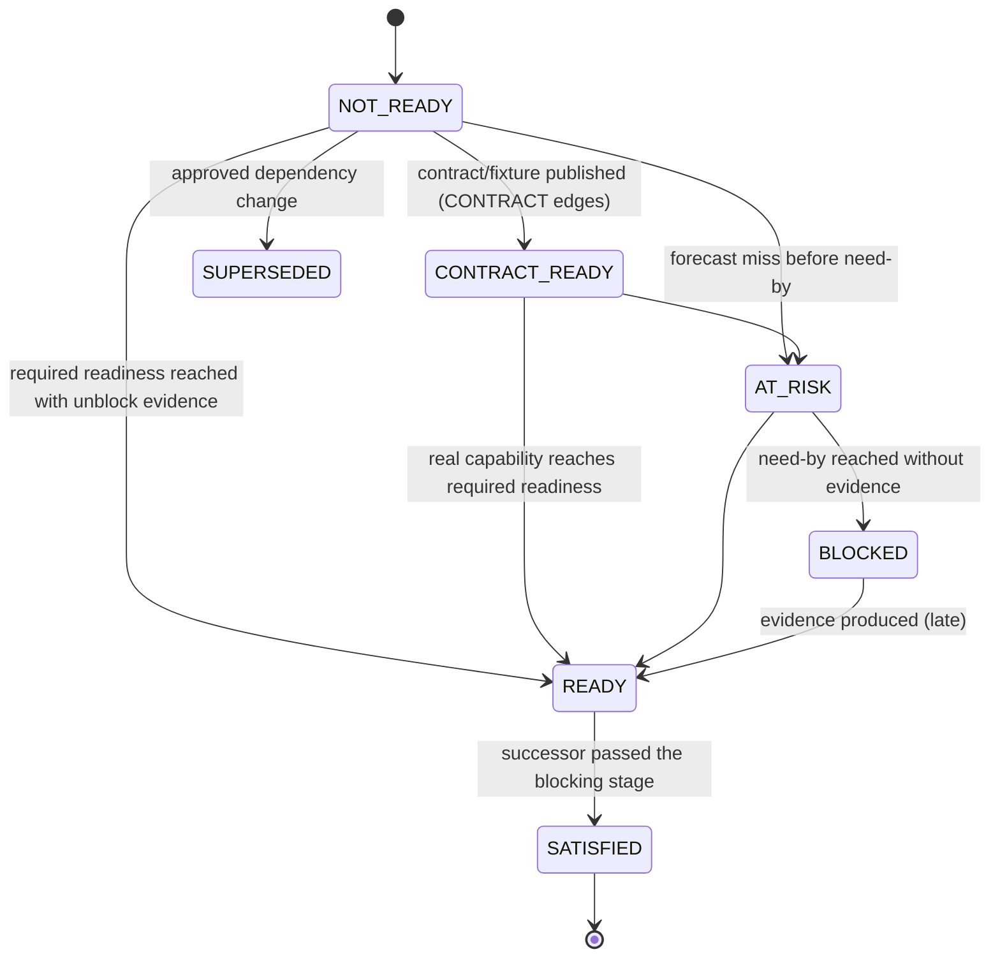
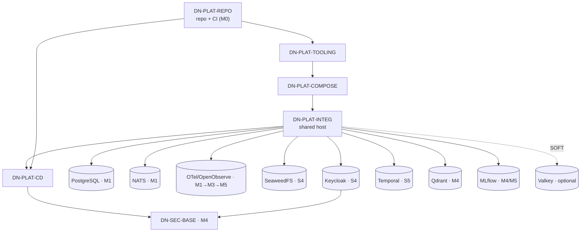
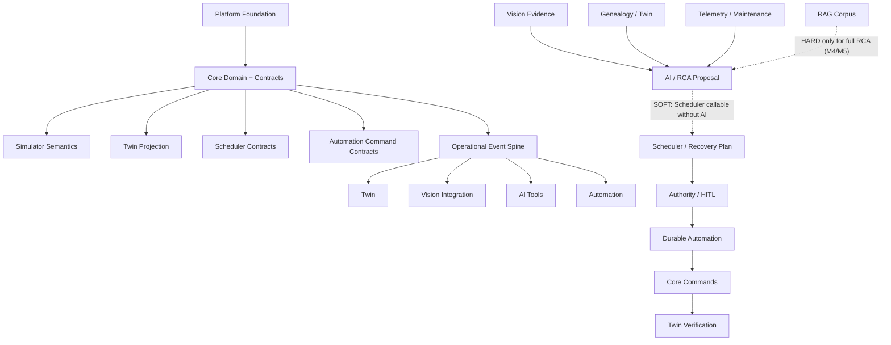
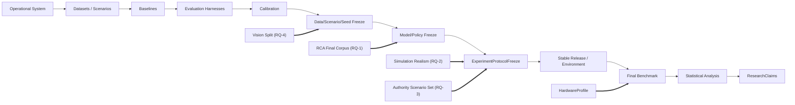
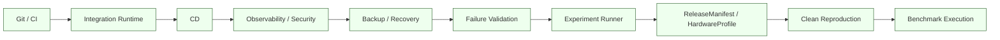
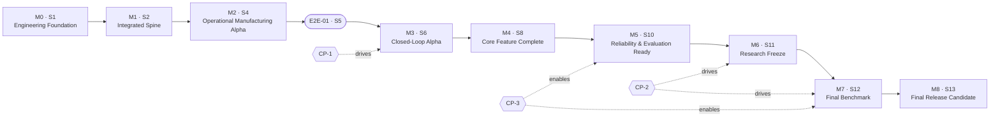
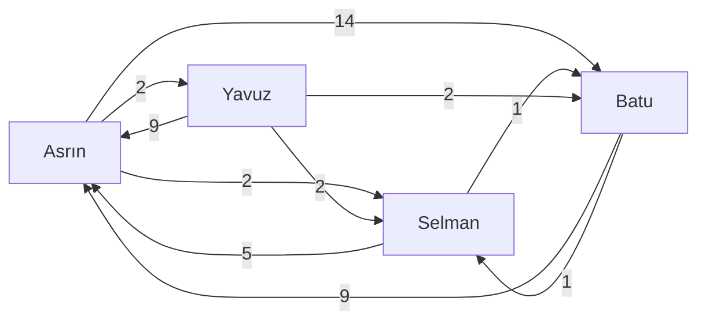

# 05 — Dependency Graph
## Intelligent Manufacturing Operations Platform for Critical Aerospace Components — Capability/Artifact Dependencies, Blocking Semantics, Critical Paths CP-1 · CP-2 · CP-3

| Field | Value |
|---|---|
| Document | `05_Dependency_Graph.md` |
| Status | **Draft — Derived from Approved 01/02 Baseline** (requires owner review, §20) |
| Version | v0.1.0-draft |
| Generated | 17 Eylül 2026 (pre-implementation) |
| Canonical dependency source | 01 Item 66 Dependency Roadmap (Approved v1.0, 13 Eylül 2026); Items 65 (milestone calendar), 67 (E2E-01 readiness), 68 (scope classes) |
| Architecture source | 02 System Architecture Specification (ARCH registry, Service Catalog, Runtime Dependency Model, Sequence I) |
| Upstream downstream artifact | 03 Requirements Traceability Matrix v0.1.0-draft (RequirementIDs, verification families, GAP-RTM-*) |
| Production doctrine | 00 Production Guide §12 (File 05) |
| Nature | Not a Gantt chart. Need-by points are milestone/checkpoint anchors from Items 65/67, not task dates |
| Graph size | 100 nodes · 217 dependency edges (208 HARD / 9 SOFT) · 0 HARD cycles (computed) |
| Status of every edge today | `NOT_READY` (no implementation exists) |
| Machine-readable companion | `05_dependency/` (nodes, edges, schema, forbidden-edge rules, mermaid sources) |

> **Reading rule.** An edge `P → S` reads: *predecessor P must reach readiness R before successor S can pass blocking stage X*. Owners are metadata on nodes, never the subject of a dependency (Item 66 #26, DEP-INV-01).

---

## Table of Contents

- 1. Purpose and Scope
- 2. Sources, Precedence and Deviations
- 3. Canonical Dependency Semantics
- 4. Blocking Semantics Rules (DEP-RULE-*)
- 5. Node Registry
- 6. Dependency Registry
- 7. Platform Dependency Spine
- 8. Product Integration Dependencies (incl. E2E-01 readiness)
- 9. Research Dependencies
- 10. Critical Paths CP-1 · CP-2 · CP-3 (+ Vision Research Chain)
- 11. Milestone Dependency Graph M0–M8
- 12. Cycle Analysis and Break Strategies
- 13. Explicit Non-Dependencies (Forbidden Edges)
- 14. Fallback Classes
- 15. Dependency Strength Evolution
- 16. Runtime Dependency Criticality (orthogonal view)
- 17. Cross-Role Handoff Graph
- 18. Sprint Overlay and Risk Windows
- 19. Dependency Board, Status Model and Acceptance Tests
- 20. Dependency Change and Review Protocol
- 21. Dependency Risk Classes
- 22. Findings Register
- 23. Edge Records
- 24. Machine-Readable Companion and Graph Linter
- 25. Rejected Alternatives
- 26. Item 66 Success-Criteria Conformance
- 27. Consistency Audit

---

## 1. Purpose and Scope

Answers, for every meaningful capability/artifact in the Manufacturing Operations Platform: **what must be ready, to which readiness level, before which other capability may start, integrate, exit a milestone, or freeze** — and what may proceed in parallel against contracts/fixtures instead of waiting (Item 66 principle *"A dependency should block only as much work as it actually needs to block"*).

| In scope | Out of scope (owned elsewhere) |
|---|---|
| Capability/artifact nodes and dependency edges with full Item 66 dimensions | Task decomposition and effort (04 WBS) |
| Platform spine semantics per final technology (PostgreSQL, NATS, SeaweedFS, Keycloak, Temporal, Qdrant, OTel/OpenObserve, MLflow, Valkey) | Per-person sequencing and calendars (06A–D Roadmaps) |
| Product integration and research dependencies; CP-1/CP-2/CP-3 | Milestone entry/exit checklists (07), DoR/DoD rules (08) |
| Blocking-semantics rules that can be evaluated mechanically | Change-request mechanics (09) |
| Cycle analysis, forbidden edges, fallback classes, strength evolution | Risk scoring (Item 69 register; referenced only) |

Granularity rule (00 §12 "avoid"): a node exists only if at least one consumer has a real readiness requirement on it; individual tasks are not nodes. Stretch (S), R2 candidates and X items never appear on a critical path (DEP-INV-20, DEP-INV-29).

## 2. Sources, Precedence and Deviations

| Source | Used for |
|---|---|
| 01 Item 66 | dimensions, readiness ladder, status model, fallback classes, DR-1…DR-10, milestone prerequisites, CP-1/2/3 chains, cycle-break strategies, non-dependencies, DEP-INV-01…30 |
| 01 Item 65 | milestone calendar M0 end S1/W2 … M8 end S13/W26 |
| 01 Item 67 | E2E-01 timing (contracts end S4, dry run mid S5, formal end S5), readiness table "before Sprint 5", logical contracts, non-mandatory components on E2E path |
| 01 Item 68 | scope classes (F0/F1/R1/R2/S/X) — keeps R2/S off critical paths |
| 01 Item 69 | risk IDs referenced by DR classes |
| 02 | ARCH anchors per node; Runtime Dependency Model (REQUIRED/DEGRADABLE/OPTIONAL); startup Sequence I; Failure Authority Principle |
| 03 RTM | requirement IDs per node; verification families used as dependency acceptance tests |

**Deviation handling.** The historical00 §12 abbreviated CP-2 and CP-3; its current chains now match01. 00 is a production guide; 01 Item 66 is normative, so the **Item 66 chains are reproduced verbatim** (§10) and the difference is logged as DEP-GAP-01. Where Item 67 requires a runtime earlier than Item 66 prose states (Keycloak, Temporal, SeaweedFS), the earlier Item 67 need-by is used because E2E-01 must precede M3 (Item 67 #7) — logged as DEP-GAP-04, not treated as a conflict.

## 3. Canonical Dependency Semantics

### 3.1 Dimensions (Item 66 #1–#17)

| Dimension | Values | Meaning (index form) | Rule |
|---|---|---|---|
| Kind | CONTRACT | versioned interface (API, event, command, snapshot, artifact schema, tool schema) | Does not require full producer completion (#5) |
| Kind | CAPABILITY | real upstream behavior required | Fixture cannot satisfy final requirement (#6) |
| Kind | DATA | DatasetVersion, ScenarioInstance, CorpusVersion, WorldSnapshot, history, labels | — |
| Kind | RUNTIME | infrastructure must actually operate | PostgreSQL, NATS, Temporal, Qdrant, Keycloak … |
| Kind | EVIDENCE | downstream decision requires upstream evaluation evidence | — |
| Kind | FREEZE | formal benchmark/release cannot start until exact artifact is frozen | — |
| Strength | HARD | successor cannot pass the declared stage | requires explicit unblock evidence (#27, DEP-INV-06) |
| Strength | SOFT | successor proceeds with reduced capability/quality/research strength | outcome-relative (#13) |
| Stage | START | meaningful implementation cannot begin | used sparingly (#14, DEP-INV-03) |
| Stage | INTEGRATION | local work proceeds; real subsystem integration cannot | — |
| Stage | MILESTONE_EXIT | implementation may exist; milestone cannot PASS | — |
| Stage | FREEZE | formal evaluation/release freeze cannot occur | — |

### 3.2 Readiness ladder (Item 66 #18–#25)

| Level | Definition | Typical unblock evidence |
|---|---|---|
| DEFINED | purpose, owner, boundary known | node registered with owner |
| CONTRACT_READY | interface stable enough for parallel work: input/output, identity/version, failure semantics, example fixture | contract merged + contract tests green + fixture published |
| SKELETON_READY | minimal executable technical implementation | service starts; smoke path |
| COMPONENT_READY | local capability/tests pass | component suite green in CI |
| INTEGRATION_READY | real upstream/downstream interaction validated | cross-boundary integration test green on INTEGRATION |
| EVALUATION_READY | stable enough for baseline/formal evaluation | evaluation harness run recorded |
| FROZEN | exact artifact selected for final evidence | freeze record with immutable identity |

Not every node uses every level (#25). The ladder applicable to each node is listed in §5. Runtime nodes use `SKELETON_READY` = local profile, `INTEGRATION_READY` = healthy on the shared host; the Item 66 board term `READY` for runtimes is read as `INTEGRATION_READY`.

### 3.3 Status model (Item 66 #136–#137)



No percentage-complete state exists (#136). `AT_RISK` must precede `BLOCKED` (#137, DEP-INV-25).

### 3.4 Fallback classes (Item 66 #130–#135)

| Class | Meaning | May satisfy development? | May satisfy milestone/final evidence? |
|---|---|---|---|
| F0 | no fallback (true hard invariant, e.g., valid approval for protected execution) | no | — |
| F1 | contract fixture | yes | **no** (#135, DEP-INV-05) |
| F2 | baseline implementation (e.g., FIFO before CP-SAT) | yes | yes, where the milestone requires only the baseline capability |
| F3 | degraded capability (e.g., Valkey outage) | yes | yes, if degradation is explicit and accepted |
| F4 | owned synthetic replacement for external data | yes | yes for product/integration; not for public-benchmark claims |
## 4. Blocking Semantics Rules (DEP-RULE-*)

These rules make Item 66 mechanically evaluable. Each rule cites its source; none adds a new decision. `DEP-RULE-*` is a document-local namespace (00 §8).

| Rule | Name | Rule text | Source |
|---|---|---|---|
| DEP-RULE-01 | Edge satisfaction | An edge P→S is SATISFIED for stage X iff P has reached readiness ≥ R (ladder order) **and** the edge's unblock evidence exists for the environment class in which S is evaluated. | Item 66 #27; DEP-INV-06 |
| DEP-RULE-02 | Stage gating | S may not pass stage X while any HARD edge into S with stage X is unsatisfied. Stages are cumulative: START ⊂ INTEGRATION ⊂ MILESTONE_EXIT ⊂ FREEZE — an unsatisfied START edge also blocks later stages. | Item 66 #11, #14–#17 |
| DEP-RULE-03 | SOFT edges never gate | An unsatisfied SOFT edge never blocks any stage; it must be recorded as reduced capability/quality/research strength on the successor's evidence. | Item 66 #12 |
| DEP-RULE-04 | Fixtures stop at CONTRACT_READY | An F1 fixture can satisfy only CONTRACT-kind edges and only for START/INTEGRATION(development) evaluation. It never satisfies a CAPABILITY/RUNTIME/DATA/EVIDENCE/FREEZE edge, and never satisfies any edge evaluated for MILESTONE_EXIT or FREEZE. | Item 66 #5–#6, #131, #135; DEP-INV-04/05 |
| DEP-RULE-05 | Real boundaries at M3 | For M3, CP-1 nodes need not have final internal quality, but every CP-1 boundary must be real (no fixture/mock in the evidence path). | Item 66 #109; E2E-INV-27 |
| DEP-RULE-06 | Precise consumer requirement | Every HARD edge declares the exact artifact/field set required (column "precise requirement"); "needs Core" is invalid. | Item 66 #28; DEP-INV-08 |
| DEP-RULE-07 | Two accountable owners | Every edge has a predecessor owner (deliverable) and a consumer owner (requirement precision); "Team" is never an owner; both validate contract usability. | Item 66 #138–#141; DEP-INV-07 |
| DEP-RULE-08 | Declared strength evolution | An edge may strengthen (SOFT→HARD, later stage, higher readiness) only through a declared update with milestone-impact assessment; no surprise mandatory dependency. | Item 66 #167–#168; DEP-INV-26 |
| DEP-RULE-09 | No HARD cycles | The HARD subgraph must be acyclic. A detected HARD cycle is recorded as `DEPENDENCY_CYCLE_FINDING` and broken by contract/fixture/baseline/boundary redesign, never waited out. | Item 66 #115–#122; DEP-INV-24; 00 §12 |
| DEP-RULE-10 | Forbidden edges | Edges listed in §13 (non-dependencies) may not exist with strength HARD; their presence fails graph lint. | Item 66 #156–#166; DEP-INV-12…15, 19, 20 |
| DEP-RULE-11 | External assets off the product path | No external dataset, paid LLM/API, ColBERT, Kubernetes or cloud node may be a HARD predecessor of any CP-1 node. | Item 66 #123–#129, #163–#166; DEP-INV-19/20 |
| DEP-RULE-12 | Freeze before benchmark | FBC-01 (DN-RES-BENCH) may start only when every FREEZE edge into DN-FRZ-RELEASE and DN-RES-BENCH is SATISFIED at FROZEN; no critical research dependency may remain "TBD during final test". | Item 66 #103–#105; DEP-INV-21/22 |
| DEP-RULE-13 | Claims from sealed evidence only | DN-RES-CLAIMS can be SATISFIED only from sealed FBC-01 evidence; development runs never satisfy EVIDENCE edges into claims. | Item 66 #93; DEP-INV-23 |
| DEP-RULE-14 | AT_RISK trigger | An edge becomes AT_RISK when (a) its need-by sprint is the current or next sprint and readiness is below required, or (b) its predecessor is BLOCKED/AT_RISK on a HARD edge, or (c) a contract change is proposed within 1 sprint of need-by. | Item 66 #137, #181; DEP-INV-25 |
| DEP-RULE-15 | Registration timing | A dependency is registered when the consuming work item becomes READY, not when it is first needed. | Item 66 #182 |
| DEP-RULE-16 | Post-M4 breaking change | A breaking change to a SATISFIED CONTRACT edge after M4 is exceptional and requires affected-consumer review + 09 change control. | Item 66 #142–#145; DEP-INV-28 |
| DEP-RULE-17 | Critical-path priority | When capacity conflicts, work on an unsatisfied HARD edge of CP-1/CP-2/CP-3 has priority over polish/stretch. | DEP-INV-29 |
| DEP-RULE-18 | Milestone evaluation | A milestone PASSES only if all HARD edges into its MS-* node are SATISFIED with milestone-grade evidence (DEP-RULE-04 applies) and its predecessor milestone PASSED. | Item 66 #94–#106; Item 65 |
| DEP-RULE-19 | Executable dependency assumptions | Repeated dependency assumptions (e.g., §19.3) become contract/integration tests; a SATISFIED HARD edge whose test later fails reverts to AT_RISK. | Item 66 #185–#189; DEP-INV-27 |
| DEP-RULE-20 | Runtime ≠ planning criticality | 02 runtime classes REQUIRED/DEGRADABLE/OPTIONAL describe production failure behavior; they are never used to decide planning HARD/SOFT and vice versa (§16). | 02 Runtime Dependency Model; Item 34 |

### 4.1 Decision table — may successor S proceed?

| Edge strength | Edge stage | Predecessor state | S may start work? | S may integrate? | S may exit milestone? | S may freeze/benchmark? |
|---|---|---|---|---|---|---|
| HARD | START | below R | no | no | no | no |
| HARD | START | R reached (fixture if CONTRACT) | yes | per other edges | per other edges | per other edges |
| HARD | INTEGRATION | below R | yes (local, fixtures) | no | no | no |
| HARD | INTEGRATION | R reached with real evidence | yes | yes | per other edges | per other edges |
| HARD | MILESTONE_EXIT | below R | yes | yes | no | no |
| HARD | FREEZE | below R (not FROZEN) | yes | yes | yes | no |
| SOFT | any | any | yes | yes | yes (record reduced strength) | yes (record reduced strength) |

### 4.2 Evaluation algorithm (for `mfgctl deps check`, planned)

```text
for each target (node S, stage X, environment class ENV):
    blockers := []
    for each edge E into S where E.strength == HARD and stage_order(E.stage) <= stage_order(X):
        p := E.predecessor
        if readiness(p) < E.required_readiness: blockers += (E, "READINESS")
        elif not evidence_exists(E.unblock_evidence, ENV): blockers += (E, "NO_EVIDENCE")
        elif E.kind != CONTRACT and evidence_is_fixture(E): blockers += (E, "FIXTURE_NOT_ALLOWED")   # DEP-RULE-04
        elif X in {MILESTONE_EXIT, FREEZE} and evidence_is_fixture(E): blockers += (E, "FIXTURE_NOT_ALLOWED")
    soft_gaps := [E for E into S where E.strength == SOFT and not satisfied(E)]
    return PASS if blockers is empty else BLOCKED(blockers); report soft_gaps as REDUCED_STRENGTH
```

## 5. Node Registry

`DN-*` = dependency node (capability/contract/runtime/data/artifact/evidence/freeze); `MS-*` = milestone; `CK-*` = checkpoint. Document-local namespace (00 §8). Node ownership follows 01 Item 62/66 #190 and 02 ownership; requirement links point into 03.

### 5.1 PLATFORM (21)

| Node | Name | Type | Owner | Applicable readiness ladder | 02 ARCH anchor | 03 requirements |
|---|---|---|---|---|---|---|
| DN-PLAT-REPO | Repository, protected main, CI baseline | CAPABILITY | Yavuz | DEFINED→INTEGRATION_READY | ARCH-PLAT-CICD | FR-PLAT-004, NFR-SEC-011, NFR-DX-006 |
| DN-PLAT-TOOLING | Runtime language/tooling baseline + mfgctl | CAPABILITY | Yavuz | DEFINED→SKELETON_READY→COMPONENT_READY | ARCH-PLAT-CLI | FR-PLAT-003, NFR-DX-001, NFR-DX-005 |
| DN-PLAT-COMPOSE | Docker Compose local capability profiles | RUNTIME | Yavuz | DEFINED→SKELETON_READY(local profile)→INTEGRATION_READY(shared host)→EVALUATION_READY | ARCH-PLAT-COMPOSE | FR-PLAT-002, NFR-DX-004 |
| DN-PLAT-INTEG | Integration runtime (shared Linux host bootstrap) | RUNTIME | Yavuz | DEFINED→SKELETON_READY(local profile)→INTEGRATION_READY(shared host)→EVALUATION_READY | ARCH-PLAT-COMPOSE | FR-PLAT-001, NFR-DEP-001, NFR-DEP-002 |
| DN-PLAT-CD | CD to INTEGRATION (immutable GHCR artifacts, DeploymentRecord) | CAPABILITY | Yavuz | DEFINED→SKELETON_READY→INTEGRATION_READY | ARCH-PLAT-CICD, ARCH-PLAT-RELEASE | FR-PLAT-004, FR-PLAT-005, NFR-DEP-003 |
| DN-RT-PG | PostgreSQL runtime | RUNTIME | Yavuz | DEFINED→SKELETON_READY(local profile)→INTEGRATION_READY(shared host)→EVALUATION_READY | ARCH-DATA-PG | FR-CORE-013, FR-CORE-015 |
| DN-RT-NATS | NATS JetStream runtime | RUNTIME | Yavuz | DEFINED→SKELETON_READY(local profile)→INTEGRATION_READY(shared host)→EVALUATION_READY | ARCH-EVT-BROKER | FR-EVT-005, NFR-CAP-004, NFR-REL-006 |
| DN-RT-OBJ | SeaweedFS object storage | RUNTIME | Yavuz | DEFINED→SKELETON_READY(local profile)→INTEGRATION_READY(shared host)→EVALUATION_READY | ARCH-DATA-OBJ | FR-VIS-001, NFR-DATA-001 |
| DN-RT-IDP | Keycloak identity runtime | RUNTIME | Yavuz | DEFINED→SKELETON_READY(local profile)→INTEGRATION_READY(shared host)→EVALUATION_READY | ARCH-SEC-IDP | FR-SEC-001, FR-HITL-007 |
| DN-RT-OBS | OTel SDK + Collector + OpenObserve | RUNTIME | Yavuz | DEFINED→SKELETON_READY(health, M1)→INTEGRATION_READY(traceability, M3)→EVALUATION_READY(reliability telemetry, M5) | ARCH-OBS-TELEMETRY, ARCH-OBS-STORE, ARCH-OBS-TRACE | FR-PLAT-006, FR-PLAT-007, NFR-OBS-001, NFR-OBS-003 |
| DN-RT-TEMPORAL | Temporal server runtime | RUNTIME | Yavuz | DEFINED→SKELETON_READY(local profile)→INTEGRATION_READY(shared host)→EVALUATION_READY | ARCH-AUTO-WORKFLOW | FR-AUTO-002 |
| DN-RT-QDRANT | Qdrant runtime | RUNTIME | Yavuz | DEFINED→SKELETON_READY(local profile)→INTEGRATION_READY(shared host)→EVALUATION_READY | ARCH-DATA-VECTOR | FR-RAG-003, FR-RAG-004, FR-RAG-005, NFR-REC-009 |
| DN-RT-MLFLOW | MLflow tracking/registry support tooling | RUNTIME | Yavuz | DEFINED→SKELETON_READY(local profile)→INTEGRATION_READY(shared host)→EVALUATION_READY | ARCH-AI-MLOPS | FR-VIS-015, FR-ML-005, FR-ML-007 |
| DN-RT-VALKEY | Valkey (optional cache; R2/S, correctness-independent) | RUNTIME | Yavuz | DEFINED→SKELETON_READY | ARCH-DATA-CACHE | — |
| DN-SEC-BASE | Security baseline: service identities, secrets sourcing, backend authz enforcement points | CAPABILITY | Yavuz | DEFINED→COMPONENT_READY→INTEGRATION_READY→EVALUATION_READY | ARCH-SEC-SECRET, ARCH-SEC-AUTHZ | FR-SEC-002, FR-SEC-006, FR-SEC-008, NFR-SEC-001 |
| DN-PLAT-BACKUP | Backup / restore / rebuild automation | CAPABILITY | Yavuz | DEFINED→COMPONENT_READY→INTEGRATION_READY→EVALUATION_READY | ARCH-PLAT-BACKUP | FR-PLAT-008, FR-PLAT-009, NFR-REC-003, NFR-REC-004, NFR-REC-007 |
| DN-PLAT-FAILVAL | Failure validation (resilience drills, AV-SCEN-05…12) | EVIDENCE | Yavuz | DEFINED→COMPONENT_READY→EVALUATION_READY | ARCH-OBS-HEALTH | NFR-REL-003, NFR-REL-005, NFR-REL-006, NFR-REL-007 |
| DN-PLAT-RUNNER | Experiment runner (manifest binding, BenchmarkRun registry) | CAPABILITY | Yavuz | DEFINED→SKELETON_READY→COMPONENT_READY→EVALUATION_READY→FROZEN | ARCH-PLAT-EXPERIMENT | FR-EVAL-001, FR-EVAL-003, FR-EVAL-004, FR-EVAL-005, FR-PLAT-010 |
| DN-ART-RELEASE | ReleaseManifest + EnvironmentManifest (stable release) | ARTIFACT | Yavuz | DEFINED→COMPONENT_READY→EVALUATION_READY→FROZEN | ARCH-PLAT-RELEASE | FR-PLAT-005, NFR-REP-003, NFR-REP-007 |
| DN-ART-HWPROF | HardwareProfile records (EVALUATION host, CPU baseline, Vision GPU/CPU) | ARTIFACT | Yavuz | DEFINED→COMPONENT_READY→EVALUATION_READY→FROZEN | ARCH-PLAT-RELEASE | NFR-GOV-005, NFR-PERF-009, NFR-PERF-010 |
| DN-PLAT-CLEANREPRO | Clean reproduction (clean host, non-owner rerun) | EVIDENCE | Yavuz | DEFINED→EVALUATION_READY | ARCH-PLAT-RELEASE | NFR-REP-003, NFR-REP-004, NFR-DEP-005 |

### 5.2 CORE (10)

| Node | Name | Type | Owner | Applicable readiness ladder | 02 ARCH anchor | 03 requirements |
|---|---|---|---|---|---|---|
| DN-CORE-CONTRACTS | Core domain contracts (Lot, SerializedComponent, Route, Operation, Equipment refs, state/revision identity) | CONTRACT | Asrın | DEFINED→CONTRACT_READY→INTEGRATION_READY→FROZEN | ARCH-CORE-DOMAIN, ARCH-CTR-API | FR-CORE-001, FR-CORE-002, FR-CORE-016 |
| DN-CORE-LIFECYCLE | Core minimal lifecycle implementation | CAPABILITY | Asrın | DEFINED→CONTRACT_READY→SKELETON_READY→COMPONENT_READY→INTEGRATION_READY→EVALUATION_READY→FROZEN | ARCH-CORE-DOMAIN, ARCH-CORE-DB | FR-CORE-001, FR-CORE-003 |
| DN-CORE-TRANSITIONS | Legal manufacturing transitions (hold/release/rework/split/merge) stable | CAPABILITY | Asrın | DEFINED→CONTRACT_READY→SKELETON_READY→COMPONENT_READY→INTEGRATION_READY→EVALUATION_READY→FROZEN | ARCH-CORE-DOMAIN, ARCH-CORE-CMD | FR-CORE-003, FR-CORE-007, FR-CORE-008, FR-CORE-009 |
| DN-CORE-CMDCON | Core command contracts (hold / release / dispatch / maintenance request) | CONTRACT | Asrın | DEFINED→CONTRACT_READY→INTEGRATION_READY→FROZEN | ARCH-CTR-CMDSCHEMA, ARCH-CORE-CMD | FR-CORE-004, FR-CORE-016, FR-AUTO-010 |
| DN-CORE-CMDEXEC | Core command execution (idempotent, revision-checked, outcome persisted) | CAPABILITY | Asrın | DEFINED→CONTRACT_READY→SKELETON_READY→COMPONENT_READY→INTEGRATION_READY→EVALUATION_READY→FROZEN | ARCH-CORE-CMD | FR-CORE-004, FR-CORE-005, FR-CORE-006 |
| DN-CORE-OUTBOX | Transactional outbox + relay | CAPABILITY | Asrın | DEFINED→CONTRACT_READY→SKELETON_READY→COMPONENT_READY→INTEGRATION_READY→EVALUATION_READY→FROZEN | ARCH-CORE-OUTBOX, ARCH-EVT-OUTBOX | FR-CORE-014, FR-CORE-015 |
| DN-CORE-GENEALOGY | Temporal genealogy / exposure queries | CAPABILITY | Asrın | DEFINED→CONTRACT_READY→SKELETON_READY→COMPONENT_READY→INTEGRATION_READY→EVALUATION_READY→FROZEN | ARCH-CORE-GENEALOGY | FR-CORE-009, FR-CORE-010, FR-CORE-011, FR-CORE-012 |
| DN-CORE-SNAPCON | ManufacturingStateSnapshot / SchedulingSnapshot contract | CONTRACT | Asrın | DEFINED→CONTRACT_READY→INTEGRATION_READY→FROZEN | ARCH-TWIN-API, ARCH-CTR-API | FR-TWIN-008, FR-SCH-001, FR-SCH-007 |
| DN-EVT-CONTRACTS | Event contracts (envelope + domain events, IC registry) | CONTRACT | Asrın | DEFINED→CONTRACT_READY→INTEGRATION_READY→FROZEN | ARCH-CTR-EVTSCHEMA, ARCH-EVT-SCHEMA, ARCH-CTR-VERSIONING | FR-EVT-001, FR-EVT-002, FR-EVT-003, FR-EVT-004, FR-EVT-006 |
| DN-EVT-SPINE | Operational event spine (outbox → NATS → idempotent consumers) | CAPABILITY | Asrın | DEFINED→CONTRACT_READY→SKELETON_READY→COMPONENT_READY→INTEGRATION_READY→EVALUATION_READY→FROZEN | ARCH-EVT-BROKER, ARCH-EVT-CONSUMER, ARCH-EVT-OUTBOX | FR-EVT-001, FR-EVT-005, FR-EVT-008 |

### 5.3 TWIN (3)

| Node | Name | Type | Owner | Applicable readiness ladder | 02 ARCH anchor | 03 requirements |
|---|---|---|---|---|---|---|
| DN-TWIN-SKELETON | Twin skeleton (projector + query API) | CAPABILITY | Asrın | DEFINED→CONTRACT_READY→SKELETON_READY→COMPONENT_READY→INTEGRATION_READY→EVALUATION_READY→FROZEN | ARCH-TWIN-PROJECTOR, ARCH-TWIN-API | FR-TWIN-001, FR-TWIN-002 |
| DN-TWIN-PROJ | Meaningful Twin projection (revision/freshness/epistemic/STALE) | CAPABILITY | Asrın | DEFINED→CONTRACT_READY→SKELETON_READY→COMPONENT_READY→INTEGRATION_READY→EVALUATION_READY→FROZEN | ARCH-TWIN-STATE, ARCH-TWIN-FRESHNESS | FR-TWIN-003, FR-TWIN-004, FR-TWIN-005, FR-TWIN-009 |
| DN-TWIN-VERIFY | Twin verification view for effect verification | CAPABILITY | Asrın | DEFINED→CONTRACT_READY→SKELETON_READY→COMPONENT_READY→INTEGRATION_READY→EVALUATION_READY→FROZEN | ARCH-TWIN-API, ARCH-AUTO-VERIFY | FR-TWIN-010, NFR-REL-010 |

### 5.4 SIM (8)

| Node | Name | Type | Owner | Applicable readiness ladder | 02 ARCH anchor | 03 requirements |
|---|---|---|---|---|---|---|
| DN-SIM-KERNEL | DES kernel (event queue, clock, named RNG) | CAPABILITY | Batu | DEFINED→CONTRACT_READY→SKELETON_READY→COMPONENT_READY→INTEGRATION_READY→EVALUATION_READY→FROZEN | ARCH-SIM-ENGINE, ARCH-SIM-CLOCK | FR-SIM-001, FR-SIM-007, FR-SIM-008 |
| DN-SIM-OPSEM | Operational semantics (reentrant routing, queues, failures, maintenance, rework) | CAPABILITY | Batu | DEFINED→CONTRACT_READY→SKELETON_READY→COMPONENT_READY→INTEGRATION_READY→EVALUATION_READY→FROZEN | ARCH-SIM-ENGINE | FR-SIM-002, FR-SIM-003, FR-SIM-004, FR-SIM-005, FR-SIM-006 |
| DN-SIM-COREINT | Simulator/Core integration (Core-validated physical commands, events) | CAPABILITY | Batu | DEFINED→CONTRACT_READY→SKELETON_READY→COMPONENT_READY→INTEGRATION_READY→EVALUATION_READY→FROZEN | ARCH-SIM-ENGINE, ARCH-CTR-CMDSCHEMA | FR-SIM-013, FR-SIM-014 |
| DN-SIM-DISPIF | Simulator dispatch-decision interface + deterministic baseline dispatch | CONTRACT | Batu | DEFINED→CONTRACT_READY→INTEGRATION_READY→FROZEN | ARCH-SIM-ENGINE, ARCH-CTR-CMDSCHEMA | FR-SIM-013 |
| DN-SIM-SNAPFORK | Snapshot / Fork / counterfactual worlds | CAPABILITY | Batu | DEFINED→CONTRACT_READY→SKELETON_READY→COMPONENT_READY→INTEGRATION_READY→EVALUATION_READY→FROZEN | ARCH-SIM-SNAPSHOT, ARCH-WORLD-FORK | FR-SIM-009, FR-SIM-010, FR-SIM-011 |
| DN-SIM-ORACLE | Oracle isolation (evaluator-only stream/credentials) | CAPABILITY | Batu | DEFINED→CONTRACT_READY→SKELETON_READY→COMPONENT_READY→INTEGRATION_READY→EVALUATION_READY→FROZEN | ARCH-SIM-ORACLE, ARCH-WORLD-EVALZONE | FR-SIM-012, FR-SEC-010 |
| DN-SIM-SYNTH | Synthetic operational data / generated history (ScenarioInstances) | DATA | Batu | DEFINED→COMPONENT_READY→EVALUATION_READY→FROZEN | ARCH-SIM-SCENARIO | FR-SIM-008, FR-ML-007 |
| DN-SIM-REALISM | Simulation validation evidence (RL-3, RealismBenchmarkSuite) | EVIDENCE | Batu | DEFINED→EVALUATION_READY→FROZEN | ARCH-SIM-ENGINE | FR-SIM-001, NFR-REP-001 |

### 5.5 VISION (10)

| Node | Name | Type | Owner | Applicable readiness ladder | 02 ARCH anchor | 03 requirements |
|---|---|---|---|---|---|---|
| DN-VIS-PUBLIC | Public Vision dataset (rights/version) | DATA | Selman | DEFINED→COMPONENT_READY→EVALUATION_READY→FROZEN | ARCH-DATA-LINEAGE | FR-VIS-011, NFR-DATA-006 |
| DN-VIS-SYNTH | Synthetic Vision generator (owned data) | DATA | Selman | DEFINED→COMPONENT_READY→EVALUATION_READY→FROZEN | ARCH-DATA-LINEAGE | FR-VIS-011 |
| DN-VIS-SPLIT | Vision DatasetVersion / SplitManifest | ARTIFACT | Selman | DEFINED→COMPONENT_READY→EVALUATION_READY→FROZEN | ARCH-DATA-LINEAGE | FR-VIS-012, NFR-DATA-002 |
| DN-VIS-BASELINES | Vision baselines | CAPABILITY | Selman | DEFINED→COMPONENT_READY→EVALUATION_READY→FROZEN | ARCH-VIS-EVAL | FR-VIS-002 |
| DN-VIS-MODELS | Deep Vision models (classification/localization/segmentation/anomaly) as ModelPackages | ARTIFACT | Selman | DEFINED→COMPONENT_READY→INTEGRATION_READY→EVALUATION_READY→FROZEN | ARCH-VIS-MODEL, ARCH-VIS-INFER | FR-VIS-002, FR-VIS-003, FR-VIS-004, FR-VIS-005, FR-VIS-015 |
| DN-VIS-OOD | OOD/UNKNOWN + spatial pattern evaluation | CAPABILITY | Selman | DEFINED→CONTRACT_READY→SKELETON_READY→COMPONENT_READY→INTEGRATION_READY→EVALUATION_READY→FROZEN | ARCH-VIS-OOD, ARCH-VIS-EVAL | FR-VIS-006, FR-VIS-010 |
| DN-VIS-ARTCON | Inspection artifact identity contract (ArtifactRef, Lot/SerializedComponent refs, model metadata) | CONTRACT | Selman | DEFINED→CONTRACT_READY→INTEGRATION_READY→FROZEN | ARCH-VIS-ARTIFACT, ARCH-CTR-API | FR-VIS-001, FR-VIS-007 |
| DN-VIS-OBSCON | InspectionObservation contract + fixtures (EVT-InspectionObservation-v1, distinct from IC-VIS-002) | CONTRACT | Selman | DEFINED→CONTRACT_READY→INTEGRATION_READY→FROZEN | ARCH-CTR-EVTSCHEMA | FR-VIS-009 |
| DN-VIS-SERVING | Operational Vision inference over real artifacts | CAPABILITY | Selman | DEFINED→CONTRACT_READY→SKELETON_READY→COMPONENT_READY→INTEGRATION_READY→EVALUATION_READY→FROZEN | ARCH-VIS-INFER, ARCH-VIS-ARTIFACT | FR-VIS-001, FR-VIS-016, FR-VIS-014 |
| DN-VIS-EPISODES | Operational inspection episodes (ScenarioEpisodes with genealogy/state) | DATA | Selman | DEFINED→COMPONENT_READY→EVALUATION_READY→FROZEN | ARCH-DATA-LINEAGE | FR-VIS-016 |

### 5.6 AI (8)

| Node | Name | Type | Owner | Applicable readiness ladder | 02 ARCH anchor | 03 requirements |
|---|---|---|---|---|---|---|
| DN-AI-TOOLCON | AI typed tool schemas + fixtures | CONTRACT | Asrın | DEFINED→CONTRACT_READY→INTEGRATION_READY→FROZEN | ARCH-AI-TOOLS | FR-AI-002, FR-AI-003 |
| DN-AI-ORCH | Deterministic AI orchestrator | CAPABILITY | Asrın | DEFINED→CONTRACT_READY→SKELETON_READY→COMPONENT_READY→INTEGRATION_READY→EVALUATION_READY→FROZEN | ARCH-AI-ORCH | FR-AI-001, FR-AI-012, FR-AI-013 |
| DN-AI-RCA | Structured evidence-grounded RCA on real operational evidence | CAPABILITY | Asrın | DEFINED→CONTRACT_READY→SKELETON_READY→COMPONENT_READY→INTEGRATION_READY→EVALUATION_READY→FROZEN | ARCH-AI-ORCH, ARCH-AI-TOOLS | FR-AI-005, FR-AI-006, FR-AI-007, FR-AI-008 |
| DN-AI-ACTCON | ActionCatalog + ActionProposal contract (authority semantics) | CONTRACT | Asrın | DEFINED→CONTRACT_READY→INTEGRATION_READY→FROZEN | ARCH-AUTO-ACTIONCAT, ARCH-AI-PROPOSAL | FR-AUTO-012, FR-AI-009, FR-AI-010 |
| DN-AI-PROVIDER | LLM provider abstraction + deterministic non-LLM baseline | CAPABILITY | Asrın | DEFINED→CONTRACT_READY→SKELETON_READY→COMPONENT_READY→INTEGRATION_READY→EVALUATION_READY→FROZEN | ARCH-AI-PROVIDER | FR-AI-011 |
| DN-RAG-CORPUS | Documentary corpus (DocumentVersion/CorpusVersion) | DATA | Asrın | DEFINED→COMPONENT_READY→EVALUATION_READY→FROZEN | ARCH-AI-RAG | FR-RAG-001, FR-RAG-009 |
| DN-RAG | RAG retrieval capability (sparse/dense/hybrid, citations, rights filter) | CAPABILITY | Asrın | DEFINED→CONTRACT_READY→SKELETON_READY→COMPONENT_READY→INTEGRATION_READY→EVALUATION_READY→FROZEN | ARCH-AI-RAG, ARCH-DATA-VECTOR | FR-RAG-003, FR-RAG-004, FR-RAG-005, FR-RAG-006, FR-RAG-010 |
| DN-ML | Predictive ML M1/M2/M3 (Prediction contract, calibration) | CAPABILITY | Asrın | DEFINED→CONTRACT_READY→SKELETON_READY→COMPONENT_READY→INTEGRATION_READY→EVALUATION_READY→FROZEN | ARCH-AI-ORCH (coarse, GAP-RTM-001), ARCH-AI-ML | FR-ML-001, FR-ML-002, FR-ML-003, FR-ML-004, FR-ML-006 |

### 5.7 SCHED (6)

| Node | Name | Type | Owner | Applicable readiness ladder | 02 ARCH anchor | 03 requirements |
|---|---|---|---|---|---|---|
| DN-SCH-HEUR | Heuristic/baseline dispatch (FIFO/EDD/CR/SPT/SRPT) over generated instances | CAPABILITY | Batu | DEFINED→CONTRACT_READY→SKELETON_READY→COMPONENT_READY→INTEGRATION_READY→EVALUATION_READY→FROZEN | ARCH-SCH-HEURISTIC | FR-SCH-010 |
| DN-SCH-VALID | Independent ScheduleValidator | CAPABILITY | Batu | DEFINED→CONTRACT_READY→SKELETON_READY→COMPONENT_READY→INTEGRATION_READY→EVALUATION_READY→FROZEN | ARCH-SCH-VALIDATOR | FR-SCH-005, FR-SCH-006, FR-SCH-014 |
| DN-SCH-PLANCON | RecoveryPlan contract | CONTRACT | Batu | DEFINED→CONTRACT_READY→INTEGRATION_READY→FROZEN | ARCH-SCH-PLAN, ARCH-CTR-EVTSCHEMA | FR-SCH-008, FR-SCH-015 |
| DN-SCH-CPSAT | CP-SAT recovery scheduling | CAPABILITY | Batu | DEFINED→CONTRACT_READY→SKELETON_READY→COMPONENT_READY→INTEGRATION_READY→EVALUATION_READY→FROZEN | ARCH-SCH-ENGINE | FR-SCH-004, FR-SCH-009, FR-SCH-012 |
| DN-SCH-DYN | Dynamic / event-triggered rescheduling on real state | CAPABILITY | Batu | DEFINED→CONTRACT_READY→SKELETON_READY→COMPONENT_READY→INTEGRATION_READY→EVALUATION_READY→FROZEN | ARCH-SCH-ENGINE | FR-SCH-001, FR-SCH-002, FR-SCH-003, FR-SCH-007 |
| DN-SCH-CF | Counterfactual schedule evaluation | CAPABILITY | Batu | DEFINED→CONTRACT_READY→SKELETON_READY→COMPONENT_READY→INTEGRATION_READY→EVALUATION_READY→FROZEN | ARCH-SCH-ENGINE, ARCH-WORLD-FORK | FR-SCH-013 |

### 5.8 AUTH (2)

| Node | Name | Type | Owner | Applicable readiness ladder | 02 ARCH anchor | 03 requirements |
|---|---|---|---|---|---|---|
| DN-HITL-POLICY | Authority policy semantics (L0–L4, deterministic evaluation) | CAPABILITY | Asrın | DEFINED→CONTRACT_READY→SKELETON_READY→COMPONENT_READY→INTEGRATION_READY→EVALUATION_READY→FROZEN | ARCH-HITL-POLICY | FR-HITL-001, FR-HITL-002 |
| DN-HITL-APPROVAL | Real HITL approval bound to identity + exact revision/WorldID/expiry | CAPABILITY | Asrın | DEFINED→CONTRACT_READY→SKELETON_READY→COMPONENT_READY→INTEGRATION_READY→EVALUATION_READY→FROZEN | ARCH-HITL-APPROVAL, ARCH-HITL-EXPIRY | FR-HITL-003, FR-HITL-004, FR-HITL-005, FR-HITL-006, FR-HITL-007, FR-HITL-008 |

### 5.9 AUTO (4)

| Node | Name | Type | Owner | Applicable readiness ladder | 02 ARCH anchor | 03 requirements |
|---|---|---|---|---|---|---|
| DN-AUTO-DESIGN | Workflow design with stub activities | CAPABILITY | Batu | DEFINED→SKELETON_READY→COMPONENT_READY | ARCH-AUTO-WORKFLOW | FR-AUTO-001 |
| DN-AUTO-DURABLE | Durable workflows on real Temporal (approval wait, restart safety) | CAPABILITY | Batu | DEFINED→CONTRACT_READY→SKELETON_READY→COMPONENT_READY→INTEGRATION_READY→EVALUATION_READY→FROZEN | ARCH-AUTO-WORKFLOW, ARCH-AUTO-IDEMPOTENCY | FR-AUTO-001, FR-AUTO-002, FR-AUTO-003, FR-AUTO-006 |
| DN-AUTO-EXEC | Protected execution via Core typed commands (final revalidation) | CAPABILITY | Batu | DEFINED→CONTRACT_READY→SKELETON_READY→COMPONENT_READY→INTEGRATION_READY→EVALUATION_READY→FROZEN | ARCH-AUTO-ACTIONCAT, ARCH-CORE-CMD | FR-AUTO-004, FR-AUTO-005, FR-AUTO-012, FR-AUTO-013, FR-AUTO-014 |
| DN-AUTO-VERIFY | Effect verification (ACK ≠ effect; UNKNOWN_VERIFY_REQUIRED) | CAPABILITY | Batu | DEFINED→CONTRACT_READY→SKELETON_READY→COMPONENT_READY→INTEGRATION_READY→EVALUATION_READY→FROZEN | ARCH-AUTO-VERIFY | FR-AUTO-007, FR-AUTO-008, FR-AUTO-009 |

### 5.10 UI (3)

| Node | Name | Type | Owner | Applicable readiness ladder | 02 ARCH anchor | 03 requirements |
|---|---|---|---|---|---|---|
| DN-UI-BFFCON | BFF/OpenAPI contracts + UI fixtures | CONTRACT | Asrın | DEFINED→CONTRACT_READY→INTEGRATION_READY→FROZEN | ARCH-EDGE-BFF, ARCH-CTR-API | FR-UI-001 |
| DN-UI-SHELL | Command Center shell via BFF | CAPABILITY | Asrın | DEFINED→CONTRACT_READY→SKELETON_READY→COMPONENT_READY→INTEGRATION_READY→EVALUATION_READY→FROZEN | ARCH-EDGE-WEB, ARCH-EDGE-BFF | FR-UI-001, FR-UI-002 |
| DN-UI-APPROVAL | Approval Center + incident timeline | CAPABILITY | Asrın | DEFINED→CONTRACT_READY→SKELETON_READY→COMPONENT_READY→INTEGRATION_READY→EVALUATION_READY→FROZEN | ARCH-HITL-UI, ARCH-EDGE-WEB | FR-UI-006, FR-UI-010, NFR-UX-003 |

### 5.11 RESEARCH (15)

| Node | Name | Type | Owner | Applicable readiness ladder | 02 ARCH anchor | 03 requirements |
|---|---|---|---|---|---|---|
| DN-RES-DATASCEN | Evaluation datasets / scenario families (DEV/CAL/FINAL partitions) | DATA | Asrın | DEFINED→COMPONENT_READY→EVALUATION_READY→FROZEN | ARCH-DATA-LINEAGE | FR-EVAL-002, NFR-DATA-002 |
| DN-RES-BASELINES | Baselines (RCA-B*, scheduler/Vision/ML baselines, BaselineRuns) | EVIDENCE | Asrın | DEFINED→COMPONENT_READY→EVALUATION_READY→FROZEN | ARCH-DATA-LINEAGE | FR-SCH-010, FR-EVAL-002 |
| DN-RES-HARNESS | Evaluation harnesses (per lane) | CAPABILITY | Yavuz | DEFINED→CONTRACT_READY→SKELETON_READY→COMPONENT_READY→INTEGRATION_READY→EVALUATION_READY→FROZEN | — (GAP-RTM-002), ARCH-SCH-EVAL, ARCH-DATA-EVIDENCE | FR-EVAL-001, FR-EVAL-006 |
| DN-RES-CALIB | Calibration (thresholds, budgets, policies on CAL partitions) | EVIDENCE | Asrın | DEFINED→EVALUATION_READY→FROZEN | ARCH-DATA-LINEAGE | FR-ML-006, FR-VIS-008 |
| DN-FRZ-DATA | Data / scenario / seed freeze (SplitManifests, ScenarioSet, SeedSet) | FREEZE | Batu | DEFINED→FROZEN | ARCH-DATA-LINEAGE, ARCH-SIM-SCENARIO | NFR-DATA-002, FR-SIM-007 |
| DN-FRZ-MODEL | Model / policy freeze (ModelPackages, AIBehaviorBundle, RetrievalProfile, SchedulerPolicy, WorkflowBundle, AuthorityPolicy) | FREEZE | Asrın | DEFINED→FROZEN | ARCH-VIS-MODEL, ARCH-AI-PROVIDER, ARCH-AI-RAG, ARCH-SCH-ENGINE, ARCH-AUTO-WORKFLOW | FR-AI-011, FR-RAG-009 |
| DN-FRZ-PROTOCOL | ExperimentProtocolFreeze (metrics, analysis plan, hypotheses) | FREEZE | Asrın | DEFINED→FROZEN | ARCH-DATA-LINEAGE | FR-EVAL-006, FR-EVAL-009 |
| DN-FRZ-RELEASE | Stable release / environment freeze for formal runs | FREEZE | Yavuz | DEFINED→FROZEN | ARCH-PLAT-RELEASE | NFR-REP-003, NFR-REP-007 |
| DN-RES-BENCH | Final Benchmark Campaign FBC-01 (sealed evidence) | EVIDENCE | Yavuz | DEFINED→EVALUATION_READY→FROZEN | ARCH-PLAT-RELEASE, ARCH-DATA-OBJ | FR-EVAL-003, FR-EVAL-007, NFR-DATA-003, NFR-DATA-007 |
| DN-RES-ANALYSIS | Statistical analysis / AnalysisPackage | EVIDENCE | Asrın | DEFINED→COMPONENT_READY→FROZEN | ARCH-DATA-LINEAGE | FR-EVAL-006, NFR-REP-002 |
| DN-RES-CLAIMS | ResearchClaims classification (RQ-1…RQ-4, MC-1, MC-2) | EVIDENCE | Asrın | DEFINED→FROZEN | — | FR-EVAL-009, FR-EVAL-010 |
| DN-FRZ-RQ1CORPUS | RCA final corpus (RQ-1) | FREEZE | Asrın | DEFINED→FROZEN | ARCH-AI-RAG | FR-RAG-009 |
| DN-FRZ-RQ3AUTH | Authority scenario set (RQ-3) | FREEZE | Asrın | DEFINED→FROZEN | ARCH-HITL-POLICY | FR-HITL-001 |
| DN-FRZ-RQ4SPLIT | Vision split freeze (RQ-4) | FREEZE | Selman | DEFINED→FROZEN | ARCH-DATA-LINEAGE | FR-VIS-012 |
| DN-FRZ-SCENSET | Scenario set (FBC-01 scenario families) | FREEZE | Batu | DEFINED→FROZEN | ARCH-SIM-SCENARIO | FR-SIM-008 |

### 5.12 MILESTONE (10)

| Node | Name | Type | Owner | Applicable readiness ladder | 02 ARCH anchor | 03 requirements |
|---|---|---|---|---|---|---|
| MS-M0 | M0 — Engineering Foundation Ready | MILESTONE | — | PASS/FAIL (Item 65) | — | — |
| MS-M1 | M1 — Integrated Spine | MILESTONE | — | PASS/FAIL (Item 65) | — | — |
| MS-M2 | M2 — Operational Manufacturing Alpha | MILESTONE | — | PASS/FAIL (Item 65) | — | — |
| MS-M3 | M3 — Closed-Loop Alpha | MILESTONE | — | PASS/FAIL (Item 65) | — | — |
| MS-M4 | M4 — Mandatory Core Feature Complete | MILESTONE | — | PASS/FAIL (Item 65) | — | — |
| MS-M5 | M5 — Reliability & Evaluation Ready | MILESTONE | — | PASS/FAIL (Item 65) | — | — |
| MS-M6 | M6 — Research Freeze | MILESTONE | — | PASS/FAIL (Item 65) | — | — |
| MS-M7 | M7 — Final Benchmark Complete | MILESTONE | — | PASS/FAIL (Item 65) | — | — |
| MS-M8 | M8 — Final Release Candidate | MILESTONE | — | PASS/FAIL (Item 65) | — | — |
| CK-E2E01 | E2E-01 First E2E Checkpoint (end S5) | CHECKPOINT | N/A — cross-capability checkpoint; coordinator ARCH-AUTO-WORKFLOW | PASS/FAIL (Item 67) | — | all F0 (precursor) |

## 6. Dependency Registry

All 217 edges. Columns follow Item 66 "Dependency Registry" fields. *Pred owner* delivers; *consumer owner* owns requirement precision. Status of all edges today: `NOT_READY`. Full precise requirements and sources per edge: §23.

### 6.1 Platform spine (28)

| DEP | Predecessor → Successor | Kind | Strength | Stage | Required readiness | Need-by | Pred owner | Consumer owner | Fallback | Unblock evidence | DR |
|---|---|---|---|---|---|---|---|---|---|---|---|
| DEP-001 | DN-PLAT-REPO → DN-PLAT-TOOLING | CAPABILITY | HARD | START | INTEGRATION_READY | M0 (S1) | Yavuz | Yavuz | — | protected main + required CI checks active | DR-3 |
| DEP-002 | DN-PLAT-REPO → DN-PLAT-CD | CAPABILITY | HARD | START | INTEGRATION_READY | M0→M1 | Yavuz | Yavuz | — | CI builds immutable images to GHCR | DR-3 |
| DEP-003 | DN-PLAT-TOOLING → DN-PLAT-COMPOSE | CAPABILITY | HARD | START | SKELETON_READY | M0 (S1) | Yavuz | Yavuz | — | `mfgctl bootstrap/doctor` runs on dev host | DR-3 |
| DEP-004 | DN-PLAT-COMPOSE → DN-PLAT-INTEG | RUNTIME | HARD | MILESTONE_EXIT | SKELETON_READY | M0 (S1) | Yavuz | Yavuz | — | Integration bootstrap from same Compose definitions | DR-3 |
| DEP-005 | DN-PLAT-INTEG → DN-PLAT-CD | RUNTIME | HARD | INTEGRATION | INTEGRATION_READY | M1 (S2) | Yavuz | Yavuz | — | runtime healthy on shared host + smoke check in CI/INTEGRATION | DR-3 |
| DEP-006 | DN-PLAT-COMPOSE → DN-RT-PG | RUNTIME | HARD | START | SKELETON_READY | M0 | Yavuz | Yavuz | — | local PostgreSQL profile up | DR-3 |
| DEP-007 | DN-PLAT-INTEG → DN-RT-PG | RUNTIME | HARD | INTEGRATION | INTEGRATION_READY | M1 (S2) | Yavuz | Yavuz | — | runtime healthy on shared host + smoke check in CI/INTEGRATION | DR-3 |
| DEP-008 | DN-PLAT-INTEG → DN-RT-NATS | RUNTIME | HARD | INTEGRATION | INTEGRATION_READY | M1 (S2) | Yavuz | Yavuz | — | runtime healthy on shared host + smoke check in CI/INTEGRATION | DR-3 |
| DEP-009 | DN-PLAT-INTEG → DN-RT-OBJ | RUNTIME | HARD | INTEGRATION | INTEGRATION_READY | E2E-01 readiness (end S4) | Yavuz | Yavuz | — | runtime healthy on shared host + smoke check in CI/INTEGRATION | DR-3 |
| DEP-010 | DN-PLAT-INTEG → DN-RT-IDP | RUNTIME | HARD | INTEGRATION | INTEGRATION_READY | E2E-01 readiness (end S4) | Yavuz | Yavuz | — | Keycloak realm/clients deployed; real login works | DR-3 |
| DEP-011 | DN-PLAT-INTEG → DN-RT-OBS | RUNTIME | HARD | MILESTONE_EXIT | SKELETON_READY | M1 (S2) | Yavuz | Yavuz | F3 | health/basic instrumentation visible in OpenObserve | DR-3 |
| DEP-012 | DN-PLAT-INTEG → DN-RT-TEMPORAL | RUNTIME | HARD | INTEGRATION | INTEGRATION_READY | E2E-01 formal run (end S5) | Yavuz | Yavuz | — | runtime healthy on shared host + smoke check in CI/INTEGRATION | DR-3 |
| DEP-013 | DN-PLAT-INTEG → DN-RT-QDRANT | RUNTIME | HARD | INTEGRATION | INTEGRATION_READY | M4 (S8) | Yavuz | Yavuz | — | runtime healthy on shared host + smoke check in CI/INTEGRATION | DR-3 |
| DEP-014 | DN-PLAT-INTEG → DN-RT-MLFLOW | RUNTIME | HARD | MILESTONE_EXIT | INTEGRATION_READY | M4/M5 | Yavuz | Yavuz | — | runtime healthy on shared host + smoke check in CI/INTEGRATION | DR-3 |
| DEP-015 | DN-PLAT-INTEG → DN-RT-VALKEY | RUNTIME | SOFT | INTEGRATION | SKELETON_READY | — (R2/S) | Yavuz | Yavuz | F3 | — | DR-6 |
| DEP-016 | DN-RT-IDP → DN-SEC-BASE | RUNTIME | HARD | INTEGRATION | INTEGRATION_READY | M4 (S8) | Yavuz | Yavuz | — | service identities issued; anonymous mutation rejected | DR-3 |
| DEP-017 | DN-PLAT-CD → DN-SEC-BASE | CAPABILITY | HARD | MILESTONE_EXIT | INTEGRATION_READY | M4 (S8) | Yavuz | Yavuz | — | non-Git secret sourcing in deploy path | DR-3 |
| DEP-109 | DN-PLAT-CD → DN-RT-OBS | CAPABILITY | HARD | MILESTONE_EXIT | INTEGRATION_READY | M3 (S6) | Yavuz | Yavuz | — | distributed traceability across closed-loop boundaries | DR-3 |
| DEP-110 | DN-RT-OBS → DN-PLAT-FAILVAL | RUNTIME | HARD | MILESTONE_EXIT | EVALUATION_READY | M5 (S10) | Yavuz | Yavuz | — | reliability/evaluation telemetry HARD | DR-3 |
| DEP-111 | DN-SEC-BASE → DN-PLAT-BACKUP | CAPABILITY | HARD | MILESTONE_EXIT | INTEGRATION_READY | M5 (S10) | Yavuz | Yavuz | — | secrets/keys restorable or rotatable | DR-3 |
| DEP-112 | DN-RT-OBS → DN-PLAT-BACKUP | CAPABILITY | SOFT | MILESTONE_EXIT | INTEGRATION_READY | M5 (S10) | Yavuz | Yavuz | F3 | backup/restore observable | DR-3 |
| DEP-113 | DN-PLAT-BACKUP → DN-PLAT-FAILVAL | CAPABILITY | HARD | MILESTONE_EXIT | EVALUATION_READY | M5 (S10) | Yavuz | Yavuz | — | restore proof executed (RESTORE-PG-001) | DR-3 |
| DEP-114 | DN-PLAT-FAILVAL → DN-PLAT-RUNNER | EVIDENCE | HARD | MILESTONE_EXIT | EVALUATION_READY | M5 (S10) | Yavuz | Yavuz | — | resilience suites operational before formal experiments | DR-7 |
| DEP-115 | DN-PLAT-CD → DN-PLAT-RUNNER | CAPABILITY | HARD | INTEGRATION | INTEGRATION_READY | M5 (S10) | Yavuz | Yavuz | — | runner deploys exact release to EVALUATION | DR-3 |
| DEP-116 | DN-PLAT-RUNNER → DN-ART-RELEASE | CAPABILITY | HARD | FREEZE | EVALUATION_READY | M6 (S11) | Yavuz | Yavuz | — | runner binds ReleaseManifest/EnvironmentManifest to runs | DR-7 |
| DEP-117 | DN-PLAT-RUNNER → DN-ART-HWPROF | CAPABILITY | HARD | FREEZE | EVALUATION_READY | M6 (S11) | Yavuz | Yavuz | — | HardwareProfile captured per run | DR-7 |
| DEP-118 | DN-ART-RELEASE → DN-PLAT-CLEANREPRO | FREEZE | HARD | MILESTONE_EXIT | FROZEN | M6→M7 | Yavuz | Yavuz | — | clean-host deploy of exact manifest PASS | DR-10 |
| DEP-119 | DN-ART-HWPROF → DN-PLAT-CLEANREPRO | FREEZE | HARD | MILESTONE_EXIT | FROZEN | M6→M7 | Yavuz | Yavuz | — | HardwareProfile recorded for reproduction host | DR-10 |

### 6.2 Core, events and Twin (19)

| DEP | Predecessor → Successor | Kind | Strength | Stage | Required readiness | Need-by | Pred owner | Consumer owner | Fallback | Unblock evidence | DR |
|---|---|---|---|---|---|---|---|---|---|---|---|
| DEP-018 | DN-CORE-CONTRACTS → DN-CORE-LIFECYCLE | CONTRACT | HARD | START | CONTRACT_READY | S1–S2 | Asrın | Asrın | F1 | contract merged + contract tests green + example fixture published | DR-1 |
| DEP-019 | DN-RT-PG → DN-CORE-LIFECYCLE | RUNTIME | HARD | INTEGRATION | SKELETON_READY | M1 (S2) | Yavuz | Asrın | — | Core migrations apply on PostgreSQL | DR-3 |
| DEP-020 | DN-CORE-LIFECYCLE → DN-CORE-TRANSITIONS | CAPABILITY | HARD | START | COMPONENT_READY | S2–S3 | Asrın | Asrın | — | minimal lifecycle component implemented; lifecycle component tests green on current main; attributable COMPONENT_READY readiness artifact present and bound to WP-CORE-002 | DR-1 |
| DEP-021 | DN-CORE-CONTRACTS → DN-EVT-CONTRACTS | CONTRACT | HARD | START | CONTRACT_READY | S1–S2 | Asrın | Asrın | F1 | contract merged + contract tests green + example fixture published | DR-1 |
| DEP-022 | DN-CORE-LIFECYCLE → DN-CORE-OUTBOX | CAPABILITY | HARD | INTEGRATION | COMPONENT_READY | M1 (S2) | Asrın | Asrın | — | atomic mutation+outbox test on real PostgreSQL | DR-1 |
| DEP-023 | DN-EVT-CONTRACTS → DN-EVT-SPINE | CONTRACT | HARD | INTEGRATION | CONTRACT_READY | M1 (S2) | Asrın | Asrın | F1 | contract merged + contract tests green + example fixture published | DR-2 |
| DEP-024 | DN-CORE-OUTBOX → DN-EVT-SPINE | CAPABILITY | HARD | INTEGRATION | INTEGRATION_READY | M1 (S2) | Asrın | Asrın | — | real cross-boundary integration test green on INTEGRATION (outbox → NATS → consumer) | DR-1 |
| DEP-025 | DN-RT-NATS → DN-EVT-SPINE | RUNTIME | HARD | INTEGRATION | INTEGRATION_READY | M1 (S2) | Yavuz | Asrın | — | real JetStream in CI + INTEGRATION (no fake bus, CI-INV-07) | DR-3 |
| DEP-026 | DN-CORE-CONTRACTS → DN-CORE-CMDCON | CONTRACT | HARD | START | CONTRACT_READY | S2 | Asrın | Asrın | F1 | contract merged + contract tests green + example fixture published | DR-1 |
| DEP-027 | DN-CORE-CMDCON → DN-CORE-CMDEXEC | CONTRACT | HARD | INTEGRATION | CONTRACT_READY | S2–S3 | Asrın | Asrın | F1 | versioned hold/release/dispatch/maintenance-request command schemas + stable command/version identity + compatibility/example fixtures + green producer/consumer contract tests | DR-2 |
| DEP-028 | DN-CORE-TRANSITIONS → DN-CORE-CMDEXEC | CAPABILITY | HARD | INTEGRATION | INTEGRATION_READY | E2E-01 readiness (end S4) | Asrın | Asrın | — | legal/illegal transition suite green incl. negatives | DR-1 |
| DEP-029 | DN-CORE-LIFECYCLE → DN-CORE-GENEALOGY | CAPABILITY | HARD | INTEGRATION | COMPONENT_READY | M2 (S4) | Asrın | Asrın | — | genealogy queries over real lineage | DR-1 |
| DEP-030 | DN-CORE-CONTRACTS → DN-CORE-SNAPCON | CONTRACT | HARD | START | CONTRACT_READY | S3 | Asrın | Asrın | F1 | contract merged + contract tests green + example fixture published | DR-1 |
| DEP-031 | DN-EVT-CONTRACTS → DN-TWIN-SKELETON | CONTRACT | HARD | START | CONTRACT_READY | S2 | Asrın | Asrın | F1 | contract merged + contract tests green + example fixture published | DR-1 |
| DEP-032 | DN-EVT-SPINE → DN-TWIN-SKELETON | CAPABILITY | HARD | INTEGRATION | INTEGRATION_READY | M1 (S2) | Asrın | Asrın | — | Twin revision advances from real events | DR-1 |
| DEP-033 | DN-RT-PG → DN-TWIN-SKELETON | RUNTIME | HARD | INTEGRATION | INTEGRATION_READY | M1 (S2) | Yavuz | Asrın | — | `twin` schema migrated | DR-3 |
| DEP-034 | DN-TWIN-SKELETON → DN-TWIN-PROJ | CAPABILITY | HARD | START | COMPONENT_READY | S3 | Asrın | Asrın | — | skeleton projector tests green | DR-1 |
| DEP-035 | DN-SIM-COREINT → DN-TWIN-PROJ | CAPABILITY | HARD | MILESTONE_EXIT | INTEGRATION_READY | M2 (S4) | Batu | Asrın | — | Twin reflects simulated reentrant world | DR-1 |
| DEP-036 | DN-TWIN-PROJ → DN-TWIN-VERIFY | CAPABILITY | HARD | INTEGRATION | INTEGRATION_READY | E2E-01 readiness (end S4) | Asrın | Asrın | — | Twin revision semantics INTEGRATION_READY | DR-1 |

### 6.3 Simulator (13)

| DEP | Predecessor → Successor | Kind | Strength | Stage | Required readiness | Need-by | Pred owner | Consumer owner | Fallback | Unblock evidence | DR |
|---|---|---|---|---|---|---|---|---|---|---|---|
| DEP-037 | DN-SIM-KERNEL → DN-SIM-OPSEM | CAPABILITY | HARD | START | COMPONENT_READY | S2 | Batu | Batu | — | kernel tests + deterministic replay green | DR-1 |
| DEP-038 | DN-CORE-CONTRACTS → DN-SIM-OPSEM | CONTRACT | HARD | START | CONTRACT_READY | S2 | Asrın | Batu | F1 | contract merged + contract tests green + example fixture published (reviewed by Batu) | DR-1 |
| DEP-039 | DN-CORE-TRANSITIONS → DN-SIM-OPSEM | CAPABILITY | HARD | MILESTONE_EXIT | INTEGRATION_READY | M2 (S4) | Asrın | Batu | — | Simulator manufacturing-validity checks against Core legality | DR-1 |
| DEP-040 | DN-SIM-OPSEM → DN-SIM-COREINT | CAPABILITY | HARD | INTEGRATION | COMPONENT_READY | M2 (S4) | Batu | Batu | — | reentrant world runs end-to-end locally | DR-1 |
| DEP-041 | DN-CORE-CMDEXEC → DN-SIM-COREINT | CAPABILITY | HARD | INTEGRATION | INTEGRATION_READY | M2 (S4) | Asrın | Batu | — | Core-validated physical commands executed by Simulator | DR-1 |
| DEP-042 | DN-EVT-SPINE → DN-SIM-COREINT | CAPABILITY | HARD | INTEGRATION | INTEGRATION_READY | M2 (S4) | Asrın | Batu | — | real cross-boundary integration test green on INTEGRATION | DR-1 |
| DEP-043 | DN-SIM-KERNEL → DN-SIM-DISPIF | CAPABILITY | HARD | START | COMPONENT_READY | S2 | Batu | Batu | — | baseline dispatch interface callable | DR-1 |
| DEP-044 | DN-SIM-KERNEL → DN-SIM-SNAPFORK | CAPABILITY | HARD | START | COMPONENT_READY | S3 | Batu | Batu | — | snapshot/restore tests green | DR-1 |
| DEP-045 | DN-RT-OBJ → DN-SIM-SNAPFORK | RUNTIME | SOFT | INTEGRATION | INTEGRATION_READY | M2 (S4) | Yavuz | Batu | — | snapshot checkpoints stored as object artifacts | DR-3 |
| DEP-046 | DN-SIM-KERNEL → DN-SIM-ORACLE | CAPABILITY | HARD | START | COMPONENT_READY | S3 | Batu | Batu | F0 | Oracle stream namespace separated | DR-1 |
| DEP-047 | DN-SEC-BASE → DN-SIM-ORACLE | CAPABILITY | HARD | MILESTONE_EXIT | INTEGRATION_READY | E2E-01 (end S5) | Yavuz | Batu | F0 | normal runtime credentials denied Oracle access (negative test) | DR-3 |
| DEP-048 | DN-SIM-OPSEM → DN-SIM-SYNTH | CAPABILITY | HARD | START | COMPONENT_READY | S3–S4 | Batu | Batu | F4 | ScenarioInstances generated with versioned ScenarioVersion/SeedSet | DR-4 |
| DEP-049 | DN-SIM-OPSEM → DN-SIM-REALISM | EVIDENCE | HARD | FREEZE | EVALUATION_READY | M5→M6 | Batu | Batu | — | RealismReport RL-3 target recorded | DR-7 |

### 6.4 Vision (14)

| DEP | Predecessor → Successor | Kind | Strength | Stage | Required readiness | Need-by | Pred owner | Consumer owner | Fallback | Unblock evidence | DR |
|---|---|---|---|---|---|---|---|---|---|---|---|
| DEP-050 | DN-VIS-PUBLIC → DN-VIS-SPLIT | DATA | SOFT | START | COMPONENT_READY | S2–S4 | Selman | Selman | F4 | rights/version recorded; else synthetic path proceeds | DR-5 |
| DEP-051 | DN-VIS-SYNTH → DN-VIS-SPLIT | DATA | HARD | START | COMPONENT_READY | S2–S3 | Selman | Selman | — | versioned synthetic DatasetVersion | DR-4 |
| DEP-052 | DN-VIS-SPLIT → DN-VIS-BASELINES | DATA | HARD | START | COMPONENT_READY | S3 | Selman | Selman | — | SplitManifest committed | DR-4 |
| DEP-053 | DN-VIS-BASELINES → DN-VIS-MODELS | EVIDENCE | HARD | MILESTONE_EXIT | EVALUATION_READY | M4 (S8) | Selman | Selman | — | baseline results recorded for comparison | DR-7 |
| DEP-054 | DN-VIS-MODELS → DN-VIS-OOD | CAPABILITY | HARD | MILESTONE_EXIT | COMPONENT_READY | M4 (S8) | Selman | Selman | — | OOD/UNKNOWN path + spatial evaluation implemented | DR-1 |
| DEP-055 | DN-RT-MLFLOW → DN-VIS-MODELS | RUNTIME | HARD | MILESTONE_EXIT | INTEGRATION_READY | M4/M5 | Yavuz | Selman | — | ModelPackage promotion recorded in MLflow + artifact store | DR-3 |
| DEP-056 | DN-CORE-CONTRACTS → DN-VIS-ARTCON | CONTRACT | HARD | START | CONTRACT_READY | S3 | Asrın | Selman | F1 | contract merged + contract tests green + example fixture published | DR-1 |
| DEP-057 | DN-VIS-ARTCON → DN-VIS-SERVING | CONTRACT | HARD | INTEGRATION | CONTRACT_READY | E2E-01 readiness (end S4) | Selman | Selman | F1 | contract merged + contract tests green + example fixture published | DR-1 |
| DEP-058 | DN-RT-OBJ → DN-VIS-SERVING | RUNTIME | HARD | INTEGRATION | INTEGRATION_READY | E2E-01 (end S5) | Yavuz | Selman | — | artifact read via ArtifactRef on SeaweedFS | DR-3 |
| DEP-059 | DN-VIS-BASELINES → DN-VIS-SERVING | CAPABILITY | SOFT | INTEGRATION | COMPONENT_READY | E2E-01 (end S5) | Selman | Selman | F2 | simple generic algorithm computes observation (no injected label) | DR-1 |
| DEP-060 | DN-VIS-MODELS → DN-VIS-SERVING | CAPABILITY | HARD | MILESTONE_EXIT | INTEGRATION_READY | M4 (S8) | Selman | Selman | — | required Vision modes served from promoted ModelPackages | DR-1 |
| DEP-061 | DN-VIS-ARTCON → DN-VIS-OBSCON | CONTRACT | HARD | START | CONTRACT_READY | S3–S4 | Selman | Selman | F1 | contract merged + contract tests green + example fixture published | DR-1 |
| DEP-062 | DN-SIM-COREINT → DN-VIS-EPISODES | DATA | HARD | MILESTONE_EXIT | INTEGRATION_READY | M5 | Batu | Selman | F4 | ScenarioEpisodes with genealogy/state generated | DR-4 |
| DEP-063 | DN-CORE-GENEALOGY → DN-VIS-EPISODES | DATA | HARD | MILESTONE_EXIT | INTEGRATION_READY | M5 | Asrın | Selman | — | genealogy linked to episodes | DR-4 |

### 6.5 AI / RAG / ML (14)

| DEP | Predecessor → Successor | Kind | Strength | Stage | Required readiness | Need-by | Pred owner | Consumer owner | Fallback | Unblock evidence | DR |
|---|---|---|---|---|---|---|---|---|---|---|---|
| DEP-064 | DN-AI-TOOLCON → DN-AI-ORCH | CONTRACT | HARD | START | CONTRACT_READY | S2–S3 | Asrın | Asrın | F1 | contract merged + contract tests green + example fixture published | DR-1 |
| DEP-065 | DN-VIS-OBSCON → DN-AI-RCA | CONTRACT | HARD | START | CONTRACT_READY | E2E-01 readiness (end S4) | Selman | Asrın | F1 | contract merged + contract tests green + example fixture published (stable fixtures) | DR-1 |
| DEP-066 | DN-AI-ORCH → DN-AI-RCA | CAPABILITY | HARD | START | COMPONENT_READY | S4 | Asrın | Asrın | — | orchestrator state machine tests green | DR-1 |
| DEP-067 | DN-TWIN-PROJ → DN-AI-RCA | CAPABILITY | HARD | INTEGRATION | INTEGRATION_READY | E2E-01 (end S5) | Asrın | Asrın | — | AI tools query real Twin/Core APIs | DR-1 |
| DEP-068 | DN-VIS-SERVING → DN-AI-RCA | CAPABILITY | HARD | MILESTONE_EXIT | INTEGRATION_READY | M3 (S6) | Selman | Asrın | — | real Vision observation consumed as RCA evidence | DR-1 |
| DEP-069 | DN-CORE-GENEALOGY → DN-AI-RCA | CAPABILITY | HARD | MILESTONE_EXIT | INTEGRATION_READY | M4 (full RQ-1 RCA config) | Asrın | Asrın | — | exposure/genealogy tool returns real lineage | DR-1 |
| DEP-070 | DN-RAG-CORPUS → DN-RAG | DATA | HARD | START | COMPONENT_READY | S3–S4 | Asrın | Asrın | — | versioned CorpusVersion ingested | DR-4 |
| DEP-071 | DN-RT-QDRANT → DN-RAG | RUNTIME | HARD | INTEGRATION | INTEGRATION_READY | M4 (S8) | Yavuz | Asrın | F3 | RAG retrieval served from Qdrant on INTEGRATION | DR-3 |
| DEP-072 | DN-RAG → DN-AI-RCA | CAPABILITY | HARD | MILESTONE_EXIT | INTEGRATION_READY | M4/M5 | Asrın | Asrın | F3 | full RCA configuration uses RAG with citations | DR-1 |
| DEP-073 | DN-AI-PROVIDER → DN-AI-RCA | CAPABILITY | SOFT | INTEGRATION | COMPONENT_READY | M4 | Asrın | Asrın | F2 | deterministic non-LLM baseline path green without paid provider | DR-5 |
| DEP-074 | DN-SIM-SYNTH → DN-ML | DATA | HARD | MILESTONE_EXIT | EVALUATION_READY | M4 (S8) | Batu | Asrın | F4 | sufficient historical data/features/labels generated | DR-4 |
| DEP-075 | DN-RT-MLFLOW → DN-ML | RUNTIME | HARD | MILESTONE_EXIT | INTEGRATION_READY | M4/M5 | Yavuz | Asrın | — | ML ModelPackage governance in MLflow | DR-3 |
| DEP-076 | DN-HITL-POLICY → DN-AI-ACTCON | CAPABILITY | HARD | START | COMPONENT_READY | S3–S4 | Asrın | Asrın | — | risk class/approval requirement defined per action | DR-1 |
| DEP-077 | DN-AI-ACTCON → DN-AI-RCA | CONTRACT | HARD | INTEGRATION | CONTRACT_READY | E2E-01 readiness (end S4) | Asrın | Asrın | F1 | contract merged + contract tests green + example fixture published | DR-1 |

### 6.6 Scheduler (12)

| DEP | Predecessor → Successor | Kind | Strength | Stage | Required readiness | Need-by | Pred owner | Consumer owner | Fallback | Unblock evidence | DR |
|---|---|---|---|---|---|---|---|---|---|---|---|
| DEP-078 | DN-SCH-HEUR → DN-SCH-DYN | CAPABILITY | HARD | START | COMPONENT_READY | S3 | Batu | Batu | F2 | heuristic baselines on generated instances | DR-1 |
| DEP-079 | DN-CORE-SNAPCON → DN-SCH-DYN | CONTRACT | HARD | INTEGRATION | CONTRACT_READY | E2E-01 readiness (end S4) | Asrın | Batu | F1 | contract merged + contract tests green + example fixture published | DR-1 |
| DEP-080 | DN-TWIN-PROJ → DN-SCH-DYN | CAPABILITY | HARD | INTEGRATION | INTEGRATION_READY | M2 (S4) | Asrın | Batu | — | SchedulingSnapshot exported from real Twin | DR-1 |
| DEP-081 | DN-EVT-SPINE → DN-SCH-DYN | CAPABILITY | HARD | MILESTONE_EXIT | INTEGRATION_READY | M4 (S8) | Asrın | Batu | — | event-triggered replanning on failures/holds/excursions | DR-1 |
| DEP-082 | DN-CORE-TRANSITIONS → DN-SCH-VALID | CAPABILITY | HARD | INTEGRATION | INTEGRATION_READY | E2E-01 (end S5) | Asrın | Batu | — | validator uses canonical domain rules (no unilateral legality) | DR-1 |
| DEP-083 | DN-SCH-DYN → DN-SCH-PLANCON | CAPABILITY | HARD | INTEGRATION | COMPONENT_READY | E2E-01 (end S5) | Batu | Batu | F2 | RecoveryPlan computed from state (no hardcoded result) | DR-1 |
| DEP-084 | DN-SCH-VALID → DN-SCH-PLANCON | CAPABILITY | HARD | INTEGRATION | INTEGRATION_READY | E2E-01 (end S5) | Batu | Batu | F0 | planner ≠ validator; eligibility only after validation | DR-1 |
| DEP-085 | DN-SCH-HEUR → DN-SCH-CPSAT | CAPABILITY | SOFT | START | COMPONENT_READY | S5–S8 | Batu | Batu | F2 | baseline comparison harness available | DR-1 |
| DEP-086 | DN-SCH-CPSAT → DN-SCH-DYN | CAPABILITY | HARD | MILESTONE_EXIT | INTEGRATION_READY | M4 (S8) | Batu | Batu | F2 | CP-SAT recovery plans validated on SP-NORMAL | DR-1 |
| DEP-087 | DN-SIM-SNAPFORK → DN-SCH-CF | CAPABILITY | HARD | INTEGRATION | INTEGRATION_READY | M4 (S8) | Batu | Batu | — | fork WorldIDs usable by scheduler | DR-1 |
| DEP-088 | DN-SIM-DISPIF → DN-SCH-DYN | CONTRACT | HARD | INTEGRATION | CONTRACT_READY | M2 (S4) | Batu | Batu | F2 | Scheduler plugs into Simulator dispatch interface | DR-1 |
| DEP-089 | DN-AI-RCA → DN-SCH-DYN | CAPABILITY | SOFT | INTEGRATION | COMPONENT_READY | M3 (S6) | Asrın | Batu | F2 | trigger/objective context may come from AI, human or policy | DR-1 |

### 6.7 Authority / HITL and Automation (15)

| DEP | Predecessor → Successor | Kind | Strength | Stage | Required readiness | Need-by | Pred owner | Consumer owner | Fallback | Unblock evidence | DR |
|---|---|---|---|---|---|---|---|---|---|---|---|
| DEP-090 | DN-RT-IDP → DN-HITL-APPROVAL | RUNTIME | HARD | INTEGRATION | INTEGRATION_READY | E2E-01 readiness (end S4) | Yavuz | Asrın | F0 | authenticated approval bound to actor | DR-3 |
| DEP-091 | DN-HITL-POLICY → DN-HITL-APPROVAL | CAPABILITY | HARD | INTEGRATION | INTEGRATION_READY | E2E-01 (end S5) | Asrın | Asrın | F0 | policy evaluation independent of AI text | DR-1 |
| DEP-092 | DN-SCH-PLANCON → DN-HITL-APPROVAL | CONTRACT | HARD | INTEGRATION | CONTRACT_READY | E2E-01 readiness (end S4) | Batu | Asrın | F1 | contract merged + contract tests green + example fixture published | DR-1 |
| DEP-093 | DN-UI-APPROVAL → DN-HITL-APPROVAL | CAPABILITY | HARD | MILESTONE_EXIT | INTEGRATION_READY | E2E-01 (end S5) | Asrın | Asrın | — | operator sees bound context and approves via real UI | DR-1 |
| DEP-094 | DN-AUTO-DESIGN → DN-AUTO-DURABLE | CAPABILITY | HARD | START | COMPONENT_READY | S3 | Batu | Batu | — | workflow tests with stub activities | DR-1 |
| DEP-095 | DN-RT-TEMPORAL → DN-AUTO-DURABLE | RUNTIME | HARD | INTEGRATION | INTEGRATION_READY | E2E-01 formal run (end S5) | Yavuz | Batu | — | workflow persists through worker restart on real Temporal | DR-3 |
| DEP-096 | DN-AI-ACTCON → DN-AUTO-EXEC | CONTRACT | HARD | INTEGRATION | CONTRACT_READY | E2E-01 readiness (end S4) | Asrın | Batu | F1 | contract merged + contract tests green + example fixture published | DR-1 |
| DEP-097 | DN-CORE-CMDCON → DN-AUTO-EXEC | CONTRACT | HARD | INTEGRATION | CONTRACT_READY | E2E-01 readiness (end S4) | Asrın | Batu | F1 | contract merged + contract tests green + example fixture published (typed command client) | DR-2 |
| DEP-098 | DN-CORE-CMDEXEC → DN-AUTO-EXEC | CAPABILITY | HARD | INTEGRATION | INTEGRATION_READY | E2E-01 readiness (end S4) | Asrın | Batu | — | Core applies approved command idempotently and emits result (#187) | DR-1 |
| DEP-099 | DN-HITL-APPROVAL → DN-AUTO-EXEC | CAPABILITY | HARD | INTEGRATION | INTEGRATION_READY | E2E-01 (end S5) | Asrın | Batu | F0 | valid approval required for protected execution — no fallback | DR-1 |
| DEP-100 | DN-AUTO-DURABLE → DN-AUTO-EXEC | CAPABILITY | HARD | INTEGRATION | INTEGRATION_READY | E2E-01 (end S5) | Batu | Batu | — | workflow creates authorized executable steps (#186) | DR-1 |
| DEP-101 | DN-SCH-PLANCON → DN-AUTO-EXEC | CONTRACT | HARD | INTEGRATION | CONTRACT_READY | E2E-01 readiness (end S4) | Batu | Batu | F1 | contract merged + contract tests green + example fixture published | DR-1 |
| DEP-102 | DN-AUTO-EXEC → DN-AUTO-VERIFY | CAPABILITY | HARD | INTEGRATION | COMPONENT_READY | E2E-01 (end S5) | Batu | Batu | — | effect verification step in workflow | DR-1 |
| DEP-103 | DN-TWIN-VERIFY → DN-AUTO-VERIFY | CAPABILITY | HARD | INTEGRATION | INTEGRATION_READY | E2E-01 (end S5) | Asrın | Batu | F0 | verified Core/Twin effect (HTTP success insufficient) | DR-1 |
| DEP-104 | DN-AI-RCA → DN-AUTO-EXEC | CAPABILITY | SOFT | INTEGRATION | COMPONENT_READY | M3 (S6) | Asrın | Batu | F2 | deterministic/human proposals allowed for testing | DR-1 |

### 6.8 Frontend (4)

| DEP | Predecessor → Successor | Kind | Strength | Stage | Required readiness | Need-by | Pred owner | Consumer owner | Fallback | Unblock evidence | DR |
|---|---|---|---|---|---|---|---|---|---|---|---|
| DEP-105 | DN-UI-BFFCON → DN-UI-SHELL | CONTRACT | HARD | START | CONTRACT_READY | S1–S2 | Asrın | Asrın | F1 | contract merged + contract tests green + example fixture published (OpenAPI + fixtures) | DR-1 |
| DEP-106 | DN-TWIN-SKELETON → DN-UI-SHELL | CAPABILITY | HARD | MILESTONE_EXIT | INTEGRATION_READY | M1 (S2) | Asrın | Asrın | — | UI shows real Twin state via BFF | DR-1 |
| DEP-107 | DN-UI-SHELL → DN-UI-APPROVAL | CAPABILITY | HARD | START | COMPONENT_READY | S4 | Asrın | Asrın | — | shell routing + auth session in place | DR-1 |
| DEP-108 | DN-RT-IDP → DN-UI-APPROVAL | RUNTIME | HARD | INTEGRATION | INTEGRATION_READY | E2E-01 readiness (end S4) | Yavuz | Asrın | — | real login in Approval Center | DR-3 |

### 6.9 Research (CP-2) and freezes (35)

| DEP | Predecessor → Successor | Kind | Strength | Stage | Required readiness | Need-by | Pred owner | Consumer owner | Fallback | Unblock evidence | DR |
|---|---|---|---|---|---|---|---|---|---|---|---|
| DEP-120 | DN-PLAT-CLEANREPRO → DN-RES-BENCH | EVIDENCE | HARD | FREEZE | EVALUATION_READY | M7 (S12) | Yavuz | Yavuz | — | clean reproduction evidence precedes benchmark execution | DR-7 |
| DEP-121 | DN-SIM-SYNTH → DN-RES-DATASCEN | DATA | HARD | MILESTONE_EXIT | EVALUATION_READY | M5 (S10) | Batu | Asrın | F4 | evaluation-ready scenarios/data with partitions | DR-4 |
| DEP-122 | DN-VIS-SPLIT → DN-RES-DATASCEN | DATA | HARD | MILESTONE_EXIT | EVALUATION_READY | M5 (S10) | Selman | Asrın | — | Vision splits evaluation-ready | DR-4 |
| DEP-123 | DN-RAG-CORPUS → DN-RES-DATASCEN | DATA | HARD | MILESTONE_EXIT | EVALUATION_READY | M5 (S10) | Asrın | Asrın | — | governed RCA case set + corpus | DR-4 |
| DEP-124 | DN-RES-DATASCEN → DN-RES-BASELINES | DATA | HARD | START | EVALUATION_READY | M5 (S10) | Asrın | Asrın | — | baselines executed on DEV/CAL partitions | DR-7 |
| DEP-125 | DN-RES-BASELINES → DN-RES-HARNESS | EVIDENCE | HARD | INTEGRATION | EVALUATION_READY | M5 (S10) | Asrın | Yavuz | — | harness reproduces baseline numbers | DR-7 |
| DEP-126 | DN-PLAT-RUNNER → DN-RES-HARNESS | CAPABILITY | HARD | INTEGRATION | COMPONENT_READY | M5 (S10) | Yavuz | Yavuz | — | harness runs through experiment runner | DR-7 |
| DEP-127 | DN-RES-HARNESS → DN-RES-CALIB | EVIDENCE | HARD | FREEZE | EVALUATION_READY | M5→M6 | Yavuz | Asrın | — | calibration on CAL partition recorded | DR-7 |
| DEP-128 | DN-RES-BASELINES → DN-RES-CALIB | EVIDENCE | HARD | FREEZE | EVALUATION_READY | M5→M6 | Asrın | Asrın | — | baselines precede calibration (HARD) | DR-7 |
| DEP-129 | DN-RES-CALIB → DN-FRZ-DATA | FREEZE | HARD | FREEZE | FROZEN | M6 (S11) | Asrın | Batu | — | calibration closed before freeze | DR-7 |
| DEP-130 | DN-FRZ-SCENSET → DN-FRZ-DATA | FREEZE | HARD | FREEZE | FROZEN | M6 (S11) | Batu | Batu | — | ScenarioSet FROZEN | DR-7 |
| DEP-131 | DN-FRZ-RQ4SPLIT → DN-FRZ-DATA | FREEZE | HARD | FREEZE | FROZEN | M6 (S11) | Selman | Batu | — | Vision split frozen before final RQ-4 training/evaluation | DR-7 |
| DEP-132 | DN-FRZ-DATA → DN-FRZ-MODEL | FREEZE | HARD | FREEZE | FROZEN | M6 (S11) | Batu | Asrın | — | model/policy selection on frozen data | DR-10 |
| DEP-133 | DN-FRZ-RQ1CORPUS → DN-FRZ-MODEL | FREEZE | HARD | FREEZE | FROZEN | M6 (S11) | Asrın | Asrın | — | RCA final corpus + RetrievalProfile frozen | DR-7 |
| DEP-134 | DN-RES-CALIB → DN-FRZ-MODEL | FREEZE | HARD | FREEZE | FROZEN | M6 (S11) | Asrın | Asrın | — | calibration precedes model/policy freeze | DR-7 |
| DEP-135 | DN-FRZ-DATA → DN-FRZ-PROTOCOL | FREEZE | HARD | FREEZE | FROZEN | M6 (S11) | Batu | Asrın | — | dataset/scenario selection before protocol freeze | DR-7 |
| DEP-136 | DN-FRZ-MODEL → DN-FRZ-PROTOCOL | FREEZE | HARD | FREEZE | FROZEN | M6 (S11) | Asrın | Asrın | — | model/policy selection before protocol freeze | DR-7 |
| DEP-137 | DN-FRZ-RQ3AUTH → DN-FRZ-PROTOCOL | FREEZE | HARD | FREEZE | FROZEN | M6 (S11) | Asrın | Asrın | — | authority scenario set frozen before RQ-3 final | DR-7 |
| DEP-138 | DN-SIM-REALISM → DN-FRZ-PROTOCOL | EVIDENCE | HARD | FREEZE | EVALUATION_READY | M6 (S11) | Batu | Asrın | — | Simulation validation before final RQ-2 claim | DR-7 |
| DEP-139 | DN-FRZ-PROTOCOL → DN-FRZ-RELEASE | FREEZE | HARD | FREEZE | FROZEN | M6 (S11) | Asrın | Yavuz | — | ExperimentProtocolFreeze recorded | DR-10 |
| DEP-140 | DN-ART-RELEASE → DN-FRZ-RELEASE | FREEZE | HARD | FREEZE | FROZEN | M6 (S11) | Yavuz | Yavuz | — | stable ReleaseManifest selected | DR-10 |
| DEP-141 | DN-FRZ-RELEASE → DN-RES-BENCH | FREEZE | HARD | FREEZE | FROZEN | M7 (S12) | Yavuz | Yavuz | — | all M6 freeze dependencies satisfied | DR-7 |
| DEP-142 | DN-ART-HWPROF → DN-RES-BENCH | FREEZE | HARD | FREEZE | FROZEN | M7 (S12) | Yavuz | Yavuz | — | HardwareProfile before performance claims | DR-7 |
| DEP-143 | DN-RES-BENCH → DN-RES-ANALYSIS | EVIDENCE | HARD | FREEZE | FROZEN | M7 (S12) | Yavuz | Asrın | — | sealed FBC-01 evidence | DR-7 |
| DEP-144 | DN-FRZ-PROTOCOL → DN-RES-ANALYSIS | FREEZE | HARD | FREEZE | FROZEN | M7 (S12) | Asrın | Asrın | — | analysis plan frozen before results | DR-7 |
| DEP-145 | DN-RES-ANALYSIS → DN-RES-CLAIMS | EVIDENCE | HARD | MILESTONE_EXIT | FROZEN | M7→M8 | Asrın | Asrın | — | claims classified from sealed analysis (#93) | DR-7 |
| DEP-146 | DN-RAG → DN-FRZ-RQ1CORPUS | CAPABILITY | HARD | FREEZE | EVALUATION_READY | M5→M6 | Asrın | Asrın | — | RetrievalProfile evaluated | DR-7 |
| DEP-147 | DN-HITL-POLICY → DN-FRZ-RQ3AUTH | CAPABILITY | HARD | FREEZE | EVALUATION_READY | M5→M6 | Asrın | Asrın | — | authority policy stable for scenario set | DR-7 |
| DEP-148 | DN-VIS-SPLIT → DN-FRZ-RQ4SPLIT | DATA | HARD | FREEZE | EVALUATION_READY | M5→M6 | Selman | Selman | — | split validated for leakage | DR-7 |
| DEP-149 | DN-SIM-SYNTH → DN-FRZ-SCENSET | DATA | HARD | FREEZE | EVALUATION_READY | M5→M6 | Batu | Batu | — | scenario families evaluation-ready | DR-7 |
| DEP-150 | DN-VIS-OOD → DN-FRZ-MODEL | CAPABILITY | HARD | FREEZE | EVALUATION_READY | M6 | Selman | Asrın | — | OOD/spatial evaluation complete before model freeze | DR-7 |
| DEP-151 | DN-VIS-EPISODES → DN-FRZ-PROTOCOL | DATA | HARD | FREEZE | EVALUATION_READY | M6 | Selman | Asrın | — | operational episodes available for RQ-4 perception-to-operations | DR-7 |
| DEP-152 | DN-ML → DN-FRZ-MODEL | CAPABILITY | HARD | FREEZE | EVALUATION_READY | M6 | Asrın | Asrın | — | M1/M2/M3 evaluated and selected | DR-7 |
| DEP-153 | DN-SCH-CPSAT → DN-FRZ-MODEL | CAPABILITY | HARD | FREEZE | EVALUATION_READY | M6 | Batu | Asrın | — | SchedulerPolicy selected | DR-7 |
| DEP-154 | DN-SCH-CF → DN-FRZ-PROTOCOL | CAPABILITY | HARD | FREEZE | EVALUATION_READY | M6 | Batu | Asrın | — | counterfactual recovery evaluation ready (CRN) | DR-7 |

### 6.10 Milestone and checkpoint exits (63)

| DEP | Predecessor → Successor | Kind | Strength | Stage | Required readiness | Need-by | Pred owner | Consumer owner | Fallback | Unblock evidence | DR |
|---|---|---|---|---|---|---|---|---|---|---|---|
| DEP-155 | DN-PLAT-REPO → MS-M0 | CAPABILITY | HARD | MILESTONE_EXIT | INTEGRATION_READY | M0 (S1) | Yavuz | — | — | milestone evidence (Item 65) | DR-3 |
| DEP-156 | DN-PLAT-TOOLING → MS-M0 | CAPABILITY | HARD | MILESTONE_EXIT | COMPONENT_READY | M0 (S1) | Yavuz | — | — | milestone evidence (Item 65) | DR-3 |
| DEP-157 | DN-PLAT-COMPOSE → MS-M0 | CAPABILITY | HARD | MILESTONE_EXIT | INTEGRATION_READY | M0 (S1) | Yavuz | — | — | milestone evidence (Item 65) | DR-3 |
| DEP-158 | DN-PLAT-INTEG → MS-M0 | CAPABILITY | HARD | MILESTONE_EXIT | INTEGRATION_READY | M0 (S1) | Yavuz | — | — | milestone evidence (Item 65) | DR-3 |
| DEP-159 | MS-M0 → MS-M1 | EVIDENCE | HARD | MILESTONE_EXIT | — | M1 | — | — | — | M0 PASS | — |
| DEP-160 | DN-CORE-LIFECYCLE → MS-M1 | CAPABILITY | HARD | MILESTONE_EXIT | INTEGRATION_READY | M1 (S2) | Asrın | — | — | milestone evidence (Item 65) | DR-1 |
| DEP-161 | DN-RT-PG → MS-M1 | CAPABILITY | HARD | MILESTONE_EXIT | INTEGRATION_READY | M1 (S2) | Yavuz | — | — | milestone evidence (Item 65) | DR-1 |
| DEP-162 | DN-RT-NATS → MS-M1 | CAPABILITY | HARD | MILESTONE_EXIT | INTEGRATION_READY | M1 (S2) | Yavuz | — | — | milestone evidence (Item 65) | DR-1 |
| DEP-163 | DN-CORE-OUTBOX → MS-M1 | CAPABILITY | HARD | MILESTONE_EXIT | INTEGRATION_READY | M1 (S2) | Asrın | — | — | milestone evidence (Item 65) | DR-1 |
| DEP-164 | DN-TWIN-SKELETON → MS-M1 | CAPABILITY | HARD | MILESTONE_EXIT | INTEGRATION_READY | M1 (S2) | Asrın | — | — | milestone evidence (Item 65) | DR-1 |
| DEP-165 | DN-UI-SHELL → MS-M1 | CAPABILITY | HARD | MILESTONE_EXIT | INTEGRATION_READY | M1 (S2) | Asrın | — | — | milestone evidence (Item 65) | DR-1 |
| DEP-166 | DN-PLAT-CD → MS-M1 | CAPABILITY | HARD | MILESTONE_EXIT | INTEGRATION_READY | M1 (S2) | Yavuz | — | — | milestone evidence (Item 65) | DR-1 |
| DEP-167 | DN-EVT-SPINE → MS-M1 | CAPABILITY | HARD | MILESTONE_EXIT | INTEGRATION_READY | M1 (S2) | Asrın | — | — | milestone evidence (Item 65) | DR-1 |
| DEP-168 | MS-M1 → MS-M2 | EVIDENCE | HARD | MILESTONE_EXIT | — | M2 | — | — | — | M1 PASS | — |
| DEP-169 | DN-SIM-COREINT → MS-M2 | CAPABILITY | HARD | MILESTONE_EXIT | INTEGRATION_READY | M2 (S4) | Batu | — | — | milestone evidence (Item 65) | DR-1 |
| DEP-170 | DN-SIM-OPSEM → MS-M2 | CAPABILITY | HARD | MILESTONE_EXIT | INTEGRATION_READY | M2 (S4) | Batu | — | — | milestone evidence (Item 65) | DR-1 |
| DEP-171 | DN-CORE-GENEALOGY → MS-M2 | CAPABILITY | HARD | MILESTONE_EXIT | INTEGRATION_READY | M2 (S4) | Asrın | — | — | milestone evidence (Item 65) | DR-1 |
| DEP-172 | DN-TWIN-PROJ → MS-M2 | CAPABILITY | HARD | MILESTONE_EXIT | INTEGRATION_READY | M2 (S4) | Asrın | — | — | milestone evidence (Item 65) | DR-1 |
| DEP-173 | DN-VIS-SERVING → MS-M2 | CAPABILITY | HARD | MILESTONE_EXIT | COMPONENT_READY | M2 (S4) | Selman | — | — | milestone evidence (Item 65) | DR-1 |
| DEP-174 | DN-SCH-DYN → MS-M2 | CAPABILITY | HARD | MILESTONE_EXIT | COMPONENT_READY | M2 (S4) | Batu | — | — | milestone evidence (Item 65) | DR-1 |
| DEP-175 | DN-RT-OBJ → MS-M2 | CAPABILITY | HARD | MILESTONE_EXIT | INTEGRATION_READY | M2 (S4) | Yavuz | — | — | milestone evidence (Item 65) | DR-1 |
| DEP-176 | DN-PLAT-FAILVAL → MS-M2 | CAPABILITY | HARD | MILESTONE_EXIT | COMPONENT_READY | M2 (S4) | Yavuz | — | — | milestone evidence (Item 65) | DR-1 |
| DEP-177 | MS-M2 → CK-E2E01 | EVIDENCE | HARD | MILESTONE_EXIT | — | E2E-01 (S5) | — | N/A — cross-capability checkpoint; coordinator ARCH-AUTO-WORKFLOW | — | contract readiness table satisfied end S4 | — |
| DEP-178 | DN-VIS-SERVING → CK-E2E01 | CAPABILITY | HARD | MILESTONE_EXIT | INTEGRATION_READY | E2E-01 (end S5) | Selman | N/A — cross-capability checkpoint; coordinator ARCH-AUTO-WORKFLOW | — | E2E-RUN-A/B/C evidence (Item 67 #157–#159) | DR-1 |
| DEP-179 | DN-AI-RCA → CK-E2E01 | CAPABILITY | HARD | MILESTONE_EXIT | INTEGRATION_READY | E2E-01 (end S5) | Asrın | N/A — cross-capability checkpoint; coordinator ARCH-AUTO-WORKFLOW | — | E2E-RUN-A/B/C evidence (Item 67 #157–#159) | DR-1 |
| DEP-180 | DN-SCH-PLANCON → CK-E2E01 | CAPABILITY | HARD | MILESTONE_EXIT | INTEGRATION_READY | E2E-01 (end S5) | Batu | N/A — cross-capability checkpoint; coordinator ARCH-AUTO-WORKFLOW | — | E2E-RUN-A/B/C evidence (Item 67 #157–#159) | DR-1 |
| DEP-181 | DN-SCH-VALID → CK-E2E01 | CAPABILITY | HARD | MILESTONE_EXIT | INTEGRATION_READY | E2E-01 (end S5) | Batu | N/A — cross-capability checkpoint; coordinator ARCH-AUTO-WORKFLOW | — | E2E-RUN-A/B/C evidence (Item 67 #157–#159) | DR-1 |
| DEP-182 | DN-HITL-APPROVAL → CK-E2E01 | CAPABILITY | HARD | MILESTONE_EXIT | INTEGRATION_READY | E2E-01 (end S5) | Asrın | N/A — cross-capability checkpoint; coordinator ARCH-AUTO-WORKFLOW | — | E2E-RUN-A/B/C evidence (Item 67 #157–#159) | DR-1 |
| DEP-183 | DN-AUTO-DURABLE → CK-E2E01 | CAPABILITY | HARD | MILESTONE_EXIT | INTEGRATION_READY | E2E-01 (end S5) | Batu | N/A — cross-capability checkpoint; coordinator ARCH-AUTO-WORKFLOW | — | E2E-RUN-A/B/C evidence (Item 67 #157–#159) | DR-1 |
| DEP-184 | DN-AUTO-EXEC → CK-E2E01 | CAPABILITY | HARD | MILESTONE_EXIT | INTEGRATION_READY | E2E-01 (end S5) | Batu | N/A — cross-capability checkpoint; coordinator ARCH-AUTO-WORKFLOW | — | E2E-RUN-A/B/C evidence (Item 67 #157–#159) | DR-1 |
| DEP-185 | DN-AUTO-VERIFY → CK-E2E01 | CAPABILITY | HARD | MILESTONE_EXIT | INTEGRATION_READY | E2E-01 (end S5) | Batu | N/A — cross-capability checkpoint; coordinator ARCH-AUTO-WORKFLOW | — | E2E-RUN-A/B/C evidence (Item 67 #157–#159) | DR-1 |
| DEP-186 | DN-UI-APPROVAL → CK-E2E01 | CAPABILITY | HARD | MILESTONE_EXIT | INTEGRATION_READY | E2E-01 (end S5) | Asrın | N/A — cross-capability checkpoint; coordinator ARCH-AUTO-WORKFLOW | — | E2E-RUN-A/B/C evidence (Item 67 #157–#159) | DR-1 |
| DEP-187 | DN-SIM-ORACLE → CK-E2E01 | CAPABILITY | HARD | MILESTONE_EXIT | INTEGRATION_READY | E2E-01 (end S5) | Batu | N/A — cross-capability checkpoint; coordinator ARCH-AUTO-WORKFLOW | — | E2E-RUN-A/B/C evidence (Item 67 #157–#159) | DR-1 |
| DEP-188 | CK-E2E01 → MS-M3 | EVIDENCE | HARD | MILESTONE_EXIT | — | M3 (S6) | N/A — cross-capability checkpoint; coordinator ARCH-AUTO-WORKFLOW | — | — | E2E-01 PASS (precursor; waives nothing) | — |
| DEP-189 | DN-RT-OBS → MS-M3 | CAPABILITY | HARD | MILESTONE_EXIT | INTEGRATION_READY | M3 (S6) | Yavuz | — | — | milestone evidence (Item 65) | DR-1 |
| DEP-190 | DN-TWIN-VERIFY → MS-M3 | CAPABILITY | HARD | MILESTONE_EXIT | INTEGRATION_READY | M3 (S6) | Asrın | — | — | milestone evidence (Item 65) | DR-1 |
| DEP-191 | MS-M3 → MS-M4 | EVIDENCE | HARD | MILESTONE_EXIT | — | M4 | — | — | — | M3 PASS | — |
| DEP-192 | DN-ML → MS-M4 | CAPABILITY | HARD | MILESTONE_EXIT | INTEGRATION_READY | M4 (S8) | Asrın | — | — | milestone evidence (Item 65) | DR-1 |
| DEP-193 | DN-RAG → MS-M4 | CAPABILITY | HARD | MILESTONE_EXIT | INTEGRATION_READY | M4 (S8) | Asrın | — | — | milestone evidence (Item 65) | DR-1 |
| DEP-194 | DN-VIS-MODELS → MS-M4 | CAPABILITY | HARD | MILESTONE_EXIT | INTEGRATION_READY | M4 (S8) | Selman | — | — | milestone evidence (Item 65) | DR-1 |
| DEP-195 | DN-VIS-OOD → MS-M4 | CAPABILITY | HARD | MILESTONE_EXIT | INTEGRATION_READY | M4 (S8) | Selman | — | — | milestone evidence (Item 65) | DR-1 |
| DEP-196 | DN-SCH-CPSAT → MS-M4 | CAPABILITY | HARD | MILESTONE_EXIT | INTEGRATION_READY | M4 (S8) | Batu | — | — | milestone evidence (Item 65) | DR-1 |
| DEP-197 | DN-SCH-CF → MS-M4 | CAPABILITY | HARD | MILESTONE_EXIT | INTEGRATION_READY | M4 (S8) | Batu | — | — | milestone evidence (Item 65) | DR-1 |
| DEP-198 | DN-SEC-BASE → MS-M4 | CAPABILITY | HARD | MILESTONE_EXIT | INTEGRATION_READY | M4 (S8) | Yavuz | — | — | milestone evidence (Item 65) | DR-1 |
| DEP-199 | DN-RT-QDRANT → MS-M4 | CAPABILITY | HARD | MILESTONE_EXIT | INTEGRATION_READY | M4 (S8) | Yavuz | — | — | milestone evidence (Item 65) | DR-1 |
| DEP-200 | DN-RT-MLFLOW → MS-M4 | CAPABILITY | HARD | MILESTONE_EXIT | INTEGRATION_READY | M4 (S8) | Yavuz | — | — | milestone evidence (Item 65) | DR-1 |
| DEP-201 | MS-M4 → MS-M5 | EVIDENCE | HARD | MILESTONE_EXIT | — | M5 | — | — | — | M4 PASS | — |
| DEP-202 | DN-RES-BASELINES → MS-M5 | CAPABILITY | HARD | MILESTONE_EXIT | EVALUATION_READY | M5 (S10) | Asrın | — | — | milestone evidence (Item 65) | DR-7 |
| DEP-203 | DN-PLAT-FAILVAL → MS-M5 | CAPABILITY | HARD | MILESTONE_EXIT | EVALUATION_READY | M5 (S10) | Yavuz | — | — | milestone evidence (Item 65) | DR-7 |
| DEP-204 | DN-PLAT-BACKUP → MS-M5 | CAPABILITY | HARD | MILESTONE_EXIT | EVALUATION_READY | M5 (S10) | Yavuz | — | — | milestone evidence (Item 65) | DR-7 |
| DEP-205 | DN-PLAT-RUNNER → MS-M5 | CAPABILITY | HARD | MILESTONE_EXIT | EVALUATION_READY | M5 (S10) | Yavuz | — | — | milestone evidence (Item 65) | DR-7 |
| DEP-206 | DN-RES-DATASCEN → MS-M5 | CAPABILITY | HARD | MILESTONE_EXIT | EVALUATION_READY | M5 (S10) | Asrın | — | — | milestone evidence (Item 65) | DR-7 |
| DEP-207 | DN-RES-HARNESS → MS-M5 | CAPABILITY | HARD | MILESTONE_EXIT | EVALUATION_READY | M5 (S10) | Yavuz | — | — | milestone evidence (Item 65) | DR-7 |
| DEP-208 | MS-M5 → MS-M6 | EVIDENCE | HARD | MILESTONE_EXIT | — | M6 | — | — | — | M5 PASS | — |
| DEP-209 | DN-FRZ-DATA → MS-M6 | FREEZE | HARD | MILESTONE_EXIT | FROZEN | M6 (S11) | Batu | — | — | freeze records | DR-7 |
| DEP-210 | DN-FRZ-MODEL → MS-M6 | FREEZE | HARD | MILESTONE_EXIT | FROZEN | M6 (S11) | Asrın | — | — | freeze records | DR-7 |
| DEP-211 | DN-FRZ-PROTOCOL → MS-M6 | FREEZE | HARD | MILESTONE_EXIT | FROZEN | M6 (S11) | Asrın | — | — | freeze records | DR-7 |
| DEP-212 | DN-FRZ-RELEASE → MS-M6 | FREEZE | HARD | MILESTONE_EXIT | FROZEN | M6 (S11) | Yavuz | — | — | freeze records | DR-7 |
| DEP-213 | MS-M6 → MS-M7 | EVIDENCE | HARD | MILESTONE_EXIT | — | M7 | — | — | — | M6 PASS | — |
| DEP-214 | DN-RES-BENCH → MS-M7 | EVIDENCE | HARD | MILESTONE_EXIT | FROZEN | M7 (S12) | Yavuz | — | — | EvidenceSeal | DR-7 |
| DEP-215 | MS-M7 → MS-M8 | EVIDENCE | HARD | MILESTONE_EXIT | — | M8 | — | — | — | M7 PASS | — |
| DEP-216 | DN-RES-CLAIMS → MS-M8 | EVIDENCE | HARD | MILESTONE_EXIT | FROZEN | M8 (S13) | Asrın | — | — | final evidence / reproduction | DR-7 |
| DEP-217 | DN-PLAT-CLEANREPRO → MS-M8 | EVIDENCE | HARD | MILESTONE_EXIT | EVALUATION_READY | M8 (S13) | Yavuz | — | — | final evidence / reproduction | DR-7 |
## 7. Platform Dependency Spine

Modeled on final technology semantics (Item 61 baseline; 02). The matrix shows the dependency strength each runtime imposes on product work, per milestone. `—` = not required; `fixt` = fixtures/local allowed; `SOFT`; `HARD`; `EVAL` = evaluation-grade; `FRZ` = frozen configuration.

| Runtime | M0 (S1) | M1 (S2) | M2 (S4) | E2E-01 (S4→S5) | M3 (S6) | M4 (S8) | M5 (S10) | M6 (S11) | Source | Key edges |
|---|---|---|---|---|---|---|---|---|---|---|
| PostgreSQL | local | HARD (Core, Twin, outbox) | HARD | HARD | HARD | HARD | EVAL + restore proof | FRZ (release) | Item 66 #31 | DEP-007, DEP-019, DEP-033 |
| NATS JetStream | fixt | HARD (event spine) | HARD | HARD | HARD | HARD | EVAL (broker drills) | FRZ | Item 66 #32 | DEP-008, DEP-025 |
| SeaweedFS | — | fixt (local files) | SOFT (snapshots) | HARD (artifact flow, READY end S4) | HARD | HARD (dataset/model governance) | HARD (evidence artifacts) | FRZ | Item 66 #33, #57; Item 67 | DEP-009, DEP-058 |
| Keycloak | — | — | — | HARD (real login READY end S4) | HARD (HITL) | HARD (M4 security acceptance) | EVAL (security validation) | FRZ | Item 66 #34; Item 67 #119 | DEP-010, DEP-090, DEP-016 |
| OTel + OpenObserve | — | HARD (health/basic) | HARD | HARD (correlation inspectable) | HARD (distributed traceability) | HARD | HARD (reliability/eval telemetry) | FRZ | Item 66 #35; Item 67 #145–#147 | DEP-011, DEP-109, DEP-110 |
| Temporal | — | — (M1 does not require, #97) | — (stub activities) | HARD (READY by formal E2E, end S5) | HARD | HARD | EVAL | FRZ (WorkflowBundle) | Item 66 #36, #77; Item 67 | DEP-012, DEP-095 |
| Qdrant | — | — | — | — (not on E2E-01 path) | SOFT | HARD (mandatory RAG) | EVALUATION_READY | RetrievalProfile FROZEN | Item 66 #37, #167; Item 67 #60 | DEP-013, DEP-071 |
| MLflow | — | — | — (experimentation precedes MLflow) | — (not on E2E-01 path) | — | HARD (promotion governance) | HARD | FRZ (ModelPackages) | Item 66 #38; Item 67 #61 | DEP-014, DEP-055, DEP-075 |
| Valkey | — | — | — | — | — | — (R2/S; F3) | — | — | Item 68 #238; 02 R-008 | DEP-015 |



Key semantics preserved: shared runtime is **not** a universal START dependency (#30) — local Compose profiles unblock development; M1 does not require Temporal, AI, final Vision or advanced optimization (#97); Qdrant is not required for E2E-01 (Item 67 #60).

## 8. Product Integration Dependencies

### 8.1 Product spine (Item 66 "High-Level Product Dependency Spine")



### 8.2 E2E-01 readiness gate "before Sprint 5" (Item 67) mapped to edges

| Item 67 dependency | Minimum readiness | Node | Edges carrying it |
|---|---|---|---|
| Lot/SerializedComponent identity | INTEGRATION_READY | DN-CORE-LIFECYCLE | DEP-020, DEP-160 |
| Core state transitions | INTEGRATION_READY | DN-CORE-TRANSITIONS | DEP-028, DEP-082 |
| InspectionArtifact | CONTRACT_READY | DN-VIS-ARTCON | DEP-057 |
| InspectionObservation | CONTRACT_READY | DN-VIS-OBSCON | DEP-065 (naming: DEP-GAP-07) |
| ActionProposal | CONTRACT_READY | DN-AI-ACTCON | DEP-077, DEP-096 |
| RecoverySchedule request | CONTRACT_READY | DN-CORE-SNAPCON | DEP-079 |
| RecoveryPlan | CONTRACT_READY | DN-SCH-PLANCON | DEP-092, DEP-101 |
| ApprovalDecision | CONTRACT_READY | DN-SCH-PLANCON → DN-HITL-APPROVAL | DEP-092 |
| Core hold command | INTEGRATION_READY | DN-CORE-CMDEXEC | DEP-098 (naming: DEP-GAP-06) |
| Core dispatch command | INTEGRATION_READY | DN-CORE-CMDEXEC | DEP-041 |
| Twin revision semantics | INTEGRATION_READY | DN-TWIN-PROJ | DEP-036 |
| PostgreSQL | READY | DN-RT-PG | DEP-007 |
| NATS | READY | DN-RT-NATS | DEP-008 |
| SeaweedFS | READY | DN-RT-OBJ | DEP-009 |
| Keycloak | READY for actual login | DN-RT-IDP | DEP-010, DEP-090, DEP-108 |
| Temporal | READY by formal E2E execution | DN-RT-TEMPORAL | DEP-012, DEP-095 |

E2E-01 relaxations that keep the checkpoint off heavy dependencies (Item 67): final LLM/RAG not required (deterministic generic triage allowed, F2); OR-Tools not mandatory (generic heuristic, F2); Qdrant, MLflow, Valkey, ColBERT not on the path; CNC-5AX-01 full isolation not mandatory (scheduler avoidance suffices). Forbidden shortcuts that would falsify the checkpoint: injected boolean defect labels, scenario-ID hardcoding, hardcoded CNC-5AX-02 result, direct DB/Simulator mutation, approval only in logs (Item 67 #101, #108, #115, #131–#134, #149).

### 8.3 Logical contract dependencies (Item 67 #64–#75)

Exact names/subjects may be refined (#76) but semantic boundaries cannot disappear (#77). Where 02 names differ, the pairing is shown and routed to 03 GAP-RTM-009/010.

| Logical contract (Item 67) | Producer node | Consumer nodes | 02 / IC catalog counterpart | Readiness by S4 | Naming status |
|---|---|---|---|---|---|
| InspectionRequested.v1 | DN-SIM-COREINT (Simulator/Core flow) | DN-VIS-SERVING | IC-VIS-001 InspectionRequest | CONTRACT_READY | aligned |
| InspectionObservation.v1 | DN-VIS-OBSCON | DN-AI-RCA, DN-TWIN-PROJ | EVT-InspectionObservation-v1 (IC-VIS-002 is a separate normalized outcome) | CONTRACT_READY | DECIDED; exact schema freeze remains assigned WP work |
| OperationalActionProposal.v1 | DN-AI-RCA | DN-SCH-DYN, DN-HITL-APPROVAL | IC-AI-004 Recommendation | CONTRACT_READY | alias to confirm |
| RecoveryScheduleRequested.v1 | operational control flow | DN-SCH-DYN | IC-SCH-002 SchedulingRequest | CONTRACT_READY | alias to confirm |
| RecoveryPlanProposed.v1 | DN-SCH-PLANCON | DN-HITL-APPROVAL, DN-AUTO-EXEC | IC-SCH-004 RecoveryPlan | CONTRACT_READY | aligned |
| ApprovalDecision.v1 | DN-HITL-APPROVAL | DN-AUTO-EXEC | IC-AUTO-002 ApprovalRequest (decision) | CONTRACT_READY | aligned |
| PlaceLotOnHold.v1 | DN-CORE-CMDCON (Core semantic owner) | DN-AUTO-EXEC (invoker) | CMD-PlaceLotOnHold-v1 (01/02) | INTEGRATION_READY | RESOLVED — schema/evidence freeze remains implementation work |
| DispatchLot.v1 | DN-CORE-CMDCON | DN-AUTO-EXEC | DispatchLot.v1 (01 Item71); IC-SCH-005 is decision data, ActivateSchedule is a different action | INTEGRATION_READY | RESOLVED — dispatch execution is distinct from plan activation |
| LotHeld.v1 | DN-CORE-OUTBOX | DN-TWIN-PROJ, DN-SIM-COREINT, DN-AUTO-VERIFY | Core domain event | CONTRACT_READY | aligned |
| LotDispatchAuthorized.v1 | DN-CORE-OUTBOX | DN-SIM-COREINT | Core domain event | CONTRACT_READY | aligned |
| OperationStarted.v1 | DN-SIM-COREINT | DN-CORE-LIFECYCLE, DN-TWIN-PROJ | physical execution event | CONTRACT_READY | aligned |
| TwinProjectionAdvanced.v1 | DN-TWIN-PROJ | DN-UI-SHELL, DN-AUTO-VERIFY | Twin revision event | CONTRACT_READY | aligned |

Shared envelope obligations for all async E2E contracts (Item 67 #78–#87): MessageID, CorrelationID, CausationID (where meaningful), WorldID, SchemaVersion, OccurredAt, ProducerIdentity, entity identity/revision, trace context — all carried by DN-EVT-CONTRACTS.

## 9. Research Dependencies

### 9.1 Item 66 research HARD rules → edges

| Item 66 rule | Kind | Edges | Freeze-owner node / owner |
|---|---|---|---|
| #83 Baselines before calibration (HARD) | EVIDENCE | DEP-128 | DN-RES-BASELINES / Asrın (coordination; per-lane owners) |
| #84 Calibration before freeze (HARD) | FREEZE | DEP-129, DEP-134 | DN-RES-CALIB / Asrın |
| #85 Dataset/scenario selection before protocol freeze | FREEZE | DEP-135 | DN-FRZ-DATA / Batu |
| #86 Model/policy selection before protocol freeze | FREEZE | DEP-136 | DN-FRZ-MODEL / Asrın |
| #87 Simulation validation before final RQ-2 claim | EVIDENCE | DEP-049, DEP-138 | DN-SIM-REALISM / Batu |
| #88 Vision split freeze before final RQ-4 | FREEZE | DEP-148, DEP-131 | DN-FRZ-RQ4SPLIT / Selman |
| #89 RCA final corpus before RQ-1 final evaluation | FREEZE | DEP-146, DEP-133 | DN-FRZ-RQ1CORPUS / Asrın |
| #90 Authority scenario set before RQ-3 final | FREEZE | DEP-147, DEP-137 | DN-FRZ-RQ3AUTH / Asrın |
| #91 Stable release before E2E formal experiment | FREEZE | DEP-140, DEP-141 | DN-FRZ-RELEASE / Yavuz |
| #92 HardwareProfile before performance claims | FREEZE | DEP-142, DEP-117 | DN-ART-HWPROF / Yavuz |
| #93 Final benchmark before ResearchClaim classification | EVIDENCE | DEP-143, DEP-145 | DN-RES-CLAIMS / Asrın |

### 9.2 Per-RQ dependency chains (projection of CP-2 per research owner)

| Claim | Owner (Item 58) | Chain | Freeze gate |
|---|---|---|---|
| RQ-1 RCA grounding | Asrın | DN-RAG-CORPUS → DN-RAG → DN-FRZ-RQ1CORPUS → DN-FRZ-MODEL → DN-FRZ-PROTOCOL → DN-FRZ-RELEASE → DN-RES-BENCH → DN-RES-ANALYSIS → DN-RES-CLAIMS | M6 |
| RQ-2 execution-aware rescheduling | Batu | DN-SIM-OPSEM → DN-SIM-REALISM → DN-FRZ-PROTOCOL; DN-SIM-SNAPFORK → DN-SCH-CF → DN-FRZ-PROTOCOL; DN-SCH-CPSAT → DN-FRZ-MODEL | M6 (realism evidence HARD) |
| RQ-3 bounded authority | Asrın | DN-HITL-POLICY → DN-FRZ-RQ3AUTH → DN-FRZ-PROTOCOL → … → DN-RES-CLAIMS | M6 |
| RQ-4 perception-to-operations | Selman | Vision research chain (§10.4) + DN-VIS-EPISODES → DN-FRZ-PROTOCOL | M6 |
| MC-1 end-to-end | Asrın | CP-1 complete (M3) → M4 → M5 → DN-FRZ-RELEASE → DN-RES-BENCH (E2E lane) | M6/M7 |
| MC-2 governed synthetic benchmark | Asrın Dündar (accountable) | DN-SIM-SYNTH → DN-FRZ-SCENSET → DN-FRZ-DATA → … → DN-RES-BENCH | M6 |
## 10. Critical Paths CP-1 · CP-2 · CP-3

The three chains below are reproduced **verbatim from 01 Item 66 #107/#110/#112** and are not re-sequenced. They are *flow-ordered* paths: consecutive nodes are connected by dependency edges that may point in either direction (e.g., Core command execution must be ready *before* Automation, although in runtime flow Automation invokes Core). Each link is resolved to real edges below; "INDIRECT" means the canonical neighbours are connected through intermediate nodes.

### 10.1 CP-1 — Product Closed Loop

> Platform Foundation → Core Domain Contracts → Operational Event Spine → Simulator/Core Integration → Twin → Vision Evidence → AI/RCA Proposal → Recovery Scheduling → Authority/HITL → Durable Automation → Core Effect → Twin Verification → Closed-Loop Alpha

| # | Canonical node (Item 66, verbatim) | Graph nodes | Owner(s) |
|---|---|---|---|
| 1 | Platform Foundation | DN-PLAT-INTEG, DN-PLAT-CD, DN-RT-PG, DN-RT-NATS | Yavuz |
| 2 | Core Domain Contracts | DN-CORE-CONTRACTS, DN-CORE-LIFECYCLE, DN-EVT-CONTRACTS, DN-CORE-OUTBOX | Asrın |
| 3 | Operational Event Spine | DN-EVT-SPINE | Asrın |
| 4 | Simulator/Core Integration | DN-SIM-COREINT | Batu |
| 5 | Twin | DN-TWIN-SKELETON, DN-TWIN-PROJ | Asrın |
| 6 | Vision Evidence | DN-VIS-SERVING, DN-VIS-OBSCON | Selman |
| 7 | AI/RCA Proposal | DN-AI-RCA, DN-AI-ACTCON | Asrın |
| 8 | Recovery Scheduling | DN-SCH-DYN, DN-SCH-VALID, DN-SCH-PLANCON | Batu |
| 9 | Authority/HITL | DN-HITL-APPROVAL, DN-UI-APPROVAL | Asrın |
| 10 | Durable Automation | DN-AUTO-DURABLE, DN-AUTO-EXEC | Batu |
| 11 | Core Effect | DN-CORE-CMDEXEC | Asrın |
| 12 | Twin Verification | DN-TWIN-VERIFY, DN-AUTO-VERIFY | Asrın, Batu |
| 13 | Closed-Loop Alpha | CK-E2E01, MS-M3 | N/A — cross-capability checkpoint; coordinator ARCH-AUTO-WORKFLOW, — |

| Link | Link strength | Cross-owner handoff | Carrying edges (id pred→succ strength/stage@readiness, need-by) |
|---|---|---|---|
| Platform Foundation → Core Domain Contracts | HARD | Y | DEP-019 DN-RT-PG→DN-CORE-LIFECYCLE HARD/INTEGRATION@SKELETON_READY by M1 (S2) |
| Core Domain Contracts → Operational Event Spine | HARD | — | DEP-023 DN-EVT-CONTRACTS→DN-EVT-SPINE HARD/INTEGRATION@CONTRACT_READY by M1 (S2); DEP-024 DN-CORE-OUTBOX→DN-EVT-SPINE HARD/INTEGRATION@INTEGRATION_READY by M1 (S2) |
| Operational Event Spine → Simulator/Core Integration | HARD | Y | DEP-042 DN-EVT-SPINE→DN-SIM-COREINT HARD/INTEGRATION@INTEGRATION_READY by M2 (S4) |
| Simulator/Core Integration → Twin | HARD | Y | DEP-035 DN-SIM-COREINT→DN-TWIN-PROJ HARD/MILESTONE_EXIT@INTEGRATION_READY by M2 (S4) |
| Twin → Vision Evidence | NONE (parallel by design) | — | no dependency edge in either direction: the two nodes progress in parallel and converge downstream (DEP-INV-12/13; Item 66 #55, #59) |
| Vision Evidence → AI/RCA Proposal | HARD | Y | DEP-065 DN-VIS-OBSCON→DN-AI-RCA HARD/START@CONTRACT_READY by E2E-01 readiness (end S4); DEP-068 DN-VIS-SERVING→DN-AI-RCA HARD/MILESTONE_EXIT@INTEGRATION_READY by M3 (S6) |
| AI/RCA Proposal → Recovery Scheduling | SOFT | Y | DEP-089 DN-AI-RCA→DN-SCH-DYN SOFT/INTEGRATION@COMPONENT_READY by M3 (S6) |
| Recovery Scheduling → Authority/HITL | HARD | Y | DEP-092 DN-SCH-PLANCON→DN-HITL-APPROVAL HARD/INTEGRATION@CONTRACT_READY by E2E-01 readiness (end S4) |
| Authority/HITL → Durable Automation | HARD | Y | DEP-099 DN-HITL-APPROVAL→DN-AUTO-EXEC HARD/INTEGRATION@INTEGRATION_READY by E2E-01 (end S5) |
| Durable Automation → Core Effect | HARD | Y | DEP-098 DN-CORE-CMDEXEC→DN-AUTO-EXEC HARD/INTEGRATION@INTEGRATION_READY by E2E-01 readiness (end S4) (readiness points upstream in flow) |
| Core Effect → Twin Verification | INDIRECT | — | path: DN-CORE-CMDEXEC → DN-AUTO-EXEC → DN-AUTO-VERIFY |
| Twin Verification → Closed-Loop Alpha | HARD | Y | DEP-185 DN-AUTO-VERIFY→CK-E2E01 HARD/MILESTONE_EXIT@INTEGRATION_READY by E2E-01 (end S5); DEP-190 DN-TWIN-VERIFY→MS-M3 HARD/MILESTONE_EXIT@INTEGRATION_READY by M3 (S6) |

**Drives:** M3 (Item 66 #108); E2E-01 end S5 is its first formal traversal (Item 67). Final internal quality is not required at every node for M3, but **real boundaries are** (#109, DEP-RULE-05).

**Computed HARD longest path to M3** (16 edges, topological longest path on the HARD subgraph): `DN-PLAT-REPO → DN-PLAT-TOOLING → DN-PLAT-COMPOSE → DN-PLAT-INTEG → DN-RT-PG → DN-CORE-LIFECYCLE → DN-CORE-OUTBOX → DN-EVT-SPINE → DN-TWIN-SKELETON → DN-TWIN-PROJ → DN-SCH-DYN → DN-SCH-PLANCON → DN-HITL-APPROVAL → DN-AUTO-EXEC → DN-AUTO-VERIFY → CK-E2E01 → MS-M3`.

Interpretation: the binding HARD chain runs Platform → Core → event spine → Twin → Scheduler → HITL → Automation → verification. Vision and AI are on CP-1 by *flow* and become HARD at M3 through FR-VIS-016 (F0) (DEP-068), but AI → Scheduler and AI → Automation are **SOFT** (DEP-089, DEP-104) because the Scheduler must remain callable without AI and Automation testable without AI (DEP-INV-14/15). CP-1 therefore never makes Scheduler/Automation *start* wait on AI.

```mermaid
flowchart LR
  PF["Platform Foundation<br/>Yavuz"] --> CC["Core Domain Contracts<br/>Asrın"] --> ES["Operational Event Spine<br/>Asrın"] --> SC["Simulator/Core Integration<br/>Batu"] --> TW["Twin<br/>Asrın"] --> VE["Vision Evidence<br/>Selman"] --> AI["AI/RCA Proposal<br/>Asrın"] -. SOFT .-> RS["Recovery Scheduling<br/>Batu"] --> HI["Authority/HITL<br/>Asrın"] --> DA["Durable Automation<br/>Batu"] --> CE["Core Effect<br/>Asrın"] --> TV["Twin Verification<br/>Asrın · Batu"] --> M3(["Closed-Loop Alpha · M3"])
  TW == "HARD (snapshot)" ==> RS
  CE == "HARD: command exec ready before Automation" ==> DA
```



### 10.2 CP-2 — Research Evidence

> Operational System → Datasets / Scenarios → Baselines → Evaluation Harnesses → Calibration → Data/Scenario/Seed Freeze → Model/Policy Freeze → ExperimentProtocolFreeze → Stable Release / Environment → Final Benchmark → Statistical Analysis → ResearchClaims

| # | Canonical node (Item 66, verbatim) | Graph nodes | Owner(s) |
|---|---|---|---|
| 1 | Operational System | DN-SIM-COREINT, DN-SIM-OPSEM, DN-SIM-SYNTH | Batu |
| 2 | Datasets / Scenarios | DN-RES-DATASCEN, DN-VIS-SPLIT, DN-RAG-CORPUS | Asrın, Selman |
| 3 | Baselines | DN-RES-BASELINES, DN-VIS-BASELINES | Asrın, Selman |
| 4 | Evaluation Harnesses | DN-RES-HARNESS | Yavuz |
| 5 | Calibration | DN-RES-CALIB | Asrın |
| 6 | Data/Scenario/Seed Freeze | DN-FRZ-DATA, DN-FRZ-SCENSET, DN-FRZ-RQ4SPLIT | Batu, Selman |
| 7 | Model/Policy Freeze | DN-FRZ-MODEL, DN-FRZ-RQ1CORPUS | Asrın |
| 8 | ExperimentProtocolFreeze | DN-FRZ-PROTOCOL, DN-FRZ-RQ3AUTH | Asrın |
| 9 | Stable Release / Environment | DN-FRZ-RELEASE, DN-ART-RELEASE | Yavuz |
| 10 | Final Benchmark | DN-RES-BENCH | Yavuz |
| 11 | Statistical Analysis | DN-RES-ANALYSIS | Asrın |
| 12 | ResearchClaims | DN-RES-CLAIMS | Asrın |

| Link | Link strength | Cross-owner handoff | Carrying edges (id pred→succ strength/stage@readiness, need-by) |
|---|---|---|---|
| Operational System → Datasets / Scenarios | HARD | Y | DEP-121 DN-SIM-SYNTH→DN-RES-DATASCEN HARD/MILESTONE_EXIT@EVALUATION_READY by M5 (S10) |
| Datasets / Scenarios → Baselines | HARD | — | DEP-052 DN-VIS-SPLIT→DN-VIS-BASELINES HARD/START@COMPONENT_READY by S3; DEP-124 DN-RES-DATASCEN→DN-RES-BASELINES HARD/START@EVALUATION_READY by M5 (S10) |
| Baselines → Evaluation Harnesses | HARD | Y | DEP-125 DN-RES-BASELINES→DN-RES-HARNESS HARD/INTEGRATION@EVALUATION_READY by M5 (S10) |
| Evaluation Harnesses → Calibration | HARD | Y | DEP-127 DN-RES-HARNESS→DN-RES-CALIB HARD/FREEZE@EVALUATION_READY by M5→M6 |
| Calibration → Data/Scenario/Seed Freeze | HARD | Y | DEP-129 DN-RES-CALIB→DN-FRZ-DATA HARD/FREEZE@FROZEN by M6 (S11) |
| Data/Scenario/Seed Freeze → Model/Policy Freeze | HARD | Y | DEP-132 DN-FRZ-DATA→DN-FRZ-MODEL HARD/FREEZE@FROZEN by M6 (S11) |
| Model/Policy Freeze → ExperimentProtocolFreeze | HARD | — | DEP-136 DN-FRZ-MODEL→DN-FRZ-PROTOCOL HARD/FREEZE@FROZEN by M6 (S11) |
| ExperimentProtocolFreeze → Stable Release / Environment | HARD | Y | DEP-139 DN-FRZ-PROTOCOL→DN-FRZ-RELEASE HARD/FREEZE@FROZEN by M6 (S11) |
| Stable Release / Environment → Final Benchmark | HARD | — | DEP-141 DN-FRZ-RELEASE→DN-RES-BENCH HARD/FREEZE@FROZEN by M7 (S12) |
| Final Benchmark → Statistical Analysis | HARD | Y | DEP-143 DN-RES-BENCH→DN-RES-ANALYSIS HARD/FREEZE@FROZEN by M7 (S12) |
| Statistical Analysis → ResearchClaims | HARD | — | DEP-145 DN-RES-ANALYSIS→DN-RES-CLAIMS HARD/MILESTONE_EXIT@FROZEN by M7→M8 |

**Drives:** M6–M7 (Item 66 #111). S11 is the highest freeze-risk window (#179); S12 treats the graph as effectively immutable (#176).



### 10.3 CP-3 — Reproducibility

> Git / CI → Integration Runtime → CD → Observability / Security → Backup / Recovery → Failure Validation → Experiment Runner → ReleaseManifest / HardwareProfile → Clean Reproduction → Benchmark Execution

| # | Canonical node (Item 66, verbatim) | Graph nodes | Owner(s) |
|---|---|---|---|
| 1 | Git / CI | DN-PLAT-REPO | Yavuz |
| 2 | Integration Runtime | DN-PLAT-INTEG | Yavuz |
| 3 | CD | DN-PLAT-CD | Yavuz |
| 4 | Observability / Security | DN-RT-OBS, DN-SEC-BASE | Yavuz |
| 5 | Backup / Recovery | DN-PLAT-BACKUP | Yavuz |
| 6 | Failure Validation | DN-PLAT-FAILVAL | Yavuz |
| 7 | Experiment Runner | DN-PLAT-RUNNER | Yavuz |
| 8 | ReleaseManifest / HardwareProfile | DN-ART-RELEASE, DN-ART-HWPROF | Yavuz |
| 9 | Clean Reproduction | DN-PLAT-CLEANREPRO | Yavuz |
| 10 | Benchmark Execution | DN-RES-BENCH | Yavuz |

| Link | Link strength | Cross-owner handoff | Carrying edges (id pred→succ strength/stage@readiness, need-by) |
|---|---|---|---|
| Git / CI → Integration Runtime | INDIRECT | — | path: DN-PLAT-REPO → DN-PLAT-TOOLING → DN-PLAT-COMPOSE → DN-PLAT-INTEG |
| Integration Runtime → CD | HARD | — | DEP-005 DN-PLAT-INTEG→DN-PLAT-CD HARD/INTEGRATION@INTEGRATION_READY by M1 (S2) |
| CD → Observability / Security | HARD | — | DEP-017 DN-PLAT-CD→DN-SEC-BASE HARD/MILESTONE_EXIT@INTEGRATION_READY by M4 (S8); DEP-109 DN-PLAT-CD→DN-RT-OBS HARD/MILESTONE_EXIT@INTEGRATION_READY by M3 (S6) |
| Observability / Security → Backup / Recovery | HARD | — | DEP-111 DN-SEC-BASE→DN-PLAT-BACKUP HARD/MILESTONE_EXIT@INTEGRATION_READY by M5 (S10); DEP-112 DN-RT-OBS→DN-PLAT-BACKUP SOFT/MILESTONE_EXIT@INTEGRATION_READY by M5 (S10) |
| Backup / Recovery → Failure Validation | HARD | — | DEP-113 DN-PLAT-BACKUP→DN-PLAT-FAILVAL HARD/MILESTONE_EXIT@EVALUATION_READY by M5 (S10) |
| Failure Validation → Experiment Runner | HARD | — | DEP-114 DN-PLAT-FAILVAL→DN-PLAT-RUNNER HARD/MILESTONE_EXIT@EVALUATION_READY by M5 (S10) |
| Experiment Runner → ReleaseManifest / HardwareProfile | HARD | — | DEP-116 DN-PLAT-RUNNER→DN-ART-RELEASE HARD/FREEZE@EVALUATION_READY by M6 (S11); DEP-117 DN-PLAT-RUNNER→DN-ART-HWPROF HARD/FREEZE@EVALUATION_READY by M6 (S11) |
| ReleaseManifest / HardwareProfile → Clean Reproduction | HARD | — | DEP-118 DN-ART-RELEASE→DN-PLAT-CLEANREPRO HARD/MILESTONE_EXIT@FROZEN by M6→M7; DEP-119 DN-ART-HWPROF→DN-PLAT-CLEANREPRO HARD/MILESTONE_EXIT@FROZEN by M6→M7 |
| Clean Reproduction → Benchmark Execution | HARD | — | DEP-120 DN-PLAT-CLEANREPRO→DN-RES-BENCH HARD/FREEZE@EVALUATION_READY by M7 (S12) |

**Drives:** defensibility of CP-2 evidence (Item 66 #113); M5 readiness (failure validation, restore proof, runner) and M6/M7 (release/hardware freeze, clean reproduction).



CP-3 is almost entirely Yavuz-owned (runtime/reproducibility edges, Item 66 #190); its consumers are every CP-2 lane. The Experiment Runner node is allocated to ARCH-PLAT-EXPERIMENT in02 (DEP-GAP-09 resolved).

### 10.4 Vision Research Critical Chain (Item 66 #114)

> Dataset Rights/Version → Split → Baselines → Deep Models → OOD/Spatial Evaluation → Operational Episodes → Multi-Seed Evaluation → RQ4 Evidence

| # | Canonical node (Item 66, verbatim) | Graph nodes | Owner(s) |
|---|---|---|---|
| 1 | Dataset Rights/Version | DN-VIS-PUBLIC, DN-VIS-SYNTH | Selman |
| 2 | Split | DN-VIS-SPLIT | Selman |
| 3 | Baselines | DN-VIS-BASELINES | Selman |
| 4 | Deep Models | DN-VIS-MODELS | Selman |
| 5 | OOD/Spatial Evaluation | DN-VIS-OOD | Selman |
| 6 | Operational Episodes | DN-VIS-EPISODES | Selman |
| 7 | Multi-Seed Evaluation | DN-FRZ-PROTOCOL, DN-RES-BENCH | Asrın, Yavuz |
| 8 | RQ4 Evidence | DN-RES-CLAIMS | Asrın |

| Link | Link strength | Cross-owner handoff | Carrying edges (id pred→succ strength/stage@readiness, need-by) |
|---|---|---|---|
| Dataset Rights/Version → Split | HARD | — | DEP-050 DN-VIS-PUBLIC→DN-VIS-SPLIT SOFT/START@COMPONENT_READY by S2–S4; DEP-051 DN-VIS-SYNTH→DN-VIS-SPLIT HARD/START@COMPONENT_READY by S2–S3 |
| Split → Baselines | HARD | — | DEP-052 DN-VIS-SPLIT→DN-VIS-BASELINES HARD/START@COMPONENT_READY by S3 |
| Baselines → Deep Models | HARD | — | DEP-053 DN-VIS-BASELINES→DN-VIS-MODELS HARD/MILESTONE_EXIT@EVALUATION_READY by M4 (S8) |
| Deep Models → OOD/Spatial Evaluation | HARD | — | DEP-054 DN-VIS-MODELS→DN-VIS-OOD HARD/MILESTONE_EXIT@COMPONENT_READY by M4 (S8) |
| OOD/Spatial Evaluation → Operational Episodes | NONE (parallel by design) | — | no dependency edge in either direction: the two nodes progress in parallel and converge downstream (DEP-INV-12/13; Item 66 #55, #59) |
| Operational Episodes → Multi-Seed Evaluation | HARD | Y | DEP-151 DN-VIS-EPISODES→DN-FRZ-PROTOCOL HARD/FREEZE@EVALUATION_READY by M6 |
| Multi-Seed Evaluation → RQ4 Evidence | INDIRECT | — | path: DN-FRZ-PROTOCOL → DN-RES-ANALYSIS → DN-RES-CLAIMS |

**Drives:** RQ-4 evidence at M7; Vision work stays parallel until operational episodes are needed (#55, #60–#61).
## 11. Milestone Dependency Graph M0–M8

| Milestone | Calendar (Item 65) | Requires (Item 66, index form) | #HARD exit edges | Exit edges in this graph |
|---|---|---|---|---|
| M0 | End S1 / Week 2 | repository, protected main, runtime language/tooling baseline, CI, Docker Compose, Integration bootstrap (#94) | 4 | DN-PLAT-REPO (DEP-155), DN-PLAT-TOOLING (DEP-156), DN-PLAT-COMPOSE (DEP-157), DN-PLAT-INTEG (DEP-158) |
| M1 | End S2 / Week 4 | M0 + Core minimal lifecycle contract, PostgreSQL, NATS, transactional outbox, Twin skeleton, frontend shell, CD to INTEGRATION (#96); NOT final Vision, AI, Temporal, advanced optimization (#97) | 9 | MS-M0 (DEP-159), DN-CORE-LIFECYCLE (DEP-160), DN-RT-PG (DEP-161), DN-RT-NATS (DEP-162), DN-CORE-OUTBOX (DEP-163), DN-TWIN-SKELETON (DEP-164), DN-UI-SHELL (DEP-165), DN-PLAT-CD (DEP-166), DN-EVT-SPINE (DEP-167) |
| M2 | End S4 / Week 8 | M1 + reentrant Simulator, failures/maintenance/rework, genealogy, meaningful Twin, Vision structured evidence, feasible scheduling path, artifact infrastructure, restart recovery (#98) | 9 | MS-M1 (DEP-168), DN-SIM-COREINT (DEP-169), DN-SIM-OPSEM (DEP-170), DN-CORE-GENEALOGY (DEP-171), DN-TWIN-PROJ (DEP-172), DN-VIS-SERVING (DEP-173), DN-SCH-DYN (DEP-174), DN-RT-OBJ (DEP-175), DN-PLAT-FAILVAL (DEP-176) |
| M3 | End S6 / Week 12 | M2 + operational Vision observation, RCA proposal, recovery-plan path, ActionCatalog/authority semantics, identity, Temporal, HITL, Core command execution, effect verification (#99); E2E-01 must precede (Item 67 #7) | 3 | CK-E2E01 (DEP-188), DN-RT-OBS (DEP-189), DN-TWIN-VERIFY (DEP-190) |
| M4 | End S8 / Week 16 | M3 + mandatory predictive ML, mandatory RAG, required Vision modes, dynamic scheduling, durable Automation, OOD/UNKNOWN, required UI workspaces, mandatory security/platform (#101) | 10 | MS-M3 (DEP-191), DN-ML (DEP-192), DN-RAG (DEP-193), DN-VIS-MODELS (DEP-194), DN-VIS-OOD (DEP-195), DN-SCH-CPSAT (DEP-196), DN-SCH-CF (DEP-197), DN-SEC-BASE (DEP-198), DN-RT-QDRANT (DEP-199), DN-RT-MLFLOW (DEP-200) |
| M5 | End S10 / Week 20 | M4 + baselines, resilience testing, restore proof, performance profile, security validation, experiment runner, reproducible environments, evaluation-ready data/scenarios (#102) | 7 | MS-M4 (DEP-201), DN-RES-BASELINES (DEP-202), DN-PLAT-FAILVAL (DEP-203), DN-PLAT-BACKUP (DEP-204), DN-PLAT-RUNNER (DEP-205), DN-RES-DATASCEN (DEP-206), DN-RES-HARNESS (DEP-207) |
| M6 | End S11 / Week 22 | M5 + frozen datasets, splits, scenarios, seeds, baselines, models, AI behavior, retrieval profile, Scheduler policy, workflow versions, metrics, analysis plan, environment/release profile (#103–#104) | 5 | MS-M5 (DEP-208), DN-FRZ-DATA (DEP-209), DN-FRZ-MODEL (DEP-210), DN-FRZ-PROTOCOL (DEP-211), DN-FRZ-RELEASE (DEP-212) |
| M7 | End S12 / Week 24 | M6 + behavioral system state effectively frozen; sealed FBC-01 evidence (#105) | 2 | MS-M6 (DEP-213), DN-RES-BENCH (DEP-214) |
| M8 | End S13 / Week 26 | M7 evidence + critical red-team resolutions, final documentation, pinned demo release, evidence/backup preservation (#106) | 3 | MS-M7 (DEP-215), DN-RES-CLAIMS (DEP-216), DN-PLAT-CLEANREPRO (DEP-217) |

**E2E-01 checkpoint** (contract readiness end S4 → dry run mid S5 → formal end S5): 11 HARD entry edges: MS-M2 (DEP-177), DN-VIS-SERVING (DEP-178), DN-AI-RCA (DEP-179), DN-SCH-PLANCON (DEP-180), DN-SCH-VALID (DEP-181), DN-HITL-APPROVAL (DEP-182), DN-AUTO-DURABLE (DEP-183), DN-AUTO-EXEC (DEP-184), DN-AUTO-VERIFY (DEP-185), DN-UI-APPROVAL (DEP-186), DN-SIM-ORACLE (DEP-187). E2E-01 is an architectural precursor; passing it waives no M3 requirement (E2E-INV-01/30).



M3 is the highest early dependency convergence (#100): 14 HARD edges converge on CK-E2E01/MS-M3.

## 12. Cycle Analysis and Break Strategies

**Computed result:** Tarjan strongly-connected-component analysis over the 208 HARD edges finds **0 non-trivial SCCs** — the HARD subgraph is a DAG (topological order of all 100 nodes exists). Therefore no `DEPENDENCY_CYCLE_FINDING` is open.

Natural (semantic) cycles exist between capabilities; each is broken by the Item 66 strategy, which appears in the graph as a CONTRACT edge (fixture-capable) plus a later CAPABILITY edge. Recorded as resolved-by-design cycle records:

| Cycle record | Natural cycle | Break strategy (Item 66) | Edges realizing the break | Residual risk |
|---|---|---|---|---|
| CYC-01 | Core ↔ Simulator (Core needs simulated behavior; Simulator needs domain semantics) | Core CONTRACT_READY first; Simulator on contract fixtures; real integration later (#115–#116) | DEP-038, DEP-041, DEP-035 | DR-2 contract churn |
| CYC-02 | Vision ↔ AI | freeze InspectionObservation contract + fixtures early (#117) | DEP-065, DEP-068 | naming reconciliation (DEP-GAP-07) |
| CYC-03 | Scheduler ↔ Simulator | Simulator supplies deterministic baseline dispatch; Scheduler plugs into same interface (#118) | DEP-043, DEP-088, DEP-087 | — |
| CYC-04 | AI ↔ Automation | ActionCatalog + ActionProposal contract first (#119) | DEP-077, DEP-096, DEP-104 (SOFT) | — |
| CYC-05 | Automation ↔ Core | Core owns command semantics; Automation consumes typed client (#120) | DEP-097, DEP-098, DEP-103 | naming reconciliation (DEP-GAP-06) |
| CYC-06 | Frontend ↔ Services | OpenAPI/contracts + fixtures (#121) | DEP-105, DEP-106 | — |
| CYC-07 | Research ↔ Model tuning | DEVELOPMENT / CALIBRATION / FINAL_TEST separation (#122) | DEP-128, DEP-134, DEP-136 | RES-R01 final-test leakage |

**Cycle-regression rule:** any future edge that introduces a HARD cycle fails graph lint (L-04, §24) and must be recorded as `DEPENDENCY_CYCLE_FINDING` in View §22 with a break strategy before merge.

## 13. Explicit Non-Dependencies (Forbidden Edges)

| ID | Subject | Must NOT HARD-depend on | Source | Forbidden HARD edge | Status in graph |
|---|---|---|---|---|---|
| NDEP-01 | Vision model training | Full Simulator | #156; DEP-INV-12 | DN-SIM-COREINT ↛ DN-VIS-MODELS | absent ✓ |
| NDEP-02 | Simulator | AI | #157 | DN-AI-RCA ↛ DN-SIM-KERNEL | absent ✓ |
| NDEP-03 | Scheduler | LLM / AI | #158; DEP-INV-14 | DN-AI-RCA ↛ DN-SCH-DYN | allowed as SOFT: DEP-089 |
| NDEP-04 | Automation testing | AI | #159; DEP-INV-15 | DN-AI-RCA ↛ DN-AUTO-EXEC | allowed as SOFT: DEP-104 |
| NDEP-05 | AI (start) | Final Vision model | #160; DEP-INV-13 | DN-VIS-MODELS ↛ DN-AI-ORCH | absent ✓ |
| NDEP-06 | Platform | Final application logic | #161 | DN-AI-RCA ↛ DN-PLAT-INTEG | absent ✓ |
| NDEP-07 | Frontend | Completed backend | #162 | DN-CORE-CMDEXEC ↛ DN-UI-SHELL | absent ✓ |
| NDEP-08 | Core product | Public dataset availability | #123, #163; DEP-INV-19 | DN-VIS-PUBLIC ↛ DN-VIS-SERVING | absent ✓ |
| NDEP-09 | Core product | ColBERT | #164; DEP-INV-20 | (ColBERT, R2 — not a node) ↛ DN-RAG | absent ✓ |
| NDEP-10 | Core product | Paid LLM/API | #127–#129, #165 | (paid provider) ↛ DN-AI-RCA | absent ✓ |
| NDEP-11 | Integration runtime | Kubernetes | #166; Item 68 X-293 | (Kubernetes) ↛ DN-PLAT-INTEG | absent ✓ |
| NDEP-12 | Simulator | Predictive ML (direction is Simulator/Data → ML) | #50 | DN-ML ↛ DN-SIM-KERNEL | absent ✓ |
| NDEP-13 | AI Orchestrator (start) | RAG | #66 | DN-RAG ↛ DN-AI-ORCH | absent ✓ |
| NDEP-14 | Any operational service | Oracle Data Plane | 02 Runtime Dependency Model | DN-SIM-ORACLE ↛ (any operational node) | absent ✓ |

Note: `DN-VIS-SERVING → DN-AI-RCA` is HARD only at MILESTONE_EXIT for M3 (real Vision evidence in the closed loop, FR-VIS-016 F0); it does not violate NDEP-05, which concerns the orchestrator's *start* on the *final* Vision model.

## 14. Fallback Classes Applied

| Fallback | #Edges | Edges |
|---|---|---|
| F0 | 7 | DEP-046, DEP-047, DEP-084, DEP-090, DEP-091, DEP-099, DEP-103 |
| F1 | 20 | DEP-018, DEP-021, DEP-023, DEP-026, DEP-027, DEP-030, DEP-031, DEP-038, DEP-056, DEP-057, DEP-061, DEP-064, DEP-065, DEP-077, DEP-079, DEP-092, DEP-096, DEP-097, DEP-101, DEP-105 |
| F2 | 9 | DEP-059, DEP-073, DEP-078, DEP-083, DEP-085, DEP-086, DEP-088, DEP-089, DEP-104 |
| F3 | 5 | DEP-011, DEP-015, DEP-071, DEP-072, DEP-112 |
| F4 | 5 | DEP-048, DEP-050, DEP-062, DEP-074, DEP-121 |
| — | 166 | DEP-001, DEP-002, DEP-003, DEP-004, DEP-005, DEP-006, DEP-007, DEP-008, DEP-009, DEP-010, DEP-012, DEP-013, DEP-014, DEP-016, DEP-017, DEP-019, DEP-020, DEP-022, DEP-024, DEP-028, DEP-029, DEP-032, DEP-033, DEP-034, DEP-035, DEP-036, DEP-037, DEP-039, DEP-040, DEP-041, DEP-042, DEP-043, DEP-044, DEP-049, DEP-051, DEP-052, DEP-053, DEP-054, DEP-055, DEP-060, DEP-063, DEP-066, DEP-067, DEP-068, DEP-069, DEP-070, DEP-075, DEP-080, DEP-081, DEP-082, DEP-087, DEP-093, DEP-095, DEP-098, DEP-100, DEP-102, DEP-106, DEP-107, DEP-108, DEP-109, DEP-110, DEP-111, DEP-113, DEP-114, DEP-115, DEP-116, DEP-117, DEP-118, DEP-119, DEP-120, DEP-122, DEP-123, DEP-124, DEP-125, DEP-126, DEP-127, DEP-128, DEP-129, DEP-130, DEP-131, DEP-132, DEP-133, DEP-134, DEP-135, DEP-136, DEP-137, DEP-138, DEP-139, DEP-140, DEP-141, DEP-142, DEP-143, DEP-144, DEP-145, DEP-146, DEP-147, DEP-148, DEP-149, DEP-150, DEP-151, DEP-152, DEP-153, DEP-154, DEP-155, DEP-156, DEP-157, DEP-158, DEP-159, DEP-160, DEP-161, DEP-162, DEP-163, DEP-164, DEP-165, DEP-166, DEP-167, DEP-168, DEP-169, DEP-170, DEP-171, DEP-172, DEP-173, DEP-174, DEP-175, DEP-176, DEP-177, DEP-178, DEP-179, DEP-180, DEP-181, DEP-182, DEP-183, DEP-184, DEP-185, DEP-186, DEP-187, DEP-188, DEP-189, DEP-190, DEP-191, DEP-192, DEP-193, DEP-194, DEP-195, DEP-196, DEP-197, DEP-198, DEP-199, DEP-200, DEP-201, DEP-202, DEP-203, DEP-204, DEP-205, DEP-206, DEP-207, DEP-208, DEP-209, DEP-210, DEP-211, DEP-212, DEP-213, DEP-214, DEP-215, DEP-216, DEP-217 |

F1 edges unblock development only; the corresponding CAPABILITY/RUNTIME edge (same successor) carries the milestone gate. F0 edges are the protected-execution and Oracle/verification invariants — no fallback exists (approval, validator eligibility, effect verification, Oracle denial).

## 15. Dependency Strength Evolution

Strength changes are declared here in advance (DEP-RULE-08). Any change not listed requires a dependency-change record (§20).

| Dependency | Early | Middle | Late | Source |
|---|---|---|---|---|
| Qdrant → RAG → RCA | M1: not required | M3: SOFT (E2E-01 not dependent) | M4 HARD; M5 EVALUATION_READY; M6 RetrievalProfile FROZEN | Item 66 #167 |
| Vision → AI | fixtures (CONTRACT_READY) from S3–S4 | M3: HARD real observation in loop | M6: ModelPackage FROZEN for RQ-4/RQ-1 evidence | Item 66 #58–#59; FR-VIS-016 |
| Genealogy → RCA | not required for skeleton | M2 genealogy exists | M4 HARD for full RQ-1 configuration | Item 66 #45 |
| Keycloak → HITL | not START-blocking | E2E-01 (S4): real login READY | M4 security acceptance HARD; M5 security validation | Item 66 #34; Item 67 |
| Temporal → Automation | stub activities | E2E-01 (S5) formal run HARD | M6 WorkflowBundle frozen | Item 66 #36, #76–#77 |
| OTel/OpenObserve | M1 health/basic | M3 distributed traceability | M5 reliability/evaluation telemetry HARD | Item 66 #35 |
| CP-SAT → Scheduler | heuristic F2 (E2E-01) | M4 HARD | M6 SchedulerPolicy FROZEN | Item 66 #132; Item 67 #112 |
| Public Vision data | SOFT for product (F4 synthetic) | — | HARD only for a public-benchmark Vision claim | Item 66 #13, #124 |
| Simulation realism → RQ-2 | not blocking implementation | — | HARD EVIDENCE before final RQ-2 claim | Item 66 #54, #87 |
| MLflow → model governance | experimentation precedes MLflow | — | M4/M5 HARD | Item 66 #38 |

## 16. Runtime Dependency Criticality (orthogonal view)

02 classifies production-time dependencies as REQUIRED / DEGRADABLE / OPTIONAL, with the Failure Authority Principle: *a service's failure can never expand another service's authority*. This is **not** planning strength (DEP-RULE-20): e.g., Vision evidence is DEGRADABLE for RCA at runtime, yet HARD for M3 exit in planning.

| Dependent capability (02) | Runtime dependency | Runtime class | On loss | Planning edge (for contrast) |
|---|---|---|---|---|
| High-impact Automation execution | Digital Twin (fresh) | REQUIRED | FAIL_CLOSED | DEP-103 HARD/F0 |
| AI RCA | RAG / retrieval index | DEGRADABLE | reduced document evidence, marked | DEP-072 HARD at M4/M5 (F3 at runtime) |
| AI RCA | Vision evidence | DEGRADABLE | weaker evidence class | DEP-068 HARD at M3 |
| Routine dispatch (L2) | Scheduler | REQUIRED for that action | baseline dispatch policy or wait | DEP-088 |
| Command Center KPI tiles | analytical store | OPTIONAL | stale / NO_DATA | — |
| Any operational service | Oracle Data Plane | never a dependency | — | NDEP-14 |

Startup order (02 Sequence I, avoids startup deadlocks): identity → data stores → event backbone → core/simulator → Twin → Vision/AI/Scheduler → Automation → BFF → frontend. Automation starts and resumes workflows without requiring a FRESH Twin; steps needing fresh state FAIL_CLOSED until catch-up.
## 17. Cross-Role Handoff Graph

Counts of HARD edges whose predecessor and successor nodes have different owners (milestone/checkpoint nodes excluded). Rows = delivering owner, columns = consuming owner. Item 66 #190: Selman owns perception-producing edges, Asrın Core/reasoning edges, Batu planning/execution edges, Yavuz runtime/reproducibility edges.

| Delivers ↓ / Consumes → | Asrın | Selman | Batu | Yavuz | Cross-owner out | All HARD out |
|---|---|---|---|---|---|---|
| Asrın | · | 2 | 14 | 2 | 18 | 58 |
| Selman | 5 | · | 1 | 0 | 6 | 14 |
| Batu | 9 | 1 | · | 0 | 10 | 29 |
| Yavuz | 9 | 2 | 2 | · | 13 | 44 |

| Owner | Cross-owner HARD edges received |
|---|---|
| Asrın | 23 |
| Selman | 5 |
| Batu | 17 |
| Yavuz | 2 |

**Bottleneck reading (TEAM-R03 "Asrın becomes universal bottleneck", TEAM-R04 "Yavuz becomes support queue"):** the largest cross-owner delivery load is Asrın (18 HARD edges). This is structural — Core contracts and platform runtimes are early unlockers (#29–#39) — and is mitigated by contract-first CONTRACT_READY edges (fixtures unblock consumers early), not by redistributing ownership. The contract edges delivered by Asrın that sit on the E2E-01 readiness gate (end S4) are the concentration point and should receive review priority in S3–S4 (DEP-INV-29).



**Role independence (DEP-INV-30, AVG-12):** every owner owns at least one CP-1 node and at least one HARD edge consumed by another owner; no owner's work is purely downstream of a single other owner.

## 18. Sprint Overlay and Risk Windows

Need-by points mapped to sprints (Item 65 calendar; Item 67 E2E-01 dates). This is a projection for 04/06/07 — not a schedule.

| Sprint | Character (Item 66) | #Edges due | #HARD | Edges due by end of sprint |
|---|---|---|---|---|
| S1 | max independent foundational work (#169) | 5 | 5 | DEP-001, DEP-002, DEP-003, DEP-004, DEP-006 |
| S2 | first Core/event/Twin/platform convergence (#170) | 20 | 20 | DEP-005, DEP-007, DEP-008, DEP-011, DEP-018, DEP-019, DEP-021, DEP-022, DEP-023, DEP-024, DEP-025, DEP-026, DEP-031, DEP-032, DEP-033, DEP-037, DEP-038, DEP-043, DEP-105, DEP-106 |
| S3 | Simulator/Vision/Scheduler depth in parallel (#171) | 12 | 12 | DEP-020, DEP-027, DEP-030, DEP-034, DEP-044, DEP-046, DEP-051, DEP-052, DEP-056, DEP-064, DEP-078, DEP-094 |
| S4 | Simulator/Vision/Scheduler depth; E2E-01 contract readiness (#171; Item 67) | 31 | 29 | DEP-009, DEP-010, DEP-028, DEP-029, DEP-035, DEP-036, DEP-039, DEP-040, DEP-041, DEP-042, DEP-045, DEP-048, DEP-050, DEP-057, DEP-061, DEP-065, DEP-066, DEP-070, DEP-076, DEP-077, DEP-079, DEP-080, DEP-088, DEP-090, DEP-092, DEP-096, DEP-097, DEP-098, DEP-101, DEP-107, DEP-108 |
| S5 | **highest integration-density window** (#172, #178); E2E-01 dry run + formal | 15 | 14 | DEP-012, DEP-047, DEP-058, DEP-059, DEP-067, DEP-082, DEP-083, DEP-084, DEP-091, DEP-093, DEP-095, DEP-099, DEP-100, DEP-102, DEP-103 |
| S6 | **highest integration-density window**; M3 | 4 | 2 | DEP-068, DEP-089, DEP-104, DEP-109 |
| S7 | independent depth increases (#173) | 0 | 0 |  |
| S8 | independent depth; M4 | 18 | 16 | DEP-013, DEP-014, DEP-016, DEP-017, DEP-053, DEP-054, DEP-055, DEP-060, DEP-069, DEP-071, DEP-072, DEP-073, DEP-074, DEP-075, DEP-081, DEP-085, DEP-086, DEP-087 |
| S9 | cross-cutting quality/evaluation (#174) | 0 | 0 |  |
| S10 | cross-cutting quality/evaluation; M5 | 21 | 20 | DEP-049, DEP-062, DEP-063, DEP-110, DEP-111, DEP-112, DEP-113, DEP-114, DEP-115, DEP-121, DEP-122, DEP-123, DEP-124, DEP-125, DEP-126, DEP-127, DEP-128, DEP-146, DEP-147, DEP-148, DEP-149 |
| S11 | **freeze convergence — highest freeze-risk window** (#175, #179); M6 | 21 | 21 | DEP-116, DEP-117, DEP-118, DEP-119, DEP-129, DEP-130, DEP-131, DEP-132, DEP-133, DEP-134, DEP-135, DEP-136, DEP-137, DEP-138, DEP-139, DEP-140, DEP-150, DEP-151, DEP-152, DEP-153, DEP-154 |
| S12 | graph effectively immutable; formal execution only (#176); M7 | 6 | 6 | DEP-120, DEP-141, DEP-142, DEP-143, DEP-144, DEP-145 |
| S13 | evidence/release/documentation convergence (#177); M8 | 0 | 0 |  |

Operational guidance derived from the overlay: avoid unrelated architecture migration in S5–S6 (#178); avoid casual experimental changes in S11 (#179); all CONTRACT edges due by S4 must be CONTRACT_READY with fixtures by S3 review so that the S4 readiness table is not the first time consumers see them (DEP-RULE-14).

## 19. Dependency Board, Status Model and Acceptance Tests

### 19.1 Initial dependency board (critical edges; Item 66 board expanded to capability consumers)

| DEP | Dependency (capability terms) | Required by | Required state | Delivering owner | Consuming capability (owner) | Status |
|---|---|---|---|---|---|---|
| DEP-018 | Core domain contracts (Lot, SerializedComponent, Route, Operation, Equipment refs, state/revision identity) → Core minimal lifecycle implementation | S1–S2 | CONTRACT_READY | Asrın | DN-CORE-LIFECYCLE (Asrın) | READY |
| DEP-038 | Core domain contracts (Lot, SerializedComponent, Route, Operation, Equipment refs, state/revision identity) → Operational semantics (reentrant routing, queues, failures, maintenance, rework) | S2 | CONTRACT_READY | Asrın | DN-SIM-OPSEM (Batu) | NOT_READY |
| DEP-008 | Integration runtime (shared Linux host bootstrap) → NATS JetStream runtime | M1 (S2) | INTEGRATION_READY | Yavuz | DN-RT-NATS (Yavuz) | NOT_READY |
| DEP-007 | Integration runtime (shared Linux host bootstrap) → PostgreSQL runtime | M1 (S2) | INTEGRATION_READY | Yavuz | DN-RT-PG (Yavuz) | NOT_READY |
| DEP-065 | InspectionObservation contract + fixtures (EVT-InspectionObservation-v1, distinct from IC-VIS-002) → Structured evidence-grounded RCA on real operational evidence | E2E-01 readiness (end S4) | CONTRACT_READY | Selman | DN-AI-RCA (Asrın) | NOT_READY |
| DEP-068 | Operational Vision inference over real artifacts → Structured evidence-grounded RCA on real operational evidence | M3 (S6) | INTEGRATION_READY | Selman | DN-AI-RCA (Asrın) | NOT_READY |
| DEP-095 | Temporal server runtime → Durable workflows on real Temporal (approval wait, restart safety) | E2E-01 formal run (end S5) | INTEGRATION_READY | Yavuz | DN-AUTO-DURABLE (Batu) | NOT_READY |
| DEP-096 | ActionCatalog + ActionProposal contract (authority semantics) → Protected execution via Core typed commands (final revalidation) | E2E-01 readiness (end S4) | CONTRACT_READY | Asrın | DN-AUTO-EXEC (Batu) | NOT_READY |
| DEP-101 | RecoveryPlan contract → Protected execution via Core typed commands (final revalidation) | E2E-01 readiness (end S4) | CONTRACT_READY | Batu | DN-AUTO-EXEC (Batu) | NOT_READY |
| DEP-084 | Independent ScheduleValidator → RecoveryPlan contract | E2E-01 (end S5) | INTEGRATION_READY | Batu | DN-SCH-PLANCON (Batu) | NOT_READY |
| DEP-090 | Keycloak identity runtime → Real HITL approval bound to identity + exact revision/WorldID/expiry | E2E-01 readiness (end S4) | INTEGRATION_READY | Yavuz | DN-HITL-APPROVAL (Asrın) | NOT_READY |
| DEP-097 | Core command contracts (hold / release / dispatch / maintenance request) → Protected execution via Core typed commands (final revalidation) | E2E-01 readiness (end S4) | CONTRACT_READY | Asrın | DN-AUTO-EXEC (Batu) | NOT_READY |
| DEP-098 | Core command execution (idempotent, revision-checked, outcome persisted) → Protected execution via Core typed commands (final revalidation) | E2E-01 readiness (end S4) | INTEGRATION_READY | Asrın | DN-AUTO-EXEC (Batu) | NOT_READY |
| DEP-103 | Twin verification view for effect verification → Effect verification (ACK ≠ effect; UNKNOWN_VERIFY_REQUIRED) | E2E-01 (end S5) | INTEGRATION_READY | Asrın | DN-AUTO-VERIFY (Batu) | NOT_READY |
| DEP-071 | Qdrant runtime → RAG retrieval capability (sparse/dense/hybrid, citations, rights filter) | M4 (S8) | INTEGRATION_READY | Yavuz | DN-RAG (Asrın) | NOT_READY |
| DEP-072 | RAG retrieval capability (sparse/dense/hybrid, citations, rights filter) → Structured evidence-grounded RCA on real operational evidence | M4/M5 | INTEGRATION_READY | Asrın | DN-AI-RCA (Asrın) | NOT_READY |
| DEP-130 | Scenario set (FBC-01 scenario families) → Data / scenario / seed freeze (SplitManifests, ScenarioSet, SeedSet) | M6 (S11) | FROZEN | Batu | DN-FRZ-DATA (Batu) | NOT_READY |
| DEP-141 | Stable release / environment freeze for formal runs → Final Benchmark Campaign FBC-01 (sealed evidence) | M7 (S12) | FROZEN | Yavuz | DN-RES-BENCH (Yavuz) | NOT_READY |
| DEP-120 | Clean reproduction (clean host, non-owner rerun) → Final Benchmark Campaign FBC-01 (sealed evidence) | M7 (S12) | EVALUATION_READY | Yavuz | DN-RES-BENCH (Yavuz) | NOT_READY |

Board fields follow Item 66 "Dependency Board"; the Item 66 example rows naming people as consumers ("Batu", "All", "Research") and a dual owner ("Asrın/Yavuz") are re-expressed as capability consumers and single owners (DEP-GAP-02/03).

### 19.2 Dependency acceptance tests (Item 66 #185–#189) → 03 verification families

| Edge assumption | Given / Then (Item 66) | Edges | Planned verification (03 RTM) |
|---|---|---|---|
| Vision → AI | known InspectionObservation ⇒ AI consumes and grounds it correctly (#185) | DEP-065, DEP-068 | TEST-VIS-PIPELINE, TEST-AI-OUTPUT, AV-SCEN-01 |
| Scheduler → Automation | valid RecoveryPlan ⇒ workflow creates authorized executable steps (#186) | DEP-101, DEP-100 | TEST-SCH-PLAN, TEST-AUTO-WORKFLOW, TEST-AUTO-ACTIONCAT |
| Automation → Core | valid approved command ⇒ Core applies idempotently and emits result event (#187) | DEP-098, DEP-097 | TEST-CORE-IDEMP, TEST-AUTO-OUTCOME, AV-SCEN-05 |
| Core → Twin | state event ⇒ Twin reaches expected revision/state (#188) | DEP-032, DEP-036 | TEST-TWIN-PROJECTION, TEST-TWIN-FRESHNESS |
| Twin → Automation verification | effect verified from Core/Twin, not ACK | DEP-103 | TEST-AUTO-OUTCOME, AV-SCEN-01 |
| Identity → HITL | approval binds authenticated actor + exact revision | DEP-090 | TEST-SEC-AUTHN, TEST-HITL-BINDING, AV-SCEN-04 |
| Oracle isolation | normal credentials denied Oracle | DEP-047 | TEST-SIM-ISOLATION, AV-SCEN-11 |
| Outbox → Spine | commit+publish atomicity incl. crash | DEP-024 | TEST-CORE-OUTBOX, RES-BROKER-001 |

## 20. Dependency Change and Review Protocol

| Trigger | Required actions (Item 66 #142) | Reviewer |
|---|---|---|
| Material change to an edge (kind/strength/stage/readiness/need-by) | 1 update record · 2 identify affected consumers · 3 milestone-impact assessment · 4 Item 63 cross-review · 5 fixture/test update | predecessor + consumer owners |
| New dependency discovered | register at WorkItem READY (DEP-RULE-15); if discovered at milestone exit, record as late-dependency finding | consumer owner |
| Contract breaking change pre-M4 | versioned; compatibility window; fixture update | contract owner + consumers |
| Contract breaking change post-M4 | exceptional; 09 change control; affected-consumer review (DEP-INV-28) | contract owner, Asrın (architecture coherence) |
| Edge AT_RISK | raise in mid-sprint dependency check / weekly sync; live discussion only for critical/at-risk (#183–#184) | delivering owner |
| Promotion of R2 candidate onto a path | formal promotion decision + declared strength evolution (DEP-INV-20) | capability owner + team |
| Document status Draft → Reviewed | each owner confirms node ownership, readiness targets and precise requirements of edges they consume | all four owners |

## 21. Dependency Risk Classes

| Class | Name | Mitigation (Item 66 #146–#155) | Related Item 69 risks | #Edges tagged |
|---|---|---|---|---|
| DR-1 | Contract not ready | contract-first work | ARCH-R01, PLAN-R03 | 102 |
| DR-2 | Contract churn | versioning + compatibility + freeze | ARCH-R03, ARCH-R04 | 3 |
| DR-3 | Runtime missing | local Compose/profile + critical-path prioritization | PLAT-R01, PLAT-R10 | 38 |
| DR-4 | Data not ready | synthetic generator / fallback | DATA-R01, DATA-R06 | 10 |
| DR-5 | External asset unavailable | keep external asset off core product path | DATA-R01, AI-R08 | 2 |
| DR-6 | Resource contention | ResourceProfiles / scheduled heavy jobs | PLAT-R01, PLAT-R12 | 1 |
| DR-7 | Research dependency late | baselines/evaluation infrastructure by M5 | RES-R09, RES-R10, PLAN-R07 | 47 |
| DR-8 | Single-person knowledge | cross review + documentation + secondary familiarity | TEAM-R01, TEAM-R02 | 0 |
| DR-9 | Hidden circular dependency | contracts/fixtures/boundary redesign | ARCH-R07 | 0 |
| DR-10 | Late behavior change | M4/M6 freezes | ARCH-R10, RES-R09 | 5 |

DR-8 and DR-9 are not tagged on individual edges: DR-8 is a property of owners (see §17 bottleneck reading), DR-9 is prevented structurally (§12 acyclicity check).
## 22. Findings Register

Severity: **B-E2E01 / B-M4 / B-M5 / B-M6** = blocks the named gate if unresolved; MAJOR = must resolve before affected planning (04/06/07); MINOR/INFO = non-blocking. No finding is resolved by decision in this document.

| ID | Class | Finding | Affected edges | Required resolution (not decided here) | Resolution owner | Severity |
|---|---|---|---|---|---|---|
| DEP-GAP-01 | RESOLVED | 00 critical paths now reproduce canonical01/05 CP-2 and CP-3 without missing stages. | CP-2, CP-3 | Item 66 chains used verbatim; editorial update of 00 recommended | Asrın (guide maintenance) | INFO — future implementation evidence remains required |
| DEP-GAP-02 | OWNERSHIP_AMBIGUITY in source | Item 66 dependency board lists "Qdrant RAG — Asrın/Yavuz", conflicting with #141 / DEP-INV-07 (no vague/shared blocker owner). | DEP-013, DEP-071 | Modeled as two nodes: DN-RT-QDRANT (Yavuz, runtime) and DN-RAG (Asrın, capability); confirm in review | Asrın · Yavuz | MINOR |
| DEP-GAP-03 | PERSON-AS-CONSUMER in source | Item 66 board names consumers as people/groups ("Batu", "All", "Research", "Asrın"), contrary to #26 / DEP-INV-01. | board rows | Re-expressed as capability consumers (§19.1) | — | INFO |
| DEP-GAP-04 | TIMING_TIGHTENING | Item 66 prose places Keycloak "before serious HITL / M4", Temporal "by M3", SeaweedFS "HARD for real artifact flow"; Item 67 requires Keycloak READY for actual login and SeaweedFS READY by end S4, Temporal READY by formal E2E (end S5). E2E-01 precedes M3, so the earlier dates govern. | DEP-010, DEP-009, DEP-012, DEP-090 | 04/06/07 must schedule these runtimes for S4/S5, not M3/M4 | Yavuz | MAJOR (B-E2E01) |
| DEP-GAP-05 | TIMING_INVERSION (computed) | DEP-047 requires DN-SEC-BASE INTEGRATION_READY by E2E-01 (end S5) for the Oracle-access negative test (Item 67 #98–#99), while DN-SEC-BASE's own identity edge DEP-016 is due only at M4 (S8). | DEP-047, DEP-016 | Plan a S5 subset of the security baseline (normal-runtime vs evaluator credential separation) ahead of the full M4 baseline; recorded here, decided in 04/06D | Yavuz (identity) · Batu (Oracle stream) | MAJOR (B-E2E01) |
| DEP-GAP-06 | RESOLVED | PlaceLotOnHold / CMD-PlaceLotOnHold-v1 is canonical; deprecated aliases do not define parallel commands. | DEP-026, DEP-097, DEP-098 | Apply explicit final human decision in01/02; exact artifacts remain implementation work | Asrın | INFO — governed implementation gates retained |
| DEP-GAP-07 | RESOLVED | EVT-InspectionObservation-v1 is distinct from normalized IC-VIS-002; both preserve immutable provenance. | DEP-061, DEP-065 | Apply explicit final human decision in01/02; exact artifacts remain implementation work | Selman (Asrın review) | INFO — governed implementation gates retained |
| DEP-GAP-08 | RESOLVED | Dedicated ARCH-AI-ML/ARCH-AI-MLOPS allocations exist in02; existing MLflow runtime and AI semantics stay distinct. | DEP-014, DEP-055, DEP-075 | Use explicit01/02 final binding; future change requires09 | Yavuz · Asrın | INFO |
| DEP-GAP-09 | RESOLVED | ARCH-PLAT-EXPERIMENT/ARCH-DATA-EVIDENCE/ARCH-SCH-EVAL now allocate existing runner/evidence/harness responsibilities. | DEP-114, DEP-126, DEP-125 | Use explicit01/02 final binding; future change requires09 | Yavuz | INFO |
| DEP-GAP-10 | RESOLVED | MC-2 accountable owner: Asrın Dündar; contributing WP owners unchanged. | DEP-149, DEP-130 | Apply explicit final human decision in01/02; exact artifacts remain implementation work | team (change control) | INFO — governed implementation gates retained |
| DEP-GAP-11 | RESOLVED | Primary shared-host HardwareProfile pinned in01; actual run resource/environment/workload identity remains required. | DEP-117, DEP-142, DEP-119 | Use explicit01/02 final binding; future change requires09 | Selman · Yavuz | INFO |
| DEP-GAP-12 | SEMANTIC_CLARIFICATION | CP-1 lists AI/RCA before Recovery Scheduling; as dependencies, AI→Scheduler and AI→Automation are SOFT (DEP-INV-14/15). CP-1 is a flow path for M3, not a chain of HARD START edges. The computed HARD longest path to M3 bypasses AI. | DEP-089, DEP-104 | None required; 04/06 must not schedule Scheduler/Automation start after AI | — | INFO |
| DEP-GAP-13 | RESOLVED | E2E coordination: durable Automation/Temporal ARCH-AUTO-WORKFLOW; scenario/evidence owners unchanged. | CK-E2E01 entry edges | Apply explicit final human decision in01/02; exact artifacts remain implementation work | 07 authors | INFO — governed implementation gates retained |
| DEP-GAP-14 | PARTIAL_EARLY_REQUIREMENT | Item 65/66 M2 includes "restart recovery" while resilience validation is an M5 capability. Modeled as DN-PLAT-FAILVAL COMPONENT_READY at M2, EVALUATION_READY at M5. | DEP-176, DEP-203 | 07 to state M2 restart-recovery evidence scope explicitly | Yavuz | MINOR |
| DEP-GAP-15 | VOCABULARY_ORTHOGONALITY | 02 runtime classes (REQUIRED/DEGRADABLE/OPTIONAL) and Item 66 planning strength (HARD/SOFT) coexist; conflating them would e.g. make Vision DEGRADABLE-at-runtime look optional for M3. | §16 | DEP-RULE-20; tooling keeps separate fields | Yavuz (tooling) | INFO |
| DEP-GAP-16 | OWNERSHIP_BOUNDARY (inherits GAP-RTM-012) | DN-HITL-APPROVAL is Asrın-owned (authority semantics) but its runtime realization sits in automation-service (Batu) and depends on Keycloak (Yavuz): a three-owner convergence point on the E2E-01 critical path. | DEP-090, DEP-091, DEP-099 | Name policy vs runtime vs identity deliverables separately in 04 | Asrın | MINOR |
| DEP-GAP-17 | RESOLVED | SOFT/local development supports are non-binding; DEP-045 has no F1 fallback and never satisfies artifact integration evidence. | DEP-045 | None; confirm in review | Batu · Yavuz | INFO — future implementation evidence remains required |

## 23. Edge Records

Full record per edge (YAML, parse-checked). `precise_requirement` states the consumer's exact need where Item 66 #28 applies; empty means the successor needs the predecessor's declared readiness as a whole.

### 23.1 Platform (28)

```yaml
DEP-001:
  predecessor: {node: DN-PLAT-REPO, owner: "Yavuz"}
  successor: {node: DN-PLAT-TOOLING, owner: "Yavuz"}
  semantics: {kind: CAPABILITY, strength: HARD, blocking_stage: START, required_readiness: INTEGRATION_READY}
  need_by: "M0 (S1)"   # sprint 1
  fallback: null
  unblock_evidence: "protected main + required CI checks active"
  precise_requirement: "repo with branch protection and CI entrypoint"
  risk_class: DR-3
  source: "Item 66 #29, #94"
  status: NOT_READY
DEP-002:
  predecessor: {node: DN-PLAT-REPO, owner: "Yavuz"}
  successor: {node: DN-PLAT-CD, owner: "Yavuz"}
  semantics: {kind: CAPABILITY, strength: HARD, blocking_stage: START, required_readiness: INTEGRATION_READY}
  need_by: "M0→M1"   # sprint 1
  fallback: null
  unblock_evidence: "CI builds immutable images to GHCR"
  precise_requirement: null
  risk_class: DR-3
  source: "Item 66 #94, #96"
  status: NOT_READY
DEP-003:
  predecessor: {node: DN-PLAT-TOOLING, owner: "Yavuz"}
  successor: {node: DN-PLAT-COMPOSE, owner: "Yavuz"}
  semantics: {kind: CAPABILITY, strength: HARD, blocking_stage: START, required_readiness: SKELETON_READY}
  need_by: "M0 (S1)"   # sprint 1
  fallback: null
  unblock_evidence: "`mfgctl bootstrap/doctor` runs on dev host"
  precise_requirement: "On current main, mfgctl bootstrap exits successfully and mfgctl doctor executes on the shared development host, emitting the versioned structured diagnostic result. A Docker socket permission failure remains an external host-runtime blocker and is not converted into compose health or integration readiness."
  risk_class: DR-3
  source: "Item 66 #94; Item 74"
  status: READY
DEP-004:
  predecessor: {node: DN-PLAT-COMPOSE, owner: "Yavuz"}
  successor: {node: DN-PLAT-INTEG, owner: "Yavuz"}
  semantics: {kind: RUNTIME, strength: HARD, blocking_stage: MILESTONE_EXIT, required_readiness: SKELETON_READY}
  need_by: "M0 (S1)"   # sprint 1
  fallback: null
  unblock_evidence: "Integration bootstrap from same Compose definitions"
  precise_requirement: "Compose profiles render + validate"
  risk_class: DR-3
  source: "Item 66 #94"
  status: NOT_READY
DEP-005:
  predecessor: {node: DN-PLAT-INTEG, owner: "Yavuz"}
  successor: {node: DN-PLAT-CD, owner: "Yavuz"}
  semantics: {kind: RUNTIME, strength: HARD, blocking_stage: INTEGRATION, required_readiness: INTEGRATION_READY}
  need_by: "M1 (S2)"   # sprint 2
  fallback: null
  unblock_evidence: "runtime healthy on shared host + smoke check in CI/INTEGRATION"
  precise_requirement: null
  risk_class: DR-3
  source: "Item 66 #96"
  status: NOT_READY
DEP-006:
  predecessor: {node: DN-PLAT-COMPOSE, owner: "Yavuz"}
  successor: {node: DN-RT-PG, owner: "Yavuz"}
  semantics: {kind: RUNTIME, strength: HARD, blocking_stage: START, required_readiness: SKELETON_READY}
  need_by: "M0"   # sprint 1
  fallback: null
  unblock_evidence: "local PostgreSQL profile up"
  precise_requirement: "local profile only; shared host not START-blocking (#30)"
  risk_class: DR-3
  source: "Item 66 #30–#31"
  status: READY
DEP-007:
  predecessor: {node: DN-PLAT-INTEG, owner: "Yavuz"}
  successor: {node: DN-RT-PG, owner: "Yavuz"}
  semantics: {kind: RUNTIME, strength: HARD, blocking_stage: INTEGRATION, required_readiness: INTEGRATION_READY}
  need_by: "M1 (S2)"   # sprint 2
  fallback: null
  unblock_evidence: "runtime healthy on shared host + smoke check in CI/INTEGRATION"
  precise_requirement: null
  risk_class: DR-3
  source: "Item 66 #31"
  status: NOT_READY
DEP-008:
  predecessor: {node: DN-PLAT-INTEG, owner: "Yavuz"}
  successor: {node: DN-RT-NATS, owner: "Yavuz"}
  semantics: {kind: RUNTIME, strength: HARD, blocking_stage: INTEGRATION, required_readiness: INTEGRATION_READY}
  need_by: "M1 (S2)"   # sprint 2
  fallback: null
  unblock_evidence: "runtime healthy on shared host + smoke check in CI/INTEGRATION"
  precise_requirement: null
  risk_class: DR-3
  source: "Item 66 #32"
  status: NOT_READY
DEP-009:
  predecessor: {node: DN-PLAT-INTEG, owner: "Yavuz"}
  successor: {node: DN-RT-OBJ, owner: "Yavuz"}
  semantics: {kind: RUNTIME, strength: HARD, blocking_stage: INTEGRATION, required_readiness: INTEGRATION_READY}
  need_by: "E2E-01 readiness (end S4)"   # sprint 4
  fallback: null
  unblock_evidence: "runtime healthy on shared host + smoke check in CI/INTEGRATION"
  precise_requirement: null
  risk_class: DR-3
  source: "Item 66 #33; Item 67 readiness table"
  status: NOT_READY
DEP-010:
  predecessor: {node: DN-PLAT-INTEG, owner: "Yavuz"}
  successor: {node: DN-RT-IDP, owner: "Yavuz"}
  semantics: {kind: RUNTIME, strength: HARD, blocking_stage: INTEGRATION, required_readiness: INTEGRATION_READY}
  need_by: "E2E-01 readiness (end S4)"   # sprint 4
  fallback: null
  unblock_evidence: "Keycloak realm/clients deployed; real login works"
  precise_requirement: null
  risk_class: DR-3
  source: "Item 66 #34; Item 67 readiness table"
  status: NOT_READY
DEP-011:
  predecessor: {node: DN-PLAT-INTEG, owner: "Yavuz"}
  successor: {node: DN-RT-OBS, owner: "Yavuz"}
  semantics: {kind: RUNTIME, strength: HARD, blocking_stage: MILESTONE_EXIT, required_readiness: SKELETON_READY}
  need_by: "M1 (S2)"   # sprint 2
  fallback: F3
  unblock_evidence: "health/basic instrumentation visible in OpenObserve"
  precise_requirement: "M1: health/basic only"
  risk_class: DR-3
  source: "Item 66 #35"
  status: NOT_READY
DEP-012:
  predecessor: {node: DN-PLAT-INTEG, owner: "Yavuz"}
  successor: {node: DN-RT-TEMPORAL, owner: "Yavuz"}
  semantics: {kind: RUNTIME, strength: HARD, blocking_stage: INTEGRATION, required_readiness: INTEGRATION_READY}
  need_by: "E2E-01 formal run (end S5)"   # sprint 5
  fallback: null
  unblock_evidence: "runtime healthy on shared host + smoke check in CI/INTEGRATION"
  precise_requirement: null
  risk_class: DR-3
  source: "Item 66 #36; Item 67 readiness table"
  status: NOT_READY
DEP-013:
  predecessor: {node: DN-PLAT-INTEG, owner: "Yavuz"}
  successor: {node: DN-RT-QDRANT, owner: "Yavuz"}
  semantics: {kind: RUNTIME, strength: HARD, blocking_stage: INTEGRATION, required_readiness: INTEGRATION_READY}
  need_by: "M4 (S8)"   # sprint 8
  fallback: null
  unblock_evidence: "runtime healthy on shared host + smoke check in CI/INTEGRATION"
  precise_requirement: null
  risk_class: DR-3
  source: "Item 66 #37, #167"
  status: NOT_READY
DEP-014:
  predecessor: {node: DN-PLAT-INTEG, owner: "Yavuz"}
  successor: {node: DN-RT-MLFLOW, owner: "Yavuz"}
  semantics: {kind: RUNTIME, strength: HARD, blocking_stage: MILESTONE_EXIT, required_readiness: INTEGRATION_READY}
  need_by: "M4/M5"   # sprint 8
  fallback: null
  unblock_evidence: "runtime healthy on shared host + smoke check in CI/INTEGRATION"
  precise_requirement: null
  risk_class: DR-3
  source: "Item 66 #38"
  status: NOT_READY
DEP-015:
  predecessor: {node: DN-PLAT-INTEG, owner: "Yavuz"}
  successor: {node: DN-RT-VALKEY, owner: "Yavuz"}
  semantics: {kind: RUNTIME, strength: SOFT, blocking_stage: INTEGRATION, required_readiness: SKELETON_READY}
  need_by: "— (R2/S)"   # sprint n/a
  fallback: F3
  unblock_evidence: "—"
  precise_requirement: "never correctness-bearing"
  risk_class: DR-6
  source: "Item 68 #238; 02 R-008"
  status: NOT_READY
DEP-016:
  predecessor: {node: DN-RT-IDP, owner: "Yavuz"}
  successor: {node: DN-SEC-BASE, owner: "Yavuz"}
  semantics: {kind: RUNTIME, strength: HARD, blocking_stage: INTEGRATION, required_readiness: INTEGRATION_READY}
  need_by: "M4 (S8)"   # sprint 8
  fallback: null
  unblock_evidence: "service identities issued; anonymous mutation rejected"
  precise_requirement: null
  risk_class: DR-3
  source: "Item 66 #34; Item 48"
  status: NOT_READY
DEP-017:
  predecessor: {node: DN-PLAT-CD, owner: "Yavuz"}
  successor: {node: DN-SEC-BASE, owner: "Yavuz"}
  semantics: {kind: CAPABILITY, strength: HARD, blocking_stage: MILESTONE_EXIT, required_readiness: INTEGRATION_READY}
  need_by: "M4 (S8)"   # sprint 8
  fallback: null
  unblock_evidence: "non-Git secret sourcing in deploy path"
  precise_requirement: null
  risk_class: DR-3
  source: "Item 48–49"
  status: NOT_READY
DEP-109:
  predecessor: {node: DN-PLAT-CD, owner: "Yavuz"}
  successor: {node: DN-RT-OBS, owner: "Yavuz"}
  semantics: {kind: CAPABILITY, strength: HARD, blocking_stage: MILESTONE_EXIT, required_readiness: INTEGRATION_READY}
  need_by: "M3 (S6)"   # sprint 6
  fallback: null
  unblock_evidence: "distributed traceability across closed-loop boundaries"
  precise_requirement: null
  risk_class: DR-3
  source: "Item 66 #35 (M3)"
  status: NOT_READY
DEP-110:
  predecessor: {node: DN-RT-OBS, owner: "Yavuz"}
  successor: {node: DN-PLAT-FAILVAL, owner: "Yavuz"}
  semantics: {kind: RUNTIME, strength: HARD, blocking_stage: MILESTONE_EXIT, required_readiness: EVALUATION_READY}
  need_by: "M5 (S10)"   # sprint 10
  fallback: null
  unblock_evidence: "reliability/evaluation telemetry HARD"
  precise_requirement: null
  risk_class: DR-3
  source: "Item 66 #35 (M5), #112"
  status: NOT_READY
DEP-111:
  predecessor: {node: DN-SEC-BASE, owner: "Yavuz"}
  successor: {node: DN-PLAT-BACKUP, owner: "Yavuz"}
  semantics: {kind: CAPABILITY, strength: HARD, blocking_stage: MILESTONE_EXIT, required_readiness: INTEGRATION_READY}
  need_by: "M5 (S10)"   # sprint 10
  fallback: null
  unblock_evidence: "secrets/keys restorable or rotatable"
  precise_requirement: null
  risk_class: DR-3
  source: "Item 66 #112; Item 69 DR-R05"
  status: NOT_READY
DEP-112:
  predecessor: {node: DN-RT-OBS, owner: "Yavuz"}
  successor: {node: DN-PLAT-BACKUP, owner: "Yavuz"}
  semantics: {kind: CAPABILITY, strength: SOFT, blocking_stage: MILESTONE_EXIT, required_readiness: INTEGRATION_READY}
  need_by: "M5 (S10)"   # sprint 10
  fallback: F3
  unblock_evidence: "backup/restore observable"
  precise_requirement: null
  risk_class: DR-3
  source: "Item 66 #112 (order)"
  status: NOT_READY
DEP-113:
  predecessor: {node: DN-PLAT-BACKUP, owner: "Yavuz"}
  successor: {node: DN-PLAT-FAILVAL, owner: "Yavuz"}
  semantics: {kind: CAPABILITY, strength: HARD, blocking_stage: MILESTONE_EXIT, required_readiness: EVALUATION_READY}
  need_by: "M5 (S10)"   # sprint 10
  fallback: null
  unblock_evidence: "restore proof executed (RESTORE-PG-001)"
  precise_requirement: null
  risk_class: DR-3
  source: "Item 66 #102, #112"
  status: NOT_READY
DEP-114:
  predecessor: {node: DN-PLAT-FAILVAL, owner: "Yavuz"}
  successor: {node: DN-PLAT-RUNNER, owner: "Yavuz"}
  semantics: {kind: EVIDENCE, strength: HARD, blocking_stage: MILESTONE_EXIT, required_readiness: EVALUATION_READY}
  need_by: "M5 (S10)"   # sprint 10
  fallback: null
  unblock_evidence: "resilience suites operational before formal experiments"
  precise_requirement: null
  risk_class: DR-7
  source: "Item 66 #112"
  status: NOT_READY
DEP-115:
  predecessor: {node: DN-PLAT-CD, owner: "Yavuz"}
  successor: {node: DN-PLAT-RUNNER, owner: "Yavuz"}
  semantics: {kind: CAPABILITY, strength: HARD, blocking_stage: INTEGRATION, required_readiness: INTEGRATION_READY}
  need_by: "M5 (S10)"   # sprint 10
  fallback: null
  unblock_evidence: "runner deploys exact release to EVALUATION"
  precise_requirement: null
  risk_class: DR-3
  source: "Item 66 #102"
  status: NOT_READY
DEP-116:
  predecessor: {node: DN-PLAT-RUNNER, owner: "Yavuz"}
  successor: {node: DN-ART-RELEASE, owner: "Yavuz"}
  semantics: {kind: CAPABILITY, strength: HARD, blocking_stage: FREEZE, required_readiness: EVALUATION_READY}
  need_by: "M6 (S11)"   # sprint 11
  fallback: null
  unblock_evidence: "runner binds ReleaseManifest/EnvironmentManifest to runs"
  precise_requirement: null
  risk_class: DR-7
  source: "Item 66 #112"
  status: NOT_READY
DEP-117:
  predecessor: {node: DN-PLAT-RUNNER, owner: "Yavuz"}
  successor: {node: DN-ART-HWPROF, owner: "Yavuz"}
  semantics: {kind: CAPABILITY, strength: HARD, blocking_stage: FREEZE, required_readiness: EVALUATION_READY}
  need_by: "M6 (S11)"   # sprint 11
  fallback: null
  unblock_evidence: "HardwareProfile captured per run"
  precise_requirement: null
  risk_class: DR-7
  source: "Item 66 #92, #112"
  status: NOT_READY
DEP-118:
  predecessor: {node: DN-ART-RELEASE, owner: "Yavuz"}
  successor: {node: DN-PLAT-CLEANREPRO, owner: "Yavuz"}
  semantics: {kind: FREEZE, strength: HARD, blocking_stage: MILESTONE_EXIT, required_readiness: FROZEN}
  need_by: "M6→M7"   # sprint 11
  fallback: null
  unblock_evidence: "clean-host deploy of exact manifest PASS"
  precise_requirement: null
  risk_class: DR-10
  source: "Item 66 #112"
  status: NOT_READY
DEP-119:
  predecessor: {node: DN-ART-HWPROF, owner: "Yavuz"}
  successor: {node: DN-PLAT-CLEANREPRO, owner: "Yavuz"}
  semantics: {kind: FREEZE, strength: HARD, blocking_stage: MILESTONE_EXIT, required_readiness: FROZEN}
  need_by: "M6→M7"   # sprint 11
  fallback: null
  unblock_evidence: "HardwareProfile recorded for reproduction host"
  precise_requirement: null
  risk_class: DR-10
  source: "Item 66 #112"
  status: NOT_READY
```

### 23.2 Core, events, Twin (19)

```yaml
DEP-018:
  predecessor: {node: DN-CORE-CONTRACTS, owner: "Asrın"}
  successor: {node: DN-CORE-LIFECYCLE, owner: "Asrın"}
  semantics: {kind: CONTRACT, strength: HARD, blocking_stage: START, required_readiness: CONTRACT_READY}
  need_by: "S1–S2"   # sprint 2
  fallback: F1
  unblock_evidence: "contract merged + contract tests green + example fixture published"
  precise_requirement: "WP-CORE-009 must consume the merged/current-main CORE-001 domain and query contracts for ProductionOrder, Lot, SerializedComponent, immutable identity/revision validation, and ordered re-entrant RouteVisit semantics. CORE-001 producer contract tests and both normal and reentrant fixtures must be green and published, and an attributable current-main DN-CORE-CONTRACTS/CONTRACT_READY artifact must bind those contracts to DEP-018. This requirement does not authorize WP-CORE-002 transition semantics."
  risk_class: DR-1
  source: "Item 66 #39"
  status: READY
DEP-019:
  predecessor: {node: DN-RT-PG, owner: "Yavuz"}
  successor: {node: DN-CORE-LIFECYCLE, owner: "Asrın"}
  semantics: {kind: RUNTIME, strength: HARD, blocking_stage: INTEGRATION, required_readiness: SKELETON_READY}
  need_by: "M1 (S2)"   # sprint 2
  fallback: null
  unblock_evidence: "Core migrations apply on PostgreSQL"
  precise_requirement: null
  risk_class: DR-3
  source: "Item 66 #31, #96"
  status: NOT_READY
DEP-020:
  predecessor: {node: DN-CORE-LIFECYCLE, owner: "Asrın"}
  successor: {node: DN-CORE-TRANSITIONS, owner: "Asrın"}
  semantics: {kind: CAPABILITY, strength: HARD, blocking_stage: START, required_readiness: COMPONENT_READY}
  need_by: "S2–S3"   # sprint 3
  fallback: null
  unblock_evidence: "minimal lifecycle component implemented; lifecycle component tests green on current main; attributable COMPONENT_READY readiness artifact present and bound to WP-CORE-002"
  precise_requirement: "Before the WP-CORE-002 transition engine starts, the minimal canonical lifecycle/state component must be implemented, its lifecycle component tests must be green on current main, and an attributable COMPONENT_READY readiness artifact bound to DN-CORE-LIFECYCLE and WP-CORE-002 must exist. This producer slice does not implement legal transition semantics."
  risk_class: DR-1
  source: "Item 66 #41"
  status: READY
DEP-021:
  predecessor: {node: DN-CORE-CONTRACTS, owner: "Asrın"}
  successor: {node: DN-EVT-CONTRACTS, owner: "Asrın"}
  semantics: {kind: CONTRACT, strength: HARD, blocking_stage: START, required_readiness: CONTRACT_READY}
  need_by: "S1–S2"   # sprint 2
  fallback: F1
  unblock_evidence: "contract merged + contract tests green + example fixture published"
  precise_requirement: "For the initial EVT contract-registry and envelope slices, WP-CORE-001 must publish the merged/current-main core.order-query.v1 request/response contract with opaque nonblank entity IDs and per-entity revisions, ordered re-entrant route visits, normal and reentrant fixtures, and green producer contract tests. This edge-specific binding does not promote DN-CORE-CONTRACTS globally, and does not cover Core domain events, outbox, broker, command, transport, or full DN-EVT-CONTRACTS readiness."
  risk_class: DR-1
  source: "Item 66 #44; Item 22"
  status: READY
DEP-022:
  predecessor: {node: DN-CORE-LIFECYCLE, owner: "Asrın"}
  successor: {node: DN-CORE-OUTBOX, owner: "Asrın"}
  semantics: {kind: CAPABILITY, strength: HARD, blocking_stage: INTEGRATION, required_readiness: COMPONENT_READY}
  need_by: "M1 (S2)"   # sprint 2
  fallback: null
  unblock_evidence: "atomic mutation+outbox test on real PostgreSQL"
  precise_requirement: null
  risk_class: DR-1
  source: "Item 66 #96"
  status: NOT_READY
DEP-023:
  predecessor: {node: DN-EVT-CONTRACTS, owner: "Asrın"}
  successor: {node: DN-EVT-SPINE, owner: "Asrın"}
  semantics: {kind: CONTRACT, strength: HARD, blocking_stage: INTEGRATION, required_readiness: CONTRACT_READY}
  need_by: "M1 (S2)"   # sprint 2
  fallback: F1
  unblock_evidence: "contract merged + contract tests green + example fixture published"
  precise_requirement: null
  risk_class: DR-2
  source: "Item 66 spine"
  status: NOT_READY
DEP-024:
  predecessor: {node: DN-CORE-OUTBOX, owner: "Asrın"}
  successor: {node: DN-EVT-SPINE, owner: "Asrın"}
  semantics: {kind: CAPABILITY, strength: HARD, blocking_stage: INTEGRATION, required_readiness: INTEGRATION_READY}
  need_by: "M1 (S2)"   # sprint 2
  fallback: null
  unblock_evidence: "real cross-boundary integration test green on INTEGRATION (outbox → NATS → consumer)"
  precise_requirement: null
  risk_class: DR-1
  source: "Item 66 spine; #96"
  status: NOT_READY
DEP-025:
  predecessor: {node: DN-RT-NATS, owner: "Yavuz"}
  successor: {node: DN-EVT-SPINE, owner: "Asrın"}
  semantics: {kind: RUNTIME, strength: HARD, blocking_stage: INTEGRATION, required_readiness: INTEGRATION_READY}
  need_by: "M1 (S2)"   # sprint 2
  fallback: null
  unblock_evidence: "real JetStream in CI + INTEGRATION (no fake bus, CI-INV-07)"
  precise_requirement: null
  risk_class: DR-3
  source: "Item 66 #32"
  status: NOT_READY
DEP-026:
  predecessor: {node: DN-CORE-CONTRACTS, owner: "Asrın"}
  successor: {node: DN-CORE-CMDCON, owner: "Asrın"}
  semantics: {kind: CONTRACT, strength: HARD, blocking_stage: START, required_readiness: CONTRACT_READY}
  need_by: "S2"   # sprint 2
  fallback: F1
  unblock_evidence: "contract merged + contract tests green + example fixture published"
  precise_requirement: null
  risk_class: DR-1
  source: "Item 66 #42"
  status: NOT_READY
DEP-027:
  predecessor: {node: DN-CORE-CMDCON, owner: "Asrın"}
  successor: {node: DN-CORE-CMDEXEC, owner: "Asrın"}
  semantics: {kind: CONTRACT, strength: HARD, blocking_stage: INTEGRATION, required_readiness: CONTRACT_READY}
  need_by: "S2–S3"   # sprint 3
  fallback: F1
  unblock_evidence: "versioned hold/release/dispatch/maintenance-request command schemas + stable command/version identity + compatibility/example fixtures + green producer/consumer contract tests"
  precise_requirement: "versioned hold/release/dispatch/maintenance-request command schemas + stable command/version identity + compatibility/example fixtures + green producer/consumer contract tests"
  risk_class: DR-2
  source: "Item 66 #42"
  status: NOT_READY
DEP-028:
  predecessor: {node: DN-CORE-TRANSITIONS, owner: "Asrın"}
  successor: {node: DN-CORE-CMDEXEC, owner: "Asrın"}
  semantics: {kind: CAPABILITY, strength: HARD, blocking_stage: INTEGRATION, required_readiness: INTEGRATION_READY}
  need_by: "E2E-01 readiness (end S4)"   # sprint 4
  fallback: null
  unblock_evidence: "legal/illegal transition suite green incl. negatives"
  precise_requirement: "hold + dispatch commands"
  risk_class: DR-1
  source: "Item 66 #41; Item 67 table (Core hold/dispatch INTEGRATION_READY)"
  status: NOT_READY
DEP-029:
  predecessor: {node: DN-CORE-LIFECYCLE, owner: "Asrın"}
  successor: {node: DN-CORE-GENEALOGY, owner: "Asrın"}
  semantics: {kind: CAPABILITY, strength: HARD, blocking_stage: INTEGRATION, required_readiness: COMPONENT_READY}
  need_by: "M2 (S4)"   # sprint 4
  fallback: null
  unblock_evidence: "genealogy queries over real lineage"
  precise_requirement: null
  risk_class: DR-1
  source: "Item 66 #98"
  status: NOT_READY
DEP-030:
  predecessor: {node: DN-CORE-CONTRACTS, owner: "Asrın"}
  successor: {node: DN-CORE-SNAPCON, owner: "Asrın"}
  semantics: {kind: CONTRACT, strength: HARD, blocking_stage: START, required_readiness: CONTRACT_READY}
  need_by: "S3"   # sprint 3
  fallback: F1
  unblock_evidence: "contract merged + contract tests green + example fixture published"
  precise_requirement: "route position, equipment eligibility, current lot revision, priorities/due dates, maintenance state"
  risk_class: DR-1
  source: "Item 66 #26, #71"
  status: READY
DEP-031:
  predecessor: {node: DN-EVT-CONTRACTS, owner: "Asrın"}
  successor: {node: DN-TWIN-SKELETON, owner: "Asrın"}
  semantics: {kind: CONTRACT, strength: HARD, blocking_stage: START, required_readiness: CONTRACT_READY}
  need_by: "S2"   # sprint 2
  fallback: F1
  unblock_evidence: "contract merged + contract tests green + example fixture published"
  precise_requirement: "versioned domain-event payload contract; canonical producer/event declaration; TWIN-relevant example fixture; green producer/consumer contract tests"
  risk_class: DR-1
  source: "Item 66 #44"
  status: READY
DEP-032:
  predecessor: {node: DN-EVT-SPINE, owner: "Asrın"}
  successor: {node: DN-TWIN-SKELETON, owner: "Asrın"}
  semantics: {kind: CAPABILITY, strength: HARD, blocking_stage: INTEGRATION, required_readiness: INTEGRATION_READY}
  need_by: "M1 (S2)"   # sprint 2
  fallback: null
  unblock_evidence: "Twin revision advances from real events"
  precise_requirement: "At INTEGRATION, consume canonical EVT-002 events through the approved EVT-003 consumer boundary and prove that a real event advances the Twin projection revision with matching source EventID, WorldID, and branch admission; fixture-only evidence is insufficient."
  risk_class: DR-1
  source: "Item 66 #96, #188"
  status: NOT_READY
DEP-033:
  predecessor: {node: DN-RT-PG, owner: "Yavuz"}
  successor: {node: DN-TWIN-SKELETON, owner: "Asrın"}
  semantics: {kind: RUNTIME, strength: HARD, blocking_stage: INTEGRATION, required_readiness: INTEGRATION_READY}
  need_by: "M1 (S2)"   # sprint 2
  fallback: null
  unblock_evidence: "`twin` schema migrated"
  precise_requirement: "At INTEGRATION, apply the canonical PostgreSQL runtime migration for the twin schema and verify projection revision and source-event ledger persistence across restart and catch-up against real PostgreSQL; an in-memory substitute is insufficient."
  risk_class: DR-3
  source: "Item 66 #31"
  status: NOT_READY
DEP-034:
  predecessor: {node: DN-TWIN-SKELETON, owner: "Asrın"}
  successor: {node: DN-TWIN-PROJ, owner: "Asrın"}
  semantics: {kind: CAPABILITY, strength: HARD, blocking_stage: START, required_readiness: COMPONENT_READY}
  need_by: "S3"   # sprint 3
  fallback: null
  unblock_evidence: "skeleton projector tests green"
  precise_requirement: "The merged Twin skeleton must provide deterministic projection and read-only query primitives with explicit world/branch scope, duplicate idempotency, stale-order and gap rejection, and green focused projector tests."
  risk_class: DR-1
  source: "Item 66 #98"
  status: READY
DEP-035:
  predecessor: {node: DN-SIM-COREINT, owner: "Batu"}
  successor: {node: DN-TWIN-PROJ, owner: "Asrın"}
  semantics: {kind: CAPABILITY, strength: HARD, blocking_stage: MILESTONE_EXIT, required_readiness: INTEGRATION_READY}
  need_by: "M2 (S4)"   # sprint 4
  fallback: null
  unblock_evidence: "Twin reflects simulated reentrant world"
  precise_requirement: "meaningful operational events"
  risk_class: DR-1
  source: "Item 66 #98 (meaningful Twin)"
  status: NOT_READY
DEP-036:
  predecessor: {node: DN-TWIN-PROJ, owner: "Asrın"}
  successor: {node: DN-TWIN-VERIFY, owner: "Asrın"}
  semantics: {kind: CAPABILITY, strength: HARD, blocking_stage: INTEGRATION, required_readiness: INTEGRATION_READY}
  need_by: "E2E-01 readiness (end S4)"   # sprint 4
  fallback: null
  unblock_evidence: "Twin revision semantics INTEGRATION_READY"
  precise_requirement: null
  risk_class: DR-1
  source: "Item 67 readiness table"
  status: NOT_READY
```

### 23.3 Simulator (13)

```yaml
DEP-037:
  predecessor: {node: DN-SIM-KERNEL, owner: "Batu"}
  successor: {node: DN-SIM-OPSEM, owner: "Batu"}
  semantics: {kind: CAPABILITY, strength: HARD, blocking_stage: START, required_readiness: COMPONENT_READY}
  need_by: "S2"   # sprint 2
  fallback: null
  unblock_evidence: "kernel tests + deterministic replay green"
  precise_requirement: null
  risk_class: DR-1
  source: "Item 66 #47"
  status: NOT_READY
DEP-038:
  predecessor: {node: DN-CORE-CONTRACTS, owner: "Asrın"}
  successor: {node: DN-SIM-OPSEM, owner: "Batu"}
  semantics: {kind: CONTRACT, strength: HARD, blocking_stage: START, required_readiness: CONTRACT_READY}
  need_by: "S2"   # sprint 2
  fallback: F1
  unblock_evidence: "contract merged + contract tests green + example fixture published (reviewed by Batu)"
  precise_requirement: "reentrant lifecycle, hold/rework semantics"
  risk_class: DR-1
  source: "Item 66 #40, #48, #116"
  status: NOT_READY
DEP-039:
  predecessor: {node: DN-CORE-TRANSITIONS, owner: "Asrın"}
  successor: {node: DN-SIM-OPSEM, owner: "Batu"}
  semantics: {kind: CAPABILITY, strength: HARD, blocking_stage: MILESTONE_EXIT, required_readiness: INTEGRATION_READY}
  need_by: "M2 (S4)"   # sprint 4
  fallback: null
  unblock_evidence: "Simulator manufacturing-validity checks against Core legality"
  precise_requirement: "manufacturing-validity claims"
  risk_class: DR-1
  source: "Item 66 #41"
  status: NOT_READY
DEP-040:
  predecessor: {node: DN-SIM-OPSEM, owner: "Batu"}
  successor: {node: DN-SIM-COREINT, owner: "Batu"}
  semantics: {kind: CAPABILITY, strength: HARD, blocking_stage: INTEGRATION, required_readiness: COMPONENT_READY}
  need_by: "M2 (S4)"   # sprint 4
  fallback: null
  unblock_evidence: "reentrant world runs end-to-end locally"
  precise_requirement: null
  risk_class: DR-1
  source: "Item 66 #98"
  status: NOT_READY
DEP-041:
  predecessor: {node: DN-CORE-CMDEXEC, owner: "Asrın"}
  successor: {node: DN-SIM-COREINT, owner: "Batu"}
  semantics: {kind: CAPABILITY, strength: HARD, blocking_stage: INTEGRATION, required_readiness: INTEGRATION_READY}
  need_by: "M2 (S4)"   # sprint 4
  fallback: null
  unblock_evidence: "Core-validated physical commands executed by Simulator"
  precise_requirement: null
  risk_class: DR-1
  source: "Item 67 #136–#138"
  status: NOT_READY
DEP-042:
  predecessor: {node: DN-EVT-SPINE, owner: "Asrın"}
  successor: {node: DN-SIM-COREINT, owner: "Batu"}
  semantics: {kind: CAPABILITY, strength: HARD, blocking_stage: INTEGRATION, required_readiness: INTEGRATION_READY}
  need_by: "M2 (S4)"   # sprint 4
  fallback: null
  unblock_evidence: "real cross-boundary integration test green on INTEGRATION"
  precise_requirement: null
  risk_class: DR-1
  source: "Item 66 spine"
  status: NOT_READY
DEP-043:
  predecessor: {node: DN-SIM-KERNEL, owner: "Batu"}
  successor: {node: DN-SIM-DISPIF, owner: "Batu"}
  semantics: {kind: CAPABILITY, strength: HARD, blocking_stage: START, required_readiness: COMPONENT_READY}
  need_by: "S2"   # sprint 2
  fallback: null
  unblock_evidence: "baseline dispatch interface callable"
  precise_requirement: null
  risk_class: DR-1
  source: "Item 66 #118"
  status: NOT_READY
DEP-044:
  predecessor: {node: DN-SIM-KERNEL, owner: "Batu"}
  successor: {node: DN-SIM-SNAPFORK, owner: "Batu"}
  semantics: {kind: CAPABILITY, strength: HARD, blocking_stage: START, required_readiness: COMPONENT_READY}
  need_by: "S3"   # sprint 3
  fallback: null
  unblock_evidence: "snapshot/restore tests green"
  precise_requirement: null
  risk_class: DR-1
  source: "Item 66 #52"
  status: NOT_READY
DEP-045:
  predecessor: {node: DN-RT-OBJ, owner: "Yavuz"}
  successor: {node: DN-SIM-SNAPFORK, owner: "Batu"}
  semantics: {kind: RUNTIME, strength: SOFT, blocking_stage: INTEGRATION, required_readiness: INTEGRATION_READY}
  need_by: "M2 (S4)"   # sprint 4
  fallback: null
  unblock_evidence: "snapshot checkpoints stored as object artifacts"
  precise_requirement: "local files for development only"
  risk_class: DR-3
  source: "02 SNAPSHOT_CHECKPOINT artifacts"
  status: NOT_READY
DEP-046:
  predecessor: {node: DN-SIM-KERNEL, owner: "Batu"}
  successor: {node: DN-SIM-ORACLE, owner: "Batu"}
  semantics: {kind: CAPABILITY, strength: HARD, blocking_stage: START, required_readiness: COMPONENT_READY}
  need_by: "S3"   # sprint 3
  fallback: F0
  unblock_evidence: "Oracle stream namespace separated"
  precise_requirement: null
  risk_class: DR-1
  source: "Item 67 #94–#99"
  status: NOT_READY
DEP-047:
  predecessor: {node: DN-SEC-BASE, owner: "Yavuz"}
  successor: {node: DN-SIM-ORACLE, owner: "Batu"}
  semantics: {kind: CAPABILITY, strength: HARD, blocking_stage: MILESTONE_EXIT, required_readiness: INTEGRATION_READY}
  need_by: "E2E-01 (end S5)"   # sprint 5
  fallback: F0
  unblock_evidence: "normal runtime credentials denied Oracle access (negative test)"
  precise_requirement: null
  risk_class: DR-3
  source: "Item 67 #98–#99"
  status: NOT_READY
DEP-048:
  predecessor: {node: DN-SIM-OPSEM, owner: "Batu"}
  successor: {node: DN-SIM-SYNTH, owner: "Batu"}
  semantics: {kind: CAPABILITY, strength: HARD, blocking_stage: START, required_readiness: COMPONENT_READY}
  need_by: "S3–S4"   # sprint 4
  fallback: F4
  unblock_evidence: "ScenarioInstances generated with versioned ScenarioVersion/SeedSet"
  precise_requirement: null
  risk_class: DR-4
  source: "Item 66 #49"
  status: NOT_READY
DEP-049:
  predecessor: {node: DN-SIM-OPSEM, owner: "Batu"}
  successor: {node: DN-SIM-REALISM, owner: "Batu"}
  semantics: {kind: EVIDENCE, strength: HARD, blocking_stage: FREEZE, required_readiness: EVALUATION_READY}
  need_by: "M5→M6"   # sprint 10
  fallback: null
  unblock_evidence: "RealismReport RL-3 target recorded"
  precise_requirement: null
  risk_class: DR-7
  source: "Item 66 #54, #87"
  status: NOT_READY
```

### 23.4 Vision (14)

```yaml
DEP-050:
  predecessor: {node: DN-VIS-PUBLIC, owner: "Selman"}
  successor: {node: DN-VIS-SPLIT, owner: "Selman"}
  semantics: {kind: DATA, strength: SOFT, blocking_stage: START, required_readiness: COMPONENT_READY}
  need_by: "S2–S4"   # sprint 4
  fallback: F4
  unblock_evidence: "rights/version recorded; else synthetic path proceeds"
  precise_requirement: "public data SOFT for product, HARD for public-benchmark claim"
  risk_class: DR-5
  source: "Item 66 #55, #124, #163"
  status: NOT_READY
DEP-051:
  predecessor: {node: DN-VIS-SYNTH, owner: "Selman"}
  successor: {node: DN-VIS-SPLIT, owner: "Selman"}
  semantics: {kind: DATA, strength: HARD, blocking_stage: START, required_readiness: COMPONENT_READY}
  need_by: "S2–S3"   # sprint 3
  fallback: null
  unblock_evidence: "versioned synthetic DatasetVersion"
  precise_requirement: null
  risk_class: DR-4
  source: "Item 66 #55; Item 68 #59"
  status: NOT_READY
DEP-052:
  predecessor: {node: DN-VIS-SPLIT, owner: "Selman"}
  successor: {node: DN-VIS-BASELINES, owner: "Selman"}
  semantics: {kind: DATA, strength: HARD, blocking_stage: START, required_readiness: COMPONENT_READY}
  need_by: "S3"   # sprint 3
  fallback: null
  unblock_evidence: "SplitManifest committed"
  precise_requirement: null
  risk_class: DR-4
  source: "Item 66 #114"
  status: NOT_READY
DEP-053:
  predecessor: {node: DN-VIS-BASELINES, owner: "Selman"}
  successor: {node: DN-VIS-MODELS, owner: "Selman"}
  semantics: {kind: EVIDENCE, strength: HARD, blocking_stage: MILESTONE_EXIT, required_readiness: EVALUATION_READY}
  need_by: "M4 (S8)"   # sprint 8
  fallback: null
  unblock_evidence: "baseline results recorded for comparison"
  precise_requirement: null
  risk_class: DR-7
  source: "Item 66 #114; #83"
  status: NOT_READY
DEP-054:
  predecessor: {node: DN-VIS-MODELS, owner: "Selman"}
  successor: {node: DN-VIS-OOD, owner: "Selman"}
  semantics: {kind: CAPABILITY, strength: HARD, blocking_stage: MILESTONE_EXIT, required_readiness: COMPONENT_READY}
  need_by: "M4 (S8)"   # sprint 8
  fallback: null
  unblock_evidence: "OOD/UNKNOWN path + spatial evaluation implemented"
  precise_requirement: null
  risk_class: DR-1
  source: "Item 66 #101, #114"
  status: NOT_READY
DEP-055:
  predecessor: {node: DN-RT-MLFLOW, owner: "Yavuz"}
  successor: {node: DN-VIS-MODELS, owner: "Selman"}
  semantics: {kind: RUNTIME, strength: HARD, blocking_stage: MILESTONE_EXIT, required_readiness: INTEGRATION_READY}
  need_by: "M4/M5"   # sprint 8
  fallback: null
  unblock_evidence: "ModelPackage promotion recorded in MLflow + artifact store"
  precise_requirement: null
  risk_class: DR-3
  source: "Item 66 #38"
  status: NOT_READY
DEP-056:
  predecessor: {node: DN-CORE-CONTRACTS, owner: "Asrın"}
  successor: {node: DN-VIS-ARTCON, owner: "Selman"}
  semantics: {kind: CONTRACT, strength: HARD, blocking_stage: START, required_readiness: CONTRACT_READY}
  need_by: "S3"   # sprint 3
  fallback: F1
  unblock_evidence: "contract merged + contract tests green + example fixture published"
  precise_requirement: "Lot/SerializedComponent references"
  risk_class: DR-1
  source: "Item 66 #56"
  status: NOT_READY
DEP-057:
  predecessor: {node: DN-VIS-ARTCON, owner: "Selman"}
  successor: {node: DN-VIS-SERVING, owner: "Selman"}
  semantics: {kind: CONTRACT, strength: HARD, blocking_stage: INTEGRATION, required_readiness: CONTRACT_READY}
  need_by: "E2E-01 readiness (end S4)"   # sprint 4
  fallback: F1
  unblock_evidence: "contract merged + contract tests green + example fixture published"
  precise_requirement: null
  risk_class: DR-1
  source: "Item 66 #56; Item 67 table (InspectionArtifact CONTRACT_READY)"
  status: NOT_READY
DEP-058:
  predecessor: {node: DN-RT-OBJ, owner: "Yavuz"}
  successor: {node: DN-VIS-SERVING, owner: "Selman"}
  semantics: {kind: RUNTIME, strength: HARD, blocking_stage: INTEGRATION, required_readiness: INTEGRATION_READY}
  need_by: "E2E-01 (end S5)"   # sprint 5
  fallback: null
  unblock_evidence: "artifact read via ArtifactRef on SeaweedFS"
  precise_requirement: "local files unblock development only (#57)"
  risk_class: DR-3
  source: "Item 66 #57"
  status: NOT_READY
DEP-059:
  predecessor: {node: DN-VIS-BASELINES, owner: "Selman"}
  successor: {node: DN-VIS-SERVING, owner: "Selman"}
  semantics: {kind: CAPABILITY, strength: SOFT, blocking_stage: INTEGRATION, required_readiness: COMPONENT_READY}
  need_by: "E2E-01 (end S5)"   # sprint 5
  fallback: F2
  unblock_evidence: "simple generic algorithm computes observation (no injected label)"
  precise_requirement: "first Vision algorithm may be simple"
  risk_class: DR-1
  source: "Item 67 #100–#104"
  status: NOT_READY
DEP-060:
  predecessor: {node: DN-VIS-MODELS, owner: "Selman"}
  successor: {node: DN-VIS-SERVING, owner: "Selman"}
  semantics: {kind: CAPABILITY, strength: HARD, blocking_stage: MILESTONE_EXIT, required_readiness: INTEGRATION_READY}
  need_by: "M4 (S8)"   # sprint 8
  fallback: null
  unblock_evidence: "required Vision modes served from promoted ModelPackages"
  precise_requirement: null
  risk_class: DR-1
  source: "Item 66 #101"
  status: NOT_READY
DEP-061:
  predecessor: {node: DN-VIS-ARTCON, owner: "Selman"}
  successor: {node: DN-VIS-OBSCON, owner: "Selman"}
  semantics: {kind: CONTRACT, strength: HARD, blocking_stage: START, required_readiness: CONTRACT_READY}
  need_by: "S3–S4"   # sprint 4
  fallback: F1
  unblock_evidence: "contract merged + contract tests green + example fixture published"
  precise_requirement: null
  risk_class: DR-1
  source: "Item 66 #58, #117"
  status: NOT_READY
DEP-062:
  predecessor: {node: DN-SIM-COREINT, owner: "Batu"}
  successor: {node: DN-VIS-EPISODES, owner: "Selman"}
  semantics: {kind: DATA, strength: HARD, blocking_stage: MILESTONE_EXIT, required_readiness: INTEGRATION_READY}
  need_by: "M5"   # sprint 10
  fallback: F4
  unblock_evidence: "ScenarioEpisodes with genealogy/state generated"
  precise_requirement: null
  risk_class: DR-4
  source: "Item 66 #61"
  status: NOT_READY
DEP-063:
  predecessor: {node: DN-CORE-GENEALOGY, owner: "Asrın"}
  successor: {node: DN-VIS-EPISODES, owner: "Selman"}
  semantics: {kind: DATA, strength: HARD, blocking_stage: MILESTONE_EXIT, required_readiness: INTEGRATION_READY}
  need_by: "M5"   # sprint 10
  fallback: null
  unblock_evidence: "genealogy linked to episodes"
  precise_requirement: null
  risk_class: DR-4
  source: "Item 66 #61"
  status: NOT_READY
```

### 23.5 AI / RAG / ML (14)

```yaml
DEP-064:
  predecessor: {node: DN-AI-TOOLCON, owner: "Asrın"}
  successor: {node: DN-AI-ORCH, owner: "Asrın"}
  semantics: {kind: CONTRACT, strength: HARD, blocking_stage: START, required_readiness: CONTRACT_READY}
  need_by: "S2–S3"   # sprint 3
  fallback: F1
  unblock_evidence: "contract merged + contract tests green + example fixture published"
  precise_requirement: null
  risk_class: DR-1
  source: "Item 66 #62"
  status: NOT_READY
DEP-065:
  predecessor: {node: DN-VIS-OBSCON, owner: "Selman"}
  successor: {node: DN-AI-RCA, owner: "Asrın"}
  semantics: {kind: CONTRACT, strength: HARD, blocking_stage: START, required_readiness: CONTRACT_READY}
  need_by: "E2E-01 readiness (end S4)"   # sprint 4
  fallback: F1
  unblock_evidence: "contract merged + contract tests green + example fixture published (stable fixtures)"
  precise_requirement: "AI must not wait for final Vision accuracy"
  risk_class: DR-1
  source: "Item 66 #58, #59, #117; Item 67 table"
  status: NOT_READY
DEP-066:
  predecessor: {node: DN-AI-ORCH, owner: "Asrın"}
  successor: {node: DN-AI-RCA, owner: "Asrın"}
  semantics: {kind: CAPABILITY, strength: HARD, blocking_stage: START, required_readiness: COMPONENT_READY}
  need_by: "S4"   # sprint 4
  fallback: null
  unblock_evidence: "orchestrator state machine tests green"
  precise_requirement: null
  risk_class: DR-1
  source: "Item 66 #62"
  status: NOT_READY
DEP-067:
  predecessor: {node: DN-TWIN-PROJ, owner: "Asrın"}
  successor: {node: DN-AI-RCA, owner: "Asrın"}
  semantics: {kind: CAPABILITY, strength: HARD, blocking_stage: INTEGRATION, required_readiness: INTEGRATION_READY}
  need_by: "E2E-01 (end S5)"   # sprint 5
  fallback: null
  unblock_evidence: "AI tools query real Twin/Core APIs"
  precise_requirement: "no shadow manufacturing truth"
  risk_class: DR-1
  source: "Item 66 #46, #63"
  status: NOT_READY
DEP-068:
  predecessor: {node: DN-VIS-SERVING, owner: "Selman"}
  successor: {node: DN-AI-RCA, owner: "Asrın"}
  semantics: {kind: CAPABILITY, strength: HARD, blocking_stage: MILESTONE_EXIT, required_readiness: INTEGRATION_READY}
  need_by: "M3 (S6)"   # sprint 6
  fallback: null
  unblock_evidence: "real Vision observation consumed as RCA evidence"
  precise_requirement: "fixture allowed before E2E-01; not for M3 evidence (#135)"
  risk_class: DR-1
  source: "Item 66 #99; FR-VIS-016 (F0)"
  status: NOT_READY
DEP-069:
  predecessor: {node: DN-CORE-GENEALOGY, owner: "Asrın"}
  successor: {node: DN-AI-RCA, owner: "Asrın"}
  semantics: {kind: CAPABILITY, strength: HARD, blocking_stage: MILESTONE_EXIT, required_readiness: INTEGRATION_READY}
  need_by: "M4 (full RQ-1 RCA config)"   # sprint 8
  fallback: null
  unblock_evidence: "exposure/genealogy tool returns real lineage"
  precise_requirement: "not required for early RCA skeleton"
  risk_class: DR-1
  source: "Item 66 #45"
  status: NOT_READY
DEP-070:
  predecessor: {node: DN-RAG-CORPUS, owner: "Asrın"}
  successor: {node: DN-RAG, owner: "Asrın"}
  semantics: {kind: DATA, strength: HARD, blocking_stage: START, required_readiness: COMPONENT_READY}
  need_by: "S3–S4"   # sprint 4
  fallback: null
  unblock_evidence: "versioned CorpusVersion ingested"
  precise_requirement: null
  risk_class: DR-4
  source: "Item 66 #65"
  status: NOT_READY
DEP-071:
  predecessor: {node: DN-RT-QDRANT, owner: "Yavuz"}
  successor: {node: DN-RAG, owner: "Asrın"}
  semantics: {kind: RUNTIME, strength: HARD, blocking_stage: INTEGRATION, required_readiness: INTEGRATION_READY}
  need_by: "M4 (S8)"   # sprint 8
  fallback: F3
  unblock_evidence: "RAG retrieval served from Qdrant on INTEGRATION"
  precise_requirement: "M3: SOFT; M4: HARD"
  risk_class: DR-3
  source: "Item 66 #37, #167"
  status: NOT_READY
DEP-072:
  predecessor: {node: DN-RAG, owner: "Asrın"}
  successor: {node: DN-AI-RCA, owner: "Asrın"}
  semantics: {kind: CAPABILITY, strength: HARD, blocking_stage: MILESTONE_EXIT, required_readiness: INTEGRATION_READY}
  need_by: "M4/M5"   # sprint 8
  fallback: F3
  unblock_evidence: "full RCA configuration uses RAG with citations"
  precise_requirement: "NOT a START dependency for orchestrator (#66)"
  risk_class: DR-1
  source: "Item 66 #66, #67"
  status: NOT_READY
DEP-073:
  predecessor: {node: DN-AI-PROVIDER, owner: "Asrın"}
  successor: {node: DN-AI-RCA, owner: "Asrın"}
  semantics: {kind: CAPABILITY, strength: SOFT, blocking_stage: INTEGRATION, required_readiness: COMPONENT_READY}
  need_by: "M4"   # sprint 8
  fallback: F2
  unblock_evidence: "deterministic non-LLM baseline path green without paid provider"
  precise_requirement: null
  risk_class: DR-5
  source: "Item 66 #127–#129; Item 67 #105–#106"
  status: NOT_READY
DEP-074:
  predecessor: {node: DN-SIM-SYNTH, owner: "Batu"}
  successor: {node: DN-ML, owner: "Asrın"}
  semantics: {kind: DATA, strength: HARD, blocking_stage: MILESTONE_EXIT, required_readiness: EVALUATION_READY}
  need_by: "M4 (S8)"   # sprint 8
  fallback: F4
  unblock_evidence: "sufficient historical data/features/labels generated"
  precise_requirement: null
  risk_class: DR-4
  source: "Item 66 #49, #68"
  status: NOT_READY
DEP-075:
  predecessor: {node: DN-RT-MLFLOW, owner: "Yavuz"}
  successor: {node: DN-ML, owner: "Asrın"}
  semantics: {kind: RUNTIME, strength: HARD, blocking_stage: MILESTONE_EXIT, required_readiness: INTEGRATION_READY}
  need_by: "M4/M5"   # sprint 8
  fallback: null
  unblock_evidence: "ML ModelPackage governance in MLflow"
  precise_requirement: null
  risk_class: DR-3
  source: "Item 66 #38"
  status: NOT_READY
DEP-076:
  predecessor: {node: DN-HITL-POLICY, owner: "Asrın"}
  successor: {node: DN-AI-ACTCON, owner: "Asrın"}
  semantics: {kind: CAPABILITY, strength: HARD, blocking_stage: START, required_readiness: COMPONENT_READY}
  need_by: "S3–S4"   # sprint 4
  fallback: null
  unblock_evidence: "risk class/approval requirement defined per action"
  precise_requirement: null
  risk_class: DR-1
  source: "Item 66 #69, #78"
  status: NOT_READY
DEP-077:
  predecessor: {node: DN-AI-ACTCON, owner: "Asrın"}
  successor: {node: DN-AI-RCA, owner: "Asrın"}
  semantics: {kind: CONTRACT, strength: HARD, blocking_stage: INTEGRATION, required_readiness: CONTRACT_READY}
  need_by: "E2E-01 readiness (end S4)"   # sprint 4
  fallback: F1
  unblock_evidence: "contract merged + contract tests green + example fixture published"
  precise_requirement: "AI cannot propose undefined actions"
  risk_class: DR-1
  source: "Item 66 #69, #119; Item 67 table (ActionProposal CONTRACT_READY)"
  status: NOT_READY
```

### 23.6 Scheduler (12)

```yaml
DEP-078:
  predecessor: {node: DN-SCH-HEUR, owner: "Batu"}
  successor: {node: DN-SCH-DYN, owner: "Batu"}
  semantics: {kind: CAPABILITY, strength: HARD, blocking_stage: START, required_readiness: COMPONENT_READY}
  need_by: "S3"   # sprint 3
  fallback: F2
  unblock_evidence: "heuristic baselines on generated instances"
  precise_requirement: "FIFO before CP-SAT (F2)"
  risk_class: DR-1
  source: "Item 66 #70"
  status: NOT_READY
DEP-079:
  predecessor: {node: DN-CORE-SNAPCON, owner: "Asrın"}
  successor: {node: DN-SCH-DYN, owner: "Batu"}
  semantics: {kind: CONTRACT, strength: HARD, blocking_stage: INTEGRATION, required_readiness: CONTRACT_READY}
  need_by: "E2E-01 readiness (end S4)"   # sprint 4
  fallback: F1
  unblock_evidence: "contract merged + contract tests green + example fixture published"
  precise_requirement: null
  risk_class: DR-1
  source: "Item 66 #26, #71"
  status: NOT_READY
DEP-080:
  predecessor: {node: DN-TWIN-PROJ, owner: "Asrın"}
  successor: {node: DN-SCH-DYN, owner: "Batu"}
  semantics: {kind: CAPABILITY, strength: HARD, blocking_stage: INTEGRATION, required_readiness: INTEGRATION_READY}
  need_by: "M2 (S4)"   # sprint 4
  fallback: null
  unblock_evidence: "SchedulingSnapshot exported from real Twin"
  precise_requirement: null
  risk_class: DR-1
  source: "Item 66 #71; 02 IC-SCH-001"
  status: NOT_READY
DEP-081:
  predecessor: {node: DN-EVT-SPINE, owner: "Asrın"}
  successor: {node: DN-SCH-DYN, owner: "Batu"}
  semantics: {kind: CAPABILITY, strength: HARD, blocking_stage: MILESTONE_EXIT, required_readiness: INTEGRATION_READY}
  need_by: "M4 (S8)"   # sprint 8
  fallback: null
  unblock_evidence: "event-triggered replanning on failures/holds/excursions"
  precise_requirement: null
  risk_class: DR-1
  source: "Item 66 #73, #101"
  status: NOT_READY
DEP-082:
  predecessor: {node: DN-CORE-TRANSITIONS, owner: "Asrın"}
  successor: {node: DN-SCH-VALID, owner: "Batu"}
  semantics: {kind: CAPABILITY, strength: HARD, blocking_stage: INTEGRATION, required_readiness: INTEGRATION_READY}
  need_by: "E2E-01 (end S5)"   # sprint 5
  fallback: null
  unblock_evidence: "validator uses canonical domain rules (no unilateral legality)"
  precise_requirement: null
  risk_class: DR-1
  source: "Item 66 #72; DEP-INV-10"
  status: NOT_READY
DEP-083:
  predecessor: {node: DN-SCH-DYN, owner: "Batu"}
  successor: {node: DN-SCH-PLANCON, owner: "Batu"}
  semantics: {kind: CAPABILITY, strength: HARD, blocking_stage: INTEGRATION, required_readiness: COMPONENT_READY}
  need_by: "E2E-01 (end S5)"   # sprint 5
  fallback: F2
  unblock_evidence: "RecoveryPlan computed from state (no hardcoded result)"
  precise_requirement: null
  risk_class: DR-1
  source: "Item 67 #113–#115"
  status: NOT_READY
DEP-084:
  predecessor: {node: DN-SCH-VALID, owner: "Batu"}
  successor: {node: DN-SCH-PLANCON, owner: "Batu"}
  semantics: {kind: CAPABILITY, strength: HARD, blocking_stage: INTEGRATION, required_readiness: INTEGRATION_READY}
  need_by: "E2E-01 (end S5)"   # sprint 5
  fallback: F0
  unblock_evidence: "planner ≠ validator; eligibility only after validation"
  precise_requirement: null
  risk_class: DR-1
  source: "Item 67 #116–#117; FR-SCH-006"
  status: NOT_READY
DEP-085:
  predecessor: {node: DN-SCH-HEUR, owner: "Batu"}
  successor: {node: DN-SCH-CPSAT, owner: "Batu"}
  semantics: {kind: CAPABILITY, strength: SOFT, blocking_stage: START, required_readiness: COMPONENT_READY}
  need_by: "S5–S8"   # sprint 8
  fallback: F2
  unblock_evidence: "baseline comparison harness available"
  precise_requirement: "OR-Tools not mandatory for E2E-01 (Item 67 #112)"
  risk_class: DR-1
  source: "Item 66 #132"
  status: NOT_READY
DEP-086:
  predecessor: {node: DN-SCH-CPSAT, owner: "Batu"}
  successor: {node: DN-SCH-DYN, owner: "Batu"}
  semantics: {kind: CAPABILITY, strength: HARD, blocking_stage: MILESTONE_EXIT, required_readiness: INTEGRATION_READY}
  need_by: "M4 (S8)"   # sprint 8
  fallback: F2
  unblock_evidence: "CP-SAT recovery plans validated on SP-NORMAL"
  precise_requirement: null
  risk_class: DR-1
  source: "Item 66 #101; Item 68 #100"
  status: NOT_READY
DEP-087:
  predecessor: {node: DN-SIM-SNAPFORK, owner: "Batu"}
  successor: {node: DN-SCH-CF, owner: "Batu"}
  semantics: {kind: CAPABILITY, strength: HARD, blocking_stage: INTEGRATION, required_readiness: INTEGRATION_READY}
  need_by: "M4 (S8)"   # sprint 8
  fallback: null
  unblock_evidence: "fork WorldIDs usable by scheduler"
  precise_requirement: null
  risk_class: DR-1
  source: "Item 66 #52, #75; DEP-INV-17"
  status: NOT_READY
DEP-088:
  predecessor: {node: DN-SIM-DISPIF, owner: "Batu"}
  successor: {node: DN-SCH-DYN, owner: "Batu"}
  semantics: {kind: CONTRACT, strength: HARD, blocking_stage: INTEGRATION, required_readiness: CONTRACT_READY}
  need_by: "M2 (S4)"   # sprint 4
  fallback: F2
  unblock_evidence: "Scheduler plugs into Simulator dispatch interface"
  precise_requirement: null
  risk_class: DR-1
  source: "Item 66 #118"
  status: NOT_READY
DEP-089:
  predecessor: {node: DN-AI-RCA, owner: "Asrın"}
  successor: {node: DN-SCH-DYN, owner: "Batu"}
  semantics: {kind: CAPABILITY, strength: SOFT, blocking_stage: INTEGRATION, required_readiness: COMPONENT_READY}
  need_by: "M3 (S6)"   # sprint 6
  fallback: F2
  unblock_evidence: "trigger/objective context may come from AI, human or policy"
  precise_requirement: "Scheduler independently callable without AI"
  risk_class: DR-1
  source: "Item 66 #74; DEP-INV-14"
  status: NOT_READY
```

### 23.7 Authority / Automation (15)

```yaml
DEP-090:
  predecessor: {node: DN-RT-IDP, owner: "Yavuz"}
  successor: {node: DN-HITL-APPROVAL, owner: "Asrın"}
  semantics: {kind: RUNTIME, strength: HARD, blocking_stage: INTEGRATION, required_readiness: INTEGRATION_READY}
  need_by: "E2E-01 readiness (end S4)"   # sprint 4
  fallback: F0
  unblock_evidence: "authenticated approval bound to actor"
  precise_requirement: null
  risk_class: DR-3
  source: "Item 66 #34, #81; Item 67 #118–#119"
  status: NOT_READY
DEP-091:
  predecessor: {node: DN-HITL-POLICY, owner: "Asrın"}
  successor: {node: DN-HITL-APPROVAL, owner: "Asrın"}
  semantics: {kind: CAPABILITY, strength: HARD, blocking_stage: INTEGRATION, required_readiness: INTEGRATION_READY}
  need_by: "E2E-01 (end S5)"   # sprint 5
  fallback: F0
  unblock_evidence: "policy evaluation independent of AI text"
  precise_requirement: null
  risk_class: DR-1
  source: "Item 66 #78; FR-HITL-001"
  status: NOT_READY
DEP-092:
  predecessor: {node: DN-SCH-PLANCON, owner: "Batu"}
  successor: {node: DN-HITL-APPROVAL, owner: "Asrın"}
  semantics: {kind: CONTRACT, strength: HARD, blocking_stage: INTEGRATION, required_readiness: CONTRACT_READY}
  need_by: "E2E-01 readiness (end S4)"   # sprint 4
  fallback: F1
  unblock_evidence: "contract merged + contract tests green + example fixture published"
  precise_requirement: "exact plan revision binding"
  risk_class: DR-1
  source: "Item 67 table (RecoveryPlan, ApprovalDecision CONTRACT_READY)"
  status: NOT_READY
DEP-093:
  predecessor: {node: DN-UI-APPROVAL, owner: "Asrın"}
  successor: {node: DN-HITL-APPROVAL, owner: "Asrın"}
  semantics: {kind: CAPABILITY, strength: HARD, blocking_stage: MILESTONE_EXIT, required_readiness: INTEGRATION_READY}
  need_by: "E2E-01 (end S5)"   # sprint 5
  fallback: null
  unblock_evidence: "operator sees bound context and approves via real UI"
  precise_requirement: null
  risk_class: DR-1
  source: "Item 67 #120, #143"
  status: NOT_READY
DEP-094:
  predecessor: {node: DN-AUTO-DESIGN, owner: "Batu"}
  successor: {node: DN-AUTO-DURABLE, owner: "Batu"}
  semantics: {kind: CAPABILITY, strength: HARD, blocking_stage: START, required_readiness: COMPONENT_READY}
  need_by: "S3"   # sprint 3
  fallback: null
  unblock_evidence: "workflow tests with stub activities"
  precise_requirement: null
  risk_class: DR-1
  source: "Item 66 #76"
  status: NOT_READY
DEP-095:
  predecessor: {node: DN-RT-TEMPORAL, owner: "Yavuz"}
  successor: {node: DN-AUTO-DURABLE, owner: "Batu"}
  semantics: {kind: RUNTIME, strength: HARD, blocking_stage: INTEGRATION, required_readiness: INTEGRATION_READY}
  need_by: "E2E-01 formal run (end S5)"   # sprint 5
  fallback: null
  unblock_evidence: "workflow persists through worker restart on real Temporal"
  precise_requirement: null
  risk_class: DR-3
  source: "Item 66 #36, #77; Item 67 #124"
  status: NOT_READY
DEP-096:
  predecessor: {node: DN-AI-ACTCON, owner: "Asrın"}
  successor: {node: DN-AUTO-EXEC, owner: "Batu"}
  semantics: {kind: CONTRACT, strength: HARD, blocking_stage: INTEGRATION, required_readiness: CONTRACT_READY}
  need_by: "E2E-01 readiness (end S4)"   # sprint 4
  fallback: F1
  unblock_evidence: "contract merged + contract tests green + example fixture published"
  precise_requirement: null
  risk_class: DR-1
  source: "Item 66 #78, #119"
  status: NOT_READY
DEP-097:
  predecessor: {node: DN-CORE-CMDCON, owner: "Asrın"}
  successor: {node: DN-AUTO-EXEC, owner: "Batu"}
  semantics: {kind: CONTRACT, strength: HARD, blocking_stage: INTEGRATION, required_readiness: CONTRACT_READY}
  need_by: "E2E-01 readiness (end S4)"   # sprint 4
  fallback: F1
  unblock_evidence: "contract merged + contract tests green + example fixture published (typed command client)"
  precise_requirement: "Automation cannot invent command semantics (#43)"
  risk_class: DR-2
  source: "Item 66 #79, #120; DEP-INV-10"
  status: NOT_READY
DEP-098:
  predecessor: {node: DN-CORE-CMDEXEC, owner: "Asrın"}
  successor: {node: DN-AUTO-EXEC, owner: "Batu"}
  semantics: {kind: CAPABILITY, strength: HARD, blocking_stage: INTEGRATION, required_readiness: INTEGRATION_READY}
  need_by: "E2E-01 readiness (end S4)"   # sprint 4
  fallback: null
  unblock_evidence: "Core applies approved command idempotently and emits result (#187)"
  precise_requirement: null
  risk_class: DR-1
  source: "Item 66 #79, #187"
  status: NOT_READY
DEP-099:
  predecessor: {node: DN-HITL-APPROVAL, owner: "Asrın"}
  successor: {node: DN-AUTO-EXEC, owner: "Batu"}
  semantics: {kind: CAPABILITY, strength: HARD, blocking_stage: INTEGRATION, required_readiness: INTEGRATION_READY}
  need_by: "E2E-01 (end S5)"   # sprint 5
  fallback: F0
  unblock_evidence: "valid approval required for protected execution — no fallback"
  precise_requirement: null
  risk_class: DR-1
  source: "Item 66 #130"
  status: NOT_READY
DEP-100:
  predecessor: {node: DN-AUTO-DURABLE, owner: "Batu"}
  successor: {node: DN-AUTO-EXEC, owner: "Batu"}
  semantics: {kind: CAPABILITY, strength: HARD, blocking_stage: INTEGRATION, required_readiness: INTEGRATION_READY}
  need_by: "E2E-01 (end S5)"   # sprint 5
  fallback: null
  unblock_evidence: "workflow creates authorized executable steps (#186)"
  precise_requirement: null
  risk_class: DR-1
  source: "Item 66 #186"
  status: NOT_READY
DEP-101:
  predecessor: {node: DN-SCH-PLANCON, owner: "Batu"}
  successor: {node: DN-AUTO-EXEC, owner: "Batu"}
  semantics: {kind: CONTRACT, strength: HARD, blocking_stage: INTEGRATION, required_readiness: CONTRACT_READY}
  need_by: "E2E-01 readiness (end S4)"   # sprint 4
  fallback: F1
  unblock_evidence: "contract merged + contract tests green + example fixture published"
  precise_requirement: null
  risk_class: DR-1
  source: "Item 66 #186"
  status: NOT_READY
DEP-102:
  predecessor: {node: DN-AUTO-EXEC, owner: "Batu"}
  successor: {node: DN-AUTO-VERIFY, owner: "Batu"}
  semantics: {kind: CAPABILITY, strength: HARD, blocking_stage: INTEGRATION, required_readiness: COMPONENT_READY}
  need_by: "E2E-01 (end S5)"   # sprint 5
  fallback: null
  unblock_evidence: "effect verification step in workflow"
  precise_requirement: null
  risk_class: DR-1
  source: "Item 67 #127–#130"
  status: NOT_READY
DEP-103:
  predecessor: {node: DN-TWIN-VERIFY, owner: "Asrın"}
  successor: {node: DN-AUTO-VERIFY, owner: "Batu"}
  semantics: {kind: CAPABILITY, strength: HARD, blocking_stage: INTEGRATION, required_readiness: INTEGRATION_READY}
  need_by: "E2E-01 (end S5)"   # sprint 5
  fallback: F0
  unblock_evidence: "verified Core/Twin effect (HTTP success insufficient)"
  precise_requirement: null
  risk_class: DR-1
  source: "Item 66 #80; DEP-INV-16"
  status: NOT_READY
DEP-104:
  predecessor: {node: DN-AI-RCA, owner: "Asrın"}
  successor: {node: DN-AUTO-EXEC, owner: "Batu"}
  semantics: {kind: CAPABILITY, strength: SOFT, blocking_stage: INTEGRATION, required_readiness: COMPONENT_READY}
  need_by: "M3 (S6)"   # sprint 6
  fallback: F2
  unblock_evidence: "deterministic/human proposals allowed for testing"
  precise_requirement: null
  risk_class: DR-1
  source: "Item 66 #82; DEP-INV-15"
  status: NOT_READY
```

### 23.8 Frontend (4)

```yaml
DEP-105:
  predecessor: {node: DN-UI-BFFCON, owner: "Asrın"}
  successor: {node: DN-UI-SHELL, owner: "Asrın"}
  semantics: {kind: CONTRACT, strength: HARD, blocking_stage: START, required_readiness: CONTRACT_READY}
  need_by: "S1–S2"   # sprint 2
  fallback: F1
  unblock_evidence: "contract merged + contract tests green + example fixture published (OpenAPI + fixtures)"
  precise_requirement: "WP-UI-001 must publish the merged/current-main operations-bff v1 OpenAPI contract, including session and overview query boundaries, a validating overview fixture, and green BFF contract tests. This edge does not certify real Core/Twin integration, Keycloak runtime acceptance, DEP-106 or WP-UI-002 completion."
  risk_class: DR-1
  source: "Item 66 #121, #162"
  status: READY
DEP-106:
  predecessor: {node: DN-TWIN-SKELETON, owner: "Asrın"}
  successor: {node: DN-UI-SHELL, owner: "Asrın"}
  semantics: {kind: CAPABILITY, strength: HARD, blocking_stage: MILESTONE_EXIT, required_readiness: INTEGRATION_READY}
  need_by: "M1 (S2)"   # sprint 2
  fallback: null
  unblock_evidence: "UI shows real Twin state via BFF"
  precise_requirement: null
  risk_class: DR-1
  source: "Item 66 #96 (frontend shell); Item 65 M1 “real Core/event/Twin/UI path”"
  status: NOT_READY
DEP-107:
  predecessor: {node: DN-UI-SHELL, owner: "Asrın"}
  successor: {node: DN-UI-APPROVAL, owner: "Asrın"}
  semantics: {kind: CAPABILITY, strength: HARD, blocking_stage: START, required_readiness: COMPONENT_READY}
  need_by: "S4"   # sprint 4
  fallback: null
  unblock_evidence: "shell routing + auth session in place"
  precise_requirement: null
  risk_class: DR-1
  source: "Item 67 #143"
  status: NOT_READY
DEP-108:
  predecessor: {node: DN-RT-IDP, owner: "Yavuz"}
  successor: {node: DN-UI-APPROVAL, owner: "Asrın"}
  semantics: {kind: RUNTIME, strength: HARD, blocking_stage: INTEGRATION, required_readiness: INTEGRATION_READY}
  need_by: "E2E-01 readiness (end S4)"   # sprint 4
  fallback: null
  unblock_evidence: "real login in Approval Center"
  precise_requirement: null
  risk_class: DR-3
  source: "Item 67 #119"
  status: NOT_READY
```

### 23.9 Research (35)

```yaml
DEP-120:
  predecessor: {node: DN-PLAT-CLEANREPRO, owner: "Yavuz"}
  successor: {node: DN-RES-BENCH, owner: "Yavuz"}
  semantics: {kind: EVIDENCE, strength: HARD, blocking_stage: FREEZE, required_readiness: EVALUATION_READY}
  need_by: "M7 (S12)"   # sprint 12
  fallback: null
  unblock_evidence: "clean reproduction evidence precedes benchmark execution"
  precise_requirement: null
  risk_class: DR-7
  source: "Item 66 #112–#113"
  status: NOT_READY
DEP-121:
  predecessor: {node: DN-SIM-SYNTH, owner: "Batu"}
  successor: {node: DN-RES-DATASCEN, owner: "Asrın"}
  semantics: {kind: DATA, strength: HARD, blocking_stage: MILESTONE_EXIT, required_readiness: EVALUATION_READY}
  need_by: "M5 (S10)"   # sprint 10
  fallback: F4
  unblock_evidence: "evaluation-ready scenarios/data with partitions"
  precise_requirement: null
  risk_class: DR-4
  source: "Item 66 #102, #110"
  status: NOT_READY
DEP-122:
  predecessor: {node: DN-VIS-SPLIT, owner: "Selman"}
  successor: {node: DN-RES-DATASCEN, owner: "Asrın"}
  semantics: {kind: DATA, strength: HARD, blocking_stage: MILESTONE_EXIT, required_readiness: EVALUATION_READY}
  need_by: "M5 (S10)"   # sprint 10
  fallback: null
  unblock_evidence: "Vision splits evaluation-ready"
  precise_requirement: null
  risk_class: DR-4
  source: "Item 66 #110"
  status: NOT_READY
DEP-123:
  predecessor: {node: DN-RAG-CORPUS, owner: "Asrın"}
  successor: {node: DN-RES-DATASCEN, owner: "Asrın"}
  semantics: {kind: DATA, strength: HARD, blocking_stage: MILESTONE_EXIT, required_readiness: EVALUATION_READY}
  need_by: "M5 (S10)"   # sprint 10
  fallback: null
  unblock_evidence: "governed RCA case set + corpus"
  precise_requirement: null
  risk_class: DR-4
  source: "Item 66 #110"
  status: NOT_READY
DEP-124:
  predecessor: {node: DN-RES-DATASCEN, owner: "Asrın"}
  successor: {node: DN-RES-BASELINES, owner: "Asrın"}
  semantics: {kind: DATA, strength: HARD, blocking_stage: START, required_readiness: EVALUATION_READY}
  need_by: "M5 (S10)"   # sprint 10
  fallback: null
  unblock_evidence: "baselines executed on DEV/CAL partitions"
  precise_requirement: null
  risk_class: DR-7
  source: "Item 66 #83, #110"
  status: NOT_READY
DEP-125:
  predecessor: {node: DN-RES-BASELINES, owner: "Asrın"}
  successor: {node: DN-RES-HARNESS, owner: "Yavuz"}
  semantics: {kind: EVIDENCE, strength: HARD, blocking_stage: INTEGRATION, required_readiness: EVALUATION_READY}
  need_by: "M5 (S10)"   # sprint 10
  fallback: null
  unblock_evidence: "harness reproduces baseline numbers"
  precise_requirement: null
  risk_class: DR-7
  source: "Item 66 #110"
  status: NOT_READY
DEP-126:
  predecessor: {node: DN-PLAT-RUNNER, owner: "Yavuz"}
  successor: {node: DN-RES-HARNESS, owner: "Yavuz"}
  semantics: {kind: CAPABILITY, strength: HARD, blocking_stage: INTEGRATION, required_readiness: COMPONENT_READY}
  need_by: "M5 (S10)"   # sprint 10
  fallback: null
  unblock_evidence: "harness runs through experiment runner"
  precise_requirement: null
  risk_class: DR-7
  source: "Item 66 #102"
  status: NOT_READY
DEP-127:
  predecessor: {node: DN-RES-HARNESS, owner: "Yavuz"}
  successor: {node: DN-RES-CALIB, owner: "Asrın"}
  semantics: {kind: EVIDENCE, strength: HARD, blocking_stage: FREEZE, required_readiness: EVALUATION_READY}
  need_by: "M5→M6"   # sprint 10
  fallback: null
  unblock_evidence: "calibration on CAL partition recorded"
  precise_requirement: null
  risk_class: DR-7
  source: "Item 66 #83–#84"
  status: NOT_READY
DEP-128:
  predecessor: {node: DN-RES-BASELINES, owner: "Asrın"}
  successor: {node: DN-RES-CALIB, owner: "Asrın"}
  semantics: {kind: EVIDENCE, strength: HARD, blocking_stage: FREEZE, required_readiness: EVALUATION_READY}
  need_by: "M5→M6"   # sprint 10
  fallback: null
  unblock_evidence: "baselines precede calibration (HARD)"
  precise_requirement: null
  risk_class: DR-7
  source: "Item 66 #83"
  status: NOT_READY
DEP-129:
  predecessor: {node: DN-RES-CALIB, owner: "Asrın"}
  successor: {node: DN-FRZ-DATA, owner: "Batu"}
  semantics: {kind: FREEZE, strength: HARD, blocking_stage: FREEZE, required_readiness: FROZEN}
  need_by: "M6 (S11)"   # sprint 11
  fallback: null
  unblock_evidence: "calibration closed before freeze"
  precise_requirement: null
  risk_class: DR-7
  source: "Item 66 #84"
  status: NOT_READY
DEP-130:
  predecessor: {node: DN-FRZ-SCENSET, owner: "Batu"}
  successor: {node: DN-FRZ-DATA, owner: "Batu"}
  semantics: {kind: FREEZE, strength: HARD, blocking_stage: FREEZE, required_readiness: FROZEN}
  need_by: "M6 (S11)"   # sprint 11
  fallback: null
  unblock_evidence: "ScenarioSet FROZEN"
  precise_requirement: null
  risk_class: DR-7
  source: "Item 66 board (Scenario set M6 FROZEN)"
  status: NOT_READY
DEP-131:
  predecessor: {node: DN-FRZ-RQ4SPLIT, owner: "Selman"}
  successor: {node: DN-FRZ-DATA, owner: "Batu"}
  semantics: {kind: FREEZE, strength: HARD, blocking_stage: FREEZE, required_readiness: FROZEN}
  need_by: "M6 (S11)"   # sprint 11
  fallback: null
  unblock_evidence: "Vision split frozen before final RQ-4 training/evaluation"
  precise_requirement: null
  risk_class: DR-7
  source: "Item 66 #88, #114"
  status: NOT_READY
DEP-132:
  predecessor: {node: DN-FRZ-DATA, owner: "Batu"}
  successor: {node: DN-FRZ-MODEL, owner: "Asrın"}
  semantics: {kind: FREEZE, strength: HARD, blocking_stage: FREEZE, required_readiness: FROZEN}
  need_by: "M6 (S11)"   # sprint 11
  fallback: null
  unblock_evidence: "model/policy selection on frozen data"
  precise_requirement: null
  risk_class: DR-10
  source: "Item 66 #86, #110"
  status: NOT_READY
DEP-133:
  predecessor: {node: DN-FRZ-RQ1CORPUS, owner: "Asrın"}
  successor: {node: DN-FRZ-MODEL, owner: "Asrın"}
  semantics: {kind: FREEZE, strength: HARD, blocking_stage: FREEZE, required_readiness: FROZEN}
  need_by: "M6 (S11)"   # sprint 11
  fallback: null
  unblock_evidence: "RCA final corpus + RetrievalProfile frozen"
  precise_requirement: null
  risk_class: DR-7
  source: "Item 66 #89, #167"
  status: NOT_READY
DEP-134:
  predecessor: {node: DN-RES-CALIB, owner: "Asrın"}
  successor: {node: DN-FRZ-MODEL, owner: "Asrın"}
  semantics: {kind: FREEZE, strength: HARD, blocking_stage: FREEZE, required_readiness: FROZEN}
  need_by: "M6 (S11)"   # sprint 11
  fallback: null
  unblock_evidence: "calibration precedes model/policy freeze"
  precise_requirement: null
  risk_class: DR-7
  source: "Item 66 #84"
  status: NOT_READY
DEP-135:
  predecessor: {node: DN-FRZ-DATA, owner: "Batu"}
  successor: {node: DN-FRZ-PROTOCOL, owner: "Asrın"}
  semantics: {kind: FREEZE, strength: HARD, blocking_stage: FREEZE, required_readiness: FROZEN}
  need_by: "M6 (S11)"   # sprint 11
  fallback: null
  unblock_evidence: "dataset/scenario selection before protocol freeze"
  precise_requirement: null
  risk_class: DR-7
  source: "Item 66 #85; DEP-INV-21"
  status: NOT_READY
DEP-136:
  predecessor: {node: DN-FRZ-MODEL, owner: "Asrın"}
  successor: {node: DN-FRZ-PROTOCOL, owner: "Asrın"}
  semantics: {kind: FREEZE, strength: HARD, blocking_stage: FREEZE, required_readiness: FROZEN}
  need_by: "M6 (S11)"   # sprint 11
  fallback: null
  unblock_evidence: "model/policy selection before protocol freeze"
  precise_requirement: null
  risk_class: DR-7
  source: "Item 66 #86; DEP-INV-21"
  status: NOT_READY
DEP-137:
  predecessor: {node: DN-FRZ-RQ3AUTH, owner: "Asrın"}
  successor: {node: DN-FRZ-PROTOCOL, owner: "Asrın"}
  semantics: {kind: FREEZE, strength: HARD, blocking_stage: FREEZE, required_readiness: FROZEN}
  need_by: "M6 (S11)"   # sprint 11
  fallback: null
  unblock_evidence: "authority scenario set frozen before RQ-3 final"
  precise_requirement: null
  risk_class: DR-7
  source: "Item 66 #90"
  status: NOT_READY
DEP-138:
  predecessor: {node: DN-SIM-REALISM, owner: "Batu"}
  successor: {node: DN-FRZ-PROTOCOL, owner: "Asrın"}
  semantics: {kind: EVIDENCE, strength: HARD, blocking_stage: FREEZE, required_readiness: EVALUATION_READY}
  need_by: "M6 (S11)"   # sprint 11
  fallback: null
  unblock_evidence: "Simulation validation before final RQ-2 claim"
  precise_requirement: null
  risk_class: DR-7
  source: "Item 66 #87; DEP-INV-18"
  status: NOT_READY
DEP-139:
  predecessor: {node: DN-FRZ-PROTOCOL, owner: "Asrın"}
  successor: {node: DN-FRZ-RELEASE, owner: "Yavuz"}
  semantics: {kind: FREEZE, strength: HARD, blocking_stage: FREEZE, required_readiness: FROZEN}
  need_by: "M6 (S11)"   # sprint 11
  fallback: null
  unblock_evidence: "ExperimentProtocolFreeze recorded"
  precise_requirement: null
  risk_class: DR-10
  source: "Item 66 #110"
  status: NOT_READY
DEP-140:
  predecessor: {node: DN-ART-RELEASE, owner: "Yavuz"}
  successor: {node: DN-FRZ-RELEASE, owner: "Yavuz"}
  semantics: {kind: FREEZE, strength: HARD, blocking_stage: FREEZE, required_readiness: FROZEN}
  need_by: "M6 (S11)"   # sprint 11
  fallback: null
  unblock_evidence: "stable ReleaseManifest selected"
  precise_requirement: null
  risk_class: DR-10
  source: "Item 66 #91"
  status: NOT_READY
DEP-141:
  predecessor: {node: DN-FRZ-RELEASE, owner: "Yavuz"}
  successor: {node: DN-RES-BENCH, owner: "Yavuz"}
  semantics: {kind: FREEZE, strength: HARD, blocking_stage: FREEZE, required_readiness: FROZEN}
  need_by: "M7 (S12)"   # sprint 12
  fallback: null
  unblock_evidence: "all M6 freeze dependencies satisfied"
  precise_requirement: null
  risk_class: DR-7
  source: "Item 66 #91, #105; DEP-INV-22"
  status: NOT_READY
DEP-142:
  predecessor: {node: DN-ART-HWPROF, owner: "Yavuz"}
  successor: {node: DN-RES-BENCH, owner: "Yavuz"}
  semantics: {kind: FREEZE, strength: HARD, blocking_stage: FREEZE, required_readiness: FROZEN}
  need_by: "M7 (S12)"   # sprint 12
  fallback: null
  unblock_evidence: "HardwareProfile before performance claims"
  precise_requirement: null
  risk_class: DR-7
  source: "Item 66 #92"
  status: NOT_READY
DEP-143:
  predecessor: {node: DN-RES-BENCH, owner: "Yavuz"}
  successor: {node: DN-RES-ANALYSIS, owner: "Asrın"}
  semantics: {kind: EVIDENCE, strength: HARD, blocking_stage: FREEZE, required_readiness: FROZEN}
  need_by: "M7 (S12)"   # sprint 12
  fallback: null
  unblock_evidence: "sealed FBC-01 evidence"
  precise_requirement: null
  risk_class: DR-7
  source: "Item 66 #110"
  status: NOT_READY
DEP-144:
  predecessor: {node: DN-FRZ-PROTOCOL, owner: "Asrın"}
  successor: {node: DN-RES-ANALYSIS, owner: "Asrın"}
  semantics: {kind: FREEZE, strength: HARD, blocking_stage: FREEZE, required_readiness: FROZEN}
  need_by: "M7 (S12)"   # sprint 12
  fallback: null
  unblock_evidence: "analysis plan frozen before results"
  precise_requirement: null
  risk_class: DR-7
  source: "Item 66 #103; Item 60"
  status: NOT_READY
DEP-145:
  predecessor: {node: DN-RES-ANALYSIS, owner: "Asrın"}
  successor: {node: DN-RES-CLAIMS, owner: "Asrın"}
  semantics: {kind: EVIDENCE, strength: HARD, blocking_stage: MILESTONE_EXIT, required_readiness: FROZEN}
  need_by: "M7→M8"   # sprint 12
  fallback: null
  unblock_evidence: "claims classified from sealed analysis (#93)"
  precise_requirement: null
  risk_class: DR-7
  source: "Item 66 #93; DEP-INV-23"
  status: NOT_READY
DEP-146:
  predecessor: {node: DN-RAG, owner: "Asrın"}
  successor: {node: DN-FRZ-RQ1CORPUS, owner: "Asrın"}
  semantics: {kind: CAPABILITY, strength: HARD, blocking_stage: FREEZE, required_readiness: EVALUATION_READY}
  need_by: "M5→M6"   # sprint 10
  fallback: null
  unblock_evidence: "RetrievalProfile evaluated"
  precise_requirement: null
  risk_class: DR-7
  source: "Item 66 #167 (M5 EVALUATION_READY)"
  status: NOT_READY
DEP-147:
  predecessor: {node: DN-HITL-POLICY, owner: "Asrın"}
  successor: {node: DN-FRZ-RQ3AUTH, owner: "Asrın"}
  semantics: {kind: CAPABILITY, strength: HARD, blocking_stage: FREEZE, required_readiness: EVALUATION_READY}
  need_by: "M5→M6"   # sprint 10
  fallback: null
  unblock_evidence: "authority policy stable for scenario set"
  precise_requirement: null
  risk_class: DR-7
  source: "Item 66 #90"
  status: NOT_READY
DEP-148:
  predecessor: {node: DN-VIS-SPLIT, owner: "Selman"}
  successor: {node: DN-FRZ-RQ4SPLIT, owner: "Selman"}
  semantics: {kind: DATA, strength: HARD, blocking_stage: FREEZE, required_readiness: EVALUATION_READY}
  need_by: "M5→M6"   # sprint 10
  fallback: null
  unblock_evidence: "split validated for leakage"
  precise_requirement: null
  risk_class: DR-7
  source: "Item 66 #88"
  status: NOT_READY
DEP-149:
  predecessor: {node: DN-SIM-SYNTH, owner: "Batu"}
  successor: {node: DN-FRZ-SCENSET, owner: "Batu"}
  semantics: {kind: DATA, strength: HARD, blocking_stage: FREEZE, required_readiness: EVALUATION_READY}
  need_by: "M5→M6"   # sprint 10
  fallback: null
  unblock_evidence: "scenario families evaluation-ready"
  precise_requirement: null
  risk_class: DR-7
  source: "Item 66 board"
  status: NOT_READY
DEP-150:
  predecessor: {node: DN-VIS-OOD, owner: "Selman"}
  successor: {node: DN-FRZ-MODEL, owner: "Asrın"}
  semantics: {kind: CAPABILITY, strength: HARD, blocking_stage: FREEZE, required_readiness: EVALUATION_READY}
  need_by: "M6"   # sprint 11
  fallback: null
  unblock_evidence: "OOD/spatial evaluation complete before model freeze"
  precise_requirement: null
  risk_class: DR-7
  source: "Item 66 #114"
  status: NOT_READY
DEP-151:
  predecessor: {node: DN-VIS-EPISODES, owner: "Selman"}
  successor: {node: DN-FRZ-PROTOCOL, owner: "Asrın"}
  semantics: {kind: DATA, strength: HARD, blocking_stage: FREEZE, required_readiness: EVALUATION_READY}
  need_by: "M6"   # sprint 11
  fallback: null
  unblock_evidence: "operational episodes available for RQ-4 perception-to-operations"
  precise_requirement: null
  risk_class: DR-7
  source: "Item 66 #61, #114"
  status: NOT_READY
DEP-152:
  predecessor: {node: DN-ML, owner: "Asrın"}
  successor: {node: DN-FRZ-MODEL, owner: "Asrın"}
  semantics: {kind: CAPABILITY, strength: HARD, blocking_stage: FREEZE, required_readiness: EVALUATION_READY}
  need_by: "M6"   # sprint 11
  fallback: null
  unblock_evidence: "M1/M2/M3 evaluated and selected"
  precise_requirement: null
  risk_class: DR-7
  source: "Item 66 #86"
  status: NOT_READY
DEP-153:
  predecessor: {node: DN-SCH-CPSAT, owner: "Batu"}
  successor: {node: DN-FRZ-MODEL, owner: "Asrın"}
  semantics: {kind: CAPABILITY, strength: HARD, blocking_stage: FREEZE, required_readiness: EVALUATION_READY}
  need_by: "M6"   # sprint 11
  fallback: null
  unblock_evidence: "SchedulerPolicy selected"
  precise_requirement: null
  risk_class: DR-7
  source: "Item 66 #86, #103"
  status: NOT_READY
DEP-154:
  predecessor: {node: DN-SCH-CF, owner: "Batu"}
  successor: {node: DN-FRZ-PROTOCOL, owner: "Asrın"}
  semantics: {kind: CAPABILITY, strength: HARD, blocking_stage: FREEZE, required_readiness: EVALUATION_READY}
  need_by: "M6"   # sprint 11
  fallback: null
  unblock_evidence: "counterfactual recovery evaluation ready (CRN)"
  precise_requirement: null
  risk_class: DR-7
  source: "Item 66 #53"
  status: NOT_READY
```

### 23.10 Milestones / checkpoint (63)

```yaml
DEP-155:
  predecessor: {node: DN-PLAT-REPO, owner: "Yavuz"}
  successor: {node: MS-M0, owner: "—"}
  semantics: {kind: CAPABILITY, strength: HARD, blocking_stage: MILESTONE_EXIT, required_readiness: INTEGRATION_READY}
  need_by: "M0 (S1)"   # sprint 1
  fallback: null
  unblock_evidence: "milestone evidence (Item 65)"
  precise_requirement: null
  risk_class: DR-3
  source: "Item 66 #94"
  status: NOT_READY
DEP-156:
  predecessor: {node: DN-PLAT-TOOLING, owner: "Yavuz"}
  successor: {node: MS-M0, owner: "—"}
  semantics: {kind: CAPABILITY, strength: HARD, blocking_stage: MILESTONE_EXIT, required_readiness: COMPONENT_READY}
  need_by: "M0 (S1)"   # sprint 1
  fallback: null
  unblock_evidence: "milestone evidence (Item 65)"
  precise_requirement: null
  risk_class: DR-3
  source: "Item 66 #94"
  status: NOT_READY
DEP-157:
  predecessor: {node: DN-PLAT-COMPOSE, owner: "Yavuz"}
  successor: {node: MS-M0, owner: "—"}
  semantics: {kind: CAPABILITY, strength: HARD, blocking_stage: MILESTONE_EXIT, required_readiness: INTEGRATION_READY}
  need_by: "M0 (S1)"   # sprint 1
  fallback: null
  unblock_evidence: "milestone evidence (Item 65)"
  precise_requirement: null
  risk_class: DR-3
  source: "Item 66 #94"
  status: NOT_READY
DEP-158:
  predecessor: {node: DN-PLAT-INTEG, owner: "Yavuz"}
  successor: {node: MS-M0, owner: "—"}
  semantics: {kind: CAPABILITY, strength: HARD, blocking_stage: MILESTONE_EXIT, required_readiness: INTEGRATION_READY}
  need_by: "M0 (S1)"   # sprint 1
  fallback: null
  unblock_evidence: "milestone evidence (Item 65)"
  precise_requirement: null
  risk_class: DR-3
  source: "Item 66 #94"
  status: NOT_READY
DEP-159:
  predecessor: {node: MS-M0, owner: "—"}
  successor: {node: MS-M1, owner: "—"}
  semantics: {kind: EVIDENCE, strength: HARD, blocking_stage: MILESTONE_EXIT, required_readiness: null}
  need_by: "M1"   # sprint 2
  fallback: null
  unblock_evidence: "M0 PASS"
  precise_requirement: null
  risk_class: null
  source: "Item 66 #96"
  status: NOT_READY
DEP-160:
  predecessor: {node: DN-CORE-LIFECYCLE, owner: "Asrın"}
  successor: {node: MS-M1, owner: "—"}
  semantics: {kind: CAPABILITY, strength: HARD, blocking_stage: MILESTONE_EXIT, required_readiness: INTEGRATION_READY}
  need_by: "M1 (S2)"   # sprint 2
  fallback: null
  unblock_evidence: "milestone evidence (Item 65)"
  precise_requirement: null
  risk_class: DR-1
  source: "Item 66 #96"
  status: NOT_READY
DEP-161:
  predecessor: {node: DN-RT-PG, owner: "Yavuz"}
  successor: {node: MS-M1, owner: "—"}
  semantics: {kind: CAPABILITY, strength: HARD, blocking_stage: MILESTONE_EXIT, required_readiness: INTEGRATION_READY}
  need_by: "M1 (S2)"   # sprint 2
  fallback: null
  unblock_evidence: "milestone evidence (Item 65)"
  precise_requirement: null
  risk_class: DR-1
  source: "Item 66 #96"
  status: NOT_READY
DEP-162:
  predecessor: {node: DN-RT-NATS, owner: "Yavuz"}
  successor: {node: MS-M1, owner: "—"}
  semantics: {kind: CAPABILITY, strength: HARD, blocking_stage: MILESTONE_EXIT, required_readiness: INTEGRATION_READY}
  need_by: "M1 (S2)"   # sprint 2
  fallback: null
  unblock_evidence: "milestone evidence (Item 65)"
  precise_requirement: null
  risk_class: DR-1
  source: "Item 66 #96"
  status: NOT_READY
DEP-163:
  predecessor: {node: DN-CORE-OUTBOX, owner: "Asrın"}
  successor: {node: MS-M1, owner: "—"}
  semantics: {kind: CAPABILITY, strength: HARD, blocking_stage: MILESTONE_EXIT, required_readiness: INTEGRATION_READY}
  need_by: "M1 (S2)"   # sprint 2
  fallback: null
  unblock_evidence: "milestone evidence (Item 65)"
  precise_requirement: null
  risk_class: DR-1
  source: "Item 66 #96"
  status: NOT_READY
DEP-164:
  predecessor: {node: DN-TWIN-SKELETON, owner: "Asrın"}
  successor: {node: MS-M1, owner: "—"}
  semantics: {kind: CAPABILITY, strength: HARD, blocking_stage: MILESTONE_EXIT, required_readiness: INTEGRATION_READY}
  need_by: "M1 (S2)"   # sprint 2
  fallback: null
  unblock_evidence: "milestone evidence (Item 65)"
  precise_requirement: null
  risk_class: DR-1
  source: "Item 66 #96"
  status: NOT_READY
DEP-165:
  predecessor: {node: DN-UI-SHELL, owner: "Asrın"}
  successor: {node: MS-M1, owner: "—"}
  semantics: {kind: CAPABILITY, strength: HARD, blocking_stage: MILESTONE_EXIT, required_readiness: INTEGRATION_READY}
  need_by: "M1 (S2)"   # sprint 2
  fallback: null
  unblock_evidence: "milestone evidence (Item 65)"
  precise_requirement: null
  risk_class: DR-1
  source: "Item 66 #96"
  status: NOT_READY
DEP-166:
  predecessor: {node: DN-PLAT-CD, owner: "Yavuz"}
  successor: {node: MS-M1, owner: "—"}
  semantics: {kind: CAPABILITY, strength: HARD, blocking_stage: MILESTONE_EXIT, required_readiness: INTEGRATION_READY}
  need_by: "M1 (S2)"   # sprint 2
  fallback: null
  unblock_evidence: "milestone evidence (Item 65)"
  precise_requirement: null
  risk_class: DR-1
  source: "Item 66 #96"
  status: NOT_READY
DEP-167:
  predecessor: {node: DN-EVT-SPINE, owner: "Asrın"}
  successor: {node: MS-M1, owner: "—"}
  semantics: {kind: CAPABILITY, strength: HARD, blocking_stage: MILESTONE_EXIT, required_readiness: INTEGRATION_READY}
  need_by: "M1 (S2)"   # sprint 2
  fallback: null
  unblock_evidence: "milestone evidence (Item 65)"
  precise_requirement: null
  risk_class: DR-1
  source: "Item 66 #96"
  status: NOT_READY
DEP-168:
  predecessor: {node: MS-M1, owner: "—"}
  successor: {node: MS-M2, owner: "—"}
  semantics: {kind: EVIDENCE, strength: HARD, blocking_stage: MILESTONE_EXIT, required_readiness: null}
  need_by: "M2"   # sprint 4
  fallback: null
  unblock_evidence: "M1 PASS"
  precise_requirement: null
  risk_class: null
  source: "Item 66 #98"
  status: NOT_READY
DEP-169:
  predecessor: {node: DN-SIM-COREINT, owner: "Batu"}
  successor: {node: MS-M2, owner: "—"}
  semantics: {kind: CAPABILITY, strength: HARD, blocking_stage: MILESTONE_EXIT, required_readiness: INTEGRATION_READY}
  need_by: "M2 (S4)"   # sprint 4
  fallback: null
  unblock_evidence: "milestone evidence (Item 65)"
  precise_requirement: "Vision structured evidence; feasible scheduling path; restart recovery (partial)"
  risk_class: DR-1
  source: "Item 66 #98"
  status: NOT_READY
DEP-170:
  predecessor: {node: DN-SIM-OPSEM, owner: "Batu"}
  successor: {node: MS-M2, owner: "—"}
  semantics: {kind: CAPABILITY, strength: HARD, blocking_stage: MILESTONE_EXIT, required_readiness: INTEGRATION_READY}
  need_by: "M2 (S4)"   # sprint 4
  fallback: null
  unblock_evidence: "milestone evidence (Item 65)"
  precise_requirement: "Vision structured evidence; feasible scheduling path; restart recovery (partial)"
  risk_class: DR-1
  source: "Item 66 #98"
  status: NOT_READY
DEP-171:
  predecessor: {node: DN-CORE-GENEALOGY, owner: "Asrın"}
  successor: {node: MS-M2, owner: "—"}
  semantics: {kind: CAPABILITY, strength: HARD, blocking_stage: MILESTONE_EXIT, required_readiness: INTEGRATION_READY}
  need_by: "M2 (S4)"   # sprint 4
  fallback: null
  unblock_evidence: "milestone evidence (Item 65)"
  precise_requirement: "Vision structured evidence; feasible scheduling path; restart recovery (partial)"
  risk_class: DR-1
  source: "Item 66 #98"
  status: NOT_READY
DEP-172:
  predecessor: {node: DN-TWIN-PROJ, owner: "Asrın"}
  successor: {node: MS-M2, owner: "—"}
  semantics: {kind: CAPABILITY, strength: HARD, blocking_stage: MILESTONE_EXIT, required_readiness: INTEGRATION_READY}
  need_by: "M2 (S4)"   # sprint 4
  fallback: null
  unblock_evidence: "milestone evidence (Item 65)"
  precise_requirement: "Vision structured evidence; feasible scheduling path; restart recovery (partial)"
  risk_class: DR-1
  source: "Item 66 #98"
  status: NOT_READY
DEP-173:
  predecessor: {node: DN-VIS-SERVING, owner: "Selman"}
  successor: {node: MS-M2, owner: "—"}
  semantics: {kind: CAPABILITY, strength: HARD, blocking_stage: MILESTONE_EXIT, required_readiness: COMPONENT_READY}
  need_by: "M2 (S4)"   # sprint 4
  fallback: null
  unblock_evidence: "milestone evidence (Item 65)"
  precise_requirement: "Vision structured evidence; feasible scheduling path; restart recovery (partial)"
  risk_class: DR-1
  source: "Item 66 #98"
  status: NOT_READY
DEP-174:
  predecessor: {node: DN-SCH-DYN, owner: "Batu"}
  successor: {node: MS-M2, owner: "—"}
  semantics: {kind: CAPABILITY, strength: HARD, blocking_stage: MILESTONE_EXIT, required_readiness: COMPONENT_READY}
  need_by: "M2 (S4)"   # sprint 4
  fallback: null
  unblock_evidence: "milestone evidence (Item 65)"
  precise_requirement: "Vision structured evidence; feasible scheduling path; restart recovery (partial)"
  risk_class: DR-1
  source: "Item 66 #98"
  status: NOT_READY
DEP-175:
  predecessor: {node: DN-RT-OBJ, owner: "Yavuz"}
  successor: {node: MS-M2, owner: "—"}
  semantics: {kind: CAPABILITY, strength: HARD, blocking_stage: MILESTONE_EXIT, required_readiness: INTEGRATION_READY}
  need_by: "M2 (S4)"   # sprint 4
  fallback: null
  unblock_evidence: "milestone evidence (Item 65)"
  precise_requirement: "Vision structured evidence; feasible scheduling path; restart recovery (partial)"
  risk_class: DR-1
  source: "Item 66 #98"
  status: NOT_READY
DEP-176:
  predecessor: {node: DN-PLAT-FAILVAL, owner: "Yavuz"}
  successor: {node: MS-M2, owner: "—"}
  semantics: {kind: CAPABILITY, strength: HARD, blocking_stage: MILESTONE_EXIT, required_readiness: COMPONENT_READY}
  need_by: "M2 (S4)"   # sprint 4
  fallback: null
  unblock_evidence: "milestone evidence (Item 65)"
  precise_requirement: "Vision structured evidence; feasible scheduling path; restart recovery (partial)"
  risk_class: DR-1
  source: "Item 66 #98"
  status: NOT_READY
DEP-177:
  predecessor: {node: MS-M2, owner: "—"}
  successor: {node: CK-E2E01, owner: "N/A — cross-capability checkpoint; coordinator ARCH-AUTO-WORKFLOW"}
  semantics: {kind: EVIDENCE, strength: HARD, blocking_stage: MILESTONE_EXIT, required_readiness: null}
  need_by: "E2E-01 (S5)"   # sprint 5
  fallback: null
  unblock_evidence: "contract readiness table satisfied end S4"
  precise_requirement: null
  risk_class: null
  source: "Item 67 readiness table"
  status: NOT_READY
DEP-178:
  predecessor: {node: DN-VIS-SERVING, owner: "Selman"}
  successor: {node: CK-E2E01, owner: "N/A — cross-capability checkpoint; coordinator ARCH-AUTO-WORKFLOW"}
  semantics: {kind: CAPABILITY, strength: HARD, blocking_stage: MILESTONE_EXIT, required_readiness: INTEGRATION_READY}
  need_by: "E2E-01 (end S5)"   # sprint 5
  fallback: null
  unblock_evidence: "E2E-RUN-A/B/C evidence (Item 67 #157–#159)"
  precise_requirement: null
  risk_class: DR-1
  source: "Item 67"
  status: NOT_READY
DEP-179:
  predecessor: {node: DN-AI-RCA, owner: "Asrın"}
  successor: {node: CK-E2E01, owner: "N/A — cross-capability checkpoint; coordinator ARCH-AUTO-WORKFLOW"}
  semantics: {kind: CAPABILITY, strength: HARD, blocking_stage: MILESTONE_EXIT, required_readiness: INTEGRATION_READY}
  need_by: "E2E-01 (end S5)"   # sprint 5
  fallback: null
  unblock_evidence: "E2E-RUN-A/B/C evidence (Item 67 #157–#159)"
  precise_requirement: null
  risk_class: DR-1
  source: "Item 67"
  status: NOT_READY
DEP-180:
  predecessor: {node: DN-SCH-PLANCON, owner: "Batu"}
  successor: {node: CK-E2E01, owner: "N/A — cross-capability checkpoint; coordinator ARCH-AUTO-WORKFLOW"}
  semantics: {kind: CAPABILITY, strength: HARD, blocking_stage: MILESTONE_EXIT, required_readiness: INTEGRATION_READY}
  need_by: "E2E-01 (end S5)"   # sprint 5
  fallback: null
  unblock_evidence: "E2E-RUN-A/B/C evidence (Item 67 #157–#159)"
  precise_requirement: null
  risk_class: DR-1
  source: "Item 67"
  status: NOT_READY
DEP-181:
  predecessor: {node: DN-SCH-VALID, owner: "Batu"}
  successor: {node: CK-E2E01, owner: "N/A — cross-capability checkpoint; coordinator ARCH-AUTO-WORKFLOW"}
  semantics: {kind: CAPABILITY, strength: HARD, blocking_stage: MILESTONE_EXIT, required_readiness: INTEGRATION_READY}
  need_by: "E2E-01 (end S5)"   # sprint 5
  fallback: null
  unblock_evidence: "E2E-RUN-A/B/C evidence (Item 67 #157–#159)"
  precise_requirement: null
  risk_class: DR-1
  source: "Item 67"
  status: NOT_READY
DEP-182:
  predecessor: {node: DN-HITL-APPROVAL, owner: "Asrın"}
  successor: {node: CK-E2E01, owner: "N/A — cross-capability checkpoint; coordinator ARCH-AUTO-WORKFLOW"}
  semantics: {kind: CAPABILITY, strength: HARD, blocking_stage: MILESTONE_EXIT, required_readiness: INTEGRATION_READY}
  need_by: "E2E-01 (end S5)"   # sprint 5
  fallback: null
  unblock_evidence: "E2E-RUN-A/B/C evidence (Item 67 #157–#159)"
  precise_requirement: null
  risk_class: DR-1
  source: "Item 67"
  status: NOT_READY
DEP-183:
  predecessor: {node: DN-AUTO-DURABLE, owner: "Batu"}
  successor: {node: CK-E2E01, owner: "N/A — cross-capability checkpoint; coordinator ARCH-AUTO-WORKFLOW"}
  semantics: {kind: CAPABILITY, strength: HARD, blocking_stage: MILESTONE_EXIT, required_readiness: INTEGRATION_READY}
  need_by: "E2E-01 (end S5)"   # sprint 5
  fallback: null
  unblock_evidence: "E2E-RUN-A/B/C evidence (Item 67 #157–#159)"
  precise_requirement: null
  risk_class: DR-1
  source: "Item 67"
  status: NOT_READY
DEP-184:
  predecessor: {node: DN-AUTO-EXEC, owner: "Batu"}
  successor: {node: CK-E2E01, owner: "N/A — cross-capability checkpoint; coordinator ARCH-AUTO-WORKFLOW"}
  semantics: {kind: CAPABILITY, strength: HARD, blocking_stage: MILESTONE_EXIT, required_readiness: INTEGRATION_READY}
  need_by: "E2E-01 (end S5)"   # sprint 5
  fallback: null
  unblock_evidence: "E2E-RUN-A/B/C evidence (Item 67 #157–#159)"
  precise_requirement: null
  risk_class: DR-1
  source: "Item 67"
  status: NOT_READY
DEP-185:
  predecessor: {node: DN-AUTO-VERIFY, owner: "Batu"}
  successor: {node: CK-E2E01, owner: "N/A — cross-capability checkpoint; coordinator ARCH-AUTO-WORKFLOW"}
  semantics: {kind: CAPABILITY, strength: HARD, blocking_stage: MILESTONE_EXIT, required_readiness: INTEGRATION_READY}
  need_by: "E2E-01 (end S5)"   # sprint 5
  fallback: null
  unblock_evidence: "E2E-RUN-A/B/C evidence (Item 67 #157–#159)"
  precise_requirement: null
  risk_class: DR-1
  source: "Item 67"
  status: NOT_READY
DEP-186:
  predecessor: {node: DN-UI-APPROVAL, owner: "Asrın"}
  successor: {node: CK-E2E01, owner: "N/A — cross-capability checkpoint; coordinator ARCH-AUTO-WORKFLOW"}
  semantics: {kind: CAPABILITY, strength: HARD, blocking_stage: MILESTONE_EXIT, required_readiness: INTEGRATION_READY}
  need_by: "E2E-01 (end S5)"   # sprint 5
  fallback: null
  unblock_evidence: "E2E-RUN-A/B/C evidence (Item 67 #157–#159)"
  precise_requirement: null
  risk_class: DR-1
  source: "Item 67"
  status: NOT_READY
DEP-187:
  predecessor: {node: DN-SIM-ORACLE, owner: "Batu"}
  successor: {node: CK-E2E01, owner: "N/A — cross-capability checkpoint; coordinator ARCH-AUTO-WORKFLOW"}
  semantics: {kind: CAPABILITY, strength: HARD, blocking_stage: MILESTONE_EXIT, required_readiness: INTEGRATION_READY}
  need_by: "E2E-01 (end S5)"   # sprint 5
  fallback: null
  unblock_evidence: "E2E-RUN-A/B/C evidence (Item 67 #157–#159)"
  precise_requirement: null
  risk_class: DR-1
  source: "Item 67"
  status: NOT_READY
DEP-188:
  predecessor: {node: CK-E2E01, owner: "N/A — cross-capability checkpoint; coordinator ARCH-AUTO-WORKFLOW"}
  successor: {node: MS-M3, owner: "—"}
  semantics: {kind: EVIDENCE, strength: HARD, blocking_stage: MILESTONE_EXIT, required_readiness: null}
  need_by: "M3 (S6)"   # sprint 6
  fallback: null
  unblock_evidence: "E2E-01 PASS (precursor; waives nothing)"
  precise_requirement: null
  risk_class: null
  source: "Item 67 #7; E2E-INV-01"
  status: NOT_READY
DEP-189:
  predecessor: {node: DN-RT-OBS, owner: "Yavuz"}
  successor: {node: MS-M3, owner: "—"}
  semantics: {kind: CAPABILITY, strength: HARD, blocking_stage: MILESTONE_EXIT, required_readiness: INTEGRATION_READY}
  need_by: "M3 (S6)"   # sprint 6
  fallback: null
  unblock_evidence: "milestone evidence (Item 65)"
  precise_requirement: null
  risk_class: DR-1
  source: "Item 66 #99, #35"
  status: NOT_READY
DEP-190:
  predecessor: {node: DN-TWIN-VERIFY, owner: "Asrın"}
  successor: {node: MS-M3, owner: "—"}
  semantics: {kind: CAPABILITY, strength: HARD, blocking_stage: MILESTONE_EXIT, required_readiness: INTEGRATION_READY}
  need_by: "M3 (S6)"   # sprint 6
  fallback: null
  unblock_evidence: "milestone evidence (Item 65)"
  precise_requirement: null
  risk_class: DR-1
  source: "Item 66 #99, #35"
  status: NOT_READY
DEP-191:
  predecessor: {node: MS-M3, owner: "—"}
  successor: {node: MS-M4, owner: "—"}
  semantics: {kind: EVIDENCE, strength: HARD, blocking_stage: MILESTONE_EXIT, required_readiness: null}
  need_by: "M4"   # sprint 8
  fallback: null
  unblock_evidence: "M3 PASS"
  precise_requirement: null
  risk_class: null
  source: "Item 66 #101"
  status: NOT_READY
DEP-192:
  predecessor: {node: DN-ML, owner: "Asrın"}
  successor: {node: MS-M4, owner: "—"}
  semantics: {kind: CAPABILITY, strength: HARD, blocking_stage: MILESTONE_EXIT, required_readiness: INTEGRATION_READY}
  need_by: "M4 (S8)"   # sprint 8
  fallback: null
  unblock_evidence: "milestone evidence (Item 65)"
  precise_requirement: null
  risk_class: DR-1
  source: "Item 66 #101"
  status: NOT_READY
DEP-193:
  predecessor: {node: DN-RAG, owner: "Asrın"}
  successor: {node: MS-M4, owner: "—"}
  semantics: {kind: CAPABILITY, strength: HARD, blocking_stage: MILESTONE_EXIT, required_readiness: INTEGRATION_READY}
  need_by: "M4 (S8)"   # sprint 8
  fallback: null
  unblock_evidence: "milestone evidence (Item 65)"
  precise_requirement: null
  risk_class: DR-1
  source: "Item 66 #101"
  status: NOT_READY
DEP-194:
  predecessor: {node: DN-VIS-MODELS, owner: "Selman"}
  successor: {node: MS-M4, owner: "—"}
  semantics: {kind: CAPABILITY, strength: HARD, blocking_stage: MILESTONE_EXIT, required_readiness: INTEGRATION_READY}
  need_by: "M4 (S8)"   # sprint 8
  fallback: null
  unblock_evidence: "milestone evidence (Item 65)"
  precise_requirement: null
  risk_class: DR-1
  source: "Item 66 #101"
  status: NOT_READY
DEP-195:
  predecessor: {node: DN-VIS-OOD, owner: "Selman"}
  successor: {node: MS-M4, owner: "—"}
  semantics: {kind: CAPABILITY, strength: HARD, blocking_stage: MILESTONE_EXIT, required_readiness: INTEGRATION_READY}
  need_by: "M4 (S8)"   # sprint 8
  fallback: null
  unblock_evidence: "milestone evidence (Item 65)"
  precise_requirement: null
  risk_class: DR-1
  source: "Item 66 #101"
  status: NOT_READY
DEP-196:
  predecessor: {node: DN-SCH-CPSAT, owner: "Batu"}
  successor: {node: MS-M4, owner: "—"}
  semantics: {kind: CAPABILITY, strength: HARD, blocking_stage: MILESTONE_EXIT, required_readiness: INTEGRATION_READY}
  need_by: "M4 (S8)"   # sprint 8
  fallback: null
  unblock_evidence: "milestone evidence (Item 65)"
  precise_requirement: null
  risk_class: DR-1
  source: "Item 66 #101"
  status: NOT_READY
DEP-197:
  predecessor: {node: DN-SCH-CF, owner: "Batu"}
  successor: {node: MS-M4, owner: "—"}
  semantics: {kind: CAPABILITY, strength: HARD, blocking_stage: MILESTONE_EXIT, required_readiness: INTEGRATION_READY}
  need_by: "M4 (S8)"   # sprint 8
  fallback: null
  unblock_evidence: "milestone evidence (Item 65)"
  precise_requirement: null
  risk_class: DR-1
  source: "Item 66 #101"
  status: NOT_READY
DEP-198:
  predecessor: {node: DN-SEC-BASE, owner: "Yavuz"}
  successor: {node: MS-M4, owner: "—"}
  semantics: {kind: CAPABILITY, strength: HARD, blocking_stage: MILESTONE_EXIT, required_readiness: INTEGRATION_READY}
  need_by: "M4 (S8)"   # sprint 8
  fallback: null
  unblock_evidence: "milestone evidence (Item 65)"
  precise_requirement: null
  risk_class: DR-1
  source: "Item 66 #101"
  status: NOT_READY
DEP-199:
  predecessor: {node: DN-RT-QDRANT, owner: "Yavuz"}
  successor: {node: MS-M4, owner: "—"}
  semantics: {kind: CAPABILITY, strength: HARD, blocking_stage: MILESTONE_EXIT, required_readiness: INTEGRATION_READY}
  need_by: "M4 (S8)"   # sprint 8
  fallback: null
  unblock_evidence: "milestone evidence (Item 65)"
  precise_requirement: null
  risk_class: DR-1
  source: "Item 66 #101"
  status: NOT_READY
DEP-200:
  predecessor: {node: DN-RT-MLFLOW, owner: "Yavuz"}
  successor: {node: MS-M4, owner: "—"}
  semantics: {kind: CAPABILITY, strength: HARD, blocking_stage: MILESTONE_EXIT, required_readiness: INTEGRATION_READY}
  need_by: "M4 (S8)"   # sprint 8
  fallback: null
  unblock_evidence: "milestone evidence (Item 65)"
  precise_requirement: null
  risk_class: DR-1
  source: "Item 66 #101"
  status: NOT_READY
DEP-201:
  predecessor: {node: MS-M4, owner: "—"}
  successor: {node: MS-M5, owner: "—"}
  semantics: {kind: EVIDENCE, strength: HARD, blocking_stage: MILESTONE_EXIT, required_readiness: null}
  need_by: "M5"   # sprint 10
  fallback: null
  unblock_evidence: "M4 PASS"
  precise_requirement: null
  risk_class: null
  source: "Item 66 #102"
  status: NOT_READY
DEP-202:
  predecessor: {node: DN-RES-BASELINES, owner: "Asrın"}
  successor: {node: MS-M5, owner: "—"}
  semantics: {kind: CAPABILITY, strength: HARD, blocking_stage: MILESTONE_EXIT, required_readiness: EVALUATION_READY}
  need_by: "M5 (S10)"   # sprint 10
  fallback: null
  unblock_evidence: "milestone evidence (Item 65)"
  precise_requirement: null
  risk_class: DR-7
  source: "Item 66 #102"
  status: NOT_READY
DEP-203:
  predecessor: {node: DN-PLAT-FAILVAL, owner: "Yavuz"}
  successor: {node: MS-M5, owner: "—"}
  semantics: {kind: CAPABILITY, strength: HARD, blocking_stage: MILESTONE_EXIT, required_readiness: EVALUATION_READY}
  need_by: "M5 (S10)"   # sprint 10
  fallback: null
  unblock_evidence: "milestone evidence (Item 65)"
  precise_requirement: null
  risk_class: DR-7
  source: "Item 66 #102"
  status: NOT_READY
DEP-204:
  predecessor: {node: DN-PLAT-BACKUP, owner: "Yavuz"}
  successor: {node: MS-M5, owner: "—"}
  semantics: {kind: CAPABILITY, strength: HARD, blocking_stage: MILESTONE_EXIT, required_readiness: EVALUATION_READY}
  need_by: "M5 (S10)"   # sprint 10
  fallback: null
  unblock_evidence: "milestone evidence (Item 65)"
  precise_requirement: null
  risk_class: DR-7
  source: "Item 66 #102"
  status: NOT_READY
DEP-205:
  predecessor: {node: DN-PLAT-RUNNER, owner: "Yavuz"}
  successor: {node: MS-M5, owner: "—"}
  semantics: {kind: CAPABILITY, strength: HARD, blocking_stage: MILESTONE_EXIT, required_readiness: EVALUATION_READY}
  need_by: "M5 (S10)"   # sprint 10
  fallback: null
  unblock_evidence: "milestone evidence (Item 65)"
  precise_requirement: null
  risk_class: DR-7
  source: "Item 66 #102"
  status: NOT_READY
DEP-206:
  predecessor: {node: DN-RES-DATASCEN, owner: "Asrın"}
  successor: {node: MS-M5, owner: "—"}
  semantics: {kind: CAPABILITY, strength: HARD, blocking_stage: MILESTONE_EXIT, required_readiness: EVALUATION_READY}
  need_by: "M5 (S10)"   # sprint 10
  fallback: null
  unblock_evidence: "milestone evidence (Item 65)"
  precise_requirement: null
  risk_class: DR-7
  source: "Item 66 #102"
  status: NOT_READY
DEP-207:
  predecessor: {node: DN-RES-HARNESS, owner: "Yavuz"}
  successor: {node: MS-M5, owner: "—"}
  semantics: {kind: CAPABILITY, strength: HARD, blocking_stage: MILESTONE_EXIT, required_readiness: EVALUATION_READY}
  need_by: "M5 (S10)"   # sprint 10
  fallback: null
  unblock_evidence: "milestone evidence (Item 65)"
  precise_requirement: null
  risk_class: DR-7
  source: "Item 66 #102"
  status: NOT_READY
DEP-208:
  predecessor: {node: MS-M5, owner: "—"}
  successor: {node: MS-M6, owner: "—"}
  semantics: {kind: EVIDENCE, strength: HARD, blocking_stage: MILESTONE_EXIT, required_readiness: null}
  need_by: "M6"   # sprint 11
  fallback: null
  unblock_evidence: "M5 PASS"
  precise_requirement: null
  risk_class: null
  source: "Item 66 #103"
  status: NOT_READY
DEP-209:
  predecessor: {node: DN-FRZ-DATA, owner: "Batu"}
  successor: {node: MS-M6, owner: "—"}
  semantics: {kind: FREEZE, strength: HARD, blocking_stage: MILESTONE_EXIT, required_readiness: FROZEN}
  need_by: "M6 (S11)"   # sprint 11
  fallback: null
  unblock_evidence: "freeze records"
  precise_requirement: null
  risk_class: DR-7
  source: "Item 66 #103–#104"
  status: NOT_READY
DEP-210:
  predecessor: {node: DN-FRZ-MODEL, owner: "Asrın"}
  successor: {node: MS-M6, owner: "—"}
  semantics: {kind: FREEZE, strength: HARD, blocking_stage: MILESTONE_EXIT, required_readiness: FROZEN}
  need_by: "M6 (S11)"   # sprint 11
  fallback: null
  unblock_evidence: "freeze records"
  precise_requirement: null
  risk_class: DR-7
  source: "Item 66 #103–#104"
  status: NOT_READY
DEP-211:
  predecessor: {node: DN-FRZ-PROTOCOL, owner: "Asrın"}
  successor: {node: MS-M6, owner: "—"}
  semantics: {kind: FREEZE, strength: HARD, blocking_stage: MILESTONE_EXIT, required_readiness: FROZEN}
  need_by: "M6 (S11)"   # sprint 11
  fallback: null
  unblock_evidence: "freeze records"
  precise_requirement: null
  risk_class: DR-7
  source: "Item 66 #103–#104"
  status: NOT_READY
DEP-212:
  predecessor: {node: DN-FRZ-RELEASE, owner: "Yavuz"}
  successor: {node: MS-M6, owner: "—"}
  semantics: {kind: FREEZE, strength: HARD, blocking_stage: MILESTONE_EXIT, required_readiness: FROZEN}
  need_by: "M6 (S11)"   # sprint 11
  fallback: null
  unblock_evidence: "freeze records"
  precise_requirement: null
  risk_class: DR-7
  source: "Item 66 #103–#104"
  status: NOT_READY
DEP-213:
  predecessor: {node: MS-M6, owner: "—"}
  successor: {node: MS-M7, owner: "—"}
  semantics: {kind: EVIDENCE, strength: HARD, blocking_stage: MILESTONE_EXIT, required_readiness: null}
  need_by: "M7"   # sprint 12
  fallback: null
  unblock_evidence: "M6 PASS"
  precise_requirement: null
  risk_class: null
  source: "Item 66 #105"
  status: NOT_READY
DEP-214:
  predecessor: {node: DN-RES-BENCH, owner: "Yavuz"}
  successor: {node: MS-M7, owner: "—"}
  semantics: {kind: EVIDENCE, strength: HARD, blocking_stage: MILESTONE_EXIT, required_readiness: FROZEN}
  need_by: "M7 (S12)"   # sprint 12
  fallback: null
  unblock_evidence: "EvidenceSeal"
  precise_requirement: null
  risk_class: DR-7
  source: "Item 66 #105"
  status: NOT_READY
DEP-215:
  predecessor: {node: MS-M7, owner: "—"}
  successor: {node: MS-M8, owner: "—"}
  semantics: {kind: EVIDENCE, strength: HARD, blocking_stage: MILESTONE_EXIT, required_readiness: null}
  need_by: "M8"   # sprint 13
  fallback: null
  unblock_evidence: "M7 PASS"
  precise_requirement: null
  risk_class: null
  source: "Item 66 #106"
  status: NOT_READY
DEP-216:
  predecessor: {node: DN-RES-CLAIMS, owner: "Asrın"}
  successor: {node: MS-M8, owner: "—"}
  semantics: {kind: EVIDENCE, strength: HARD, blocking_stage: MILESTONE_EXIT, required_readiness: FROZEN}
  need_by: "M8 (S13)"   # sprint 13
  fallback: null
  unblock_evidence: "final evidence / reproduction"
  precise_requirement: null
  risk_class: DR-7
  source: "Item 66 #106; NFR-REP-004"
  status: NOT_READY
DEP-217:
  predecessor: {node: DN-PLAT-CLEANREPRO, owner: "Yavuz"}
  successor: {node: MS-M8, owner: "—"}
  semantics: {kind: EVIDENCE, strength: HARD, blocking_stage: MILESTONE_EXIT, required_readiness: EVALUATION_READY}
  need_by: "M8 (S13)"   # sprint 13
  fallback: null
  unblock_evidence: "final evidence / reproduction"
  precise_requirement: null
  risk_class: DR-7
  source: "Item 66 #106; NFR-REP-004"
  status: NOT_READY
```

## 24. Machine-Readable Companion and Graph Linter

| File | Content |
|---|---|
| `05_dependency/nodes.csv` | 100 nodes with owner, type, readiness ladder, ARCH anchor, 03 requirement links |
| `05_dependency/dependency_edges.csv` | 217 edges with all Item 66 registry fields |
| `05_dependency/dependency_schema.json` | edge JSON Schema with controlled enums |
| `05_dependency/forbidden_edges.yaml` | NDEP-01…14 forbidden HARD edges |
| `05_dependency/dependency_graph.mmd` | full-graph Mermaid source (HARD solid, SOFT dashed) |

| Lint check | Rule |
|---|---|
| L-01 schema | every edge validates; enums controlled |
| L-02 references | predecessor/successor exist in nodes.csv; owner ∈ {Asrın, Selman, Batu, Yavuz} or N/A for milestone/checkpoint |
| L-03 precision | HARD edges into CAPABILITY/CONTRACT successors on CP-1 carry precise_requirement or explicit null justification |
| L-04 acyclicity | HARD subgraph DAG (Tarjan) |
| L-05 forbidden | no forbidden_edges.yaml match with strength HARD |
| L-06 fixture scope | fallback F1 only on CONTRACT edges or development-stage use |
| L-07 external off path | no external/R2/S node is a HARD ancestor of any CP-1 node |
| L-08 timing inversion | flag when an edge requiring P ≥ INTEGRATION_READY is due earlier than a START/INTEGRATION HARD edge into P |
| L-09 unblock evidence | non-empty for every HARD edge |
| L-10 strength drift | strength/stage/readiness change without dependency-change record fails |

Planned CLI surface (syntax may evolve): `mfgctl deps check <node> --stage <X>` · `mfgctl deps path CP-1|CP-2|CP-3` · `mfgctl deps at-risk --sprint S<n>` · `mfgctl deps lint`.

## 25. Rejected Alternatives

| Alternative | Rejected because |
|---|---|
| Person-based dependencies ("Batu waits for Asrın") | DEP-INV-01; Item 66 rejected alternatives |
| Wait until the entire upstream service is finished | DEP-INV-04; contracts/fixtures suffice |
| Binary done/not-done state | Item 66 readiness ladder |
| Fixtures as final integration proof | DEP-INV-05; DEP-RULE-04 |
| Every task as a node | 00 §12 "avoid"; nodes only where a readiness requirement exists |
| Scheduler/Automation HARD-dependent on AI | DEP-INV-14/15; NDEP-03/04 |
| Public dataset / paid LLM / ColBERT / Kubernetes on product path | DEP-INV-19/20; NDEP-08…11 |
| Gantt chart with dates per edge | 00 §12: not a Gantt; calendars belong to 06/07 |
| Re-sequencing CP chains for convenience | CP-1/2/3 are approved verbatim |
| Treating 02 runtime REQUIRED/DEGRADABLE as planning strength | DEP-RULE-20 |
| Resolving naming conflicts inside 05 | silent resolution forbidden; DEP-GAP-06/07 |

## 26. Item 66 Success-Criteria Conformance

| # | Item 66 success criterion | Status | Where |
|---|---|---|---|
| 1 | Major capabilities have explicit predecessor relationships | MET | §6 |
| 2 | Dependency kinds explicit | MET | §3.1, §6 |
| 3 | HARD/SOFT explicit | MET | §6 |
| 4 | Blocking stages explicit | MET | §6 |
| 5 | Required readiness explicit | MET | §6 |
| 6 | Dependencies milestone-scoped | MET | need-by column, §11, §18 |
| 7 | HARD dependencies have unblock evidence | MET (all 208) | §6, §23 |
| 8 | Capability-based, not person-vague | MET | §5; DEP-GAP-03 |
| 9 | Contracts permit early parallel implementation | MET | 21 CONTRACT edges |
| 10 | Fixtures unblock development without replacing final integration | MET | DEP-RULE-04, §14 |
| 11 | Core contracts unlock Simulator/Scheduler/Automation early | MET | DEP-038, DEP-079, DEP-097 |
| 12 | Vision remains highly parallelizable | MET | NDEP-01; §10.1 NONE link |
| 13 | AI progresses against early Vision fixtures | MET | DEP-065 |
| 14 | Scheduler independent of AI | MET | NDEP-03; SOFT DEP-089 |
| 15 | Automation testable independently of AI | MET | NDEP-04; SOFT DEP-104 |
| 16 | Temporal HARD only when durable execution required | MET | §7, §15 |
| 17 | Qdrant mandatory only when RAG requires it | MET | §7, §15 |
| 18 | Public datasets outside core product path | MET | NDEP-08 |
| 19 | Synthetic team-controlled data provides fallback | MET | F4 edges |
| 20 | CP-1 explicitly tracked | MET | §10.1 |
| 21 | CP-2 explicitly tracked | MET | §10.2 |
| 22 | CP-3 explicitly tracked | MET | §10.3 |
| 23 | M0–M8 prerequisites explicit | MET | §11 |
| 24 | Circular dependencies have break strategies | MET | §12 |
| 25 | S5–S6 integration-risk period recognized | MET | §18 |
| 26 | S11 freeze-risk period recognized | MET | §18 |
| 27 | Final benchmark contains no unresolved behavioral dependencies | DEFINED (evaluated at M6) | DEP-RULE-12 |
| 28 | Critical dependency status visible in planning | DEFINED | §19.1 |
| 29 | Major dependency assumptions become tests | PLANNED | §19.2 |
| 30 | Four-way ownership independence preserved | MET (planning) | §17 |

## 27. Consistency Audit

| Check | Result |
|---|---|
| A-01 all edge endpoints exist | PASS (0 dangling) |
| A-02 HARD subgraph acyclic | PASS (0 non-trivial SCCs) |
| A-03 forbidden edges absent as HARD | PASS (0 violations) |
| A-04 every HARD edge has unblock evidence | PASS (0 missing) |
| A-05 no node owned by "Team" | PASS (0) |
| A-06 F1 fallback not used to gate MILESTONE_EXIT/FREEZE on non-contract edges | PASS (0: —) |
| A-07 CP-1/2/3 node chains verbatim from Item 66 | PASS (manual) |
| A-08 computed HARD longest path to M3 lies on CP-1 nodes | PASS (DN-RT-PG → DN-CORE-LIFECYCLE → DN-CORE-OUTBOX → DN-EVT-SPINE → DN-TWIN-SKELETON → DN-TWIN-PROJ → DN-SCH-DYN → DN-SCH-PLANCON → DN-HITL-APPROVAL → DN-AUTO-EXEC → DN-AUTO-VERIFY → CK-E2E01 → MS-M3) |
| A-09 timing inversions | 1 found → DEP-GAP-05 |
| A-10 every ARCH anchor exists in 02 registry or is flagged | PASS (unanchored nodes flagged: DN-RT-MLFLOW, DN-PLAT-RUNNER, DN-RES-HARNESS, DN-ML coarse) |
| A-11 owners unchanged from 01 Item 62/66/67 assignments | PASS |
| A-12 no R2/S/X capability on any critical path | PASS (Valkey only SOFT/F3, off paths) |

### 27.1 Residual limitations

- Need-by points are milestone/checkpoint anchors; intra-sprint ordering belongs to 04/06.
- Precise requirements are filled for CP-1 contract edges and Item 66/67 examples; owners must complete the remainder at WorkItem READY (DEP-RULE-15).
- The graph reflects 01/02/03 as uploaded; regenerate on any change and diff `dependency_edges.csv`.

---

*End of 05 — Dependency Graph (Draft — Derived from Approved 01/02 Baseline).*

## Final human reconciliation binding — 2026-10-13

01 §Final Human Reconciliation and02 §Final human reconciliation govern this projection. Vision/NDT publishes immutable InspectionObservation (existing EVT-InspectionObservation-v1); Core normalizes separate InspectionResult (existing IC-VIS-002) and owns canonical manufacturing/quality state. PlaceLotOnHold / CMD-PlaceLotOnHold-v1 is the single hold-placement command; ApplyMaterialHold is deprecated terminology, never a second contract. Other protected identities follow the01 action table, with exact approval/revision/freshness/idempotency binding. Simulator/Oracle, Twin/Qdrant projections, AI READ/SIMULATE/PROPOSE, Scheduler candidates, HITL, identity and UI boundaries remain unchanged.

ARCH-AUTO-WORKFLOW (durable Automation/Temporal layer) coordinates GS-01/E2E across Inspection/NDT→Core quality→RCA→recovery→HITL→governed Core commands→verified effect→Twin/Audit. It does not acquire Core authority. MC-2 accountable owner is Asrın Dündar; contributing WP owners remain73/17/32/57. The primary shared-host HardwareProfile and accepted LaneA/B/C portfolio are pinned in01; acquisition/rights/source fields not locally verified are NEEDS_SOURCE_VERIFICATION, not invented facts or performance results. Real/public held-out evaluation and source-specific limitations remain mandatory where claimed.

HARD/SOFT refer to declared work/readiness consumers, not automatic runtime/deployment/import relations. Non-CONTRACT F1 entries DEP-025/045/058/076/094 have no fixture fallback: real producer readiness at the declared stage is required, while development stubs are not satisfaction evidence. DN-VIS-MODELS now declares INTEGRATION_READY for DEP-060/194; operational serving must load promoted required-mode artifacts with provenance. Source-supported deadlines and per-consumer scope are defined in05, without shifting canonical ownership or schedules.

GAP-RTM-004/005 remain ACCEPTED_WITH_RATIONALE for this pre-implementation baseline: missing canonical record metadata is not fabricated. FR-GOV-001/004 and the relevant NFR owners must supply/review actual fields and measurement definitions before their declared gates; projectctl retains nulls/warnings and never grants READY/VERIFIED from planned prose. Owner trace confirmation GAP-RTM-006 and final schema/version/card specifics remain ordinary implementation/review prerequisites, not unresolved choices among the eight approved policy groups.


## Consumer binding and source-supported need-by interpretation

This section applies DEP-RULE-06/Item66 consumer specificity without fabricating future schema fields or converting readiness edges into runtime imports. Each edge’s canonical predecessor, successor, kind, strength, blocking stage, readiness and unblock_evidence are its declared planning predicate. A downstream owner must bind the exact consumed version/artifact/fields when its implementation task becomes READY. Unknown precise_requirement remains null and diagnostic-visible; no gate satisfaction is inferred. The null justification is per-edge below, not a waiver of field-level DoR. This resolves the planning-vs-implementation tension in §23: precise implementation contracts are delivered by their canonical contract WPs.

For original window labels Sx–Sy, Mx/My and Mx→My, the already-published §18 sprint overlay supplies the latest due sprint for that edge; it does not permit actual consumption earlier than required readiness. START readiness is checked at actual start, INTEGRATION at the integration boundary, MILESTONE_EXIT at the named milestone, FREEZE before freeze. The original string remains provenance/planning context and parser ambiguity warnings remain visible. SOFT R2/S has no mandatory deadline or mandatory-path blocker. M4/M5 edges are due at the M4/S8 gate when §18 says S8, not deferred to M5 merely because their display label mentions both.

| Edge with window label | Original label | Existing §18 latest due sprint | Blocking-stage interpretation |
|---|---|---|---|
| DEP-002 | M0→M1 | S1 | START; actual consumer cannot pass stage before required producer readiness |
| DEP-014 | M4/M5 | S8 | MILESTONE_EXIT; actual consumer cannot pass stage before required producer readiness |
| DEP-015 | — (R2/S) | none — optional R2/S | INTEGRATION; actual consumer cannot pass stage before required producer readiness |
| DEP-018 | S1–S2 | S2 | START; actual consumer cannot pass stage before required producer readiness |
| DEP-020 | S2–S3 | S3 | START; actual consumer cannot pass stage before required producer readiness |
| DEP-021 | S1–S2 | S2 | START; actual consumer cannot pass stage before required producer readiness |
| DEP-027 | S2–S3 | S3 | INTEGRATION; the later execution/capability consumer cannot pass its integration stage before required producer readiness |
| DEP-048 | S3–S4 | S4 | START; actual consumer cannot pass stage before required producer readiness |
| DEP-049 | M5→M6 | S10 | FREEZE; actual consumer cannot pass stage before required producer readiness |
| DEP-050 | S2–S4 | S4 | START; actual consumer cannot pass stage before required producer readiness |
| DEP-051 | S2–S3 | S3 | START; actual consumer cannot pass stage before required producer readiness |
| DEP-055 | M4/M5 | S8 | MILESTONE_EXIT; actual consumer cannot pass stage before required producer readiness |
| DEP-061 | S3–S4 | S4 | START; actual consumer cannot pass stage before required producer readiness |
| DEP-064 | S2–S3 | S3 | START; actual consumer cannot pass stage before required producer readiness |
| DEP-070 | S3–S4 | S4 | START; actual consumer cannot pass stage before required producer readiness |
| DEP-072 | M4/M5 | S8 | MILESTONE_EXIT; actual consumer cannot pass stage before required producer readiness |
| DEP-075 | M4/M5 | S8 | MILESTONE_EXIT; actual consumer cannot pass stage before required producer readiness |
| DEP-076 | S3–S4 | S4 | START; actual consumer cannot pass stage before required producer readiness |
| DEP-085 | S5–S8 | S8 | START; actual consumer cannot pass stage before required producer readiness |
| DEP-105 | S1–S2 | S2 | START; actual consumer cannot pass stage before required producer readiness |
| DEP-118 | M6→M7 | S11 | MILESTONE_EXIT; actual consumer cannot pass stage before required producer readiness |
| DEP-119 | M6→M7 | S11 | MILESTONE_EXIT; actual consumer cannot pass stage before required producer readiness |
| DEP-127 | M5→M6 | S10 | FREEZE; actual consumer cannot pass stage before required producer readiness |
| DEP-128 | M5→M6 | S10 | FREEZE; actual consumer cannot pass stage before required producer readiness |
| DEP-145 | M7→M8 | S12 | MILESTONE_EXIT; actual consumer cannot pass stage before required producer readiness |
| DEP-146 | M5→M6 | S10 | FREEZE; actual consumer cannot pass stage before required producer readiness |
| DEP-147 | M5→M6 | S10 | FREEZE; actual consumer cannot pass stage before required producer readiness |
| DEP-148 | M5→M6 | S10 | FREEZE; actual consumer cannot pass stage before required producer readiness |
| DEP-149 | M5→M6 | S10 | FREEZE; actual consumer cannot pass stage before required producer readiness |

| HARD edge with unknown field-level precision | Declared consumer | Required producer artifact/readiness and existing evidence predicate | Null justification / remaining DoR |
|---|---|---|---|
| DEP-002 | DN-PLAT-CD at START | DN-PLAT-REPO: Repository, protected main, CI baseline; INTEGRATION_READY; CI builds immutable images to GHCR | Existing CAPABILITY planning predicate is explicit; exact implementation version/fields are not yet produced. Consumer must bind them before READY (DOR-WP-04); null is not satisfied evidence. |
| DEP-003 | DN-PLAT-COMPOSE at START | DN-PLAT-TOOLING: Runtime language/tooling baseline + mfgctl; SKELETON_READY; current-main `mfgctl bootstrap` succeeds and `mfgctl doctor` emits structured diagnostics on the dev host; Docker permission remains external runtime evidence | Edge-specific predicate bound by CHG-065; Docker/Compose/Integration readiness is not inferred. |
| DEP-005 | DN-PLAT-CD at INTEGRATION | DN-PLAT-INTEG: Integration runtime (shared Linux host bootstrap); INTEGRATION_READY; runtime healthy on shared host + smoke check in CI/INTEGRATION | Existing RUNTIME planning predicate is explicit; exact implementation version/fields are not yet produced. Consumer must bind them before READY (DOR-WP-04); null is not satisfied evidence. |
| DEP-007 | DN-RT-PG at INTEGRATION | DN-PLAT-INTEG: Integration runtime (shared Linux host bootstrap); INTEGRATION_READY; runtime healthy on shared host + smoke check in CI/INTEGRATION | Existing RUNTIME planning predicate is explicit; exact implementation version/fields are not yet produced. Consumer must bind them before READY (DOR-WP-04); null is not satisfied evidence. |
| DEP-008 | DN-RT-NATS at INTEGRATION | DN-PLAT-INTEG: Integration runtime (shared Linux host bootstrap); INTEGRATION_READY; runtime healthy on shared host + smoke check in CI/INTEGRATION | Existing RUNTIME planning predicate is explicit; exact implementation version/fields are not yet produced. Consumer must bind them before READY (DOR-WP-04); null is not satisfied evidence. |
| DEP-009 | DN-RT-OBJ at INTEGRATION | DN-PLAT-INTEG: Integration runtime (shared Linux host bootstrap); INTEGRATION_READY; runtime healthy on shared host + smoke check in CI/INTEGRATION | Existing RUNTIME planning predicate is explicit; exact implementation version/fields are not yet produced. Consumer must bind them before READY (DOR-WP-04); null is not satisfied evidence. |
| DEP-010 | DN-RT-IDP at INTEGRATION | DN-PLAT-INTEG: Integration runtime (shared Linux host bootstrap); INTEGRATION_READY; Keycloak realm/clients deployed; real login works | Existing RUNTIME planning predicate is explicit; exact implementation version/fields are not yet produced. Consumer must bind them before READY (DOR-WP-04); null is not satisfied evidence. |
| DEP-012 | DN-RT-TEMPORAL at INTEGRATION | DN-PLAT-INTEG: Integration runtime (shared Linux host bootstrap); INTEGRATION_READY; runtime healthy on shared host + smoke check in CI/INTEGRATION | Existing RUNTIME planning predicate is explicit; exact implementation version/fields are not yet produced. Consumer must bind them before READY (DOR-WP-04); null is not satisfied evidence. |
| DEP-013 | DN-RT-QDRANT at INTEGRATION | DN-PLAT-INTEG: Integration runtime (shared Linux host bootstrap); INTEGRATION_READY; runtime healthy on shared host + smoke check in CI/INTEGRATION | Existing RUNTIME planning predicate is explicit; exact implementation version/fields are not yet produced. Consumer must bind them before READY (DOR-WP-04); null is not satisfied evidence. |
| DEP-014 | DN-RT-MLFLOW at MILESTONE_EXIT | DN-PLAT-INTEG: Integration runtime (shared Linux host bootstrap); INTEGRATION_READY; runtime healthy on shared host + smoke check in CI/INTEGRATION | Existing RUNTIME planning predicate is explicit; exact implementation version/fields are not yet produced. Consumer must bind them before READY (DOR-WP-04); null is not satisfied evidence. |
| DEP-016 | DN-SEC-BASE at INTEGRATION | DN-RT-IDP: Keycloak identity runtime; INTEGRATION_READY; service identities issued; anonymous mutation rejected | Existing RUNTIME planning predicate is explicit; exact implementation version/fields are not yet produced. Consumer must bind them before READY (DOR-WP-04); null is not satisfied evidence. |
| DEP-017 | DN-SEC-BASE at MILESTONE_EXIT | DN-PLAT-CD: CD to INTEGRATION (immutable GHCR artifacts, DeploymentRecord); INTEGRATION_READY; non-Git secret sourcing in deploy path | Existing CAPABILITY planning predicate is explicit; exact implementation version/fields are not yet produced. Consumer must bind them before READY (DOR-WP-04); null is not satisfied evidence. |
| DEP-018 | DN-CORE-LIFECYCLE at START | DN-CORE-CONTRACTS: Core domain contracts (Lot, SerializedComponent, Route, Operation, Equipment refs, state/revision identity); CONTRACT_READY; contract merged + contract tests green + example fixture published | WP-CORE-009 consumes the merged/current-main CORE-001 domain/query contracts for ProductionOrder, Lot, SerializedComponent, immutable identity/revision validation and ordered re-entrant RouteVisit semantics. CORE-001 producer contract tests plus normal/reentrant fixtures must be green/published and bound by attributable current-main CONTRACT_READY evidence; WP-CORE-002 transition semantics remain out of scope. |
| DEP-019 | DN-CORE-LIFECYCLE at INTEGRATION | DN-RT-PG: PostgreSQL runtime; SKELETON_READY; Core migrations apply on PostgreSQL | Existing RUNTIME planning predicate is explicit; exact implementation version/fields are not yet produced. Consumer must bind them before READY (DOR-WP-04); null is not satisfied evidence. |
| DEP-020 | DN-CORE-TRANSITIONS at START | DN-CORE-LIFECYCLE: Core minimal lifecycle implementation; COMPONENT_READY; minimal lifecycle component implemented, lifecycle component tests green on current main, and attributable COMPONENT_READY readiness artifact bound to WP-CORE-002 | Producer is WP-CORE-009; the artifact must bind the current-main revision, CI/component-test evidence and DN-CORE-LIFECYCLE readiness to the WP-CORE-002 consumer. Legal transition semantics remain in WP-CORE-002. |
| DEP-021 | DN-EVT-CONTRACTS at START | DN-CORE-CONTRACTS: Core domain contracts (Lot, SerializedComponent, Route, Operation, Equipment refs, state/revision identity); CONTRACT_READY; contract merged + contract tests green + example fixture published | Existing CONTRACT planning predicate is explicit; exact implementation version/fields are not yet produced. Consumer must bind them before READY (DOR-WP-04); null is not satisfied evidence. |
| DEP-022 | DN-CORE-OUTBOX at INTEGRATION | DN-CORE-LIFECYCLE: Core minimal lifecycle implementation; COMPONENT_READY; atomic mutation+outbox test on real PostgreSQL | Existing CAPABILITY planning predicate is explicit; exact implementation version/fields are not yet produced. Consumer must bind them before READY (DOR-WP-04); null is not satisfied evidence. |
| DEP-023 | DN-EVT-SPINE at INTEGRATION | DN-EVT-CONTRACTS: Event contracts (envelope + domain events, IC registry); CONTRACT_READY; contract merged + contract tests green + example fixture published | Existing CONTRACT planning predicate is explicit; exact implementation version/fields are not yet produced. Consumer must bind them before READY (DOR-WP-04); null is not satisfied evidence. |
| DEP-024 | DN-EVT-SPINE at INTEGRATION | DN-CORE-OUTBOX: Transactional outbox + relay; INTEGRATION_READY; real cross-boundary integration test green on INTEGRATION (outbox → NATS → consumer) | Existing CAPABILITY planning predicate is explicit; exact implementation version/fields are not yet produced. Consumer must bind them before READY (DOR-WP-04); null is not satisfied evidence. |
| DEP-025 | DN-EVT-SPINE at INTEGRATION | DN-RT-NATS: NATS JetStream runtime; INTEGRATION_READY; real JetStream in CI + INTEGRATION (no fake bus, CI-INV-07) | Existing RUNTIME planning predicate is explicit; exact implementation version/fields are not yet produced. Consumer must bind them before READY (DOR-WP-04); null is not satisfied evidence. |
| DEP-026 | DN-CORE-CMDCON at START | DN-CORE-CONTRACTS: Core domain contracts (Lot, SerializedComponent, Route, Operation, Equipment refs, state/revision identity); CONTRACT_READY; contract merged + contract tests green + example fixture published | Existing CONTRACT planning predicate is explicit; exact implementation version/fields are not yet produced. Consumer must bind them before READY (DOR-WP-04); null is not satisfied evidence. |
| DEP-027 | DN-CORE-CMDEXEC at INTEGRATION | DN-CORE-CMDCON: Core command contracts (hold / release / dispatch / maintenance request); CONTRACT_READY; versioned hold/release/dispatch/maintenance-request command schemas + stable command/version identity + compatibility/example fixtures + green producer/consumer contract tests | Existing CONTRACT planning predicate is explicit; the contract-first producer slice is owned by WP-CORE-003; execution persistence/idempotency remains a later capability slice. |
| DEP-029 | DN-CORE-GENEALOGY at INTEGRATION | DN-CORE-LIFECYCLE: Core minimal lifecycle implementation; COMPONENT_READY; genealogy queries over real lineage | Existing CAPABILITY planning predicate is explicit; exact implementation version/fields are not yet produced. Consumer must bind them before READY (DOR-WP-04); null is not satisfied evidence. |
| DEP-031 | DN-TWIN-SKELETON at START | DN-EVT-CONTRACTS: Event contracts (envelope + domain events, IC registry); CONTRACT_READY; contract merged + contract tests green + example fixture published | Existing CONTRACT planning predicate is explicit; exact implementation version/fields are not yet produced. Consumer must bind them before READY (DOR-WP-04); null is not satisfied evidence. |
| DEP-032 | DN-TWIN-SKELETON at INTEGRATION | DN-EVT-SPINE: Operational event spine (outbox → NATS → idempotent consumers); INTEGRATION_READY; Twin revision advances from real events | Existing CAPABILITY planning predicate is explicit; exact implementation version/fields are not yet produced. Consumer must bind them before READY (DOR-WP-04); null is not satisfied evidence. |
| DEP-033 | DN-TWIN-SKELETON at INTEGRATION | DN-RT-PG: PostgreSQL runtime; INTEGRATION_READY; `twin` schema migrated | Existing RUNTIME planning predicate is explicit; exact implementation version/fields are not yet produced. Consumer must bind them before READY (DOR-WP-04); null is not satisfied evidence. |
| DEP-034 | DN-TWIN-PROJ at START | DN-TWIN-SKELETON: Twin skeleton (projector + query API); COMPONENT_READY; merged current-main projector/query skeleton with explicit scope, idempotency, gap rejection and green focused tests | Edge-specific predicate bound by CHG-066; event-spine, PostgreSQL and later Twin projection semantics remain separate. |
| DEP-036 | DN-TWIN-VERIFY at INTEGRATION | DN-TWIN-PROJ: Meaningful Twin projection (revision/freshness/epistemic/STALE); INTEGRATION_READY; Twin revision semantics INTEGRATION_READY | Existing CAPABILITY planning predicate is explicit; exact implementation version/fields are not yet produced. Consumer must bind them before READY (DOR-WP-04); null is not satisfied evidence. |
| DEP-037 | DN-SIM-OPSEM at START | DN-SIM-KERNEL: DES kernel (event queue, clock, named RNG); COMPONENT_READY; kernel tests + deterministic replay green | Existing CAPABILITY planning predicate is explicit; exact implementation version/fields are not yet produced. Consumer must bind them before READY (DOR-WP-04); null is not satisfied evidence. |
| DEP-040 | DN-SIM-COREINT at INTEGRATION | DN-SIM-OPSEM: Operational semantics (reentrant routing, queues, failures, maintenance, rework); COMPONENT_READY; reentrant world runs end-to-end locally | Existing CAPABILITY planning predicate is explicit; exact implementation version/fields are not yet produced. Consumer must bind them before READY (DOR-WP-04); null is not satisfied evidence. |
| DEP-041 | DN-SIM-COREINT at INTEGRATION | DN-CORE-CMDEXEC: Core command execution (idempotent, revision-checked, outcome persisted); INTEGRATION_READY; Core-validated physical commands executed by Simulator | Existing CAPABILITY planning predicate is explicit; exact implementation version/fields are not yet produced. Consumer must bind them before READY (DOR-WP-04); null is not satisfied evidence. |
| DEP-042 | DN-SIM-COREINT at INTEGRATION | DN-EVT-SPINE: Operational event spine (outbox → NATS → idempotent consumers); INTEGRATION_READY; real cross-boundary integration test green on INTEGRATION | Existing CAPABILITY planning predicate is explicit; exact implementation version/fields are not yet produced. Consumer must bind them before READY (DOR-WP-04); null is not satisfied evidence. |
| DEP-043 | DN-SIM-DISPIF at START | DN-SIM-KERNEL: DES kernel (event queue, clock, named RNG); COMPONENT_READY; baseline dispatch interface callable | Existing CAPABILITY planning predicate is explicit; exact implementation version/fields are not yet produced. Consumer must bind them before READY (DOR-WP-04); null is not satisfied evidence. |
| DEP-044 | DN-SIM-SNAPFORK at START | DN-SIM-KERNEL: DES kernel (event queue, clock, named RNG); COMPONENT_READY; snapshot/restore tests green | Existing CAPABILITY planning predicate is explicit; exact implementation version/fields are not yet produced. Consumer must bind them before READY (DOR-WP-04); null is not satisfied evidence. |
| DEP-046 | DN-SIM-ORACLE at START | DN-SIM-KERNEL: DES kernel (event queue, clock, named RNG); COMPONENT_READY; Oracle stream namespace separated | Existing CAPABILITY planning predicate is explicit; exact implementation version/fields are not yet produced. Consumer must bind them before READY (DOR-WP-04); null is not satisfied evidence. |
| DEP-047 | DN-SIM-ORACLE at MILESTONE_EXIT | DN-SEC-BASE: Security baseline: service identities, secrets sourcing, backend authz enforcement points; INTEGRATION_READY; normal runtime credentials denied Oracle access (negative test) | Existing CAPABILITY planning predicate is explicit; exact implementation version/fields are not yet produced. Consumer must bind them before READY (DOR-WP-04); null is not satisfied evidence. |
| DEP-048 | DN-SIM-SYNTH at START | DN-SIM-OPSEM: Operational semantics (reentrant routing, queues, failures, maintenance, rework); COMPONENT_READY; ScenarioInstances generated with versioned ScenarioVersion/SeedSet | Existing CAPABILITY planning predicate is explicit; exact implementation version/fields are not yet produced. Consumer must bind them before READY (DOR-WP-04); null is not satisfied evidence. |
| DEP-049 | DN-SIM-REALISM at FREEZE | DN-SIM-OPSEM: Operational semantics (reentrant routing, queues, failures, maintenance, rework); EVALUATION_READY; RealismReport RL-3 target recorded | Existing EVIDENCE planning predicate is explicit; exact implementation version/fields are not yet produced. Consumer must bind them before READY (DOR-WP-04); null is not satisfied evidence. |
| DEP-051 | DN-VIS-SPLIT at START | DN-VIS-SYNTH: Synthetic Vision generator (owned data); COMPONENT_READY; versioned synthetic DatasetVersion | Existing DATA planning predicate is explicit; exact implementation version/fields are not yet produced. Consumer must bind them before READY (DOR-WP-04); null is not satisfied evidence. |
| DEP-052 | DN-VIS-BASELINES at START | DN-VIS-SPLIT: Vision DatasetVersion / SplitManifest; COMPONENT_READY; SplitManifest committed | Existing DATA planning predicate is explicit; exact implementation version/fields are not yet produced. Consumer must bind them before READY (DOR-WP-04); null is not satisfied evidence. |
| DEP-053 | DN-VIS-MODELS at MILESTONE_EXIT | DN-VIS-BASELINES: Vision baselines; EVALUATION_READY; baseline results recorded for comparison | Existing EVIDENCE planning predicate is explicit; exact implementation version/fields are not yet produced. Consumer must bind them before READY (DOR-WP-04); null is not satisfied evidence. |
| DEP-054 | DN-VIS-OOD at MILESTONE_EXIT | DN-VIS-MODELS: Deep Vision models (classification/localization/segmentation/anomaly) as ModelPackages; COMPONENT_READY; OOD/UNKNOWN path + spatial evaluation implemented | Existing CAPABILITY planning predicate is explicit; exact implementation version/fields are not yet produced. Consumer must bind them before READY (DOR-WP-04); null is not satisfied evidence. |
| DEP-055 | DN-VIS-MODELS at MILESTONE_EXIT | DN-RT-MLFLOW: MLflow tracking/registry support tooling; INTEGRATION_READY; ModelPackage promotion recorded in MLflow + artifact store | Existing RUNTIME planning predicate is explicit; exact implementation version/fields are not yet produced. Consumer must bind them before READY (DOR-WP-04); null is not satisfied evidence. |
| DEP-057 | DN-VIS-SERVING at INTEGRATION | DN-VIS-ARTCON: Inspection artifact identity contract (ArtifactRef, Lot/SerializedComponent refs, model metadata); CONTRACT_READY; contract merged + contract tests green + example fixture published | Existing CONTRACT planning predicate is explicit; exact implementation version/fields are not yet produced. Consumer must bind them before READY (DOR-WP-04); null is not satisfied evidence. |
| DEP-060 | DN-VIS-SERVING at MILESTONE_EXIT | DN-VIS-MODELS: Deep Vision models (classification/localization/segmentation/anomaly) as ModelPackages; INTEGRATION_READY; required Vision modes served from promoted ModelPackages | Existing CAPABILITY planning predicate is explicit; exact implementation version/fields are not yet produced. Consumer must bind them before READY (DOR-WP-04); null is not satisfied evidence. |
| DEP-061 | DN-VIS-OBSCON at START | DN-VIS-ARTCON: Inspection artifact identity contract (ArtifactRef, Lot/SerializedComponent refs, model metadata); CONTRACT_READY; contract merged + contract tests green + example fixture published | Existing CONTRACT planning predicate is explicit; exact implementation version/fields are not yet produced. Consumer must bind them before READY (DOR-WP-04); null is not satisfied evidence. |
| DEP-062 | DN-VIS-EPISODES at MILESTONE_EXIT | DN-SIM-COREINT: Simulator/Core integration (Core-validated physical commands, events); INTEGRATION_READY; ScenarioEpisodes with genealogy/state generated | Existing DATA planning predicate is explicit; exact implementation version/fields are not yet produced. Consumer must bind them before READY (DOR-WP-04); null is not satisfied evidence. |
| DEP-063 | DN-VIS-EPISODES at MILESTONE_EXIT | DN-CORE-GENEALOGY: Temporal genealogy / exposure queries; INTEGRATION_READY; genealogy linked to episodes | Existing DATA planning predicate is explicit; exact implementation version/fields are not yet produced. Consumer must bind them before READY (DOR-WP-04); null is not satisfied evidence. |
| DEP-064 | DN-AI-ORCH at START | DN-AI-TOOLCON: AI typed tool schemas + fixtures; CONTRACT_READY; contract merged + contract tests green + example fixture published | Existing CONTRACT planning predicate is explicit; exact implementation version/fields are not yet produced. Consumer must bind them before READY (DOR-WP-04); null is not satisfied evidence. |
| DEP-066 | DN-AI-RCA at START | DN-AI-ORCH: Deterministic AI orchestrator; COMPONENT_READY; orchestrator state machine tests green | Existing CAPABILITY planning predicate is explicit; exact implementation version/fields are not yet produced. Consumer must bind them before READY (DOR-WP-04); null is not satisfied evidence. |
| DEP-070 | DN-RAG at START | DN-RAG-CORPUS: Documentary corpus (DocumentVersion/CorpusVersion); COMPONENT_READY; versioned CorpusVersion ingested | Existing DATA planning predicate is explicit; exact implementation version/fields are not yet produced. Consumer must bind them before READY (DOR-WP-04); null is not satisfied evidence. |
| DEP-074 | DN-ML at MILESTONE_EXIT | DN-SIM-SYNTH: Synthetic operational data / generated history (ScenarioInstances); EVALUATION_READY; sufficient historical data/features/labels generated | Existing DATA planning predicate is explicit; exact implementation version/fields are not yet produced. Consumer must bind them before READY (DOR-WP-04); null is not satisfied evidence. |
| DEP-075 | DN-ML at MILESTONE_EXIT | DN-RT-MLFLOW: MLflow tracking/registry support tooling; INTEGRATION_READY; ML ModelPackage governance in MLflow | Existing RUNTIME planning predicate is explicit; exact implementation version/fields are not yet produced. Consumer must bind them before READY (DOR-WP-04); null is not satisfied evidence. |
| DEP-076 | DN-AI-ACTCON at START | DN-HITL-POLICY: Authority policy semantics (L0–L4, deterministic evaluation); COMPONENT_READY; risk class/approval requirement defined per action | Existing CAPABILITY planning predicate is explicit; exact implementation version/fields are not yet produced. Consumer must bind them before READY (DOR-WP-04); null is not satisfied evidence. |
| DEP-079 | DN-SCH-DYN at INTEGRATION | DN-CORE-SNAPCON: ManufacturingStateSnapshot / SchedulingSnapshot contract; CONTRACT_READY; contract merged + contract tests green + example fixture published | Existing CONTRACT planning predicate is explicit; exact implementation version/fields are not yet produced. Consumer must bind them before READY (DOR-WP-04); null is not satisfied evidence. |
| DEP-080 | DN-SCH-DYN at INTEGRATION | DN-TWIN-PROJ: Meaningful Twin projection (revision/freshness/epistemic/STALE); INTEGRATION_READY; SchedulingSnapshot exported from real Twin | Existing CAPABILITY planning predicate is explicit; exact implementation version/fields are not yet produced. Consumer must bind them before READY (DOR-WP-04); null is not satisfied evidence. |
| DEP-081 | DN-SCH-DYN at MILESTONE_EXIT | DN-EVT-SPINE: Operational event spine (outbox → NATS → idempotent consumers); INTEGRATION_READY; event-triggered replanning on failures/holds/excursions | Existing CAPABILITY planning predicate is explicit; exact implementation version/fields are not yet produced. Consumer must bind them before READY (DOR-WP-04); null is not satisfied evidence. |
| DEP-082 | DN-SCH-VALID at INTEGRATION | DN-CORE-TRANSITIONS: Legal manufacturing transitions (hold/release/rework/split/merge) stable; INTEGRATION_READY; validator uses canonical domain rules (no unilateral legality) | Existing CAPABILITY planning predicate is explicit; exact implementation version/fields are not yet produced. Consumer must bind them before READY (DOR-WP-04); null is not satisfied evidence. |
| DEP-083 | DN-SCH-PLANCON at INTEGRATION | DN-SCH-DYN: Dynamic / event-triggered rescheduling on real state; COMPONENT_READY; RecoveryPlan computed from state (no hardcoded result) | Existing CAPABILITY planning predicate is explicit; exact implementation version/fields are not yet produced. Consumer must bind them before READY (DOR-WP-04); null is not satisfied evidence. |
| DEP-084 | DN-SCH-PLANCON at INTEGRATION | DN-SCH-VALID: Independent ScheduleValidator; INTEGRATION_READY; planner ≠ validator; eligibility only after validation | Existing CAPABILITY planning predicate is explicit; exact implementation version/fields are not yet produced. Consumer must bind them before READY (DOR-WP-04); null is not satisfied evidence. |
| DEP-086 | DN-SCH-DYN at MILESTONE_EXIT | DN-SCH-CPSAT: CP-SAT recovery scheduling; INTEGRATION_READY; CP-SAT recovery plans validated on SP-NORMAL | Existing CAPABILITY planning predicate is explicit; exact implementation version/fields are not yet produced. Consumer must bind them before READY (DOR-WP-04); null is not satisfied evidence. |
| DEP-087 | DN-SCH-CF at INTEGRATION | DN-SIM-SNAPFORK: Snapshot / Fork / counterfactual worlds; INTEGRATION_READY; fork WorldIDs usable by scheduler | Existing CAPABILITY planning predicate is explicit; exact implementation version/fields are not yet produced. Consumer must bind them before READY (DOR-WP-04); null is not satisfied evidence. |
| DEP-088 | DN-SCH-DYN at INTEGRATION | DN-SIM-DISPIF: Simulator dispatch-decision interface + deterministic baseline dispatch; CONTRACT_READY; Scheduler plugs into Simulator dispatch interface | Existing CONTRACT planning predicate is explicit; exact implementation version/fields are not yet produced. Consumer must bind them before READY (DOR-WP-04); null is not satisfied evidence. |
| DEP-090 | DN-HITL-APPROVAL at INTEGRATION | DN-RT-IDP: Keycloak identity runtime; INTEGRATION_READY; authenticated approval bound to actor | Existing RUNTIME planning predicate is explicit; exact implementation version/fields are not yet produced. Consumer must bind them before READY (DOR-WP-04); null is not satisfied evidence. |
| DEP-091 | DN-HITL-APPROVAL at INTEGRATION | DN-HITL-POLICY: Authority policy semantics (L0–L4, deterministic evaluation); INTEGRATION_READY; policy evaluation independent of AI text | Existing CAPABILITY planning predicate is explicit; exact implementation version/fields are not yet produced. Consumer must bind them before READY (DOR-WP-04); null is not satisfied evidence. |
| DEP-093 | DN-HITL-APPROVAL at MILESTONE_EXIT | DN-UI-APPROVAL: Approval Center + incident timeline; INTEGRATION_READY; operator sees bound context and approves via real UI | Existing CAPABILITY planning predicate is explicit; exact implementation version/fields are not yet produced. Consumer must bind them before READY (DOR-WP-04); null is not satisfied evidence. |
| DEP-094 | DN-AUTO-DURABLE at START | DN-AUTO-DESIGN: Workflow design with stub activities; COMPONENT_READY; workflow tests with stub activities | Existing CAPABILITY planning predicate is explicit; exact implementation version/fields are not yet produced. Consumer must bind them before READY (DOR-WP-04); null is not satisfied evidence. |
| DEP-095 | DN-AUTO-DURABLE at INTEGRATION | DN-RT-TEMPORAL: Temporal server runtime; INTEGRATION_READY; workflow persists through worker restart on real Temporal | Existing RUNTIME planning predicate is explicit; exact implementation version/fields are not yet produced. Consumer must bind them before READY (DOR-WP-04); null is not satisfied evidence. |
| DEP-096 | DN-AUTO-EXEC at INTEGRATION | DN-AI-ACTCON: ActionCatalog + ActionProposal contract (authority semantics); CONTRACT_READY; contract merged + contract tests green + example fixture published | Existing CONTRACT planning predicate is explicit; exact implementation version/fields are not yet produced. Consumer must bind them before READY (DOR-WP-04); null is not satisfied evidence. |
| DEP-098 | DN-AUTO-EXEC at INTEGRATION | DN-CORE-CMDEXEC: Core command execution (idempotent, revision-checked, outcome persisted); INTEGRATION_READY; Core applies approved command idempotently and emits result (#187) | Existing CAPABILITY planning predicate is explicit; exact implementation version/fields are not yet produced. Consumer must bind them before READY (DOR-WP-04); null is not satisfied evidence. |
| DEP-099 | DN-AUTO-EXEC at INTEGRATION | DN-HITL-APPROVAL: Real HITL approval bound to identity + exact revision/WorldID/expiry; INTEGRATION_READY; valid approval required for protected execution — no fallback | Existing CAPABILITY planning predicate is explicit; exact implementation version/fields are not yet produced. Consumer must bind them before READY (DOR-WP-04); null is not satisfied evidence. |
| DEP-100 | DN-AUTO-EXEC at INTEGRATION | DN-AUTO-DURABLE: Durable workflows on real Temporal (approval wait, restart safety); INTEGRATION_READY; workflow creates authorized executable steps (#186) | Existing CAPABILITY planning predicate is explicit; exact implementation version/fields are not yet produced. Consumer must bind them before READY (DOR-WP-04); null is not satisfied evidence. |
| DEP-101 | DN-AUTO-EXEC at INTEGRATION | DN-SCH-PLANCON: RecoveryPlan contract; CONTRACT_READY; contract merged + contract tests green + example fixture published | Existing CONTRACT planning predicate is explicit; exact implementation version/fields are not yet produced. Consumer must bind them before READY (DOR-WP-04); null is not satisfied evidence. |
| DEP-102 | DN-AUTO-VERIFY at INTEGRATION | DN-AUTO-EXEC: Protected execution via Core typed commands (final revalidation); COMPONENT_READY; effect verification step in workflow | Existing CAPABILITY planning predicate is explicit; exact implementation version/fields are not yet produced. Consumer must bind them before READY (DOR-WP-04); null is not satisfied evidence. |
| DEP-103 | DN-AUTO-VERIFY at INTEGRATION | DN-TWIN-VERIFY: Twin verification view for effect verification; INTEGRATION_READY; verified Core/Twin effect (HTTP success insufficient) | Existing CAPABILITY planning predicate is explicit; exact implementation version/fields are not yet produced. Consumer must bind them before READY (DOR-WP-04); null is not satisfied evidence. |
| DEP-105 | DN-UI-SHELL at START | DN-UI-BFFCON: BFF/OpenAPI contracts + UI fixtures; CONTRACT_READY; current-main operations-bff OpenAPI/fixtures are merged and BFF contract tests are green | Edge-specific predicate bound by CHG-065; real Core/Twin integration, Keycloak and DEP-106 remain separate. |
| DEP-106 | DN-UI-SHELL at MILESTONE_EXIT | DN-TWIN-SKELETON: Twin skeleton (projector + query API); INTEGRATION_READY; UI shows real Twin state via BFF | Existing CAPABILITY planning predicate is explicit; exact implementation version/fields are not yet produced. Consumer must bind them before READY (DOR-WP-04); null is not satisfied evidence. |
| DEP-107 | DN-UI-APPROVAL at START | DN-UI-SHELL: Command Center shell via BFF; COMPONENT_READY; shell routing + auth session in place | Existing CAPABILITY planning predicate is explicit; exact implementation version/fields are not yet produced. Consumer must bind them before READY (DOR-WP-04); null is not satisfied evidence. |
| DEP-108 | DN-UI-APPROVAL at INTEGRATION | DN-RT-IDP: Keycloak identity runtime; INTEGRATION_READY; real login in Approval Center | Existing RUNTIME planning predicate is explicit; exact implementation version/fields are not yet produced. Consumer must bind them before READY (DOR-WP-04); null is not satisfied evidence. |
| DEP-109 | DN-RT-OBS at MILESTONE_EXIT | DN-PLAT-CD: CD to INTEGRATION (immutable GHCR artifacts, DeploymentRecord); INTEGRATION_READY; distributed traceability across closed-loop boundaries | Existing CAPABILITY planning predicate is explicit; exact implementation version/fields are not yet produced. Consumer must bind them before READY (DOR-WP-04); null is not satisfied evidence. |
| DEP-110 | DN-PLAT-FAILVAL at MILESTONE_EXIT | DN-RT-OBS: OTel SDK + Collector + OpenObserve; EVALUATION_READY; reliability/evaluation telemetry HARD | Existing RUNTIME planning predicate is explicit; exact implementation version/fields are not yet produced. Consumer must bind them before READY (DOR-WP-04); null is not satisfied evidence. |
| DEP-111 | DN-PLAT-BACKUP at MILESTONE_EXIT | DN-SEC-BASE: Security baseline: service identities, secrets sourcing, backend authz enforcement points; INTEGRATION_READY; secrets/keys restorable or rotatable | Existing CAPABILITY planning predicate is explicit; exact implementation version/fields are not yet produced. Consumer must bind them before READY (DOR-WP-04); null is not satisfied evidence. |
| DEP-113 | DN-PLAT-FAILVAL at MILESTONE_EXIT | DN-PLAT-BACKUP: Backup / restore / rebuild automation; EVALUATION_READY; restore proof executed (RESTORE-PG-001) | Existing CAPABILITY planning predicate is explicit; exact implementation version/fields are not yet produced. Consumer must bind them before READY (DOR-WP-04); null is not satisfied evidence. |
| DEP-114 | DN-PLAT-RUNNER at MILESTONE_EXIT | DN-PLAT-FAILVAL: Failure validation (resilience drills, AV-SCEN-05…12); EVALUATION_READY; resilience suites operational before formal experiments | Existing EVIDENCE planning predicate is explicit; exact implementation version/fields are not yet produced. Consumer must bind them before READY (DOR-WP-04); null is not satisfied evidence. |
| DEP-115 | DN-PLAT-RUNNER at INTEGRATION | DN-PLAT-CD: CD to INTEGRATION (immutable GHCR artifacts, DeploymentRecord); INTEGRATION_READY; runner deploys exact release to EVALUATION | Existing CAPABILITY planning predicate is explicit; exact implementation version/fields are not yet produced. Consumer must bind them before READY (DOR-WP-04); null is not satisfied evidence. |
| DEP-116 | DN-ART-RELEASE at FREEZE | DN-PLAT-RUNNER: Experiment runner (manifest binding, BenchmarkRun registry); EVALUATION_READY; runner binds ReleaseManifest/EnvironmentManifest to runs | Existing CAPABILITY planning predicate is explicit; exact implementation version/fields are not yet produced. Consumer must bind them before READY (DOR-WP-04); null is not satisfied evidence. |
| DEP-117 | DN-ART-HWPROF at FREEZE | DN-PLAT-RUNNER: Experiment runner (manifest binding, BenchmarkRun registry); EVALUATION_READY; HardwareProfile captured per run | Existing CAPABILITY planning predicate is explicit; exact implementation version/fields are not yet produced. Consumer must bind them before READY (DOR-WP-04); null is not satisfied evidence. |
| DEP-118 | DN-PLAT-CLEANREPRO at MILESTONE_EXIT | DN-ART-RELEASE: ReleaseManifest + EnvironmentManifest (stable release); FROZEN; clean-host deploy of exact manifest PASS | Existing FREEZE planning predicate is explicit; exact implementation version/fields are not yet produced. Consumer must bind them before READY (DOR-WP-04); null is not satisfied evidence. |
| DEP-119 | DN-PLAT-CLEANREPRO at MILESTONE_EXIT | DN-ART-HWPROF: HardwareProfile records (EVALUATION host, CPU baseline, Vision GPU/CPU); FROZEN; HardwareProfile recorded for reproduction host | Existing FREEZE planning predicate is explicit; exact implementation version/fields are not yet produced. Consumer must bind them before READY (DOR-WP-04); null is not satisfied evidence. |
| DEP-120 | DN-RES-BENCH at FREEZE | DN-PLAT-CLEANREPRO: Clean reproduction (clean host, non-owner rerun); EVALUATION_READY; clean reproduction evidence precedes benchmark execution | Existing EVIDENCE planning predicate is explicit; exact implementation version/fields are not yet produced. Consumer must bind them before READY (DOR-WP-04); null is not satisfied evidence. |
| DEP-121 | DN-RES-DATASCEN at MILESTONE_EXIT | DN-SIM-SYNTH: Synthetic operational data / generated history (ScenarioInstances); EVALUATION_READY; evaluation-ready scenarios/data with partitions | Existing DATA planning predicate is explicit; exact implementation version/fields are not yet produced. Consumer must bind them before READY (DOR-WP-04); null is not satisfied evidence. |
| DEP-122 | DN-RES-DATASCEN at MILESTONE_EXIT | DN-VIS-SPLIT: Vision DatasetVersion / SplitManifest; EVALUATION_READY; Vision splits evaluation-ready | Existing DATA planning predicate is explicit; exact implementation version/fields are not yet produced. Consumer must bind them before READY (DOR-WP-04); null is not satisfied evidence. |
| DEP-123 | DN-RES-DATASCEN at MILESTONE_EXIT | DN-RAG-CORPUS: Documentary corpus (DocumentVersion/CorpusVersion); EVALUATION_READY; governed RCA case set + corpus | Existing DATA planning predicate is explicit; exact implementation version/fields are not yet produced. Consumer must bind them before READY (DOR-WP-04); null is not satisfied evidence. |
| DEP-124 | DN-RES-BASELINES at START | DN-RES-DATASCEN: Evaluation datasets / scenario families (DEV/CAL/FINAL partitions); EVALUATION_READY; baselines executed on DEV/CAL partitions | Existing DATA planning predicate is explicit; exact implementation version/fields are not yet produced. Consumer must bind them before READY (DOR-WP-04); null is not satisfied evidence. |
| DEP-125 | DN-RES-HARNESS at INTEGRATION | DN-RES-BASELINES: Baselines (RCA-B*, scheduler/Vision/ML baselines, BaselineRuns); EVALUATION_READY; harness reproduces baseline numbers | Existing EVIDENCE planning predicate is explicit; exact implementation version/fields are not yet produced. Consumer must bind them before READY (DOR-WP-04); null is not satisfied evidence. |
| DEP-126 | DN-RES-HARNESS at INTEGRATION | DN-PLAT-RUNNER: Experiment runner (manifest binding, BenchmarkRun registry); COMPONENT_READY; harness runs through experiment runner | Existing CAPABILITY planning predicate is explicit; exact implementation version/fields are not yet produced. Consumer must bind them before READY (DOR-WP-04); null is not satisfied evidence. |
| DEP-127 | DN-RES-CALIB at FREEZE | DN-RES-HARNESS: Evaluation harnesses (per lane); EVALUATION_READY; calibration on CAL partition recorded | Existing EVIDENCE planning predicate is explicit; exact implementation version/fields are not yet produced. Consumer must bind them before READY (DOR-WP-04); null is not satisfied evidence. |
| DEP-128 | DN-RES-CALIB at FREEZE | DN-RES-BASELINES: Baselines (RCA-B*, scheduler/Vision/ML baselines, BaselineRuns); EVALUATION_READY; baselines precede calibration (HARD) | Existing EVIDENCE planning predicate is explicit; exact implementation version/fields are not yet produced. Consumer must bind them before READY (DOR-WP-04); null is not satisfied evidence. |
| DEP-129 | DN-FRZ-DATA at FREEZE | DN-RES-CALIB: Calibration (thresholds, budgets, policies on CAL partitions); FROZEN; calibration closed before freeze | Existing FREEZE planning predicate is explicit; exact implementation version/fields are not yet produced. Consumer must bind them before READY (DOR-WP-04); null is not satisfied evidence. |
| DEP-130 | DN-FRZ-DATA at FREEZE | DN-FRZ-SCENSET: Scenario set (FBC-01 scenario families); FROZEN; ScenarioSet FROZEN | Existing FREEZE planning predicate is explicit; exact implementation version/fields are not yet produced. Consumer must bind them before READY (DOR-WP-04); null is not satisfied evidence. |
| DEP-131 | DN-FRZ-DATA at FREEZE | DN-FRZ-RQ4SPLIT: Vision split freeze (RQ-4); FROZEN; Vision split frozen before final RQ-4 training/evaluation | Existing FREEZE planning predicate is explicit; exact implementation version/fields are not yet produced. Consumer must bind them before READY (DOR-WP-04); null is not satisfied evidence. |
| DEP-132 | DN-FRZ-MODEL at FREEZE | DN-FRZ-DATA: Data / scenario / seed freeze (SplitManifests, ScenarioSet, SeedSet); FROZEN; model/policy selection on frozen data | Existing FREEZE planning predicate is explicit; exact implementation version/fields are not yet produced. Consumer must bind them before READY (DOR-WP-04); null is not satisfied evidence. |
| DEP-133 | DN-FRZ-MODEL at FREEZE | DN-FRZ-RQ1CORPUS: RCA final corpus (RQ-1); FROZEN; RCA final corpus + RetrievalProfile frozen | Existing FREEZE planning predicate is explicit; exact implementation version/fields are not yet produced. Consumer must bind them before READY (DOR-WP-04); null is not satisfied evidence. |
| DEP-134 | DN-FRZ-MODEL at FREEZE | DN-RES-CALIB: Calibration (thresholds, budgets, policies on CAL partitions); FROZEN; calibration precedes model/policy freeze | Existing FREEZE planning predicate is explicit; exact implementation version/fields are not yet produced. Consumer must bind them before READY (DOR-WP-04); null is not satisfied evidence. |
| DEP-135 | DN-FRZ-PROTOCOL at FREEZE | DN-FRZ-DATA: Data / scenario / seed freeze (SplitManifests, ScenarioSet, SeedSet); FROZEN; dataset/scenario selection before protocol freeze | Existing FREEZE planning predicate is explicit; exact implementation version/fields are not yet produced. Consumer must bind them before READY (DOR-WP-04); null is not satisfied evidence. |
| DEP-136 | DN-FRZ-PROTOCOL at FREEZE | DN-FRZ-MODEL: Model / policy freeze (ModelPackages, AIBehaviorBundle, RetrievalProfile, SchedulerPolicy, WorkflowBundle, AuthorityPolicy); FROZEN; model/policy selection before protocol freeze | Existing FREEZE planning predicate is explicit; exact implementation version/fields are not yet produced. Consumer must bind them before READY (DOR-WP-04); null is not satisfied evidence. |
| DEP-137 | DN-FRZ-PROTOCOL at FREEZE | DN-FRZ-RQ3AUTH: Authority scenario set (RQ-3); FROZEN; authority scenario set frozen before RQ-3 final | Existing FREEZE planning predicate is explicit; exact implementation version/fields are not yet produced. Consumer must bind them before READY (DOR-WP-04); null is not satisfied evidence. |
| DEP-138 | DN-FRZ-PROTOCOL at FREEZE | DN-SIM-REALISM: Simulation validation evidence (RL-3, RealismBenchmarkSuite); EVALUATION_READY; Simulation validation before final RQ-2 claim | Existing EVIDENCE planning predicate is explicit; exact implementation version/fields are not yet produced. Consumer must bind them before READY (DOR-WP-04); null is not satisfied evidence. |
| DEP-139 | DN-FRZ-RELEASE at FREEZE | DN-FRZ-PROTOCOL: ExperimentProtocolFreeze (metrics, analysis plan, hypotheses); FROZEN; ExperimentProtocolFreeze recorded | Existing FREEZE planning predicate is explicit; exact implementation version/fields are not yet produced. Consumer must bind them before READY (DOR-WP-04); null is not satisfied evidence. |
| DEP-140 | DN-FRZ-RELEASE at FREEZE | DN-ART-RELEASE: ReleaseManifest + EnvironmentManifest (stable release); FROZEN; stable ReleaseManifest selected | Existing FREEZE planning predicate is explicit; exact implementation version/fields are not yet produced. Consumer must bind them before READY (DOR-WP-04); null is not satisfied evidence. |
| DEP-141 | DN-RES-BENCH at FREEZE | DN-FRZ-RELEASE: Stable release / environment freeze for formal runs; FROZEN; all M6 freeze dependencies satisfied | Existing FREEZE planning predicate is explicit; exact implementation version/fields are not yet produced. Consumer must bind them before READY (DOR-WP-04); null is not satisfied evidence. |
| DEP-142 | DN-RES-BENCH at FREEZE | DN-ART-HWPROF: HardwareProfile records (EVALUATION host, CPU baseline, Vision GPU/CPU); FROZEN; HardwareProfile before performance claims | Existing FREEZE planning predicate is explicit; exact implementation version/fields are not yet produced. Consumer must bind them before READY (DOR-WP-04); null is not satisfied evidence. |
| DEP-143 | DN-RES-ANALYSIS at FREEZE | DN-RES-BENCH: Final Benchmark Campaign FBC-01 (sealed evidence); FROZEN; sealed FBC-01 evidence | Existing EVIDENCE planning predicate is explicit; exact implementation version/fields are not yet produced. Consumer must bind them before READY (DOR-WP-04); null is not satisfied evidence. |
| DEP-144 | DN-RES-ANALYSIS at FREEZE | DN-FRZ-PROTOCOL: ExperimentProtocolFreeze (metrics, analysis plan, hypotheses); FROZEN; analysis plan frozen before results | Existing FREEZE planning predicate is explicit; exact implementation version/fields are not yet produced. Consumer must bind them before READY (DOR-WP-04); null is not satisfied evidence. |
| DEP-145 | DN-RES-CLAIMS at MILESTONE_EXIT | DN-RES-ANALYSIS: Statistical analysis / AnalysisPackage; FROZEN; claims classified from sealed analysis (#93) | Existing EVIDENCE planning predicate is explicit; exact implementation version/fields are not yet produced. Consumer must bind them before READY (DOR-WP-04); null is not satisfied evidence. |
| DEP-146 | DN-FRZ-RQ1CORPUS at FREEZE | DN-RAG: RAG retrieval capability (sparse/dense/hybrid, citations, rights filter); EVALUATION_READY; RetrievalProfile evaluated | Existing CAPABILITY planning predicate is explicit; exact implementation version/fields are not yet produced. Consumer must bind them before READY (DOR-WP-04); null is not satisfied evidence. |
| DEP-147 | DN-FRZ-RQ3AUTH at FREEZE | DN-HITL-POLICY: Authority policy semantics (L0–L4, deterministic evaluation); EVALUATION_READY; authority policy stable for scenario set | Existing CAPABILITY planning predicate is explicit; exact implementation version/fields are not yet produced. Consumer must bind them before READY (DOR-WP-04); null is not satisfied evidence. |
| DEP-148 | DN-FRZ-RQ4SPLIT at FREEZE | DN-VIS-SPLIT: Vision DatasetVersion / SplitManifest; EVALUATION_READY; split validated for leakage | Existing DATA planning predicate is explicit; exact implementation version/fields are not yet produced. Consumer must bind them before READY (DOR-WP-04); null is not satisfied evidence. |
| DEP-149 | DN-FRZ-SCENSET at FREEZE | DN-SIM-SYNTH: Synthetic operational data / generated history (ScenarioInstances); EVALUATION_READY; scenario families evaluation-ready | Existing DATA planning predicate is explicit; exact implementation version/fields are not yet produced. Consumer must bind them before READY (DOR-WP-04); null is not satisfied evidence. |
| DEP-150 | DN-FRZ-MODEL at FREEZE | DN-VIS-OOD: OOD/UNKNOWN + spatial pattern evaluation; EVALUATION_READY; OOD/spatial evaluation complete before model freeze | Existing CAPABILITY planning predicate is explicit; exact implementation version/fields are not yet produced. Consumer must bind them before READY (DOR-WP-04); null is not satisfied evidence. |
| DEP-151 | DN-FRZ-PROTOCOL at FREEZE | DN-VIS-EPISODES: Operational inspection episodes (ScenarioEpisodes with genealogy/state); EVALUATION_READY; operational episodes available for RQ-4 perception-to-operations | Existing DATA planning predicate is explicit; exact implementation version/fields are not yet produced. Consumer must bind them before READY (DOR-WP-04); null is not satisfied evidence. |
| DEP-152 | DN-FRZ-MODEL at FREEZE | DN-ML: Predictive ML M1/M2/M3 (Prediction contract, calibration); EVALUATION_READY; M1/M2/M3 evaluated and selected | Existing CAPABILITY planning predicate is explicit; exact implementation version/fields are not yet produced. Consumer must bind them before READY (DOR-WP-04); null is not satisfied evidence. |
| DEP-153 | DN-FRZ-MODEL at FREEZE | DN-SCH-CPSAT: CP-SAT recovery scheduling; EVALUATION_READY; SchedulerPolicy selected | Existing CAPABILITY planning predicate is explicit; exact implementation version/fields are not yet produced. Consumer must bind them before READY (DOR-WP-04); null is not satisfied evidence. |
| DEP-154 | DN-FRZ-PROTOCOL at FREEZE | DN-SCH-CF: Counterfactual schedule evaluation; EVALUATION_READY; counterfactual recovery evaluation ready (CRN) | Existing CAPABILITY planning predicate is explicit; exact implementation version/fields are not yet produced. Consumer must bind them before READY (DOR-WP-04); null is not satisfied evidence. |
| DEP-155 | MS-M0 at MILESTONE_EXIT | DN-PLAT-REPO: Repository, protected main, CI baseline; INTEGRATION_READY; milestone evidence (Item 65) | Existing CAPABILITY planning predicate is explicit; exact implementation version/fields are not yet produced. Consumer must bind them before READY (DOR-WP-04); null is not satisfied evidence. |
| DEP-156 | MS-M0 at MILESTONE_EXIT | DN-PLAT-TOOLING: Runtime language/tooling baseline + mfgctl; COMPONENT_READY; milestone evidence (Item 65) | Existing CAPABILITY planning predicate is explicit; exact implementation version/fields are not yet produced. Consumer must bind them before READY (DOR-WP-04); null is not satisfied evidence. |
| DEP-157 | MS-M0 at MILESTONE_EXIT | DN-PLAT-COMPOSE: Docker Compose local capability profiles; INTEGRATION_READY; milestone evidence (Item 65) | Existing CAPABILITY planning predicate is explicit; exact implementation version/fields are not yet produced. Consumer must bind them before READY (DOR-WP-04); null is not satisfied evidence. |
| DEP-158 | MS-M0 at MILESTONE_EXIT | DN-PLAT-INTEG: Integration runtime (shared Linux host bootstrap); INTEGRATION_READY; milestone evidence (Item 65) | Existing CAPABILITY planning predicate is explicit; exact implementation version/fields are not yet produced. Consumer must bind them before READY (DOR-WP-04); null is not satisfied evidence. |
| DEP-159 | MS-M1 at MILESTONE_EXIT | MS-M0: M0 — Engineering Foundation Ready; declared checkpoint outcome; M0 PASS | Existing EVIDENCE planning predicate is explicit; exact implementation version/fields are not yet produced. Consumer must bind them before READY (DOR-WP-04); null is not satisfied evidence. |
| DEP-160 | MS-M1 at MILESTONE_EXIT | DN-CORE-LIFECYCLE: Core minimal lifecycle implementation; INTEGRATION_READY; milestone evidence (Item 65) | Existing CAPABILITY planning predicate is explicit; exact implementation version/fields are not yet produced. Consumer must bind them before READY (DOR-WP-04); null is not satisfied evidence. |
| DEP-161 | MS-M1 at MILESTONE_EXIT | DN-RT-PG: PostgreSQL runtime; INTEGRATION_READY; milestone evidence (Item 65) | Existing CAPABILITY planning predicate is explicit; exact implementation version/fields are not yet produced. Consumer must bind them before READY (DOR-WP-04); null is not satisfied evidence. |
| DEP-162 | MS-M1 at MILESTONE_EXIT | DN-RT-NATS: NATS JetStream runtime; INTEGRATION_READY; milestone evidence (Item 65) | Existing CAPABILITY planning predicate is explicit; exact implementation version/fields are not yet produced. Consumer must bind them before READY (DOR-WP-04); null is not satisfied evidence. |
| DEP-163 | MS-M1 at MILESTONE_EXIT | DN-CORE-OUTBOX: Transactional outbox + relay; INTEGRATION_READY; milestone evidence (Item 65) | Existing CAPABILITY planning predicate is explicit; exact implementation version/fields are not yet produced. Consumer must bind them before READY (DOR-WP-04); null is not satisfied evidence. |
| DEP-164 | MS-M1 at MILESTONE_EXIT | DN-TWIN-SKELETON: Twin skeleton (projector + query API); INTEGRATION_READY; milestone evidence (Item 65) | Existing CAPABILITY planning predicate is explicit; exact implementation version/fields are not yet produced. Consumer must bind them before READY (DOR-WP-04); null is not satisfied evidence. |
| DEP-165 | MS-M1 at MILESTONE_EXIT | DN-UI-SHELL: Command Center shell via BFF; INTEGRATION_READY; milestone evidence (Item 65) | Existing CAPABILITY planning predicate is explicit; exact implementation version/fields are not yet produced. Consumer must bind them before READY (DOR-WP-04); null is not satisfied evidence. |
| DEP-166 | MS-M1 at MILESTONE_EXIT | DN-PLAT-CD: CD to INTEGRATION (immutable GHCR artifacts, DeploymentRecord); INTEGRATION_READY; milestone evidence (Item 65) | Existing CAPABILITY planning predicate is explicit; exact implementation version/fields are not yet produced. Consumer must bind them before READY (DOR-WP-04); null is not satisfied evidence. |
| DEP-167 | MS-M1 at MILESTONE_EXIT | DN-EVT-SPINE: Operational event spine (outbox → NATS → idempotent consumers); INTEGRATION_READY; milestone evidence (Item 65) | Existing CAPABILITY planning predicate is explicit; exact implementation version/fields are not yet produced. Consumer must bind them before READY (DOR-WP-04); null is not satisfied evidence. |
| DEP-168 | MS-M2 at MILESTONE_EXIT | MS-M1: M1 — Integrated Spine; declared checkpoint outcome; M1 PASS | Existing EVIDENCE planning predicate is explicit; exact implementation version/fields are not yet produced. Consumer must bind them before READY (DOR-WP-04); null is not satisfied evidence. |
| DEP-177 | CK-E2E01 at MILESTONE_EXIT | MS-M2: M2 — Operational Manufacturing Alpha; declared checkpoint outcome; contract readiness table satisfied end S4 | Existing EVIDENCE planning predicate is explicit; exact implementation version/fields are not yet produced. Consumer must bind them before READY (DOR-WP-04); null is not satisfied evidence. |
| DEP-178 | CK-E2E01 at MILESTONE_EXIT | DN-VIS-SERVING: Operational Vision inference over real artifacts; INTEGRATION_READY; E2E-RUN-A/B/C evidence (Item 67 #157–#159) | Existing CAPABILITY planning predicate is explicit; exact implementation version/fields are not yet produced. Consumer must bind them before READY (DOR-WP-04); null is not satisfied evidence. |
| DEP-179 | CK-E2E01 at MILESTONE_EXIT | DN-AI-RCA: Structured evidence-grounded RCA on real operational evidence; INTEGRATION_READY; E2E-RUN-A/B/C evidence (Item 67 #157–#159) | Existing CAPABILITY planning predicate is explicit; exact implementation version/fields are not yet produced. Consumer must bind them before READY (DOR-WP-04); null is not satisfied evidence. |
| DEP-180 | CK-E2E01 at MILESTONE_EXIT | DN-SCH-PLANCON: RecoveryPlan contract; INTEGRATION_READY; E2E-RUN-A/B/C evidence (Item 67 #157–#159) | Existing CAPABILITY planning predicate is explicit; exact implementation version/fields are not yet produced. Consumer must bind them before READY (DOR-WP-04); null is not satisfied evidence. |
| DEP-181 | CK-E2E01 at MILESTONE_EXIT | DN-SCH-VALID: Independent ScheduleValidator; INTEGRATION_READY; E2E-RUN-A/B/C evidence (Item 67 #157–#159) | Existing CAPABILITY planning predicate is explicit; exact implementation version/fields are not yet produced. Consumer must bind them before READY (DOR-WP-04); null is not satisfied evidence. |
| DEP-182 | CK-E2E01 at MILESTONE_EXIT | DN-HITL-APPROVAL: Real HITL approval bound to identity + exact revision/WorldID/expiry; INTEGRATION_READY; E2E-RUN-A/B/C evidence (Item 67 #157–#159) | Existing CAPABILITY planning predicate is explicit; exact implementation version/fields are not yet produced. Consumer must bind them before READY (DOR-WP-04); null is not satisfied evidence. |
| DEP-183 | CK-E2E01 at MILESTONE_EXIT | DN-AUTO-DURABLE: Durable workflows on real Temporal (approval wait, restart safety); INTEGRATION_READY; E2E-RUN-A/B/C evidence (Item 67 #157–#159) | Existing CAPABILITY planning predicate is explicit; exact implementation version/fields are not yet produced. Consumer must bind them before READY (DOR-WP-04); null is not satisfied evidence. |
| DEP-184 | CK-E2E01 at MILESTONE_EXIT | DN-AUTO-EXEC: Protected execution via Core typed commands (final revalidation); INTEGRATION_READY; E2E-RUN-A/B/C evidence (Item 67 #157–#159) | Existing CAPABILITY planning predicate is explicit; exact implementation version/fields are not yet produced. Consumer must bind them before READY (DOR-WP-04); null is not satisfied evidence. |
| DEP-185 | CK-E2E01 at MILESTONE_EXIT | DN-AUTO-VERIFY: Effect verification (ACK ≠ effect; UNKNOWN_VERIFY_REQUIRED); INTEGRATION_READY; E2E-RUN-A/B/C evidence (Item 67 #157–#159) | Existing CAPABILITY planning predicate is explicit; exact implementation version/fields are not yet produced. Consumer must bind them before READY (DOR-WP-04); null is not satisfied evidence. |
| DEP-186 | CK-E2E01 at MILESTONE_EXIT | DN-UI-APPROVAL: Approval Center + incident timeline; INTEGRATION_READY; E2E-RUN-A/B/C evidence (Item 67 #157–#159) | Existing CAPABILITY planning predicate is explicit; exact implementation version/fields are not yet produced. Consumer must bind them before READY (DOR-WP-04); null is not satisfied evidence. |
| DEP-187 | CK-E2E01 at MILESTONE_EXIT | DN-SIM-ORACLE: Oracle isolation (evaluator-only stream/credentials); INTEGRATION_READY; E2E-RUN-A/B/C evidence (Item 67 #157–#159) | Existing CAPABILITY planning predicate is explicit; exact implementation version/fields are not yet produced. Consumer must bind them before READY (DOR-WP-04); null is not satisfied evidence. |
| DEP-188 | MS-M3 at MILESTONE_EXIT | CK-E2E01: E2E-01 First E2E Checkpoint (end S5); declared checkpoint outcome; E2E-01 PASS (precursor; waives nothing) | Existing EVIDENCE planning predicate is explicit; exact implementation version/fields are not yet produced. Consumer must bind them before READY (DOR-WP-04); null is not satisfied evidence. |
| DEP-189 | MS-M3 at MILESTONE_EXIT | DN-RT-OBS: OTel SDK + Collector + OpenObserve; INTEGRATION_READY; milestone evidence (Item 65) | Existing CAPABILITY planning predicate is explicit; exact implementation version/fields are not yet produced. Consumer must bind them before READY (DOR-WP-04); null is not satisfied evidence. |
| DEP-190 | MS-M3 at MILESTONE_EXIT | DN-TWIN-VERIFY: Twin verification view for effect verification; INTEGRATION_READY; milestone evidence (Item 65) | Existing CAPABILITY planning predicate is explicit; exact implementation version/fields are not yet produced. Consumer must bind them before READY (DOR-WP-04); null is not satisfied evidence. |
| DEP-191 | MS-M4 at MILESTONE_EXIT | MS-M3: M3 — Closed-Loop Alpha; declared checkpoint outcome; M3 PASS | Existing EVIDENCE planning predicate is explicit; exact implementation version/fields are not yet produced. Consumer must bind them before READY (DOR-WP-04); null is not satisfied evidence. |
| DEP-192 | MS-M4 at MILESTONE_EXIT | DN-ML: Predictive ML M1/M2/M3 (Prediction contract, calibration); INTEGRATION_READY; milestone evidence (Item 65) | Existing CAPABILITY planning predicate is explicit; exact implementation version/fields are not yet produced. Consumer must bind them before READY (DOR-WP-04); null is not satisfied evidence. |
| DEP-193 | MS-M4 at MILESTONE_EXIT | DN-RAG: RAG retrieval capability (sparse/dense/hybrid, citations, rights filter); INTEGRATION_READY; milestone evidence (Item 65) | Existing CAPABILITY planning predicate is explicit; exact implementation version/fields are not yet produced. Consumer must bind them before READY (DOR-WP-04); null is not satisfied evidence. |
| DEP-194 | MS-M4 at MILESTONE_EXIT | DN-VIS-MODELS: Deep Vision models (classification/localization/segmentation/anomaly) as ModelPackages; INTEGRATION_READY; milestone evidence (Item 65) | Existing CAPABILITY planning predicate is explicit; exact implementation version/fields are not yet produced. Consumer must bind them before READY (DOR-WP-04); null is not satisfied evidence. |
| DEP-195 | MS-M4 at MILESTONE_EXIT | DN-VIS-OOD: OOD/UNKNOWN + spatial pattern evaluation; INTEGRATION_READY; milestone evidence (Item 65) | Existing CAPABILITY planning predicate is explicit; exact implementation version/fields are not yet produced. Consumer must bind them before READY (DOR-WP-04); null is not satisfied evidence. |
| DEP-196 | MS-M4 at MILESTONE_EXIT | DN-SCH-CPSAT: CP-SAT recovery scheduling; INTEGRATION_READY; milestone evidence (Item 65) | Existing CAPABILITY planning predicate is explicit; exact implementation version/fields are not yet produced. Consumer must bind them before READY (DOR-WP-04); null is not satisfied evidence. |
| DEP-197 | MS-M4 at MILESTONE_EXIT | DN-SCH-CF: Counterfactual schedule evaluation; INTEGRATION_READY; milestone evidence (Item 65) | Existing CAPABILITY planning predicate is explicit; exact implementation version/fields are not yet produced. Consumer must bind them before READY (DOR-WP-04); null is not satisfied evidence. |
| DEP-198 | MS-M4 at MILESTONE_EXIT | DN-SEC-BASE: Security baseline: service identities, secrets sourcing, backend authz enforcement points; INTEGRATION_READY; milestone evidence (Item 65) | Existing CAPABILITY planning predicate is explicit; exact implementation version/fields are not yet produced. Consumer must bind them before READY (DOR-WP-04); null is not satisfied evidence. |
| DEP-199 | MS-M4 at MILESTONE_EXIT | DN-RT-QDRANT: Qdrant runtime; INTEGRATION_READY; milestone evidence (Item 65) | Existing CAPABILITY planning predicate is explicit; exact implementation version/fields are not yet produced. Consumer must bind them before READY (DOR-WP-04); null is not satisfied evidence. |
| DEP-200 | MS-M4 at MILESTONE_EXIT | DN-RT-MLFLOW: MLflow tracking/registry support tooling; INTEGRATION_READY; milestone evidence (Item 65) | Existing CAPABILITY planning predicate is explicit; exact implementation version/fields are not yet produced. Consumer must bind them before READY (DOR-WP-04); null is not satisfied evidence. |
| DEP-201 | MS-M5 at MILESTONE_EXIT | MS-M4: M4 — Mandatory Core Feature Complete; declared checkpoint outcome; M4 PASS | Existing EVIDENCE planning predicate is explicit; exact implementation version/fields are not yet produced. Consumer must bind them before READY (DOR-WP-04); null is not satisfied evidence. |
| DEP-202 | MS-M5 at MILESTONE_EXIT | DN-RES-BASELINES: Baselines (RCA-B*, scheduler/Vision/ML baselines, BaselineRuns); EVALUATION_READY; milestone evidence (Item 65) | Existing CAPABILITY planning predicate is explicit; exact implementation version/fields are not yet produced. Consumer must bind them before READY (DOR-WP-04); null is not satisfied evidence. |
| DEP-203 | MS-M5 at MILESTONE_EXIT | DN-PLAT-FAILVAL: Failure validation (resilience drills, AV-SCEN-05…12); EVALUATION_READY; milestone evidence (Item 65) | Existing CAPABILITY planning predicate is explicit; exact implementation version/fields are not yet produced. Consumer must bind them before READY (DOR-WP-04); null is not satisfied evidence. |
| DEP-204 | MS-M5 at MILESTONE_EXIT | DN-PLAT-BACKUP: Backup / restore / rebuild automation; EVALUATION_READY; milestone evidence (Item 65) | Existing CAPABILITY planning predicate is explicit; exact implementation version/fields are not yet produced. Consumer must bind them before READY (DOR-WP-04); null is not satisfied evidence. |
| DEP-205 | MS-M5 at MILESTONE_EXIT | DN-PLAT-RUNNER: Experiment runner (manifest binding, BenchmarkRun registry); EVALUATION_READY; milestone evidence (Item 65) | Existing CAPABILITY planning predicate is explicit; exact implementation version/fields are not yet produced. Consumer must bind them before READY (DOR-WP-04); null is not satisfied evidence. |
| DEP-206 | MS-M5 at MILESTONE_EXIT | DN-RES-DATASCEN: Evaluation datasets / scenario families (DEV/CAL/FINAL partitions); EVALUATION_READY; milestone evidence (Item 65) | Existing CAPABILITY planning predicate is explicit; exact implementation version/fields are not yet produced. Consumer must bind them before READY (DOR-WP-04); null is not satisfied evidence. |
| DEP-207 | MS-M5 at MILESTONE_EXIT | DN-RES-HARNESS: Evaluation harnesses (per lane); EVALUATION_READY; milestone evidence (Item 65) | Existing CAPABILITY planning predicate is explicit; exact implementation version/fields are not yet produced. Consumer must bind them before READY (DOR-WP-04); null is not satisfied evidence. |
| DEP-208 | MS-M6 at MILESTONE_EXIT | MS-M5: M5 — Reliability & Evaluation Ready; declared checkpoint outcome; M5 PASS | Existing EVIDENCE planning predicate is explicit; exact implementation version/fields are not yet produced. Consumer must bind them before READY (DOR-WP-04); null is not satisfied evidence. |
| DEP-209 | MS-M6 at MILESTONE_EXIT | DN-FRZ-DATA: Data / scenario / seed freeze (SplitManifests, ScenarioSet, SeedSet); FROZEN; freeze records | Existing FREEZE planning predicate is explicit; exact implementation version/fields are not yet produced. Consumer must bind them before READY (DOR-WP-04); null is not satisfied evidence. |
| DEP-210 | MS-M6 at MILESTONE_EXIT | DN-FRZ-MODEL: Model / policy freeze (ModelPackages, AIBehaviorBundle, RetrievalProfile, SchedulerPolicy, WorkflowBundle, AuthorityPolicy); FROZEN; freeze records | Existing FREEZE planning predicate is explicit; exact implementation version/fields are not yet produced. Consumer must bind them before READY (DOR-WP-04); null is not satisfied evidence. |
| DEP-211 | MS-M6 at MILESTONE_EXIT | DN-FRZ-PROTOCOL: ExperimentProtocolFreeze (metrics, analysis plan, hypotheses); FROZEN; freeze records | Existing FREEZE planning predicate is explicit; exact implementation version/fields are not yet produced. Consumer must bind them before READY (DOR-WP-04); null is not satisfied evidence. |
| DEP-212 | MS-M6 at MILESTONE_EXIT | DN-FRZ-RELEASE: Stable release / environment freeze for formal runs; FROZEN; freeze records | Existing FREEZE planning predicate is explicit; exact implementation version/fields are not yet produced. Consumer must bind them before READY (DOR-WP-04); null is not satisfied evidence. |
| DEP-213 | MS-M7 at MILESTONE_EXIT | MS-M6: M6 — Research Freeze; declared checkpoint outcome; M6 PASS | Existing EVIDENCE planning predicate is explicit; exact implementation version/fields are not yet produced. Consumer must bind them before READY (DOR-WP-04); null is not satisfied evidence. |
| DEP-214 | MS-M7 at MILESTONE_EXIT | DN-RES-BENCH: Final Benchmark Campaign FBC-01 (sealed evidence); FROZEN; EvidenceSeal | Existing EVIDENCE planning predicate is explicit; exact implementation version/fields are not yet produced. Consumer must bind them before READY (DOR-WP-04); null is not satisfied evidence. |
| DEP-215 | MS-M8 at MILESTONE_EXIT | MS-M7: M7 — Final Benchmark Complete; declared checkpoint outcome; M7 PASS | Existing EVIDENCE planning predicate is explicit; exact implementation version/fields are not yet produced. Consumer must bind them before READY (DOR-WP-04); null is not satisfied evidence. |
| DEP-216 | MS-M8 at MILESTONE_EXIT | DN-RES-CLAIMS: ResearchClaims classification (RQ-1…RQ-4, MC-1, MC-2); FROZEN; final evidence / reproduction | Existing EVIDENCE planning predicate is explicit; exact implementation version/fields are not yet produced. Consumer must bind them before READY (DOR-WP-04); null is not satisfied evidence. |
| DEP-217 | MS-M8 at MILESTONE_EXIT | DN-PLAT-CLEANREPRO: Clean reproduction (clean host, non-owner rerun); EVALUATION_READY; final evidence / reproduction | Existing EVIDENCE planning predicate is explicit; exact implementation version/fields are not yet produced. Consumer must bind them before READY (DOR-WP-04); null is not satisfied evidence. |
