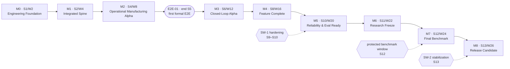

# 07 — Milestone and Release Plan
## Intelligent Manufacturing Operations Platform for Critical Aerospace Components — Milestone Gates, Sprint Themes, Release Semantics, Freeze Rules and Cut Policy

| Field | Value |
|---|---|
| Document | `07_Milestone_and_Release_Plan.md` |
| Status | **Draft — Derived from Approved 01/02 Baseline** (requires team review; see §17) |
| Version | v0.1.0-draft |
| Generated | pre-implementation (no milestone has been attempted) |
| Planning baseline | **26 effective engineering weeks / 13 × 2-week sprints** (01 Item 65 #1–#2) |
| Date policy | No calendar dates are invented. All timing is expressed as S1–S13 (sprints) and W2–W26 (effective weeks); effective weeks are not calendar weeks (Item 65 #3) |
| Canonical sources | 01 Items 42, 60, 64–69, 75, 79, 83–85; 02 Deployment/Release architecture |
| Upstream artifacts | 03 RTM · 04 WBS · 05 Dependency Graph · 06A–D Roadmaps |
| Milestones | M0 (End S1/W2) … M8 (End S13/W26) — semantics fixed, calendar may be rebaselined |
| Work packages placed | 174 of 179 work packages have a target milestone; 5 are unscheduled by design (R2/S/guard rails) |
| Status of every milestone today | `NOT_ATTEMPTED` — no gate has been evaluated, no release exists, no evidence has been produced |

> **Reading rule.** A milestone is passed when its gates are demonstrably satisfied, not when its week arrives. Calendar progress can never auto-pass a milestone (Item 65 #198).

---

## Table of Contents

1. Purpose and Scope
2. Sources, Precedence and Date Policy
3. Planning Baseline: Horizon, Cadence, Capacity
4. Milestone Map and Gate Model
5. Milestone Records M0–M8
6. Sprint Themes S1–S13
7. Release Semantics
8. Environment and Promotion Model
9. Freeze Semantics (M6 and after)
10. Cut Policy
11. Evidence Requirements per Gate
12. Go/No-Go Procedure and Milestone Health
13. Demo and Benchmark Separation
14. Slip, Contingency and Replanning
15. Role Convergence per Milestone
16. Machine-Readable Companion
17. Findings Register
18. Rejected Alternatives
19. Guide §15 Compliance Check and Audit

---

## 1. Purpose and Scope

Make the approved schedule operational: what each milestone means, what must be true to enter and to exit it, which work packages and dependency gates carry it, what evidence it demands, how releases are built and promoted, what freezes at M6, and what gets cut first when the plan is under pressure.

| In scope | Out of scope (owned elsewhere) |
|---|---|
| Milestone records with entry/exit criteria, required capabilities, WPs, integration and evidence | Work package definitions themselves (04) |
| Sprint themes and per-role scope per sprint | Per-person execution detail (06A–D) |
| Release, promotion, migration and rollback semantics | CD implementation work packages (04 WP-CICD-*) |
| Freeze rules and the research freeze sequence | Experiment design (01 Item 60) and benchmark design (Item 79) |
| Cut policy and slip response | Change-request mechanics (09, not yet produced) |
| Go/No-Go procedure and milestone health states | Dependency semantics (05) and requirement wording (01/03) |

## 2. Sources, Precedence and Date Policy

| Source | Used for |
|---|---|
| 01 Item 65 | planning horizon, sprint cadence, capacity model, milestone targets and exit criteria, sprint scopes per role, freeze sequence, stabilization windows, failure handling |
| 01 Item 42 | CD model: build once → promote → preflight → migrate → roll out → verify → declare success; ReleaseManifest and DeploymentRecord semantics; deployment state machine |
| 01 Item 43 | environment classes and their integrity rules |
| 01 Items 66/67 | dependency need-by points and the E2E-01 checkpoint that precedes M3 |
| 01 Items 68/69 | scope classes for cut policy; risk identities for blocking risks |
| 01 Items 60/79/83 | freeze prerequisites, benchmark campaign structure, evidence and acceptance semantics |
| 01 Items 75/84/85 | demo rules, architecture validation scenarios, final red-team review |
| 02 | deployment topology, environment profiles, startup order, runtime dependency classes |
| 03 / 04 / 05 / 06 | requirement dispositions, work packages, dependency gates and per-role commitments referenced by identity |

**Date policy (00 §15).** The sources contain no academic calendar, so no dates are invented. Sprints are S1–S13 and effective weeks W2–W26. If the real calendar shifts, the mapping is rebaselined while milestone semantics stay fixed (Item 65 #4).

## 3. Planning Baseline: Horizon, Cadence, Capacity

| Parameter | Value | Source |
|---|---|---|
| Reference horizon | 26 effective engineering weeks | Item 65 #1 |
| Cadence | 13 × 2-week sprints | Item 65 #2 |
| Effective week vs calendar week | Exams, holidays, other coursework and availability reductions are excluded from effective capacity | Item 65 #3 |
| Sprint length rationale | 1 week rejected (too short for training/integration/review); 3–4 weeks rejected (feedback too slow) | Item 65 #5 |
| Sprint ≠ release boundary | Not every sprint produces a formal release, but `main` stays continuously integratable/deployable | Item 65 #6 |
| Capacity model | ≈65% planned milestone work · ≈20% integration/review/defects · ≈15% contingency | Item 65 #7 |
| Capacity discipline | Percentages are planning discipline, not timesheet accounting; 100% planned capacity is rejected | Item 65 #8–#9 |
| Contingency use order | integration → tests → documentation → technical debt → next READY critical task (never stretch features) | Item 65 #10 |
| Estimation | Size classes S/M/L; story-point velocity is not a target; L items become workstreams rather than issues | Item 65 #11–#13 |
| Milestone types | engineering · integration · research · release | Item 65 #14–#17 |

### 3.1 Sprint capacity template (per sprint, per person)

| Band | Share | Contents | Rule |
|---|---|---|---|
| Planned milestone work | ≈65% | work packages targeted at the current milestone (04) | planned at sprint start against a sprint goal |
| Integration, review, defects | ≈20% | cross-owner review obligations, contract handshakes, defect repair | review of a blocking dependency outranks personal feature work (Item 66 DEP-INV-29) |
| Contingency | ≈15% | absorbs uncertainty | never pre-allocated to stretch scope; unused contingency follows the Item 65 #10 order |

### 3.2 Work distribution across the horizon (generated from 04)

| Milestone | Name | Target | #WP | F0 | R1 | WPs by owner |
|---|---|---|---|---|---|---|
| M0 | Engineering Foundation Ready | End S1 / W2 | 2 | 0 | 0 | Asrın:1, Yavuz:1 |
| M1 | Integrated Spine | End S2 / W4 | 13 | 8 | 0 | Asrın:7, Yavuz:5, Batu:1 |
| M2 | Operational Manufacturing Alpha | End S4 / W8 | 21 | 3 | 0 | Asrın:10, Yavuz:5, Batu:4, Selman:2 |
| M3 | Closed-Loop Alpha | End S6 / W12 | 27 | 14 | 0 | Asrın:13, Batu:9, Yavuz:3, Selman:2 |
| M4 | Mandatory Core Feature Complete | End S8 / W16 | 39 | 1 | 0 | Asrın:15, Batu:9, Selman:8, Yavuz:7 |
| M5 | Reliability & Evaluation Ready | End S10 / W20 | 30 | 0 | 3 | Yavuz:17, Asrın:7, Batu:4, Selman:2 |
| M6 | Research Freeze | End S11 / W22 | 17 | 0 | 11 | Asrın:7, Yavuz:6, Batu:2, Selman:2 |
| M7 | Final Benchmark Complete | End S12 / W24 | 15 | 0 | 4 | Yavuz:8, Asrın:3, Batu:3, Selman:1 |
| M8 | Final Release Candidate | End S13 / W26 | 10 | 0 | 5 | Asrın:6, Yavuz:4 |
| — | unscheduled (R2/S/guard rails) | n/a | 5 | 0 | 0 |  |

## 4. Milestone Map and Gate Model

| Milestone | Type | Target | Theme | Drives |
|---|---|---|---|---|
| M0 | Engineering milestone | End S1 / W2 | Engineering Foundation Ready | shared development becomes possible |
| M1 | Integration milestone | End S2 / W4 | Integrated Spine | real distributed spine |
| M2 | Engineering + integration milestone | End S4 / W8 | Operational Manufacturing Alpha | operational world |
| M3 | Integration milestone (project survival gate) | End S6 / W12 | Closed-Loop Alpha | closed loop (CP-1) |
| M4 | Engineering milestone | End S8 / W16 | Mandatory Core Feature Complete | mandatory capability complete |
| M5 | Engineering + research-readiness milestone | End S10 / W20 | Reliability & Evaluation Ready | reliability + evaluation readiness (CP-3) |
| M6 | Research milestone (freeze) | End S11 / W22 | Research Freeze | research freeze (CP-2) |
| M7 | Research milestone (evidence) | End S12 / W24 | Final Benchmark Complete | sealed evidence |
| M8 | Release milestone | End S13 / W26 | Final Release Candidate | pinned release, demo, thesis |



### 4.1 The five gates every milestone is evaluated against (Item 65 #129–#134)

| Gate | Question | Fails when |
|---|---|---|
| Functional gate | do the required capabilities exist in integrated form? | a required capability exists only locally or behind a fixture |
| Integration gate | do the capabilities work together across real service boundaries? | the path is demonstrated with a mocked broker, database, identity or Vision output |
| Quality gate | do the required tests, including negative paths, pass without gate erosion? | a required suite is quarantined, retried until green, or absent |
| Operational gate | can the system be deployed, observed and recovered as required at this stage? | deployment needs a manual host step, or a failure is invisible |
| Evidence gate | does the evidence required at this milestone exist and bind to the right identities? | a claim rests on a development run, an unbound measurement, or nothing |

A failed mandatory gate means the milestone is **not passed** (#134). There is no partial pass; there is `PASSED_WITH_ACCEPTED_DEBT` only under the debt rules in §12.
## 5. Milestone Records M0–M8

Each record follows the 00 §15 milestone schema. Work packages, dependency gates and requirement targets are generated from 04 and 05; criteria and semantics come from 01 Item 65. Status of every record: `NOT_ATTEMPTED`.

### 5.M0 M0 — Engineering Foundation Ready

| Field | Value |
|---|---|
| Target | End S1 / effective W2 |
| Type | Engineering milestone |
| Sprints | S1 |
| Work packages | 2 |
| HARD dependency gates due in window | 9 |
| Milestone exit edges (05) | DEP-155, DEP-156, DEP-157, DEP-158 |
| Status | NOT_ATTEMPTED |

**Purpose.** Make shared, reproducible development possible. Nothing about the product is proven at M0; what is proven is that four people can build, run and deploy the same thing from Git without manual host surgery.

**Entry criteria.**
- approved 01/02 baseline and the downstream artifacts 03–06 exist in draft
- repository created with the agreed monorepo structure
- the shared Linux host is available for bootstrap

**Required capabilities.**
- protected `main` with required PR checks
- application skeletons that build and run
- PostgreSQL, NATS and object storage reachable from the Integration host
- Integration host deployable from Git
- basic health endpoints
- no manual deployment dependency on the normal path

**Required work packages (from 04).**

| WP | Title | Owner | Scope | Size |
|---|---|---|---|---|
| WP-GOV-001 | Machine-readable requirement catalog and ID lint | Asrın | F1 | L |
| WP-CICD-001 | CI pipeline and required gates | Yavuz | F1 | M |

**Requirements reaching their target in this window:** 10 (0 F0: —).

**Dependency gates that must close in this window (05).**

| DEP | Predecessor → Successor | Kind | Stage | Required readiness | Owner → Consumer |
|---|---|---|---|---|---|
| DEP-001 | DN-PLAT-REPO → DN-PLAT-TOOLING | CAPABILITY | START | INTEGRATION_READY | Yavuz → Yavuz |
| DEP-002 | DN-PLAT-REPO → DN-PLAT-CD | CAPABILITY | START | INTEGRATION_READY | Yavuz → Yavuz |
| DEP-003 | DN-PLAT-TOOLING → DN-PLAT-COMPOSE | CAPABILITY | START | SKELETON_READY | Yavuz → Yavuz |
| DEP-004 | DN-PLAT-COMPOSE → DN-PLAT-INTEG | RUNTIME | MILESTONE_EXIT | SKELETON_READY | Yavuz → Yavuz |
| DEP-006 | DN-PLAT-COMPOSE → DN-RT-PG | RUNTIME | START | SKELETON_READY | Yavuz → Yavuz |
| DEP-155 | DN-PLAT-REPO → MS-M0 | CAPABILITY | MILESTONE_EXIT | INTEGRATION_READY | Yavuz → — |
| DEP-156 | DN-PLAT-TOOLING → MS-M0 | CAPABILITY | MILESTONE_EXIT | COMPONENT_READY | Yavuz → — |
| DEP-157 | DN-PLAT-COMPOSE → MS-M0 | CAPABILITY | MILESTONE_EXIT | INTEGRATION_READY | Yavuz → — |
| DEP-158 | DN-PLAT-INTEG → MS-M0 | CAPABILITY | MILESTONE_EXIT | INTEGRATION_READY | Yavuz → — |

**Required integration.** Integration host bootstrap from Git; each service skeleton starts under the Compose profile.

**Exit criteria (Item 65).**
- protected `main` active
- working PR CI
- application skeletons build and run
- PostgreSQL reachable
- NATS reachable
- object storage reachable
- Integration host deployable from Git
- basic health endpoints present
- no manual deployment dependency for the normal path

**Required evidence.**
- CI run on a PR with required checks green
- a deployment from Git to the Integration host with a DeploymentRecord (format may still be v0)
- `mfgctl doctor` output on a fresh developer machine

**Blocking risks.**

| Risk (Item 69) | Exposure at this gate |
|---|---|
| PLAT-R10 | host bootstrap depends on undocumented manual steps |
| TEAM-R01 | only one person can operate the platform |

**Cut decision at this milestone.** Nothing product-facing can be cut at M0 because nothing product-facing is in it. If the window is tight, cut dashboard polish and non-essential `mfgctl` convenience commands, never branch protection, CI or the Integration bootstrap.

**Debt policy.**

| Allowed debt (may pass as PASSED_WITH_ACCEPTED_DEBT) | Not waivable |
|---|---|
| incomplete `mfgctl` command surface, minimal dashboards, rough service skeletons | unprotected `main`, manual deployment as the normal path, secrets committed to Git |

**Release artifact.** No product release. Artifact: repository baseline + first CI-built images (not promoted).

**Go/No-Go condition.** GO when every exit criterion is demonstrable on the shared host by someone other than its author. NO-GO if the normal deployment path still requires manual steps — the entire plan assumes reproducible deployment from S2 onwards.

**Gate evaluation checklist.**

| Gate | Evidence source at this milestone | Result |
|---|---|---|
| Functional | work-package DoD across the 2 packages above | — |
| Integration | Integration host bootstrap from Git; each service skeleton starts under the Compose profile. | — |
| Quality | required CI tiers and negative suites for the capabilities in scope | — |
| Operational | deployment, health and recovery behaviour required at this stage | — |
| Evidence | CI run on a PR with required checks green | — |


### 5.M1 M1 — Integrated Spine

| Field | Value |
|---|---|
| Target | End S2 / effective W4 |
| Type | Integration milestone |
| Sprints | S2 |
| Work packages | 13 |
| HARD dependency gates due in window | 28 |
| Milestone exit edges (05) | DEP-159, DEP-160, DEP-161, DEP-162, DEP-163, DEP-164, DEP-165, DEP-166, DEP-167 |
| Status | NOT_ATTEMPTED |

**Purpose.** Prove the distributed spine: a manufacturing fact created in Core travels through the real outbox and broker into the Twin projection and becomes visible in the Command Center shell. This is the milestone that forbids a monolithic shortcut for the rest of the project.

**Entry criteria.**
- M0 PASSED
- Core domain contract draft published with fixtures
- PostgreSQL and NATS INTEGRATION_READY

**Required capabilities.**
- Core minimal lifecycle on PostgreSQL
- transactional outbox and relay
- event contracts with envelope fields
- Twin projection skeleton consuming real events
- Command Center shell reading through the BFF
- CD to INTEGRATION with immutable artifacts
- basic health and log/metric instrumentation

**Required work packages (from 04).**

| WP | Title | Owner | Scope | Size |
|---|---|---|---|---|
| WP-CORE-001 | Canonical manufacturing domain model and core schema | Asrın | F0 | L |
| WP-CORE-005 | Domain events and transactional outbox | Asrın | F0 | M |
| WP-CORE-007 | Core database migrations and role separation | Asrın | F1 | M |
| WP-EVT-001 | Integration Contract Registry and versioning discipline | Asrın | F0 | M |
| WP-EVT-002 | Message envelope, correlation and world scoping | Asrın | F1 | M |
| WP-TWIN-001 | Twin projection engine | Asrın | F0 | M |
| WP-SIM-001 | Deterministic DES kernel | Batu | F0 | M |
| WP-UI-001 | Command Center shell and BFF contract | Asrın | F0 | M |
| WP-PLAT-001 | Compose profiles and mandatory runtime composition | Yavuz | F0 | M |
| WP-PLAT-002 | mfgctl developer and operator CLI | Yavuz | F1 | M |
| WP-CICD-002 | CD to INTEGRATION with immutable artifacts | Yavuz | F0 | M |
| WP-OBS-001 | Telemetry pipeline (OTel → Collector → OpenObserve) | Yavuz | F1 | M |
| WP-TEST-001 | Test strategy, tiers and boundary-mode policy | Yavuz | F1 | M |

**Requirements reaching their target in this window:** 38 (7 F0: FR-CORE-001, FR-CORE-002, FR-EVT-001, FR-PLAT-001, FR-SIM-001, FR-TWIN-001, FR-UI-001).

**Dependency gates that must close in this window (05).**

| DEP | Predecessor → Successor | Kind | Stage | Required readiness | Owner → Consumer |
|---|---|---|---|---|---|
| DEP-005 | DN-PLAT-INTEG → DN-PLAT-CD | RUNTIME | INTEGRATION | INTEGRATION_READY | Yavuz → Yavuz |
| DEP-007 | DN-PLAT-INTEG → DN-RT-PG | RUNTIME | INTEGRATION | INTEGRATION_READY | Yavuz → Yavuz |
| DEP-008 | DN-PLAT-INTEG → DN-RT-NATS | RUNTIME | INTEGRATION | INTEGRATION_READY | Yavuz → Yavuz |
| DEP-011 | DN-PLAT-INTEG → DN-RT-OBS | RUNTIME | MILESTONE_EXIT | SKELETON_READY | Yavuz → Yavuz |
| DEP-018 | DN-CORE-CONTRACTS → DN-CORE-LIFECYCLE | CONTRACT | START | CONTRACT_READY | Asrın → Asrın |
| DEP-019 | DN-RT-PG → DN-CORE-LIFECYCLE | RUNTIME | INTEGRATION | SKELETON_READY | Yavuz → Asrın |
| DEP-021 | DN-CORE-CONTRACTS → DN-EVT-CONTRACTS | CONTRACT | START | CONTRACT_READY | Asrın → Asrın |
| DEP-022 | DN-CORE-LIFECYCLE → DN-CORE-OUTBOX | CAPABILITY | INTEGRATION | COMPONENT_READY | Asrın → Asrın |
| DEP-023 | DN-EVT-CONTRACTS → DN-EVT-SPINE | CONTRACT | INTEGRATION | CONTRACT_READY | Asrın → Asrın |
| DEP-024 | DN-CORE-OUTBOX → DN-EVT-SPINE | CAPABILITY | INTEGRATION | INTEGRATION_READY | Asrın → Asrın |
| DEP-025 | DN-RT-NATS → DN-EVT-SPINE | RUNTIME | INTEGRATION | INTEGRATION_READY | Yavuz → Asrın |
| DEP-026 | DN-CORE-CONTRACTS → DN-CORE-CMDCON | CONTRACT | START | CONTRACT_READY | Asrın → Asrın |
| DEP-031 | DN-EVT-CONTRACTS → DN-TWIN-SKELETON | CONTRACT | START | CONTRACT_READY | Asrın → Asrın |
| DEP-032 | DN-EVT-SPINE → DN-TWIN-SKELETON | CAPABILITY | INTEGRATION | INTEGRATION_READY | Asrın → Asrın |
| DEP-033 | DN-RT-PG → DN-TWIN-SKELETON | RUNTIME | INTEGRATION | INTEGRATION_READY | Yavuz → Asrın |
| DEP-037 | DN-SIM-KERNEL → DN-SIM-OPSEM | CAPABILITY | START | COMPONENT_READY | Batu → Batu |
| DEP-038 | DN-CORE-CONTRACTS → DN-SIM-OPSEM | CONTRACT | START | CONTRACT_READY | Asrın → Batu |
| DEP-043 | DN-SIM-KERNEL → DN-SIM-DISPIF | CAPABILITY | START | COMPONENT_READY | Batu → Batu |
| DEP-105 | DN-UI-BFFCON → DN-UI-SHELL | CONTRACT | START | CONTRACT_READY | Asrın → Asrın |
| DEP-106 | DN-TWIN-SKELETON → DN-UI-SHELL | CAPABILITY | MILESTONE_EXIT | INTEGRATION_READY | Asrın → Asrın |
| DEP-160 | DN-CORE-LIFECYCLE → MS-M1 | CAPABILITY | MILESTONE_EXIT | INTEGRATION_READY | Asrın → — |
| DEP-161 | DN-RT-PG → MS-M1 | CAPABILITY | MILESTONE_EXIT | INTEGRATION_READY | Yavuz → — |
| DEP-162 | DN-RT-NATS → MS-M1 | CAPABILITY | MILESTONE_EXIT | INTEGRATION_READY | Yavuz → — |
| DEP-163 | DN-CORE-OUTBOX → MS-M1 | CAPABILITY | MILESTONE_EXIT | INTEGRATION_READY | Asrın → — |
| DEP-164 | DN-TWIN-SKELETON → MS-M1 | CAPABILITY | MILESTONE_EXIT | INTEGRATION_READY | Asrın → — |
| DEP-165 | DN-UI-SHELL → MS-M1 | CAPABILITY | MILESTONE_EXIT | INTEGRATION_READY | Asrın → — |
| DEP-166 | DN-PLAT-CD → MS-M1 | CAPABILITY | MILESTONE_EXIT | INTEGRATION_READY | Yavuz → — |
| DEP-167 | DN-EVT-SPINE → MS-M1 | CAPABILITY | MILESTONE_EXIT | INTEGRATION_READY | Asrın → — |

**Required integration.** Core → outbox → NATS → Twin → BFF → UI, on the Integration environment, with no in-process shortcut between services.

**Exit criteria (Item 65).**
- one synthetic lot is created
- it traverses a minimal route
- real events are emitted
- Twin/read state updates
- the lot becomes visible in the Command Center skeleton
- real distributed boundaries are used (no monolithic bypass)

**Required evidence.**
- integration test run covering the create → traverse → project → display path
- DeploymentRecord for the release under test
- Twin revision advancing in response to real events

**Blocking risks.**

| Risk (Item 69) | Exposure at this gate |
|---|---|
| ARCH-R06 | Twin degenerates into a renamed Core query |
| ARCH-R04 | event contracts drift between producer and consumer |
| PLAT-R08 | deployment needs host patching |

**Cut decision at this milestone.** AI, advanced scheduling and final Vision are explicitly not required at M1 (Item 65 #33–#34). Cut UI breadth to a single state view before cutting the real boundary requirement.

**Debt policy.**

| Allowed debt (may pass as PASSED_WITH_ACCEPTED_DEBT) | Not waivable |
|---|---|
| minimal UI, simple event payloads, no authentication on the UI path yet, manual scenario seeding | direct database access across service boundaries, fake event bus in the demonstrated path, Twin populated by Core queries instead of events |

**Release artifact.** First promoted Integration release with ReleaseManifest v0 and a DeploymentRecord.

**Go/No-Go condition.** GO when the spine path is demonstrated end to end on INTEGRATION from a promoted artifact. NO-GO if the demonstration requires a local process, an in-memory bus or a hand-seeded Twin.

**Gate evaluation checklist.**

| Gate | Evidence source at this milestone | Result |
|---|---|---|
| Functional | work-package DoD across the 13 packages above | — |
| Integration | Core → outbox → NATS → Twin → BFF → UI, on the Integration environment, with no in-process shortcut between services. | — |
| Quality | required CI tiers and negative suites for the capabilities in scope | — |
| Operational | deployment, health and recovery behaviour required at this stage | — |
| Evidence | integration test run covering the create → traverse → project → display path | — |


### 5.M2 M2 — Operational Manufacturing Alpha

| Field | Value |
|---|---|
| Target | End S4 / effective W8 |
| Type | Engineering + integration milestone |
| Sprints | S3, S4 |
| Work packages | 21 |
| HARD dependency gates due in window | 49 |
| Milestone exit edges (05) | DEP-168, DEP-169, DEP-170, DEP-171, DEP-172, DEP-173, DEP-174, DEP-175, DEP-176 |
| Status | NOT_ATTEMPTED |

**Purpose.** Turn the spine into an operational world: reentrant manufacturing with competition for equipment, failures, maintenance and rework, reconstructable genealogy, a synchronized Twin, structured visual evidence and at least one feasible schedule.

**Entry criteria.**
- M1 PASSED
- Core transition rules stabilizing
- SeaweedFS and artifact contract available for inspection artifacts

**Required capabilities.**
- reentrant routing in Simulator aligned to Core legality
- equipment queues, failure/repair, maintenance, rework
- genealogy and exposure queries
- Twin revision, freshness and epistemic classes
- structured Vision inspection evidence published as observations
- feasible schedule produced from a Twin-derived snapshot
- restart recovery behaviour
- reconstructable environment (manifests, migrations, backups foundation)

**Required work packages (from 04).**

| WP | Title | Owner | Scope | Size |
|---|---|---|---|---|
| WP-GOV-002 | Trace registry, edges and trace linter | Yavuz | F1 | L |
| WP-CORE-002 | Manufacturing lifecycle state machine | Asrın | F1 | M |
| WP-CORE-003 | Command acceptance: idempotency, revision preconditions, durable outcomes | Asrın | F1 | L |
| WP-CORE-004 | Rework, split/merge and temporal genealogy | Asrın | F1 | M |
| WP-EVT-003 | Idempotent consumer framework | Asrın | F1 | S |
| WP-EVT-005 | Architecture rules as code (boundaries and ownership) | Asrın | F1 | S |
| WP-TWIN-002 | Epistemic classes, freshness and staleness semantics | Asrın | F1 | M |
| WP-TWIN-003 | Twin query API and scheduling snapshot export | Asrın | F1 | M |
| WP-SIM-002 | Determinism, replay and event-hash equivalence | Batu | F1 | M |
| WP-SIM-003 | Operational semantics: reentrant routing, queues, failures, maintenance, rework | Batu | F0 | L |
| WP-SIM-006 | External dispatch decision interface and operational telemetry | Batu | F0 | M |
| WP-OBJ-001 | Artifact service: ArtifactRef contract and object storage integration | Yavuz | F1 | M |
| WP-VIS-001 | Inspection pipeline and serving path | Selman | F0 | M |
| WP-VIS-008 | CPU smoke inference path | Selman | F1 | S |
| WP-SCH-001 | Dispatch baselines and scheduling instance model | Batu | F1 | S |
| WP-UI-002 | manufacturing facility state and operational views | Asrın | F1 | S |
| WP-PLAT-003 | Runtime service bring-up on the shared host | Yavuz | F1 | M |
| WP-CICD-003 | Automated migration execution in the deployment path | Yavuz | F1 | S |
| WP-TEST-002 | Contract and schema test suites | Asrın | F1 | S |
| WP-TEST-007 | Architecture rules and trace validation in CI | Yavuz | F1 | S |
| WP-DOC-002 | ADR backfill and decision index | Asrın | F1 | S |

**Requirements reaching their target in this window:** 47 (3 F0: FR-PLAT-001, FR-SIM-002, FR-VIS-001).

**Dependency gates that must close in this window (05).**

| DEP | Predecessor → Successor | Kind | Stage | Required readiness | Owner → Consumer |
|---|---|---|---|---|---|
| DEP-009 | DN-PLAT-INTEG → DN-RT-OBJ | RUNTIME | INTEGRATION | INTEGRATION_READY | Yavuz → Yavuz |
| DEP-010 | DN-PLAT-INTEG → DN-RT-IDP | RUNTIME | INTEGRATION | INTEGRATION_READY | Yavuz → Yavuz |
| DEP-020 | DN-CORE-LIFECYCLE → DN-CORE-TRANSITIONS | CAPABILITY | START | COMPONENT_READY | Asrın → Asrın |
| DEP-027 | DN-CORE-CMDCON → DN-CORE-CMDEXEC | CONTRACT | START | CONTRACT_READY | Asrın → Asrın |
| DEP-028 | DN-CORE-TRANSITIONS → DN-CORE-CMDEXEC | CAPABILITY | INTEGRATION | INTEGRATION_READY | Asrın → Asrın |
| DEP-029 | DN-CORE-LIFECYCLE → DN-CORE-GENEALOGY | CAPABILITY | INTEGRATION | COMPONENT_READY | Asrın → Asrın |
| DEP-030 | DN-CORE-CONTRACTS → DN-CORE-SNAPCON | CONTRACT | START | CONTRACT_READY | Asrın → Asrın |
| DEP-034 | DN-TWIN-SKELETON → DN-TWIN-PROJ | CAPABILITY | START | COMPONENT_READY | Asrın → Asrın |
| DEP-035 | DN-SIM-COREINT → DN-TWIN-PROJ | CAPABILITY | MILESTONE_EXIT | INTEGRATION_READY | Batu → Asrın |
| DEP-036 | DN-TWIN-PROJ → DN-TWIN-VERIFY | CAPABILITY | INTEGRATION | INTEGRATION_READY | Asrın → Asrın |
| DEP-039 | DN-CORE-TRANSITIONS → DN-SIM-OPSEM | CAPABILITY | MILESTONE_EXIT | INTEGRATION_READY | Asrın → Batu |
| DEP-040 | DN-SIM-OPSEM → DN-SIM-COREINT | CAPABILITY | INTEGRATION | COMPONENT_READY | Batu → Batu |
| DEP-041 | DN-CORE-CMDEXEC → DN-SIM-COREINT | CAPABILITY | INTEGRATION | INTEGRATION_READY | Asrın → Batu |
| DEP-042 | DN-EVT-SPINE → DN-SIM-COREINT | CAPABILITY | INTEGRATION | INTEGRATION_READY | Asrın → Batu |
| DEP-044 | DN-SIM-KERNEL → DN-SIM-SNAPFORK | CAPABILITY | START | COMPONENT_READY | Batu → Batu |
| DEP-046 | DN-SIM-KERNEL → DN-SIM-ORACLE | CAPABILITY | START | COMPONENT_READY | Batu → Batu |
| DEP-048 | DN-SIM-OPSEM → DN-SIM-SYNTH | CAPABILITY | START | COMPONENT_READY | Batu → Batu |
| DEP-051 | DN-VIS-SYNTH → DN-VIS-SPLIT | DATA | START | COMPONENT_READY | Selman → Selman |
| DEP-052 | DN-VIS-SPLIT → DN-VIS-BASELINES | DATA | START | COMPONENT_READY | Selman → Selman |
| DEP-056 | DN-CORE-CONTRACTS → DN-VIS-ARTCON | CONTRACT | START | CONTRACT_READY | Asrın → Selman |
| DEP-057 | DN-VIS-ARTCON → DN-VIS-SERVING | CONTRACT | INTEGRATION | CONTRACT_READY | Selman → Selman |
| DEP-061 | DN-VIS-ARTCON → DN-VIS-OBSCON | CONTRACT | START | CONTRACT_READY | Selman → Selman |
| DEP-064 | DN-AI-TOOLCON → DN-AI-ORCH | CONTRACT | START | CONTRACT_READY | Asrın → Asrın |
| DEP-065 | DN-VIS-OBSCON → DN-AI-RCA | CONTRACT | START | CONTRACT_READY | Selman → Asrın |
| DEP-066 | DN-AI-ORCH → DN-AI-RCA | CAPABILITY | START | COMPONENT_READY | Asrın → Asrın |
| DEP-070 | DN-RAG-CORPUS → DN-RAG | DATA | START | COMPONENT_READY | Asrın → Asrın |
| DEP-076 | DN-HITL-POLICY → DN-AI-ACTCON | CAPABILITY | START | COMPONENT_READY | Asrın → Asrın |
| DEP-077 | DN-AI-ACTCON → DN-AI-RCA | CONTRACT | INTEGRATION | CONTRACT_READY | Asrın → Asrın |
| DEP-078 | DN-SCH-HEUR → DN-SCH-DYN | CAPABILITY | START | COMPONENT_READY | Batu → Batu |
| DEP-079 | DN-CORE-SNAPCON → DN-SCH-DYN | CONTRACT | INTEGRATION | CONTRACT_READY | Asrın → Batu |
| DEP-080 | DN-TWIN-PROJ → DN-SCH-DYN | CAPABILITY | INTEGRATION | INTEGRATION_READY | Asrın → Batu |
| DEP-088 | DN-SIM-DISPIF → DN-SCH-DYN | CONTRACT | INTEGRATION | CONTRACT_READY | Batu → Batu |
| DEP-090 | DN-RT-IDP → DN-HITL-APPROVAL | RUNTIME | INTEGRATION | INTEGRATION_READY | Yavuz → Asrın |
| DEP-092 | DN-SCH-PLANCON → DN-HITL-APPROVAL | CONTRACT | INTEGRATION | CONTRACT_READY | Batu → Asrın |
| DEP-094 | DN-AUTO-DESIGN → DN-AUTO-DURABLE | CAPABILITY | START | COMPONENT_READY | Batu → Batu |
| DEP-096 | DN-AI-ACTCON → DN-AUTO-EXEC | CONTRACT | INTEGRATION | CONTRACT_READY | Asrın → Batu |
| DEP-097 | DN-CORE-CMDCON → DN-AUTO-EXEC | CONTRACT | INTEGRATION | CONTRACT_READY | Asrın → Batu |
| DEP-098 | DN-CORE-CMDEXEC → DN-AUTO-EXEC | CAPABILITY | INTEGRATION | INTEGRATION_READY | Asrın → Batu |
| DEP-101 | DN-SCH-PLANCON → DN-AUTO-EXEC | CONTRACT | INTEGRATION | CONTRACT_READY | Batu → Batu |
| DEP-107 | DN-UI-SHELL → DN-UI-APPROVAL | CAPABILITY | START | COMPONENT_READY | Asrın → Asrın |
| DEP-108 | DN-RT-IDP → DN-UI-APPROVAL | RUNTIME | INTEGRATION | INTEGRATION_READY | Yavuz → Asrın |
| DEP-169 | DN-SIM-COREINT → MS-M2 | CAPABILITY | MILESTONE_EXIT | INTEGRATION_READY | Batu → — |
| DEP-170 | DN-SIM-OPSEM → MS-M2 | CAPABILITY | MILESTONE_EXIT | INTEGRATION_READY | Batu → — |
| DEP-171 | DN-CORE-GENEALOGY → MS-M2 | CAPABILITY | MILESTONE_EXIT | INTEGRATION_READY | Asrın → — |
| DEP-172 | DN-TWIN-PROJ → MS-M2 | CAPABILITY | MILESTONE_EXIT | INTEGRATION_READY | Asrın → — |
| DEP-173 | DN-VIS-SERVING → MS-M2 | CAPABILITY | MILESTONE_EXIT | COMPONENT_READY | Selman → — |
| DEP-174 | DN-SCH-DYN → MS-M2 | CAPABILITY | MILESTONE_EXIT | COMPONENT_READY | Batu → — |
| DEP-175 | DN-RT-OBJ → MS-M2 | CAPABILITY | MILESTONE_EXIT | INTEGRATION_READY | Yavuz → — |
| DEP-176 | DN-PLAT-FAILVAL → MS-M2 | CAPABILITY | MILESTONE_EXIT | COMPONENT_READY | Yavuz → — |

**Required integration.** Simulator ↔ Core ↔ Twin triangle under real events; Vision publishing observations into the spine; Scheduler consuming real snapshots.

**Exit criteria (Item 65).**
- reentrant manufacturing demonstrated
- equipment/resource competition demonstrated
- failure, maintenance and rework demonstrated
- genealogy reconstruction demonstrated
- Twin synchronization demonstrated
- structured Vision inspection evidence present
- at least one feasible schedule produced
- restart behaviour demonstrated
- environment reconstructable

**Required evidence.**
- scenario run covering reentrant flow with disruptions
- genealogy query output for a reworked lot
- Vision observation with provenance fields
- restart test record
- EnvironmentManifest and migration run record

**Blocking risks.**

| Risk (Item 69) | Exposure at this gate |
|---|---|
| SIM-R01 | simulator behaviour diverges from Core legality |
| DATA-R06 | no usable dataset for meaningful Vision evidence |
| ARCH-R03 | contract churn between Vision, Core and Twin |

**Cut decision at this milestone.** Model quality, scheduler optimality and UI depth are the cut candidates. The non-negotiable content is reentrancy, disruption handling, genealogy and the Twin synchronization that E2E-01 depends on.

**Debt policy.**

| Allowed debt (may pass as PASSED_WITH_ACCEPTED_DEBT) | Not waivable |
|---|---|
| simple Vision algorithm, heuristic-only scheduling, partial observability dashboards, incomplete UI views | simulated effects that bypass Core validation, genealogy reconstructed by overwriting history, Vision evidence injected rather than computed |

**Release artifact.** Integration release used for the E2E-01 contract-readiness check at end S4.

**Go/No-Go condition.** GO when the operational world runs a disruption scenario end to end and the E2E-01 readiness table (Item 67) is satisfied for contracts due at end S4. NO-GO if any E2E-01 contract is still unversioned or fixture-only on the producer side.

**Gate evaluation checklist.**

| Gate | Evidence source at this milestone | Result |
|---|---|---|
| Functional | work-package DoD across the 21 packages above | — |
| Integration | Simulator ↔ Core ↔ Twin triangle under real events; Vision publishing observations into the spine; Scheduler consuming real snapshots. | — |
| Quality | required CI tiers and negative suites for the capabilities in scope | — |
| Operational | deployment, health and recovery behaviour required at this stage | — |
| Evidence | scenario run covering reentrant flow with disruptions | — |


### 5.M3 M3 — Closed-Loop Alpha

| Field | Value |
|---|---|
| Target | End S6 / effective W12 |
| Type | Integration milestone (project survival gate) |
| Sprints | S5, S6 |
| Work packages | 27 |
| HARD dependency gates due in window | 28 |
| Milestone exit edges (05) | DEP-188, DEP-189, DEP-190 |
| Status | NOT_ATTEMPTED |

**Purpose.** Close the loop: perception → reasoning → plan → validation → human authority → durable execution → Core effect → Twin verification, on real infrastructure. This is the project survival gate.

**Entry criteria.**
- M2 PASSED
- E2E-01 dry run executed mid S5 with failures classified
- Keycloak, Temporal and SeaweedFS INTEGRATION_READY
- E2E-01 formal run passed at end S5

**Required capabilities.**
- operational Vision observation driving RCA (no injected labels)
- evidence-grounded RCA proposal with binding
- independent schedule validator gating execution eligibility
- authority policy with authenticated human approval
- durable Temporal workflow with approval wait and revalidation
- Core command execution with idempotency
- effect verification against Core/Twin
- distributed traceability across the loop

**Required work packages (from 04).**

| WP | Title | Owner | Scope | Size |
|---|---|---|---|---|
| WP-CORE-008 | Core ↔ Simulator ↔ Twin integration and acceptance | Asrın | F0 | M |
| WP-TWIN-006 | Effect verification view and Core/Twin consistency | Asrın | F0 | S |
| WP-SIM-005 | Oracle isolation and evaluator-only data plane | Batu | F0 | M |
| WP-VIS-007 | Vision-to-loop integration (perception drives RCA) | Selman | F0 | S |
| WP-VIS-009 | Oracle-taint guard for Vision inputs | Selman | F1 | S |
| WP-AI-001 | Deterministic orchestrator and execution budgets | Asrın | F0 | M |
| WP-AI-002 | Typed tool registry and authority-tagged tool access | Asrın | F1 | M |
| WP-AI-003 | Structured evidence-grounded RCA output | Asrın | F1 | M |
| WP-AI-004 | Action proposal and context binding | Asrın | F1 | S |
| WP-AI-006 | AI authority boundary and negative suite | Asrın | F0 | M |
| WP-SCH-002 | Snapshot consumption and recovery plan contract | Batu | F0 | M |
| WP-VALID-001 | Independent schedule validator | Batu | F0 | M |
| WP-VALID-002 | Execution eligibility gate and AI-origin plan routing | Batu | F1 | S |
| WP-AUTO-001 | Durable workflow bundle and approval wait | Batu | F0 | M |
| WP-AUTO-003 | Pre-execution revalidation and command identity | Batu | F1 | S |
| WP-AUTO-004 | ActionCatalog and authorization gate | Batu | F1 | S |
| WP-AUTO-005 | Outcome model and effect verification | Batu | F0 | M |
| WP-HITL-001 | Authority policy engine (L0–L4) | Asrın | F0 | S |
| WP-HITL-002 | Approval binding to exact proposal/plan revision and world | Asrın | F1 | S |
| WP-HITL-003 | Expiry, replay and staleness rejection | Asrın | F1 | S |
| WP-HITL-004 | Identity-bound approvals | Yavuz | F1 | S |
| WP-UI-006 | Approval Center | Asrın | F0 | M |
| WP-OBS-002 | Distributed trace propagation across the closed loop | Yavuz | F1 | S |
| WP-SEC-001 | Keycloak realm, clients and interactive authentication | Yavuz | F1 | M |
| WP-SEC-003 | Backend authorization enforcement | Asrın | F1/H0 | S |
| WP-TEST-003 | Integration scenarios AV-SCEN-01…04 | Asrın | F0 | M |
| WP-TEST-006 | E2E-01 checkpoint execution | Batu | F0 | M |

**Requirements reaching their target in this window:** 59 (8 F0: FR-AI-001, FR-AI-004, FR-AUTO-001, FR-AUTO-014, FR-HITL-001, FR-SCH-001, FR-SCH-005, FR-VIS-016).

**Dependency gates that must close in this window (05).**

| DEP | Predecessor → Successor | Kind | Stage | Required readiness | Owner → Consumer |
|---|---|---|---|---|---|
| DEP-012 | DN-PLAT-INTEG → DN-RT-TEMPORAL | RUNTIME | INTEGRATION | INTEGRATION_READY | Yavuz → Yavuz |
| DEP-047 | DN-SEC-BASE → DN-SIM-ORACLE | CAPABILITY | MILESTONE_EXIT | INTEGRATION_READY | Yavuz → Batu |
| DEP-058 | DN-RT-OBJ → DN-VIS-SERVING | RUNTIME | INTEGRATION | INTEGRATION_READY | Yavuz → Selman |
| DEP-067 | DN-TWIN-PROJ → DN-AI-RCA | CAPABILITY | INTEGRATION | INTEGRATION_READY | Asrın → Asrın |
| DEP-068 | DN-VIS-SERVING → DN-AI-RCA | CAPABILITY | MILESTONE_EXIT | INTEGRATION_READY | Selman → Asrın |
| DEP-082 | DN-CORE-TRANSITIONS → DN-SCH-VALID | CAPABILITY | INTEGRATION | INTEGRATION_READY | Asrın → Batu |
| DEP-083 | DN-SCH-DYN → DN-SCH-PLANCON | CAPABILITY | INTEGRATION | COMPONENT_READY | Batu → Batu |
| DEP-084 | DN-SCH-VALID → DN-SCH-PLANCON | CAPABILITY | INTEGRATION | INTEGRATION_READY | Batu → Batu |
| DEP-091 | DN-HITL-POLICY → DN-HITL-APPROVAL | CAPABILITY | INTEGRATION | INTEGRATION_READY | Asrın → Asrın |
| DEP-093 | DN-UI-APPROVAL → DN-HITL-APPROVAL | CAPABILITY | MILESTONE_EXIT | INTEGRATION_READY | Asrın → Asrın |
| DEP-095 | DN-RT-TEMPORAL → DN-AUTO-DURABLE | RUNTIME | INTEGRATION | INTEGRATION_READY | Yavuz → Batu |
| DEP-099 | DN-HITL-APPROVAL → DN-AUTO-EXEC | CAPABILITY | INTEGRATION | INTEGRATION_READY | Asrın → Batu |
| DEP-100 | DN-AUTO-DURABLE → DN-AUTO-EXEC | CAPABILITY | INTEGRATION | INTEGRATION_READY | Batu → Batu |
| DEP-102 | DN-AUTO-EXEC → DN-AUTO-VERIFY | CAPABILITY | INTEGRATION | COMPONENT_READY | Batu → Batu |
| DEP-103 | DN-TWIN-VERIFY → DN-AUTO-VERIFY | CAPABILITY | INTEGRATION | INTEGRATION_READY | Asrın → Batu |
| DEP-109 | DN-PLAT-CD → DN-RT-OBS | CAPABILITY | MILESTONE_EXIT | INTEGRATION_READY | Yavuz → Yavuz |
| DEP-178 | DN-VIS-SERVING → CK-E2E01 | CAPABILITY | MILESTONE_EXIT | INTEGRATION_READY | Selman → N/A — no single owner (Item 67 #213) |
| DEP-179 | DN-AI-RCA → CK-E2E01 | CAPABILITY | MILESTONE_EXIT | INTEGRATION_READY | Asrın → N/A — no single owner (Item 67 #213) |
| DEP-180 | DN-SCH-PLANCON → CK-E2E01 | CAPABILITY | MILESTONE_EXIT | INTEGRATION_READY | Batu → N/A — no single owner (Item 67 #213) |
| DEP-181 | DN-SCH-VALID → CK-E2E01 | CAPABILITY | MILESTONE_EXIT | INTEGRATION_READY | Batu → N/A — no single owner (Item 67 #213) |
| DEP-182 | DN-HITL-APPROVAL → CK-E2E01 | CAPABILITY | MILESTONE_EXIT | INTEGRATION_READY | Asrın → N/A — no single owner (Item 67 #213) |
| DEP-183 | DN-AUTO-DURABLE → CK-E2E01 | CAPABILITY | MILESTONE_EXIT | INTEGRATION_READY | Batu → N/A — no single owner (Item 67 #213) |
| DEP-184 | DN-AUTO-EXEC → CK-E2E01 | CAPABILITY | MILESTONE_EXIT | INTEGRATION_READY | Batu → N/A — no single owner (Item 67 #213) |
| DEP-185 | DN-AUTO-VERIFY → CK-E2E01 | CAPABILITY | MILESTONE_EXIT | INTEGRATION_READY | Batu → N/A — no single owner (Item 67 #213) |
| DEP-186 | DN-UI-APPROVAL → CK-E2E01 | CAPABILITY | MILESTONE_EXIT | INTEGRATION_READY | Asrın → N/A — no single owner (Item 67 #213) |
| DEP-187 | DN-SIM-ORACLE → CK-E2E01 | CAPABILITY | MILESTONE_EXIT | INTEGRATION_READY | Batu → N/A — no single owner (Item 67 #213) |
| DEP-189 | DN-RT-OBS → MS-M3 | CAPABILITY | MILESTONE_EXIT | INTEGRATION_READY | Yavuz → — |
| DEP-190 | DN-TWIN-VERIFY → MS-M3 | CAPABILITY | MILESTONE_EXIT | INTEGRATION_READY | Asrın → — |

**Required integration.** GS-01-family preliminary flow end to end: Vision anomaly → RCA → schedule proposal → approval → durable workflow → Core state change → Twin verification.

**Exit criteria (Item 65).**
- the GS-01-family preliminary flow executes on real service boundaries
- a duplicate input does not produce a duplicate manufacturing effect
- a stale or replayed approval is rejected
- the correlation chain for the run is inspectable end to end
- no scenario-ID hardcoding or injected defect flag anywhere in the path

**Required evidence.**
- E2E-01 formal run records (E2E-RUN-A/B/C) from an immutable main-derived release
- AV-SCEN-01 and AV-SCEN-04 execution records
- trace showing one correlation chain across all hops

**Blocking risks.**

| Risk (Item 69) | Exposure at this gate |
|---|---|
| ARCH-R01 | closed loop integrates late and semantics drift |
| AUTO-R01 | duplicate protected effect under retry |
| AUTO-R04 | stale approval executes |
| PLAN-R03 | E2E-01 slips into S6 and compresses M3 |

**Cut decision at this milestone.** Internal quality at each node may be baseline (Item 66 #109); breadth of scenarios, model strength and UI polish are cut first. The real boundaries, the validator, the approval binding and the effect verification are never cut — removing any of them removes the product identity.

**Debt policy.**

| Allowed debt (may pass as PASSED_WITH_ACCEPTED_DEBT) | Not waivable |
|---|---|
| simple heuristic scheduling instead of CP-SAT, deterministic triage baseline instead of the final LLM path, minimal RAG configuration, basic UI for approvals | mocked Vision output in the accepted run, skipped validator, approval that is not bound to a revision, success declared on acknowledgement instead of verified effect |

**Release artifact.** Pinned Integration release used for the E2E-01 formal run and the M3 review; GS-01 v1 becomes rehearsable from it.

**Go/No-Go condition.** GO when the loop runs from a promoted artifact with all four negative gates (duplicate input, stale approval, validator rejection, unverified effect) behaving correctly. NO-GO stops feature expansion: Item 65 #63 requires repair before further capability growth.

**Gate evaluation checklist.**

| Gate | Evidence source at this milestone | Result |
|---|---|---|
| Functional | work-package DoD across the 27 packages above | — |
| Integration | GS-01-family preliminary flow end to end: Vision anomaly → RCA → schedule proposal → approval → durable workflow → Core state change → Twin verification. | — |
| Quality | required CI tiers and negative suites for the capabilities in scope | — |
| Operational | deployment, health and recovery behaviour required at this stage | — |
| Evidence | E2E-01 formal run records (E2E-RUN-A/B/C) from an immutable main-derived release | — |


### 5.M4 M4 — Mandatory Core Feature Complete

| Field | Value |
|---|---|
| Target | End S8 / effective W16 |
| Type | Engineering milestone |
| Sprints | S7, S8 |
| Work packages | 39 |
| HARD dependency gates due in window | 25 |
| Milestone exit edges (05) | DEP-191, DEP-192, DEP-193, DEP-194, DEP-195, DEP-196, DEP-197, DEP-198, DEP-199, DEP-200 |
| Status | NOT_ATTEMPTED |

**Purpose.** Complete every mandatory capability in integrated form. After M4 the product stops growing and starts hardening; new mandatory features require change control.

**Entry criteria.**
- M3 PASSED
- Qdrant and MLflow INTEGRATION_READY
- dataset versions and split manifests exist in draft

**Required capabilities.**
- predictive M1/M2/M3 behind the common Prediction contract
- mandatory RAG configuration with citations and rights filtering
- required Vision modes plus OOD/UNKNOWN and spatial analysis
- CP-SAT recovery scheduling, rolling horizon, event-triggered replanning, counterfactual evaluation
- durable Automation with ActionCatalog, restart safety and effect verification
- required Command Center workspaces
- mandatory security and platform components (service identities, secrets, audit separation)

**Required work packages (from 04).**

| WP | Title | Owner | Scope | Size |
|---|---|---|---|---|
| WP-TWIN-005 | Counterfactual/what-if stream isolation | Asrın | F1 | S |
| WP-SIM-004 | Snapshot, fork and world isolation | Batu | F1 | M |
| WP-SIM-007 | Scenario versioning and synthetic operational history | Batu | F1 | M |
| WP-VIS-002 | Defect classification and localization models | Selman | F1 | M |
| WP-VIS-003 | Segmentation and anomaly detection | Selman | F1 | M |
| WP-VIS-004 | OOD / UNKNOWN handling and threshold policy | Selman | F1 | M |
| WP-VIS-005 | Provenance, confidence and calibration in Vision outputs | Selman | F1 | S |
| WP-VIS-006 | SerializedComponent spatial pattern and cluster analysis | Selman | F1 | S |
| WP-VDATA-001 | Dataset governance, rights and provenance | Selman | F1 | S |
| WP-VDATA-003 | Synthetic Vision data generator | Selman | F1 | S |
| WP-ML-001 | Feature and label pipeline from operational history | Asrın | F1 | M |
| WP-ML-002 | M1 — equipment risk model | Asrın | F1 | M |
| WP-ML-003 | M2 — cycle-time / tardiness risk model | Asrın | F1 | M |
| WP-ML-004 | M3 — pre-inspection quality risk model | Asrın | F1 | S |
| WP-ML-005 | Common prediction contract and publication | Asrın | F1 | S |
| WP-RAG-001 | Documentary corpus governance and ingestion | Asrın | F1 | M |
| WP-RAG-002 | Retrieval profiles: sparse, dense and hybrid | Asrın | F1 | M |
| WP-RAG-003 | Citation-bearing provenance in retrieval and RCA | Asrın | F1 | S |
| WP-RAG-004 | Rights filtering and prompt-injection resistance | Asrın | F1 | M |
| WP-RAG-005 | Evidence typing: documentary vs operational | Asrın | F1 | S |
| WP-AI-005 | Provider abstraction, behavior bundle and deterministic baseline | Asrın | F1 | M |
| WP-SCH-003 | CP-SAT model and hard constraints | Batu | F1 | M |
| WP-SCH-004 | Rolling horizon and event-triggered rescheduling | Batu | F1 | M |
| WP-SCH-006 | Counterfactual schedule evaluation on forked worlds | Batu | F1 | S |
| WP-AUTO-002 | Idempotency and restart safety for protected effects | Batu | F1 | M |
| WP-AUTO-007 | GS-01 recovery workflow and closed-loop timing | Batu | F0 | S |
| WP-HITL-005 | Approval record, audit trail and protected-action coverage | Asrın | F1 | S |
| WP-HITL-006 | Dual approval for highest-risk actions | Asrın | F1 | S |
| WP-UI-003 | Inspection viewer with overlays | Selman | F1 | S |
| WP-UI-004 | Incident investigation workspace (RCA) | Asrın | F1 | S |
| WP-UI-005 | Planning and validation views | Batu | F1 | S |
| WP-UI-007 | Workflow progress and verification view | Batu | F1 | S |
| WP-UI-009 | System health and environment diagnostics view | Yavuz | F1 | S |
| WP-OBS-003 | Health, readiness and degradation states | Yavuz | F1 | S |
| WP-OBS-004 | Audit store separation from telemetry | Yavuz | F1/H0 | S |
| WP-SEC-002 | Service identities and least-privilege credentials | Yavuz | F1/H0 | M |
| WP-SEC-004 | AI-reachable capability surface restriction | Yavuz | F1/H0 | S |
| WP-SEC-005 | Secret sourcing and hygiene | Yavuz | F1/H0 | M |
| WP-SEC-007 | Oracle access denial at runtime | Yavuz | F1/H0 | S |

**Requirements reaching their target in this window:** 72 (1 F0: FR-AUTO-014).

**Dependency gates that must close in this window (05).**

| DEP | Predecessor → Successor | Kind | Stage | Required readiness | Owner → Consumer |
|---|---|---|---|---|---|
| DEP-013 | DN-PLAT-INTEG → DN-RT-QDRANT | RUNTIME | INTEGRATION | INTEGRATION_READY | Yavuz → Yavuz |
| DEP-014 | DN-PLAT-INTEG → DN-RT-MLFLOW | RUNTIME | MILESTONE_EXIT | INTEGRATION_READY | Yavuz → Yavuz |
| DEP-016 | DN-RT-IDP → DN-SEC-BASE | RUNTIME | INTEGRATION | INTEGRATION_READY | Yavuz → Yavuz |
| DEP-017 | DN-PLAT-CD → DN-SEC-BASE | CAPABILITY | MILESTONE_EXIT | INTEGRATION_READY | Yavuz → Yavuz |
| DEP-053 | DN-VIS-BASELINES → DN-VIS-MODELS | EVIDENCE | MILESTONE_EXIT | EVALUATION_READY | Selman → Selman |
| DEP-054 | DN-VIS-MODELS → DN-VIS-OOD | CAPABILITY | MILESTONE_EXIT | COMPONENT_READY | Selman → Selman |
| DEP-055 | DN-RT-MLFLOW → DN-VIS-MODELS | RUNTIME | MILESTONE_EXIT | INTEGRATION_READY | Yavuz → Selman |
| DEP-060 | DN-VIS-MODELS → DN-VIS-SERVING | CAPABILITY | MILESTONE_EXIT | INTEGRATION_READY | Selman → Selman |
| DEP-069 | DN-CORE-GENEALOGY → DN-AI-RCA | CAPABILITY | MILESTONE_EXIT | INTEGRATION_READY | Asrın → Asrın |
| DEP-071 | DN-RT-QDRANT → DN-RAG | RUNTIME | INTEGRATION | INTEGRATION_READY | Yavuz → Asrın |
| DEP-072 | DN-RAG → DN-AI-RCA | CAPABILITY | MILESTONE_EXIT | INTEGRATION_READY | Asrın → Asrın |
| DEP-074 | DN-SIM-SYNTH → DN-ML | DATA | MILESTONE_EXIT | EVALUATION_READY | Batu → Asrın |
| DEP-075 | DN-RT-MLFLOW → DN-ML | RUNTIME | MILESTONE_EXIT | INTEGRATION_READY | Yavuz → Asrın |
| DEP-081 | DN-EVT-SPINE → DN-SCH-DYN | CAPABILITY | MILESTONE_EXIT | INTEGRATION_READY | Asrın → Batu |
| DEP-086 | DN-SCH-CPSAT → DN-SCH-DYN | CAPABILITY | MILESTONE_EXIT | INTEGRATION_READY | Batu → Batu |
| DEP-087 | DN-SIM-SNAPFORK → DN-SCH-CF | CAPABILITY | INTEGRATION | INTEGRATION_READY | Batu → Batu |
| DEP-192 | DN-ML → MS-M4 | CAPABILITY | MILESTONE_EXIT | INTEGRATION_READY | Asrın → — |
| DEP-193 | DN-RAG → MS-M4 | CAPABILITY | MILESTONE_EXIT | INTEGRATION_READY | Asrın → — |
| DEP-194 | DN-VIS-MODELS → MS-M4 | CAPABILITY | MILESTONE_EXIT | INTEGRATION_READY | Selman → — |
| DEP-195 | DN-VIS-OOD → MS-M4 | CAPABILITY | MILESTONE_EXIT | INTEGRATION_READY | Selman → — |
| DEP-196 | DN-SCH-CPSAT → MS-M4 | CAPABILITY | MILESTONE_EXIT | INTEGRATION_READY | Batu → — |
| DEP-197 | DN-SCH-CF → MS-M4 | CAPABILITY | MILESTONE_EXIT | INTEGRATION_READY | Batu → — |
| DEP-198 | DN-SEC-BASE → MS-M4 | CAPABILITY | MILESTONE_EXIT | INTEGRATION_READY | Yavuz → — |
| DEP-199 | DN-RT-QDRANT → MS-M4 | CAPABILITY | MILESTONE_EXIT | INTEGRATION_READY | Yavuz → — |
| DEP-200 | DN-RT-MLFLOW → MS-M4 | CAPABILITY | MILESTONE_EXIT | INTEGRATION_READY | Yavuz → — |

**Required integration.** All mandatory capabilities integrated into the same running system; the closed loop now exercises the full intelligence and control surface rather than a skeleton.

**Exit criteria (Item 65).**
- all mandatory product capabilities exist and integrate
- no mandatory capability is satisfied only by a fixture or stub
- authority negatives pass on the real runtime
- the requirement catalogue shows implementation references for 100% of active F0/F1 (03 M4 gate)

**Required evidence.**
- integration suites per capability family
- authority negative suite execution record
- implementation coverage report generated from the trace registry

**Blocking risks.**

| Risk (Item 69) | Exposure at this gate |
|---|---|
| AI-R11 | predictive models are not usable in time |
| SCH-R01 | scheduler produces illegal plans |
| AI-R03 | RAG retrieval quality blocks the full RCA configuration |
| ARCH-R10 | late behaviour change after feature completeness |

**Cut decision at this milestone.** Depth inside a mandatory capability may be reduced (fewer Vision model variants, simpler objective function, narrower UI breadth) as long as the capability exists and integrates. Mandatory capabilities themselves cannot be dropped without change control (Item 65 #76).

**Debt policy.**

| Allowed debt (may pass as PASSED_WITH_ACCEPTED_DEBT) | Not waivable |
|---|---|
| unoptimized performance, partial dashboards, rough documentation, known non-critical defects | missing OOD/UNKNOWN path, scheduler without an independent validator, automation without effect verification, AI able to mutate state |

**Release artifact.** Feature-complete Integration release; GS-01 v2 rehearsable.

**Go/No-Go condition.** GO when every mandatory capability is demonstrable in the integrated system and the trace registry shows no active F0/F1 without an implementation reference. NO-GO means the hardening phase cannot start; capability work continues into S9 with an explicit replan.

**Gate evaluation checklist.**

| Gate | Evidence source at this milestone | Result |
|---|---|---|
| Functional | work-package DoD across the 39 packages above | — |
| Integration | All mandatory capabilities integrated into the same running system; the closed loop now exercises the full intelligence and control surface rather than a skeleton. | — |
| Quality | required CI tiers and negative suites for the capabilities in scope | — |
| Operational | deployment, health and recovery behaviour required at this stage | — |
| Evidence | integration suites per capability family | — |


### 5.M5 M5 — Reliability & Evaluation Ready

| Field | Value |
|---|---|
| Target | End S10 / effective W20 |
| Type | Engineering + research-readiness milestone |
| Sprints | S9, S10 |
| Work packages | 30 |
| HARD dependency gates due in window | 26 |
| Milestone exit edges (05) | DEP-201, DEP-202, DEP-203, DEP-204, DEP-205, DEP-206, DEP-207 |
| Status | NOT_ATTEMPTED |

**Purpose.** Make the system reliable enough and the research infrastructure reproducible enough that a formal benchmark becomes meaningful. A formal final benchmark before M5 is prohibited (Item 65 #89).

**Entry criteria.**
- M4 PASSED
- failure-injection and restore tooling available
- experiment runner in place

**Required capabilities.**
- mandatory flows stable under restart, duplication and disruption
- critical security tests passing
- restore proven by drill
- restart/failure behaviour characterized
- performance profile measured on the evaluation host
- research baselines implemented and recorded
- formal datasets and scenarios ready for freeze
- reproducible experiment infrastructure

**Required work packages (from 04).**

| WP | Title | Owner | Scope | Size |
|---|---|---|---|---|
| WP-GOV-003 | Coverage reports and release acceptance record generation | Yavuz | F1 | M |
| WP-EVT-004 | Replay, poison message and DLQ operations | Yavuz | F1 | S |
| WP-TWIN-004 | Twin rebuild and catch-up | Asrın | F1 | S |
| WP-OBJ-002 | Artifact lifecycle, retention and quota policy | Yavuz | F1 | S |
| WP-VDATA-002 | Split manifests and leakage protection | Selman | F1 | M |
| WP-VDATA-004 | ModelPackage governance and MLflow promotion | Selman | F1 | M |
| WP-ML-006 | Calibration and uncertainty evaluation | Asrın | F1 | S |
| WP-RAG-006 | Index rebuild and recovery | Asrın | F1 | S |
| WP-SCH-005 | Decision budget, fallback and explicit failure state | Batu | F1 | S |
| WP-SCH-007 | Schedule churn and stability metrics | Batu | F1 | S |
| WP-AUTO-006 | Workflow history and audit surface | Batu | F1 | S |
| WP-HITL-007 | Break-glass path with mandatory audit | Yavuz | F1 | S |
| WP-UI-008 | Epistemic, staleness and failure-state semantics | Asrın | F1 | M |
| WP-UI-010 | Incident and decision timeline | Asrın | F1 | S |
| WP-PLAT-004 | Resource profiles and footprint control | Yavuz | F1/A1 | M |
| WP-PLAT-005 | Environment, release and world manifests | Yavuz | F1 | M |
| WP-CICD-004 | Supply chain: pinning, scanning and SBOM | Yavuz | F1/H0 | M |
| WP-CICD-005 | Release rollback capability | Yavuz | F1/A1 | S |
| WP-CICD-006 | CI isolation for untrusted contributions | Yavuz | F1/H0 | S |
| WP-OBS-005 | Redaction and diagnostic bundles | Yavuz | F1/H0 | S |
| WP-SEC-006 | Test-auth prohibition in formal environments | Yavuz | F1/H0 | S |
| WP-SEC-008 | Security negative suite and external egress audit | Yavuz | F1/H0 | S |
| WP-DR-001 | Backup automation and integrity verification | Yavuz | F1/H0 | M |
| WP-DR-003 | Derived-state rebuild paths | Yavuz | F1 | S |
| WP-TEST-004 | Integration scenarios AV-SCEN-05…08 | Yavuz | F1 | M |
| WP-TEST-005 | Integration scenarios AV-SCEN-09…12 | Batu | F1 | M |
| WP-PERF-001 | Benchmark definitions, workload profiles and measurement protocol | Yavuz | F1 | M |
| WP-RES-001 | Experiment runner and run manifest binding | Yavuz | R1 | M |
| WP-RES-002 | Partition, seed and protocol governance | Asrın | R1 | M |
| WP-RES-006 | Baseline suite across lanes | Asrın | R1 | M |

**Requirements reaching their target in this window:** 69 (1 F0: FR-AI-001).

**Dependency gates that must close in this window (05).**

| DEP | Predecessor → Successor | Kind | Stage | Required readiness | Owner → Consumer |
|---|---|---|---|---|---|
| DEP-049 | DN-SIM-OPSEM → DN-SIM-REALISM | EVIDENCE | FREEZE | EVALUATION_READY | Batu → Batu |
| DEP-062 | DN-SIM-COREINT → DN-VIS-EPISODES | DATA | MILESTONE_EXIT | INTEGRATION_READY | Batu → Selman |
| DEP-063 | DN-CORE-GENEALOGY → DN-VIS-EPISODES | DATA | MILESTONE_EXIT | INTEGRATION_READY | Asrın → Selman |
| DEP-110 | DN-RT-OBS → DN-PLAT-FAILVAL | RUNTIME | MILESTONE_EXIT | EVALUATION_READY | Yavuz → Yavuz |
| DEP-111 | DN-SEC-BASE → DN-PLAT-BACKUP | CAPABILITY | MILESTONE_EXIT | INTEGRATION_READY | Yavuz → Yavuz |
| DEP-113 | DN-PLAT-BACKUP → DN-PLAT-FAILVAL | CAPABILITY | MILESTONE_EXIT | EVALUATION_READY | Yavuz → Yavuz |
| DEP-114 | DN-PLAT-FAILVAL → DN-PLAT-RUNNER | EVIDENCE | MILESTONE_EXIT | EVALUATION_READY | Yavuz → Yavuz |
| DEP-115 | DN-PLAT-CD → DN-PLAT-RUNNER | CAPABILITY | INTEGRATION | INTEGRATION_READY | Yavuz → Yavuz |
| DEP-121 | DN-SIM-SYNTH → DN-RES-DATASCEN | DATA | MILESTONE_EXIT | EVALUATION_READY | Batu → Asrın |
| DEP-122 | DN-VIS-SPLIT → DN-RES-DATASCEN | DATA | MILESTONE_EXIT | EVALUATION_READY | Selman → Asrın |
| DEP-123 | DN-RAG-CORPUS → DN-RES-DATASCEN | DATA | MILESTONE_EXIT | EVALUATION_READY | Asrın → Asrın |
| DEP-124 | DN-RES-DATASCEN → DN-RES-BASELINES | DATA | START | EVALUATION_READY | Asrın → Asrın |
| DEP-125 | DN-RES-BASELINES → DN-RES-HARNESS | EVIDENCE | INTEGRATION | EVALUATION_READY | Asrın → Yavuz |
| DEP-126 | DN-PLAT-RUNNER → DN-RES-HARNESS | CAPABILITY | INTEGRATION | COMPONENT_READY | Yavuz → Yavuz |
| DEP-127 | DN-RES-HARNESS → DN-RES-CALIB | EVIDENCE | FREEZE | EVALUATION_READY | Yavuz → Asrın |
| DEP-128 | DN-RES-BASELINES → DN-RES-CALIB | EVIDENCE | FREEZE | EVALUATION_READY | Asrın → Asrın |
| DEP-146 | DN-RAG → DN-FRZ-RQ1CORPUS | CAPABILITY | FREEZE | EVALUATION_READY | Asrın → Asrın |
| DEP-147 | DN-HITL-POLICY → DN-FRZ-RQ3AUTH | CAPABILITY | FREEZE | EVALUATION_READY | Asrın → Asrın |
| DEP-148 | DN-VIS-SPLIT → DN-FRZ-RQ4SPLIT | DATA | FREEZE | EVALUATION_READY | Selman → Selman |
| DEP-149 | DN-SIM-SYNTH → DN-FRZ-SCENSET | DATA | FREEZE | EVALUATION_READY | Batu → Batu |
| DEP-202 | DN-RES-BASELINES → MS-M5 | CAPABILITY | MILESTONE_EXIT | EVALUATION_READY | Asrın → — |
| DEP-203 | DN-PLAT-FAILVAL → MS-M5 | CAPABILITY | MILESTONE_EXIT | EVALUATION_READY | Yavuz → — |
| DEP-204 | DN-PLAT-BACKUP → MS-M5 | CAPABILITY | MILESTONE_EXIT | EVALUATION_READY | Yavuz → — |
| DEP-205 | DN-PLAT-RUNNER → MS-M5 | CAPABILITY | MILESTONE_EXIT | EVALUATION_READY | Yavuz → — |
| DEP-206 | DN-RES-DATASCEN → MS-M5 | CAPABILITY | MILESTONE_EXIT | EVALUATION_READY | Asrın → — |
| DEP-207 | DN-RES-HARNESS → MS-M5 | CAPABILITY | MILESTONE_EXIT | EVALUATION_READY | Yavuz → — |

**Required integration.** Resilience drills, restore drills and the experiment runner all operate against the real Integration environment and the promoted release.

**Exit criteria (Item 65).**
- mandatory flows stable
- critical security tests pass
- restore proven
- restart/failure behaviour known
- performance profile exists
- research baselines implemented
- formal datasets/scenarios ready for freeze
- experiment infrastructure reproducible

**Required evidence.**
- resilience drill records (process, worker, broker, reboot, dependency loss)
- restore drill record with measured duration
- performance and capacity measurement records bound to Release/Environment/HardwareProfile/WorkloadProfile
- baseline run records on DEV/CAL partitions
- a reproduction of one experiment by a non-author

**Blocking risks.**

| Risk (Item 69) | Exposure at this gate |
|---|---|
| PLAT-R01 | the 16 GiB envelope is exceeded under benchmark-like load |
| DR-R03 | restore takes longer than the bound or fails |
| RES-R09 | baselines are late and compress the freeze window |
| TEAM-R04 | platform owner becomes a support queue and evidence work slips |

**Cut decision at this milestone.** Optional dashboards, additional drill variants and non-critical performance tuning are cut first. Security tests, restore proof and baseline implementation are not schedule buffer (Item 65 #143).

**Debt policy.**

| Allowed debt (may pass as PASSED_WITH_ACCEPTED_DEBT) | Not waivable |
|---|---|
| non-critical performance misses recorded as S2 MISS, partial alerting, documentation gaps outside runbooks | unproven restore, missing baselines, unmeasured hard-gate NFRs, experiment runs that cannot be attributed to a release/environment |

**Release artifact.** Evaluation-candidate release: the artifact the freeze will be taken from.

**Go/No-Go condition.** GO when reliability, security, recovery and research infrastructure are all demonstrated, not designed. NO-GO delays the freeze rather than compressing it — starting the benchmark on a moving system is the failure mode this gate exists to prevent.

**Gate evaluation checklist.**

| Gate | Evidence source at this milestone | Result |
|---|---|---|
| Functional | work-package DoD across the 30 packages above | — |
| Integration | Resilience drills, restore drills and the experiment runner all operate against the real Integration environment and the promoted release. | — |
| Quality | required CI tiers and negative suites for the capabilities in scope | — |
| Operational | deployment, health and recovery behaviour required at this stage | — |
| Evidence | resilience drill records (process, worker, broker, reboot, dependency loss) | — |


### 5.M6 M6 — Research Freeze

| Field | Value |
|---|---|
| Target | End S11 / effective W22 |
| Type | Research milestone (freeze) |
| Sprints | S11 |
| Work packages | 17 |
| HARD dependency gates due in window | 25 |
| Milestone exit edges (05) | DEP-208, DEP-209, DEP-210, DEP-211, DEP-212 |
| Status | NOT_ATTEMPTED |

**Purpose.** Freeze everything the final evidence depends on, in the intentional order, so that the benchmark measures a fixed system rather than a moving one.

**Entry criteria.**
- M5 PASSED
- calibration completed on CAL partitions
- freeze prerequisites listed in 05 §9 satisfied

**Required capabilities.**
- frozen DatasetVersions, SplitManifests, ScenarioVersions and SeedSets
- frozen BaselineDefinitions, ModelPackages, AI BehaviorBundle, RetrievalProfiles, SchedulerPolicy and WorkflowDefinition versions
- frozen MetricDefinitions, AnalysisPlans and ExperimentDefinitions
- recorded HardwareProfile and ReleaseManifest candidate
- simulation realism evidence available for RQ-2 claims

**Required work packages (from 04).**

| WP | Title | Owner | Scope | Size |
|---|---|---|---|---|
| WP-GOV-004 | Change control and freeze-impact tooling | Asrın | F1 | S |
| WP-SIM-009 | Simulation realism validation suite (RL-3) | Batu | R1 | M |
| WP-VDATA-005 | Vision evaluation portfolio and RQ-4 lane preparation | Selman | R1 | M |
| WP-ML-007 | ML evaluation lanes (M1/M2/M3) for the final campaign | Asrın | R1 | S |
| WP-RAG-007 | Retrieval ablation lane for RQ-1 | Asrın | R1 | S |
| WP-PLAT-007 | Benchmark and demo preflight tooling | Yavuz | F1/H0 | S |
| WP-DR-002 | Restore drills: database and full host | Yavuz | F1/H0 | M |
| WP-TEST-008 | Flake control and release-gate hygiene | Yavuz | F1/S2 | S |
| WP-PERF-004 | Resilience drill execution | Yavuz | F1/H0 | S |
| WP-RES-003 | Benchmark run registry and disposition accounting | Yavuz | R1 | S |
| WP-RES-004 | AnalysisPackage and deterministic result regeneration | Asrın | R1 | S |
| WP-RES-007 | RQ-1 lane: evidence-grounded RCA evaluation | Asrın | R1 | M |
| WP-RES-008 | RQ-2 lane: dynamic recovery evaluation | Batu | R1 | M |
| WP-RES-009 | RQ-3 lane: governed AI-to-action evaluation | Asrın | R1 | M |
| WP-RES-010 | RQ-4 lane: perception-to-operations evaluation | Selman | R1 | M |
| WP-RES-011 | Freeze execution for M6 | Asrın | R1 | S |
| WP-DOC-001 | Engineering documentation set | Yavuz | F1 | S |

**Requirements reaching their target in this window:** 43 (4 F0: FR-AI-004, FR-HITL-001, FR-SIM-001, FR-VIS-016).

**Dependency gates that must close in this window (05).**

| DEP | Predecessor → Successor | Kind | Stage | Required readiness | Owner → Consumer |
|---|---|---|---|---|---|
| DEP-116 | DN-PLAT-RUNNER → DN-ART-RELEASE | CAPABILITY | FREEZE | EVALUATION_READY | Yavuz → Yavuz |
| DEP-117 | DN-PLAT-RUNNER → DN-ART-HWPROF | CAPABILITY | FREEZE | EVALUATION_READY | Yavuz → Yavuz |
| DEP-118 | DN-ART-RELEASE → DN-PLAT-CLEANREPRO | FREEZE | MILESTONE_EXIT | FROZEN | Yavuz → Yavuz |
| DEP-119 | DN-ART-HWPROF → DN-PLAT-CLEANREPRO | FREEZE | MILESTONE_EXIT | FROZEN | Yavuz → Yavuz |
| DEP-129 | DN-RES-CALIB → DN-FRZ-DATA | FREEZE | FREEZE | FROZEN | Asrın → Batu |
| DEP-130 | DN-FRZ-SCENSET → DN-FRZ-DATA | FREEZE | FREEZE | FROZEN | Batu → Batu |
| DEP-131 | DN-FRZ-RQ4SPLIT → DN-FRZ-DATA | FREEZE | FREEZE | FROZEN | Selman → Batu |
| DEP-132 | DN-FRZ-DATA → DN-FRZ-MODEL | FREEZE | FREEZE | FROZEN | Batu → Asrın |
| DEP-133 | DN-FRZ-RQ1CORPUS → DN-FRZ-MODEL | FREEZE | FREEZE | FROZEN | Asrın → Asrın |
| DEP-134 | DN-RES-CALIB → DN-FRZ-MODEL | FREEZE | FREEZE | FROZEN | Asrın → Asrın |
| DEP-135 | DN-FRZ-DATA → DN-FRZ-PROTOCOL | FREEZE | FREEZE | FROZEN | Batu → Asrın |
| DEP-136 | DN-FRZ-MODEL → DN-FRZ-PROTOCOL | FREEZE | FREEZE | FROZEN | Asrın → Asrın |
| DEP-137 | DN-FRZ-RQ3AUTH → DN-FRZ-PROTOCOL | FREEZE | FREEZE | FROZEN | Asrın → Asrın |
| DEP-138 | DN-SIM-REALISM → DN-FRZ-PROTOCOL | EVIDENCE | FREEZE | EVALUATION_READY | Batu → Asrın |
| DEP-139 | DN-FRZ-PROTOCOL → DN-FRZ-RELEASE | FREEZE | FREEZE | FROZEN | Asrın → Yavuz |
| DEP-140 | DN-ART-RELEASE → DN-FRZ-RELEASE | FREEZE | FREEZE | FROZEN | Yavuz → Yavuz |
| DEP-150 | DN-VIS-OOD → DN-FRZ-MODEL | CAPABILITY | FREEZE | EVALUATION_READY | Selman → Asrın |
| DEP-151 | DN-VIS-EPISODES → DN-FRZ-PROTOCOL | DATA | FREEZE | EVALUATION_READY | Selman → Asrın |
| DEP-152 | DN-ML → DN-FRZ-MODEL | CAPABILITY | FREEZE | EVALUATION_READY | Asrın → Asrın |
| DEP-153 | DN-SCH-CPSAT → DN-FRZ-MODEL | CAPABILITY | FREEZE | EVALUATION_READY | Batu → Asrın |
| DEP-154 | DN-SCH-CF → DN-FRZ-PROTOCOL | CAPABILITY | FREEZE | EVALUATION_READY | Batu → Asrın |
| DEP-209 | DN-FRZ-DATA → MS-M6 | FREEZE | MILESTONE_EXIT | FROZEN | Batu → — |
| DEP-210 | DN-FRZ-MODEL → MS-M6 | FREEZE | MILESTONE_EXIT | FROZEN | Asrın → — |
| DEP-211 | DN-FRZ-PROTOCOL → MS-M6 | FREEZE | MILESTONE_EXIT | FROZEN | Asrın → — |
| DEP-212 | DN-FRZ-RELEASE → MS-M6 | FREEZE | MILESTONE_EXIT | FROZEN | Yavuz → — |

**Required integration.** No new integration work; the integration state is what the benchmark will run against.

**Exit criteria (Item 65).**
- every asset in the frozen-asset register has an immutable identity
- final-test tuning has stopped
- feature freeze is in force
- no critical research dependency remains "TBD during final test" (Item 66 #104)
- measurement contexts (HardwareProfile, WorkloadProfile, BenchmarkDefinition) are complete

**Required evidence.**
- freeze records per asset class
- ExperimentProtocolFreeze document
- measurement-context completeness check

**Blocking risks.**

| Risk (Item 69) | Exposure at this gate |
|---|---|
| RES-R01 | final-partition leakage discovered after freeze |
| ARCH-R10 | a late behaviour change forces re-benchmarking |
| RES-R09 | an unfrozen dependency is discovered during S12 |

**Cut decision at this milestone.** Scope is no longer cut here; what is cut is *ambition* — an unfinished R2 candidate is abandoned rather than promoted, and an unstable optional metric is dropped from the analysis plan before freeze rather than after.

**Debt policy.**

| Allowed debt (may pass as PASSED_WITH_ACCEPTED_DEBT) | Not waivable |
|---|---|
| documentation and cosmetic defects, non-benchmark-critical known issues | benchmark-threatening debt (must be resolved before M6, Item 65 #188), unfrozen scenario, model, policy or metric, uncalibrated thresholds |

**Release artifact.** ReleaseManifest candidate pinned for the benchmark; dependency and image digests frozen.

**Go/No-Go condition.** GO when the frozen-asset register is complete and verifiable. NO-GO is preferable to a partial freeze: a benchmark executed against partially frozen assets produces evidence that cannot be defended.

**Gate evaluation checklist.**

| Gate | Evidence source at this milestone | Result |
|---|---|---|
| Functional | work-package DoD across the 17 packages above | — |
| Integration | No new integration work; the integration state is what the benchmark will run against. | — |
| Quality | required CI tiers and negative suites for the capabilities in scope | — |
| Operational | deployment, health and recovery behaviour required at this stage | — |
| Evidence | freeze records per asset class | — |


### 5.M7 M7 — Final Benchmark Complete

| Field | Value |
|---|---|
| Target | End S12 / effective W24 |
| Type | Research milestone (evidence) |
| Sprints | S12 |
| Work packages | 15 |
| HARD dependency gates due in window | 7 |
| Milestone exit edges (05) | DEP-213, DEP-214 |
| Status | NOT_ATTEMPTED |

**Purpose.** Execute the frozen experiment portfolio under protected conditions and seal the evidence. Sprint 12 carries no feature roadmap.

**Entry criteria.**
- M6 PASSED
- preflight checks green (disk headroom, workload isolation, environment integrity)
- benchmark campaign manifest prepared

**Required capabilities.**
- campaign orchestration across engineering and research lanes
- run registry with disposition accounting
- statistical analysis from the frozen analysis package
- evidence sealing and off-host preservation

**Required work packages (from 04).**

| WP | Title | Owner | Scope | Size |
|---|---|---|---|---|
| WP-CORE-006 | Core and Twin read/command performance profile | Asrın | F1/S2 | S |
| WP-EVT-006 | Event spine throughput and delivery characterization | Yavuz | F1/A1 | S |
| WP-SIM-008 | Simulator capacity and scale validation | Batu | F1/A1 | S |
| WP-VIS-010 | Vision inference performance characterization | Selman | F1/C3 | S |
| WP-AI-007 | RCA path performance characterization | Asrın | F1/A1 | S |
| WP-OBS-006 | Telemetry retention, quota and instrumentation overhead | Yavuz | F1/S2 | S |
| WP-DR-004 | Evidence protection and off-host preservation | Yavuz | F1/H0 | S |
| WP-PERF-002 | Latency and throughput measurement execution | Yavuz | F1/A1 | M |
| WP-PERF-003 | Capacity and stress execution | Batu | F1/A1 | S |
| WP-PERF-005 | Soak testing and resource behaviour under sustained load | Yavuz | F1/H0 | S |
| WP-PERF-006 | Scheduler performance frontier measurement | Batu | F1/A1 | S |
| WP-RES-005 | Evidence sealing and bundle assembly | Yavuz | R1 | S |
| WP-BENCH-001 | Campaign manifest, preflight and lane orchestration | Yavuz | R1 | S |
| WP-BENCH-002 | Final E2E matrix execution (MC-1) | Asrın | R1 | S |
| WP-BENCH-003 | Engineering lanes execution (ENG-A…I) | Yavuz | R1 | S |

**Requirements reaching their target in this window:** 39 (2 F0: FR-AUTO-014, FR-VIS-016).

**Dependency gates that must close in this window (05).**

| DEP | Predecessor → Successor | Kind | Stage | Required readiness | Owner → Consumer |
|---|---|---|---|---|---|
| DEP-120 | DN-PLAT-CLEANREPRO → DN-RES-BENCH | EVIDENCE | FREEZE | EVALUATION_READY | Yavuz → Yavuz |
| DEP-141 | DN-FRZ-RELEASE → DN-RES-BENCH | FREEZE | FREEZE | FROZEN | Yavuz → Yavuz |
| DEP-142 | DN-ART-HWPROF → DN-RES-BENCH | FREEZE | FREEZE | FROZEN | Yavuz → Yavuz |
| DEP-143 | DN-RES-BENCH → DN-RES-ANALYSIS | EVIDENCE | FREEZE | FROZEN | Yavuz → Asrın |
| DEP-144 | DN-FRZ-PROTOCOL → DN-RES-ANALYSIS | FREEZE | FREEZE | FROZEN | Asrın → Asrın |
| DEP-145 | DN-RES-ANALYSIS → DN-RES-CLAIMS | EVIDENCE | MILESTONE_EXIT | FROZEN | Asrın → Asrın |
| DEP-214 | DN-RES-BENCH → MS-M7 | EVIDENCE | MILESTONE_EXIT | FROZEN | Yavuz → — |

**Required integration.** No new integration; the system executes as frozen. Infrastructure failures are handled as INFRA_INVALID reruns under protocol, never as silent retries.

**Exit criteria (Item 65).**
- the planned experiment matrix is executed
- failed and invalid runs are classified
- evidence bundles are sealed
- statistics are independently checked
- research claims are classifiable

**Required evidence.**
- BenchmarkRunRecords for every attempted run, including failures
- RunDispositionRegister reconciling planned vs executed units
- sealed FinalBenchmarkEvidenceBundle with off-host copy
- analysis outputs regenerable from raw evidence

**Blocking risks.**

| Risk (Item 69) | Exposure at this gate |
|---|---|
| RES-R05 | runs disappear without disposition |
| PLAT-R12 | undeclared concurrent load invalidates measurements |
| DR-R02 | sealed evidence exists only on the Integration host |
| RES-R13 | analysis cannot be regenerated |

**Cut decision at this milestone.** Nothing methodological is cut. If time is short, the optional characterization lanes (C3) are reduced before any mandatory lane, and the reduction is recorded as a deviation from the campaign manifest.

**Debt policy.**

| Allowed debt (may pass as PASSED_WITH_ACCEPTED_DEBT) | Not waivable |
|---|---|
| C3 characterization breadth reduced with an explicit record | unexecuted mandatory lane presented as complete, post-hoc threshold or rubric adjustment, reruns that are not protocol-authorized |

**Release artifact.** The benchmark release stays pinned and unchanged throughout S12.

**Go/No-Go condition.** GO when every planned experimental unit has a disposition and the bundles are sealed and copied off host. An unsupported hypothesis does not block GO — invalid or missing evidence does (Item 65 #109).

**Gate evaluation checklist.**

| Gate | Evidence source at this milestone | Result |
|---|---|---|
| Functional | work-package DoD across the 15 packages above | — |
| Integration | No new integration; the system executes as frozen. Infrastructure failures are handled as INFRA_INVALID reruns under protocol, never as silent retries. | — |
| Quality | required CI tiers and negative suites for the capabilities in scope | — |
| Operational | deployment, health and recovery behaviour required at this stage | — |
| Evidence | BenchmarkRunRecords for every attempted run, including failures | — |


### 5.M8 M8 — Final Release Candidate

| Field | Value |
|---|---|
| Target | End S13 / effective W26 |
| Type | Release milestone |
| Sprints | S13 |
| Work packages | 10 |
| HARD dependency gates due in window | 2 |
| Milestone exit edges (05) | DEP-215, DEP-216, DEP-217 |
| Status | NOT_ATTEMPTED |

**Purpose.** Produce the pinned final release candidate with demo readiness, complete documentation, preserved evidence and classified research claims.

**Entry criteria.**
- M7 PASSED
- red-team review underway
- final restore drill scheduled

**Required capabilities.**
- mandatory product acceptance derived from the trace registry
- final E2E execution on the release candidate
- safety and security gates passing
- rehearsed GS-01 demo from the pinned release
- backup and recovery evidence complete
- documentation baseline validated against the release
- research evidence completeness verified

**Required work packages (from 04).**

| WP | Title | Owner | Scope | Size |
|---|---|---|---|---|
| WP-UI-011 | Browser E2E harness and compatibility validation | Asrın | F1/S2 | S |
| WP-UI-012 | Presenter mode integrity | Asrın | F1 | S |
| WP-PLAT-006 | Onboarding, executable documentation and diagnostics | Yavuz | F1/S2 | M |
| WP-RES-012 | Research claim classification | Asrın | R1 | S |
| WP-BENCH-004 | Reproduction lanes: clean host, non-owner and public | Yavuz | R1 | M |
| WP-BENCH-005 | Evidence bundle finalization and acceptance reporting | Yavuz | R1 | S |
| WP-DOC-003 | Thesis and portfolio artifact production | Asrın | R1 | S |
| WP-DOC-004 | Demo infrastructure and GS-01 rehearsal | Asrın | F1 | M |
| WP-DOC-005 | Public release package (v1) | Yavuz | R1 | S |
| WP-DOC-006 | Final red-team review execution | Asrın | F1 | S |

**Requirements reaching their target in this window:** 20 (0 F0: —).

**Dependency gates that must close in this window (05).**

| DEP | Predecessor → Successor | Kind | Stage | Required readiness | Owner → Consumer |
|---|---|---|---|---|---|
| DEP-216 | DN-RES-CLAIMS → MS-M8 | EVIDENCE | MILESTONE_EXIT | FROZEN | Asrın → — |
| DEP-217 | DN-PLAT-CLEANREPRO → MS-M8 | EVIDENCE | MILESTONE_EXIT | EVALUATION_READY | Yavuz → — |

**Required integration.** Final E2E on the pinned candidate; demo rehearsal uses exactly the released artifacts.

**Exit criteria (Item 65).**
- mandatory product acceptance passes
- final E2E passes
- safety/security gates pass
- demo readiness confirmed
- backup/recovery evidence exists
- documentation baseline is complete
- research evidence completeness is verified

**Required evidence.**
- ReleaseAcceptanceRecord and AcceptanceCoverageReport generated from the trace registry
- final E2E run record
- full-host restore drill record (≥1 PASS before M8)
- non-owner reproduction record
- red-team finding register with resolutions

**Blocking risks.**

| Risk (Item 69) | Exposure at this gate |
|---|---|
| DEMO-R03 | demo depends on undocumented host state |
| PLAT-R06 | host loss late in the project |
| DOC-R05 | claims exceed evidence in written material |
| TEAM-R01 | only one person can execute the release |

**Cut decision at this milestone.** Cosmetic polish, extra demo scenarios and optional public-package breadth are cut first. Acceptance evidence, restore proof and claim discipline are not cut.

**Debt policy.**

| Allowed debt (may pass as PASSED_WITH_ACCEPTED_DEBT) | Not waivable |
|---|---|
| cosmetic UI defects, documentation depth beyond the runbook baseline, reduced public package scope, declared explicitly | unresolved critical red-team finding, missing acceptance evidence for an active mandatory requirement, demo that runs from arbitrary latest main, claims unsupported by sealed evidence |

**Release artifact.** **Final Release Candidate**: pinned ReleaseManifest with image digests, model versions, workflow versions, configuration and dataset/scenario artifacts; demo uses exactly this.

**Go/No-Go condition.** GO when all seven exit criteria hold and the acceptance artifacts are generated rather than asserted. NO-GO means the release candidate is not declared; the demo continues to run from the last known-good pinned release while the gap is closed.

**Gate evaluation checklist.**

| Gate | Evidence source at this milestone | Result |
|---|---|---|
| Functional | work-package DoD across the 10 packages above | — |
| Integration | Final E2E on the pinned candidate; demo rehearsal uses exactly the released artifacts. | — |
| Quality | required CI tiers and negative suites for the capabilities in scope | — |
| Operational | deployment, health and recovery behaviour required at this stage | — |
| Evidence | ReleaseAcceptanceRecord and AcceptanceCoverageReport generated from the trace registry | — |

## 6. Sprint Themes S1–S13

Sprint goals and per-role scope are the Item 65 progression, projected against the work packages of 04. A sprint goal is required (Item 65 #122) and individual completion never overrides a failed integrated goal (#123).

### 6.S1 Sprint 1 — Engineering Foundation (Phase 1 — Foundation, ends W2)

| Field | Value |
|---|---|
| Sprint goal | Repository, runtime and domain skeleton become reproducibly executable. |
| Milestone in this window | M0 — Engineering Foundation Ready (target End S1 / W2) |
| Window character | normal delivery window |
| Capacity split | ≈65% milestone work · ≈20% integration/review/defects · ≈15% contingency |

**Per-role scope (Item 65).**

| Owner | Scope in this sprint |
|---|---|
| Asrın | Python monorepo application structure, Core service skeleton, initial manufacturing entities, lifecycle contract foundation, FastAPI/Pydantic/SQLAlchemy conventions, first Core API |
| Selman | Vision service skeleton, dataset-registry skeleton, Vision input/output contracts, image/serialized component ingestion, initial preprocessing and evaluation harness |
| Batu | Simulator architecture, deterministic event-queue prototype, simulation clock, named RNG design, minimal lot/tool scenario |
| Yavuz | repository governance, CODEOWNERS, baseline GitHub Actions, Docker Compose, PostgreSQL, NATS, SeaweedFS, shared Integration host bootstrap, initial `mfgctl` commands |

**Work packages in flight for M0 (2, by owner: Asrın:1, Yavuz:1).**

| WP | Title | Owner | Scope |
|---|---|---|---|
| WP-GOV-001 | Machine-readable requirement catalog and ID lint | Asrın | F1 |
| WP-CICD-001 | CI pipeline and required gates | Yavuz | F1 |

**Dependency gates due by end of this sprint (9):** DEP-001 (Yavuz → Yavuz), DEP-002 (Yavuz → Yavuz), DEP-003 (Yavuz → Yavuz), DEP-004 (Yavuz → Yavuz), DEP-006 (Yavuz → Yavuz), DEP-155 (Yavuz → —), DEP-156 (Yavuz → —), DEP-157 (Yavuz → —), DEP-158 (Yavuz → —)


### 6.S2 Sprint 2 — Integrated Spine (Phase 1 — Foundation, ends W4)

| Field | Value |
|---|---|
| Sprint goal | Core → events → read projection → frontend path becomes real. |
| Milestone in this window | M1 — Integrated Spine (target End S2 / W4) |
| Window character | normal delivery window |
| Capacity split | ≈65% milestone work · ≈20% integration/review/defects · ≈15% contingency |

**Per-role scope (Item 65).**

| Owner | Scope in this sprint |
|---|---|
| Asrın | command/event model, transactional outbox, minimal lot/component manufacturing lifecycle, Twin projection skeleton, BFF/API contracts |
| Selman | callable Vision baseline, first InspectionObservation, sample dataset ingestion, simple perception/classification sanity baseline |
| Batu | Simulator/Core-world integration, resource/queue mechanics, FIFO dispatch baseline, Scheduler contract v1 |
| Yavuz | JetStream baseline streams, CI integration dependencies, CD to INTEGRATION, Keycloak skeleton, OTel Collector/OpenObserve skeleton, ReleaseManifest v0 |

**Work packages in flight for M1 (13, by owner: Asrın:7, Yavuz:5, Batu:1).**

| WP | Title | Owner | Scope |
|---|---|---|---|
| WP-CORE-001 | Canonical manufacturing domain model and core schema | Asrın | F0 |
| WP-CORE-005 | Domain events and transactional outbox | Asrın | F0 |
| WP-CORE-007 | Core database migrations and role separation | Asrın | F1 |
| WP-EVT-001 | Integration Contract Registry and versioning discipline | Asrın | F0 |
| WP-EVT-002 | Message envelope, correlation and world scoping | Asrın | F1 |
| WP-TWIN-001 | Twin projection engine | Asrın | F0 |
| WP-SIM-001 | Deterministic DES kernel | Batu | F0 |
| WP-UI-001 | Command Center shell and BFF contract | Asrın | F0 |
| WP-PLAT-001 | Compose profiles and mandatory runtime composition | Yavuz | F0 |
| WP-PLAT-002 | mfgctl developer and operator CLI | Yavuz | F1 |
| WP-CICD-002 | CD to INTEGRATION with immutable artifacts | Yavuz | F0 |
| WP-OBS-001 | Telemetry pipeline (OTel → Collector → OpenObserve) | Yavuz | F1 |
| WP-TEST-001 | Test strategy, tiers and boundary-mode policy | Yavuz | F1 |

**Dependency gates due by end of this sprint (28):** DEP-005 (Yavuz → Yavuz), DEP-007 (Yavuz → Yavuz), DEP-008 (Yavuz → Yavuz), DEP-011 (Yavuz → Yavuz), DEP-018 (Asrın → Asrın), DEP-019 (Yavuz → Asrın), DEP-021 (Asrın → Asrın), DEP-022 (Asrın → Asrın), DEP-023 (Asrın → Asrın), DEP-024 (Asrın → Asrın), DEP-025 (Yavuz → Asrın), DEP-026 (Asrın → Asrın), DEP-031 (Asrın → Asrın), DEP-032 (Asrın → Asrın), DEP-033 (Yavuz → Asrın), DEP-037 (Batu → Batu), DEP-038 (Asrın → Batu), DEP-043 (Batu → Batu), DEP-105 (Asrın → Asrın), DEP-106 (Asrın → Asrın), DEP-160 (Asrın → —), DEP-161 (Yavuz → —), DEP-162 (Yavuz → —), DEP-163 (Asrın → —), DEP-164 (Asrın → —), DEP-165 (Asrın → —), DEP-166 (Yavuz → —), DEP-167 (Asrın → —)


### 6.S3 Sprint 3 — Manufacturing World Depth (Phase 2 — Operational manufacturing facility, ends W6)

| Field | Value |
|---|---|
| Sprint goal | manufacturing world becomes operationally meaningful. |
| Milestone in this window | M2 — Operational Manufacturing Alpha (target End S4 / W8) |
| Window character | normal delivery window |
| Capacity split | ≈65% milestone work · ≈20% integration/review/defects · ≈15% contingency |

**Per-role scope (Item 65).**

| Owner | Scope in this sprint |
|---|---|
| Asrın | holds/releases/rework, richer lot/component manufacturing lifecycle, genealogy, Twin revision/freshness, event schema maturity |
| Selman | DatasetVersion pipeline, public/synthetic dataset preparation, classification baseline, synthetic serialized component-map generation, evaluation harness |
| Batu | reentrant routing, parallel equipment, failure/repair, maintenance, rework behaviour, FIFO/EDD/SPT/CR/SRPT baselines |
| Yavuz | EnvironmentManifest, DB migration pipeline, artifact governance, service resource limits, initial observability dashboards, backup foundation |

**Work packages in flight for M2 (21, by owner: Asrın:10, Yavuz:5, Batu:4, Selman:2).**

| WP | Title | Owner | Scope |
|---|---|---|---|
| WP-GOV-002 | Trace registry, edges and trace linter | Yavuz | F1 |
| WP-CORE-002 | Manufacturing lifecycle state machine | Asrın | F1 |
| WP-CORE-003 | Command acceptance: idempotency, revision preconditions, durable outcomes | Asrın | F1 |
| WP-CORE-004 | Rework, split/merge and temporal genealogy | Asrın | F1 |
| WP-EVT-003 | Idempotent consumer framework | Asrın | F1 |
| WP-EVT-005 | Architecture rules as code (boundaries and ownership) | Asrın | F1 |
| WP-TWIN-002 | Epistemic classes, freshness and staleness semantics | Asrın | F1 |
| WP-TWIN-003 | Twin query API and scheduling snapshot export | Asrın | F1 |
| WP-SIM-002 | Determinism, replay and event-hash equivalence | Batu | F1 |
| WP-SIM-003 | Operational semantics: reentrant routing, queues, failures, maintenance, rework | Batu | F0 |
| WP-SIM-006 | External dispatch decision interface and operational telemetry | Batu | F0 |
| WP-OBJ-001 | Artifact service: ArtifactRef contract and object storage integration | Yavuz | F1 |
| WP-VIS-001 | Inspection pipeline and serving path | Selman | F0 |
| WP-VIS-008 | CPU smoke inference path | Selman | F1 |
| WP-SCH-001 | Dispatch baselines and scheduling instance model | Batu | F1 |
| WP-UI-002 | manufacturing facility state and operational views | Asrın | F1 |
| WP-PLAT-003 | Runtime service bring-up on the shared host | Yavuz | F1 |
| WP-CICD-003 | Automated migration execution in the deployment path | Yavuz | F1 |
| WP-TEST-002 | Contract and schema test suites | Asrın | F1 |
| WP-TEST-007 | Architecture rules and trace validation in CI | Yavuz | F1 |
| WP-DOC-002 | ADR backfill and decision index | Asrın | F1 |

**Dependency gates due by end of this sprint (12):** DEP-020 (Asrın → Asrın), DEP-027 (Asrın → Asrın), DEP-030 (Asrın → Asrın), DEP-034 (Asrın → Asrın), DEP-044 (Batu → Batu), DEP-046 (Batu → Batu), DEP-051 (Selman → Selman), DEP-052 (Selman → Selman), DEP-056 (Asrın → Selman), DEP-064 (Asrın → Asrın), DEP-078 (Batu → Batu), DEP-094 (Batu → Batu)


### 6.S4 Sprint 4 — Operational Manufacturing Alpha (Phase 2 — Operational manufacturing facility, ends W8)

| Field | Value |
|---|---|
| Sprint goal | A nontrivial reentrant manufacturing scenario becomes reproducibly executable. |
| Milestone in this window | M2 — Operational Manufacturing Alpha (target End S4 / W8) |
| Window character | normal delivery window |
| Capacity split | ≈65% milestone work · ≈20% integration/review/defects · ≈15% contingency |

**Per-role scope (Item 65).**

| Owner | Scope in this sprint |
|---|---|
| Asrın | mature Twin projections, query APIs, genealogy traversal, M1/M2/M3 data interfaces, RAG/document corpus foundation |
| Selman | localization/segmentation baseline, spatial clustering, anomaly baseline, Vision ModelPackage pipeline |
| Batu | Scheduler constraints v1, OR-Tools CP-SAT first candidate, rolling-horizon interface, Simulator snapshots/forks |
| Yavuz | MLflow, Qdrant, Temporal server, expanded OpenTelemetry/OpenObserve, restart/recovery verification, CI contract/migration suites |

**Work packages in flight for M2 (21, by owner: Asrın:10, Yavuz:5, Batu:4, Selman:2).**

| WP | Title | Owner | Scope |
|---|---|---|---|
| WP-GOV-002 | Trace registry, edges and trace linter | Yavuz | F1 |
| WP-CORE-002 | Manufacturing lifecycle state machine | Asrın | F1 |
| WP-CORE-003 | Command acceptance: idempotency, revision preconditions, durable outcomes | Asrın | F1 |
| WP-CORE-004 | Rework, split/merge and temporal genealogy | Asrın | F1 |
| WP-EVT-003 | Idempotent consumer framework | Asrın | F1 |
| WP-EVT-005 | Architecture rules as code (boundaries and ownership) | Asrın | F1 |
| WP-TWIN-002 | Epistemic classes, freshness and staleness semantics | Asrın | F1 |
| WP-TWIN-003 | Twin query API and scheduling snapshot export | Asrın | F1 |
| WP-SIM-002 | Determinism, replay and event-hash equivalence | Batu | F1 |
| WP-SIM-003 | Operational semantics: reentrant routing, queues, failures, maintenance, rework | Batu | F0 |
| WP-SIM-006 | External dispatch decision interface and operational telemetry | Batu | F0 |
| WP-OBJ-001 | Artifact service: ArtifactRef contract and object storage integration | Yavuz | F1 |
| WP-VIS-001 | Inspection pipeline and serving path | Selman | F0 |
| WP-VIS-008 | CPU smoke inference path | Selman | F1 |
| WP-SCH-001 | Dispatch baselines and scheduling instance model | Batu | F1 |
| WP-UI-002 | manufacturing facility state and operational views | Asrın | F1 |
| WP-PLAT-003 | Runtime service bring-up on the shared host | Yavuz | F1 |
| WP-CICD-003 | Automated migration execution in the deployment path | Yavuz | F1 |
| WP-TEST-002 | Contract and schema test suites | Asrın | F1 |
| WP-TEST-007 | Architecture rules and trace validation in CI | Yavuz | F1 |
| WP-DOC-002 | ADR backfill and decision index | Asrın | F1 |

**Dependency gates due by end of this sprint (37):** DEP-009 (Yavuz → Yavuz), DEP-010 (Yavuz → Yavuz), DEP-028 (Asrın → Asrın), DEP-029 (Asrın → Asrın), DEP-035 (Batu → Asrın), DEP-036 (Asrın → Asrın), DEP-039 (Asrın → Batu), DEP-040 (Batu → Batu), DEP-041 (Asrın → Batu), DEP-042 (Asrın → Batu), DEP-048 (Batu → Batu), DEP-057 (Selman → Selman), DEP-061 (Selman → Selman), DEP-065 (Selman → Asrın), DEP-066 (Asrın → Asrın), DEP-070 (Asrın → Asrın), DEP-076 (Asrın → Asrın), DEP-077 (Asrın → Asrın), DEP-079 (Asrın → Batu), DEP-080 (Asrın → Batu), DEP-088 (Batu → Batu), DEP-090 (Yavuz → Asrın), DEP-092 (Batu → Asrın), DEP-096 (Asrın → Batu), DEP-097 (Asrın → Batu), DEP-098 (Asrın → Batu), DEP-101 (Batu → Batu), DEP-107 (Asrın → Asrın), DEP-108 (Yavuz → Asrın), DEP-169 (Batu → —), DEP-170 (Batu → —), DEP-171 (Asrın → —), DEP-172 (Asrın → —), DEP-173 (Selman → —), DEP-174 (Batu → —), DEP-175 (Yavuz → —), DEP-176 (Yavuz → —)

**Checkpoint obligations.** E2E-01 contract-readiness table must be satisfied (Item 67): Core hold/dispatch commands INTEGRATION_READY; InspectionArtifact, InspectionObservation, ActionProposal, RecoveryPlan and ApprovalDecision CONTRACT_READY; PostgreSQL, NATS, SeaweedFS and Keycloak READY.


### 6.S5 Sprint 5 — Closed-Loop Skeleton (Phase 3 — First Closed Loop, ends W10)

| Field | Value |
|---|---|
| Sprint goal | Sense → Understand → Decide → Execute → Observe executes once across real service boundaries. |
| Milestone in this window | M3 — Closed-Loop Alpha (target End S6 / W12) |
| Window character | highest integration-risk window (Item 66 #178) — avoid unrelated architecture migration |
| Capacity split | ≈65% milestone work · ≈20% integration/review/defects · ≈15% contingency |

**Per-role scope (Item 65).**

| Owner | Scope in this sprint |
|---|---|
| Asrın | early evidence-grounded diagnosis and proposal path against typed tools |
| Selman | inspection artifact producing real perception / anomaly / excursion evidence |
| Batu | feasible recovery plan, durable workflow, Core command execution |
| Yavuz | integrated deployment, traceability, telemetry and workflow visibility; Keycloak and Temporal ready for the formal E2E-01 run |

**Work packages in flight for M3 (27, by owner: Asrın:13, Batu:9, Yavuz:3, Selman:2).**

| WP | Title | Owner | Scope |
|---|---|---|---|
| WP-CORE-008 | Core ↔ Simulator ↔ Twin integration and acceptance | Asrın | F0 |
| WP-TWIN-006 | Effect verification view and Core/Twin consistency | Asrın | F0 |
| WP-SIM-005 | Oracle isolation and evaluator-only data plane | Batu | F0 |
| WP-VIS-007 | Vision-to-loop integration (perception drives RCA) | Selman | F0 |
| WP-VIS-009 | Oracle-taint guard for Vision inputs | Selman | F1 |
| WP-AI-001 | Deterministic orchestrator and execution budgets | Asrın | F0 |
| WP-AI-002 | Typed tool registry and authority-tagged tool access | Asrın | F1 |
| WP-AI-003 | Structured evidence-grounded RCA output | Asrın | F1 |
| WP-AI-004 | Action proposal and context binding | Asrın | F1 |
| WP-AI-006 | AI authority boundary and negative suite | Asrın | F0 |
| WP-SCH-002 | Snapshot consumption and recovery plan contract | Batu | F0 |
| WP-VALID-001 | Independent schedule validator | Batu | F0 |
| WP-VALID-002 | Execution eligibility gate and AI-origin plan routing | Batu | F1 |
| WP-AUTO-001 | Durable workflow bundle and approval wait | Batu | F0 |
| WP-AUTO-003 | Pre-execution revalidation and command identity | Batu | F1 |
| WP-AUTO-004 | ActionCatalog and authorization gate | Batu | F1 |
| WP-AUTO-005 | Outcome model and effect verification | Batu | F0 |
| WP-HITL-001 | Authority policy engine (L0–L4) | Asrın | F0 |
| WP-HITL-002 | Approval binding to exact proposal/plan revision and world | Asrın | F1 |
| WP-HITL-003 | Expiry, replay and staleness rejection | Asrın | F1 |
| WP-HITL-004 | Identity-bound approvals | Yavuz | F1 |
| WP-UI-006 | Approval Center | Asrın | F0 |
| WP-OBS-002 | Distributed trace propagation across the closed loop | Yavuz | F1 |
| WP-SEC-001 | Keycloak realm, clients and interactive authentication | Yavuz | F1 |
| WP-SEC-003 | Backend authorization enforcement | Asrın | F1 |
| WP-TEST-003 | Integration scenarios AV-SCEN-01…04 | Asrın | F0 |
| WP-TEST-006 | E2E-01 checkpoint execution | Batu | F0 |

**Dependency gates due by end of this sprint (24):** DEP-012 (Yavuz → Yavuz), DEP-047 (Yavuz → Batu), DEP-058 (Yavuz → Selman), DEP-067 (Asrın → Asrın), DEP-082 (Asrın → Batu), DEP-083 (Batu → Batu), DEP-084 (Batu → Batu), DEP-091 (Asrın → Asrın), DEP-093 (Asrın → Asrın), DEP-095 (Yavuz → Batu), DEP-099 (Asrın → Batu), DEP-100 (Batu → Batu), DEP-102 (Batu → Batu), DEP-103 (Asrın → Batu), DEP-178 (Selman → N/A — no single owner (Item 67 #213)), DEP-179 (Asrın → N/A — no single owner (Item 67 #213)), DEP-180 (Batu → N/A — no single owner (Item 67 #213)), DEP-181 (Batu → N/A — no single owner (Item 67 #213)), DEP-182 (Asrın → N/A — no single owner (Item 67 #213)), DEP-183 (Batu → N/A — no single owner (Item 67 #213)), DEP-184 (Batu → N/A — no single owner (Item 67 #213)), DEP-185 (Batu → N/A — no single owner (Item 67 #213)), DEP-186 (Asrın → N/A — no single owner (Item 67 #213)), DEP-187 (Batu → N/A — no single owner (Item 67 #213))

**Checkpoint obligations.** E2E-01 dry run mid-sprint (failure is expected feedback) and the formal E2E-01 run at the end of the sprint, executed from an immutable main-derived release — a manual patch invalidates the run.


### 6.S6 Sprint 6 — Closed-Loop Alpha (Phase 3 — First Closed Loop, ends W12)

| Field | Value |
|---|---|
| Sprint goal | The first closed loop becomes product-like rather than an architectural skeleton. |
| Milestone in this window | M3 — Closed-Loop Alpha (target End S6 / W12) |
| Window character | highest integration-risk window — protect review capacity |
| Capacity split | ≈65% milestone work · ≈20% integration/review/defects · ≈15% contingency |

**Per-role scope (Item 65).**

| Owner | Scope in this sprint |
|---|---|
| Asrın | Qdrant RAG v1, dense/sparse retrieval, AI tools, RCA hypotheses/evidence, citations, bounded authority proposal model |
| Selman | localization/classification integration, spatial patterns, OOD/UNKNOWN v1, operational Vision contracts |
| Batu | dynamic rescheduling, event-triggered scheduling, Temporal HITL workflows, retries/idempotency, effect verification |
| Yavuz | service identities, NATS ACLs, Keycloak roles, distributed traces, workflow health, deployment rollback |

**Work packages in flight for M3 (27, by owner: Asrın:13, Batu:9, Yavuz:3, Selman:2).**

| WP | Title | Owner | Scope |
|---|---|---|---|
| WP-CORE-008 | Core ↔ Simulator ↔ Twin integration and acceptance | Asrın | F0 |
| WP-TWIN-006 | Effect verification view and Core/Twin consistency | Asrın | F0 |
| WP-SIM-005 | Oracle isolation and evaluator-only data plane | Batu | F0 |
| WP-VIS-007 | Vision-to-loop integration (perception drives RCA) | Selman | F0 |
| WP-VIS-009 | Oracle-taint guard for Vision inputs | Selman | F1 |
| WP-AI-001 | Deterministic orchestrator and execution budgets | Asrın | F0 |
| WP-AI-002 | Typed tool registry and authority-tagged tool access | Asrın | F1 |
| WP-AI-003 | Structured evidence-grounded RCA output | Asrın | F1 |
| WP-AI-004 | Action proposal and context binding | Asrın | F1 |
| WP-AI-006 | AI authority boundary and negative suite | Asrın | F0 |
| WP-SCH-002 | Snapshot consumption and recovery plan contract | Batu | F0 |
| WP-VALID-001 | Independent schedule validator | Batu | F0 |
| WP-VALID-002 | Execution eligibility gate and AI-origin plan routing | Batu | F1 |
| WP-AUTO-001 | Durable workflow bundle and approval wait | Batu | F0 |
| WP-AUTO-003 | Pre-execution revalidation and command identity | Batu | F1 |
| WP-AUTO-004 | ActionCatalog and authorization gate | Batu | F1 |
| WP-AUTO-005 | Outcome model and effect verification | Batu | F0 |
| WP-HITL-001 | Authority policy engine (L0–L4) | Asrın | F0 |
| WP-HITL-002 | Approval binding to exact proposal/plan revision and world | Asrın | F1 |
| WP-HITL-003 | Expiry, replay and staleness rejection | Asrın | F1 |
| WP-HITL-004 | Identity-bound approvals | Yavuz | F1 |
| WP-UI-006 | Approval Center | Asrın | F0 |
| WP-OBS-002 | Distributed trace propagation across the closed loop | Yavuz | F1 |
| WP-SEC-001 | Keycloak realm, clients and interactive authentication | Yavuz | F1 |
| WP-SEC-003 | Backend authorization enforcement | Asrın | F1 |
| WP-TEST-003 | Integration scenarios AV-SCEN-01…04 | Asrın | F0 |
| WP-TEST-006 | E2E-01 checkpoint execution | Batu | F0 |

**Dependency gates due by end of this sprint (4):** DEP-068 (Selman → Asrın), DEP-109 (Yavuz → Yavuz), DEP-189 (Yavuz → —), DEP-190 (Asrın → —)

**Checkpoint obligations.** M3 review of the GS-01-family flow; GS-01 v1 becomes rehearsable.


### 6.S7 Sprint 7 — Intelligence / Planning Depth (Phase 4 — Capability Depth, ends W14)

| Field | Value |
|---|---|
| Sprint goal | Deepen intelligence and planning capability on the now-closed loop. |
| Milestone in this window | M4 — Mandatory Core Feature Complete (target End S8 / W16) |
| Window character | normal delivery window |
| Capacity split | ≈65% milestone work · ≈20% integration/review/defects · ≈15% contingency |

**Per-role scope (Item 65).**

| Owner | Scope in this sprint |
|---|---|
| Asrın | M1 equipment risk, M2 cycle-time/tardiness, M3 pre-inspection quality risk, richer RCA tools, hybrid RAG, AI baselines |
| Selman | stronger Vision models, anomaly/OOD, spatial excursion detection, calibration, synthetic/public comparison |
| Batu | richer optimization objectives, schedule stability, counterfactual planning, hard schedule validator, recovery-policy variants |
| Yavuz | security hardening, SBOM, dependency/image scans, backup verification, experiment execution infrastructure |

**Work packages in flight for M4 (39, by owner: Asrın:15, Batu:9, Selman:8, Yavuz:7).**

| WP | Title | Owner | Scope |
|---|---|---|---|
| WP-TWIN-005 | Counterfactual/what-if stream isolation | Asrın | F1 |
| WP-SIM-004 | Snapshot, fork and world isolation | Batu | F1 |
| WP-SIM-007 | Scenario versioning and synthetic operational history | Batu | F1 |
| WP-VIS-002 | Defect classification and localization models | Selman | F1 |
| WP-VIS-003 | Segmentation and anomaly detection | Selman | F1 |
| WP-VIS-004 | OOD / UNKNOWN handling and threshold policy | Selman | F1 |
| WP-VIS-005 | Provenance, confidence and calibration in Vision outputs | Selman | F1 |
| WP-VIS-006 | SerializedComponent spatial pattern and cluster analysis | Selman | F1 |
| WP-VDATA-001 | Dataset governance, rights and provenance | Selman | F1 |
| WP-VDATA-003 | Synthetic Vision data generator | Selman | F1 |
| WP-ML-001 | Feature and label pipeline from operational history | Asrın | F1 |
| WP-ML-002 | M1 — equipment risk model | Asrın | F1 |
| WP-ML-003 | M2 — cycle-time / tardiness risk model | Asrın | F1 |
| WP-ML-004 | M3 — pre-inspection quality risk model | Asrın | F1 |
| WP-ML-005 | Common prediction contract and publication | Asrın | F1 |
| WP-RAG-001 | Documentary corpus governance and ingestion | Asrın | F1 |
| WP-RAG-002 | Retrieval profiles: sparse, dense and hybrid | Asrın | F1 |
| WP-RAG-003 | Citation-bearing provenance in retrieval and RCA | Asrın | F1 |
| WP-RAG-004 | Rights filtering and prompt-injection resistance | Asrın | F1 |
| WP-RAG-005 | Evidence typing: documentary vs operational | Asrın | F1 |
| WP-AI-005 | Provider abstraction, behavior bundle and deterministic baseline | Asrın | F1 |
| WP-SCH-003 | CP-SAT model and hard constraints | Batu | F1 |
| WP-SCH-004 | Rolling horizon and event-triggered rescheduling | Batu | F1 |
| WP-SCH-006 | Counterfactual schedule evaluation on forked worlds | Batu | F1 |
| WP-AUTO-002 | Idempotency and restart safety for protected effects | Batu | F1 |
| WP-AUTO-007 | GS-01 recovery workflow and closed-loop timing | Batu | F0 |
| WP-HITL-005 | Approval record, audit trail and protected-action coverage | Asrın | F1 |
| WP-HITL-006 | Dual approval for highest-risk actions | Asrın | F1 |
| WP-UI-003 | Inspection viewer with overlays | Selman | F1 |
| WP-UI-004 | Incident investigation workspace (RCA) | Asrın | F1 |
| WP-UI-005 | Planning and validation views | Batu | F1 |
| WP-UI-007 | Workflow progress and verification view | Batu | F1 |
| WP-UI-009 | System health and environment diagnostics view | Yavuz | F1 |
| WP-OBS-003 | Health, readiness and degradation states | Yavuz | F1 |
| WP-OBS-004 | Audit store separation from telemetry | Yavuz | F1 |
| WP-SEC-002 | Service identities and least-privilege credentials | Yavuz | F1 |
| WP-SEC-004 | AI-reachable capability surface restriction | Yavuz | F1 |
| WP-SEC-005 | Secret sourcing and hygiene | Yavuz | F1 |
| WP-SEC-007 | Oracle access denial at runtime | Yavuz | F1 |

**Dependency gates due by end of this sprint (0):** —


### 6.S8 Sprint 8 — Mandatory Capability Completion (Phase 4 — Capability Depth, ends W16)

| Field | Value |
|---|---|
| Sprint goal | All mandatory core capabilities exist in integrated form. |
| Milestone in this window | M4 — Mandatory Core Feature Complete (target End S8 / W16) |
| Window character | normal delivery window |
| Capacity split | ≈65% milestone work · ≈20% integration/review/defects · ≈15% contingency |

**Per-role scope (Item 65).**

| Owner | Scope in this sprint |
|---|---|
| Asrın | final AI orchestrator architecture, abstention, evidence grounding, AI evaluation harness |
| Selman | feature-complete mandatory perception: classification, localization, segmentation, anomaly, OOD, spatial analysis |
| Batu | complete Scheduler candidate, durable Automation workflows, compensation, recovery, approval expiry and revision binding |
| Yavuz | robust CD, observability/alerting, DR tooling, resilience/failure-injection harness, environment/release evidence |

**Work packages in flight for M4 (39, by owner: Asrın:15, Batu:9, Selman:8, Yavuz:7).**

| WP | Title | Owner | Scope |
|---|---|---|---|
| WP-TWIN-005 | Counterfactual/what-if stream isolation | Asrın | F1 |
| WP-SIM-004 | Snapshot, fork and world isolation | Batu | F1 |
| WP-SIM-007 | Scenario versioning and synthetic operational history | Batu | F1 |
| WP-VIS-002 | Defect classification and localization models | Selman | F1 |
| WP-VIS-003 | Segmentation and anomaly detection | Selman | F1 |
| WP-VIS-004 | OOD / UNKNOWN handling and threshold policy | Selman | F1 |
| WP-VIS-005 | Provenance, confidence and calibration in Vision outputs | Selman | F1 |
| WP-VIS-006 | SerializedComponent spatial pattern and cluster analysis | Selman | F1 |
| WP-VDATA-001 | Dataset governance, rights and provenance | Selman | F1 |
| WP-VDATA-003 | Synthetic Vision data generator | Selman | F1 |
| WP-ML-001 | Feature and label pipeline from operational history | Asrın | F1 |
| WP-ML-002 | M1 — equipment risk model | Asrın | F1 |
| WP-ML-003 | M2 — cycle-time / tardiness risk model | Asrın | F1 |
| WP-ML-004 | M3 — pre-inspection quality risk model | Asrın | F1 |
| WP-ML-005 | Common prediction contract and publication | Asrın | F1 |
| WP-RAG-001 | Documentary corpus governance and ingestion | Asrın | F1 |
| WP-RAG-002 | Retrieval profiles: sparse, dense and hybrid | Asrın | F1 |
| WP-RAG-003 | Citation-bearing provenance in retrieval and RCA | Asrın | F1 |
| WP-RAG-004 | Rights filtering and prompt-injection resistance | Asrın | F1 |
| WP-RAG-005 | Evidence typing: documentary vs operational | Asrın | F1 |
| WP-AI-005 | Provider abstraction, behavior bundle and deterministic baseline | Asrın | F1 |
| WP-SCH-003 | CP-SAT model and hard constraints | Batu | F1 |
| WP-SCH-004 | Rolling horizon and event-triggered rescheduling | Batu | F1 |
| WP-SCH-006 | Counterfactual schedule evaluation on forked worlds | Batu | F1 |
| WP-AUTO-002 | Idempotency and restart safety for protected effects | Batu | F1 |
| WP-AUTO-007 | GS-01 recovery workflow and closed-loop timing | Batu | F0 |
| WP-HITL-005 | Approval record, audit trail and protected-action coverage | Asrın | F1 |
| WP-HITL-006 | Dual approval for highest-risk actions | Asrın | F1 |
| WP-UI-003 | Inspection viewer with overlays | Selman | F1 |
| WP-UI-004 | Incident investigation workspace (RCA) | Asrın | F1 |
| WP-UI-005 | Planning and validation views | Batu | F1 |
| WP-UI-007 | Workflow progress and verification view | Batu | F1 |
| WP-UI-009 | System health and environment diagnostics view | Yavuz | F1 |
| WP-OBS-003 | Health, readiness and degradation states | Yavuz | F1 |
| WP-OBS-004 | Audit store separation from telemetry | Yavuz | F1 |
| WP-SEC-002 | Service identities and least-privilege credentials | Yavuz | F1 |
| WP-SEC-004 | AI-reachable capability surface restriction | Yavuz | F1 |
| WP-SEC-005 | Secret sourcing and hygiene | Yavuz | F1 |
| WP-SEC-007 | Oracle access denial at runtime | Yavuz | F1 |

**Dependency gates due by end of this sprint (25):** DEP-013 (Yavuz → Yavuz), DEP-014 (Yavuz → Yavuz), DEP-016 (Yavuz → Yavuz), DEP-017 (Yavuz → Yavuz), DEP-053 (Selman → Selman), DEP-054 (Selman → Selman), DEP-055 (Yavuz → Selman), DEP-060 (Selman → Selman), DEP-069 (Asrın → Asrın), DEP-071 (Yavuz → Asrın), DEP-072 (Asrın → Asrın), DEP-074 (Batu → Asrın), DEP-075 (Yavuz → Asrın), DEP-081 (Asrın → Batu), DEP-086 (Batu → Batu), DEP-087 (Batu → Batu), DEP-192 (Asrın → —), DEP-193 (Asrın → —), DEP-194 (Selman → —), DEP-195 (Selman → —), DEP-196 (Batu → —), DEP-197 (Batu → —), DEP-198 (Yavuz → —), DEP-199 (Yavuz → —), DEP-200 (Yavuz → —)

**Checkpoint obligations.** GS-01 v2 (feature-complete) rehearsable; implementation coverage report generated.


### 6.S9 Sprint 9 — Reliability / Security / Performance (Phase 5 — Hardening, ends W18)

| Field | Value |
|---|---|
| Sprint goal | Shift emphasis from capability creation to system robustness. |
| Milestone in this window | M5 — Reliability & Evaluation Ready (target End S10 / W20) |
| Window character | stabilization window SW-1 (Item 65 #179) |
| Capacity split | ≈65% milestone work · ≈20% integration/review/defects · ≈15% contingency |

**Per-role scope (Item 65).**

| Owner | Scope in this sprint |
|---|---|
| Asrın | stale evidence handling, AI/provider failures, tool-budget behaviour, Core concurrency/idempotency, backend profiling |
| Selman | OOD challenge sets, corruption/noise, edge cases, Vision serving performance |
| Batu | duplicate/lost acknowledgement, Scheduler timeout, infeasibility, workflow restart/recovery, disruption stress |
| Yavuz | failure injection, host reboot, backup restore, OpenObserve resource governance, security scans, capacity measurement |

**Work packages in flight for M5 (30, by owner: Yavuz:17, Asrın:7, Batu:4, Selman:2).**

| WP | Title | Owner | Scope |
|---|---|---|---|
| WP-GOV-003 | Coverage reports and release acceptance record generation | Yavuz | F1 |
| WP-EVT-004 | Replay, poison message and DLQ operations | Yavuz | F1 |
| WP-TWIN-004 | Twin rebuild and catch-up | Asrın | F1 |
| WP-OBJ-002 | Artifact lifecycle, retention and quota policy | Yavuz | F1 |
| WP-VDATA-002 | Split manifests and leakage protection | Selman | F1 |
| WP-VDATA-004 | ModelPackage governance and MLflow promotion | Selman | F1 |
| WP-ML-006 | Calibration and uncertainty evaluation | Asrın | F1 |
| WP-RAG-006 | Index rebuild and recovery | Asrın | F1 |
| WP-SCH-005 | Decision budget, fallback and explicit failure state | Batu | F1 |
| WP-SCH-007 | Schedule churn and stability metrics | Batu | F1 |
| WP-AUTO-006 | Workflow history and audit surface | Batu | F1 |
| WP-HITL-007 | Break-glass path with mandatory audit | Yavuz | F1 |
| WP-UI-008 | Epistemic, staleness and failure-state semantics | Asrın | F1 |
| WP-UI-010 | Incident and decision timeline | Asrın | F1 |
| WP-PLAT-004 | Resource profiles and footprint control | Yavuz | F1 |
| WP-PLAT-005 | Environment, release and world manifests | Yavuz | F1 |
| WP-CICD-004 | Supply chain: pinning, scanning and SBOM | Yavuz | F1 |
| WP-CICD-005 | Release rollback capability | Yavuz | F1 |
| WP-CICD-006 | CI isolation for untrusted contributions | Yavuz | F1 |
| WP-OBS-005 | Redaction and diagnostic bundles | Yavuz | F1 |
| WP-SEC-006 | Test-auth prohibition in formal environments | Yavuz | F1 |
| WP-SEC-008 | Security negative suite and external egress audit | Yavuz | F1 |
| WP-DR-001 | Backup automation and integrity verification | Yavuz | F1 |
| WP-DR-003 | Derived-state rebuild paths | Yavuz | F1 |
| WP-TEST-004 | Integration scenarios AV-SCEN-05…08 | Yavuz | F1 |
| WP-TEST-005 | Integration scenarios AV-SCEN-09…12 | Batu | F1 |
| WP-PERF-001 | Benchmark definitions, workload profiles and measurement protocol | Yavuz | F1 |
| WP-RES-001 | Experiment runner and run manifest binding | Yavuz | R1 |
| WP-RES-002 | Partition, seed and protocol governance | Asrın | R1 |
| WP-RES-006 | Baseline suite across lanes | Asrın | R1 |

**Dependency gates due by end of this sprint (0):** —


### 6.S10 Sprint 10 — Evaluation Ready (Phase 5 — Hardening, ends W20)

| Field | Value |
|---|---|
| Sprint goal | System and research infrastructure become ready for formal freeze. |
| Milestone in this window | M5 — Reliability & Evaluation Ready (target End S10 / W20) |
| Window character | stabilization window SW-1 |
| Capacity split | ≈65% milestone work · ≈20% integration/review/defects · ≈15% contingency |

**Per-role scope (Item 65).**

| Owner | Scope in this sprint |
|---|---|
| Asrın | RQ-1/RQ-3 baselines, RAG baseline suite, RCA calibration, ExperimentDefinition preparation |
| Selman | final Vision baseline candidates, split freeze candidate, RQ-4 episode corpus, training-seed pipeline |
| Batu | Scheduler baseline suite, ScenarioFamily candidates, paired SeedSets, calibration |
| Yavuz | benchmark runner, EnvironmentDefinition, HardwareProfile, evidence packaging, clean-run reproducibility, capacity validation |

**Work packages in flight for M5 (30, by owner: Yavuz:17, Asrın:7, Batu:4, Selman:2).**

| WP | Title | Owner | Scope |
|---|---|---|---|
| WP-GOV-003 | Coverage reports and release acceptance record generation | Yavuz | F1 |
| WP-EVT-004 | Replay, poison message and DLQ operations | Yavuz | F1 |
| WP-TWIN-004 | Twin rebuild and catch-up | Asrın | F1 |
| WP-OBJ-002 | Artifact lifecycle, retention and quota policy | Yavuz | F1 |
| WP-VDATA-002 | Split manifests and leakage protection | Selman | F1 |
| WP-VDATA-004 | ModelPackage governance and MLflow promotion | Selman | F1 |
| WP-ML-006 | Calibration and uncertainty evaluation | Asrın | F1 |
| WP-RAG-006 | Index rebuild and recovery | Asrın | F1 |
| WP-SCH-005 | Decision budget, fallback and explicit failure state | Batu | F1 |
| WP-SCH-007 | Schedule churn and stability metrics | Batu | F1 |
| WP-AUTO-006 | Workflow history and audit surface | Batu | F1 |
| WP-HITL-007 | Break-glass path with mandatory audit | Yavuz | F1 |
| WP-UI-008 | Epistemic, staleness and failure-state semantics | Asrın | F1 |
| WP-UI-010 | Incident and decision timeline | Asrın | F1 |
| WP-PLAT-004 | Resource profiles and footprint control | Yavuz | F1 |
| WP-PLAT-005 | Environment, release and world manifests | Yavuz | F1 |
| WP-CICD-004 | Supply chain: pinning, scanning and SBOM | Yavuz | F1 |
| WP-CICD-005 | Release rollback capability | Yavuz | F1 |
| WP-CICD-006 | CI isolation for untrusted contributions | Yavuz | F1 |
| WP-OBS-005 | Redaction and diagnostic bundles | Yavuz | F1 |
| WP-SEC-006 | Test-auth prohibition in formal environments | Yavuz | F1 |
| WP-SEC-008 | Security negative suite and external egress audit | Yavuz | F1 |
| WP-DR-001 | Backup automation and integrity verification | Yavuz | F1 |
| WP-DR-003 | Derived-state rebuild paths | Yavuz | F1 |
| WP-TEST-004 | Integration scenarios AV-SCEN-05…08 | Yavuz | F1 |
| WP-TEST-005 | Integration scenarios AV-SCEN-09…12 | Batu | F1 |
| WP-PERF-001 | Benchmark definitions, workload profiles and measurement protocol | Yavuz | F1 |
| WP-RES-001 | Experiment runner and run manifest binding | Yavuz | R1 |
| WP-RES-002 | Partition, seed and protocol governance | Asrın | R1 |
| WP-RES-006 | Baseline suite across lanes | Asrın | R1 |

**Dependency gates due by end of this sprint (26):** DEP-049 (Batu → Batu), DEP-062 (Batu → Selman), DEP-063 (Asrın → Selman), DEP-110 (Yavuz → Yavuz), DEP-111 (Yavuz → Yavuz), DEP-113 (Yavuz → Yavuz), DEP-114 (Yavuz → Yavuz), DEP-115 (Yavuz → Yavuz), DEP-121 (Batu → Asrın), DEP-122 (Selman → Asrın), DEP-123 (Asrın → Asrın), DEP-124 (Asrın → Asrın), DEP-125 (Asrın → Yavuz), DEP-126 (Yavuz → Yavuz), DEP-127 (Yavuz → Asrın), DEP-128 (Asrın → Asrın), DEP-146 (Asrın → Asrın), DEP-147 (Asrın → Asrın), DEP-148 (Selman → Selman), DEP-149 (Batu → Batu), DEP-202 (Asrın → —), DEP-203 (Yavuz → —), DEP-204 (Yavuz → —), DEP-205 (Yavuz → —), DEP-206 (Asrın → —), DEP-207 (Yavuz → —)

**Checkpoint obligations.** F1 dataset/scenario candidate freeze and F2 baseline/model/policy selection begin; GS-01 v3 (hardened) rehearsable.


### 6.S11 Sprint 11 — Calibration and Freeze (Phase 6 — Research Freeze, ends W22)

| Field | Value |
|---|---|
| Sprint goal | Select, calibrate, freeze and rehearse. Feature work largely ends. |
| Milestone in this window | M6 — Research Freeze (target End S11 / W22) |
| Window character | highest freeze-risk window (Item 66 #179) — avoid casual experimental changes |
| Capacity split | ≈65% milestone work · ≈20% integration/review/defects · ≈15% contingency |

**Per-role scope (Item 65).**

| Owner | Scope in this sprint |
|---|---|
| Asrın | RQ-1/RQ-3 calibration, final AI BehaviorBundle, RetrievalProfiles, final metrics and configuration |
| Selman | final model selection, Vision ModelPackage freeze, final split, thresholds |
| Batu | best-heuristic selection, SchedulerPolicy freeze, solve budget, scenario/seed registry |
| Yavuz | final benchmark environment, ReleaseManifest candidate, dependency/image freeze, clean-environment rehearsal |

**Work packages in flight for M6 (17, by owner: Asrın:7, Yavuz:6, Batu:2, Selman:2).**

| WP | Title | Owner | Scope |
|---|---|---|---|
| WP-GOV-004 | Change control and freeze-impact tooling | Asrın | F1 |
| WP-SIM-009 | Simulation realism validation suite (RL-3) | Batu | R1 |
| WP-VDATA-005 | Vision evaluation portfolio and RQ-4 lane preparation | Selman | R1 |
| WP-ML-007 | ML evaluation lanes (M1/M2/M3) for the final campaign | Asrın | R1 |
| WP-RAG-007 | Retrieval ablation lane for RQ-1 | Asrın | R1 |
| WP-PLAT-007 | Benchmark and demo preflight tooling | Yavuz | F1 |
| WP-DR-002 | Restore drills: database and full host | Yavuz | F1 |
| WP-TEST-008 | Flake control and release-gate hygiene | Yavuz | F1 |
| WP-PERF-004 | Resilience drill execution | Yavuz | F1 |
| WP-RES-003 | Benchmark run registry and disposition accounting | Yavuz | R1 |
| WP-RES-004 | AnalysisPackage and deterministic result regeneration | Asrın | R1 |
| WP-RES-007 | RQ-1 lane: evidence-grounded RCA evaluation | Asrın | R1 |
| WP-RES-008 | RQ-2 lane: dynamic recovery evaluation | Batu | R1 |
| WP-RES-009 | RQ-3 lane: governed AI-to-action evaluation | Asrın | R1 |
| WP-RES-010 | RQ-4 lane: perception-to-operations evaluation | Selman | R1 |
| WP-RES-011 | Freeze execution for M6 | Asrın | R1 |
| WP-DOC-001 | Engineering documentation set | Yavuz | F1 |

**Dependency gates due by end of this sprint (25):** DEP-116 (Yavuz → Yavuz), DEP-117 (Yavuz → Yavuz), DEP-118 (Yavuz → Yavuz), DEP-119 (Yavuz → Yavuz), DEP-129 (Asrın → Batu), DEP-130 (Batu → Batu), DEP-131 (Selman → Batu), DEP-132 (Batu → Asrın), DEP-133 (Asrın → Asrın), DEP-134 (Asrın → Asrın), DEP-135 (Batu → Asrın), DEP-136 (Asrın → Asrın), DEP-137 (Asrın → Asrın), DEP-138 (Batu → Asrın), DEP-139 (Asrın → Yavuz), DEP-140 (Yavuz → Yavuz), DEP-150 (Selman → Asrın), DEP-151 (Selman → Asrın), DEP-152 (Asrın → Asrın), DEP-153 (Batu → Asrın), DEP-154 (Batu → Asrın), DEP-209 (Batu → —), DEP-210 (Asrın → —), DEP-211 (Asrın → —), DEP-212 (Yavuz → —)

**Checkpoint obligations.** F3 ExperimentProtocolFreeze at end of sprint; F4 release/environment freeze immediately before benchmark execution.


### 6.S12 Sprint 12 — Final Benchmark (Phase 7 — Formal Evaluation, ends W24)

| Field | Value |
|---|---|
| Sprint goal | Execute the formal frozen research and system experiment portfolio. |
| Milestone in this window | M7 — Final Benchmark Complete (target End S12 / W24) |
| Window character | protected benchmark window (Item 65 #176) — no feature roadmap |
| Capacity split | ≈65% milestone work · ≈20% integration/review/defects · ≈15% contingency |

**Per-role scope (Item 65).**

| Owner | Scope in this sprint |
|---|---|
| Asrın | RQ-1, RQ-3, ML/RAG evaluation, evidence analysis |
| Selman | multi-seed Vision evaluation, RQ-4, OOD/context evaluation |
| Batu | RQ-2 paired Scheduler benchmark, full recovery experiments, simulation validation |
| Yavuz | controlled execution, run-status accounting, environment integrity, resource records, evidence bundles, cross-reproduction |

**Work packages in flight for M7 (15, by owner: Yavuz:8, Asrın:3, Batu:3, Selman:1).**

| WP | Title | Owner | Scope |
|---|---|---|---|
| WP-CORE-006 | Core and Twin read/command performance profile | Asrın | F1 |
| WP-EVT-006 | Event spine throughput and delivery characterization | Yavuz | F1 |
| WP-SIM-008 | Simulator capacity and scale validation | Batu | F1 |
| WP-VIS-010 | Vision inference performance characterization | Selman | F1 |
| WP-AI-007 | RCA path performance characterization | Asrın | F1 |
| WP-OBS-006 | Telemetry retention, quota and instrumentation overhead | Yavuz | F1 |
| WP-DR-004 | Evidence protection and off-host preservation | Yavuz | F1 |
| WP-PERF-002 | Latency and throughput measurement execution | Yavuz | F1 |
| WP-PERF-003 | Capacity and stress execution | Batu | F1 |
| WP-PERF-005 | Soak testing and resource behaviour under sustained load | Yavuz | F1 |
| WP-PERF-006 | Scheduler performance frontier measurement | Batu | F1 |
| WP-RES-005 | Evidence sealing and bundle assembly | Yavuz | R1 |
| WP-BENCH-001 | Campaign manifest, preflight and lane orchestration | Yavuz | R1 |
| WP-BENCH-002 | Final E2E matrix execution (MC-1) | Asrın | R1 |
| WP-BENCH-003 | Engineering lanes execution (ENG-A…I) | Yavuz | R1 |

**Dependency gates due by end of this sprint (7):** DEP-120 (Yavuz → Yavuz), DEP-141 (Yavuz → Yavuz), DEP-142 (Yavuz → Yavuz), DEP-143 (Yavuz → Asrın), DEP-144 (Asrın → Asrın), DEP-145 (Asrın → Asrın), DEP-214 (Yavuz → —)

**Checkpoint obligations.** Protected window: only final runs, protocol-authorized reruns, analysis, evidence QA and reproducibility work.


### 6.S13 Sprint 13 — Final Release / Demo / Thesis Stabilization (Phase 8 — Finalization, ends W26)

| Field | Value |
|---|---|
| Sprint goal | No major feature development: release stabilization, documentation, demo, report, portfolio, red-team findings, evidence preservation. |
| Milestone in this window | M8 — Final Release Candidate (target End S13 / W26) |
| Window character | stabilization window SW-2 (Item 65 #180) |
| Capacity split | ≈65% milestone work · ≈20% integration/review/defects · ≈15% contingency |

**Per-role scope (Item 65).**

| Owner | Scope in this sprint |
|---|---|
| Asrın | Core/AI documentation, RQ-1/RQ-3 results, GS-01 reasoning narrative |
| Selman | Vision results, dataset/model documentation, visual demo readiness |
| Batu | Scheduler/recovery results, Simulator methodology, workflow and demo readiness |
| Yavuz | final ReleaseManifest, demo environment, restore verification, evidence archive, deployment runbooks |

**Work packages in flight for M8 (10, by owner: Asrın:6, Yavuz:4).**

| WP | Title | Owner | Scope |
|---|---|---|---|
| WP-UI-011 | Browser E2E harness and compatibility validation | Asrın | F1 |
| WP-UI-012 | Presenter mode integrity | Asrın | F1 |
| WP-PLAT-006 | Onboarding, executable documentation and diagnostics | Yavuz | F1 |
| WP-RES-012 | Research claim classification | Asrın | R1 |
| WP-BENCH-004 | Reproduction lanes: clean host, non-owner and public | Yavuz | R1 |
| WP-BENCH-005 | Evidence bundle finalization and acceptance reporting | Yavuz | R1 |
| WP-DOC-003 | Thesis and portfolio artifact production | Asrın | R1 |
| WP-DOC-004 | Demo infrastructure and GS-01 rehearsal | Asrın | F1 |
| WP-DOC-005 | Public release package (v1) | Yavuz | R1 |
| WP-DOC-006 | Final red-team review execution | Asrın | F1 |

**Dependency gates due by end of this sprint (2):** DEP-216 (Asrın → —), DEP-217 (Yavuz → —)

**Checkpoint obligations.** GS-01 FINAL from the pinned release candidate; evidence archive and restore verification.


## 7. Release Semantics

Canonical CD model (01 Item 42): **Build Once → Promote Same Artifact → Preflight → Migrate → Roll Out → Verify → Declare Success**. A deployment is successful because the intended ReleaseManifest is observably active in the target environment, not because containers started.

| Stage | Rule | Failure behaviour |
|---|---|---|
| Build once | CI builds the artifact from source exactly once; CD never rebuilds. Per-environment rebuilds are forbidden — environment differences are configuration, secret references, resource limits, endpoints and environment identity only | build failure blocks promotion entirely |
| Promote same artifact | the identical image digests and artifact identities move between environments | a mismatch invalidates the deployment |
| Preflight | mandatory check of artifact availability (images, model artifacts, migration artifacts, configuration references), host state and environment lock | preflight failure stops the deployment before any change |
| Migrate | versioned automated migrations execute with inspectable status; no manual SQL on the host | failed migration → ROLLBACK_REQUIRED or MANUAL_INTERVENTION_REQUIRED |
| Roll out | services start in dependency order (02 Sequence I: identity → data stores → event backbone → core/simulator → Twin → Vision/AI/Scheduler → Automation → BFF → frontend) | partial rollout is a failure state, not a partial success |
| Verify | health/readiness plus semantic smoke validation of the capability, not process liveness | verification failure → FAILED / ROLLBACK_REQUIRED |
| Declare success | DeploymentRecord reaches SUCCEEDED with migration, rollout, health and smoke results recorded | without the record the deployment did not happen for planning purposes |

### 7.1 Release unit and identity

| Artifact | Contents | Immutability |
|---|---|---|
| ReleaseManifest | release_id, product version, Git commit/tag, service image digests, database schema target, contract catalog version, model versions, workflow definition versions, prompt/tool/model-routing versions, knowledge index version, configuration schema version, build provenance, creation timestamp | immutable — any change produces a new ReleaseManifest, never an edit |
| DeploymentRecord | deployment_id, release_id, target environment, initiator/trigger, previous and target release, timestamps, state, migration/rollout/health/smoke/rollback results | append-only history of what was deployed where, when and with what outcome |
| Release vs deployment | the manifest answers *what are we deploying*; the record answers *where, when and with what result* | a Git tag is not a ReleaseManifest |

### 7.2 Deployment state machine (Item 42 #17–#18)

```mermaid
stateDiagram-v2
  [*] --> CREATED
  CREATED --> PREFLIGHT
  PREFLIGHT --> READY_TO_DEPLOY
  PREFLIGHT --> FAILED: artifact or host check fails
  READY_TO_DEPLOY --> MIGRATING
  MIGRATING --> ROLLING_OUT
  MIGRATING --> ROLLBACK_REQUIRED: migration failure
  ROLLING_OUT --> VERIFYING
  ROLLING_OUT --> ROLLBACK_REQUIRED
  VERIFYING --> SUCCEEDED: health + semantic smoke pass
  VERIFYING --> ROLLBACK_REQUIRED: verification fails
  ROLLBACK_REQUIRED --> ROLLING_BACK --> ROLLED_BACK
  ROLLBACK_REQUIRED --> MANUAL_INTERVENTION_REQUIRED: migration not reversible
  SUCCEEDED --> [*]
```

Concurrency: an environment-level deployment lock applies; concurrent deployments are queued or rejected, and no new mutating deployment starts before verification completes (Item 42 #21–#23).

### 7.3 Rollback

| Condition | Action | Bound |
|---|---|---|
| Compatible migration state | roll back to the last known-good ReleaseManifest | NFR-REC-005 target: decision → verified known-good release ≤ 20 minutes |
| Irreversible migration | forward-fix under MANUAL_INTERVENTION_REQUIRED with an explicit record | no silent partial rollback |
| Post-M6 | any rollback that changes behaviour triggers freeze-impact review and possible re-benchmarking | §9 |

### 7.4 Release cadence against milestones

| Milestone | Release artifact | Promotion target | Notes |
|---|---|---|---|
| M0 | repository baseline + first CI images (not promoted) | — | no product release |
| M1 | first promoted Integration release, ReleaseManifest v0 | INTEGRATION | CD path proven |
| M2 | Integration release used for the E2E-01 readiness check | INTEGRATION | contract readiness at end S4 |
| M3 | pinned release for the E2E-01 formal run and M3 review | INTEGRATION | manual patch invalidates the formal run |
| M4 | feature-complete Integration release | INTEGRATION | GS-01 v2 rehearsable |
| M5 | evaluation-candidate release | INTEGRATION → EVALUATION | the artifact the freeze is taken from |
| M6 | ReleaseManifest candidate, dependencies and digests frozen | EVALUATION | F4 release/environment freeze |
| M7 | benchmark release, unchanged throughout S12 | EVALUATION | no deployment during the protected window except protocol-authorized recovery |
| M8 | **Final Release Candidate**, pinned | EVALUATION + DEMO | demo uses exactly this manifest, never latest main |

## 8. Environment and Promotion Model

| Environment | Purpose | Deployment trigger | Integrity rules |
|---|---|---|---|
| DEV (local) | developer machines via Compose capability profiles | manual, `mfgctl` | test-auth shortcuts permitted here only |
| CI | protected pipeline with real PostgreSQL and NATS for integration tiers | automatic per PR/merge | no privileged credentials for untrusted fork jobs |
| INTEGRATION | shared Linux host running the full mandatory composition | automatic from main (pausable) | no manual source patching; DeploymentRecord required |
| EVALUATION | formal measurement and benchmark execution | explicit promotion with release evidence and an actor | workload isolation and preflight mandatory; undeclared concurrent load invalidates results |
| DEMO | pinned demo runs | explicit promotion of the pinned release | presenter mode cannot conceal approvals, validation, failures or verification |
| PUBLIC_REPRO | clean-clone reproduction of the public package | manual by a third party | no private host state may be required |

Promotion rules (Item 42 #26–#28): higher environments require explicit promotion with release evidence, validation and a named actor. **Code approval is not promotion approval.** Integration auto-deploy may be paused during sensitive windows (E2E-01 formal run, S12 benchmark execution).
## 9. Freeze Semantics (M6 and after)

### 9.1 Freeze sequence (Item 65 #169–#175)

| Freeze | Content | Timing | Rule |
|---|---|---|---|
| F1 — Dataset / scenario candidate freeze | DatasetVersions, SplitManifests, ScenarioVersions, SeedSets become candidates | around S10 | calibration may still run against CAL partitions |
| F2 — Baseline / model / policy selection | BaselineDefinitions, ModelPackages, AI BehaviorBundle, RetrievalProfiles, SchedulerPolicy, WorkflowDefinition versions | S10–S11 | selection happens on frozen data (F1 precedes F2) |
| F3 — ExperimentProtocolFreeze | MetricDefinitions, AnalysisPlans, ExperimentDefinitions, hypotheses | end S11 | calibration must have ended before F3 (#174) |
| F4 — Release / environment freeze | ReleaseManifest candidate, image digests, dependency pins, HardwareProfile, EnvironmentManifest | immediately before benchmark execution | final-test execution starts only after F3 and F4 (#175) |

The order is intentional: a protocol cannot meaningfully freeze while the artifacts it measures are still moving (#173).

### 9.2 Frozen asset register (Item 65 #96)

| Asset class | 05 freeze node | Owner | Frozen at |
|---|---|---|---|
| DatasetVersions / SplitManifests / ScenarioVersions / SeedSets | DN-FRZ-DATA, DN-FRZ-SCENSET, DN-FRZ-RQ4SPLIT | Batu / Selman | F1 → M6 |
| BaselineDefinitions | DN-RES-BASELINES | Asrın (per-lane owners) | F2 |
| ModelPackages (Vision, M1/M2/M3) | DN-FRZ-MODEL | Selman / Asrın | F2 |
| AI BehaviorBundle, RetrievalProfiles, RCA corpus | DN-FRZ-MODEL, DN-FRZ-RQ1CORPUS | Asrın | F2 |
| SchedulerPolicy, WorkflowDefinition versions | DN-FRZ-MODEL | Batu | F2 |
| Authority scenario set | DN-FRZ-RQ3AUTH | Asrın | F2/F3 |
| MetricDefinitions, AnalysisPlans, ExperimentDefinitions | DN-FRZ-PROTOCOL | Asrın (Yavuz for runner definitions) | F3 |
| HardwareProfile, EnvironmentManifest, ReleaseManifest candidate | DN-ART-HWPROF, DN-ART-RELEASE, DN-FRZ-RELEASE | Yavuz | F4 |

### 9.3 What M6 permits and prohibits (Item 65 #97–#100)

| Normally permitted after M6 | Normally prohibited after M6 |
|---|---|
| correctness fixes | new AI features |
| security fixes | extra Vision architectures |
| benchmark infrastructure corrections | new Scheduler objectives |
| evidence-pipeline fixes | UI redesign |
| documentation | exploratory product expansion |
| — | final-test tuning of any kind |

### 9.4 Freeze-breaking fix protocol

| Step | Action | Owner |
|---|---|---|
| 1 | classify the fix: correctness / security / benchmark-infrastructure / evidence-pipeline — anything else is refused under freeze | Asrın (semantics) + affected owner |
| 2 | formal impact review: which frozen assets, which experiments, which evidence become stale | affected owners + Yavuz (evidence) |
| 3 | reversion: a new ReleaseManifest and, where the behaviour changed, new artifact versions — never an in-place edit | Yavuz |
| 4 | evidence staleness assessment: which sealed or pending evidence is invalidated and which lanes must re-execute | Yavuz + lane owners |
| 5 | rerun scope decision and recording: reruns are protocol-authorized and appear in the run registry with their reason | lane owner |
| 6 | record the deviation in the campaign manifest and in the claim wording if scope changed | Asrın |

A behaviour-changing late fix may force re-benchmarking (#185). This is the cost the freeze exists to make visible in advance.

## 10. Cut Policy

Cut order under schedule pressure (00 §15; Item 65 #142–#144). Cuts are applied in order and are recorded — a silent cut is a planning failure.

| Order | Category | Examples in this project | Decision owner |
|---|---|---|---|
| 1 | Cosmetic | UI polish, extra dashboards, animation, additional demo scenarios | capability owner |
| 2 | Convenience | optional `mfgctl` commands, additional developer tooling, nice-to-have automation | capability owner |
| 3 | Unpromoted R2 | WP-R2-001 retrieval candidates, WP-R2-002 modelling candidates, WP-R2-003 infrastructure candidates | team (no promotion decision taken) |
| 4 | Non-core breadth | extra Vision model variants, additional scheduler objectives, additional scenario families, wider UI coverage | capability owner + Asrın (semantic impact) |
| 5 | Semantics-preserving simplification | simpler algorithm behind the same contract, reduced optimization depth, fewer characterization lanes (C3) | capability owner + Asrın; architecture invariants must be preserved (#144) |

| Never cut | Why |
|---|---|
| Safety and authority invariants (approval binding, validator gate, no AI mutation, effect verification) | removing them removes the product identity and invalidates RQ-3 |
| Correctness gates (idempotency, revision preconditions, world isolation, oracle separation) | H0 hard gates; failure here is not recoverable by later work |
| Research integrity (partitions, freezes, baselines, disposition accounting, evidence sealing) | tests, security and experiment integrity are not schedule buffer (Item 65 #143) |
| Real integration boundaries in accepted evidence | fixtures cannot satisfy milestone or final evidence (05 DEP-RULE-04) |
| Mandatory F0/F1 capability existence | post-M4 removal requires change control, not a schedule decision |

### 10.1 Cut candidate register (generated from 04)

| Cut order | Work package | Title | Owner | Note |
|---|---|---|---|---|
| 3 | WP-R2-001 | R2 retrieval candidates (ColBERT, cross-encoder reranking, alternative embeddings) | Asrın | unscheduled by design; no mandatory dependant |
| 3 | WP-R2-002 | R2 modelling candidates (local LLM runtime, VLM experiment, advanced causal RCA, RL scheduler, alternative solver formulations) | Asrın | unscheduled by design; no mandatory dependant |
| 3 | WP-R2-003 | R2 infrastructure candidates (Neo4j, TimescaleDB, Valkey optimization, GPU/distributed simulator) | Yavuz | unscheduled by design; no mandatory dependant |
| 1–2 | WP-S-001 | Stretch enhancements register (visualization, mobile UI, multi-node, analytics, extra scenarios) | Asrın | unscheduled by design; no mandatory dependant |
| 1–2 | WP-X-001 | Out-of-scope boundary maintenance | Asrın | unscheduled by design; no mandatory dependant |

Beyond these, order-4 and order-5 cuts are decided inside mandatory packages and recorded as scope notes on the package, never as silent omissions.

## 11. Evidence Requirements per Gate

Evidence classes follow 03 §4.5 (EV-L1 development … EV-L5 sealed final). A milestone may not be satisfied by evidence from a lower environment class than it requires.

| Milestone | Minimum evidence class | Environment | Representative evidence | Generated artifact |
|---|---|---|---|---|
| M0 | EV-L2 | CI + INTEGRATION | CI run, deployment from Git, doctor output | DeploymentRecord (v0) |
| M1 | EV-L3 | INTEGRATION | spine integration run from a promoted artifact | DeploymentRecord, integration report |
| M2 | EV-L3 | INTEGRATION | reentrant disruption scenario, genealogy query, restart test | scenario execution records |
| M3 | EV-L3 | INTEGRATION | E2E-01 formal runs, AV-SCEN-01/04, correlation trace | E2E-RUN-A/B/C records |
| M4 | EV-L3 | INTEGRATION | per-capability integration suites, authority negative suite | implementation coverage report |
| M5 | EV-L4 | EVALUATION | drills, restore, performance/capacity measurements, baselines | measurement and drill records bound to manifests |
| M6 | EV-L4 | EVALUATION | freeze records, measurement-context completeness | ExperimentProtocolFreeze |
| M7 | EV-L5 | EVALUATION | sealed lane evidence, run disposition reconciliation | FinalBenchmarkEvidenceBundle |
| M8 | EV-L5 | EVALUATION + DEMO | acceptance report, final E2E, restore drill, reproduction | ReleaseAcceptanceRecord, AcceptanceCoverageReport |

### 11.1 Evidence that may never substitute another

| Evidence | May not substitute | Source |
|---|---|---|
| Demo run (EXP-DEMO, GS-01) | statistical or acceptance evidence | 01 Item 79 / 03 §4.5 |
| Development or CI run | milestone integration evidence where a real boundary is required | 05 DEP-RULE-04 |
| A passing E2E-01 | any M3 exit criterion beyond its own scope | Item 67 #7, E2E-INV-01 |
| Literature numbers | a locally executed BaselineRun | Item 59 baseline discipline |
| Design argument | reliability or recovery evidence | H0 requirements demand executed drills |

## 12. Go/No-Go Procedure and Milestone Health

| Step | Action | Output |
|---|---|---|
| 1 | Generate the coverage state for the milestone from the trace registry (03) — requirement, implementation, verification and evidence coverage | coverage report |
| 2 | Evaluate the five gates (§4.1) against that report and the milestone record (§5) | gate results |
| 3 | Review open dependency gates from 05 for the window | blocked/at-risk edge list |
| 4 | Classify debt: allowed vs not waivable for this milestone (§5) | debt decision |
| 5 | Declare milestone health and record the decision with its evidence references | milestone decision record |
| 6 | If NO-GO: identify the failed gate, classify root cause, replan the next sprint around recovery | recovery plan |

| Health state | Meaning | Allowed action |
|---|---|---|
| ON_TRACK | gates expected to pass at the target | continue |
| AT_RISK | a gate is forecast to fail; surfaced before the target, never at the review | replan, reallocate review capacity, apply cut order |
| BLOCKED | a HARD dependency or gate cannot close in the window | escalate to team level; critical-path diagnosis first (Item 65 #141) |
| PASSED | all mandatory gates satisfied | proceed to the next milestone |
| PASSED_WITH_ACCEPTED_DEBT | mandatory gates satisfied; explicitly recorded non-critical debt remains | debt is registered with an owner and a target milestone |
| NOT_PASSED | a mandatory gate failed | no milestone credit; calendar progress cannot auto-pass (#198) |

Safety, security and research-integrity debt cannot be waived casually (Item 65 #140). M3 or M4 failure is a team-level concern, not an individual one (#199).

## 13. Demo and Benchmark Separation

M7 (benchmark completion) and M8 (demo/release stabilization) are separate milestones with separate evidence classes; conflating them is explicitly rejected (00 §15).

| Dimension | Benchmark (M7, S12) | Demo (M8, S13) |
|---|---|---|
| Purpose | produce sealed statistical and reliability evidence | show the working system from a pinned release |
| Environment | EVALUATION with workload isolation | DEMO with the pinned final release |
| Evidence class | EV-L5 sealed | EV-L4 demo evidence (EXP-DEMO) |
| Can it support a claim? | yes — it is the evidence base | no — demo evidence never supports an empirical claim |
| Repetition | protocol-authorized reruns only | rehearsed repeatedly |
| Failure handling | INFRA_INVALID reruns per protocol; METHOD_FAILURE stays a result | abort conditions stop the demo rather than hiding the fault |

### 13.1 GS-01 evolution (Item 65 #189–#194)

| Version | Sprint | Content | Rule |
|---|---|---|---|
| GS-01 v0 | S5 | closed-loop skeleton across real boundaries | fake integration is not acceptable even in v0 |
| GS-01 v1 | S6 | real AI and Automation integration | rehearsable from a promoted release |
| GS-01 v2 | S8 | feature-complete path | all mandatory capabilities visible |
| GS-01 v3 | S10 | hardened recovery and failure handling | failure paths are part of the story |
| GS-01 FINAL | S13 | pinned final showcase | exact ReleaseManifest, image digests, model, workflow and config versions |

Demo abort conditions (Item 75 / 02): wrong release, test-auth enabled, oracle violation, authority bypass, validator failure, stale plan execution, unverified effect, unreconciled Core/Twin state. Aborting is preferable to a misleading success.
## 14. Slip, Contingency and Replanning

| Situation | First response | Never |
|---|---|---|
| A milestone is forecast AT_RISK | critical-path diagnosis: which HARD edge or gate is actually blocking (Item 65 #141) | adding people to an unblocked task |
| Capacity shortfall in a sprint | apply the cut order (§10) starting at cosmetic; use contingency per Item 65 #10 | cutting tests, security or experiment integrity (#143) |
| A capability is harder than planned | semantics-preserving simplification behind the same contract (#144) | changing the contract silently, or swapping in new technology as a slip remedy (#145) |
| E2E-01 slips | compress S6 scope to loop repair; treat M3 as the survival gate | declaring M3 passed on a partially mocked path |
| M3 not passed | pause feature expansion until the loop is repaired (Item 65 #63) | continuing capability growth on a broken loop |
| M5 not passed | delay the freeze; benchmarking a moving system is prohibited (#89) | starting the campaign to save calendar time |
| Benchmark infrastructure failure in S12 | classify INFRA_INVALID and rerun under protocol (#178) | silent retry until a better number appears |
| Late behaviour-changing fix | freeze-impact review and possible re-benchmark (§9.4) | shipping the fix and keeping the old evidence |

### 14.1 Contingency allocation

| Contingency consumed by | Priority | Note |
|---|---|---|
| Integration work | 1 | the most common actual overrun in this plan |
| Tests | 2 | including negative paths deferred earlier |
| Documentation | 3 | runbooks first |
| Technical debt | 4 | benchmark-threatening debt must clear before M6 |
| Next READY critical-path task | 5 | only when the four above are clear |

Contingency is never a stretch-feature budget (Item 65 #10). Unused contingency does not become R2 promotion capacity.

## 15. Role Convergence per Milestone

Generated from 04/06: every milestone must contain independent work for all four roles (Item 65 #154–#155). The table shows package counts and the integration convergence point for each window.

| Milestone | Name | Asrın | Selman | Batu | Yavuz | Convergence point | All four roles have independent work |
|---|---|---|---|---|---|---|---|
| M0 | Engineering Foundation Ready | 1 | 0 | 0 | 1 | platform foundation only | review — a role has no owned package in this window |
| M1 | Integrated Spine | 7 | 0 | 1 | 5 | Core ↔ events ↔ Twin ↔ UI ↔ platform | review — a role has no owned package in this window |
| M2 | Operational Manufacturing Alpha | 10 | 2 | 4 | 5 | Simulator ↔ Core ↔ Twin ↔ Vision ↔ Scheduler | yes |
| M3 | Closed-Loop Alpha | 13 | 2 | 9 | 3 | full closed loop including authority, Automation and identity | yes |
| M4 | Mandatory Core Feature Complete | 15 | 8 | 9 | 7 | intelligence and control depth integrated into the same running system | yes |
| M5 | Reliability & Evaluation Ready | 7 | 2 | 4 | 17 | reliability, security, recovery and experiment infrastructure across all services | yes |
| M6 | Research Freeze | 7 | 2 | 2 | 6 | freeze coordination across all research owners | yes |
| M7 | Final Benchmark Complete | 3 | 1 | 3 | 8 | campaign execution across all lanes | yes |
| M8 | Final Release Candidate | 6 | 0 | 0 | 4 | release, demo, documentation and evidence | review — a role has no owned package in this window |

Where a role has no owned package in a window, the roadmaps (06A–D) place that role on review, support and preparation work for the next window — that is acceptable for a single window, but no role may spend an entire phase only supporting another (#155).

## 16. Machine-Readable Companion

| File | Content | Rows |
|---|---|---|
| `07_plan/milestones.csv` | milestone records with targets, package counts, gates and release artifacts | 9 |
| `07_plan/milestone_exit_criteria.csv` | every exit criterion as an evaluable row | 58 |
| `07_plan/sprint_plan.csv` | S1–S13 with goals, per-role scope, packages in flight and gates due | 13 |
| `07_plan/release_gates.csv` | five gates × nine milestones with evidence class and status | 45 |

## 17. Findings Register

| ID | Class | Finding | Resolution | Severity |
|---|---|---|---|---|
| PLAN-GAP-01 | TIMING_TIGHTENING (inherited 05 DEP-GAP-04) | Item 65 sprint scopes place Keycloak and Temporal at S2/S4 as "skeleton", while Item 67 requires Keycloak READY for actual login by end S4 and Temporal READY for the formal E2E run by end S5. | S4/S5 dates govern; WP-PLAT-003, WP-SEC-001 and WP-HITL-004 are scheduled accordingly in §6. | MAJOR |
| PLAN-GAP-02 | SEQUENCE_INVERSION (inherited 05 DEP-GAP-05) | The E2E-01 oracle-access negative test needs runtime credential separation by S5, while the full security baseline targets M4 (S8). | Plan an S5 subset of WP-SEC-002; recorded here, decided by the owners. | MAJOR |
| PLAN-GAP-03 | CONTRACT_NAMING (inherited 03 GAP-RTM-009/010) | The S4 readiness gate requires hold/dispatch commands and the inspection observation contract to be CONTRACT_READY, but their canonical names are unresolved. | Resolve in the contract registry during S3. | B-E2E01 |
| PLAN-GAP-04 | OWNERLESS_CHECKPOINT (inherited 05 DEP-GAP-13) | E2E-01 has no single capability owner (Item 67 #213); this plan needs a named run coordinator for the dry run and the formal run. | Name a coordinator for the S5 runs (Item 67 assigns scenario semantics to Batu and evidence execution tooling to Yavuz) without changing capability ownership. | MINOR — decide before S4 |
| PLAN-GAP-05 | OWNER_UNASSIGNED (inherited 03 GAP-RTM-020) | MC-2 has no research owner, so its lane has no accountable owner at M6/M7. | Assign before the F3 freeze. | B-M6 |
| PLAN-GAP-06 | MEASUREMENT_CONTEXT (inherited 03 GAP-RTM-021) | HardwareProfiles for the Vision CPU baseline and the final Vision host are unpinned; F4 cannot complete without them. | Record in WP-PLAT-005 before S11. | B-M6 |
| PLAN-GAP-07 | CAPACITY_UNVERIFIED | The 65/20/15 capacity model and the milestone package distribution (M4 carries 39 packages, the largest window) have not been validated against real throughput, because no sprint has been executed. | Rebaseline the distribution after S2 using observed integration cost, not velocity points. | INFO |
| PLAN-GAP-08 | ROLE_LOAD (inherited 04 WBS-GAP-08) | Package counts per window are uneven by design; S9–S11 concentrate platform and evidence work on one owner. | 06 roadmaps keep research lane execution with lane owners; review capacity is reserved in S3–S5 and S11. | MAJOR for planning |
| PLAN-GAP-09 | NO_CALENDAR | No academic calendar exists in the sources, so effective weeks cannot be mapped to dates. | Map W2–W26 to real dates when the team fixes the semester calendar; milestone semantics stay fixed (Item 65 #4). | INFO |

## 18. Rejected Alternatives

| Alternative | Rejected because |
|---|---|
| Inventing calendar dates | no calendar exists in the sources; 00 §15 forbids fabricated dates |
| One-week or four-week sprints | Item 65 #5: too short for training/integration/review, or too slow for feedback |
| Velocity-driven planning | Item 65 #11: the team does not optimize around story points |
| 100% planned capacity | Item 65 #9: the project contains inherent uncertainty |
| Treating contingency as stretch budget | Item 65 #10 |
| Merging M7 and M8 into one "final" milestone | benchmark evidence and release/demo stabilization have different evidence classes and failure modes |
| Running the formal benchmark before M5 | Item 65 #89: the system is still moving |
| Allowing a milestone to pass because its week arrived | Item 65 #198 |
| Cutting tests, security or experiment integrity for schedule | Item 65 #143 |
| Demo from latest main | Item 65 #118: the demo uses the pinned release |

## 19. Guide §15 Compliance Check and Audit

| Guide §15 requirement | Status | Where |
|---|---|---|
| 26 effective weeks / 13 × 2-week sprint baseline preserved | MET | §3 |
| Canonical milestone semantics M0–M8 unchanged | MET | §4, §5 |
| Milestone record fields (purpose, entry, capabilities, WPs, integration, exit, evidence, risks, cut, debt, release artifact, go/no-go) | MET for all nine | §5 |
| Sprint themes S1–S13 progression preserved | MET | §6 |
| Release semantics build once → promote → preflight → migrate → roll out → verify → declare success | MET | §7 |
| Known-good rollback where compatible | MET | §7.3 |
| Freeze semantics after M6 (no behaviour-affecting features, no benchmark tuning, formal impact review, evidence staleness/rerun scope) | MET | §9 |
| Cut policy order 1–5 with non-cuttable set | MET | §10 |
| Demo/benchmark separation | MET | §13 |
| No fabricated calendar dates | MET (S1–S13 / W2–W26 only) | §2, throughout |

| Automated audit check | Result |
|---|---|
| A-01 every milestone has a complete record | PASS (9/9) |
| A-02 every scheduled work package (174) falls inside a milestone window | PASS |
| A-03 unscheduled packages are R2/S/guard rails only | PASS (5) |
| A-04 every milestone window contains at least one owned package for each role | REVIEW — see §15 |
| A-05 no calendar date appears in the document | PASS |
| A-06 no milestone is marked passed, and no evidence result is claimed | PASS (all NOT_ATTEMPTED / NOT_EVALUATED) |
| A-07 every exit criterion is traceable to Item 65 or to an Item 66/67 gate | PASS |
| A-08 dependency gates per window match 05 | PASS (generated) |
| A-09 freeze sequence order F1→F2→F3→F4 preserved | PASS |
| A-10 cut policy never includes safety, correctness or research integrity | PASS |

### 19.1 Residual limitations

- Effective weeks are not mapped to calendar dates; the mapping is a team decision (PLAN-GAP-09).
- Capacity distribution across milestones is unvalidated until real sprints run (PLAN-GAP-07).
- Milestone records reference work packages and dependency edges by identity; if 04 or 05 change, regenerate this plan and diff `milestones.csv`.
- Sprint scopes reproduce the Item 65 progression at index level; the authoritative wording stays in 01.

---

*End of 07 — Milestone and Release Plan (Draft — Derived from Approved 01/02 Baseline).*