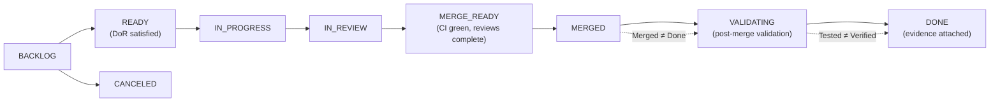
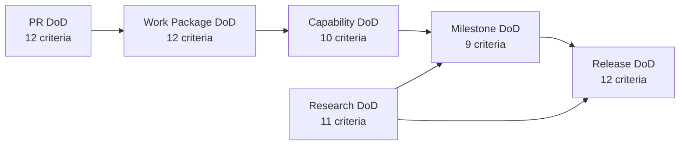

# 08 — Definition of Ready and Definition of Done
## Intelligent Manufacturing Operations Platform for Critical Aerospace Components — Readiness and Completion Criteria by Work Type and Maturity Level

| Field | Value |
|---|---|
| Document | `08_Definition_of_Ready_and_Done.md` |
| Status | **Draft — Derived from Approved 01/02 Baseline** (ratifies the proposed rule sets referenced by 04 and 09) |
| Version | v0.1.0-draft |
| Generated | pre-implementation (no work item has reached any state) |
| Governing doctrine | **Merged ≠ Done · Implemented ≠ Tested · Tested ≠ Verified · Demoed ≠ Accepted** |
| Canonical sources | 01 Items 40–43, 50, 60, 62–65, 68, 79, 81–85; 02 |
| Artifacts that reference this document | 04 WBS (`DOR-WP-*`, `DOD-WP-*` placeholders), 07 Milestone & Release Plan (gate semantics), 09 Change Control (IMPLEMENTED / VERIFIED states) |
| DoR levels defined | 10 — task/work package, PR, contract change, capability integration, dataset/model experiment, benchmark experiment, milestone, release candidate, demo, architecture change |
| DoD levels defined | 6 — PR, work package, capability, milestone, release, research |
| Criteria identities | `DOR-<LEVEL>-NN` and `DOD-<LEVEL>-NN`, stable and never reused |
| Status of every work item today | `BACKLOG` — nothing is READY, nothing is DONE, no evidence exists |

> **Reading rule.** DoR protects the team from starting work that will stall; DoD protects the project from work that looks finished but cannot be defended. Neither is a ceremony: every criterion below is either machine-checkable or answerable by a named owner in one sentence.

---

## Table of Contents

1. Purpose and the Four Maxims
2. Sources, Precedence and Artifact Relations
3. Work Model: Types, States, Blocking and WIP
4. Generic DoR Dimensions
5. DoR by Level (10 levels)
6. DoD Doctrine: What Each Maxim Blocks
7. DoD by Level: PR, Work Package, Capability, Milestone, Release
8. Research DoD and the Negative Result Rule
9. Scope-Class Supplements (F0 / F1 / R1 / H0 / A1 / S2 / C3)
10. Per-Capability-Area Completion Requirements
11. Evidence Maturity Mapping
12. Operational Checklists
13. Anti-Patterns: Completion Claims That Do Not Hold
14. Ratification of the 04 Placeholder Rule Sets
15. Machine-Readable Companion
16. Findings Register
17. Rejected Alternatives
18. Guide §16 Compliance Check and Audit

---

## 1. Purpose and the Four Maxims

Two questions, answered per work type and per maturity level: **is this ready to start?** and **is this actually finished?** The four maxims below are the compressed form of everything in this document.

| Maxim | What it denies | What it demands | Where it is enforced |
|---|---|---|---|
| **Merged ≠ Done** | that a green PR on `main` completes a work item | post-merge validation on a real environment, trace update and evidence state before closure (Item 64 #103–#107) | §7.1 PR DoD vs §7.2 work package DoD; state machine VALIDATING → DONE |
| **Implemented ≠ Tested** | that working code implies exercised behaviour | tests that include the negative and failure paths of the same behaviour, at the boundary mode the requirement demands | §7.2, §9 (H0 supplements), §10 per-area negative families |
| **Tested ≠ Verified** | that a passing test equals a satisfied requirement | evidence of the required class, in the required environment, bound to release/environment/hardware/workload identity, with the trace registry updated | §11 evidence maturity mapping; 03 evidence rules |
| **Demoed ≠ Accepted** | that a successful demonstration equals product acceptance | acceptance derived from generated coverage over requirements and sealed evidence — demo evidence never substitutes evaluation evidence | §7.5 release DoD; 07 §13 demo/benchmark separation |

A fifth implicit maxim runs through the research levels: **Executed ≠ Concluded.** A benchmark run that completed is not a research result until its accounting, analysis and reporting are complete (§8).

## 2. Sources, Precedence and Artifact Relations

| Source | Contribution |
|---|---|
| 00 §16 | doctrine, the ten DoR levels, the generic DoR dimensions, the five DoD levels and the research DoD rule |
| 01 Item 64 | work types, work-item metadata, the canonical state machine BACKLOG→READY→IN_PROGRESS→IN_REVIEW→MERGE_READY→MERGED→VALIDATING→DONE, BLOCKED model, WIP limits, PR template, merge policy, post-merge validation |
| 01 Item 63 | review classes CR-0…CR-4 and reviewer requirements that a PR must satisfy before MERGE_READY |
| 01 Item 50 | test tiers and boundary discipline (what may be faked where) |
| 01 Item 65 | milestone gate semantics used by the milestone DoD |
| 01 Items 60/79 | experiment readiness, run accounting, evidence sealing and the honest-reporting rules behind the research DoD |
| 01 Items 81/82/83 | requirement classes, acceptance denominators and the trace states a work package must advance |
| 01 Items 42/43 | release identity and environment integrity used by the release DoD |
| 02 | architecture boundaries and runtime dependency classes that capability DoD checks against |
| 03 / 04 / 05 / 07 / 09 | requirement verification design, work packages, dependency readiness, milestone gates and change states referenced by identity |

| Related artifact | Relation |
|---|---|
| 04 WBS | `DOR-WP-01…08` and `DOD-WP-01…12` are already in active use by 179 work package cards; this document ratifies them with unchanged meanings and gives the lossless mapping (§14) |
| 07 Milestone & Release Plan | milestone DoD here is the work-item-level view of the five gates in 07 §4.1; 07 remains authoritative for gate semantics |
| 09 Change Control | the `IMPLEMENTED` and `VERIFIED` change states are mapped narrowly in §14: they describe the lifecycle of the change itself, not the completion of a parent work package or capability |
| 05 Dependency Graph | DoR dependency readiness is evaluated against DEP-* edges and their required readiness levels |
| 03 RTM | DoD evidence rules are the work-item projection of the trace states and evidence classes defined there |

## 3. Work Model: Types, States, Blocking and WIP

DoR and DoD attach to work items. The model below is Item 64 and is not restated elsewhere in this document.

| Work type | Typical DoR level | Typical DoD level | Note |
|---|---|---|---|
| `CAPABILITY` | task/work package | work package → capability | the main product work |
| `INTEGRATION` | capability integration | capability | crosses at least one owner boundary |
| `BUG` | task (with reproduction) | PR → work package | restoring approved behaviour is C1 in 09 |
| `PLATFORM` | task/work package + architecture change where topology moves | work package → capability | runtime, CI/CD, observability, security, DR |
| `RESEARCH` | dataset/model experiment or benchmark experiment | research DoD | outcome direction is irrelevant to completion |
| `TECH_DEBT` | task | PR → work package | benchmark-threatening debt must clear before M6 |
| `SPIKE` | task with an explicit question and a time box | PR (findings recorded) — never capability DoD | a spike ends in an answer or an ADR, not in shipped behaviour |
| `DOC/ADR` | task | PR | ADR supersession rules in 09 §11 |

### 3.1 State machine and where the maxims bite



| State | Entry condition | Exit condition | DoR/DoD tie |
|---|---|---|---|
| BACKLOG | the work is identified | DoR satisfied | §4, §5 |
| READY | all DoR criteria for the level are met and no hidden blocker exists | owner starts work | §5 |
| IN_PROGRESS | work started, WIP limits respected | a reviewable change exists | — |
| IN_REVIEW | explicitly requested review (a draft PR is not IN_REVIEW) | required reviewers responded | §7.1 |
| MERGE_READY | required CI green, mandatory reviews approved, blocking findings resolved, branch safe against current `main` | merge | §7.1 |
| MERGED | squash-merged with a meaningful title; branch deleted | post-merge validation starts | **Merged ≠ Done** |
| VALIDATING | integration smoke, system scenario, model evaluation, deployment verification or contract validation running | validation passed and evidence attached | **Implemented ≠ Tested**, **Tested ≠ Verified** |
| DONE | all DoD criteria for the level satisfied and recorded | — | §7 |
| CANCELED | explicit decision recorded | — | a canceled item states why |

`BLOCKED` is orthogonal (IN_PROGRESS+BLOCKED, IN_REVIEW+BLOCKED, VALIDATING+BLOCKED). A blocker needs a description, a link to the blocking work and an owner or a named external dependency; silent blocking is prohibited and anything blocked for more than one working day is surfaced (Item 64 #35–#40).

WIP discipline: at most two active implementation items per person, at most one heavy/core item; review work is first-class and does not count as full implementation WIP; integration repair precedes new feature expansion (Item 64 #41–#46).
## 4. Generic DoR Dimensions

Twelve dimensions from 00 §16. Every DoR level in §5 is a selection of these with level-specific evidence. A dimension that does not apply is answered `N/A — reason`, never left blank.

| # | Dimension | Question | Evidence that it is satisfied | Blocks READY when |
|---|---|---|---|---|
| D-1 | Purpose clear | what changes in the system when this is complete? | one-sentence outcome statement in the work item | the outcome is described as an activity ("work on X") rather than a change |
| D-2 | RequirementIDs known | which FR/NFR does this serve? | linked requirement IDs, or `NONE — reason` for platform/debt/spike work | behaviour-changing work with no requirement link (04 forbids requirement-less packages) |
| D-3 | PrimaryOwner known | who is accountable? | single named owner from the approved four | ownership is "the team" or unassigned |
| D-4 | Dependency readiness satisfied | are the inbound HARD dependencies at their required readiness? | DEP-* edges checked in 05; fallback class recorded if a fixture is used for development only | a HARD gate is unsatisfied and no approved fallback applies |
| D-5 | Contracts ready | which contracts are consumed or produced, and are they CONTRACT_READY with fixtures? | contract identity + fixture reference, or "this item produces the contract" | a consumed contract exists only as an intention |
| D-6 | Data rights / source ready | which datasets, corpora or scenarios are used and are their provenance and rights known? | DatasetVersion / CorpusVersion / ScenarioVersion identity with rights status | rights status is unknown for data feeding a claim |
| D-7 | Acceptance criteria defined | how will anyone know it is done? | testable criteria in the work item, aligned with the DoD level | criteria are "works well" or "looks right" |
| D-8 | Verification strategy defined | what will prove it, at which boundary mode? | named verification family from 03 + boundary mode (REAL / FIXTURE_ALLOWED) | no verification approach exists for behaviour-changing work |
| D-9 | Environment available | where will it run and be validated? | local profile, INTEGRATION or EVALUATION availability confirmed | the required environment does not exist yet |
| D-10 | Risk level classified | what is the review risk class? | CR-0…CR-4 estimate (Item 63), escalatable by reviewers | safety-, authority- or evidence-critical work is unclassified |
| D-11 | Architecture decision resolved | is there fundamental architectural uncertainty? | ADR reference, or an explicit statement that no decision is open | a fundamental design question is open → SPIKE/ADR first (Item 64 #23) |
| D-12 | No hidden blocker | is anything known that will stall this? | declared blockers with owners; "none known" is an explicit answer | a known blocker is not written down |

## 5. DoR by Level

### 5.1 Task / Work Package DoR

| Field | Value |
|---|---|
| Applies when | the unit an engineer picks up |
| Confirming owner | WP owner |
| Criteria count | 12 |

| ID | Criterion |
|---|---|
| DOR-TASK-01 | Outcome statement exists: what is different in the system afterwards (D-1); target milestone and 05 readiness node are declared |
| DOR-TASK-02 | Source requirements linked with wording current in 01/03, or `NONE — reason` for debt/spike/platform hygiene work (D-2) |
| DOR-TASK-03 | Single accountable owner assigned; supporting reviewer named and CODEOWNERS routing exists (D-3) |
| DOR-TASK-04 | Inbound HARD dependencies satisfied at their required readiness, or an approved F1–F4 fallback is recorded for development-stage work only (D-4); the precise consumer requirement — the exact artifacts/fields needed from each predecessor — is written down (05 DEP-RULE-06) |
| DOR-TASK-05 | Consumed contracts are CONTRACT_READY with published fixtures, or this item produces them (D-5) |
| DOR-TASK-06 | Acceptance criteria written and testable (D-7) |
| DOR-TASK-07 | Verification approach named: which 03 family, which boundary mode (D-8) |
| DOR-TASK-08 | Review risk class estimated (D-10) |
| DOR-TASK-09 | No open fundamental architecture question; otherwise a SPIKE or ADR is created first (D-11) |
| DOR-TASK-10 | Item is a coherent slice of roughly 0.5–3 focused days; larger work is decomposed or treated as a workstream (Item 64 #47–#50) |
| DOR-TASK-11 | Known blockers declared with owners (D-12) |
| DOR-TASK-12 | For R1 work: partition/seed policy and protocol status known; no FINAL partition use before the protocol freeze |

### 5.2 Pull Request DoR (ready for review, not draft)

| Field | Value |
|---|---|
| Applies when | the moment review capacity is requested |
| Confirming owner | author |
| Criteria count | 8 |

| ID | Criterion |
|---|---|
| DOR-PR-01 | One coherent behaviour change; unrelated cleanup is separated (Item 64 #68, #72) |
| DOR-PR-02 | Linked work item and requirement IDs, or explicit `NONE — reason` (Item 83 #98–#99) |
| DOR-PR-03 | PR template complete: what, why, affected domains, predicted review class, contract impact, migration impact, security/authority impact, dataset/model impact, observability impact, tests executed, rollout/rollback notes, known limitations — "no impact" answers are explicit, not omitted |
| DOR-PR-04 | Author self-review done: no debug code, no secrets, no stray unrelated modifications, relevant tests present (Item 64 #75) |
| DOR-PR-05 | Required CI is green before serious review is requested; mechanical failures belong to the author (Item 64 #76–#78) |
| DOR-PR-06 | Reviewers routed: CODEOWNERS baseline plus impact-based reviewers for cross-boundary, security or research impact |
| DOR-PR-07 | Change class declared per 09 (C0–C3) when the change touches behaviour, contracts, data or evidence |
| DOR-PR-08 | Reviewable size: preferably under ~400–500 manually authored changed lines; a larger cohesive PR carries a justification |

### 5.3 Contract Change DoR

| Field | Value |
|---|---|
| Applies when | before a cross-service contract is altered |
| Confirming owner | canonical producer owner |
| Criteria count | 8 |

| ID | Criterion |
|---|---|
| DOR-CON-01 | Contract identity and current version named (IC-* or equivalent) |
| DOR-CON-02 | Compatibility class assessed: NON_BREAKING / BEHAVIORAL_CHANGE / BREAKING (Item 22) |
| DOR-CON-03 | Every consumer identified from 05 downstream edges, with owners named |
| DOR-CON-04 | Consumer review commitment obtained for BEHAVIORAL_CHANGE and BREAKING before implementation starts |
| DOR-CON-05 | Failure semantics specified: unavailable, timeout, stale, partial, unknown (Item 64 #62) |
| DOR-CON-06 | Fixture update plan exists — a contract change without fixture updates leaves consumers working against a lie |
| DOR-CON-07 | Rollout sequencing decided: consumer-tolerance first, producer activation later, dual publication time-bounded if needed |
| DOR-CON-08 | Post-M4 breaking changes carry a 09 change request and an explicit exception rationale |

### 5.4 Capability Integration DoR

| Field | Value |
|---|---|
| Applies when | before two or more owners wire real components together |
| Confirming owner | integration owner (consumer side unless stated) |
| Criteria count | 7 |

| ID | Criterion |
|---|---|
| DOR-INT-01 | Both sides are at least COMPONENT_READY; the producing side has published its contract and fixtures |
| DOR-INT-02 | Target environment is available and healthy (INTEGRATION for cross-service work) |
| DOR-INT-03 | The integration scenario is defined with an expected outcome held by the evaluating side, not by the implementation |
| DOR-INT-04 | Boundary mode declared: which boundaries must be real for this integration to count |
| DOR-INT-05 | Observability exists on both sides: correlation propagation and health surface, otherwise failures will be invisible |
| DOR-INT-06 | Negative cases are part of the plan from the start (duplicate delivery, stale state, rejection paths) |
| DOR-INT-07 | Rollback/interference plan: how to stop if the integration destabilizes the shared environment |

### 5.5 Dataset / Model Experiment DoR

| Field | Value |
|---|---|
| Applies when | before training or evaluating anything that may feed a claim |
| Confirming owner | lane owner |
| Criteria count | 9 |

| ID | Criterion |
|---|---|
| DOR-EXP-01 | Question stated: what is being measured and what would change the decision |
| DOR-EXP-02 | DatasetVersion / CorpusVersion / ScenarioVersion identities fixed, with rights and provenance recorded |
| DOR-EXP-03 | Partition policy explicit: DEVELOPMENT / CALIBRATION only; FINAL is unavailable before the protocol freeze |
| DOR-EXP-04 | Split policy checked for entity/group leakage before use |
| DOR-EXP-05 | Baseline defined and runnable — a candidate without a baseline produces an uninterpretable number |
| DOR-EXP-06 | Metrics defined before running; no metric selection after seeing results |
| DOR-EXP-07 | Seeds and repetition plan defined; single-run conclusions are not accepted for stochastic methods |
| DOR-EXP-08 | Run identity capture available: release, environment, hardware, data, scenario, seed |
| DOR-EXP-09 | Compute and storage budget checked against the shared-host envelope |

### 5.6 Benchmark Experiment DoR

| Field | Value |
|---|---|
| Applies when | before any formal campaign lane executes |
| Confirming owner | Yavuz (execution) + lane owner (protocol) |
| Criteria count | 8 |

| ID | Criterion |
|---|---|
| DOR-BEN-01 | ExperimentProtocolFreeze in force for this lane (F3) and release/environment freeze in force (F4) |
| DOR-BEN-02 | All frozen assets referenced by immutable identity: dataset, split, scenario, seed, model, policy, behaviour bundle, retrieval profile |
| DOR-BEN-03 | Preflight green: disk headroom, workload isolation, no undeclared concurrent load, environment integrity |
| DOR-BEN-04 | Run registry ready to record every attempt, including failures, with dispositions |
| DOR-BEN-05 | Analysis package version fixed; metric calculators frozen |
| DOR-BEN-06 | Oracle isolation verified for the execution identity — evaluator-only data unreachable from runtime services |
| DOR-BEN-07 | Stop conditions defined: which discoveries pause or invalidate the campaign (oracle leakage, FINAL contamination, wrong release, authority bypass, corrupted evidence) |
| DOR-BEN-08 | Evidence sealing and off-host copy path confirmed before the lane starts |

### 5.7 Milestone DoR

| Field | Value |
|---|---|
| Applies when | before a milestone review is convened |
| Confirming owner | team |
| Criteria count | 7 |

| ID | Criterion |
|---|---|
| DOR-MS-01 | Previous milestone PASSED (or its failure is explicitly carried with a recovery plan) |
| DOR-MS-02 | The milestone record in 07 §5 is the agreed scope — no criteria have been added or removed informally |
| DOR-MS-03 | Coverage state generated from the trace registry rather than asserted |
| DOR-MS-04 | Dependency gates for the window evaluated in 05 terms (satisfied / at risk / blocked) |
| DOR-MS-05 | Evidence for the milestone exists in the right environment class and is locatable, not "somewhere in a branch" |
| DOR-MS-06 | Open debt list prepared with proposed classification (allowed vs not waivable) |
| DOR-MS-07 | Open change requests relevant to the milestone are visible (09 registry) |

### 5.8 Release Candidate DoR

| Field | Value |
|---|---|
| Applies when | before an artifact is promoted as a candidate |
| Confirming owner | Yavuz |
| Criteria count | 7 |

| ID | Criterion |
|---|---|
| DOR-RC-01 | Build once: the candidate is a main-derived immutable artifact set, not a rebuild |
| DOR-RC-02 | ReleaseManifest complete: image digests, schema target, contract catalog version, model and workflow versions, configuration schema, build provenance |
| DOR-RC-03 | Migration plan and reversibility assessed |
| DOR-RC-04 | Preflight artifacts available in the target environment |
| DOR-RC-05 | Known-good rollback target identified, or rollback declared impossible with a reason |
| DOR-RC-06 | No test-auth mode, no development shortcut enabled in the candidate configuration |
| DOR-RC-07 | Open CR-3/CR-4 change requests affecting the candidate are resolved or explicitly deferred |

### 5.9 Demo DoR

| Field | Value |
|---|---|
| Applies when | before a demo is shown to anyone outside the team |
| Confirming owner | Asrın (narrative) + Yavuz (environment) |
| Criteria count | 6 |

| ID | Criterion |
|---|---|
| DOR-DEMO-01 | Pinned release identity: exact ReleaseManifest, digests, model, workflow and configuration versions — never latest `main` |
| DOR-DEMO-02 | Demo world provisioned from a defined scenario, not hand-edited state |
| DOR-DEMO-03 | Rehearsal executed on the same release; failures from the rehearsal are fixed or disclosed |
| DOR-DEMO-04 | Abort conditions agreed: wrong release, test-auth enabled, oracle violation, authority bypass, validator failure, stale plan execution, unverified effect, unreconciled Core/Twin state |
| DOR-DEMO-05 | Presenter mode verified to conceal nothing: approvals, validation, failures and verification remain visible |
| DOR-DEMO-06 | Evidence capture path ready so the demo run is recorded as EXP-DEMO, never as statistical evidence |

### 5.10 Architecture Change DoR

| Field | Value |
|---|---|
| Applies when | before a boundary, authority placement or technology changes |
| Confirming owner | Asrın (application) / Yavuz (platform) |
| Criteria count | 8 |

| ID | Criterion |
|---|---|
| DOR-ARCH-01 | The decision is written as an ADR draft with alternatives considered |
| DOR-ARCH-02 | Affected ARCH-* components and service boundaries identified in 02 terms |
| DOR-ARCH-03 | Authority impact assessed: does anything gain the ability to mutate, approve or bypass? |
| DOR-ARCH-04 | Contract impact assessed with consumer owners named |
| DOR-ARCH-05 | Dependency impact assessed in 05 terms (new edges, strength changes, cycle risk) |
| DOR-ARCH-06 | Change request raised at the correct class (usually C3) with reviewers assigned |
| DOR-ARCH-07 | Evidence staleness pre-assessed: what would have to be re-verified if this lands |
| DOR-ARCH-08 | Timing checked against the phase policy — after M6 this is a freeze-breaking path |

### 5.11 DoR anti-patterns

| Anti-pattern | Why it fails | Correct move |
|---|---|---|
| "We will figure out the contract while implementing" | consumers are blocked or build against an assumption | publish the contract with a fixture first (DOR-TASK-05) |
| "The dependency is nearly ready" | nearly-ready is NOT_READY in 05 terms | use an approved fallback for development only, or wait |
| "Acceptance is: it works" | nothing can be reviewed or verified against it | write testable acceptance criteria (DOR-TASK-06) |
| Starting a third implementation item | WIP limits exist because integration debt compounds | finish or hand off first (Item 64 #41–#44) |
| Opening review on a red pipeline | reviewer time is spent on mechanical failures | fix CI first (DOR-PR-05) |
| Running an experiment on FINAL data "just to see" | contaminates the final partition irreversibly | DEV/CAL only until the protocol freeze (DOR-EXP-03) |
| Demoing from latest `main` | the demo becomes unreproducible and possibly untrue | pin the release (DOR-DEMO-01) |
## 6. DoD Doctrine: What Each Maxim Blocks

| Claim someone makes | Maxim that blocks it | What must exist instead | DoD level |
|---|---|---|---|
| "It is merged, so the task is closed" | Merged ≠ Done | post-merge validation on a real environment plus trace update | work package DoD (§7.2) |
| "The happy path works" | Implemented ≠ Tested | negative and failure paths exercised for the same behaviour | §7.2 DOD-WP-04 |
| "All tests are green" | Tested ≠ Verified | evidence of the required class, in the required environment, bound to identities | §7.3, §11 |
| "The demo ran perfectly" | Demoed ≠ Accepted | acceptance generated from requirement coverage and sealed evidence | §7.5 |
| "The experiment finished" | Executed ≠ Concluded | run accounting, analysis, sealing and honest reporting | §8 |
| "The capability exists in our service" | Implemented ≠ Integrated | real cross-boundary behaviour with no core mock in the accepted path | §7.3 |

## 7. DoD by Level

### 7.1 Pull Request DoD

| Field | Value |
|---|---|
| Confirming owner | author + required reviewers |
| State transition | MERGE_READY → MERGED |
| Criteria count | 12 |

| ID | Criterion |
|---|---|
| DOD-PR-01 | One coherent behaviour change, squash-merged with a meaningful title |
| DOD-PR-02 | Required CI green without retry-until-green; no quarantined test is masking this change |
| DOD-PR-03 | Tests added or updated for the changed behaviour, including at least one negative/failure case where the behaviour can fail |
| DOD-PR-04 | Static analysis and type checks pass |
| DOD-PR-05 | Contract and schema artifacts updated together with the code; fixtures regenerated |
| DOD-PR-06 | Trace impact recorded: `ImpactedRequirementIDs` or `NONE — reason`; REALIZED_BY/VERIFIED_BY edges updated in the same PR |
| DOD-PR-07 | Documentation touched where operator or developer behaviour changes (runbook, quickstart, ADR) |
| DOD-PR-08 | Required reviewers approved at the actual review risk class; CR-3/CR-4 never self-certified and never auto-approved on timeout |
| DOD-PR-09 | No secret, credential or security violation introduced; secret scan clean |
| DOD-PR-10 | Branch safe against current `main`; branch deleted after merge |
| DOD-PR-11 | Change class declared per 09 where behaviour, contracts, data or evidence are touched |
| DOD-PR-12 | Known limitations stated in the PR rather than discovered later |

### 7.2 Work Package DoD

| Field | Value |
|---|---|
| Confirming owner | WP owner + supporting reviewer |
| State transition | VALIDATING → DONE |
| Criteria count | 12 |

The twelve criteria below carry the meanings fixed in 04 §4.2, because 179 work package cards already select subsets of these IDs as their completion contract. The wording is refined here; the obligation behind each ID is unchanged (§14).

| ID | Criterion | Applies to |
|---|---|---|
| DOD-WP-01 | All declared deliverables exist in the repository or the runtime with real references — no `TBD_BY_IMPLEMENTATION` remains, and every source requirement of the package is implemented behind those deliverables | all |
| DOD-WP-02 | Trace edges updated in the same PR (REALIZED_BY, VERIFIED_BY — 03 §19): the coverage state is advanced to the level the package actually reached and never beyond it, and the evidence state is recorded honestly (`NOT_YET_EXECUTED`, `EVIDENCE_PENDING` or a real evidence reference) | all |
| DOD-WP-03 | Required CI gates green without retry-until-green; no quarantined test is masking this package | all |
| DOD-WP-04 | Negative and failure paths are tested, not only the happy path: rejection, staleness, duplication, timeout, unavailability — whichever apply | F0/F1 + H0 |
| DOD-WP-05 | Cross-boundary behaviour verified against real infrastructure (no mocked broker/DB/identity in the acceptance path): post-merge validation executed on the target environment (integration smoke, scenario, deployment verification or contract validation) and consumers that were promised readiness have confirmed usability | F0/F1 integration WPs |
| DOD-WP-06 | Observability exists: structured logs with correlation propagation, health surface for the capability, and the metrics the package's NFRs need | all runtime WPs |
| DOD-WP-07 | Documentation/runbook updated where operator action is possible; ADR written where a decision was taken | all runtime WPs |
| DOD-WP-08 | Measurement definition exists and a measurement has been executed in the correct environment and profile | NFR-driven WPs (H0/A1/S2/C3) |
| DOD-WP-09 | For H0: hard/negative evidence produced and the zero-count assertions hold | H0 |
| DOD-WP-10 | For R1: the mechanism runs reproducibly; outcome direction is irrelevant to completion | R1 |
| DOD-WP-11 | Evidence produced is bound to Release/Environment/Hardware/Workload identities | evidence-producing WPs |
| DOD-WP-12 | Cut/fallback semantics honoured: no development fixture is used as milestone or final evidence (05 DEP-RULE-04) | all |

### 7.3 Capability DoD

| Field | Value |
|---|---|
| Confirming owner | capability owner + cross-domain reviewer |
| State transition | capability-level acceptance |
| Criteria count | 10 |

| ID | Criterion |
|---|---|
| DOD-CAP-01 | Real boundaries: the capability operates across actual service, broker, database and identity boundaries in the accepted path |
| DOD-CAP-02 | No core mock, stub or injected value in the formal path — fixtures are development aids only |
| DOD-CAP-03 | Failure semantics implemented and demonstrated: unavailable, timeout, stale, partial, unknown, as the contracts declare |
| DOD-CAP-04 | Service health is observable at capability granularity (HEALTHY / DEGRADED / UNAVAILABLE), not just process liveness |
| DOD-CAP-05 | All F0/F1 requirements of the capability have their required verification executed at the required boundary mode |
| DOD-CAP-06 | Role-owned evaluation exists: the owner can demonstrate the capability and interpret its failures without another owner present |
| DOD-CAP-07 | Authority and isolation invariants that touch the capability are proven negatively (no mutation without authorization, no cross-world leakage, no oracle access) |
| DOD-CAP-08 | Integrated scenario participation: the capability appears in at least one AV-SCEN or E2E path where the architecture requires it |
| DOD-CAP-09 | Recovery behaviour known: what happens on restart, on dependency loss and on duplicate input |
| DOD-CAP-10 | Cross-review completed by the consuming owner, confirming the capability is usable as contracted |

### 7.4 Milestone DoD

| Field | Value |
|---|---|
| Confirming owner | team (07 §12 procedure) |
| State transition | milestone PASSED |
| Criteria count | 9 |

| ID | Criterion |
|---|---|
| DOD-MS-01 | Functional gate: the required capabilities exist in integrated form (07 §4.1) |
| DOD-MS-02 | Integration gate: they work together across real boundaries |
| DOD-MS-03 | Quality gate: required tests including negative paths pass without gate erosion |
| DOD-MS-04 | Operational gate: deployment, observation and recovery behave as required at this stage |
| DOD-MS-05 | Evidence gate: the milestone's required evidence exists in the right environment class and binds to release/environment identities |
| DOD-MS-06 | Exit criteria from the 07 milestone record are individually satisfied and recorded |
| DOD-MS-07 | Debt classified: allowed debt recorded with owner and target; non-waivable debt absent |
| DOD-MS-08 | Health state declared: PASSED or PASSED_WITH_ACCEPTED_DEBT; a failed mandatory gate means NOT_PASSED regardless of calendar |
| DOD-MS-09 | Decision recorded with evidence references so the milestone can be re-examined later |

### 7.5 Final Release DoD

| Field | Value |
|---|---|
| Confirming owner | team; generated artifacts, not assertions |
| State transition | M8 release candidate accepted |
| Criteria count | 12 |

| ID | Criterion |
|---|---|
| DOD-REL-01 | 100% of active F0 (17) and F1 (159) requirements are **VERIFIED**. `FAIL`, `MISS`, an analysis-only disposition or a silent waiver cannot satisfy final acceptance for a mandatory requirement, and no active mandatory requirement may remain UNKNOWN at M8. A mandatory requirement leaves the active acceptance denominator only through an upstream-approved change/rebaseline (09, C3) that supersedes or retires it |
| DOD-REL-02 | H0 requirements: all PASS with hard/negative evidence and zero-count assertions satisfied |
| DOD-REL-03 | A1 requirements: all PASS in the correct hardware/workload profile, or formally rebaselined through change control |
| DOD-REL-04 | S2 measured with PASS/MISS recorded; C3 measured and characterized |
| DOD-REL-05 | R1 requirements (10) VERIFIED: the research mechanisms run reproducibly with dispositions recorded; outcome direction is irrelevant, but the mechanism and its evidence must exist |
| DOD-REL-06 | Architecture validity: boundary and authority invariants hold; architecture validation scenarios executed |
| DOD-REL-07 | Benchmark evidence sealed, complete, reference-resolvable and copied off host |
| DOD-REL-08 | Restore and reproduction proven: full-host restore drill PASS, clean-host deployment, non-owner reproduction |
| DOD-REL-09 | Documentation baseline validated against the release; quickstart, reproduction and runbook commands execute |
| DOD-REL-10 | Red-team defensibility: findings resolved or explicitly accepted; claims bounded by sealed evidence |
| DOD-REL-11 | Release candidate pinned: exact ReleaseManifest, digests, model, workflow, configuration and dataset/scenario artifacts |
| DOD-REL-12 | Acceptance artifacts generated from the trace registry (AcceptanceCoverageReport, ReleaseAcceptanceRecord) rather than asserted in prose |

### 7.6 Level containment



Each level assumes the level below is satisfied for the work it contains. A capability cannot be DONE while one of its work packages is still VALIDATING; a milestone cannot pass while a required capability is incomplete; the release cannot be accepted while a milestone gate is open.
## 8. Research DoD and the Negative Result Rule

> **A negative result is DONE. An unaccountable result is not.**

Research work completes on process integrity, never on outcome direction. "Hypothesis supported" is not a completion criterion, and it is not permitted as one (00 §16).

| ID | Criterion | Why it is required |
|---|---|---|
| DOD-RES-01 | Protocol valid: the executed design matches the frozen ExperimentDefinition, metrics and analysis plan | a result produced under an improvised protocol cannot be interpreted |
| DOD-RES-02 | Frozen identities bound: dataset, split, scenario, seed, model, policy, behaviour bundle, retrieval profile, release, environment, hardware | without identity binding the number belongs to nothing |
| DOD-RES-03 | Partition discipline honoured: FINAL used once, after the freeze, with no tuning afterwards | the single most damaging research failure mode |
| DOD-RES-04 | Baselines executed locally under the same conditions as the candidate | literature numbers are context, never a comparison |
| DOD-RES-05 | Run accounting complete: every planned experimental unit reconciles to a documented disposition, including failures | silently vanished runs turn a result into an advertisement |
| DOD-RES-06 | Dispositions correct: METHOD_FAILURE retained as a result; INFRA_INVALID reruns protocol-authorized and registered with `RetryOf` | prevents rerun-until-green |
| DOD-RES-07 | Evidence sealed: raw outputs, run records and analysis inputs immutable, reference-resolvable and copied off host | evidence that can change is not evidence |
| DOD-RES-08 | Analysis complete and regenerable: canonical tables and figures reproduce from raw evidence via the versioned analysis package | protects against analysis drift and selective recomputation |
| DOD-RES-09 | Corrections applied symmetrically to all arms, never to the candidate alone | Item 79 #127 |
| DOD-RES-10 | Result honestly reported with its outcome class: SUPPORTED / PARTIALLY_SUPPORTED / NOT_SUPPORTED / INCONCLUSIVE, plus threats to validity | the outcome class is the deliverable |
| DOD-RES-11 | Claim wording bounded by the achieved evidence tier; no claim exceeds what the sealed evidence supports | the difference between research and marketing |

### 8.1 What makes a research item NOT done

| Situation | Done? | Reason |
|---|---|---|
| The hypothesis was not supported; protocol, accounting, sealing, analysis and reporting are complete | **DONE** | a negative finding is legitimate research (Item 65 #109) |
| The comparison was inconclusive due to variance; this is reported with the observed spread and a power note | **DONE** | INCONCLUSIVE is a valid outcome class |
| The method failed on many cases and this is recorded as METHOD_FAILURE with analysis | **DONE** | failure of the method is a result; failure to account for it is not |
| Results look good but three runs are missing from the registry | NOT DONE | run accounting incomplete (DOD-RES-05) |
| Results are sealed but the analysis cannot be regenerated from raw evidence | NOT DONE | DOD-RES-08 |
| A threshold was adjusted after seeing FINAL results | NOT DONE — and a research-integrity incident | DOD-RES-03, 09 §13 |
| Baseline was cited from a paper rather than executed | NOT DONE | DOD-RES-04 |
| The write-up states a stronger claim than the evidence tier allows | NOT DONE | DOD-RES-11 |

### 8.2 Research completion record (required fields)

```yaml
research_completion:
  lane: "<RQ-1 | RQ-2 | RQ-3 | RQ-4 | MC-1 | MC-2 | engineering lane>"
  owner: "<Asrın | Selman | Batu | Yavuz>"
  protocol_freeze_ref: "<ExperimentProtocolFreeze identity>"
  frozen_identities: {dataset: "", split: "", scenario: "", seeds: "", model: "", policy: "", behaviour_bundle: "", release: "", environment: "", hardware: ""}
  planned_units: 0
  executed_units: 0
  dispositions: {valid: 0, method_failure: 0, infra_invalid: 0, reruns: 0}
  reconciliation_complete: false
  evidence_bundle: "<sealed bundle identity>"
  offhost_copy_verified: false
  analysis_package_version: ""
  regeneration_verified: false
  outcome_class: SUPPORTED | PARTIALLY_SUPPORTED | NOT_SUPPORTED | INCONCLUSIVE
  threats_to_validity: []
  claim_wording_reviewed_by: ""
  status: NOT_STARTED
```

Today every lane in the project would fill this record with zeros and `NOT_STARTED`; that is the honest state before implementation.

## 9. Scope-Class Supplements

The level DoD is the floor. The requirement class adds obligations that cannot be waived by the level.

| Class | Population | Additional DoD obligation | Failure meaning |
|---|---|---|---|
| F0 | 17 requirements | verified on at least one real integrated acceptance path; no fixture anywhere in that path; participates in an AV-SCEN or E2E scenario | product identity is incomplete — expansion stops until repaired |
| F1 | 159 requirements | verification executed at the boundary mode declared in 03; E2E only where the catalogue verification code demands it | mandatory capability missing at M4; requires change control |
| R1 | 10 requirements | mechanism runs reproducibly by a non-author; outcome direction irrelevant | research infrastructure gap — claims become unverifiable |
| H0 | 52 NFRs | hard/negative evidence with zero-count assertions; happy-path evidence is insufficient by definition | acceptance blocked; cannot be averaged away |
| A1 | 41 NFRs | measured PASS in the correct HardwareProfile and WorkloadProfile, or formally rebaselined with measured justification | acceptance blocked unless rebaselined through 09 |
| S2 | 23 NFRs | measured with PASS or MISS recorded plus analysis | a MISS is a valid recorded outcome, not a silent adjustment |
| C3 | 4 NFRs | measured and characterized; absence of a threshold does not excuse absence of measurement | unmeasured characterization is an incomplete deliverable |

## 10. Per-Capability-Area Completion Requirements

Generated from 04 and 03: for each area, the negative/failure families that its work packages must exercise before capability DoD, and the integrated checkpoint where the area must appear.

| Prefix | Area | #WP | #F0 WP | Mandatory negative/failure families (first 6) | Integrated checkpoint |
|---|---|---|---|---|---|
| WP-GOV | Requirement Governance | 4 | 0 | — | — |
| WP-CORE | Manufacturing Core | 8 | 3 | RES-DUP-001, TEST-ARCH-BOUNDARY, TEST-AUTH-NEG, TEST-AUTO-OUTCOME, TEST-CORE-IDEMP, TEST-CORE-REVISION … | AV-SCEN-01, AV-SCEN-03, E2E-01 |
| WP-EVT | Event Spine & Contracts | 6 | 1 | RES-DUP-001, TEST-ARCH-BOUNDARY, TEST-EVT-CONSUMER-IDEMP, TEST-EVT-REPLAY-DLQ, TEST-SEC-SVCID | — |
| WP-TWIN | Digital Twin | 6 | 2 | TEST-AUTH-NEG, TEST-TWIN-EPISTEMIC, TEST-TWIN-FRESHNESS, TEST-TWIN-READONLY, TEST-UI-SEMANTICS | AV-SCEN-01, BENCH-E2E-001 |
| WP-SIM | Simulator | 9 | 4 | TEST-DATA-SPLITLEAK, TEST-SEC-ORACLE-NEG, TEST-SIM-ISOLATION | AV-SCEN-11, E2E-01 |
| WP-OBJ | Artifact Layer | 2 | 0 | — | — |
| WP-VIS | Vision | 10 | 2 | TEST-VIS-OOD, TEST-VIS-ORACLE-NEG | E2E-01, AV-SCEN-01, DEMO-GS01-001 |
| WP-VDATA | Vision Data & MLOps | 5 | 0 | TEST-DATA-SPLITLEAK, TEST-VIS-OOD | — |
| WP-ML | Predictive ML | 7 | 0 | TEST-DATA-SPLITLEAK, TEST-ML-LEAKAGE | — |
| WP-RAG | RAG | 7 | 0 | TEST-ARCH-BOUNDARY, TEST-AUTH-NEG, TEST-RAG-INJECTION, TEST-RAG-RIGHTS | — |
| WP-AI | AI / RCA | 7 | 2 | TEST-AI-BINDING, TEST-AI-BUDGET, TEST-AUTH-NEG, TEST-SEC-AISURFACE, TEST-SEC-AUTHZ-NEG, TEST-SEC-EGRESS … | AV-SCEN-01, AV-SCEN-04, BENCH-RQ3-001 |
| WP-SCH | Scheduling | 7 | 1 | TEST-AUTO-FRESHNESS, TEST-SCH-COUNTERFACTUAL, TEST-SCH-FALLBACK | — |
| WP-VALID | Schedule Validation | 2 | 1 | TEST-AUTH-NEG, TEST-SCH-VALIDATOR | — |
| WP-AUTO | Automation | 7 | 3 | RES-DUP-001, TEST-AUTH-NEG, TEST-AUTO-ACTIONCAT, TEST-AUTO-FRESHNESS, TEST-AUTO-OUTCOME, TEST-AUTO-RESTART-001 | AV-SCEN-01, AV-SCEN-06; E2E-01, DEMO-GS01-001, BENCH-E2E-001 |
| WP-HITL | HITL / Authority | 7 | 1 | TEST-AUTH-NEG, TEST-HITL-BINDING, TEST-HITL-DUAL, TEST-HITL-REPLAY-NEG, TEST-SEC-AUTHN, TEST-SEC-BREAKGLASS | — |
| WP-UI | Command Center | 12 | 2 | TEST-UI-SEMANTICS | E2E-01, AV-SCEN-04, DEMO-GS01-001 |
| WP-PLAT | Platform | 7 | 1 | — | — |
| WP-CICD | CI/CD | 6 | 1 | TEST-SEC-CIISOLATION | — |
| WP-OBS | Observability | 6 | 0 | — | — |
| WP-SEC | Security | 8 | 0 | TEST-AUTH-NEG, TEST-SEC-AISURFACE, TEST-SEC-AUTHN, TEST-SEC-AUTHZ-NEG, TEST-SEC-CONTAINER, TEST-SEC-EGRESS … | — |
| WP-DR | Backup & DR | 4 | 0 | — | — |
| WP-TEST | Testing | 8 | 2 | RES-DUP-001, TEST-ARCH-BOUNDARY, TEST-AUTH-NEG, TEST-AUTO-RESTART-001, TEST-CORE-STATEMACHINE, TEST-EVT-CONSUMER-IDEMP … | AV-SCEN-01…04; AV-SCEN-05…08; AV-SCEN-09…12; E2E-01 |
| WP-PERF | Performance & Resilience | 6 | 0 | RES-DUP-001, TEST-AUTO-RESTART-001, TEST-SCH-FALLBACK | AV-SCEN-06, AV-SCEN-07, AV-SCEN-12 |
| WP-RES | Research Infrastructure | 12 | 0 | TEST-AUTH-NEG, TEST-AUTO-FRESHNESS, TEST-DATA-SPLITLEAK, TEST-SCH-COUNTERFACTUAL, TEST-SEC-SVCID, TEST-VIS-OOD | — |
| WP-BENCH | Benchmark Campaign | 5 | 0 | RES-DUP-001, TEST-AUTH-NEG, TEST-AUTO-RESTART-001, TEST-SEC-AUTHZ-NEG | BENCH-E2E-001 |
| WP-DOC | Documentation & Release | 6 | 0 | TEST-SEC-SECRETS, TEST-UI-SEMANTICS | DEMO-GS01-001 |
| WP-R2 | R2 Candidates | 3 | 0 | — | — |
| WP-S | Stretch | 1 | 0 | — | — |
| WP-X | Guard Rails | 1 | 0 | — | — |

### 10.1 Areas whose capability DoD requires a real integrated path

| WP | Area | Owner | Checkpoint | Boundary rule |
|---|---|---|---|---|
| WP-CORE-008 | CORE | Asrın | AV-SCEN-01, AV-SCEN-03, E2E-01 | no core mock in the accepted path (DOD-CAP-02) |
| WP-TWIN-006 | TWIN | Asrın | AV-SCEN-01, BENCH-E2E-001 | no core mock in the accepted path (DOD-CAP-02) |
| WP-SIM-005 | SIM | Batu | AV-SCEN-11, E2E-01 | no core mock in the accepted path (DOD-CAP-02) |
| WP-VIS-007 | VIS | Selman | E2E-01, AV-SCEN-01, DEMO-GS01-001 | no core mock in the accepted path (DOD-CAP-02) |
| WP-AI-006 | AI | Asrın | AV-SCEN-01, AV-SCEN-04, BENCH-RQ3-001 | no core mock in the accepted path (DOD-CAP-02) |
| WP-AUTO-005 | AUTO | Batu | AV-SCEN-01, AV-SCEN-06 | no core mock in the accepted path (DOD-CAP-02) |
| WP-AUTO-007 | AUTO | Batu | E2E-01, DEMO-GS01-001, BENCH-E2E-001 | no core mock in the accepted path (DOD-CAP-02) |
| WP-UI-006 | UI | Asrın | E2E-01, AV-SCEN-04, DEMO-GS01-001 | no core mock in the accepted path (DOD-CAP-02) |
| WP-TEST-003 | TEST | Asrın | AV-SCEN-01…04 | no core mock in the accepted path (DOD-CAP-02) |
| WP-TEST-004 | TEST | Yavuz | AV-SCEN-05…08 | no core mock in the accepted path (DOD-CAP-02) |
| WP-TEST-005 | TEST | Batu | AV-SCEN-09…12 | no core mock in the accepted path (DOD-CAP-02) |
| WP-TEST-006 | TEST | Batu | E2E-01 | no core mock in the accepted path (DOD-CAP-02) |
| WP-PERF-004 | PERF | Yavuz | AV-SCEN-06, AV-SCEN-07, AV-SCEN-12 | no core mock in the accepted path (DOD-CAP-02) |
| WP-BENCH-002 | BENCH | Asrın | BENCH-E2E-001 | no core mock in the accepted path (DOD-CAP-02) |
| WP-DOC-004 | DOC | Asrın | DEMO-GS01-001 | no core mock in the accepted path (DOD-CAP-02) |
## 11. Evidence Maturity Mapping

The "Tested ≠ Verified" maxim in operational form: which evidence class each DoD level accepts.

| DoD level | Minimum evidence class | Environment | Acceptable evidence | Never acceptable |
|---|---|---|---|---|
| PR DoD | EV-L2 | CI | required CI tiers green, contract tests, negative cases for the changed behaviour | a local run on the author machine |
| Work Package DoD | EV-L2 → EV-L3 | CI + INTEGRATION where the requirement demands REAL | post-merge validation, integration smoke, scenario execution, measurement where NFR-driven | fixture-based evidence for a REAL-boundary requirement |
| Capability DoD | EV-L3 | INTEGRATION | cross-boundary scenario execution, failure-path drills, negative suites | mocked broker, database or identity in the accepted path |
| Milestone DoD | per 07 §11 (EV-L2 at M0 → EV-L5 at M7/M8) | as the milestone record states | the milestone's required evidence, generated coverage, drill and measurement records | evidence from a lower environment class than the milestone requires |
| Release DoD | EV-L5 | EVALUATION (+ DEMO for the demo path) | sealed bundles, acceptance artifacts, restore and reproduction records | demo evidence as a substitute for evaluation evidence |
| Research DoD | EV-L5 for final lanes (EV-L4 for characterization) | EVALUATION | sealed raw evidence plus regenerable analysis | development or CAL runs presented as final results |

| Evidence rule | Statement |
|---|---|
| Environment substitution | a result obtained on a different hardware or environment profile does not satisfy a profile-bound requirement |
| Identity binding | quantitative evidence without ReleaseManifest + EnvironmentManifest + HardwareProfile + WorkloadProfile binding is not admissible |
| Fixture ceiling | a fixture satisfies CONTRACT-kind development work only; it never satisfies milestone or final evidence |
| Demo ceiling | demo evidence supports no empirical claim |
| Staleness | evidence becomes STALE when the artifact it measured changes (09 §14); a DONE item whose evidence went stale returns to VALIDATING |

## 12. Operational Checklists

Copy-paste forms. Each line is answerable with yes / no / `N/A — reason`; an unanswered line means the item is not ready or not done.

### 12.1 Starting a work package (DoR-TASK)

- [ ] outcome statement written
- [ ] requirement IDs linked or NONE with reason
- [ ] owner and supporting reviewer named
- [ ] inbound HARD dependencies satisfied or approved fallback recorded (development only)
- [ ] consumed contracts CONTRACT_READY with fixtures
- [ ] acceptance criteria testable
- [ ] verification family and boundary mode named
- [ ] review risk class estimated
- [ ] no open fundamental architecture question
- [ ] slice size roughly 0.5–3 focused days
- [ ] blockers declared
- [ ] R1 only: partition/seed policy known, FINAL untouched

### 12.2 Requesting review (DoR-PR)

- [ ] one coherent behaviour change
- [ ] work item and requirement impact linked
- [ ] PR template complete with explicit no-impact answers
- [ ] self-review done: no debug code, no secrets, tests present
- [ ] required CI green
- [ ] reviewers routed by impact, not only by path
- [ ] change class declared where applicable
- [ ] size reviewable or justified

### 12.3 Closing a work package (DoD-WP)

- [ ] DOD-WP-01 deliverables exist with real references; source requirements implemented
- [ ] DOD-WP-02 trace edges updated in the same PR; coverage state not overstated; evidence state honest
- [ ] DOD-WP-03 required CI gates green, no retry-until-green, no quarantine masking
- [ ] DOD-WP-04 negative and failure paths tested
- [ ] DOD-WP-05 real cross-boundary behaviour verified; post-merge validation executed; consumers confirmed usability
- [ ] DOD-WP-06 observability present
- [ ] DOD-WP-07 documentation and runbooks updated
- [ ] DOD-WP-08 NFR-driven: measurement defined and executed in the correct environment/profile
- [ ] DOD-WP-09 H0: hard/negative evidence with zero-count assertions
- [ ] DOD-WP-10 R1: mechanism reproducible, outcome direction irrelevant
- [ ] DOD-WP-11 evidence bound to Release/Environment/Hardware/Workload identities
- [ ] DOD-WP-12 no development fixture used as milestone or final evidence

### 12.4 Declaring a capability complete (DoD-CAP)

- [ ] real boundaries in the accepted path
- [ ] no core mock or injected value
- [ ] failure semantics implemented and demonstrated
- [ ] capability-level health observable
- [ ] F0/F1 verification executed at required boundary modes
- [ ] owner can demonstrate and interpret failures alone
- [ ] authority and isolation invariants proven negatively
- [ ] appears in its required integrated scenario
- [ ] restart, dependency-loss and duplicate behaviour known
- [ ] consuming owner completed cross-review

### 12.5 Milestone review (DoD-MS)

- [ ] functional gate satisfied
- [ ] integration gate satisfied
- [ ] quality gate satisfied
- [ ] operational gate satisfied
- [ ] evidence gate satisfied
- [ ] 07 exit criteria individually recorded
- [ ] debt classified; nothing non-waivable remains
- [ ] health state declared
- [ ] decision recorded with evidence references

### 12.6 Research lane completion (DoD-RES)

- [ ] protocol matches the freeze
- [ ] frozen identities bound
- [ ] FINAL used once, after freeze, no post-hoc tuning
- [ ] baselines executed locally
- [ ] planned vs executed units reconciled
- [ ] dispositions correct, reruns protocol-authorized
- [ ] evidence sealed and copied off host
- [ ] analysis regenerable
- [ ] corrections symmetric across arms
- [ ] outcome class recorded with threats to validity
- [ ] claim wording within the evidence tier

### 12.7 Release acceptance (DoD-REL)

- [ ] F0 (17) and F1 (159) all VERIFIED — no FAIL/MISS/analysis-only disposition for a mandatory requirement, no active mandatory UNKNOWN
- [ ] H0 all PASS with negative evidence
- [ ] A1 PASS or formally rebaselined
- [ ] S2 measured with PASS/MISS; C3 characterized
- [ ] R1 (10) VERIFIED: mechanisms reproducible with dispositions recorded
- [ ] architecture invariants hold; validation scenarios executed
- [ ] benchmark evidence sealed and preserved
- [ ] restore and reproduction proven
- [ ] documentation validated against the release
- [ ] red-team findings resolved or accepted
- [ ] release candidate pinned
- [ ] acceptance artifacts generated, not asserted

## 13. Anti-Patterns: Completion Claims That Do Not Hold

| Claim | Missing | DoD criterion that catches it |
|---|---|---|
| "CI is green, so it is done" | post-merge validation and honest evidence state | DOD-WP-05, DOD-WP-02 |
| "It works on my machine and on INTEGRATION once" | repeatability and negative paths | DOD-WP-04, DOD-CAP-09 |
| "The mock returns the right thing" | real boundary | DOD-CAP-02 |
| "We tested the happy path; the error path is obvious" | failure semantics | DOD-CAP-03 |
| "The measurement was fine when I ran it locally" | environment and identity binding | DOD-WP-08, DOD-WP-11, §11 |
| "The demo convinced everyone" | acceptance derived from coverage and sealed evidence | DOD-REL-12 |
| "The experiment ran; the numbers are in a notebook" | run accounting, sealing, regenerable analysis | DOD-RES-05/07/08 |
| "We will write the docs at the end" | operator documentation at package closure | DOD-WP-07 |
| "The trace registry can be updated later" | same-PR trace discipline | DOD-PR-06 |
| "The test is flaky, we retried it" | gate integrity | DOD-PR-02 |
| "The requirement is basically satisfied" | explicit disposition | DOD-REL-01 |
| "The hypothesis was not supported, so the lane is unfinished" | outcome direction is not a completion criterion | §8 — the lane is DONE if accounting and reporting are complete |

## 14. Ratification of the 04 Placeholder Rule Sets

04 defined `DOR-WP-01…08` and `DOD-WP-01…12` and 179 work package cards already select subsets of those IDs. Those identities are therefore a stable contract: this document ratifies them without renumbering and without reassigning any meaning. No work package card needs re-editing.

| 04 placeholder | Status here | Mapping |
|---|---|---|
| DOD-WP-01…12 | ratified as-is | §7.2 carries the same twelve IDs with the same obligations and the same "applies to" scope as 04 §4.2; refinements were folded into the criterion that already owned the obligation (§14.1) |
| DOR-WP-01…08 | ratified, losslessly mapped many-to-one where obligations share DOR-TASK-04 | §14.2 gives the lossless mapping; the `DOR-WP-*` identities remain valid shorthand for those obligations |
| 04 class-specific DoD hints (F0/H0/R1 rows on the cards) | ratified | §9 scope-class supplements are the normative form |
| 09 `IMPLEMENTED` state | mapped (narrow) | the approved change is merged/applied with its required trace and release handling — PR DoD (§7.1) applies to the change's own PR; it does **not** imply that a parent work package is DONE |
| 09 `VERIFIED` state | mapped (narrow) | the verification and reruns required *for that change* succeeded and their dispositions are recorded; where the change touches a package or capability boundary, the applicable DOD-WP/DOD-CAP criteria are the reference for what "required verification" means. A CR may be `VERIFIED` while its parent work package is still VALIDATING |
| 07 milestone gates | mapped | DOD-MS-01…05 are the work-item view of the five gates; 07 remains authoritative |

### 14.1 DOD-WP compatibility check (04 meaning → 08 criterion)

| ID | 04 canonical meaning | 08 §7.2 | Refinement added here |
|---|---|---|---|
| DOD-WP-01 | declared deliverables exist, no TBD | same | source requirements implemented behind the deliverables |
| DOD-WP-02 | trace edges updated | same | coverage state not overstated; evidence state honest |
| DOD-WP-03 | required CI gates green, no retry-until-green / quarantine masking | same | — |
| DOD-WP-04 | negative/failure paths tested | same | named failure classes (rejection, staleness, duplication, timeout, unavailability) |
| DOD-WP-05 | real cross-boundary behaviour where applicable | same | post-merge validation on the target environment; consumer usability confirmation |
| DOD-WP-06 | observability | same | correlation propagation and NFR metrics named |
| DOD-WP-07 | documentation/runbook | same | ADR where a decision was taken |
| DOD-WP-08 | NFR measurement definition + execution | same | correct environment and profile stated explicitly |
| DOD-WP-09 | H0 hard/negative evidence | same | zero-count assertions named |
| DOD-WP-10 | R1 reproducibility, outcome direction irrelevant | same | — |
| DOD-WP-11 | evidence identity binding | same | — |
| DOD-WP-12 | cut/fallback semantics; no development fixture as milestone/final evidence | same | 05 DEP-RULE-04 reference |

### 14.2 DOR-WP compatibility mapping (lossless)

| 04 ID | Preserved obligation | 08 criterion |
|---|---|---|
| DOR-WP-01 | source RequirementIDs listed, wording current in 01/03 | DOR-TASK-02 |
| DOR-WP-02 | target milestone and 05 readiness node declared | DOR-TASK-01 |
| DOR-WP-03 | inbound HARD dependency readiness, or approved F1–F4 fallback for development-stage work only | DOR-TASK-04 |
| DOR-WP-04 | precise consumer requirement (exact artifacts/fields) per 05 DEP-RULE-06 | DOR-TASK-04 |
| DOR-WP-05 | consumed contracts CONTRACT_READY with fixtures, or this item produces them | DOR-TASK-05 |
| DOR-WP-06 | verification family and boundary mode identified | DOR-TASK-07 |
| DOR-WP-07 | owner and supporting reviewer named; CODEOWNERS routing exists | DOR-TASK-03 |
| DOR-WP-08 | R1: partition/seed policy and protocol status known; no FINAL use before freeze | DOR-TASK-12 |

Criteria that 08 adds beyond the 04 set (acceptance criteria, review risk class, architecture-uncertainty block, slice size, blocker disclosure — DOR-TASK-06, 08, 09, 10, 11) are additional obligations; they do not replace any 04 obligation.

## 15. Machine-Readable Companion

| File | Content | Rows |
|---|---|---|
| `08_dor_dod/dor_criteria.csv` | all DoR criteria across the ten levels | 80 |
| `08_dor_dod/dod_criteria.csv` | all DoD criteria across the six levels | 66 |
| `08_dor_dod/scope_class_rules.csv` | class-specific obligations with populations | 7 |
| `08_dor_dod/work_package_completion.csv` | per-work-package completion requirements (negative families, checkpoint, DoD set) | 179 |

Planned CI support: the PR template enforces DOR-PR-03 and DOD-PR-06; the trace linter enforces DOD-PR-06 and DOD-WP-02; the benchmark preflight enforces DOR-BEN-03; the acceptance report generator enforces DOD-REL-01…04 and DOD-REL-12.

## 16. Findings Register

| ID | Class | Finding | Resolution | Severity |
|---|---|---|---|---|
| DOD-GAP-01 | SEQUENCE | This document was produced after 04, 07 and 09, which referenced its rule sets as placeholders. | §14 ratifies those IDs with their 04 meanings intact (§14.1 DoD compatibility check, §14.2 lossless DoR mapping); no upstream artifact needs re-editing and no work package card changes meaning. | INFO — closed by §14 |
| DOD-GAP-02 | TOOLING_ABSENT | PR template, trace linter, preflight and acceptance generator do not exist yet (WP-GOV-002/003, WP-CICD-001, WP-PLAT-007). | Until they exist, criteria are checked manually with the same wording. | MAJOR — discipline risk in S1–S4 |
| DOD-GAP-03 | BOUNDARY_MODE_SOURCE | Boundary modes per requirement live in 03; a work item that ignores them can claim DONE on fixture evidence. | DOD-WP-12 and DOD-CAP-02 make this explicit; the linter should check it once available. | MAJOR |
| DOD-GAP-04 | MEASUREMENT_CONTEXT | NFR-driven packages cannot satisfy DOD-WP-08 while hardware profiles remain unpinned (inherited 03 GAP-RTM-021). | Record profiles in WP-PLAT-005 before those packages close. | B-M6 |
| DOD-GAP-05 | REVIEW_CAPACITY | CR-3/CR-4 criteria require an independent reviewer; in a four-person team this concentrates on two people for authority and research work. | Reserve review capacity in sprint planning (06/07); pairing does not satisfy independent review. | MAJOR |
| DOD-GAP-06 | RESEARCH_RECORD_TOOLING | The research completion record (§8.2) has no storage location until the run registry exists (WP-RES-003). | Keep it in the repository alongside the experiment definitions until then. | MINOR |

## 17. Rejected Alternatives

| Alternative | Rejected because |
|---|---|
| One universal DoD for all work | a PR, a capability and a research lane fail in completely different ways |
| "Done when merged" | Merged ≠ Done; post-merge validation is where integration failures surface |
| Treating tests as verification | Tested ≠ Verified; evidence class, environment and identity binding are what make a requirement satisfied |
| Accepting demo success as product acceptance | Demoed ≠ Accepted; acceptance is generated from coverage over requirements |
| Making "hypothesis supported" a research DoD criterion | turns research into advocacy and creates pressure to tune after seeing results |
| Percentage-complete reporting | a work item is READY, IN_PROGRESS, VALIDATING or DONE; 80% done hides which part is missing |
| Letting the author self-certify CR-3/CR-4 work | Item 63 forbids it; the failure modes are exactly the ones an author cannot see |
| Deferring documentation and trace updates to a cleanup phase | both decay immediately and neither is recoverable later at the same fidelity |
| Allowing a flaky test to be retried into green on a release gate | destroys the meaning of the gate |

## 18. Guide §16 Compliance Check and Audit

| Guide §16 requirement | Status | Where |
|---|---|---|
| Doctrine: Merged ≠ Done, Implemented ≠ Tested, Tested ≠ Verified, Demoed ≠ Accepted | MET (each worked out operationally) | §1, §6 |
| DoR for all ten listed levels | MET (80 criteria) | §5 |
| Generic DoR dimensions | MET (12 dimensions with evidence and blocking conditions) | §4 |
| PR DoD | MET (12 criteria) | §7.1 |
| Work Package DoD | MET (12 criteria) | §7.2 |
| Capability DoD | MET (10 criteria) | §7.3 |
| Milestone DoD using Item 65 gate semantics | MET (9 criteria mapped to the five gates) | §7.4 |
| Final Release DoD aligned with F0/F1 disposition, H0/A1 rules, architecture validity, sealed benchmark, restore/reproduction, documentation, red-team defensibility | MET (12 criteria) | §7.5 |
| Research DoD with the negative-result rule and "hypothesis supported is not DoD" | MET (11 criteria + decision table) | §8 |

| Automated audit check | Result |
|---|---|
| A-01 every DoR level from 00 §16 is present | PASS (10/10) |
| A-02 every DoD level from 00 §16 is present | PASS (5 + research = 6) |
| A-03 every criterion has a stable ID and a confirming owner | PASS (80 DoR + 66 DoD) |
| A-04 each of the four maxims is operationalized by at least one criterion | PASS (§6 mapping) |
| A-05 research completion never depends on outcome direction | PASS (§8.1 decision table) |
| A-06 no fabricated completion, evidence or measurement appears | PASS (all statuses NOT_STARTED / NOT_YET_EXECUTED) |
| A-07 per-work-package completion requirements generated for all packages | PASS (179) |
| A-08 scope-class obligations cover all seven classes | PASS |
| A-09 04 placeholders ratified without renumbering | PASS (§14) |
| A-10 no calendar dates used | PASS |

### 18.1 Residual limitations

- Criteria are unexercised; the first real work package will expose wording that is ambiguous in practice.
- Enforcement is manual until the governance tooling lands (DOD-GAP-02).
- Boundary-mode and measurement-context dependencies are inherited from 03 and must close before the relevant packages can satisfy their DoD.
- If 03/04/07/09 change, regenerate the companion CSVs and re-check §14.

---

*End of 08 — Definition of Ready and Definition of Done (Draft — Derived from Approved 01/02 Baseline).*

## Final human reconciliation binding — 2026-10-13

01 §Final Human Reconciliation and02 §Final human reconciliation govern this projection. Vision/NDT publishes immutable InspectionObservation (existing EVT-InspectionObservation-v1); Core normalizes separate InspectionResult (existing IC-VIS-002) and owns canonical manufacturing/quality state. PlaceLotOnHold / CMD-PlaceLotOnHold-v1 is the single hold-placement command; ApplyMaterialHold is deprecated terminology, never a second contract. Other protected identities follow the01 action table, with exact approval/revision/freshness/idempotency binding. Simulator/Oracle, Twin/Qdrant projections, AI READ/SIMULATE/PROPOSE, Scheduler candidates, HITL, identity and UI boundaries remain unchanged.

ARCH-AUTO-WORKFLOW (durable Automation/Temporal layer) coordinates GS-01/E2E across Inspection/NDT→Core quality→RCA→recovery→HITL→governed Core commands→verified effect→Twin/Audit. It does not acquire Core authority. MC-2 accountable owner is Asrın Dündar; contributing WP owners remain73/17/32/57. The primary shared-host HardwareProfile and accepted LaneA/B/C portfolio are pinned in01; acquisition/rights/source fields not locally verified are NEEDS_SOURCE_VERIFICATION, not invented facts or performance results. Real/public held-out evaluation and source-specific limitations remain mandatory where claimed.

HARD/SOFT refer to declared work/readiness consumers, not automatic runtime/deployment/import relations. Non-CONTRACT F1 entries DEP-025/045/058/076/094 have no fixture fallback: real producer readiness at the declared stage is required, while development stubs are not satisfaction evidence. DN-VIS-MODELS now declares INTEGRATION_READY for DEP-060/194; operational serving must load promoted required-mode artifacts with provenance. Source-supported deadlines and per-consumer scope are defined in05, without shifting canonical ownership or schedules.

GAP-RTM-004/005 remain ACCEPTED_WITH_RATIONALE for this pre-implementation baseline: missing canonical record metadata is not fabricated. FR-GOV-001/004 and the relevant NFR owners must supply/review actual fields and measurement definitions before their declared gates; projectctl retains nulls/warnings and never grants READY/VERIFIED from planned prose. Owner trace confirmation GAP-RTM-006 and final schema/version/card specifics remain ordinary implementation/review prerequisites, not unresolved choices among the eight approved policy groups.


## Development review policy binding —14 October2026

For development PR review,01 owner-approved policy and09 §§7.3/7.4 govern all reviewer/checklist references: one qualified independent approval for normal risk, two for actual high-risk auth/authorization, protected-action authority, destructive migration, security-sensitive infra/secrets or major authority-boundary changes. Owner/consumer expertise routing is not an additional blanket approval quota. Self-approval is forbidden. Product HITL/protected-action and all runtime evidence/DoR/DoD obligations are unchanged. PR#4 has the explicit bounded owner-authorized migration/closure exception recorded in01; no new-head human review is fabricated.
