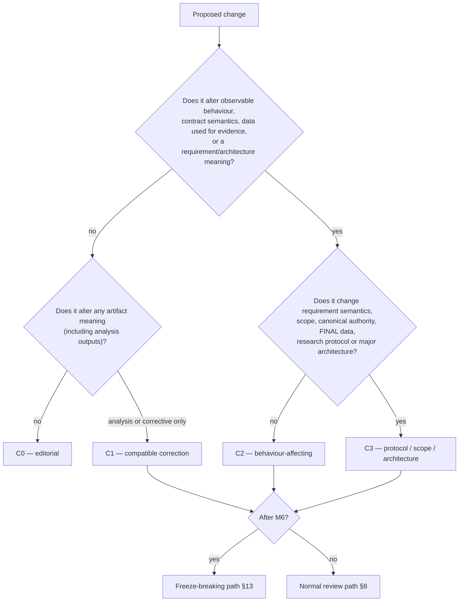

# 09 — Change Control Process
## Intelligent Manufacturing Operations Platform for Critical Aerospace Components — Change Classes, ChangeRequest Governance, Freeze Rules, Evidence Staleness and Emergency Handling

| Field | Value |
|---|---|
| Document | `09_Change_Control_Process.md` |
| Status | **Draft — Derived from Approved 01/02 Baseline** (requires team ratification before first use) |
| Version | v0.1.0-draft |
| Generated | pre-implementation; original empty-registry snapshot retained historically |
| Governing doctrine | **Change Is Allowed; Silent Change Is Not.** |
| Canonical sources | 01 Items 22, 35, 40–43, 60, 63, 65, 68, 73, 79, 81–85; 02 (contract registry, reconciliation register, open decisions) |
| Upstream artifacts governed | 01, 02 and the downstream set 03 RTM · 04 WBS · 05 Dependency Graph · 06A–D Roadmaps · 07 Milestone & Release Plan · 08 DoR/DoD |
| Change classes | C0 Editorial · C1 Compatible · C2 Behavior-Affecting · C3 Protocol / Scope / Architecture |
| Review risk classes | CR-0 … CR-4 (01 Item 63), applied on top of the change class |
| Registry | `09_change/` companion files; ChangeIDs `CHG-NNN` allocated in order, never reused |
| Status of the registry today | **16 reconciliation records UNDER_REVIEW**; eight final human policy groups DECIDED, independent change review/ratification pending |

> **CTRL-DOC-006 / CHG-014 registry delta.** The empty-registry counts in this original pre-implementation snapshot are historical. Current reconciliation records are in repository-root `09_change/change_requests.csv` and `CHG-001.yaml` through `CHG-016.yaml`. Current user policy authorizes scoped branch application; formal independent peer reviews and merge gates are not claimed complete. Records remain UNDER_REVIEW and do not certify VERIFIED/CLOSED changes or parent-WP completion.

> **Reading rule.** This process is lightweight but strict. Its purpose is not to slow the team down; it is to guarantee that after 26 weeks every difference between the approved baseline and the delivered system is visible, attributed, reviewed and — where it touches evidence — accounted for.

---

## Table of Contents

1. Doctrine and Scope
2. Sources and Precedence
3. What Counts as a Change (Change Surface)
4. Change Classes C0–C3
5. Impact Domains
6. ChangeRequest Schema and Worked Templates
7. Review Model: Dimensions, Roles, Risk Classes
8. Change Workflow and States
9. Requirement Change Rules
10. Contract Change Rules
11. Architecture and ADR Relation
12. Milestone-Phase Change Policy
13. Freeze Rules (M6 and after)
14. Evidence Staleness and Rerun Scope
15. Emergency and Hotfix Protocol
16. Change Registry, Identity and Metrics
17. Machine-Readable Companion
18. Findings Register
19. Rejected Alternatives
20. Guide §17 Compliance Check and Audit

---

## 1. Doctrine and Scope

> **Change Is Allowed; Silent Change Is Not.**

The approved 01/02 baseline was written before implementation; reality will contradict parts of it. The failure mode this process prevents is not *changing* the baseline — it is changing behaviour while the documents, the trace registry and the evidence still describe the old behaviour. Four concrete consequences follow:

| Principle | Operational meaning | Enforcement |
|---|---|---|
| Every material change is classified | a change without a class cannot be reviewed proportionally | PR template requires a class; CI blocks a behaviour-changing PR with no declared class |
| Every material change declares impact | requirement, contract, architecture, WBS, dependency, milestone, evidence and claim impact are named, not implied | `ImpactedRequirementIDs` (or an explicit `NONE — reason`) in the PR (01 Item 83 #98–#99) |
| Every material change declares impact; human PR review is optional at normal risk and mandatory at high risk | review authority follows impact, not repository path (Item 63) | reviewer matrix §7.4; human development review is advisory; actual technical/evidence gates remain |
| Every behaviour-affecting change asks the staleness question | "which previous evidence is no longer valid?" is answered before the change is closed | §14; evidence applicability is updated in the trace registry |

| In scope | Out of scope |
|---|---|
| Deviations from approved requirements, architecture, contracts, policies, models, data, scenarios, workflows and platform composition | Ordinary implementation inside an approved requirement with no behavioural or contractual effect (still reviewed under Item 63, but no ChangeRequest) |
| Changes to any downstream artifact (03–08) that alter meaning rather than presentation | Regenerating a downstream artifact from unchanged sources (C0 by construction) |
| Research protocol, freeze and benchmark campaign changes | Experiment *execution* decisions already authorized by the frozen protocol |
| Emergency hotfixes and their reconciliation | Local developer experiments that never reach `main` |
| Scope reduction under the 07 cut policy (recorded as a change when it removes an approved capability) | Cut of cosmetic or convenience work inside an approved package |

## 2. Sources and Precedence

| Source | Contribution to this process |
|---|---|
| 00 §17 | change taxonomy C0–C3, ChangeRequest field set, freeze rules, requirement-change rules, ADR relation, evidence staleness triggers, hotfix rules |
| 01 Item 63 | review dimensions RD-1…RD-8, reviewer roles RR-1…RR-7, risk classes CR-0…CR-4, mandatory review matrix, no-self-certification rules |
| 01 Item 79 | campaign change classes C0–C3 (documentation / analysis correction / behaviour-affecting / protocol-data-final-split), campaign abort and invalidation rules, symmetric-correction rule |
| 01 Item 60 | run dispositions (METHOD_FAILURE vs INFRA_INVALID) and rerun authorization semantics |
| 01 Item 65 | feature freeze at M6, permitted and prohibited post-freeze changes, freeze-breaking fix requires reversioning |
| 01 Items 42/43 | release identity, promotion, deployment records, environment integrity — the vehicle every approved change rides on |
| 01 Item 22 | contract compatibility classes NON_BREAKING / BEHAVIORAL_CHANGE / BREAKING, consumer review obligations |
| 01 Items 35/40/41 | migration classification, Git and CI governance (protected main, required checks) |
| 01 Items 73/83 | ADR obligations and trace-registry obligations that a change must satisfy |
| 01 Items 81/82 | requirement identity rules: ID stability, supersession, retired IDs never reused |
| 02 | contract registry, reconciliation register (R-001…R-009) and open decisions (OD-*) — the architecture-side inputs a C3 change must update |

**Precedence.** 01 outranks 02; 02 outranks the downstream artifacts; this process outranks convenience. Where this document and 01 appear to differ, 01 governs and the difference is recorded in §18.

## 3. What Counts as a Change (Change Surface)

The change surface is everything whose modification can alter behaviour, meaning, obligations or evidence validity. The table names the artifact family, who owns its meaning, and the minimum class its modification usually triggers.

| Surface | Examples | Meaning owner | Usual minimum class |
|---|---|---|---|
| Requirement semantics | FR/NFR statement, class, owner, threshold | Asrın (catalogue), requirement PrimaryOwner | C3 (new ID/supersession) or C0 (editorial clarification) |
| Architecture component / boundary | ARCH-* responsibilities, service boundaries, authority placement | Asrın (application), Yavuz (platform) | C3 |
| Cross-service contract | IC-* events, commands, queries, artifact and tool schemas | canonical producer owner | C1 (NON_BREAKING) · C2 (BEHAVIORAL_CHANGE) · C3 (BREAKING after M4) |
| Domain behaviour | Core transitions, idempotency, revision rules, genealogy | Asrın | C2 or C3 |
| Authority / HITL policy | AuthorityPolicy, ActionCatalog risk classes, approval binding, expiry | Asrın (semantics), Batu (runtime) | C2 minimum, CR-3 review always |
| Simulator semantics | routing, disruption models, RNG streams, scenario definitions | Batu | C2 (C3 after scenario freeze) |
| Scheduler policy | objectives, constraints, budgets, fallback, stability metrics | Batu | C2 (C3 after policy freeze) |
| Workflow semantics | WorkflowBundle, activity boundaries, revalidation, verification | Batu | C2 |
| AI behaviour | provider/model binding, prompts, tool set, budgets, abstention rules | Asrın | C2 (C3 after BehaviorBundle freeze) |
| Retrieval configuration | CorpusVersion, RetrievalProfile, chunking, filters | Asrın | C2 (C3 after freeze) |
| Vision models and thresholds | ModelPackage, preprocessing, ThresholdPolicyVersion | Selman | C2 (C3 after model freeze) |
| Datasets and splits | DatasetVersion, SplitManifest, synthetic generator parameters | Selman (Vision), Batu (scenarios) | C2 before F1 · C3 after freeze or for FINAL splits |
| Platform composition | Compose profiles, runtime versions, resource profiles, environment manifests | Yavuz | C1 (patch) · C2 (behavioural) · C3 (topology or technology addition) |
| Infrastructure major upgrade | PostgreSQL, NATS, object store, Temporal major versions | Yavuz | PlatformChange — never triggered by application auto-CD (Item 35 #67–#68) |
| Database migration | additive, backfill, destructive | schema owner | C1 (additive) · C2 (backfill) · C3 (destructive) |
| Security configuration | identities, credentials, secrets sourcing, Keycloak policy, CI secrets | Yavuz | CR-3 review regardless of class |
| Research protocol | hypotheses, metrics, analysis plan, seeds, baselines, exclusion policy | Asrın (with lane owners) | C3 |
| Benchmark campaign | campaign manifest, lane composition, execution logic | Yavuz (execution), Asrın (protocol) | C2 or C3 (Item 79 classes) |
| Downstream artifacts 03–08 | trace mappings, work packages, dependency edges, milestone criteria, DoR/DoD rules | artifact owner | C0 (regeneration) · C1 (correction) · C2/C3 (meaning change) |
| Claims and thesis wording | RQ outcome statements, portfolio metric exports | Asrın | C3 if the claim exceeds its evidence |
## 4. Change Classes C0–C3

The project-wide taxonomy is aligned with the Item 79 campaign change classes so that a single classification serves both engineering and research governance.

| Class | Name | Definition | Behavioural semantics | Release identity | Evidence consequence | Item 79 counterpart |
|---|---|---|---|---|---|---|
| C0 | Editorial / non-semantic | typos, formatting, non-semantic documentation, diagram clarity, regenerated artifacts from unchanged sources | unchanged | no new release required | no behavioural rerun by default | C0 — Documentation Only |
| C1 | Compatible correction | bug fix that restores approved behaviour, analysis correction on unchanged raw outputs, derived implementation detail, additive migration | approved semantics preserved | new build, same behavioural identity | impact/evidence assessment required; human development review advisory; analysis corrections require a new AnalysisPackage version and symmetric recomputation | C1 — Analysis Correction |
| C2 | Behaviour-affecting | model, prompt/tool behaviour, scheduler policy, workflow semantics, authority policy, event contract behaviour, data processing | changed | **new ReleaseManifest required** | affected evidence reviewed and, where applicable, reruns executed | C2 — Behaviour-Affecting |
| C3 | Protocol / scope / final-data / fundamental architecture | requirement semantics, FINAL split or protocol, research hypothesis, canonical authority, major architecture, scope | changed at the level of what the system *is* or what is being measured | new release plus formal rebaseline of the affected baseline documents | research-integrity event: campaign version may change, disclosure required | C3 — Protocol/Data/Final-Split |

### 4.1 Classification decision procedure



### 4.2 Classification rules that prevent under-classification

| Rule | Statement | Source |
|---|---|---|
| CL-01 | When in doubt between two classes, the higher class applies until actual impact/evidence supports a documented downgrade; no reviewer gate (CHG-018). | derived |
| CL-02 | A schema-compatible change can still be behaviourally breaking (e.g. `confidence` field semantics changing without a JSON shape change) — that is C2, not C0/C1. | Item 63 #83 |
| CL-03 | A "configuration only" change that alters behaviour (threshold, budget, policy value, retrieval parameter) is C2. | derived from Item 79 C2 |
| CL-04 | A fix that changes what the system does in a case it previously handled differently is C2 even when it is called a bug fix; C1 is reserved for restoring *approved* behaviour. | derived |
| CL-05 | Any touch of FINAL partitions, frozen seeds, hypotheses, primary metrics or exclusion policy is C3 regardless of size. | Item 79 #126, Item 63 CR-4 |
| CL-06 | Adding an infrastructure technology is never C1; it is C3 and requires an ADR (no application team adds infrastructure unilaterally). | Item 62 #127 |
| CL-07 | Removing or reducing an approved F0/F1 capability under schedule pressure is C3, not a planning decision. | Item 65 #76, 07 §10 |
| CL-08 | Regenerating 03–08 from unchanged upstream sources is C0; changing what they assert is at least C1. | derived |

### 4.3 Related classification systems that stack on top of the class

| System | Values | Applies to | Effect |
|---|---|---|---|
| Review risk class (Item 63) | CR-0 trivial · CR-1 subsystem-local · CR-2 cross-boundary · CR-3 critical/safety-sensitive · CR-4 research/final-evidence critical | every change | determines reviewer set and actual technical/security/evidence verification needs; review remains advisory |
| Contract compatibility (Item 22) | NON_BREAKING · BEHAVIORAL_CHANGE · BREAKING | contract changes | BEHAVIORAL_CHANGE and BREAKING require actual compatibility/consumer evidence; development review advisory |
| Migration class (Item 35) | additive · backfill · destructive | database changes | destructive migrations are CR-3 and require rollback analysis |
| Platform change (Item 35 #67–#68) | PlatformChange / maintenance | major infrastructure upgrades | never triggered by application auto-CD; separately scheduled |
| Run disposition (Item 60) | METHOD_FAILURE · INFRA_INVALID | benchmark runs affected by a change | decides whether a rerun is legitimate (§14.4) |

## 5. Impact Domains

Every ChangeRequest answers the same nine impact questions. The table gives the artifact that must be updated and the owner who confirms it.

| # | Impact domain | Question | Artifact to update | Confirming owner |
|---|---|---|---|---|
| 1 | Requirements | which FR/NFR change meaning, class, threshold or owner? | 01 Items 81/82 + 03 trace registry | requirement PrimaryOwner |
| 2 | Architecture | which ARCH-* component, boundary or authority placement changes? | 02 + ADR | Asrın (application) / Yavuz (platform) |
| 3 | Contracts | which IC-* contract changes, and is it NON_BREAKING, BEHAVIORAL_CHANGE or BREAKING? | contract registry + consumer fixtures | canonical producer owner + every consumer owner |
| 4 | Work packages and roadmaps | which WP deliverables, tasks or milestones change? | 04 + affected 06A–D | WP owner |
| 5 | Dependencies | which DEP-* edge changes kind, strength, stage, readiness or need-by? | 05 | predecessor and consumer owners |
| 6 | Milestones and release | does a milestone gate, exit criterion or release artifact change? | 07 | team |
| 7 | Evidence | which existing or planned evidence becomes stale, invalid or insufficient? | 03 evidence applicability + run registry | Yavuz (evidence) + lane owner |
| 8 | Security and authority | does the change touch identity, credentials, authority policy, oracle isolation or audit? | 02 security surfaces + negative suites | Yavuz + Asrın (CR-3 review) |
| 9 | Claims and research protocol | does any RQ/MC claim, metric, hypothesis or analysis step change? | ThesisClaimRegister + AnalysisPackage + campaign manifest | Asrın + lane owner |

### 5.1 Impact fan-out reference (generated)

Typical blast radius by surface, computed from the current downstream artifacts. Counts are the *maximum* population a change in that surface can touch, not a prediction for any single change.

| Surface | Requirements | Work packages | Verification families | Downstream dependency edges | Consumer owners |
|---|---|---|---|---|---|
| Core domain / transitions | 16 | 8 | 28 | 6 | Asrın, Batu, Selman |
| Event & contract registry | 10 | 8 | 25 | 2 | Asrın |
| Twin projection | 10 | 9 | 33 | 4 | Asrın, Batu |
| Simulator semantics | 14 | 9 | 27 | 4 | Batu |
| Vision models / observation | 16 | 19 | 32 | 3 | Asrın |
| Predictive ML | 8 | 9 | 15 | 2 | Asrın |
| RAG configuration | 10 | 9 | 18 | 3 | Asrın |
| AI orchestration / RCA | 13 | 13 | 39 | 3 | Batu |
| Scheduler policy | 15 | 13 | 25 | 2 | Batu |
| Automation / workflow | 14 | 13 | 41 | 2 | Batu |
| Authority / HITL | 10 | 10 | 26 | 2 | Batu |
| Command Center | 10 | 12 | 14 | 2 | Asrın |
| Platform / runtime | 10 | 11 | 31 | 11 | Yavuz |
| Security runtime | 10 | 11 | 23 | 3 | Batu, Yavuz |
| Research / evaluation | 10 | 12 | 27 | 4 | Yavuz |

A C2 change in any row must, at minimum, re-examine the verification families in that row; a C3 change must additionally re-examine the dependency edges and the consumer owners listed.
## 6. ChangeRequest Schema and Worked Templates

### 6.1 Field set (00 §17, mandatory for every material change)

| # | Field | Required for | Rule |
|---|---|---|---|
| 1 | ChangeID | all | `CHG-NNN`, allocated in order, never reused, never renumbered |
| 2 | Title | all | one line stating the change, not the motivation |
| 3 | Trigger | all | what surfaced the need: defect, measurement, review finding, dependency failure, red-team finding, external constraint |
| 4 | Reason | all | why the approved baseline cannot stand as written |
| 5 | Class | all | C0 / C1 / C2 / C3 plus review risk class CR-0…CR-4 |
| 6 | AffectedRequirements | C1+ | FR/NFR IDs, or `NONE — reason` |
| 7 | AffectedArchitecture | C1+ | ARCH-* IDs, deployables, or `NONE` |
| 8 | AffectedContracts | C1+ | IC-* identities with compatibility class NON_BREAKING / BEHAVIORAL_CHANGE / BREAKING |
| 9 | AffectedWorkPackagesAndRoadmaps | C1+ | WP-* IDs and the 06 roadmaps that must be regenerated |
| 10 | AffectedDependencies | C2+ | DEP-* edges whose kind, strength, stage, readiness or need-by changes |
| 11 | AffectedEvidence | C1+ | existing and planned evidence, by lane or verification family |
| 12 | EvidenceStaleness | C2+ | explicit answer to "which previous evidence is no longer valid?" (§14) |
| 13 | SecurityAuthorityImpact | all | identity, credential, authority-policy, oracle-isolation or audit impact — `NONE` must be stated, not omitted |
| 14 | Owner | all | single accountable owner (the capability owner, never "team") |
| 15 | Reviewers | all | actual risk-based approval count from01 owner policy; §7.4 routes relevant expertise |
| 16 | Decision | all | APPROVED / APPROVED_WITH_CONDITIONS / REJECTED / DEFERRED, with the deciding reviewers |
| 17 | Rollout | C1+ | how it reaches INTEGRATION/EVALUATION: release identity, migration plan, consumer sequencing |
| 18 | Rollback | C1+ | known-good release to return to, or an explicit statement that rollback is impossible and why |
| 19 | RequiredRerun | C2+ | lanes/scenarios to re-execute, with disposition handling per §14.4 |
| 20 | DocumentationUpdates | all | 01/02 edits, ADR creation or supersession, downstream regeneration (03–08), runbook updates |

### 6.2 Machine-readable template

```yaml
CHG-NNN:
  title: "<one line>"
  trigger: "<defect | measurement | review finding | dependency failure | red-team finding | external constraint>"
  reason: "<why the approved baseline cannot stand>"
  class: C0 | C1 | C2 | C3
  review_risk_class: CR-0 | CR-1 | CR-2 | CR-3 | CR-4
  raised_in: "S<n>"          # sprint window, never a calendar date
  affected_requirements: []   # FR-*/NFR-* or ["NONE — reason"]
  affected_architecture: []   # ARCH-*
  affected_contracts:
    - id: IC-XXX-NNN
      compatibility: NON_BREAKING | BEHAVIORAL_CHANGE | BREAKING
      consumers_reviewed: []
  affected_work_packages: []  # WP-*
  affected_dependencies: []   # DEP-*
  affected_evidence: []       # verification families, lanes, or run ids once they exist
  evidence_staleness:
    question_answered: true
    stale: []                 # evidence that becomes STALE
    unaffected: []            # evidence explicitly reviewed and kept CURRENT
    rerun_required: []        # lanes to re-execute
  security_authority_impact: "NONE | <description>"
  owner: "<Asrın | Selman | Batu | Yavuz>"
  reviewers: []
  decision: DRAFT | APPROVED | APPROVED_WITH_CONDITIONS | REJECTED | DEFERRED
  conditions: []
  rollout: "<release identity, migration plan, consumer sequencing>"
  rollback: "<known-good release | IMPOSSIBLE — reason>"
  required_rerun: []
  documentation_updates: []   # 01/02 sections, ADR-*, 03–08 regeneration, runbooks
  freeze_context: PRE_M6 | POST_M6_PERMITTED | POST_M6_FREEZE_BREAKING
  status: DRAFT | CLASSIFIED | IMPACT_ASSESSED | UNDER_REVIEW | APPROVED | IMPLEMENTED | VERIFIED | CLOSED | REJECTED
```

### 6.3 Worked templates (illustrative — these are not real change requests)

The three examples below show how the schema behaves at different classes. They carry the marker `EXAMPLE` and are never counted in the registry.

**EXAMPLE-C1 — compatible correction**

| Field | Value |
|---|---|
| Title | Twin freshness computation returns stale marker one revision late |
| Trigger | defect found by TEST-TWIN-FRESHNESS during S7 |
| Reason | approved behaviour (FR-TWIN-005) is not met; the fix restores approved semantics rather than changing them |
| Class / risk | C1 / CR-1 |
| Affected requirements | FR-TWIN-004, FR-TWIN-005 |
| Affected contracts | none (field semantics unchanged) |
| Affected evidence | none sealed; planned TEST-TWIN-FRESHNESS and AV-SCEN-07 cases must pass after the fix |
| Evidence staleness | no prior evidence invalidated — the change makes the system match its approved description |
| Security/authority impact | NONE |
| Owner / reviewers | Asrın / RR-1 owner reviewer + RR-3 platform reviewer (staleness surfaces in UI) |
| Rollout / rollback | normal release; rollback to previous known-good release |
| Documentation updates | none beyond the trace registry |

**EXAMPLE-C2 — behaviour-affecting change**

| Field | Value |
|---|---|
| Title | Scheduler fallback threshold changed after SP-NORMAL measurement |
| Trigger | measurement: NFR-PERF-008 misses its budget on 12% of instances in S9 |
| Reason | the approved decision budget is achievable only with an earlier fallback trigger |
| Class / risk | C2 / CR-2 (CR-3 if it touches execution eligibility) |
| Affected requirements | FR-SCH-012, NFR-PERF-008, NFR-CAP-006 |
| Affected contracts | IC-SCH-004 unchanged in shape; `fallback_reason` semantics extended → BEHAVIORAL_CHANGE, consumers (Automation, Command Center) reviewed |
| Affected dependencies | DEP edges from the Scheduler node to Automation and HITL consumers re-confirmed at their declared readiness |
| Affected evidence | scheduler component benchmark and any RQ-2 dry-run results produced before the change |
| Evidence staleness | all pre-change scheduler performance measurements become STALE; RQ-2 DEV/CAL results must be re-executed; no sealed evidence exists yet |
| Security/authority impact | NONE (execution eligibility still requires validator approval) |
| Owner / reviewers | Batu / RR-1 owner + RR-2 cross-domain (Asrın, authority path) + RR-3 platform (resource budget) |
| Rollout / rollback | new ReleaseManifest; rollback to previous release is compatible (no migration) |
| Required rerun | BENCH-PERF-SCH, BENCH-SCH-001 dry runs |
| Documentation updates | 04 WP-SCH-005 scope note, 03 View G measurement note, ADR if the fallback strategy itself changes |

**EXAMPLE-C3 — protocol / scope change**

| Field | Value |
|---|---|
| Title | RQ-1 final case count reduced from 120 to 90 after corpus availability constraint |
| Trigger | external constraint discovered during S10 corpus preparation |
| Reason | the approved FINAL_TEST case count cannot be reached with rights-clear documents |
| Class / risk | C3 / CR-4 |
| Affected requirements | FR-RAG-009, FR-EVAL-002, NFR-DATA-006 |
| Affected evidence | the entire RQ-1 lane design; statistical power of the planned comparison |
| Evidence staleness | no sealed evidence yet; the protocol itself is being changed before F3, which is the only point at which this is acceptable |
| Security/authority impact | NONE; rights/licence constraint is the trigger |
| Owner / reviewers | Asrın / RR-5 research reviewer (independent of the lane owner) + RR-6 data reviewer + team acknowledgement |
| Rollout | protocol revision recorded before ExperimentProtocolFreeze; campaign manifest updated |
| Rollback | not applicable — protocol decisions are versioned, not rolled back |
| Required rerun | none yet; if this occurred after F3 it would be a freeze-breaking change requiring campaign reversioning |
| Documentation updates | 01 Item 60/79 deviation note, 03 View H design column, 07 §9 freeze register, thesis method section |

## 7. Review Model: Dimensions, Roles, Risk Classes

Review authority follows impact, not repository path. No critical change may be authored, certified and accepted by the same person alone (Item 63).

### 7.1 Review dimensions (RD)

| ID | Dimension | Asks |
|---|---|---|
| RD-1 | Implementation correctness | does the code do what it claims, correctly? |
| RD-2 | Domain / semantic correctness | does it preserve approved manufacturing and system meaning? |
| RD-3 | Contract compatibility | what happens to every consumer of the changed contract? |
| RD-4 | Security / authority | can this widen authority, expose secrets or weaken isolation? |
| RD-5 | Runtime / operability | can it be deployed, observed, recovered and afforded on the shared host? |
| RD-6 | Data / model integrity | does it affect datasets, splits, models, provenance or leakage risk? |
| RD-7 | Research validity | does it affect protocol, metrics, baselines, seeds or claim strength? |
| RD-8 | Supply chain / licensing | does it add dependencies, images or rights obligations? |

### 7.2 Reviewer roles (RR) and who typically holds them

| ID | Role | Typical holder | Held for |
|---|---|---|---|
| RR-1 | Primary owner reviewer | capability owner | every change to their capability |
| RR-2 | Cross-domain reviewer | the consuming capability owner | cross-boundary contract and behaviour changes |
| RR-3 | Platform reviewer | Yavuz | runtime, deployment, resource, observability impact |
| RR-4 | Security / authority reviewer | Yavuz (identity/platform) with Asrın (authority semantics) | CR-3 changes |
| RR-5 | Research reviewer | Asrın, or an owner independent of the affected lane | CR-4 changes |
| RR-6 | Vision / data reviewer | Selman | dataset, split, model and provenance changes |
| RR-7 | Planning / execution reviewer | Batu | scheduler, workflow and execution-semantics changes |

One person may hold several expertise roles; all development PRs require zero approvals; actual technical acceptance evidence remains a distinct gate.

### 7.3 Review risk classes and minimum review

| Risk class | Examples | Minimum review | Self-certification |
|---|---|---|---|
| CR-0 | typos, comments, documentation wording, formatting | zero required human approvals; all development review advisory; protected main technical safeguards still apply | advisory only; no development approval mechanism |
| CR-1 | subsystem-local refactor, local serving change, local dashboard work | zero required approvals; owner expertise guides advisory review | advisory only; no development approval mechanism |
| CR-2 | Vision→AI contract, Scheduler→Core contract, Core→Twin projection, AI tool contract, RAG evidence contract, workflow↔approval contract | zero required approvals; affected-domain expertise guides advisory review | advisory only; no development approval mechanism |
| CR-3 | actual auth/authorization, protected-action authority, destructive migration, security-sensitive infrastructure/secrets, major authority-boundary changes, explicitly high-risk safety/protected execution semantics | zero required human approvals; actual security/authority/migration/static verification remains mandatory | advisory review, not a gate |
| CR-4 | research hypothesis, FINAL split, SeedSet, baseline removal, primary metric, ExperimentProtocolFreeze, AnalysisPlan, exclusion policy, final benchmark execution logic, final statistics | zero required approvals for ALL research/development PRs, including high risk | final-methodology acceptance remains at its actual gate |

### 7.4 Reviewer expertise-routing matrix (final owner policy15 October2026; all routing advisory, CHG-018)

| Change surface | Primary owner reviewer (RR-1) | Relevant cross-domain expertise | Relevant platform expertise | Usual risk class |
|---|---|---|---|---|
| Core domain, transitions, commands | Asrın | Batu (execution consumer) | Yavuz | CR-2 / CR-3 for state transitions |
| Event and contract registry | Asrın | every consumer owner | Yavuz | CR-2 |
| Twin projection and freshness | Asrın | Batu, Selman (consumers) | Yavuz | CR-2 |
| Simulator semantics and scenarios | Batu | Asrın (domain legality) | Yavuz | CR-2; CR-4 after scenario freeze |
| Vision models, thresholds, observation contract | Selman | Asrın (evidence consumer) | Yavuz | CR-2; CR-4 for splits |
| Predictive ML models and prediction contract | Asrın | Selman (data), Batu (consumer) | Yavuz | CR-2; CR-4 for FINAL partitions |
| RAG corpus and retrieval profile | Asrın | Yavuz (runtime) | Yavuz | CR-2; CR-4 after corpus freeze |
| AI orchestration, tools, behaviour bundle | Asrın | Batu (proposal consumer) | Yavuz | CR-3 (authority surface) |
| Scheduler policy, validator, budgets | Batu | Asrın (legality), Yavuz (resources) | Yavuz | CR-2; CR-3 for execution eligibility |
| Automation workflows and execution | Batu | Asrın (authority), Yavuz (Temporal runtime) | Yavuz | CR-3 |
| Authority policy, approval binding, ActionCatalog | Asrın | Batu (runtime), Yavuz (identity) | Yavuz | CR-3 always |
| Command Center surfaces | Asrın (shell) | surface owner (Selman/Batu/Yavuz) | Yavuz | CR-1 / CR-2 |
| Platform composition, CI/CD, resources | Yavuz | Asrın (application impact) | — | CR-2; CR-3 for secrets and credentials |
| Security configuration and identities | Yavuz | Asrın (authority semantics) | — | CR-3 always |
| Backup, restore, recovery tooling | Yavuz | Batu (execution impact) | — | CR-2; CR-3 for destructive operations |
| Research protocol, metrics, analysis | Asrın | lane owner + an independent owner | Yavuz (execution) | CR-4 always |
| Benchmark campaign and evidence pipeline | Yavuz | Asrın (protocol) | — | CR-4 |
## 8. Change Workflow and States

```mermaid
stateDiagram-v2
  [*] --> DRAFT
  DRAFT --> CLASSIFIED: class + review risk class assigned
  CLASSIFIED --> IMPACT_ASSESSED: nine impact domains answered (§5)
  IMPACT_ASSESSED --> UNDER_REVIEW: impact classified; advisory routing for all development classes (§7.4)
  UNDER_REVIEW --> APPROVED
  UNDER_REVIEW --> APPROVED_WITH_CONDITIONS
  UNDER_REVIEW --> REJECTED
  UNDER_REVIEW --> DEFERRED: valid but not now (records the decision, not silence)
  APPROVED --> IMPLEMENTED: merged to main with trace edges updated in the same PR
  APPROVED_WITH_CONDITIONS --> IMPLEMENTED
  IMPLEMENTED --> VERIFIED: release deployed and required verification/rerun executed
  VERIFIED --> CLOSED: documentation and evidence applicability updated
  REJECTED --> [*]
  DEFERRED --> DRAFT: reopened with new information
```



| State | Exit condition | Who moves it |
|---|---|---|
| DRAFT | title, trigger and reason written | raiser |
| CLASSIFIED | class C0–C3 and risk class CR-0…CR-4 assigned; CL-01 applied when uncertain | raiser + owner |
| IMPACT_ASSESSED | all nine impact domains answered, including explicit `NONE` answers | owner |
| UNDER_REVIEW | actual applicable scope/DoR/DoD and CI checks pass: all development approvals zero; actual technical/canonical failures block, advisory review states do not | reviewers |
| APPROVED | accountable decision and real evidence recorded; reviewers advisory | reviewers |
| IMPLEMENTED | merged with trace edges updated in the same PR; new ReleaseManifest for C2+ | owner |
| VERIFIED | required verification passed and required reruns executed with dispositions recorded | owner + Yavuz (evidence) |
| CLOSED | documentation updates done; evidence applicability set; registry entry final | owner |

**Timing.** No calendar SLAs are defined (no calendar exists in the sources). Review expectations are expressed in sprint terms: a CR-0/CR-1 is expected to close within the sprint it is raised; a CR-2 within the sprint or the next; CR-3/CR-4 have no time pressure at all — an unreviewed critical change simply does not merge.

## 9. Requirement Change Rules

| Situation | Rule | ID handling | Artifacts |
|---|---|---|---|
| Editorial clarification with unchanged behaviour | allowed as C0 | same RequirementID, revision incremented | 01 catalogue + 03 regeneration |
| Threshold or measurement-context correction before M6 | C2 (A1/S2/C3 NFRs) with measurement rationale | same ID, revision incremented, previous value retained in history | 01 Item 82 + 03 View G |
| Materially different behaviour | C3 | **new RequirementID preferred**, old one marked SUPERSEDED with `Supersedes`/`SupersededBy` links | 01 + 03 + affected WPs and roadmaps |
| Requirement removal | C3 | ID retired; never reused for anything else (FR-GOV-002) | 01 + 03 + acceptance denominators in 07 |
| Scope-class change (F1 → R2, R2 → F1) | C3 | same ID, ScopeClass changed with a promotion/demotion decision | 01 Item 68 + 04 + 05 (dependency strength may change) |
| Owner change | C3 (ownership is an approved decision) | same ID, PrimaryOwner changed; exactly one owner always | 01 Item 62 + 03 + 06 roadmaps |
| Rebaselining an A1 NFR that cannot be met | C3 with measured evidence attached | same ID, threshold revised, disposition recorded as REBASELINED | 01 Item 82 + 03 + 07 acceptance |

Acceptance denominators move with these changes: the M8 acceptance report counts *active* requirements, so a superseded ID leaves the denominator and its replacement enters it (03 §3).

## 10. Contract Change Rules

| Compatibility class | Definition | Class | Required actions |
|---|---|---|---|
| NON_BREAKING | additive, optional, no semantic shift for existing consumers | C1 | producer review + schema compatibility check in CI |
| BEHAVIORAL_CHANGE | shape compatible, meaning changed (e.g. `confidence` semantics) | C2 | affected-consumer review is mandatory; fixtures updated; consumer tests re-run |
| BREAKING | consumers cannot process the new form without change | C2 before M4; **C3 after M4** (exceptional, 05 DEP-RULE-16) | versioned contract, consumer sequencing plan, dual publication if needed |

| Rollout rule | Statement | Source |
|---|---|---|
| Consumer compatibility first | in risky event evolution, consumers are prepared to tolerate the new format before the producer activates it | Item 35 #69 |
| Producer activation later | the producer switches on new behaviour only after compatible consumers are deployed | Item 35 #70 |
| Dual publication is time-bounded | transitional old/new publication has an explicit end | Item 35 #71 |
| Canonical producer unchanged | a change may not move a contract to a second producer | Item 22 / 03 FR-EVT-008 |
| Fixtures move with the contract | every published fixture is updated in the same change, or consumers are working against a lie | 05 DEP-RULE-04 |

## 11. Architecture and ADR Relation

| Situation | ADR action | Change class | Note |
|---|---|---|---|
| New architectural decision | new ADR | C2/C3 depending on behaviour | Change Control does not replace the ADR; it routes and records it |
| Decision reversal | supersede the ADR, keep the original | C3 | superseded ADRs are retained, never deleted |
| Decision refinement without reversal | update the ADR with an amendment note | C1/C2 | the amendment states what changed and why |
| Adding infrastructure technology | new ADR plus platform review | C3 | no application team adds infrastructure unilaterally (Item 62 #127) |
| Architecture boundary change (authority placement, service split) | new ADR plus 02 update | C3 | requires Asrın (application) and Yavuz (platform) review |
| Backfill ADRs for existing decisions | mint ADR IDs for the 02 backfill list | C0 (documenting an existing decision) | tracked as 03 GAP-RTM-023 until done |

## 12. Milestone-Phase Change Policy

The same change is governed differently depending on when it is raised. This table is the operational join between 07 and this process.

| Phase | C0 | C1 | C2 | C3 |
|---|---|---|---|---|
| Before M3 (S1–S6) | normal | normal | normal, with contract sequencing | allowed; cheapest window for requirement/architecture correction |
| M3 → M4 (S7–S8) | normal | normal | normal | allowed, but new mandatory scope needs an explicit decision (Item 65 #76) |
| M4 → M6 (S9–S11) | normal | normal | allowed with impact review; correctness/reliability dominate | discouraged; requires rebaseline and roadmap regeneration |
| After M6 (S11 freeze → S12) | allowed | allowed for evidence-pipeline and analysis corrections | **default prohibited**; only bug/security/integrity fixes via §13 | **research-integrity event**: campaign reversioning, disclosure |
| During S12 protected window | documentation only | analysis corrections only, applied symmetrically | only if the alternative is invalid evidence; triggers rerun scope decision | campaign invalidation path (§13.4) |
| S13 (release stabilization) | normal | release-critical fixes | only release-critical, with re-verification of affected acceptance evidence | not accepted; defer to post-v1 roadmap |

## 13. Freeze Rules (M6 and after)

### 13.1 Default position

After M6 a behaviour-affecting change is **disallowed by default**. Permitted categories are correctness fixes, security fixes, benchmark-infrastructure corrections and evidence-pipeline fixes (Item 65 #98). Everything else — new AI features, extra Vision architectures, new Scheduler objectives, UI redesign, exploratory expansion — is refused (#99). Final-test tuning of any kind stops at M6 (#97).

### 13.2 Freeze-breaking change protocol

| Step | Action | Owner | Output |
|---|---|---|---|
| 1 | Classify the fix into a permitted category; anything else is refused under freeze | Asrın + affected owner | classification record |
| 2 | Formal impact review: which frozen assets, experiments and evidence are touched | affected owners + Yavuz | impact statement in the CR |
| 3 | Reversion: new artifact versions and a new ReleaseManifest — never an in-place edit of a frozen artifact | Yavuz | new release identity |
| 4 | Benchmark validity assessment: is prior evidence still comparable, or does mixing results across releases occur? | Yavuz + lane owners | validity decision |
| 5 | Rerun scope decision: which lanes re-execute, and under which disposition | lane owner | rerun list in the CR |
| 6 | Disclosure: record the deviation in the campaign manifest and in any claim wording it touches | Asrın | deviation record |

**No silent mixing of results across releases.** If part of a lane ran on release A and part on release B, either the lane is re-executed on one release or the split is disclosed as a threat to validity and the affected comparison is dropped.

### 13.3 Frozen asset change matrix

| Frozen asset | Change after M6 | Consequence |
|---|---|---|
| DatasetVersion / SplitManifest | prohibited except to correct a leakage defect | all affected lanes re-execute; RQ claims re-derived |
| ScenarioVersion / SeedSet | prohibited except to correct a scenario defect that invalidates runs | paired-seed comparisons re-executed for the affected family |
| ModelPackage (Vision, ML) | prohibited except for a serving defect that does not change outputs | output-changing fixes force Vision/ML lane reruns |
| AI BehaviorBundle / RetrievalProfile | prohibited except for a security or correctness defect | RQ-1 lane reruns; provider identity re-recorded |
| SchedulerPolicy / WorkflowDefinition | prohibited except for a safety or correctness defect | RQ-2 and automation lanes re-examined |
| AuthorityPolicy / ActionCatalog | security fixes permitted and expected | RQ-3 adversarial lane re-examined; safety gate re-verified |
| MetricDefinition / AnalysisPlan | prohibited except for a defect in the calculator | symmetric recomputation of *all* arms, never candidate-only (Item 79 #127) |
| ReleaseManifest / EnvironmentManifest / HardwareProfile | any change creates a new identity | performance and capacity evidence bound to the old identity becomes STALE |

### 13.4 Campaign abort and invalidation

The campaign pauses or invalidates on discovery of: oracle leakage, FINAL contamination, wrong provider/model, wrong release, corrupted evidence, incorrect baseline implementation, major evaluator defect, authority bypass, or cross-world contamination (Item 79). Integrity failure outranks schedule pressure (#128). An invalidated FBC-01 is marked `INVALIDATED`, retained in history (#129), and replaced by a new campaign version.
## 14. Evidence Staleness and Rerun Scope

Every C1+ change answers one question before it closes: **"which previous evidence is no longer valid?"** An unanswered staleness question is itself a process failure, independent of whether the change was correct.

### 14.1 Staleness trigger matrix (generated from 03)

| Changed artifact | Scope in the requirement catalogue | Typical trigger | Evidence that becomes STALE |
|---|---|---|---|
| Code / behaviour of a service | — | any behaviour-affecting change in the owning service | re-run the verification families of the affected requirements |
| ModelPackage (Vision or M1/M2/M3) or ThresholdPolicyVersion | 16 requirements | model retrain, promotion, threshold recalibration | Vision/ML lanes, RQ-4, any RCA evidence that consumed those outputs |
| CorpusVersion / RetrievalProfile | 7 requirements | corpus reingest, chunking change, retrieval parameter change | RQ-1 lane and retrieval ablation |
| AIBehaviorBundle / provider-model binding / tool allowlist | 7 requirements | provider switch, prompt or tool-set change, budget change | RQ-1, RQ-3, any RCA-derived evidence |
| SchedulerPolicy | 8 requirements | objective, constraint, budget or fallback change | scheduler benchmark, RQ-2 lanes, E2E matrix timing |
| WorkflowBundle / ActionCatalog | 8 requirements | workflow shape, activity boundary, action definition change | automation lane, resilience drills, RQ-3 |
| AuthorityPolicy / approval semantics | 13 requirements | policy class mapping, binding or expiry change | authority negative suite, RQ-3, AV-SCEN-04 |
| DatasetVersion / SplitManifest / SeedSet / ScenarioVersion | 20 requirements | new data, re-split, re-seed, scenario edit | every lane that consumed the artifact; paired comparisons must be fully re-executed |
| Event / command / API contract (behavioural or breaking) | 87 requirements | semantic change to a published contract | integration scenarios, E2E matrix, consumer-side verification |
| HardwareProfile / host resources | 58 requirements | host change, resource-limit change, contention | all performance, capacity and resource evidence bound to that profile |
| ReleaseManifest / EnvironmentManifest / Compose composition | 38 requirements | release identity change | everything measured on the previous identity; acceptance evidence re-bound |
| AnalysisPackage | 11 requirements | metric calculator or statistical procedure change | all derived tables and figures; recomputation must be symmetric across arms |

### 14.2 Requirement-level staleness lists (generated)

**ModelPackage (Vision or M1/M2/M3) or ThresholdPolicyVersion — 16 requirements.** FR-VIS-001, FR-VIS-002, FR-VIS-003, FR-VIS-004, FR-VIS-005, FR-VIS-006, FR-VIS-014, FR-VIS-015, FR-ML-001, FR-ML-002, FR-ML-003, FR-ML-005, FR-ML-006, FR-AI-011, NFR-PERF-009, NFR-PERF-010

**CorpusVersion / RetrievalProfile — 7 requirements.** FR-RAG-001, FR-RAG-003, FR-RAG-004, FR-RAG-005, FR-RAG-009, NFR-PERF-006, NFR-REC-009

**AIBehaviorBundle / provider-model binding / tool allowlist — 7 requirements.** FR-AI-003, FR-AI-011, FR-SEC-004, FR-SEC-005, NFR-PERF-007, NFR-SEC-009, NFR-REP-009

**SchedulerPolicy — 8 requirements.** FR-SCH-002, FR-SCH-003, FR-SCH-004, FR-SCH-009, FR-SCH-012, NFR-PERF-008, NFR-CAP-006, NFR-CAP-007

**WorkflowBundle / ActionCatalog — 8 requirements.** FR-AUTO-001, FR-AUTO-006, FR-AUTO-012, FR-AUTO-014, FR-HITL-002, NFR-PERF-011, NFR-CAP-008, NFR-REL-004

**AuthorityPolicy / approval semantics — 13 requirements.** FR-RAG-008, FR-AI-003, FR-SCH-014, FR-AUTO-004, FR-AUTO-013, FR-HITL-001, FR-HITL-002, FR-HITL-006, FR-HITL-009, FR-SEC-003, FR-SEC-009, NFR-REL-002, NFR-SEC-004

**DatasetVersion / SplitManifest / SeedSet / ScenarioVersion — 20 requirements.** FR-SIM-003, FR-SIM-004, FR-SIM-005, FR-SIM-006, FR-SIM-007, FR-SIM-008, FR-VIS-002, FR-VIS-003, FR-VIS-004, FR-VIS-011, FR-VIS-012, FR-ML-001, FR-ML-002, FR-ML-003, FR-ML-007, FR-ML-008, FR-EVAL-001, FR-EVAL-002, NFR-REP-001, NFR-DATA-002

**Event / command / API contract (behavioural or breaking) — 87 requirements.** FR-CORE-001, FR-CORE-002, FR-CORE-003, FR-CORE-004, FR-CORE-005, FR-CORE-006, FR-CORE-007, FR-CORE-008, FR-CORE-009, FR-CORE-010, FR-CORE-011, FR-CORE-012, FR-CORE-014, FR-CORE-015, FR-CORE-016, FR-SIM-002, FR-SIM-010, FR-SIM-013, FR-SIM-014, FR-TWIN-001, FR-TWIN-002, FR-TWIN-003, FR-TWIN-004, FR-TWIN-005, FR-TWIN-008, FR-TWIN-009, FR-TWIN-010, FR-EVT-001, FR-EVT-002, FR-EVT-003, FR-EVT-004, FR-EVT-005, FR-EVT-006, FR-EVT-008, FR-VIS-001, FR-VIS-007, FR-VIS-008, FR-VIS-009, FR-VIS-010, FR-VIS-016, FR-ML-004, FR-ML-005, FR-RAG-002, FR-RAG-006, FR-RAG-010, FR-AI-001, FR-AI-002, FR-AI-005, FR-AI-006, FR-AI-007, FR-AI-008, FR-AI-009, FR-AI-010, FR-AI-013, FR-SCH-001, FR-SCH-005, FR-SCH-006, FR-SCH-007, FR-SCH-008, FR-SCH-015, FR-AUTO-001, FR-AUTO-003, FR-AUTO-005, FR-AUTO-007, FR-AUTO-008, FR-AUTO-009, FR-AUTO-010, FR-AUTO-011, FR-AUTO-014, FR-HITL-003, FR-HITL-004, FR-HITL-005, FR-HITL-008, FR-UI-001, FR-UI-002, FR-UI-003, FR-UI-004, FR-UI-005, FR-UI-006, FR-UI-007, FR-UI-008, FR-UI-009, FR-UI-010, FR-PLAT-003, FR-PLAT-007, FR-SEC-007, NFR-DATA-005

**HardwareProfile / host resources — 58 requirements.** NFR-PERF-001, NFR-PERF-002, NFR-PERF-003, NFR-PERF-004, NFR-PERF-005, NFR-PERF-006, NFR-PERF-007, NFR-PERF-008, NFR-PERF-009, NFR-PERF-010, NFR-PERF-011, NFR-PERF-012, NFR-PERF-013, NFR-PERF-014, NFR-CAP-001, NFR-CAP-002, NFR-CAP-003, NFR-CAP-004, NFR-CAP-005, NFR-CAP-006, NFR-CAP-007, NFR-CAP-008, NFR-CAP-009, NFR-CAP-010, NFR-REL-003, NFR-REL-004, NFR-REL-005, NFR-REL-006, NFR-REL-007, NFR-REL-008, NFR-REL-009, NFR-REC-003, NFR-REC-004, NFR-REC-005, NFR-REC-007, NFR-REC-008, NFR-REC-009, NFR-OBS-004, NFR-OBS-008, NFR-OBS-009, NFR-REP-003, NFR-REP-008, NFR-RES-001, NFR-RES-002, NFR-RES-003, NFR-RES-004, NFR-RES-005, NFR-RES-007, NFR-RES-008, NFR-DEP-001, NFR-DEP-002, NFR-DX-001, NFR-DX-002, NFR-DX-003, NFR-DX-004, NFR-DX-005, NFR-DX-008, NFR-UX-005

**ReleaseManifest / EnvironmentManifest / Compose composition — 38 requirements.** FR-UI-009, FR-PLAT-001, FR-PLAT-002, FR-PLAT-004, FR-PLAT-005, FR-PLAT-010, FR-SEC-008, FR-EVAL-001, NFR-GOV-004, NFR-GOV-005, NFR-GOV-006, NFR-REL-003, NFR-REL-005, NFR-REL-006, NFR-REL-007, NFR-REC-004, NFR-REC-005, NFR-REC-007, NFR-SEC-006, NFR-SEC-007, NFR-SEC-008, NFR-REP-003, NFR-REP-004, NFR-REP-007, NFR-REP-008, NFR-RES-001, NFR-RES-002, NFR-RES-003, NFR-RES-004, NFR-RES-005, NFR-RES-008, NFR-DEP-001, NFR-DEP-002, NFR-DEP-003, NFR-DEP-005, NFR-DEP-006, NFR-DX-004, NFR-DX-007

**AnalysisPackage — 11 requirements.** FR-EVAL-001, FR-EVAL-002, FR-EVAL-003, FR-EVAL-004, FR-EVAL-005, FR-EVAL-006, FR-EVAL-007, FR-EVAL-008, FR-EVAL-009, FR-EVAL-010, NFR-REP-002

### 14.3 Staleness decision procedure

| Step | Question | Outcome |
|---|---|---|
| 1 | Which artifact identities changed? | list of changed identities (model, corpus, policy, dataset, contract, release, hardware, analysis) |
| 2 | Which evidence was produced against those identities? | candidate stale set, taken from the run registry and the trace registry |
| 3 | Is the change output-affecting for that evidence? | if no, record the review and keep the evidence CURRENT with a justification; if yes, mark STALE |
| 4 | Is the stale evidence sealed? | unsealed → re-execute; sealed → §13.2 freeze-breaking path with campaign validity assessment |
| 5 | Can comparisons still be made across the change? | no mixing across releases without disclosure; otherwise re-execute the whole comparison |
| 6 | Record | evidence applicability updated in the trace registry; rerun list recorded in the CR |

Documentation-only changes never stale behavioural evidence (03 §16.2). Conversely, "it was only a config value" is not a defence: configuration that changes behaviour stales evidence exactly like code.

### 14.4 Rerun scope and dispositions

| Disposition | Meaning | Rerun rule | Source |
|---|---|---|---|
| INFRA_INVALID | the run failed for infrastructure reasons unrelated to the method (host, network, runtime fault) | may be re-executed under protocol; both attempts stay in the registry | Item 60 #216, #220 |
| METHOD_FAILURE | the method itself failed on the case | **not** automatically rerun; it is a result | Item 60 #213, #219 |
| SUPERSEDED_BY_CHANGE | the run predates an approved behaviour-affecting change | re-execute on the new release; the old run is retained with a pointer to the CR | derived from Item 79 C2 |
| PROTOCOL_CHANGED | the run predates a protocol change | the lane is re-designed and re-executed; prior results are not comparable | Item 79 C3 |
| RETAINED_VALID | reviewed and confirmed unaffected | no rerun; the review is recorded so the decision is auditable | derived |

Every rerun is protocol-authorized and appears in the run registry with its reason and a `RetryOf` reference. Re-running until a better number appears is prohibited by construction: the registry keeps every attempt and the disposition register must reconcile planned against executed units.

## 15. Emergency and Hotfix Protocol

An emergency is a situation where waiting for normal review causes more damage than proceeding: the Integration environment is down in a way that blocks the team, a security exposure is live, or a benchmark window is being destroyed by a defect. Emergency handling changes the *sequence* of review, never its existence.

### 15.1 Non-negotiable rules

| Rule | Statement | Why |
|---|---|---|
| EH-1 | A hotfix goes through Git. A commit exists, on a branch, merged to `main` by the normal mechanism as soon as the emergency is contained. | an SSH manual patch is never an accepted source of truth (00 §17) |
| EH-2 | The deployed artifact is an exact, identifiable revision with a ReleaseManifest — never an edited container or a hand-patched file on the host. | deployment identity is the basis of every later attribution (01 Item 42) |
| EH-3 | Manual host intervention, if it happens at all, is logged with what was changed, by whom and at which revision, and is reconciled within the same or next sprint. | NFR-DEP-003 requires zero manual source patches on the normal path |
| EH-4 | A retroactive ChangeRequest is raised for every hotfix, with the same schema, no later than the next working session. | no silent change |
| EH-5 | Security-sensitive hotfixes still require applicable technical security/negative/rollback verification; development review advisory (CHG-018). | Item 63 #30–#31: CR-3 cannot auto-approve, and green CI does not replace review |
| EH-6 | A hotfix never bypasses authority invariants: it may not disable approval requirements, validator gates, oracle isolation or audit emission to "make things work". | these are hard invariants, not configuration |
| EH-7 | During the S12 protected benchmark window, a hotfix pauses the campaign; runs in flight are dispositioned rather than quietly completed. | Item 79 abort conditions; integrity outranks schedule |

### 15.2 Emergency sequence

```mermaid
flowchart LR
  A["Incident detected"] --> B["Contain: pause auto-deploy / pause campaign if S12"]
  B --> C["Fix on a branch, exact revision"]
  C --> D["Deploy identifiable release to INTEGRATION"]
  D --> E["Verify effect and record DeploymentRecord"]
  E --> F["Raise retroactive CHG with full schema"]
  F --> G["Post-hoc review by required reviewers (CR class unchanged)"]
  G --> H["Evidence staleness assessment §14"]
  H --> I["Reconciliation: docs, trace edges, runbook, tests that would have caught it"]
  I --> J["Close CHG or escalate to C3 rebaseline"]
```



### 15.3 Reconciliation checklist (must complete before the CR closes)

- the emergency revision is merged to `main` and is not a divergent host state
- the ReleaseManifest and DeploymentRecord for the emergency deployment exist and are linked to the CR
- any manual host action is documented and undone or normalized into configuration
- the change is classified retroactively (C0–C3) and reviewed at its true risk class
- trace edges are updated for every affected requirement
- a regression test that would have caught the defect exists, or the absence is justified in the CR
- evidence staleness is assessed and affected runs are dispositioned
- if the emergency touched authority, identity or isolation, the relevant negative suite is re-executed
- the runbook is updated so the next occurrence is not an emergency
- if the fix broke a freeze, §13.2 has been executed in full

### 15.4 What an emergency never authorizes

| Prohibited | Reason |
|---|---|
| Editing files directly on the Integration host as the durable fix | breaks reproducibility and release identity (NFR-DEP-003, NFR-REP-003) |
| Disabling authentication, approval, validator or audit to restore service | removes the product identity; these are H0 hard gates |
| Using test-auth mode in a formal environment | NFR-SEC-006 requires zero uses in formal runs |
| Quietly re-running benchmark lanes after the fix | every rerun is protocol-authorized and registered |
| Deferring the retroactive CR indefinitely | the change becomes silent, which is the one thing this process exists to prevent |
## 16. Change Registry, Identity and Metrics

| Aspect | Rule |
|---|---|
| Identity | `CHG-NNN`, allocated sequentially from 001, never reused, never renumbered; emergency changes use the same sequence (no separate namespace) |
| Storage | `09_change/change_requests.csv` plus one YAML record per change in the repository, reviewed like code |
| Linkage | every CHG links to: requirement IDs (03), work packages (04), dependency edges (05), milestone (07), ADRs, release identity and run/evidence references once they exist |
| Visibility | open CR-3/CR-4 changes are reviewed at sprint start; the registry is read during every milestone Go/No-Go (07 §12) |
| Immutability | decisions are appended, not edited; a reversal is a new CHG that supersedes the old one |
| Retention | rejected and deferred changes are retained — knowing what was refused and why is part of the record |

### 16.1 Registry status today

| Metric | Value |
|---|---|
| Total change requests | 0 — the registry is empty |
| Open by class | C0: 0 · C1: 0 · C2: 0 · C3: 0 |
| Freeze-breaking changes | 0 (M6 not reached) |
| Emergency changes | 0 |
| Evidence marked STALE by a change | 0 (no evidence exists) |
| Known pre-existing reconciliation items that will become change requests | see §18 and the inherited gaps from 03/04/05/07 |

### 16.2 Health indicators to watch once the registry is live

| Indicator | Healthy pattern | Warning pattern |
|---|---|---|
| Class distribution | mostly C0/C1 with occasional C2 | a stream of C2/C3 after M4 means the baseline was wrong or scope is drifting |
| Time to classification | same sprint | unclassified changes accumulating means the PR template is being bypassed |
| Staleness answers | every C2+ has a non-empty evidence assessment | empty assessments mean evidence validity is being assumed |
| Emergency ratio | rare, each with a completed reconciliation | repeated emergencies with open reconciliations means the platform is unstable and the process is decaying |
| Post-M6 changes | only permitted categories | any prohibited-category change after M6 is a research-integrity incident |
| Rejected/deferred entries | present and explained | an empty rejection history usually means decisions are happening outside the process |

## 17. Machine-Readable Companion

| File | Content | Rows today |
|---|---|---|
| `09_change/change_request_schema.json` | ChangeRequest JSON Schema with controlled enums and cross-field rules | — |
| `09_change/change_classes.csv` | C0–C3 with release and evidence consequences | 4 |
| `09_change/reviewer_matrix.csv` | planned expertise routing, optional for normal-risk PRs | 17 (planned; absent) |
| `09_change/staleness_triggers.csv` | changed artifact → stale evidence mapping | 11 |
| `09_change/change_requests.csv` | change decision registry; historical decisions preserved | see live CSV; CHG-017 records final review policy |
| `09_change/development_review_policy.json` | active static development PR approval policy, validated by projectctl and compiled into the host helper policy | all development 0, advisory |

Planned CI checks: `chg lint` validates every YAML record against the schema; a behaviour-changing PR without a declared class or without `ImpactedRequirementIDs` fails; an approval/reviewer quota is never evaluated; actual technical/scope/trace/evidence violations fail; a `POST_M6_FREEZE_BREAKING` record without a rerun decision fails.

## 18. Findings Register

| ID | Class | Finding | Resolution | Severity |
|---|---|---|---|---|
| CHG-GAP-01 | PROCESS_PRECONDITION | 08 DoR/DoD is the authority for readiness and completion rules; this process references DoD for "IMPLEMENTED" and "VERIFIED" states. | Closed: 08 exists and ratifies the rule sets; its §14 maps the two states narrowly — `IMPLEMENTED` = the approved change is merged/applied with its trace and release handling, `VERIFIED` = the verification and reruns required for that change succeeded with dispositions recorded. A CR may be VERIFIED while its parent work package is still VALIDATING. | INFO — closed |
| CHG-GAP-02 | INHERITED_RECONCILIATION | Known open reconciliations from upstream artifacts (contract naming GAP-RTM-009/010, ARCH registry gaps GAP-RTM-001/002/003, MC-2 owner GAP-RTM-020, hardware profiles GAP-RTM-021) will each become a ChangeRequest once work starts. | Raise them as CHG-001…CHG-00N at project start rather than discovering them mid-implementation. | MAJOR — act at S1 |
| CHG-GAP-03 | NO_TOOLING_YET | The registry, schema validation and PR template do not exist; they are delivered by WP-GOV-004 and WP-GOV-002. | Until they exist, records are maintained manually with the same schema. | INFO |
| CHG-GAP-04 | CLASSIFICATION_RISK | Under-classification (calling a C2 a C1) is the most likely failure mode, because it avoids the staleness question. | CL-01…CL-08 plus reviewer spot-checks at milestone Go/No-Go. | MAJOR |
| CHG-GAP-05 | EMERGENCY_DRILL | The emergency protocol has never been exercised; a process that is first used during a real incident usually fails. | Rehearse once during S9–S10 alongside the resilience drills. | MINOR |
| CHG-GAP-06 | NO_CALENDAR | Review expectations cannot use calendar SLAs because no calendar exists in the sources. | Sprint-relative expectations are used; revisit if the team fixes a calendar. | INFO |

## 19. Rejected Alternatives

| Alternative | Rejected because |
|---|---|
| Heavyweight CAB with scheduled approval meetings | a four-person team needs routing and records, not ceremony |
| No formal change process ("we will remember") | the entire evidence chain depends on knowing what changed and when |
| Classifying by size (lines changed) instead of impact | a one-line threshold change can invalidate an entire lane |
| Letting green CI stand in for CR-3 review | Item 63 #31 explicitly rejects this |
| A separate emergency namespace or an exemption from the schema | the schema is what makes the emergency reconcilable |
| Allowing candidate-only analysis corrections | Item 79 #127: corrections apply symmetrically to all arms |
| Deleting rejected change requests | the refusal history is part of the record |
| Reusing retired requirement IDs after removal | FR-GOV-002 forbids it; recycling IDs destroys traceability |
| Post-M6 "small" behaviour changes without impact review | this is precisely the silent change the doctrine forbids |

## 20. Guide §17 Compliance Check and Audit

| Guide §17 requirement | Status | Where |
|---|---|---|
| Doctrine "Change Is Allowed; Silent Change Is Not" | MET | §1 |
| Change classes C0–C3 aligned with Item 79 campaign classes | MET | §4 |
| ChangeRequest schema with all 20 fields | MET | §6.1–§6.2 |
| Freeze rules after M6 (default disallowed, permitted fix categories, impact review, benchmark validity, no silent mixing across releases) | MET | §13 |
| Requirement change rules (editorial vs supersession, no ID reuse) | MET | §9 |
| ADR relation (change control does not replace ADR) | MET | §11 |
| Evidence staleness question and trigger list (code, model, corpus, dataset, workflow, policy, contract, hardware, analysis package) | MET | §14 |
| Emergency/hotfix via Git, auditable, exact revision, follow-up reconciliation; SSH manual patch not a source of truth | MET | §15 |
| Lightweight but strict governance | MET — routing and records only, no standing committee | §7, §8 |

| Automated audit check | Result |
|---|---|
| A-01 every change class has a defined release and evidence consequence | PASS (4/4) |
| A-02 every schema field from 00 §17 is present | PASS (20/20) |
| A-03 every impact domain names an artifact and a confirming owner | PASS (9/9) |
| A-04 reviewer matrix covers every change surface in §3 | PASS (17 surfaces) |
| A-05 staleness triggers cover all nine trigger types named in 00 §17 | PASS (11 rows, superset) |
| A-06 no fabricated change request, decision or evidence result | PASS (registry empty; §6.3 marked EXAMPLE) |
| A-07 no calendar dates | PASS (sprint-relative only) |
| A-08 owners are drawn from the approved four | PASS |
| A-09 CR-3/CR-4 self-certification is prohibited everywhere it appears | PASS |
| A-10 requirement ID reuse is prohibited | PASS (§9) |

### 20.1 Residual limitations

- The process is unexercised; its real failure modes will surface in the first C2 change (CHG-GAP-04/05).
- Registry tooling arrives with WP-GOV-002/004; until then discipline is manual.
- The IMPLEMENTED and VERIFIED states are scoped to the change itself (08 §14); they never assert that a parent work package or capability is DONE.
- Inherited reconciliations (§18) should enter the registry at S1 rather than being rediscovered later.

---

*End of 09 — Change Control Process (Draft — Derived from Approved 01/02 Baseline).*

## Historical owner-approved review policy — 14 October2026 (superseded 15 October2026)

Historical 14 October2026 decision, superseded by the final 15 October2026 policy below: the former blanket two-review / mandatory owner-pair rules were replaced; normal-risk documentation and development PRs then required **one qualified independent approval**. Two distinct qualified independent approvals are mandatory only for actual high-risk changes: authentication/authorization, protected-action authority, destructive migrations, security-sensitive infrastructure/secrets, or major authority-boundary changes. Impact and expertise, not filenames or the C0–C3 change class alone, determine risk. CR-3 denotes these actual high-risk triggers; CR-4 retains methodological/reproducibility scrutiny but does not alone require two reviewers. An unresolved high-risk impact is not silently classified normal-risk.

Historical 14 October2026 routing (superseded below): self-approval remained prohibited. Reviewer routing selected expertise relevant to the actual change; it does not require every listed owner or make Batuhan the reviewer of every PR. For normal risk, one qualified independent reviewer may cover the relevant domains; for high risk, the two independent reviewers must cover the critical impact. Owner/context consultation and contract/evaluation/security evidence remain required where applicable, but are not extra blanket approval quotas. Existing review-role matrices are expertise-routing guidance subject to this policy, not unconditional additional approvals.

This changes no product runtime HITL, protected-command approval/binding, Core authority, Oracle isolation, security invariant or safety rule. Normal approvals still bind the exact reviewed revision. The owner explicitly authorizes the PR#4 documentation-only migration and closure after final-head CI and validation without a new review request: Ejlonn's genuine approval of219439364757473c8450959a3af06bdc237cd439 remains historical review evidence; it is **not represented as approval of the new policy commit**. This bounded owner authorization is not a general stale-approval exception or self-approval.

Historical rule: CR-3 previously required at least two relevant independent approvals and the matrices mandated owner/consumer review sets. The owner replaced those blanket requirements on14 October2026 with the actual-risk policy above. Earlier rules, decisions, failed merge-gate report and source-hashed evidence remain historical. PR#4 reconciles approved documentation within existing authority boundaries, introduces no runtime/security/destructive change and is normal-risk for this migration; the previously blanket CR-3 labels do not establish an actual high-risk trigger. Future changes must be classified on their own impact.


## Historical intermediate CHG-017 decision — 15 October 2026 (superseded by CHG-018)

Policy ID: `DEV-REVIEW-2026-10-15`; migration: `CHG-017`; companion: `09_change/development_review_policy.json`. This final project-owner decision supersedes the 14 October2026 normal-risk one-approval policy for development/GitHub PR governance only.

| Policy ID | Risk | Required independent approvals |
|---|---|---|
| DEV-REVIEW-2026-10-15 | NORMAL_RISK | 0 |
| DEV-REVIEW-2026-10-15 | HIGH_RISK | 2 |

Normal risk includes CR-0/CR-1/CR-2, ordinary implementation, docs/tooling and normal research implementation (including CR-4 without a real high-risk trigger). Human review, review requests and comments are optional and are not merge gates. No self-approval is recorded or fabricated; the author may merge after actual applicable gates pass.

High risk requires two distinct qualified independent current-head approvals covering the actual critical impact: authentication/authorization; protected-action authority; destructive schema/data migration; secrets/security-sensitive infrastructure; major authority-boundary change; explicitly high-risk safety/protected-execution semantics. Author, commit/co-authors and pairing participants do not supply independent approvals. Neither green CI, timeout nor owner override substitutes for either approval. Unassessed/conflicting high-risk impact fails closed; filenames or C0–C3 labels alone do not determine risk.

MERGE_READY requires a real canonical WP PR, non-draft/current head, required CI green, mergeability and safety against current main, scope/DoR-PR/applicable pre-merge PR DoD satisfied, and no unresolved blocking CHANGES_REQUESTED or invariant violation. A new commit, a label, reviewer absence or an owner override cannot silently clear a blocking finding. A reviewer must clear the finding with attributable resolution; ambiguous dismissal alone is insufficient. Approval count zero never means failed CI, missing evidence or an unresolved finding may be bypassed. Post-merge DoD remains post-merge.

All development review matrices/owner/consumer/research routing statements are expertise guidance for normal-risk PRs, not additional approval quotas. Independent semantic acceptance/final-protocol/freeze obligations remain at their actual acceptance gates; they do not impose a blanket GitHub approval on ordinary research implementation. Product runtime HITL, protected-action approval/binding, manufacturing authority and verification obligations are unchanged. Merged != Done; Implemented != Tested; Tested != Verified; Demoed != Accepted. Historical reviews remain bound to their real revisions; no new approval or product completion is inferred.


## Final advisory development review policy — CHG-018, 15 October 2026

Policy ID: `DEV-REVIEW-2026-10-15-FINAL`. CHG-018 explicitly supersedes CHG-017; CHG-017 and its intermediate 0/2 decision remain historical, unchanged. Active companion: `09_change/development_review_policy.json`; previous companion archived under `09_change/history/CHG-017-development_review_policy.json`.

| Policy ID | Scope | Required human approvals |
|---|---|---|
| DEV-REVIEW-2026-10-15-FINAL | ALL_DEVELOPMENT | 0 |

Every repository development PR, CR-0 through CR-4, normal/high risk, security/auth, protected-action-authority code, destructive migration, secrets/infrastructure, authority boundaries, platform, tooling, docs, product and research implementation has zero required human approvals. Review, requests, comments, suggestions and security advice are ADVISORY. No independent/qualified reviewer quota, self-approval rule, owner override, current-head approval or stale-approval mechanism governs development workflow. GitHub APPROVED, CHANGES_REQUESTED, COMMENTED and DISMISSED are not workflow, merge or DONE gates, and reviewer presence/absence never blocks progress. CODEOWNERS and supporting-reviewer metadata are advisory routing/domain context only.

IN_REVIEW means a real non-draft technically reviewable PR, not waiting for a human. MERGE_READY requires correct canonical WP/approved control scope and branch/PR/head binding, required actual CI/tests/canonical validation, mergeability/no conflict against current main, no out-of-scope changes, applicable DoR-PR/PR DoD, trace/evidence and applicable security/secret/static checks, and no real BLOCKED condition. Actual technical/canonical failures or ambiguity fail closed; a review state alone neither proves nor disproves these facts. Material revisions re-run technical checks/evidence. Rework follows actual revision/technical evidence, not approval invalidation.

MERGED requires an actual GitHub merge. VALIDATING requires actual post-merge validation started. DONE requires all applicable DoD, trace/evidence and actual successful post-merge validation; accountable owner assessment and real artifacts remain required, another person's review/confirmation does not. Development peer/methodology review is advisory even for closure; real protocol, scientific reproducibility, measured acceptance and product-authority evidence remain required. Merged != Done; Implemented != Tested; Tested != Verified; Demoed != Accepted.

This changes ONLY development/GitHub/repository governance. Product HITL, protected-action approval, AuthorityPolicy, authenticated approvers, runtime self-approval prohibition, exact proposal/plan binding and execution authorization are unchanged. Project-owner scope/cancellation decisions and real product acceptance artifacts are not GitHub review approvals and are not fabricated or waived. No Plane test mutation, merge, commit or push is authorized in this pass. Existing historical approvals remain history, never requirements for a current transition.


## CHG-019 — guarded automatic next-work planning

Explicit owner decision, 22 October 2026: `project_control/execution_preferences.yaml` defines total planning preference for 174 scheduled WPs using milestone/window, canonical task-priority class and owner roadmap order as final tie-breaker. The central AUTO_NEXT resolver may release only the first evidenced eligible BACKLOG WP to READY after VERIFIED DONE or explicit recovery, and only when no READY/active/pending WP exists. Node readiness, HARD blocking stages, accountable DoR/DoD/evidence, blockers, exact ownership/assignment and CHG-018 remain authoritative. Preference is not dependency truth, readiness or execution state. No calendar gate, cycle/assignment mutation or automatic DONE is introduced. CHG-019 records the authorized governance change.


## CHG-031 — audited lifecycle reconciliation of merged work

Proposed under project-owner approval of the reconciliation scope (24 October 2026) and its task-local exception to a separate control item; the change record `09_change/CHG-031.yaml` is UNDER_REVIEW and is neither approved nor implemented by this text. `project_control/lifecycle_reconciliation.yaml` allow-lists individual, fully bound cases in which a canonical work package's pull request really merged to main while Plane still shows a premerge state. A separate protected operation, `cap-plane-reconcile`, may record the CURRENT observed fact as MERGED, or as VALIDATING when actual started main validation runs exist at the exact merge revision, through one audited state update (operation LIFECYCLE_RECONCILE). It never asserts that skipped historical transitions occurred, never fabricates or backdates ordinary transitions, never writes DONE, never clears BLOCKED, never changes assignment or cycles and never releases other work. Ordinary transition rules, the DONE validator and Merged != Done are unchanged. Review risk C3/CR-3; CHG-018 still requires zero human approvals and all technical, security and deployment gates.

Allocation: CHG-031 is the next free identifier. CHG-029 (WP-DOC-002) and CHG-030 (CTRL-HOST-014) were allocated and merged to main while this change was in preparation, and are untouched; this record had been drafted locally under the number 030 but was never published, so it takes the next free number. Identifiers are never reused or renumbered once published. The record stays DRAFT/UNDER_REVIEW until the ordinary development gates complete; IMPLEMENTED and VERIFIED are not asserted and would apply to this change only, never to a parent work package.

## CHG-033 — deferred-acceptance recovery for a two-parent merge

Proposed under the operator's approval of the exact plan for WP-SIM-001; the change record `09_change/CHG-033.yaml` is UNDER_REVIEW and is neither approved nor implemented by this text. The installed deferred proof (CHG-022) reads an owner-authored merged WP pull request and requires a single-parent squash merge. WP-SIM-001's kernel PR 52 landed as a two-parent merge, and its VERIFIED BLOCKED audit carries no PR reference, so that proof cannot read it. `project_control/deferred_recovery.yaml` allow-lists one fully bound case, and `recovery_proof` in `tools/host/plane-transition/auto_next.py` re-proves it live under the separate schema `cap-deferred-recovery-v1`. The legacy proof is unchanged and still decides every other case.

The recovery proof binds the original VERIFIED BLOCKED audit; the reconciliation case's PR, head, merge, parents, main ancestry, complete file inventory and validating runs; a later UNCHANGED re-assertion that carries a current, unedited owner assessment with the exact fields `Recovery case`, `Original blocker audit`, `Canonical main revision`, `Deferred acceptance class`, `Owner-executable implementation work: NONE`, `Pending producers` and `Platform disposition` (which cites the merged disposition and so states that the observability decision named in the historical blocker reason is resolved); the pinned canonical inputs both at the assessed revision and on the current main; the platform owner's merged disposition, whose registry entry on the current main must equal the entry at that merge (a changed reason or status is a new decision) and be unexpired; and the absence of any deliverable from the named pending producers on the current main. The assessment records a current decision; it never asserts that the historical audit or PR text contained these fields. Release-bound identities that do not yet exist may be classified by the owner as waiting for a named producer work package; an agent cannot waive DOD-WP-11. Any failed predicate keeps the slot occupied and returns a redacted reason code.

Allocation: CHG-033 is the next free identifier (CHG-032 belongs to WP-EVT-001). The record stays DRAFT/UNDER_REVIEW until the ordinary development gates complete; IMPLEMENTED and VERIFIED are not asserted and would apply to this change only, never to a parent work package.

## CHG-037 — consolidated semantic slot release and bounded queue selection

CHG-037 / CTRL-HOST-018 supersedes and consolidates the runtime slot-accounting
behavior introduced by CHG-034, CHG-035 and CHG-036 without changing those records
or their audit history. `EXECUTION_SLOT_RELEASED` is a calculated scheduler property,
not a lifecycle state. A blocked work package releases its implementation slot when
the latest attributable owner assessment says `Local actionable work: NONE`, the
implementation is safely persisted, and the blocker has a semantic external
integration or downstream acceptance identity. Exact blocker prose, historical
reassertion continuity, unrelated later governance edits, complete binding registries
and not-yet-existing runtime paths are not hard prerequisites. Relevant scope,
acceptance or dependency changes still force reevaluation and UNKNOWN never passes.

The existing binding registry and audit history remain intact and continue to support
DONE and integration acceptance. Readiness and HARD dependency guards, exact merge CI,
Merged != DONE and all real DoD rules are unchanged. Queue selection is actionable
current work, then READY, then preparable BACKLOG; advisory health UNAVAILABLE alone
does not suppress a real CURRENT, NO_TASK or AMBIGUOUS result. This control does not
authorize lifecycle writes or implementation of a newly selected work package.

## CHG-038 — bounded pull-request CI and nonblocking full regression

CHG-038 / CTRL-HOST-019 keeps `ci-gate` and the required `projectctl` context while
making the PR lane bounded and scope-aware. Pull requests run static/canonical
validation, changed-scope focused tests and relevant regressions with explicit job,
step and command timeouts; superseded runs are canceled and failures include
diagnostics. The full `projectctl` suite moves to main, nightly and manual
full-regression execution, and remains available when a WP acceptance plan explicitly
requires it. This is a test scheduling change only: exact merge binding, UNKNOWN !=
PASS, real acceptance/DoD evidence and all protected transition rules remain intact.

## CHG-039 — mechanical runtime skeleton readiness attestation

CHG-039 / CTRL-HOST-021 extends AUTO_READINESS only for canonical `RUNTIME` dependency
edges whose required readiness is `SKELETON_READY`. The attestation is system-derived
from an immutable current-main readiness basis and producer evidence already authored
in the verified producer PR. It requires the policy-resolved producer WP and owner,
the merged producer PR and ancestor binding, an explicit consumer WP and dependency
edge, exact current blob bindings, and allow-listed mechanical runtime health/smoke
checks. Missing, stale, mismatched or UNKNOWN evidence returns UNKNOWN and never
produces an assessment.

The path does not cover CONTRACT readiness, human semantic judgment, INTEGRATION_READY,
EVALUATION_READY, milestone/freeze gates or later runtime acceptance. DEP-006 is the
bounded use case: local PostgreSQL evidence can attest `SKELETON_READY`; DEP-007 remains
an INTEGRATION-stage dependency and is not waived. No lifecycle, DoR/DoD, producer
ownership, Merged != Done or Plane transition rule is relaxed.

Allocation: CHG-039 is the next free identifier. The record remains bound to this
evaluator change only; it does not certify any WP or authorize implementation by
itself.

## CHG-041 — evidence-based generic lifecycle reconciliation

CHG-041 / CTRL-HOST-022 replaces the WP-specific lifecycle reconciliation
authorization with a generic, fail-closed evidence evaluator. A reconciliation to
MERGED or VALIDATING requires a merged pull request, the exact merge revision
reachable from current main, required CI success, and an attributable accountable
owner assessment bound to that revision. VALIDATING additionally requires successful
main validation runs at the exact merge revision. Unknown, stale, unmerged, failed,
ambiguous or scope-mismatched evidence denies the operation.

Historical reconciliation cases remain available only as inputs to the separate
CHG-033 deferred-recovery proof; they are not an authorization allow-list. The
change does not assert skipped history, waive DoR/DoD, clear blockers, write DONE,
or alter slot-release semantics. It is a C3 / CR-3 control change with zero human
development approvals under CHG-018; deployment uses the existing root-only backup,
hash-refresh and rollback procedure after merged required CI.

Allocation: CHG-041 is the canonical control record for this generic evaluator and
is approved only for the control surface described above.

## CHG-043 — historical merge-time technical acceptance for semantic Slot Release v2

CHG-043 / CTRL-HOST-023 preserves the current required technical-step policy for
current and future PRs while handling merged PRs that predate CHG-038. Their
semantic Slot Release v2 proof may use a recorded successful post-merge technical
acceptance run only when the run and jobs are bound to the exact merge SHA, the
recorded evidence is unambiguous, `ci-gate` and at least one technical job
succeeded, and the merged PR and accountable owner assessment remain valid.
Missing, failed, stale, ambiguous or wrong-SHA history fails closed. No step-name
alias, WP-specific exception, lifecycle mutation, DONE waiver or acceptance claim
is introduced.

## CHG-044 — isolated queue health-probe timeout

CHG-044 / CTRL-HOST-025 isolates the advisory queue health probe from the normal
30-second GitHub control-operation timeout. The queue passes a short, explicit
probe budget to the existing root transition helper; an unavailable or timed-out
probe remains `UNAVAILABLE` and never hides actionable work, releases a slot, or
changes a Plane lifecycle state. The existing queue JSON/read-only contract,
fail-closed UNKNOWN handling, credentials, authority boundaries and all product
semantics remain unchanged. This control does not authorize CORE-003 or any other
product WP implementation.

## CHG-047 — bounded queue health worker shutdown

CHG-047 / CTRL-HOST-027 is a compatible correction to CHG-044. The advisory
health probe keeps its four-second overall budget and one-second per-request
GitHub timeout, while propagating the remaining probe deadline to each worker
subprocess. This prevents executor cleanup from waiting through multiple
sequential `gh api` timeouts after the advisory probe has already failed closed.
Queue pacing, snapshot parallelism, GET-only behavior, JSON compatibility,
credentials, fail-closed UNKNOWN handling and all product semantics are
unchanged. The control applies only to host control-plane latency.

## CHG-048 — hard-bound all queue external reads and worker cleanup

CHG-048 / CTRL-HOST-028 is the generic continuation for the residual
boundedness defect after CHG-047. A queue invocation now has one hard read
budget covering lock acquisition, Plane snapshot HTTP reads, response-body
reads, cycle reads and advisory slot proofs. Snapshot workers are daemonized
and joined only within the remaining budget; slot proofs no longer create an
executor whose shutdown can outlive the budget. Expired or unavailable paths
fail closed and do not use stale/cache data as authoritative state. GET-only,
pacing, parallel snapshot behavior, Slot Release proof semantics, JSON output,
credentials and all product lifecycle semantics remain unchanged.

## CHG-045 — root-owned Slot Release v2 diagnostic launcher

CHG-045 / CTRL-HOST-026 adds a fixed, profile-scoped, root-owned GET-only launcher
for diagnosing Slot Release v2. It reuses the installed AUTO_NEXT source and
evaluator, reports only the first failed predicate and bounded redacted
fingerprints, and reads the installed policy/source, cache, transition audit,
accountable assessment/binding, merge/CI/provenance/scope evidence and audit
continuity. It has no lifecycle, cache, audit, policy, Plane or GitHub mutation,
no arbitrary file/command interface, and no credential output. Exact profile/WP
sudoers grants are generated from canonical policy. CORE-003 is a diagnostic
target only; no product WP scope or readiness is changed.

## CHG-046 — independent Core lifecycle producer slice

CHG-046 / CTRL-DOC-008 (C3 / CR-2) records the verified DEP-020 planning gap
correction. It adds only `WP-CORE-009` as the independent producer slice for
`DN-CORE-LIFECYCLE`: the canonical minimal lifecycle/state component, its
component tests, and the attributable `COMPONENT_READY` readiness artifact.
`WP-CORE-001` historical scope is not broadened, and `WP-CORE-002` remains the
consumer and the sole owner of legal transition semantics, including guards and
hold/release handlers. DEP-020 remains HARD / START / COMPONENT_READY and now
requires the producer implementation, green lifecycle component tests on current
main, and an exact readiness artifact binding to `WP-CORE-002`. This change
creates no implementation or readiness evidence and performs no Plane lifecycle
transition.

## Merged external integration binding slot exception — CHG-034

CHG-034 / CTRL-HOST-015 (C3 / CR-3) is authorized by the project-owner request of
25 October 2026 for this bounded implementation. It extends implementation-slot
accounting to `VALIDATING + BLOCKED + WAITING_EXTERNAL_INTEGRATION_BINDINGS`,
using a separate proof rather than reclassifying incomplete propagation as
acceptance-only. The merged PR, deleted branch, exact-merge required CI and main
run, verified blocker chain, current-main unedited owner assessment (owner work
NONE and local actionable work NONE), and identical audited/assessed blocker are
mandatory. Each missing binding requires a reviewed mapping in
`project_control/merged_external_bindings.yaml`, including canonical producer and
consumer owners/WPs, scope projection digests, a precise consumer requirement,
pinned canonical provenance and concrete producer output paths still absent on
main. An unrelated WP cannot be substituted; mappings are not readiness evidence.
The initial registry is empty and certifies no actual binding wait. A producer
output appearing, local work, stale assessment or incomplete/UNKNOWN proof retains
the slot. VALIDATING/BLOCKED visibility, DoD, DONE, dependency satisfaction,
CHG-022/024 and canonical selection rules are unchanged. No live state application
or deployment is authorized by this implementation record alone.
